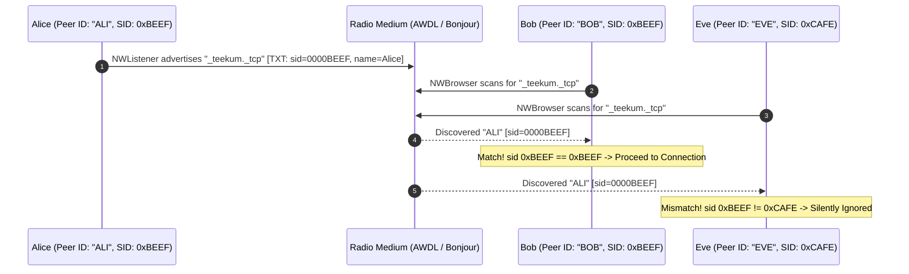
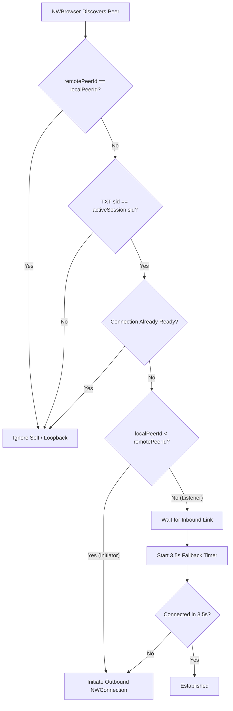
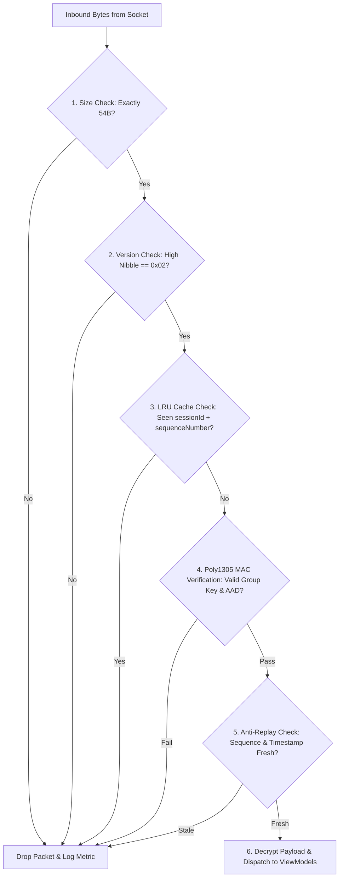

# TeeKum — Networking Architecture & Wire Protocol Documentation

> **Document Version:** 2.0  
> **Status:** Authoritative Networking Architecture  
> **Target Platform:** iOS 27+ (Native Apple Frameworks Only, Zero External Packages)
> **Related Documents:**
> - [Master Agent Instructions (docs/agent.md)](agent.md)
> - [Technical Requirements (docs/TechnicalRequirements.md)](TechnicalRequirements.md)
> - [54-Byte Wire Protocol & Payload Developer Guide (docs/PAYLOAD_GUIDE.md)](PAYLOAD_GUIDE.md)
> - [Direct P2P Transport Report (docs/P2P_TRANSPORT_REPORT.md)](P2P_TRANSPORT_REPORT.md)

---

## 1. Executive Summary & Networking Philosophy

**TeeKum** is an offline-first iOS application designed to locate friends at crowded concerts, music festivals, and sports stadiums. In these environments, cellular towers collapse under congestion and public Wi-Fi access points are either non-existent or completely overwhelmed. Furthermore, human bodies—consisting of ~70% water—strongly absorb 2.4 GHz and 5 GHz radio waves ("Human Wall" attenuation), shrinking practical radio ranges from 50+ meters down to 10–15 meters.

To deliver reliable, private group coordination under these extreme physical conditions, TeeKum’s networking is engineered around four core tenets:

1. **100% Serverless & Offline-First:** Devices discover each other, establish wireless links, and exchange state directly over the air without requiring cellular internet, cloud servers, or local Wi-Fi infrastructure.
2. **Micro-Burst Radio Transmissions:** Packets are fixed at exactly **54 bytes** (Protocol v2), transmitting in under 1 millisecond. This minimizes radio channel occupancy, lowers contention, and allows device baseband radios and CPU cores to drop immediately back into deep sleep.
3. **Zero-Knowledge Wire Framing:** Intermediate relays inspect only an 8-byte cleartext outer envelope to make forwarding decisions. Payload data and member identities remain sealed inside a 30-byte authenticated ciphertext block with a 16-byte Poly1305 MAC tag.
4. **Honest, Congestion-Aware Transport:** Radio channels in dense crowds experience high packet loss and jitter. The networking pipeline prioritizes life-safety alerts (SOS) and coalesces routine location pings so obsolete coordinates are discarded rather than jamming the radio.

---

## 2. The 5-Layer Networking Stack

TeeKum implements a 5-layer networking architecture built entirely on native Apple frameworks:

```text
+-----------------------------------------------------------------------------------+
| Layer 5: Application & Presentation Layer                                         |
| Pure MVVM: MapViewModel, SOSViewModel, GroupSessionViewModel, DiagnosticsView     |
+-----------------------------------------------------------------------------------+
                                         │
+-----------------------------------------------------------------------------------+
| Layer 4: Protocol & Cryptography Layer (Protocol v2 — 54 Bytes)                    |
| PacketCodec, InitialsCodec (Base-27), CryptoService (ChaCha20-Poly1305 AEAD)      |
+-----------------------------------------------------------------------------------+
                                         │
+-----------------------------------------------------------------------------------+
| Layer 3: Dispatch & Flow Control Layer                                             |
| PriorityOutboxQueue (Dual-lane), StreamMessageFramer (Frame buffering & self-heal)|
+-----------------------------------------------------------------------------------+
                                         │
+-----------------------------------------------------------------------------------+
| Layer 2: Peer Transport & Discovery Layer (Network.framework)                     |
| PeerTransportService Actor, NWListener, NWBrowser, NWConnection (Bonjour)         |
+-----------------------------------------------------------------------------------+
                                         │
+-----------------------------------------------------------------------------------+
| Layer 1: Physical Radio & Data Link Layer                                          |
| Apple Wireless Direct Link (AWDL), Wi-Fi Direct, Bluetooth Low Energy (BLE)       |
+-----------------------------------------------------------------------------------+
```

### Layer Details:

| Layer | Responsibility | Key Swift Types / Frameworks |
| :--- | :--- | :--- |
| **Layer 5: Application** | UI presentation, map pins, status carousels, 3-second hold SOS, Debug HUD. | SwiftUI, `@Observable`, `MapKit`, `ActivityKit` |
| **Layer 4: Protocol & Crypto** | 54-byte serialization, integer coordinate quantization, Base-27 initials, 12-byte AEAD nonce, Poly1305 auth tag. | `CryptoKit`, `RawWirePacket`, `CleartextEnvelope`, `InitialsCodec` |
| **Layer 3: Flow Control** | Urgent SOS lane preemption, obsolete ping coalescing, stream slicing, buffer overflow protection. | `PriorityOutboxQueue`, `StreamMessageFramer` |
| **Layer 2: Transport & Discovery**| Bonjour discovery, deterministic tie-breaking, connection lifecycle, keep-alives, telemetry. | `Network.framework` (`NWListener`, `NWBrowser`, `NWConnection`) |
| **Layer 1: Physical Radio** | Direct radio transmission over Wi-Fi chip without access points; BLE discovery beacons. | Apple Wireless Direct Link (AWDL) |

---

## 3. Physical Radio & Discovery Layer

### 3.1 Apple Wireless Direct Link (AWDL)
TeeKum communicates peer-to-peer using **Apple Wireless Direct Link (AWDL)**, Apple's proprietary Wi-Fi direct protocol that also powers AirDrop and AirPlay.
- **Operating Frequencies:** 2.4 GHz and 5 GHz (channel 6, 44, or 149 depending on country and radio conditions).
- **Interface:** Managed automatically by iOS when `NWParameters.includePeerToPeer = true` is configured.
- **No Wi-Fi Router Required:** The device does not need to be connected to a Wi-Fi network. However, the Wi-Fi hardware switch in iOS Control Center must be **ON**.
- **BLE Proximity Assistance:** iOS uses Bluetooth Low Energy (BLE) background advertising to discover nearby devices and coordinate AWDL channel hops.

### 3.2 Bonjour Service Discovery
Discovery is powered by Apple's Zero-Configuration Networking (Bonjour / DNS-SD over mDNS):

- **Service Type:** `_teekum._tcp` (primary) and `_teekum._udp` (supported).
- **Advertising (`NWListener`):**
  - Advertises the service with `localPeerId` (the member's 1-to-3 character Base-27 initials, e.g., `"ALI"`, `"BOB"`).
  - Embeds session metadata inside the Bonjour **TXT Record**:
    - `sid`: 8-character hex string of the active session ID (e.g., `"0000BEEF"`).
    - `name`: UTF-8 encoded local member display name.
- **Scanning (`NWBrowser`):**
  - Scans for Bonjour services matching `_teekum._tcp`.
  - Filters incoming results:
    1. **Self-Rejection:** Discards endpoints where advertised peer ID matches `localPeerId`.
    2. **Session Isolation:** Parses `sid` from the TXT record; immediately ignores any peer advertising a different session ID.



---

## 4. Transport Layer Implementation (`PeerTransportService`)

### 4.1 Protocol Selection: TCP vs UDP over AWDL
TeeKum supports both UDP and TCP modes over `Network.framework`. In production Phase 1, **TCP over AWDL** is selected as the default configuration for the following architectural reasons:

1. **Guaranteed Delivery of Emergency SOS & Rendezvous:** While location pings can tolerate occasional dropouts, SOS alerts and rendezvous agreements require reliable delivery semantics at the transport layer.
2. **Built-in Flow & Congestion Control:** TCP handles link-layer retransmissions and backoff transparently on noisy festival channels.
3. **TCP Keep-Alives:** Configured with aggressive keep-alives to rapidly detect dead peers when someone walks out of radio range:
   ```swift
   let tcpOptions = NWProtocolTCP.Options()
   tcpOptions.enableKeepalive = true
   tcpOptions.keepaliveIdle = 5       // Send probe after 5s idle
   tcpOptions.keepaliveInterval = 2   // Retry probe every 2s
   tcpOptions.keepaliveCount = 3      // Disconnect after 3 failed probes
   ```
4. **Boundary Preservation via Framer:** TCP is a continuous byte-stream protocol and does not preserve packet boundaries. TeeKum solves this with `StreamMessageFramer`, which reconstructs discrete 54-byte frames at the receiver.

### 4.2 Deterministic Tie-Breaking (Preventing Duplicate Sockets)
When two iPhones running `NWBrowser` discover each other at the same moment, both devices naturally attempt to initiate an outbound `NWConnection`. Without coordination, this results in two parallel sockets, race conditions, and duplicate packets.

**The Tie-Breaking Algorithm:**
- Each peer has an alphanumeric identifier (`localPeerId` vs `remotePeerId`).
- **Initiator Role:** If `localPeerId < remotePeerId`, this device is the designated connection initiator and dials outbound via `NWConnection(to: endpoint, using: params)`.
- **Listener Role:** If `localPeerId > remotePeerId`, this device pauses and waits for the incoming connection via `NWListener`.
- **Deadlock Fallback Timer:** The listener device schedules a **3.5-second fallback timer**. If the initiator device fails to connect within 3.5 seconds (due to discovery lag or radio contention), the listener initiates the connection as a fallback.
- **Race Protection:** If both connections somehow reach `.ready` state simultaneously, the connection handler detects the duplicate entry in `connections` and closes the redundant link cleanly.



### 4.3 Zero-Handshake Radio Architecture
Traditional P2P networking protocols perform an initial multi-packet handshake upon connection (e.g. exchanging device names, cryptographic capabilities, or public keys).

TeeKum **completely eliminates runtime connection handshakes**:
- Session encryption keys and session IDs are exchanged out-of-band via offline QR barcode or universal invite link during group formation.
- The transmitting member's 1-to-3 letter initials are compressed into **2 bytes** (Base-27 radix) and packed inside the 30-byte authenticated payload.
- Upon socket connection reaching `.ready`, the receiver immediately begins reading 54-byte frames. The very first frame is fully self-describing and authenticates the sender.

---

## 5. Framing and Flow Control

### 5.1 Stream Message Framing (`StreamMessageFramer`)
Because stream sockets deliver data in arbitrary chunk sizes depending on radio fragmentation and OS buffers:
- A single read may deliver **20 bytes** (partial packet).
- A single read may deliver **108 bytes** (two coalesced 54-byte packets).
- A single read may deliver **74 bytes** (one complete 54-byte packet + 20 bytes of the next).

`StreamMessageFramer` manages an internal byte accumulation buffer:
1. Appends received bytes to `buffer`.
2. Inspects `buffer[0]`: extracts version (`byte0 >> 4`) and packet type (`byte0 & 0x0F`).
3. If version matches `PacketConstants.protocolVersion` (`0x02`) and `PacketType` is valid:
   - Slices off the exact 54-byte subdata frame.
   - Yields the complete frame to the packet decoder.
   - Clears the 54 bytes from the front of the buffer.
4. **Self-Healing Stream Resynchronization:** If Byte 0 does not match a valid packet signature, the framer advances byte-by-byte (`buffer.removeFirst(1)`) until a valid header signature is located, discarding corrupted bytes.
5. **Memory Exhaustion Guard:** The buffer is bounded at `maxBufferSize = 65,536` bytes. If unexpected stream overflow occurs, the buffer is purged and an error is logged.

### 5.2 Dual-Lane Priority Outbox (`PriorityOutboxQueue`)
At a music festival, radio congestion can cause temporary backpressure. Stacking normal periodic location pings in a standard FIFO queue leads to queue bloat and transmits stale coordinates when the channel clears.

TeeKum solves this with a **Dual-Lane Prioritized Outbox**:

```text
Outbox Queue Architecture:
┌─────────────────────────────────────────────────────────────┐
│ High-Priority Urgent Lane (FIFO)                            │
│  [SOS Alert] -> [Delivery ACK] -> [Meeting Update]          │  ──► Next over radio
└─────────────────────────────────────────────────────────────┘
                               ▲
                               │ Preempts
┌──────────────────────────────┴──────────────────────────────┐
│ Coalescing Location Ping Lane (Single-Slot Buffer)          │
│  [Latest Location Ping (11:04:12)]                          │  ──► Sent only when
│  (Overwrites obsolete 11:04:08 ping instantly)              │      urgent lane empty
└─────────────────────────────────────────────────────────────┘
```

- **Urgent Lane (FIFO):** Handles `SOS`, `ACK`, and `MEETING_UPDATE` packets. These cut the line, never coalesce, and are transmitted with highest QoS.
- **Location Ping Lane (Coalesced Slot):** Whenever a fresh location ping is generated, any pending unsent location ping is overwritten. The radio transmits only the freshest coordinate.
- **Bounded Capacity & Retries:** The urgent queue is bounded (max 50 packets). Outbound transmissions have bounded retry budgets (3 attempts) with exponential backoff before reporting an unreachable peer.

---

## 6. Binary Wire Protocol v2 (54-Byte Datagram)

Every wire packet transmitted across TeeKum’s radio link is strictly **54 bytes**.

```text
+-----------------------+-----------------------------+-------------------------+
|  Outer Envelope (8B)  |   Encrypted Payload (30B)   |   Auth Tag (16B)        |
|  (Cleartext Routing)  |   (Zero-Knowledge Cipher)   |   (Poly1305 / AES-GCM)  |
+-----------------------+-----------------------------+-------------------------+
0                       8                             38                        54 Bytes
```

### 6.1 Exact Byte-by-Byte Wire Map

| Byte Range | Field Name | Wire Type | Description & Endianness |
| :--- | :--- | :--- | :--- |
| **0** | `versionAndType` | `UInt8` | High 4 bits = Version (`0x2`), Low 4 bits = Type (`0x1` Ping, `0x2` SOS, `0x3` Meeting, `0x6` ACK, `0x4` RouteReq, `0x5` RouteResp). |
| **1** | `hopMetadata` | `UInt8` | High 4 bits = Hop Limit (`8` for ping, `15` for SOS/meeting), Low 4 bits = Hop Count (`0` initially, incremented per relay). |
| **2..3** | `sessionId` | `UInt16` | 16-bit big-endian session network ID (`0x0001`..`0xFFFF`). Derived from SHA-256 of creation GPS fix and CSPRNG salt. |
| **4..7** | `sequenceNumber` | `UInt32` | 32-bit big-endian partitioned counter (`memberSlot: UInt8` + 24-bit monotonic counter) for replay rejection. |
| **8..37** | `encryptedPayload` | `30 Bytes` | Private payload encrypted with ChaCha20 or AES-256-GCM using group symmetric key. |
| **38..53** | `authTag` | `16 Bytes` | 128-bit Poly1305 MAC tag authenticating the 30-byte ciphertext and envelope AAD. |

### 6.2 Associated Authenticated Data (AAD) & Mutable Hop Masking
In multi-hop relaying, intermediate devices must increment `hopCount` (low 4 bits of Byte 1). If Byte 1 were authenticated directly, every relay would break the authentication tag.

**AAD Construction Rule:**
During both sealing and decryption, Byte 1 is normalized by **masking out `hopCount` to `0x00`**:

$$\text{MaskedByte1} = \text{hopMetadata} \ \& \ \mathtt{0xF0} = (\text{hopLimit} \ \& \ \mathtt{0x0F}) \ll 4$$

The 8-byte AAD passed to CryptoKit is:
```text
Byte 0:    versionAndType
Byte 1:    (hopLimit << 4) & 0xF0  [hopCount masked to 0x00]
Bytes 2..3: sessionId (16-bit big-endian)
Bytes 4..7: sequenceNumber (32-bit big-endian)
```
- `version`, `type`, `hopLimit`, `sessionId`, and `sequenceNumber` are tamper-proof.
- Intermediate relays increment `hopCount` in the clear without corrupting the MAC tag.

### 6.3 12-Byte (96-Bit) AEAD Nonce Construction
AEAD requires absolute nonce uniqueness under the shared group key:
```text
Bytes 0..1:   sessionId (2 bytes, UInt16 big-endian)
Bytes 2..5:   sequenceNumber (4 bytes, UInt32 big-endian)
Byte 6:       versionAndType (1 byte, Byte 0 of envelope)
Bytes 7..11:  Protocol domain tag: [0x54, 0x4B, 0x4D, 0x30, 0x32] (ASCII "TKM02")
```
Because `sequenceNumber` is partitioned with an 8-bit `memberSlot`, each group member increments their counter in a disjoint number space, mathematically guaranteeing zero nonce collisions.

---

## 7. Packet Types & Internal Payload Formats

All inner payloads occupy exactly **30 bytes** before encryption:

### Type 1: `0x01` — `LOCATION_PING` (Periodic Location & Status)
Broadcast every 3–5s while moving, 15–30s while stationary.
- **Bytes 8..11 (4B):** `latitudeRaw` (`Int32`, `Double * 1_000_000`, ~11cm resolution).
- **Bytes 12..15 (4B):** `longitudeRaw` (`Int32`, `Double * 1_000_000`, ~11cm resolution).
- **Bytes 16..19 (4B):** `timestamp` (`UInt32`, Unix epoch seconds).
- **Byte 20 (1B):** `accuracy` (`UInt8`, 0–255 meters).
- **Byte 21 (1B):** `statusCode` (`UInt8`, compact coded hash: `0x00` Available, `0x0A` Drinks, `0x0B` Restroom, `0x02` OMW).
- **Bytes 22..25 (4B):** `targetRefId` (`UInt32`, optional landmark/friend target).
- **Bytes 26..27 (2B):** `senderInitials` (`UInt16`, Base-27 encoded 1-to-3 uppercase letters).
- **Byte 28 (1B):** `batteryLevel` (`UInt8`, 0–100%).
- **Byte 29 (1B):** `heading` (`UInt8`, 0–255 mapping to 0–360°).
- **Bytes 30..37 (8B):** `reserved` (`Data`, zero padding).

### Type 2: `0x02` — `SOS` (Immediate Emergency Alert)
Dispatched immediately upon 3-second hold. Hop limit = 15.
- **Bytes 8..11 (4B):** `latitudeRaw` (`Int32`, freshest valid latitude).
- **Bytes 12..15 (4B):** `longitudeRaw` (`Int32`, freshest valid longitude).
- **Bytes 16..19 (4B):** `timestamp` (`UInt32`, coordinate fix epoch seconds).
- **Byte 20 (1B):** `accuracy` (`UInt8`, GPS horizontal accuracy).
- **Byte 21 (1B):** `statusCode` (`UInt8`, fixed at `0x01` SOS).
- **Bytes 22..25 (4B):** `sosEventId` (`UInt32`, unique random event identifier).
- **Bytes 26..27 (2B):** `senderInitials` (`UInt16`, Base-27 encoded initials).
- **Byte 28 (1B):** `emergencyType` (`UInt8`: `0x01` Medical, `0x02` Separated, `0x03` Security, `0x00` General).
- **Byte 29 (1B):** `batteryLevel` (`UInt8`, 0–100%).
- **Bytes 30..37 (8B):** `reserved` (`Data`, zero padding).

### Type 3: `0x03` — `MEETING_UPDATE` (Rendezvous & Attendance)
Synchronizes the single active meeting point across the group.
- **Bytes 8..11 (4B):** `meetingLat` (`Int32`, rendezvous latitude).
- **Bytes 12..15 (4B):** `meetingLon` (`Int32`, rendezvous longitude).
- **Bytes 16..19 (4B):** `meetupTime` (`UInt32`, target epoch seconds).
- **Byte 20 (1B):** `meetingAction` (`UInt8`: `0x01` Propose, `0x02` Accept, `0x03` Decline, `0x04` Cancel).
- **Byte 21 (1B):** `attendanceStatus` (`UInt8`: `0x01` Attending, `0x02` Can't make it, `0x09` At rendezvous).
- **Bytes 22..25 (4B):** `meetingPointId` (`UInt32`, unique rendezvous ID).
- **Bytes 26..27 (2B):** `senderInitials` (`UInt16`, Base-27 initials).
- **Bytes 28..31 (4B):** `landmarkId` (`UInt32`, optional venue landmark ID).
- **Bytes 32..37 (6B):** `reserved` (`Data`, zero padding).

### Type 4: `0x06` — `ACK` (Receipt Confirmation)
Confirms delivery of an SOS alert, status, or meeting update. Hop limit = 15.
- **Bytes 8..11 (4B):** `ackedSeqNumber` (`UInt32`, sequence number of confirmed message).
- **Bytes 12..13 (2B):** `ackedSenderInitials` (`UInt16`, initials of sender whose packet is confirmed).
- **Bytes 14..17 (4B):** `ackTimestamp` (`UInt32`, receipt timestamp).
- **Byte 18 (1B):** `ackStatus` (`UInt8`: `0x01` Delivered to Friend, `0x02` Relayed by Mesh Hop).
- **Byte 19 (1B):** `receivedRssi` (`Int8`, signal strength in dBm on arrival).
- **Bytes 20..23 (4B):** `originalEventId` (`UInt32`, matches `sosEventId` or `meetingPointId`).
- **Bytes 24..25 (2B):** `responderInitials` (`UInt16`, Base-27 initials of confirming node).
- **Bytes 26..37 (12B):** `reserved` (`Data`, zero padding).

---

## 8. Inbound Ingestion Pipeline (The 6-Step Filter)

Every incoming 54-byte datagram passes through an immutable 6-step filter before touching application state:



1. **Size Verification:** Rejects any buffer whose length is not exactly 54 bytes (`PacketConstants.wirePacketSize`).
2. **Version & Type Verification:** Confirms protocol version equals `0x02` and type is one of `0x01`..`0x06`.
3. **LRU Deduplication Filter:** Checks a 5-minute in-memory LRU cache of `(sessionId, sequenceNumber)`. Duplicate packets (e.g. from multi-hop mesh echoes) are immediately dropped.
4. **Cryptographic Tag Authentication:** Reconstructs the 12-byte nonce and 8-byte masked AAD. Verifies the 16-byte Poly1305 tag via `CryptoKit.ChaChaPoly`. Packets from unauthenticated strangers fail instantly and are discarded without leaking plaintext.
5. **Anti-Replay & Freshness Check:** Rejects stale coordinates or sequence numbers smaller than the newest observed state for that member slot.
6. **Application Dispatch:** Decodes the 30-byte payload, updates member coordinate pins in `MapViewModel`, updates attendance in `MeetingPointViewModel`, or triggers the emergency siren and haptic alert in `SOSViewModel`.

---

## 9. Background Execution & iOS Constraints

Running peer-to-peer radio sockets while an iPhone is locked in an attendee's pocket presents strict iOS platform hurdles:

### 9.1 Background Location Indicator (`showsBackgroundLocationIndicator`)
- Without special privileges, iOS suspends app execution and closes `NWListener` and `NWConnection` sockets within seconds of the screen locking.
- TeeKum maintains active background mesh reception by running an active CoreLocation session with:
  ```swift
  locationManager.allowsBackgroundLocationUpdates = true
  locationManager.showsBackgroundLocationIndicator = true
  ```
- This surfaces Apple's official blue location arrow / Dynamic Island pill, granting continuous background execution so incoming SOS alerts and peer location pings can be processed.

### 9.2 Battery Protection & Festival Survival Mode (<20% Cutoff)
- **Stationary Sleep via CoreMotion:** Even while background execution is active, the app monitors `CMMotionActivityManager`. When the user is stationary (standing still watching a concert), GPS hardware goes to sleep, waking up only when walking.
- **Hard 20% Cutoff:** When battery drops below 20% or enters system Low Power Mode:
  - Background mesh relaying is immediately terminated.
  - Sockets and listeners are closed.
  - GPS is throttled to on-demand only.
  - Remaining battery is reserved strictly for viewing the offline map and triggering emergency SOS.

---

## 10. Diagnostics Telemetry & Physical Verification

The networking layer exposes a real-time diagnostics snapshot via `PeerTransport.getDiagnostics()`:

```swift
public struct TransportDiagnostics: Sendable {
    public let localPeerId: String
    public let serviceType: String
    public let sessionName: String
    public let sessionId: UInt16
    public let state: TransportState
    public let activeDirectPeers: [PeerInfo]
    public let packetsSent: Int
    public let packetsReceived: Int
    public let obsoletePingsCoalesced: Int
    public let sendErrors: Int
    public let lastError: String?
    public let recentEvents: [DiagnosticEvent]
}
```

Attendees and engineers can inspect this in the on-device Debug HUD sheet ([`DiagnosticsView.swift`](file:///Users/nicho/Developer/TeeKum%20Prototype/TeeKum%20Prototype/Views/DiagnosticsView.swift)):
- **Connected Peer Roster:** Direct link status, display name, and last seen timestamps.
- **Traffic Counters:** Sent vs. received packet count, dropped packets, and coalesced obsolete pings.
- **Event Log:** Live timestamped audit log of Bonjour discovery events, socket state changes, and reconnection attempts.
