# TeeKum — 54-Byte Wire Protocol & Payload Developer Guide

> **Team baseline:** This is a retained design reference, not a report of implemented or verified behavior. Resolve conflicts in [TechnicalRequirements Section 7](TechnicalRequirements.md#7-open-team-decisions) before adopting packet layouts, identities or runtime assumptions. Existing examples, performance figures and implementation wording require validation by the responsible developer. File placement follows [Section 3](TechnicalRequirements.md#3-architecture--mvvm-feature-driven).


> **Audience:** iOS Developers, Protocol Engineers, and System Designers working on TeeKum.  
> **Scope:** Byte-level wire format, field quantization algorithms, AEAD cryptographic boundaries, and worked concrete festival scenarios.  
> **Current Version:** Protocol v2 design proposal with a Protocol v3 evolution proposal (Phase 2).

---

## 1. Executive Summary & The 54-Byte Wire Rule

TeeKum is engineered to operate in the harshest radio environments on Earth: dense music festivals and stadium concerts where 50,000 to 100,000 human bodies absorb 2.4 GHz and 5 GHz signals, and cellular towers collapse. 

To achieve single-digit millisecond airtime and prevent packet collisions, every message transmitted over Apple Wireless Direct Link (AWDL) and Wi-Fi Direct via `Network.framework` is constrained to **exactly 54 bytes**.

```text
+-----------------------+-----------------------------+-------------------------+
|  Outer Envelope (8B)  |   Encrypted Payload (30B)   |   Auth Tag (16B)        |
|  (Cleartext Routing)  |   (Zero-Knowledge Cipher)   |   (Poly1305 / AES-GCM)  |
+-----------------------+-----------------------------+-------------------------+
0                       8                             38                        54 Bytes
```

### Why a Fixed 54-Byte Format?
1. **Zero Radio Fragmentation:** 54 bytes fits comfortably below all peer-to-peer Maximum Transmission Unit (MTU) limits without IP fragmentation.
2. **Micro-Burst Transmissions (<1 ms):** Sockets open, flash 54 bytes, and shut down in microseconds, cutting radio energy drain by ~70%.
3. **Traffic Analysis Immunity:** Attackers, venue snoopers, and stranger relay phones cannot distinguish between a routine location ping, a meeting update, or an emergency SOS alert by packet length alone.
4. **Zero-Knowledge Blind Relaying:** Stranger phones in the festival crowd can verify routing envelopes and forward packets without possessing session keys or viewing location coordinates.

---

## 2. Visual Wire Map & Layering Architecture

Every packet is divided into three distinct cryptographic layers:

```mermaid
flowchart LR
    subgraph CleartextEnvelope ["1. Cleartext Envelope (Bytes 0..7)"]
        direction TB
        B0["Byte 0: version (4b) | type (4b)"]
        B1["Byte 1: hopLimit (4b) | hopCount (4b)"]
        B2["Bytes 2..3: sessionId (16b big-endian)"]
        B4["Bytes 4..7: sequenceNumber (32b big-endian)"]
    end

    subgraph EncryptedPayload ["2. Encrypted Payload (Bytes 8..37)"]
        direction TB
        P0["Private Coordinates & Measurements"]
        P1["Member Initials (Base-27 UInt16)"]
        P2["Status Enums & Target References"]
        P3["Reserved Expansion Padding"]
    end

    subgraph AuthTag ["3. Authentication Tag (Bytes 38..53)"]
        direction TB
        T0["128-bit Poly1305 MAC Tag"]
        T1["Seals Ciphertext + Masked AAD"]
    end

    CleartextEnvelope --> EncryptedPayload --> AuthTag
```



### Endianness & Data Representation Rule
- **Big-Endian (Network Byte Order):** All multi-byte integers (`UInt16`, `UInt32`, `Int32`) are serialized and deserialized strictly in Big-Endian format.
- **Fixed Width:** Variable-length strings, JSON, or Protocol Buffers are prohibited on the wire.

---

## 3. The Cleartext Outer Envelope (Bytes 0..7)

The outer envelope is transmitted in the clear so intermediate mesh relay nodes can route packets, reject expired frames, and deduplicate broadcasts without decrypting private data.

| Byte Offset | Wire Type | Field Name | Description & Bit Layout |
| :---: | :---: | :--- | :--- |
| **0** | `UInt8` | `versionAndType` | **High 4 bits:** Protocol Version (`0x2` for Protocol v2).<br>**Low 4 bits:** Packet Type (`0x1` Ping, `0x2` SOS, `0x3` Meeting, `0x4` RouteReq, `0x5` RouteResp, `0x6` ACK). |
| **1** | `UInt8` | `hopMetadata` | **High 4 bits:** `hopLimit` ($1 \dots 15$, default `8` for ping, `15` for SOS & meeting).<br>**Low 4 bits:** `hopCount` ($0 \dots \text{hopLimit}$, starts at `0`, incremented per relay). |
| **2..3** | `UInt16` | `sessionId` | Big-endian 16-bit group identifier (`0x0001`..`0xFFFF`) derived via SHA-256 over timestamp, location, and random salt. `0x0000` is reserved as invalid sentinel. |
| **4..7** | `UInt32` | `sequenceNumber` | Big-endian partitioned counter: **High 8 bits** = `memberSlot` ($0 \dots 255$); **Low 24 bits** = Monotonic counter ($1 \dots 16{,}777{,}215$). Protects against replay and provides nonce uniqueness. |

### Cryptographic AAD Masking (How Relays Mutate Hops Safely)
When computing the Poly1305 MAC tag, the 8-byte envelope is injected as **Associated Authenticated Data (AAD)** into the cipher. If the wire envelope were authenticated verbatim, any relay incrementing `hopCount` would break the signature.

**The Solution:** The sender and recipient normalize Byte 1 by **masking out `hopCount` to `0x00`**:
$$\text{MaskedByte1} = \text{hopMetadata} \ \& \ \mathtt{0xF0} = (\text{hopLimit} \ \& \ \mathtt{0x0F}) \ll 4$$

```text
AAD Buffer (8 Bytes):
[ Byte 0: versionAndType ]
[ Byte 1: (hopLimit << 4) & 0xF0 ]  <-- hopCount forced to 0x00
[ Bytes 2..3: sessionId ]
[ Bytes 4..7: sequenceNumber ]
```
- **Result:** `hopLimit`, `sessionId`, and `sequenceNumber` are mathematically tamper-proof. Rogue relays cannot inflate packet budgets, but legitimate relays can freely increment `hopCount` in Byte 1.

---

## 4. Core Field Encoding Standards

### 4.1 Coordinate Quantization (Double $\to$ Signed Int32)
CoreLocation delivers latitude and longitude as IEEE 754 64-bit floating point numbers (`Double` / `CLLocationDegrees`). Transmitting two 8-byte doubles consumes 16 bytes. 

TeeKum multiplies coordinates by $1{,}000{,}000$ and rounds to a signed 32-bit big-endian integer (`Int32`), consuming only 8 bytes total:

$$\text{rawLatitude} = \text{Int32}(\text{round}(\text{latitude} \times 1{,}000{,}000))$$
$$\text{rawLongitude} = \text{Int32}(\text{round}(\text{longitude} \times 1{,}000{,}000))$$

- **Resolution:** $1 / 1{,}000{,}000^\circ = 0.000001^\circ \approx 11.13\text{ cm}$ precision worldwide.
- **Bandwidth Saved:** Exactly 8 bytes per packet saved on the radio link.

### 4.2 2-Byte Base-27 Initials Codec (Zero-Handshake Identity)
To display a friend's avatar immediately on the map without requiring an out-of-band Bluetooth pairing handshake, the sender's 1-to-3 letter initials (e.g. `"D"`, `"AB"`, `"DNA"`) are compressed into exactly **2 bytes** (`UInt16`).

- **Base-27 Radix Mapping:** Each character $c$ is mapped to $1 \dots 26$ ($A \to 1, \dots, Z \to 26$). Missing characters evaluate to $0$.
  - 1st letter $a \in [1 \dots 26]$ (weight $27^2 = 729$)
  - 2nd letter $b \in [0 \dots 26]$ (weight $27^1 = 27$)
  - 3rd letter $c \in [0 \dots 26]$ (weight $27^0 = 1$)

$$\text{EncodedValue} = (a \times 729) + (b \times 27) + c$$

$$\text{HighByte} = \lfloor \text{EncodedValue} / 256 \rfloor, \quad \text{LowByte} = \text{EncodedValue} \bmod 256$$

- **Mathematical Proof:** Max value for `"ZZZ"` is $(26 \times 729) + (26 \times 27) + 26 = 18{,}954 + 702 + 26 = 19{,}682$.
- Because $19{,}682 \le 65{,}535$ ($2^{16}-1$), all 18,278 possible 1, 2, or 3-letter combinations fit cleanly inside a standard 16-bit `UInt16`.

### 4.3 1-Byte Festival Activity Status Codes (`StatusCode`)
Festival activities are transmitted as 1-byte coded hashes. Display strings and localized icons are rendered on the receiving device.

| Code (Hex) | Name | Display Label | Description |
| :---: | :--- | :--- | :--- |
| `0x00` | `AVAILABLE` | Available | Default idle / active green indicator. |
| `0x01` | `SOS` | Emergency SOS | High-priority siren alert (3-second hold). |
| `0x02` | `OMW` | On My Way | Moving toward friend or rendezvous point. |
| `0x03` | `LOST` | I'm Lost | Separated from group in dense crowd. |
| `0x04` | `EXPLORING` | Exploring | Roaming stages or festival grounds. |
| `0x05` | `WAIT` | Wait For Me | Paused at current location; requesting group wait. |
| `0x06` | `COME_TO_ME` | Come To Me | Directing friends to current GPS pin. |
| `0x07` | `GOING_TO` | Going To... | Attaches `targetRefId` of friend or meeting point. |
| `0x08` | `CANCEL_MEETING`| Meeting Cancelled| Dismisses current active rendezvous. |
| `0x09` | `AT_MEETING_POINT`| At Meeting Point | Confirms arrival at landmark rendezvous. |
| `0x0A` | `GETTING_DRINKS`| Getting Drinks | Grabbing beverages or waiting in bar queue. |
| `0x0B` | `RESTROOM` | Restroom | Waiting in restroom / toilet queue. |
| `0x0C` | `FOOD_MERCH` | Food / Merch | At food truck or merchandise stand. |
| `0x0D` | `MEDICAL` | Medical Tent | At first aid or medical support area. |

---

## 5. Byte-by-Byte Specifications for All Message Types

Every message consists of:
- **Envelope:** Bytes 0..7 (8 bytes)
- **Inner Payload:** Bytes 8..37 (30 bytes, encrypted)
- **Authentication Tag:** Bytes 38..53 (16 bytes)

---

### Type 1: `0x01` — `LOCATION_PING` (Normal Location & Status)
*Broadcast every 3–5 seconds while moving, or 15–30 seconds while stationary.*

```text
+---------------------------------------------------------------------------------------+
| Byte 0: versionAndType (0x21)                                                         |
| Byte 1: hopMetadata (High: hopLimit=8, Low: hopCount=0)                               |
| Bytes 2..3: sessionId (UInt16 big-endian)                                             |
| Bytes 4..7: sequenceNumber (UInt32 big-endian)                                        |
+---------------------------------------------------------------------------------------+
| Bytes 8..11: latitudeRaw (Int32 big-endian, lat * 1,000,000)                          |
| Bytes 12..15: longitudeRaw (Int32 big-endian, lon * 1,000,000)                        |
| Bytes 16..19: timestamp (UInt32 big-endian, epoch seconds)                            |
| Byte 20: accuracy (UInt8, horizontal radius 0..255m)                                  |
| Byte 21: statusCode (UInt8, festival status enum 0x00..0x0D)                          |
| Bytes 22..25: targetRefId (UInt32 big-endian, optional friend/meeting ID or 0)        |
| Bytes 26..27: senderInitials (UInt16 big-endian, Base-27 compressed initials)         |
| Byte 28: batteryLevel (UInt8, percentage 0..100)                                      |
| Byte 29: heading (UInt8, compass degrees * 255 / 360)                                 |
| Bytes 30..37: reserved (8 bytes padding, 0x0000000000000000)                          |
+---------------------------------------------------------------------------------------+
| Bytes 38..53: authTag (16 bytes Poly1305 MAC)                                         |
+---------------------------------------------------------------------------------------+
```

---

### Type 2: `0x02` — `SOS` (Urgent Emergency Alert)
*Dispatched immediately upon 3-second continuous hold. Preempts all queues with 15-hop limit.*

```text
+---------------------------------------------------------------------------------------+
| Byte 0: versionAndType (0x22)                                                         |
| Byte 1: hopMetadata (High: hopLimit=15 (0xF), Low: hopCount=0 (0x0) -> 0xF0)         |
| Bytes 2..3: sessionId (UInt16 big-endian)                                             |
| Bytes 4..7: sequenceNumber (UInt32 big-endian)                                        |
+---------------------------------------------------------------------------------------+
| Bytes 8..11: latitudeRaw (Int32 big-endian, freshest available GPS lat)               |
| Bytes 12..15: longitudeRaw (Int32 big-endian, freshest available GPS lon)             |
| Bytes 16..19: timestamp (UInt32 big-endian, epoch seconds of original GPS fix)        |
| Byte 20: accuracy (UInt8, horizontal accuracy radius in meters)                       |
| Byte 21: statusCode (UInt8, fixed urgent code 0x01 = SOS)                             |
| Bytes 22..25: sosEventId (UInt32 big-endian, random deduplication ID)                 |
| Bytes 26..27: senderInitials (UInt16 big-endian, Base-27 initials of distressed)     |
| Byte 28: emergencyType (UInt8, 0x00 General, 0x01 Medical, 0x02 Separated, 0x03 Sec) |
| Byte 29: batteryLevel (UInt8, sender battery percentage 0..100)                       |
| Bytes 30..37: reserved (8 bytes padding, 0x0000000000000000)                          |
+---------------------------------------------------------------------------------------+
| Bytes 38..53: authTag (16 bytes Poly1305 MAC)                                         |
+---------------------------------------------------------------------------------------+
```

---

### Type 3: `0x03` — `MEETING_UPDATE` (Rendezvous Landmark & Attendance)
*Dispatched when proposing, accepting ("I'll be there"), or cancelling a single active meeting point.*

```text
+---------------------------------------------------------------------------------------+
| Byte 0: versionAndType (0x23)                                                         |
| Byte 1: hopMetadata (High: hopLimit=15 (0xF), Low: hopCount=0 (0x0) -> 0xF0)         |
| Bytes 2..3: sessionId (UInt16 big-endian)                                             |
| Bytes 4..7: sequenceNumber (UInt32 big-endian)                                        |
+---------------------------------------------------------------------------------------+
| Bytes 8..11: meetingLat (Int32 big-endian, rendezvous coordinate * 1,000,000)         |
| Bytes 12..15: meetingLon (Int32 big-endian, rendezvous coordinate * 1,000,000)        |
| Bytes 16..19: meetupTime (UInt32 big-endian, target epoch seconds, e.g. 10:30 PM)      |
| Byte 20: meetingAction (UInt8: 0x01 Propose, 0x02 Accept, 0x03 Decline, 0x04 Cancel)  |
| Byte 21: attendanceStatus (UInt8: 0x01 Attending, 0x02 Cannot Make It, 0x09 At Spot) |
| Bytes 22..25: meetingPointId (UInt32 big-endian, unique rendezvous instance ID)       |
| Bytes 26..27: senderInitials (UInt16 big-endian, Base-27 initials of member)          |
| Bytes 28..31: landmarkId (UInt32 big-endian, preset venue ID 1=Gate 1, 0 if custom)  |
| Bytes 32..37: reserved (6 bytes padding, 0x000000000000)                              |
+---------------------------------------------------------------------------------------+
| Bytes 38..53: authTag (16 bytes Poly1305 MAC)                                         |
+---------------------------------------------------------------------------------------+
```

---

### Type 4: `0x06` — `ACK` (Delivery Receipt Confirmation)
*Sent back to confirm receipt of an urgent SOS alert or meeting proposal across the mesh.*

```text
+---------------------------------------------------------------------------------------+
| Byte 0: versionAndType (0x26)                                                         |
| Byte 1: hopMetadata (High: hopLimit=15 for SOS ACK, Low: hopCount=0)                  |
| Bytes 2..3: sessionId (UInt16 big-endian)                                             |
| Bytes 4..7: sequenceNumber (UInt32 big-endian)                                        |
+---------------------------------------------------------------------------------------+
| Bytes 8..11: ackedSeqNumber (UInt32 big-endian, sequence number of original packet)   |
| Bytes 12..13: ackedSenderInitials (UInt16 big-endian, Base-27 initials acknowledged)  |
| Bytes 14..17: ackTimestamp (UInt32 big-endian, epoch seconds when message received)   |
| Byte 18: ackStatus (UInt8: 0x01 Delivered to Friend, 0x02 Relayed by Mesh Hop)        |
| Byte 19: receivedRssi (Int8, arrival signal strength in dBm, e.g. -68 dBm = 0xBC)     |
| Bytes 20..23: originalEventId (UInt32 big-endian, matches sosEventId or meetingId)    |
| Bytes 24..25: responderInitials (UInt16 big-endian, Base-27 initials of confirmer)   |
| Bytes 26..37: reserved (12 bytes padding, 0x000000000000000000000000)                 |
+---------------------------------------------------------------------------------------+
| Bytes 38..53: authTag (16 bytes Poly1305 MAC)                                         |
+---------------------------------------------------------------------------------------+
```

---

## 6. End-to-End Concrete Festival Scenarios (Worked Hex Dumps)

Below are four realistic festival scenarios illustrating exact field conversions, binary serialization, and the final 54-byte hex stream.

---

### Scenario 1: Alice Shares Location Ping While Getting Drinks
- **Sender:** Alice (Initials: `"ALI"`, MemberSlot: `1`)
- **Session ID:** `0x4321` (Festival Group)
- **Status:** `GETTING_DRINKS` (`0x0A`)
- **Coordinates:** Lat `36.114704`, Lon `-115.172813` (Las Vegas Festival Grounds)
- **Accuracy:** `6` meters, **Battery:** `84%`, **Heading:** `180°` (South)
- **Timestamp:** `1730198400` (`2026-10-29 10:40:00 UTC`)

#### Field Calculations:
1. `versionAndType`: Version 2 (`0x2`), Type 1 (`0x1`) $\to$ `0x21`
2. `hopMetadata`: Hop Limit 8 (`0x8`), Hop Count 0 (`0x0`) $\to$ `0x80`
3. `sessionId`: `0x4321`
4. `sequenceNumber`: Slot `1` (`0x01`), Counter `42` (`0x00002A`) $\to$ `0x0100002A`
5. `latitudeRaw`: $36.114704 \times 1{,}000{,}000 = 36{,}114{,}704$ $\to$ `0x02271110`
6. `longitudeRaw`: $-115.172813 \times 1{,}000{,}000 = -115{,}172{,}813$ $\to$ `0xF9229A33` (Two's complement)
7. `timestamp`: `1730198400` $\to$ `0x6720D300`
8. `senderInitials`: `"ALI"` $\to$ $a=1, b=12, c=9 \to (1 \times 729) + (12 \times 27) + 9 = 729 + 324 + 9 = 1{,}062$ $\to$ `0x0426`
9. `heading`: $180^\circ \times 255 / 360 = 127$ $\to$ `0x7F`

#### Complete 54-Byte Wire Dump (Hex Stream):
```text
Offset  00 01 02 03 04 05 06 07 08 09 0A 0B 0C 0D 0E 0F  Decoded Interpretation
-------------------------------------------------------------------------------------------------
0000    21 80 43 21 01 00 00 2A                          [Envelope] Type:Ping, Hops:8/0, SID:4321, Seq:1#42
0008    02 27 11 10 F9 22 9A 33 67 20 D3 00 06 0A 00 00  [Payload] Lat:36.114704, Lon:-115.172813, Time, Acc:6m, Drinks
0018    00 00 04 26 54 7F 00 00 00 00 00 00 00 00        [Payload] Initials:"ALI", Bat:84%, Hdg:180°, Reserved
0026    7A 8F 3C 11 E4 D0 B9 22 55 91 F0 A2 C8 31 E9 04  [AuthTag] 128-bit Poly1305 MAC Signature
```

---

### Scenario 2: Bob Triggers Urgent Medical SOS
- **Sender:** Bob (Initials: `"BOB"`, MemberSlot: `2`)
- **Emergency:** `MEDICAL` (`0x01`), Status: `SOS` (`0x01`)
- **Event ID:** `0xA1B2C3D4`
- **Coordinates:** Lat `36.115120`, Lon `-115.173400`
- **Hop Limit:** `15` (`0xF`), Hop Count: `0` (`0x0`) $\to$ Byte 1 = `0xF0`

#### Field Calculations:
1. `versionAndType`: Version 2 (`0x2`), Type 2 (`0x2`) $\to$ `0x22`
2. `hopMetadata`: Hop Limit 15 (`0xF`), Hop Count 0 (`0x0`) $\to$ `0xF0`
3. `senderInitials`: `"BOB"` $\to$ $a=2, b=15, c=2 \to (2 \times 729) + (15 \times 27) + 2 = 1{,}458 + 405 + 2 = 1{,}865$ $\to$ `0x0749`

#### Complete 54-Byte Wire Dump (Hex Stream):
```text
Offset  00 01 02 03 04 05 06 07 08 09 0A 0B 0C 0D 0E 0F  Decoded Interpretation
-------------------------------------------------------------------------------------------------
0000    22 F0 43 21 02 00 00 05                          [Envelope] Type:SOS, Hops:15/0, SID:4321, Seq:2#5
0008    02 27 12 B0 F9 22 97 E8 67 20 D3 12 04 01 A1 B2  [Payload] Lat:36.115120, Lon:-115.173400, Time, Acc:4m, SOS, EvtID
0018    C3 D4 07 49 01 4B 00 00 00 00 00 00 00 00        [Payload] EvtID, Init:"BOB", Medical, Bat:75%, Reserved
0026    9B 34 FE 81 22 0A CC 45 77 19 DA 88 B3 E1 44 92  [AuthTag] 128-bit Poly1305 MAC Signature
```

---

### Scenario 3: Charlie Proposes Meeting Point at Landmark Gate 1
- **Sender:** Charlie (Initials: `"CHL"`, MemberSlot: `3`)
- **Action:** `PROPOSE` (`0x01`), **Landmark ID:** `0x00000001` (Main Gate 1)
- **Meeting Point ID:** `0x77889900`
- **Meetup Time:** `1730200800` (`11:20 PM`)
- **Coordinates:** Lat `36.116000`, Lon `-115.171000`

#### Field Calculations:
1. `versionAndType`: Version 2 (`0x2`), Type 3 (`0x3`) $\to$ `0x23`
2. `hopMetadata`: Hop Limit 15 (`0xF`), Hop Count 0 (`0x0`) $\to$ `0xF0`
3. `senderInitials`: `"CHL"` $\to$ $a=3, b=8, c=12 \to (3 \times 729) + (8 \times 27) + 12 = 2{,}187 + 216 + 12 = 2{,}415$ $\to$ `0x096F`

#### Complete 54-Byte Wire Dump (Hex Stream):
```text
Offset  00 01 02 03 04 05 06 07 08 09 0A 0B 0C 0D 0E 0F  Decoded Interpretation
-------------------------------------------------------------------------------------------------
0000    23 F0 43 21 03 00 00 11                          [Envelope] Type:Meeting, Hops:15/0, SID:4321, Seq:3#17
0008    02 27 16 20 F9 22 A1 48 67 20 DC 60 01 01 77 88  [Payload] Gate 1 Lat/Lon, Time:11:20PM, Propose, Attending, MeetID
0018    99 00 09 6F 00 00 00 01 00 00 00 00 00 00        [Payload] MeetID, Init:"CHL", Landmark:1, Reserved
0026    E3 44 19 80 AA B2 37 61 98 FC 20 11 D7 84 92 AC  [AuthTag] 128-bit Poly1305 MAC Signature
```

---

### Scenario 4: Dave Sends Delivery ACK for Bob's SOS
- **Sender:** Dave (Initials: `"DAV"`, MemberSlot: `4`)
- **Acking:** Bob's Sequence `0x02000005`, Bob's Initials `"BOB"` (`0x0749`), Event `0xA1B2C3D4`
- **Observed RSSI:** `-65` dBm (`0xBF` signed `Int8`)
- **Ack Status:** `0x01` (`DELIVERED_TO_FRIEND`)

#### Complete 54-Byte Wire Dump (Hex Stream):
```text
Offset  00 01 02 03 04 05 06 07 08 09 0A 0B 0C 0D 0E 0F  Decoded Interpretation
-------------------------------------------------------------------------------------------------
0000    26 F0 43 21 04 00 00 08                          [Envelope] Type:ACK, Hops:15/0, SID:4321, Seq:4#8
0008    02 00 00 05 07 49 67 20 D3 14 01 BF A1 B2 C3 D4  [Payload] AckedSeq:2#5, AckedInit:"BOB", Time, Deliv, RSSI:-65, EvtID
0018    08 D2 00 00 00 00 00 00 00 00 00 00 00 00        [Payload] ResponderInit:"DAV", Reserved (12B)
0026    4A F1 23 88 EE 90 77 31 C2 B3 84 90 12 AF 66 5D  [AuthTag] 128-bit Poly1305 MAC Signature
```

---

## 7. Cryptographic Boundaries & Zero-Knowledge Relaying

```text
+---------------------------------------------------------------------------+
|                          WHAT A STRANGER RELAY SEES                       |
|                                                                           |
|  [ Version: 2 ]  [ Type: 0x01 ]  [ Hops: 8 / 1 ]  [ Session: 0x4321 ]     |
|  [ Sequence Number: 0x0100002A ]                                          |
|                                                                           |
|  [ Ciphertext: 7A 8F 3C 11 E4 D0 B9 22 55 91 F0 A2 C8 31 E9 04 ... (30B) ]|
|  [ Auth Tag:   9B 34 FE 81 22 0A CC 45 77 19 DA 88 B3 E1 44 92 ... (16B) ]|
|                                                                           |
|  (RELAY CANNOT READ COORDINATES, STATUS, BATTERY, OR IDENTITY INITIALS)  |
+---------------------------------------------------------------------------+
                                     │
                                     ▼ (Group Symmetric Key Held)
+---------------------------------------------------------------------------+
|                          WHAT A GROUP FRIEND SEES                         |
|                                                                           |
|  "Alice (ALI) is getting drinks at Main Stage Bar (36.114704, -115.172813)|
|   Battery: 84%, Accuracy: 6m, Last updated 2 seconds ago"                 |
+---------------------------------------------------------------------------+
```

### The 12-Byte (96-Bit) AEAD Nonce Formula
In ChaCha20-Poly1305, encrypting two different messages with the same `(Key, Nonce)` pair creates a cryptographic two-time pad collision that destroys confidentiality. 

TeeKum derives a strictly collision-free 12-byte nonce directly from message coordinates without transmitting extra nonce bytes over the air:

```text
Nonce Buffer (12 Bytes):
Bytes 0..1:   sessionId (UInt16 big-endian)
Bytes 2..5:   sequenceNumber (UInt32 big-endian: memberSlot + counter)
Byte 6:       versionAndType (UInt8, Byte 0 of envelope)
Bytes 7..11:  Protocol Domain Tag: "TKM02" ([0x54, 0x4B, 0x4D, 0x30, 0x32])
```
- **Uniqueness Proof:** Because each group member is assigned a unique `memberSlot` ($0 \dots 255$) and increments their monotonic 24-bit counter sequentially, **no two devices in the same session can ever generate an identical sequence number**. The nonce is mathematically guaranteed to be unique.

---

## 8. Phase 2 Protocol Evolution: 2-Byte Hop Control (Protocol v3 Planning)

In Phase 1, `hopMetadata` is packed into a single 8-bit byte (`hopLimit: 4 bits` | `hopCount: 4 bits`), constraining packets to a maximum of 15 hops. While optimal for direct links and small festivals, massive multi-stage festivals and stadium racecourses require route depths exceeding 15 hops.

### The Problem with a Single Mutating TTL Byte
A single decrementing TTL byte (`ttl: UInt8`) was evaluated and **rejected**:
- Because the TTL byte mutates on every hop, it cannot be authenticated in ChaCha20-Poly1305 without masking it to `0x00`.
- If masked to `0x00`, any rogue node can rewrite the TTL to `255` without failing authentication, causing catastrophic broadcast storms and draining everyone's battery.

### Phase 2 Architecture Proposal: Two Dedicated Bytes
In Phase 2, the envelope expands to two dedicated 8-bit bytes:
1. `hopLimit: UInt8` (Byte 1, range $0 \dots 255$): Immutable forwarding budget sealed inside the AAD. Rogue nodes cannot inflate it.
2. `hopCount: UInt8` (Byte 2, range $0 \dots 255$): Mutable traversal counter incremented per relay and masked to `0x00` in AAD.

```text
+-----------------------+-----------------------------+-------------------------+
|  Outer Envelope (9B)  |   Encrypted Payload (29B)   |   Auth Tag (16B)        |
|  (Cleartext Routing)  |   (Zero-Knowledge Cipher)   |   (Poly1305 / AES-GCM)  |
+-----------------------+-----------------------------+-------------------------+
0                       9                             38                        54 Bytes
```

- **54-Byte Wire Preservation via Padding Absorption:** The outer envelope expands by 1 byte (from 8 to 9 bytes). To prevent radio packet fragmentation, **exactly 1 byte is absorbed from the inner payload's reserved padding** (reducing reserved from 8 to 7 bytes in `LOCATION_PING` and `SOS`). Total wire size remains strictly **54 bytes**.

---

## 9. Common Implementation Pitfalls & Developer Checklist

Before submitting code modifying packet serialization or radio handlers, verify every item on this checklist:

- [ ] **Exact 54-Byte Check:** `data.count == PacketConstants.wirePacketSize` (54 bytes) must be enforced at the socket entry point.
- [ ] **Big-Endian Serialization:** Always use `Int32(bigEndian:)`, `UInt16(bigEndian:)`, and `UInt32(bigEndian:)`. Never serialize native platform endianness directly.
- [ ] **Byte 1 Masking in AAD:** Ensure Byte 1 is masked with `& 0xF0` before passing to `CryptoKit.ChaChaPoly.seal` or `open`. Forgetting this will cause valid multi-hop relayed packets to fail MAC authentication!
- [ ] **Monotonic Counter Increment:** Sequence counters must strictly increment using `&+= 1` to prevent overflow crashes.
- [ ] **Quantization Rounding:** Always round coordinates (`(coordinate.latitude * 1_000_000.0).rounded()`) before casting to `Int32` to avoid truncation bias.
- [ ] **Zero Sensitive Logging:** Never log raw 30-byte ciphertexts, encryption keys, or GPS coordinates to OSLog or console in production.

---

*Authored by the TeeKum Protocol Engineering Team · Fantasix*
