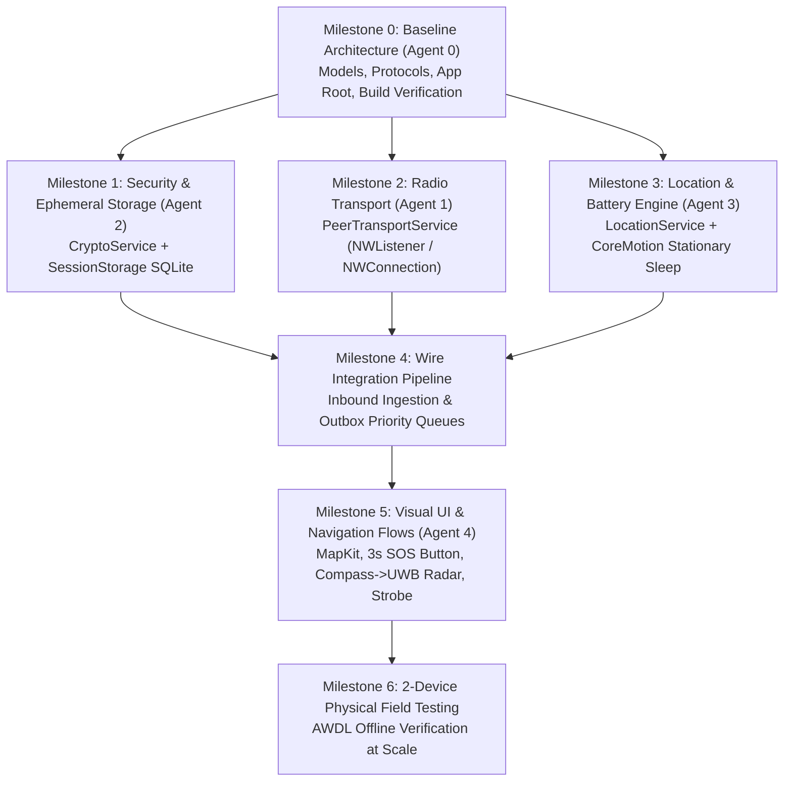

# TeeKum — Direct Offline POC Implementation Plan

**Author:** Agent 0 (Technical Lead)  
**Date:** 27 October 2026  
**Status:** Historical prototype plan; not the current team architecture baseline.

> **2026-10-29:** The layer-based folder tree and five-agent assignment below are retained as historical context. For the proposed MVVM Feature-Driven structure and four-human-developer ownership, use [TechnicalRequirements Section 3](TechnicalRequirements.md#3-architecture--mvvm-feature-driven). Old protocol/contracts remain subject to [documentation review](DOCUMENTATION_REVIEW.md).
**Target Milestone:** Phase 1 — Direct Offline MVP (Pure MVVM, 100% Native Apple Frameworks)

---

## 1. Objectives & Executive Scope

This plan establishes the implementation sequence, file ownership boundaries, shared contracts, and test procedures for the **TeeKum Direct Offline Proof-of-Concept (POC)**.

The primary objective is to prove **serverless offline friend finding** between physical iPhones in crowded, zero-reception venues using direct Apple Wireless Direct Link (AWDL) / Wi-Fi Direct datagrams, authenticated 56-byte wire packets, adaptive battery conservation, and compass-to-UWB directional navigation.

---

## 2. Canonical Codebase Structure & File Ownership

The project adheres to **Radical Simplicity**: Pure MVVM (`@Observable`), zero external dependencies, and Swift actors for thread-sensitive services.

```text
TeeKum Prototype/
├── App/
│   └── TeeKumApp.swift                   // [Agent 0] App entry point & root state view switcher
├── Models/
│   ├── Member.swift                      // [Agent 0] Member identity, lastSeen, status, battery, heading
│   ├── LocationPin.swift                 // [Agent 0] CLLocationCoordinate2D wrapper & ~11cm Int32 quantization
│   ├── Status.swift                      // [Agent 0] 1-byte coded festival activity status hash enum & target refs
│   ├── MeetingPoint.swift                // [Agent 0] Single active meeting point model & attendance
│   ├── GroupSession.swift                // [Agent 0] Ephemeral session model, QR / URL fragment link encoder
│   ├── Packet.swift                      // [Agent 0] 56-byte binary wire layout, envelope, and payloads
│   └── SOSDeliveryState.swift            // [Agent 0] Honest UX delivery state machine
├── Services/
│   ├── PeerTransport.swift               // [Agent 0: Interface / Agent 1: Service] Network.framework P2P actor
│   ├── CryptoServiceProtocol.swift       // [Agent 0: Interface / Agent 2: Service] CryptoKit ChaChaPoly & Keychain actor
│   ├── LocationServiceProtocol.swift     // [Agent 0: Interface / Agent 3: Service] CoreLocation & CoreMotion service
│   └── SessionStorageProtocol.swift      // [Agent 0: Interface / Agent 2: Service] libsqlite3 ephemeral crash recovery
├── ViewModels/
│   ├── GroupSessionViewModel.swift       // [Agent 0: Scaffold / Agent 4: Full UI] Session lifecycle & pairing
│   ├── MapViewModel.swift                // [Agent 0: Scaffold / Agent 4: Full UI] Map viewport & live sharing toggle
│   ├── SOSViewModel.swift                // [Agent 0: Scaffold / Agent 4: Full UI] 3-second hold & honest delivery
│   └── MeetingPointViewModel.swift       // [Agent 0: Scaffold / Agent 4: Full UI] Single active rendezvous point
├── Views/
│   ├── GroupPairingView.swift            // [Agent 4] QR scanner / generator & serverless URL share
│   ├── MainMapView.swift                 // [Agent 4] MapKit view, friend pins, status pills, live sharing
│   ├── StatusPickerView.swift            // [Agent 4] 1-handed horizontal status chips carousel
│   ├── SOSButtonView.swift               // [Agent 4] 3-second hold button with circular progress ring
│   ├── FinderBeaconView.swift            // [Agent 4] 360° compass arrow -> UWB radar & strobe flasher
│   ├── MeetingPointsView.swift           // [Agent 4] Propose rendezvous & 1-tap "I'll be there" cards
│   └── DiagnosticsView.swift             // [Agent 4] Debug HUD sheet (live RSSI dBm, peers, packet logs)
└── Tests/
    └── PacketCodecTests.swift            // [Agent 0] 56-byte packet codec & quantization tests
```

### Agent Roles & Ownership Matrix

| Agent | Responsibility | Primary Files Owned |
| :--- | :--- | :--- |
| **Agent 0 (Technical Lead)** | Repository integrity, build stability, canonical models, shared protocol contracts, test runner. | `App/`, `Models/`, Service protocols, `docs/POC_IMPLEMENTATION_PLAN.md`, `Tests/` |
| **Agent 1 (Peer Transport Specialist)** | Low-level peer-to-peer radio transport using `Network.framework` (`NWListener`, `NWConnection`, `NWBrowser`, AWDL Bonjour `_teekum._udp`). | `Services/PeerTransportService.swift` |
| **Agent 2 (Crypto & Persistence Specialist)** | Authenticated symmetric encryption (ChaCha20-Poly1305 / AES-256-GCM), Secure Enclave Keychain storage, and `libsqlite3` ephemeral snapshot store. | `Services/CryptoService.swift`, `Services/SessionStorage.swift` |
| **Agent 3 (Location & Battery Specialist)** | Adaptive CoreLocation GPS publisher, CoreMotion activity monitoring (stationary GPS sleep), and Festival Survival Mode (<20% cutoff). | `Services/LocationService.swift` |
| **Agent 4 (UI & Navigation Specialist)** | SwiftUI Pure MVVM screens: MapKit preview, 360° compass to NearbyInteraction UWB precision radar, 3s SOS button, strobe beacon, and Debug HUD. | `Views/`, `ViewModels/` |

---

## 3. Authoritative Service Contracts

To guarantee that components can be implemented independently without circular dependencies:

### 3.1 Peer Transport Contract (`Services/PeerTransport.swift`)

```swift
public protocol PeerTransport: Actor {
    var inboundPackets: AsyncStream<InboundPacket> { get }
    var peerUpdates: AsyncStream<[PeerInfo]> { get }
    func start(serviceType: String, session: GroupSession) async throws
    func stop() async
    func broadcastPacket(_ data: Data) async throws
    func sendPacket(_ data: Data, to peerId: String) async throws
    func activeDirectPeerCount() async -> Int
}
```

### 3.2 Cryptography & Keychain Contract (`Services/CryptoServiceProtocol.swift`)

```swift
public protocol CryptoServiceProvider: Actor {
    func seal(payload: Data, envelope: CleartextEnvelope, using key: SymmetricKey) throws -> (ciphertext: Data, authTag: Data)
    func open(ciphertext: Data, envelope: CleartextEnvelope, authTag: Data, using key: SymmetricKey) throws -> Data
    func generateSymmetricKey() -> SymmetricKey
    func storeKeyInKeychain(_ key: SymmetricKey, forSessionId sessionId: UInt32) throws
    func loadKeyFromKeychain(forSessionId sessionId: UInt32) throws -> SymmetricKey?
    func purgeKeyFromKeychain(forSessionId sessionId: UInt32) throws
}
```

### 3.3 Location & Adaptive Battery Contract (`Services/LocationServiceProtocol.swift`)

```swift
@MainActor
public protocol LocationServiceProvider: AnyObject {
    var currentLocation: LocationPin? { get }
    var currentHeading: CLLocationDirection? { get }
    var isStationary: Bool { get }
    var isLiveSharingEnabled: Bool { get set }
    var isSurvivalModeActive: Bool { get }
    var currentBatteryLevel: Float { get }
    func requestPermissions() async -> Bool
    func startTracking() throws
    func stopTracking()
}
```

### 3.4 Ephemeral Session Recovery Contract (`Services/SessionStorageProtocol.swift`)

```swift
public protocol SessionStorageProvider: Actor {
    func openSession(sessionId: UInt32) throws
    func saveMember(_ member: Member) throws
    func loadMembers() throws -> [Member]
    func isDuplicate(sessionId: UInt32, sequenceNumber: UInt32) throws -> Bool
    func recordPacket(sessionId: UInt32, sequenceNumber: UInt32) throws
    func purgeSession() throws
}
```

---

## 4. Integration Sequence & Milestones



### Milestone Details
1. **Milestone 0 (Complete):** Repository baseline, models, protocols, `@Observable` ViewModels, compilation verification.
2. **Milestone 1:** `CryptoService` implementation (ChaChaPoly AAD sealing + Keychain) & `SessionStorage` (ephemeral SQLite database).
3. **Milestone 2:** `PeerTransportService` implementation using `Network.framework` with Bonjour AWDL peer discovery.
4. **Milestone 3:** `LocationService` implementation with `CMMotionActivityManager` motion detection (3–5s moving, 15–30s stationary, hard 20% cutoff).
5. **Milestone 4:** Full 6-step inbound ingestion pipeline and urgent priority queue preemption for SOS packets.
6. **Milestone 5:** Complete SwiftUI screen implementations: MapKit offline preview, 360° Compass -> NearbyInteraction UWB precision radar transition, 1-tap strobe beacon, and on-device Debug HUD (`DiagnosticsView.swift`).
7. **Milestone 6:** Two physical iPhones offline test on real AWDL radio links.

---

## 5. Testing & Verification Procedures

### 5.1 Automated Unit Tests (Simulated / Local)
- **`PacketCodecTests.swift`:**
  - [x] CleartextEnvelope 10-byte serialization/deserialization.
  - [x] RawWirePacket 56-byte layout boundary enforcement.
  - [x] `LocationPingPayload` Int32 coordinate quantization resolution (<11cm error).
  - [x] `SOSPayload` urgent event ID and bounded timestamp.
  - [x] `MeetingUpdatePayload` action and attendance serialization.
  - [x] `ACKPayload` receipt confirmation and signed RSSI dBm.
  - [x] Serverless invite URL (`teekum://join#key=...`) generation and parsing.
- **`CryptoSecurityTests.swift` (To be implemented by Agent 2):**
  - Tamper rejection: Modifying any single byte in the 10-byte cleartext envelope causes the 16-byte Poly1305 authentication tag to fail verification and drop the packet.
  - Replay rejection: Re-transmitting an older sequence number triggers duplicate cache suppression.

### 5.2 Physical Two-Device Verification Workflow
Testing must be performed on two real iPhones disconnected from Wi-Fi routers and cellular data:
1. **Zero-Reception Group Pairing:** Device A generates QR code; Device B scans with camera. Verify Keychain key exchange succeeds in <2 seconds.
2. **Direct AWDL Link:** Verify `NWListener` and `NWBrowser` discover each other over AWDL within 30 meters. Verify Debug HUD displays RSSI (e.g. `-65 dBm`).
3. **Live Sharing Cadence:** Enable Live Sharing; walk with Device A and verify Device B receives coordinate pings every 3–5 seconds. Stop walking; verify pings drop to 15–30 seconds.
4. **Single Active Meeting Point:** Device A proposes rendezvous at venue landmark; Device B taps *"I'll be there"*. Verify attendance badge updates immediately on both screens.
5. **Emergency SOS Hold:** Press and hold SOS on Device A for 3 full seconds. Verify Device B immediately triggers audible alert, and Device A displays `DELIVERED_TO_FRIEND` ACK.
6. **Last 10 Meters Directional Finding:** Walk toward Device A. Verify smooth transition from 360° compass arrow into NearbyInteraction UWB centimeter radar.

---

## 6. Flagged Architectural Decisions & Reconciliations

The following 5 technical items have been reconciled and flagged for product owner awareness:

### 1. Member Nicknames vs 56-Byte Packet Budget
- **Observation:** Member display names (e.g., "Alexander") cannot fit inside the 30-byte encrypted payload alongside coordinates, timestamp, accuracy, status, and IDs.
- **Reconciliation:** Member names are transmitted once during group pairing (embedded in the QR / URL fragment string) and mapped locally to the member's ephemeral 32-bit `senderId`.

### 2. Envelope AAD Authentication vs Hop Count Mutability
- **Observation:** In Phase 1 direct offline MVP, `hopCount` is always `0`. In Phase 2 multi-hop mesh, intermediate relay devices must increment `hopCount`.
- **Reconciliation:** If `hopCount` is modified on the wire by an intermediate relay, it will invalidate the Poly1305 authentication tag if `hopCount` is bound into AAD. For Phase 1, `hopCount` is immutable (0). For Phase 2, `hopMetadata` (Byte 1) will either be excluded from the inner AAD or authenticated using a hop-by-hop message authentication code.

### 3. AWDL / Network.framework Discovery Topology
- **Observation:** `NWParameters.peerToPeer` over AWDL creates direct point-to-point connections upon Bonjour discovery.
- **Reconciliation:** `PeerTransportService` maintains a mesh of direct `NWConnection` links between discovered group members, broadcasting packets over all established direct connections.

### 4. Background Execution & App Store Guidelines
- **Observation:** Continuously running `NWListener` while an iPhone is locked in a pocket requires background execution privileges.
- **Reconciliation:** The app activates an official iOS background location session with Apple's status pill (`showsBackgroundLocationIndicator = true`). To prevent App Store rejection and excessive battery drain, GPS hardware is slept via `CoreMotion` when stationary, waking only for <1ms packet relays, and terminates strictly at 20% battery (Festival Survival Mode).

### 5. NearbyInteraction Hardware Graceful Fallback
- **Observation:** NearbyInteraction (Ultra-Wideband) requires iPhone 11 or newer and requires mutual exchange of `NIDiscoveryToken` over the network.
- **Reconciliation:** Long-range 360° magnetic compass navigation is universal across all iPhones. UWB radar is activated conditionally only when hardware is supported and peer tokens have been successfully paired; otherwise, the compass arrow provides continuous directional finding down to direct visual range.
