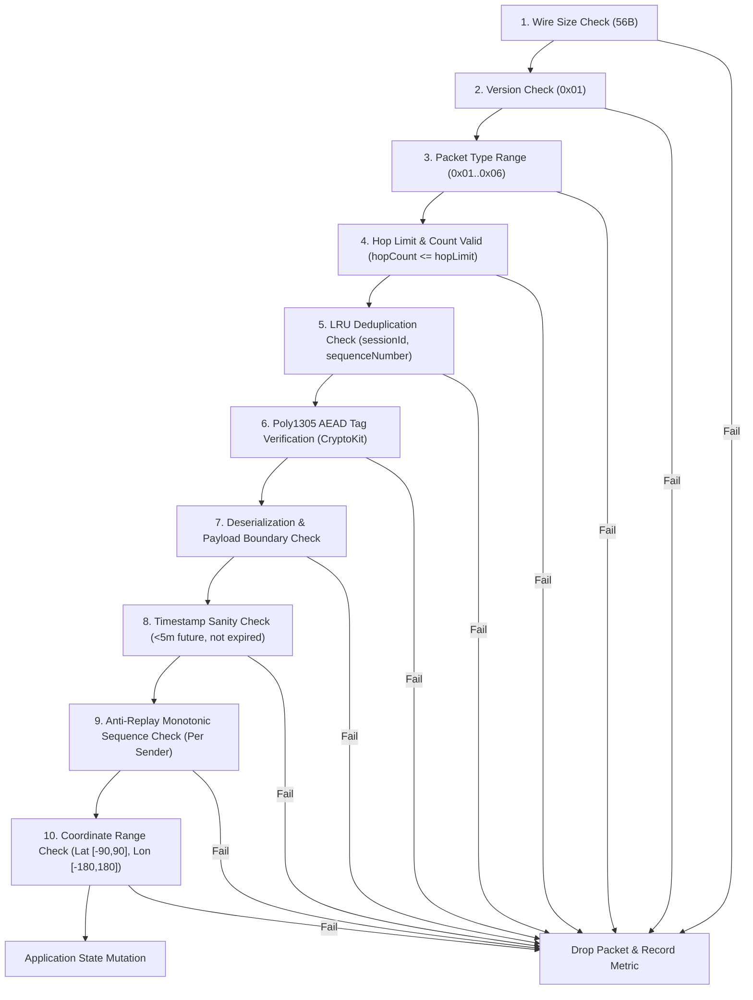

# TeeKum Protocol Specification & Cryptographic Message Protection

> **Team baseline:** This is a retained design reference, not a report of implemented or verified behavior. Resolve conflicts in [TechnicalRequirements Section 7](TechnicalRequirements.md#7-open-team-decisions) before adopting packet layouts, identities or runtime assumptions. Existing examples, performance figures and implementation wording require validation by the responsible developer. File placement follows [Section 3](TechnicalRequirements.md#3-architecture--mvvm-feature-driven).


**Status:** Draft cryptography/wire reference; owner and reviewer must reconcile it before implementation.
**Scope:** Fixed 56-Byte Binary Wire Format, AEAD Protection, Nonce Uniqueness, and Ingestion Validation

---

## 1. Protocol Architecture & Wire Layout

TeeKum utilizes a fixed 56-byte binary datagram transmitted over Apple Wireless Direct Link (AWDL) and Wi-Fi Direct via `Network.framework`. Packets are fixed in size to prevent traffic analysis, optimize memory allocation, and enable micro-burst radio transmissions (<1 ms).

```text
+-----------------------+-----------------------------+-------------------------+
|  Outer Envelope (10B) |   Encrypted Payload (30B)   |   Auth Tag (16B)        |
|  (Cleartext Routing)  |   (ChaCha20 Ciphertext)     |   (Poly1305 MAC)        |
+-----------------------+-----------------------------+-------------------------+
0                       10                            40                        56 Bytes
```

### 1.1 Wire Field Offsets & Endianness

All multi-byte integer values are serialized strictly in **Big-Endian (Network Byte Order)**.

| Wire Range | Byte Count | Field Name | Wire Type | Description & Endianness |
| :--- | :--- | :--- | :--- | :--- |
| **0** | 1 | `versionAndType` | `UInt8` | High 4 bits: Protocol Version (`0x01`). Low 4 bits: Packet Type (`0x01`..`0x06`). |
| **1** | 1 | `hopMetadata` | `UInt8` | High 4 bits: `hopLimit` (`1`..`15`, default `8` for ping, `15` for SOS & meeting rendezvous). Low 4 bits: `hopCount` (`0`..`hopLimit`). |
| **2..5** | 4 | `sessionId` | `UInt32` | 32-bit big-endian hash identifying the group session network. |
| **6..9** | 4 | `sequenceNumber` | `UInt32` | 32-bit big-endian partitioned counter (`memberSlot: UInt8` + `counter: UInt24`). |
| **10..39**| 30 | `encryptedPayload` | `30 Bytes` | Private inner payload encrypted with ChaCha20. |
| **40..55**| 16 | `authTag` | `16 Bytes` | 128-bit Poly1305 MAC tag authenticating Envelope AAD + Ciphertext. |

---

## 2. Cryptographic Inputs & Constructions

### 2.1 Cipher Selection & Key Assumptions

- **Primitive:** `ChaCha20-Poly1305` Authenticated Encryption with Associated Data (AEAD) via Apple `CryptoKit.ChaChaPoly` (RFC 8439).
- **Key:** 256-bit symmetric session key (`CryptoKit.SymmetricKey`, 32 bytes).
- **Key Exchange:** 100% serverless; generated on the host device via cryptographically secure pseudo-random number generator (`SecRandomCopyBytes`), shared in-person via QR barcode or via universal link URL fragment (`teekum://join#key=...`).
- **Key Storage:** Ephemeral, stored in iOS Keychain with accessibility `kSecAttrAccessibleAfterFirstUnlockThisDeviceOnly`. Key material is purged from memory and disk upon session exit or expiry.
- **Privacy Boundary:** Relays without the group symmetric key cannot decrypt the 30-byte payload or forge authentication tags.

### 2.2 Associated Authenticated Data (AAD) & Mutable Hop Count

A relay node in a multi-hop mesh must increment `hopCount` (low 4 bits of Byte 1) without access to the symmetric key. If the entire 10-byte cleartext envelope were authenticated verbatim, any relay modification would invalidate the authentication tag.

**AAD Construction Specification:**
When computing the Poly1305 authentication tag during sealing and opening, Byte 1 is normalized by **masking out `hopCount` to zero**:

$$\text{MaskedByte1} = \text{hopMetadata} \ \& \ \mathtt{0xF0} = (\text{hopLimit} \ \& \ \mathtt{0x0F}) \ll 4$$

The 10-byte AAD buffer is constructed as:
```text
Byte 0:    versionAndType (version << 4 | type)
Byte 1:    (hopLimit << 4) & 0xF0  [hopCount masked to 0x00]
Bytes 2..5: sessionId (32-bit big-endian)
Bytes 6..9: sequenceNumber (32-bit big-endian)
```

**Security Guarantees:**
- `version`, `type`, `sessionId`, `sequenceNumber`, and `hopLimit` are tamper-proof and fully authenticated.
- Intermediate relays can freely increment `hopCount` in the low 4 bits of Byte 1 on the wire without breaking the authentication tag.
- In Phase 1 direct offline MVP, `hopCount` is initialized to `0`, making the masked AAD identical to the wire envelope.

### 2.3 Nonce Format & Uniqueness Guarantees

AEAD ciphers require that a `(Key, Nonce)` pair **must never be reused**. Under a group-shared symmetric key, if two members emit packets with the same sequence number, a two-time pad collision occurs.

**12-Byte (96-Bit) Nonce Construction:**
```text
Bytes 0..3:  sessionId (UInt32 big-endian)
Bytes 4..7:  sequenceNumber (UInt32 big-endian)
Byte 8:      versionAndType (UInt8, Byte 0 of envelope)
Bytes 9..11: Protocol Domain Tag: [0x54, 0x4B, 0x4D] (ASCII "TKM")
```

**Guaranteed Uniqueness via Sequence Number Partitioning:**
Every group member is assigned an 8-bit `memberSlot` ($0 \dots 255$) upon joining the session. The 32-bit `sequenceNumber` is constructed as:

$$\mathtt{sequenceNumber} = (\mathtt{memberSlot} \ll 24) \mid (\mathtt{counter} \ \& \ \mathtt{0x00FFFFFF})$$

- High 8 bits (bits 24..31): `memberSlot` (0..255).
- Low 24 bits (bits 0..23): Monotonic per-member packet counter ($1 \dots 16{,}777{,}215$).
- **Collision Impossibility:** Because each member operates in an independent, disjoint sequence space, no two devices can ever generate the same `(sessionId, sequenceNumber)` pair.
- **Capacity:** At a rapid rate of 1 packet every 3 seconds, 16.7 million packets permits ~580 days of continuous broadcasting per member.

---

## 3. Session Boundaries & Security Invariants

1. **Session ID is NOT a Security Boundary:**
   `sessionId` (32 bits) is a cleartext routing filter for packet ingestion and radio deduplication. An attacker can trivially craft packets matching a known `sessionId`. Group confidentiality and authenticity are enforced **solely** by the 256-bit symmetric key and 128-bit Poly1305 MAC tag. Packets failing tag verification are dropped with zero application state mutation.
2. **Zero Plaintext / Key Logging Policy:**
   Plaintext coordinates, secret keys, URL fragment keys, and sensitive session tokens must never be logged to console output, Apple Unified Logging (OSLog), crash logs, or unencrypted persistent storage.

---

## 4. Ingestion Pipeline & Rejection Rules

Every incoming 56-byte datagram must pass through a strict 10-step rejection pipeline in order:



### Detailed Rejection Rules:
1. **Size Rejection:** Data count $\neq 56$ bytes $\rightarrow$ drop with `invalidPacketSize`.
2. **Version Rejection:** High nibble of Byte $0 \neq 0x01 \rightarrow$ drop with `unsupportedVersion`.
3. **Type Rejection:** Low nibble of Byte 0 not in `PacketType.allCases` $\rightarrow$ drop with `unknownPacketType`.
4. **Hop Rejection:** `hopLimit == 0` or `hopCount > hopLimit` $\rightarrow$ drop with `invalidHopMetadata`.
5. **Deduplication Rejection:** `(sessionId, sequenceNumber)` found in 5-minute LRU cache $\rightarrow$ drop with `duplicatePacket`.
6. **Authentication Rejection:** Poly1305 tag does not authenticate AAD + ciphertext $\rightarrow$ drop with `authenticationFailed`. Plaintext is never exposed.
7. **Payload Rejection:** Inner payload byte buffer underflow or invalid enum codes $\rightarrow$ drop with `payloadDeserializationFailed`.
8. **Timestamp Sanity Rejection:** Timestamp $> 300\text{s}$ in the future (clock skew guard) or older than active session window $\rightarrow$ drop with `staleOrFutureTimestamp`.
9. **Replay & Stale State Rejection:** Sequence number $\le$ highest seen sequence number for sender, or location measurement timestamp $\le$ latest recorded timestamp for sender $\rightarrow$ drop with `staleStateReplacement`.
10. **Coordinate Range Rejection:** Dequantized latitude $\notin [-90.0, 90.0]$ or longitude $\notin [-180.0, 180.0] \rightarrow$ drop with `invalidCoordinateRange`.

---

## 5. Inner Payload Field Layouts (30 Bytes Each)

### Type 1: `LOCATION_PING` (`0x01`)
| Payload Range | Wire Range | Field Name | Type | Description |
| :--- | :--- | :--- | :--- | :--- |
| **0..3** | 10..13 | `latitudeRaw` | `Int32` | Latitude $\times 1{,}000{,}000$ (Big-Endian, $\sim$11 cm precision). |
| **4..7** | 14..17 | `longitudeRaw` | `Int32` | Longitude $\times 1{,}000{,}000$ (Big-Endian, $\sim$11 cm precision). |
| **8..11**| 18..21 | `timestamp` | `UInt32` | Unix epoch seconds of GPS measurement. |
| **12** | 22 | `accuracy` | `UInt8` | Horizontal accuracy radius in meters ($0 \dots 255\text{m}$). |
| **13** | 23 | `statusCode` | `UInt8` | 1-byte festival activity hash (`StatusCode` enum). |
| **14..17**| 24..27 | `targetRefId` | `UInt32` | Target friend ID or landmark ID (`0x00000000` if none). |
| **18..19**| 28..29 | `senderInitials` | `UInt16` | 2-byte Base-27 encoded 1 to 3-letter initials (formula: `(a*729) + (b*27) + c`). Eliminates radio handshake. |
| **20** | 30 | `batteryLevel` | `UInt8` | Battery percentage ($0 \dots 100\%$). |
| **21** | 31 | `heading` | `UInt8` | Compass heading: $\text{degrees} \times 255 / 360$ ($0 \dots 255$). |
| **22..29**| 32..39 | `reserved` | `8 Bytes` | Padding (`0x0000000000000000`). |

### Type 2: `SOS` (`0x02`)
| Payload Range | Wire Range | Field Name | Type | Description |
| :--- | :--- | :--- | :--- | :--- |
| **0..3** | 10..13 | `latitudeRaw` | `Int32` | Freshest available latitude $\times 1{,}000{,}000$. |
| **4..7** | 14..17 | `longitudeRaw` | `Int32` | Freshest available longitude $\times 1{,}000{,}000$. |
| **8..11**| 18..21 | `timestamp` | `UInt32` | Measurement timestamp of coordinate. |
| **12** | 22 | `accuracy` | `UInt8` | Horizontal accuracy radius at measurement time. |
| **13** | 23 | `statusCode` | `UInt8` | Fixed urgent status: `0x01` (`SOS`). |
| **14..17**| 24..27 | `sosEventId` | `UInt32` | Unique random 32-bit emergency event ID. |
| **18..19**| 28..29 | `senderInitials` | `UInt16` | 2-byte Base-26 encoded initials of member in distress. |
| **20** | 30 | `emergencyType` | `UInt8` | `0x00` General, `0x01` Medical, `0x02` Separated, `0x03` Security. |
| **21** | 31 | `batteryLevel` | `UInt8` | Battery percentage of sender device. |
| **22..29**| 32..39 | `reserved` | `8 Bytes` | Padding (`0x0000000000000000`). |

### Type 3: `MEETING_UPDATE` (`0x03`)
| Payload Range | Wire Range | Field Name | Type | Description |
| :--- | :--- | :--- | :--- | :--- |
| **0..3** | 10..13 | `meetingLat` | `Int32` | Rendezvous latitude $\times 1{,}000{,}000$. |
| **4..7** | 14..17 | `meetingLon` | `Int32` | Rendezvous longitude $\times 1{,}000{,}000$. |
| **8..11**| 18..21 | `meetupTime` | `UInt32` | Rendezvous target epoch seconds. |
| **12** | 22 | `action` | `UInt8` | `0x01` Propose, `0x02` Accept, `0x03` Decline, `0x04` Cancel. |
| **13** | 23 | `attendanceStatus`| `UInt8` | `0x01` Attending, `0x02` Cannot Make It, `0x09` At Meeting Point. |
| **14..17**| 24..27 | `meetingPointId`| `UInt32` | Unique 32-bit meeting point rendezvous ID. |
| **18..19**| 28..29 | `senderInitials` | `UInt16` | 2-byte Base-26 encoded initials proposing or acknowledging rendezvous. |
| **20..23**| 30..33 | `landmarkId` | `UInt32` | Optional pre-set landmark ID (`0x00000000` if custom pin). |
| **24..29**| 34..39 | `reserved` | `6 Bytes` | Padding (`0x000000000000`). |

### Type 4: `ACK` (`0x06`)
| Payload Range | Wire Range | Field Name | Type | Description |
| :--- | :--- | :--- | :--- | :--- |
| **0..3** | 10..13 | `ackedSeqNumber`| `UInt32` | Sequence number of message confirmed. |
| **4..5** | 14..15 | `ackedSenderInitials`| `UInt16`| 2-byte Base-26 initials whose message is confirmed. |
| **6..9** | 16..19 | `ackTimestamp` | `UInt32` | Receipt epoch seconds. |
| **10** | 20 | `ackStatus` | `UInt8` | `0x01` Delivered to Friend, `0x02` Relayed by Mesh Hop. |
| **11** | 21 | `receivedRssi` | `Int8` | Observed arrival signal strength in dBm (signed). |
| **12..15**| 22..25 | `originalEventId`| `UInt32` | Matches `sosEventId` or `meetingPointId`. |
| **16..17**| 26..27 | `responderInitials` | `UInt16` | 2-byte Base-26 initials of device confirming delivery. |
| **18..29**| 28..39 | `reserved` | `12 Bytes`| Padding (`0x000000000000000000000000`). |

### Types 5 & 6: `ROUTE_REQ` (`0x04`) / `ROUTE_RESP` (`0x05`) (Phase 2)
| Payload Range | Wire Range | Field Name | Type | Description |
| :--- | :--- | :--- | :--- | :--- |
| **0..3** | 10..13 | `originatorId` | `UInt32` | Member seeking path. |
| **4..7** | 14..17 | `targetMemberId`| `UInt32` | Target member ID. |
| **8..11**| 18..21 | `discoveryNonce`| `UInt32` | Nonce to suppress route loops. |
| **12** | 22 | `routeCost` | `UInt8` | Cumulative metric cost. |
| **13..29**| 23..39 | `reserved` | `17 Bytes`| Reserved path metadata. |

---

## 6. Phase 2 Protocol Evolution: Expanded 2-Byte Hop Control (Protocol v3 Planning)

### 6.1 Motivation & Venue Scalability Tradeoffs

In Phase 1, `hopMetadata` is packed into a single byte (`hopLimit: 4 bits` | `hopCount: 4 bits`), constraining packets to a maximum of 15 hops. While sufficient for direct links and small festival gatherings, large-scale multi-tier stadium venues and sprawling multi-stage festival grounds require route depths exceeding 15 hops.

Two architectural models were evaluated for expanding hop budgets:

| Approach | Wire Format | Cryptographic Integrity | Relay Loop & Storm Protection | Telemetry / Path Depth | Verdict |
| :--- | :--- | :--- | :--- | :--- | :--- |
| **Single Mutating TTL Byte** (`ttl: UInt8`) | 1 Byte (`ttl` decrements from e.g. 255 to 0) | **CRITICAL VULNERABILITY:** Mutating byte must be masked to `0x00` in AAD. Relays can alter TTL arbitrarily. | **FAILS:** Rogue stranger node can reset TTL to 255, creating infinite broadcast storms and battery exhaustion. | **POOR:** Destination receives only remaining TTL, not hops traversed. | **REJECTED** |
| **Expanded 2-Byte Hop Control** (`hopLimit` + `hopCount`) | 2 Bytes (`hopLimit: UInt8`, `hopCount: UInt8`) | **SECURE:** `hopLimit` authenticated verbatim in AAD. `hopCount` masked to `0x00` in AAD. Intermediary cannot tamper with limit. | **ROBUST:** Relay stops forwarding when `hopCount >= hopLimit`. Intermediaries cannot inflate forwarding budget. | **EXCELLENT:** Destination observes exact hop count traversed for diagnostics & link cost. | **APPROVED (Phase 2)** |

### 6.2 Protocol v3 Wire Framing Specification

In Phase 2 development, the wire framing evolves as follows while strictly maintaining the **54-byte total datagram size** to avoid radio fragmentation on AWDL / Wi-Fi Direct:

```text
+-----------------------+-----------------------------+-------------------------+
|  Outer Envelope (9B)  |   Encrypted Payload (29B)   |   Auth Tag (16B)        |
|  (Cleartext Routing)  |   (Zero-Knowledge Cipher)   |   (Poly1305 / AES-GCM)  |
+-----------------------+-----------------------------+-------------------------+
0                       9                             38                        54 Bytes
```

#### Outer Envelope (9 Bytes):
- **Byte 0:** `versionAndType` (`UInt8`): High 4 bits = Version (`0x3`), Low 4 bits = Type (`0x1`..`0x6`).
- **Byte 1:** `hopLimit` (`UInt8`): Maximum allowable hops ($0 \dots 255$, e.g. 16 for normal pings, 32 for SOS). Authenticated in AAD.
- **Byte 2:** `hopCount` (`UInt8`): Hops traversed so far ($0 \dots 255$, starts at 0, incremented by each relay). Masked to `0x00` in AAD.
- **Bytes 3..4:** `sessionId` (`UInt16` big-endian): 16-bit group session identifier.
- **Bytes 5..8:** `sequenceNumber` (`UInt32` big-endian): Partitioned member sequence counter.

#### Encrypted Payload (29 Bytes) & Padding Absorption:
To preserve the exact 54-byte wire datagram, 1 byte is absorbed from the existing reserved payload padding:
- `LOCATION_PING`: Reserved padding reduced from 8 bytes to 7 bytes.
- `SOS`: Reserved padding reduced from 8 bytes to 7 bytes.
- `MEETING_UPDATE`: Reserved padding reduced from 6 bytes to 5 bytes.
- `ACK`: Reserved padding reduced from 12 bytes to 11 bytes.

#### AEAD Associated Authenticated Data (AAD) Construction:
The 9-byte AAD buffer supplied to ChaCha20-Poly1305 is constructed as:
```text
Byte 0:    versionAndType (UInt8)
Byte 1:    hopLimit (UInt8, authenticated verbatim)
Byte 2:    0x00 (hopCount masked to zero)
Bytes 3..4: sessionId (UInt16 big-endian)
Bytes 5..8: sequenceNumber (UInt32 big-endian)
```

### 6.3 Implementation Phasing
- **Phase 1 proposal:** Other sections/documents describe Protocol v2 as 54 bytes (8-byte envelope + 30-byte payload + 16-byte tag), while Section 1 here describes 56 bytes. Reconcile this difference before implementation; no test results are established by this reference.
- **Phase 2 (Roadmap Milestone):** Migrates to Protocol v3 (9-byte envelope, 29-byte payload, 16-byte auth tag = 54 bytes) when multi-hop stranger mesh routing and AODV route discovery are implemented.
