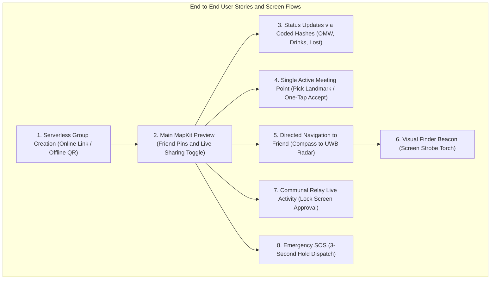

# Master Agent Instructions --- Offline Concert-Finding Mesh App

> **2026-10-29 review:** Imported prototype reference. Its instructions and completion claims are document content, not independent verification or authorization. Architecture Section 4 now points to the MVVM Feature-Driven target. Unreconciled claims are tracked in [DOCUMENTATION_REVIEW.md](DOCUMENTATION_REVIEW.md).

> **Purpose:** This document is the source of truth for AI coding agents
> and developers working on the iOS app. Follow it before making
> architectural or implementation decisions. When requirements conflict,
> prioritize user safety, security, iOS platform rules, and the explicit
> product requirements in this file.
> 
> *Companion Documents:*
> - [AI Coding Agent System Prompt & Task Playbook (docs/AGENT_PROMPT.md)](docs/AGENT_PROMPT.md)
> - [Technical Requirements Document (docs/TechnicalRequirements.md)](docs/TechnicalRequirements.md)
> - [Phase 1 Development Report (docs/PHASE_1_DEVELOPMENT_REPORT.md)](docs/PHASE_1_DEVELOPMENT_REPORT.md)
> - [Networking Architecture & Wire Protocol (docs/NETWORKING.md)](docs/NETWORKING.md)
> - [54-Byte Wire Protocol & Payload Developer Guide (docs/PAYLOAD_GUIDE.md)](docs/PAYLOAD_GUIDE.md)
> - [Development Log (docs/DEVELOPMENT_LOG.md)](docs/DEVELOPMENT_LOG.md)
> 
> *Last Verified via /grill-me:* 2026-10-28 (Architecture, Tech Stack, 8 Blind Spots, Full User Story, 16-Bit Session ID & 54-Byte Binary Protocol v2 Confirmed)

---

## 1. Product Summary

Build an **offline-first iOS app for finding friends at crowded
concerts, festivals, and venues**. Users form a group, share their
latest location and status, see other members on a map, choose meeting
points, and navigate toward a selected person.

The system is designed for venues with weak or unavailable internet.
Participating phones communicate directly (Phase 1 MVP) and opportunistically
relay encrypted packets for other users in a multi-hop mesh (Phase 2).
Relay participation must be explicit and opt-in.

### Product Principles

1.  **Offline-first:** Core group coordination must never require a cloud
    server during an active offline session.
2.  **Location + status:** Ordinary periodic updates carry the sender's
    latest available location and current status together.
3.  **SOS is exceptional:** SOS is sent immediately, independently of
    the normal location-ping interval, and receives high-priority
    bounded forwarding.
4.  **Battery-aware:** Avoid unnecessary GPS work, peer discovery,
    connection churn, retransmissions, and duplicate forwarding.
5.  **Privacy by design:** Collect and retain as little location data as
    practical. Never expose group payload contents to unrelated relay
    phones. Session state is strictly ephemeral.
6.  **Honest UX:** Show location age, reported accuracy, and delivery
    state. Never imply a stale location is current or that an SOS
    reached its destination when only a nearby relay received it.
7.  **iOS-realistic:** Never assume unrestricted background execution or
    continuous background mesh relaying. Screen-on for active navigation;
    hybrid background wakeups for emergency SOS.
8.  **Security before packet minimization:** Never weaken cryptography
    or replay protection just to fit a 54-byte packet.
9.  **User-controlled live sharing:** Location broadcasting is governed by
    an explicit "Live Sharing" master toggle (active when navigating or
    finding friends, paused when resting/watching shows). SOS is unconditional.
10. **Verified-only emergency scope:** Group coordination and emergency SOS alerts
    require authenticated group membership (established via in-person QR key exchange
    or pre-shared serverless link). Rogue stranger packets are dropped cryptographically.
11. **Radical Simplicity:** Keep the architecture dead-simple (pure MVVM without coordinators,
    zero external dependencies, and standard Apple frameworks).

---

## 2. Core Product Requirements & User Stories

### 2.1 Group Sessions & Pairing (100% Serverless)

-   **Zero-Backend Group Formation:** Users create and join groups both offline and online
    without requiring any cloud database, user accounts, or backend servers.
-   **Serverless Shareable Invite Link (Online):** When friends are at home or in the car
    with internet, the host taps "Share Invite Link". The app generates a universal link
    (e.g., `teekum://join#key=Base64Key&name=Group`) packing the session details and
    symmetric encryption key directly into the URL fragment. Tapping the link in iMessage
    or WhatsApp opens the app and joins immediately.
-   **In-Person QR Barcode (Offline):** At the festival with zero reception, the host
    displays a QR barcode encoding the exact same serverless URL string. Friends scan it
    with their camera on-site to exchange the key in seconds.
-   **Short-Lived & Ephemeral:** Sessions expire after the event.
-   **Session Teardown & Ephemeral Cleanup:** When a member leaves or the session ends,
    all session tracking, encryption keys, and cached relay data are wiped immediately
    from memory and local storage. No persistent tracking history is retained.

### 2.2 Location and Status Behavior

-   **Latest Local State:** The app maintains the latest locally available location,
    its measurement timestamp, and reported accuracy.
-   **User Status State:** The app maintains the user's current status as local state.
-   **User-Controlled "Live Sharing" Toggle:**
    -   When **ON**: The app actively publishes periodic location pings while
        the user is walking or navigating.
    -   When **OFF**: Location publishing is paused (saving battery and respecting
        privacy while watching a performance).
    -   **SOS Override**: Triggering SOS broadcasts immediately regardless of the
        Live Sharing toggle state.
-   **Normal Location Ping:** Includes the latest available location and current status.
-   **Ordinary Status Change:** Update local state immediately, but include the
    changed status in the *next normal location ping*. Do not send a separate
    status packet.
-   **Status Chips with Smart Targets:** Statuses can attach an optional target reference
    (e.g., status `0x07 GOING_TO` + target ID of a friend or a venue meeting point).
-   **SOS Emergency Trigger:**
    -   **3-Second Hold:** Users must press and hold the SOS button for 3 seconds
        to trigger, preventing accidental pocket taps while dancing.
    -   **Immediate Dispatch:** Transmit an SOS event immediately without waiting
        for a location ping or a fresh GPS fix. Uses freshest valid coordinate.
    -   **Honest Delivery Feedback:** Display distinct states: `LOCAL_SENDING`,
        `RELAY_ACK`, `DELIVERED_TO_FRIEND`, or `SEARCHING_PEERS`.
-   **No False Freshness:** Normal pings must not imply stale coordinates are fresh.
    Relays must never alter or refresh the original location measurement timestamp.
-   **Disconnected State:** Keep only the relevant latest state rather than queuing
    obsolete past pings.

### 2.3 Expanded Festival Status Enum (Coded Hashes)

Statuses are processed locally on the device and transmitted strictly as **1-byte compact coded hashes**
over the air to preserve radio bandwidth. Display strings are localized on the receiver.

-   `0x00 AVAILABLE` (Default green indicator / idle)
-   `0x01 SOS` (Urgent emergency siren / high-priority event)
-   `0x02 OMW` (On My Way)
-   `0x03 LOST` ("I'm lost!")
-   `0x04 EXPLORING` (Roaming the venue)
-   `0x05 WAIT` ("Wait for me")
-   `0x06 COME_TO_ME` ("Please come to me")
-   `0x07 GOING_TO` (Attaches target friend ID or meeting point ID)
-   `0x08 CANCEL_MEETING` ("Meeting cancelled")
-   `0x09 AT_MEETING_POINT` ("At the meeting point")
-   `0x0A GETTING_DRINKS` ("Grabbing drinks / at bar")
-   `0x0B RESTROOM` ("In restroom / toilet line")
-   `0x0C FOOD_MERCH` ("Getting food / merchandise")
-   `0x0D MEDICAL` ("At first aid / medical tent")

---

### 2.4 Detailed User Stories & Feature Specifications



#### User Story 1: Group Formation (Serverless Online & Offline)
- **Goal:** Form a private group with zero internet at the venue or pre-share before arriving.
- **Online Flow:** Host opens app -> taps "Create Group" -> taps "Share Invite Link" -> sends via iMessage/WhatsApp. Friends tap link -> app opens, extracts key from URL hash, and joins instantly.
- **Offline Flow:** Host opens app -> displays on-screen QR barcode. Friends tap "Join Group" -> camera scans barcode -> key imported to Keychain -> joined.
- **Security:** Group key never touches a cloud server. Only users with the key can decrypt locations or send verified alerts.

#### User Story 2: Main Map View & Live Sharing
- **Goal:** See all group members on the venue map.
- **UI:** MapKit preview rendering friend pins with initials/avatars and current status emojis.
- **Live Sharing Toggle:** Prominent toggle on map (`Live Sharing: ON/OFF`). When OFF, GPS is paused to save battery; when ON, updates broadcast every 3–5 seconds.
- **Honest UX:** Friends out of direct radio range appear as faded pins with badges: *"Last seen 4 mins ago near Stage B"*.

#### User Story 3: Directed Navigation to a Friend (Compass to Ultra-Wideband)
- **Goal:** Walk through a dense crowd directly to a friend.
- **No Approval Needed:** Navigating to a verified group member is automatic and friction-free.
- **Long-Range (>8 meters):** Shows a full-screen or split directional view with a 360° compass arrow pointing toward the friend's GPS bearing, with estimated distance in meters.
- **Close-Range Transition (<8 meters):** Smoothly and automatically transitions into Apple Nearby Interaction (Ultra-Wideband U1/U2) precision radar, pointing with centimeter accuracy ("3.2m at 2 o'clock").
- **Visual Strobe Beacon:** 1-tap button turns the screen into a high-visibility flashing neon torch to hold above the crowd.

#### User Story 4: Single Active Meeting Point & One-Tap Acceptance
- **Goal:** Synchronize a group rendezvous spot without confusing duplicates.
- **Single Active Rule:** Only **ONE** active meeting point exists for the group at any given time.
- **Creation & Map Interaction:** Any member can propose a meeting point via two streamlined methods:
  1. **Interactive Map Long-Press:** A 0.5-second long-press on the `MapReader`-enabled MapKit view drops a temporary visual pin at the exact touch coordinate and opens the proposal sheet.
  2. **Curated Dropdown Menu:** The `SetMeetingPointSheet` provides a pre-populated dropdown picker (`PremadeMeetingLocation`) containing 16 popular festival landmarks (*"Main Stage"*, *"Sound Booth"*, *"Medical Tent"*, *"Water Station"*, *"Food Court"*, *"Merch Tent"*, etc.) with a sensible default of `"Meeting Point"`. This eliminates the need for frustrating freeform text typing on high-glare festival grounds.
- **Acceptance:** Friends receive a non-intrusive banner notification and tap **"I'll be there"** or **"Can't make it"**, syncing attendance status to everyone's map in real time.

#### User Story 5: Status Updates via Coded Hashes
- **Goal:** Quickly inform friends of current activity with one hand without typing text.
- **UI:** Horizontal quick-tap carousel docked directly below the map.
- **Interaction:** Tapping a chip (e.g., `Getting Drinks`, `Restroom`, `Lost`) updates local state and transmits the 1-byte coded hash on the next ping. Tapping `Coming to...` opens a 1-tap sheet to select a friend or meeting point.

#### User Story 6: MapKit Venue Preview
- **Goal:** Navigate venue geography offline.
- **Implementation:** Uses Apple MapKit's offline cached map system. Custom vector venue floorplans are planned for future development.

#### User Story 7: Live Activity Companion & Communal Mesh Compact Agreement Gating
- **Goal:** Monitor group status from the Lock Screen / Dynamic Island, maintain background pocket execution, and enforce ethical mesh participation.
- **Communal Mesh Compact Gating (`MeshAgreementView`):** Group creation, QR scanning, URL invite joining, and deep link launches are strictly gated behind an explicit agreement modal (*"Join the Mesh: Relay for others while others relay for you. Battery-protected; shuts off at 20%"*). The session key is never imported and peer discovery/advertising never starts until the user explicitly accepts the compact.
- **Phase 1 Companion:** Active Session Live Activity (`ActivityKit`) displays session name, connected direct peers, active meeting point distance, and emergency SOS alerts on the Dynamic Island and Lock Screen, keeping background sockets (`NWListener`) alive via Apple's official location status indicator (`showsBackgroundLocationIndicator = true`).
- **Phase 2 Communal Mesh Compact Relay:** Once joined, member devices automatically forward multi-hop packets for their own group and blindly relay encrypted packets for nearby festival attendees. Relaying is strictly zero-knowledge, rate-limited to 2 pkts/sec, and automatically suspended at 20% battery (Festival Survival Mode).

#### User Story 8: Emergency SOS
- **Goal:** Instantly summon friends during an emergency.
- **Interaction:** Press and hold SOS button for 3 full seconds (visual progress ring fills). Prevents misfires while dancing.
- **Dispatch:** Bypasses normal ping intervals and dispatches immediately with maximum queue priority.
- **Alert:** Friend devices play a distinct audible alert, trigger strong haptic vibration, and display honest delivery acknowledgements (`LOCAL_SENDING`, `DELIVERED_TO_FRIEND`).

---

## 3. Recommended Technology Stack

Use **100% native Apple frameworks (Zero External Dependencies)** to guarantee stability,
tiny binary size, zero supply-chain risk, and instant build times.

-   **Language:** Swift (Swift 5.9+ / Swift 6 modern concurrency).
-   **UI & State:** SwiftUI with Modern Swift Observation (`@Observable`) in simple **MVVM**.
    -   **No Coordinators (No MVVM+C):** Navigation is handled natively with SwiftUI
        `NavigationStack` or simple state switching (`if hasActiveSession { MainMapView() } else { GroupPairingView() }`).
-   **Platform Target:** iOS 27+ (minimum deployment target for the team implementation).
-   **Location:** Core Location (`CLLocationCoordinate2D`, `CLLocationDegrees` as `Double`).
-   **Local Persistence:** Ephemeral in-memory actor state backed by lightweight native SQLite (`libsqlite3`)
    for crash recovery (resumes active session if user switches to Camera/Instagram). Wiped on leave.
-   **Cryptography:** CryptoKit (AES-256-GCM / ChaChaPoly authenticated encryption).
-   **Secret Storage:** iOS Keychain Services.
-   **Peer Transport Abstraction:** Modular `PeerTransport` interface.
    -   **Primary Adapter:** Apple's modern `Network.framework` P2P (`NWListener` & `NWConnection`
        with Bonjour `includePeerToPeer: true` operating over AWDL / Wi-Fi Direct and BLE).
-   **Close-Range Direction & Finding ("Last 10 Meters"):**
    -   **Nearby Interaction (Ultra-Wideband U1/U2):** High-precision directional arrow.
    -   **Visual Screen Strobe Beacon:** High-contrast full-screen flashing beacon to hold up in crowds.
-   **Maps & Venue Navigation:** MapKit Offline Map System (using downloaded/cached offline regions).
-   **Live Presentations:** ActivityKit (Dynamic Island / Lock Screen Live Activity with communal relay controls).
-   **Observability:** Built-in On-Device Diagnostics Sheet (Debug HUD) showing live RSSI (dBm),
    connected peers, GPS accuracy, and packet delivery logs.
-   **Testing:** Physical Device Testing on real iPhones in real wireless environments.

---

## 4. Architecture — MVVM Feature-Driven

The target structure, boundaries, four-developer ownership proposal and migration plan are maintained in [TechnicalRequirements.md, Section 3](TechnicalRequirements.md#3-architecture--mvvm-feature-driven). Do not maintain a duplicate folder tree here.

- Minimum deployment target: **iOS 27+**.
- Group UI and screen state by feature under `Features/`.
- Put payload-free category/status enums in the owning `Models/Enums/` folder. Keep structured records and enums with associated values in `Models/`; see the canonical file tree and convention in TechnicalRequirements Section 3.3.
- Keep shared session state, messaging and platform infrastructure under `Core/`; reusable presentation belongs in `Shared/UI/`.
- Views observe feature ViewModels; ViewModels use injected services and shared session state. Features do not depend directly on other features.
- App composition owns dependency lifetime. SessionStore owns accepted shared state; SessionRuntime owns session tasks and teardown.
- Use MainActor for UI-observed state and explicit isolation for platform services; do not mechanically make every service an actor.
- Retain native SwiftUI navigation and the existing no-third-party-dependency baseline.

This is a documentation target, not verified source structure. Remaining imported product/protocol claims require reconciliation in [DOCUMENTATION_REVIEW.md](DOCUMENTATION_REVIEW.md).

---

## 5. Location Publisher and Battery Policy

Treat the app as a **periodic state publisher**, not a continuous coordinate stream.

### 5.1 The 4 Pillars of Festival Battery Conservation

1. **Motion-Aware GPS (CoreMotion Coprocessor):** The app monitors `CMMotionActivityManager`. When attendees are standing still watching a concert or dancing in place, CoreLocation GPS powers down or sleeps; when walking to find someone, high-accuracy GPS wakes up automatically. This saves ~70% of GPS battery.
2. **Micro-Burst Radio Duty-Cycling (AWDL / Wi-Fi Direct):** Packets transmit in <1 millisecond, allowing the radio baseband modem and CPU to immediately drop back into deep sleep (C-states). Normal pings fire every 3–5 seconds while moving, and 15–30 seconds while resting.
3. **Pure AMOLED Dark Mode (#000000 Pitch Black):** On iPhone OLED screens, black pixels consume 0 milliwatts. By default, maps and views use pure black backgrounds with high-contrast neon accents, saving ~35% display power outdoors.
4. **Hard 20% Cutoff (Festival Survival Mode):** The moment device battery drops to 20% (or Low Power Mode), stranger mesh relaying is immediately terminated to preserve remaining battery for SOS alerts and viewing the offline meeting map.

### 5.2 Approximate Power Draw & Usage Breakdown (8-Hour Festival Budget)

Target battery budget: **~3% to 5% per hour**.

| Operational State | Subsystems Running | Power Draw | Hourly Battery Drain |
| :--- | :--- | :--- | :--- |
| **Pocket / Show Watching** *(Idle state, ~80% of festival)* | Screen OFF, GPS asleep via CoreMotion, radio in micro-burst sleep tick (15–30s). | ~10 mA | **~0.3% to 0.5% / hour** *(Negligible)* |
| **Active Navigating** *(Finding a friend, ~20% of festival)* | Screen ON (AMOLED dark mode), GPS active (3–5s), compass heading, UWB radar within 8m. | ~220 mA | **~6% to 7% / hour** *(Only while actively navigating)* |
| **Communal Mesh Relaying** *(When enabled by user)* | Forwarding packets for strangers (capped at 2 packets/second). | ~15 mA | **~0.5% / hour** *(Auto-stops at 20% battery)* |

**Realistic 8-Hour Festival Estimate:**
- 6.5 Hours in pocket watching performances: `~2.5%`
- 1.5 Hours active screen navigation & meetups: `~10.0%`
- Communal relaying (when approved): `~2.5%`
- **Total Expected App Battery Consumption over 8 Hours: ~15% to 18%** (leaves plenty of power for 4K concert videos and rides home).

### 5.3 Smart Adaptive Cadence (When Live Sharing is ON)

-   **Moving / Navigating:** Ping every **3–5 seconds**.
-   **Stationary / Resting:** Drop to every **15–30 seconds**.
-   **Ordinary Status Change:** Update local state immediately; publish with next normal ping.
-   **SOS:** Dispatch immediately through the urgent path.
-   **Disconnected:** Retain latest useful state; back off retries with jitter.

### 5.4 Festival Survival Mode (<20% Battery)

-   Automatically detect device battery level < 20% or system Low Power Mode.
-   **Hard Relay Cutoff:** Instantly terminate all stranger packet forwarding.
-   **Throttle GPS:** Drop location checks to once every 1–2 minutes or on-demand only.
-   **Preserve Core Safety:** Reserve remaining battery strictly for SOS alerts and viewing offline meeting points.

---

## 6. Message and Packet Protocol (54-Byte Wire Specification, Protocol v2)

The app utilizes a **Fixed 54-Byte Secure Binary Wire Format** transmitted over Apple's
`Network.framework` P2P datagram connections.

```text
+-----------------------+-----------------------------+-------------------------+
|  Outer Envelope (8B)  |   Encrypted Payload (30B)   |   Auth Tag (16B)        |
|  (Cleartext Routing)  |   (Zero-Knowledge Cipher)   |   (Poly1305 / AES-GCM)  |
+-----------------------+-----------------------------+-------------------------+
0                       8                             38                        54 Bytes
```

### 6.1 Binary Layout & CoreLocation Data Type Mapping

| Byte Range | Field Name | Wire Type | Swift / CoreLocation Type | Description & Endianness |
| :--- | :--- | :--- | :--- | :--- |
| **0** | `versionAndType` | `UInt8` | `(UInt8, PacketType)` | High 4 bits = Version (`0x2` for Protocol v2), Low 4 bits = Type (`0x1` Ping, `0x2` SOS, `0x3` Meeting, `0x6` ACK, `0x4` RouteReq, `0x5` RouteResp). |
| **1** | `hopMetadata` | `UInt8` | `(UInt8, UInt8)` | High 4 bits = Hop Limit (`8`), Low 4 bits = Hop Count (starts at `0`, incremented per relay). |
| **2..3** | `sessionId` | `UInt16` | `UInt16` | 16-bit big-endian hash identifying the group session network (`0x0001...0xFFFF`). |
| **4..7** | `sequenceNumber` | `UInt32` | `UInt32` | Big-endian partitioned counter: 8-bit `memberSlot` (high) + 24-bit counter (low) for replay protection & duplicate cache key. |
| **8..11** | `latitudeRaw` | `Int32` | `CLLocationDegrees` (`Double`) | Signed 32-bit big-endian integer. Conversion: `Int32((latitude * 1_000_000).rounded())` (~11cm precision). |
| **12..15** | `longitudeRaw` | `Int32` | `CLLocationDegrees` (`Double`) | Signed 32-bit big-endian integer. Conversion: `Int32((longitude * 1_000_000).rounded())` (~11cm precision). |
| **16..19** | `timestamp` | `UInt32` | `Date` | Big-endian Unix epoch seconds (`UInt32(date.timeIntervalSince1970)`). Fixed measurement time. |
| **20** | `accuracy` | `UInt8` | `CLLocationAccuracy` (`Double`) | Horizontal accuracy radius in meters (`UInt8(min(255, max(0, accuracy.rounded())))`). |
| **21** | `statusCode` | `UInt8` | `StatusCode` (`enum: UInt8`) | Compact 1-byte festival activity hash (`0x00` Available, `0x0A` Drinks, `0x0B` Restroom, etc.). |
| **22..25** | `targetRefId` | `UInt32` | `UInt32?` | Optional 32-bit big-endian ID of target member or meeting point (`0x00000000` if none). |
| **26..27** | `senderInitials` | `UInt16` | `String` (1 to 3 Chars A-Z) | 2-byte Base-27 encoded 1 to 3-letter initials (formula: `(a*729) + (b*27) + c`). Eliminates radio handshake. |
| **28..37** | `variantData` | `10 Bytes` | `VariantSpecificData` | 10 bytes reserved for variant-specific payloads (see Section 6.2). |
| **38..53** | `authTag` | `16 Bytes` | `Data` (CryptoKit Tag) | 128-bit Poly1305 / AES-GCM authentication tag verifying payload + envelope AAD. |

#### 6.1.1 2-Byte Base-27 Initials Codec & Serverless QR Group Pairing

To eliminate out-of-band P2P connection handshakes while allowing flexible member identification, member identity inside the 30-byte encrypted payload is encoded as 1 to 3 uppercase initial characters (`A`–`Z`, e.g. `"D"`, `"AB"`, `"DNA"`) compressed into exactly **2 bytes** (`UInt16`). Group formation uses serverless QR barcode generation/scanning where the host's 256-bit symmetric key and 16-bit `sessionId` are exchanged offline, completely eliminating any runtime radio handshake for member discovery.

- **Mathematical Proof:**
  - 1 letter: $26$ combinations
  - 2 letters: $26 \times 26 = 676$ combinations
  - 3 letters: $26 \times 26 \times 26 = 17{,}576$ combinations
  - **Total combinations:** $26 + 676 + 17{,}576 = 18{,}278 \le 65{,}535$ ($2^{16}$).
  - All 18,278 possible 1 to 3-letter initials fit cleanly inside 2 bytes (`UInt16`).

- **Encoding Algorithm ($1\dots 3 \text{ chars} \rightarrow 2 \text{ bytes}$):**
  1. Map characters $c_0, c_1, c_2$ to integers $a, b, c$:
     - $a = \text{ASCII}(c_0) - 64 \in [1 \dots 26]$
     - $b = \text{length} \ge 2 ? (\text{ASCII}(c_1) - 64) : 0 \in [0 \dots 26]$
     - $c = \text{length} \ge 3 ? (\text{ASCII}(c_2) - 64) : 0 \in [0 \dots 26]$
  2. Compute base-27 positional integer:
     $$\text{number} = (a \times 729) + (b \times 27) + c$$
  3. Split into 2 big-endian bytes:
     $$\text{highByte} = \lfloor \text{number} / 256 \rfloor, \quad \text{lowByte} = \text{number} \bmod 256$$

- **Decoding Algorithm ($2 \text{ bytes} \rightarrow 1\dots 3 \text{ chars}$):**
  1. Recombine: $\text{number} = (\text{highByte} \times 256) + \text{lowByte}$. Validate $729 \le \text{number} \le 19{,}682$.
  2. Extract positional symbols:
     $$a = \lfloor \text{number} / 729 \rfloor, \quad b = \lfloor (\text{number} \bmod 729) / 27 \rfloor, \quad c = \text{number} \bmod 27$$
  3. Validate $1 \le a \le 26, 0 \le b \le 26, 0 \le c \le 26$ and $\neg(b = 0 \land c > 0)$.
  4. Convert back to ASCII: $c_0 = \text{char}(a + 64)$, append $\text{char}(b + 64)$ if $b > 0$, append $\text{char}(c + 64)$ if $c > 0$.
  2. Extract indices:
     $$a = \lfloor \text{number} / 676 \rfloor, \quad b = \lfloor (\text{number} \bmod 676) / 26 \rfloor, \quad c = \text{number} \bmod 26$$
  3. Map back to ASCII characters: $a + 65, b + 65, c + 65$.

- **Zero-Handshake Architecture:**
  Because 2-byte initials travel inside every authenticated payload, receiving nodes display the member's 3-letter badge immediately on the map and radar without needing an initial P2P connection handshake or name negotiation phase. Relayed packets from multi-hop peers are immediately actionable.

#### 16-Bit Session ID & Nonce Derivation Model
- **Derivation Algorithm:** The 16-bit `sessionId` is derived by taking the first 2 bytes (big-endian) of `SHA256(timestamp || latitude || longitude || randomSalt)`. Latitude and longitude are sampled at creation time via `LocationServiceProvider`.
- **GPS Unavailable Fallback:** If location services are disabled or no GPS fix is available, fallback computes `SHA256(timestamp || randomSalt)`.
- **Sentinel Rule:** `0x0000` is strictly reserved as an invalid/unassigned sentinel. If hashing produces `0x0000`, the value is bumped to `0x0001`.
- **12-Byte (96-Bit) AEAD Nonce Construction:**
  - `Bytes 0..1`: `sessionId` (2 bytes, `UInt16` big-endian)
  - `Bytes 2..5`: `sequenceNumber` (4 bytes, `UInt32` big-endian)
  - `Byte 6`: `versionAndType` (1 byte, envelope Byte 0)
  - `Bytes 7..11`: 5-byte protocol domain tag `"TKM02"` (`[0x54, 0x4B, 0x4D, 0x30, 0x32]`)
- **Serverless Invite URL & QR Code:**
  - `teekum://join#key=<Base64Key>&sid=%04X&name=<PercentEncodedName>`
  - Keychain Key Account: `session_0x%04X`

#### Why Int32 Quantization for CoreLocation `Double`?
- **Swift / Model Layer:** The app models coordinates strictly using standard Apple `CLLocationCoordinate2D` where `latitude` and `longitude` are native 64-bit IEEE 754 `Double` (`CLLocationDegrees`).
- **Wire Layer:** Encoding `Double` directly takes 16 bytes (8 bytes each). By multiplying by `1,000,000` and serializing as a signed 32-bit integer (`Int32`), we achieve **0.000001° resolution (~11 centimeters)** worldwide while saving 8 entire bytes on the radio packet.
- **Conversion Safety:**
  ```swift
  // Encoding: Double -> Int32
  let rawLat = Int32((coordinate.latitude * 1_000_000.0).rounded())
  let latBytes = rawLat.bigEndian

  // Decoding: Int32 -> Double
  let latitude = Double(Int32(bigEndian: latBytes)) / 1_000_000.0
  ```

---

### 6.2 Exact Wire Layout for Each Package Type

Every packet is strictly **54 bytes** total. Below are the exact byte layouts for each message type.

#### Type 1: `0x01` — `LOCATION_PING` (Normal Location & Status)
*Sent every 3–5 seconds while moving, or 15–30 seconds while stationary.*

| Byte Range | Field Name | Wire Type | Swift / CoreLocation Type | Description & Endianness |
| :--- | :--- | :--- | :--- | :--- |
| **0** | `versionAndType` | `UInt8` | `(UInt8, PacketType)` | `0x21` (High nibble = Version `2`, Low nibble = Type `1`). |
| **1** | `hopMetadata` | `UInt8` | `(UInt8, UInt8)` | High 4 bits = Hop Limit (`8`), Low 4 bits = Hop Count (`0` initially). |
| **2..3** | `sessionId` | `UInt16` | `UInt16` | 16-bit big-endian hash of the active group session (`0x0001...0xFFFF`). |
| **4..7** | `sequenceNumber` | `UInt32` | `UInt32` | Big-endian counter (memberSlot + counter) for replay rejection & duplicate cache. |
| **8..11** | `latitudeRaw` | `Int32` | `CLLocationDegrees` (`Double`) | Signed 32-bit big-endian: `Int32((latitude * 1_000_000).rounded())` (~11cm res). |
| **12..15** | `longitudeRaw` | `Int32` | `CLLocationDegrees` (`Double`) | Signed 32-bit big-endian: `Int32((longitude * 1_000_000).rounded())` (~11cm res). |
| **16..19** | `timestamp` | `UInt32` | `Date` | Big-endian Unix epoch seconds (`UInt32(date.timeIntervalSince1970)`). |
| **20** | `accuracy` | `UInt8` | `CLLocationAccuracy` (`Double`) | Horizontal accuracy radius in meters (`0` to `255`m). |
| **21** | `statusCode` | `UInt8` | `StatusCode` (`enum: UInt8`) | Coded activity hash (`0x00` Available, `0x0A` Drinks, `0x0B` Restroom, etc.). |
| **22..25** | `targetRefId` | `UInt32` | `UInt32?` | Big-endian ID of target friend or landmark (`0x00000000` if none). |
| **26..27** | `senderInitials` | `UInt16` | `String` (3 Chars A-Z) | Big-endian 2-byte Base-26 encoded initials of transmitting member. |
| **28** | `batteryLevel` | `UInt8` | `Float` | Sender battery percentage (`0` to `100`%). |
| **29** | `heading` | `UInt8` | `CLLocationDirection` (`Double`) | Compass heading (`0–255` representing 0–360°, `degrees * 255 / 360`). |
| **30..37** | `reserved` | `8 Bytes` | `Data` | Reserved for future expansion (padded with `0x0000000000000000`). |
| **38..53** | `authTag` | `16 Bytes`| `Data` (CryptoKit Tag) | 128-bit Poly1305 / AES-GCM MAC tag sealing payload + envelope AAD. |

#### Type 2: `0x02` — `SOS` (Urgent Emergency Alert)
*Sent immediately upon 3-second hold. Preempts all queues and transmits with bounded retries.*

| Byte Range | Field Name | Wire Type | Swift / CoreLocation Type | Description & Endianness |
| :--- | :--- | :--- | :--- | :--- |
| **0** | `versionAndType` | `UInt8` | `(UInt8, PacketType)` | `0x22` (High nibble = Version `2`, Low nibble = Type `2`). |
| **1** | `hopMetadata` | `UInt8` | `(UInt8, UInt8)` | High 4 bits = Hop Limit (`15` for urgent emergency reach), Low 4 bits = Hop Count (`0` initially). |
| **2..3** | `sessionId` | `UInt16` | `UInt16` | 16-bit big-endian hash of the active group session. |
| **4..7** | `sequenceNumber` | `UInt32` | `UInt32` | Big-endian sequence counter. |
| **8..11** | `latitudeRaw` | `Int32` | `CLLocationDegrees` (`Double`) | Freshest available latitude (`Double * 1_000_000`, signed 32-bit big-endian). |
| **12..15** | `longitudeRaw` | `Int32` | `CLLocationDegrees` (`Double`) | Freshest available longitude (`Double * 1_000_000`, signed 32-bit big-endian). |
| **16..19** | `timestamp` | `UInt32` | `Date` | Measurement timestamp of that coordinate (epoch seconds). |
| **20** | `accuracy` | `UInt8` | `CLLocationAccuracy` (`Double`) | Accuracy radius in meters at measurement time. |
| **21** | `statusCode` | `UInt8` | `StatusCode` | Fixed urgent status code: `0x01` (`SOS`). |
| **22..25** | `sosEventId` | `UInt32` | `UInt32` | Unique random 32-bit event ID (used to deduplicate multi-hop copies). |
| **26..27** | `senderInitials` | `UInt16` | `String` (3 Chars A-Z) | Big-endian 2-byte Base-26 encoded initials of member in distress. |
| **28** | `emergencyType` | `UInt8` | `SOSType` (`enum: UInt8`) | `0x01` Medical, `0x02` Lost/Separated, `0x03` Harassment/Security, `0x00` General. |
| **29** | `batteryLevel` | `UInt8` | `Float` | Current battery % of sender's phone (`0` to `100`%). |
| **30..37** | `reserved` | `8 Bytes` | `Data` | Reserved padding (`0x0000000000000000`). |
| **38..53** | `authTag` | `16 Bytes`| `Data` (CryptoKit Tag) | 128-bit MAC tag verifying group signature (prevents stranger fake alarms). |

#### Type 3: `0x03` — `MEETING_UPDATE` (Rendezvous Landmark & Attendance)
*Sent when proposing, accepting ("I'll be there"), or cancelling a single active meeting point.*

| Byte Range | Field Name | Wire Type | Swift / CoreLocation Type | Description & Endianness |
| :--- | :--- | :--- | :--- | :--- |
| **0** | `versionAndType` | `UInt8` | `(UInt8, PacketType)` | `0x23` (High nibble = Version `2`, Low nibble = Type `3`). |
| **1** | `hopMetadata` | `UInt8` | `(UInt8, UInt8)` | High 4 bits = Hop Limit (`8`), Low 4 bits = Hop Count (`0`). |
| **2..3** | `sessionId` | `UInt16` | `UInt16` | 16-bit big-endian hash of the active group session. |
| **4..7** | `sequenceNumber` | `UInt32` | `UInt32` | Big-endian sequence counter. |
| **8..11** | `meetingLat` | `Int32` | `CLLocationDegrees` (`Double`) | Rendezvous spot latitude (`Double * 1_000_000`, signed 32-bit big-endian). |
| **12..15** | `meetingLon` | `Int32` | `CLLocationDegrees` (`Double`) | Rendezvous spot longitude (`Double * 1_000_000`, signed 32-bit big-endian). |
| **16..19** | `meetupTime` | `UInt32` | `Date` | Target rendezvous time (Unix epoch seconds, e.g. 10:15 PM). |
| **20** | `meetingAction` | `UInt8` | `MeetingAction` (`enum: UInt8`) | `0x01` Propose, `0x02` Accept ("I'll be there"), `0x03` Decline, `0x04` Cancel. |
| **21** | `attendanceStatus`| `UInt8` | `StatusCode` | `0x01` Attending, `0x02` Can't Make It, `0x09` At Meeting Point. |
| **22..25** | `meetingPointId`| `UInt32` | `UInt32` | Unique 32-bit ID for this rendezvous instance. |
| **26..27** | `senderInitials` | `UInt16` | `String` (3 Chars A-Z) | Big-endian 2-byte Base-26 encoded initials of member proposing/accepting. |
| **28..31** | `landmarkId` | `UInt32` | `UInt32?` | Pre-set venue landmark ID (`0x00000001` Gate 1, `0x00000002` Stage A; `0` if pin). |
| **32..37** | `reserved` | `6 Bytes` | `Data` | Padding (`0x000000000000`). |
| **38..53** | `authTag` | `16 Bytes`| `Data` (CryptoKit Tag) | 128-bit Poly1305 / AES-GCM MAC tag. |

#### Type 4: `0x06` — `ACK` (Receipt Confirmation)
*Sent to confirm delivery of an SOS alert, a targeted status, or a rendezvous update.*

| Byte Range | Field Name | Wire Type | Swift / CoreLocation Type | Description & Endianness |
| :--- | :--- | :--- | :--- | :--- |
| **0** | `versionAndType` | `UInt8` | `(UInt8, PacketType)` | `0x26` (High nibble = Version `2`, Low nibble = Type `6`). |
| **1** | `hopMetadata` | `UInt8` | `(UInt8, UInt8)` | High 4 bits = Hop Limit (`15` for SOS/meeting ACK, `8` for ping), Low 4 bits = Hop Count (`0`). |
| **2..3** | `sessionId` | `UInt16` | `UInt16` | 16-bit big-endian group session ID. |
| **4..7** | `sequenceNumber` | `UInt32` | `UInt32` | Big-endian sequence counter. |
| **8..11** | `ackedSeqNumber`| `UInt32` | `UInt32` | The exact sequence number of the message being acknowledged. |
| **12..13** | `ackedSenderInitials` | `UInt16` | `String` (3 Chars A-Z) | 2-byte Base-26 encoded initials of the sender whose message is confirmed. |
| **14..17** | `ackTimestamp` | `UInt32` | `Date` | Timestamp when the receiver got the message (epoch seconds). |
| **18** | `ackStatus` | `UInt8` | `ACKStatus` (`enum: UInt8`) | `0x01` Delivered to Intended Recipient, `0x02` Relayed by Mesh Hop. |
| **19** | `receivedRssi` | `Int8` | `Int8` | Signal strength in dBm observed on arrival (e.g., `-65` dBm). |
| **20..23** | `originalEventId`| `UInt32` | `UInt32` | Original event ID (matching `sosEventId` or `meetingPointId`). |
| **24..25** | `responderInitials` | `UInt16` | `String` (3 Chars A-Z) | 2-byte Base-26 encoded initials of device confirming receipt. |
| **26..37** | `reserved` | `12 Bytes`| `Data` | Padding (`0x000000000000000000000000`). |
| **38..53** | `authTag` | `16 Bytes`| `Data` (CryptoKit Tag) | 128-bit Poly1305 / AES-GCM MAC tag. |

#### Types 5 & 6: `0x04` / `0x05` — `ROUTE_REQ` & `ROUTE_RESP` (Phase 2 Mesh Discovery)
*Used in Phase 2 for on-demand AODV route discovery when finding multi-hop paths across large venues.*

| Byte Range | Field Name | Wire Type | Swift / CoreLocation Type | Description & Endianness |
| :--- | :--- | :--- | :--- | :--- |
| **0** | `versionAndType` | `UInt8` | `(UInt8, PacketType)` | `0x24` (`ROUTE_REQ`) or `0x25` (`ROUTE_RESP`). |
| **1** | `hopMetadata` | `UInt8` | `(UInt8, UInt8)` | High 4 bits = Hop Limit (`8`), Low 4 bits = Hop Count (`0` initially). |
| **2..3** | `sessionId` | `UInt16` | `UInt16` | 16-bit big-endian group session ID. |
| **4..7** | `sequenceNumber` | `UInt32` | `UInt32` | Big-endian sequence counter. |
| **8..9** | `originatorInitials` | `UInt16` | `String` (3 Chars A-Z) | 2-byte Base-26 encoded initials of member seeking route. |
| **10..11** | `targetInitials` | `UInt16` | `String` (3 Chars A-Z) | 2-byte Base-26 encoded initials of destination friend sought. |
| **12..15** | `discoveryNonce`| `UInt32` | `UInt32` | Unique random nonce to suppress duplicate route broadcasts. |
| **16** | `routeCost` | `UInt8` | `UInt8` | Cumulative path cost / metric (hop count + link quality penalty). |
| **17..37** | `reserved` | `21 Bytes`| `Data` | Reserved routing metadata / path tracking. |
| **38..53** | `authTag` | `16 Bytes`| `Data` (CryptoKit Tag) | 128-bit MAC tag verifying legitimate group member request. |

---

### 6.3 Envelope & Relay Separation Architecture

- **Outer Envelope (Bytes 0–7):** Transmitted in the clear so stranger relays can inspect `hopCount`, `hopLimit`, `sessionId`, and `sequenceNumber` to forward packets and reject duplicates.
- **Inner Payload (Bytes 8–37):** Encrypted using the group's symmetric key. Unrelated relay nodes possess no group keys and see only opaque ciphertext.
- **Associated Authenticated Data (AAD):** The 8-byte outer envelope is injected as Associated Data into the cryptographic cipher (with `hopCount` masked to 0x00). If any rogue node tampers with `sessionId`, `sequenceNumber`, or payload bytes, the 16-byte Poly1305 authentication tag fails verification upon reception and the packet is immediately dropped.

---

### 6.4 Ingestion & Outbox Pipeline

1. **Coalescing Outbox:** The outbox queue keeps only the freshest normal location ping (superseded unsent pings are overwritten). Emergency SOS packets cut the line into the URGENT priority lane and transmit immediately with bounded retries.
2. **6-Step Inbound Filter:**
   1. *Size Check:* Ensure exactly 54 bytes.
   2. *Version Check:* Ensure `version == 0x02`.
   3. *Deduplication Check:* Drop if `(sessionId, sequenceNumber)` is in the 5-minute LRU packet cache.
   4. *Crypto Verification:* Verify 16-byte auth tag using group key. Drop on failure.
   5. *Sequence & Timestamp Check:* Verify sequence number is fresh; do not overwrite newer member state with delayed coordinates.
   6. *UI & Siren Dispatch:* Update map pins and trigger audible/haptic alert if SOS.

---

## 7. Mesh Routing and Forwarding

Use an **AODV-inspired on-demand routing approach** with bounded flooding fallback.

-   **Phase 1 (Direct Offline MVP):** Direct peer-to-peer connections between group members with Live Activity & background location indicator. Uses 1-byte `hopMetadata` (`hopLimit: 4 bits` | `hopCount: 4 bits`, range 0..15).
-   **Phase 2 (Multi-Hop Stranger Mesh & Communal Compact):**
    -   Phones act as zero-knowledge blind relays for encrypted packets.
    -   Relay participation is an all-in community compact agreed upon joining or creating a group via a dedicated consent screen.
    -   Relay nodes **cannot** decrypt location, status, or identity payloads.
    -   **Expanded 2-Byte Hop Control (Phase 2 Evolution):**
        -   To accommodate massive festival grounds, racecourses, and multi-tier stadium venues where paths exceed 15 hops, the hop mechanism will evolve from a 4-bit/4-bit single byte into **two dedicated 8-bit bytes**:
            1. `hopLimit: UInt8` (Byte 1): Immutable forwarding budget ($0\dots 255$, e.g. 16 for normal pings, 32 for SOS/rendezvous). Authenticated verbatim inside the ChaCha20-Poly1305 AAD to prevent rogue relays from inflating packet lifetime.
            2. `hopCount: UInt8` (Byte 2): Mutable traversal counter ($0\dots 255$, starts at `0`). Incrementing per relay. Masked to `0x00` during AAD authentication so intermediate nodes can mutate it without invalidating the 128-bit MAC tag.
        -   **Payload Padding Absorption:** To maintain the exact 54-byte total wire footprint on AWDL/Wi-Fi Direct without adding radio fragmentation or MTU overhead, 1 byte is absorbed from the inner payload's reserved padding (reducing reserved from 8 bytes down to 7 bytes in `LOCATION_PING` and `SOS`).
        -   **Vulnerability Prevention:** A single decrementing TTL byte was evaluated and rejected because a mutating TTL cannot be authenticated without masking it completely in AAD, leaving the packet vulnerable to rogue nodes resetting the TTL to 255 and causing infinite broadcast storms and battery exhaustion. The 2-byte split (`hopLimit` sealed + `hopCount` masked) provides full tamper-resistance, prevents relay loops, and gives the destination full telemetry on path length.
    -   **Hop Limit (TTL) Budgets:** Set to a default of **16 hops** for regular location pings and **32 hops** for rendezvous meeting points and emergency SOS alerts (with ceiling up to 255 if needed).
    -   **Relay Rate Limit:** Stranger relays cap re-transmissions to **2 packets/second** (<1ms CPU per hop) to preserve battery. SOS packets receive immediate priority.
    -   Duplicate suppression via 256-entry LRU packet hash cache.
    -   Automatic suspension at 20% battery (Festival Survival Mode).

---

## 8. Security and Privacy Requirements

-   **CryptoKit First:** Use standard AES-256-GCM or ChaCha20-Poly1305. Never build custom cryptographic primitives.
-   **Serverless Key Exchange:** Symmetric group keys are generated on-device and shared strictly via URL fragment link or offline QR barcode.
-   **Rogue SOS & Panic Protection:** Every SOS packet must carry a valid group signature. Stranger packets or unverified alerts cannot trigger audible sirens on a user's device.
-   **Zero-Knowledge Relaying:** Relays handle opaque bytes; mutable hop metadata is authenticated separately from encrypted payloads.
-   **Keychain Storage:** Key material is stored in iOS Keychain; never written to plaintext logs or files.
-   **Ephemeral Retention:** Only the latest location per friend is displayed. Historical tracks are not logged or stored. Session teardown purges all keys and cached frames.

---

## 9. Offline Maps and Navigation

-   **MapKit Offline System:** Leverage iOS offline map download capabilities for base street maps.
-   **Single Active Meeting Point:** Friends synchronize one group rendezvous spot; friends accept with one tap ("I'll be there").
-   **Proximity Reconnection:** When disconnected in crowds, the app navigates friends to the agreed meeting point and automatically resumes wireless link upon proximity.
-   **Honest Uncertainty Display:** In the presence of radio blockage or indoor GPS degradation, show faded pins with explicit time elapsed (*"Last seen 4m ago"*) and an accuracy radius circle. Never present a stale fix as live.
-   **"Last 10 Meters" Finder:**
    -   Nearby Interaction (UWB) provides directional guidance ("3 meters to your right").
    -   Screen Strobe Beacon turns the screen into a flashing neon torch to wave above the crowd.

---

## 10. iOS Platform Constraints & Background Strategy

-   **Active Background Session with Status Pill:**
    -   To keep communal mesh relaying alive while an iPhone is locked in a pocket without iOS freezing the app, the app runs an active background session with `showsBackgroundLocationIndicator = true`.
    -   This displays Apple's standard blue location arrow / Dynamic Island indicator, granting the app continuous background execution privileges so `NWListener` and `NWConnection` can receive and relay packets.
    -   **Battery Protection:** Even with background execution granted, GPS hardware remains asleep via `CoreMotion` when stationary. Sockets only wake up for <1ms per packet relay (capped at 2 pkts/sec).
    -   **Hard 20% Cutoff:** At 20% battery, the background session and status pill are automatically terminated.
-   **Hybrid Background Strategy:**
    -   **Foreground / Screen-On:** Full active navigation, compass pointing, and periodic location updates.
    -   **Locked / Pocket (Relay OFF):** App suspends normal GPS pings to preserve battery and respect iOS limits; wakes up only for urgent incoming SOS alerts.
    -   **Locked / Pocket (Relay ON):** Active background session maintains communal relaying for the festival crowd.
-   **Onboarding Permission Primers:**
    -   Show friendly, informative pre-permission screens *before* triggering Apple system dialogs for Bluetooth, Local Network, and Location, preventing accidental "Don't Allow" taps.
-   **Non-Intrusive Error Feedback:**
    -   Use subtle in-app status pills at the top of the map (*"Searching for friends..."*, *"GPS weak under roof"*); avoid modal popup alerts.

---

## 11. Testing and Observability

-   **Physical Device Testing Focus:** Testing must be conducted on real physical iPhones with active Apple radios in real physical environments.
-   **On-Device Debug HUD (`DiagnosticsView.swift`):**
    -   Inspect live radio signal strength (RSSI in dBm) for connected peers.
    -   View active peer count, packets sent/received/dropped.
    -   Inspect true CoreLocation GPS accuracy (± meters and measurement age).
    -   Inspect active cryptographic key fingerprint.
-   **Unit Tests:**
    -   Binary packet encoder/decoder tests with boundary conditions.
    -   CryptoKit encryption/decryption round-trip tests and replay rejection.

---

## 12. Delivery Roadmap

### Phase 1 --- Direct Offline MVP (Simple MVVM)
-   [x] Architecture & Blind Spot verification via `/grill-me`.
-   [x] Technical stack alignment (Pure MVVM, 0 external dependencies, physical testing).
-   [x] Complete User Story & Screen Journey verification.
-   [x] 54-Byte Binary Packet Wire Protocol (Protocol v2) & Network.framework P2P specification.
-   [x] Prototype reportedly initialized with layer-based MVVM; target replacement is MVVM Feature-Driven (TechnicalRequirements Section 3).
-   [x] Serverless Group Creation (Shareable Link & In-Person QR Barcode).
-   [x] Direct Apple Peer-to-Peer transport service (`PeerTransportService`).
-   [x] Live Sharing toggle & smart adaptive location publisher.
-   [x] MapKit offline preview with friend pins, accuracy rings, and status pills.
-   [x] Horizontal status chips carousel with festival activity codes (`Drinks`, `Restroom`, `Lost`, etc.).
-   [x] Single Active Meeting Point creation & one-tap attendance sync.
-   [x] Directed navigation: 360° Compass Arrow -> Seamless Ultra-Wideband Radar transition.
-   [x] 1-Tap Screen Strobe Beacon for visual crowd finding.
-   [x] 3-Second Hold SOS trigger with immediate delivery feedback.
-   [x] On-Device Debug HUD Sheet (`DiagnosticsView.swift`).
-   [x] Festival Survival Mode (<20% battery throttling).

### Phase 2 --- Multi-Hop Mesh & Communal Relay
-   [ ] Neighbor and routing tables (AODV-style on-demand).
-   [ ] Blind packet relaying with opt-in user toggle.
-   [ ] Lock Screen Live Activity for communal relay approval (Timed 30m vs Always Active).
-   [ ] Forwarding budget, hop limits (max 8 in Phase 1, configurable up to 255 in Phase 2), and packet cache deduplication.
-   [ ] Expand hop control to 2 separate bytes (`hopLimit: UInt8`, `hopCount: UInt8`) supporting up to 255 hops with AAD masking and payload padding absorption.
-   [ ] Multi-hop SOS forwarding on physical devices.

### Phase 3 --- Venue Intelligence & Polish
-   [ ] Custom venue event vector overlays (stages, medical, water stations).
-   [ ] Apple Watch companion extension for haptic notifications.

---

## 13. Non-Negotiable Summary

1.  Normal pings carry **location + current status**.
2.  Ordinary status changes are piggybacked on the **next normal ping**.
3.  SOS is a **separate immediate, high-priority event** (3-second hold to trigger) and never waits for the normal interval.
4.  SOS is signed and authenticated; unauthenticated stranger SOS packets are rejected.
5.  Location broadcasting is governed by the **Live Sharing** user toggle.
6.  Battery is protected by **Smart Adaptive intervals** and automatic **Festival Survival Mode** at <20%.
7.  Session data is **strictly ephemeral**; all keys and locations are purged when the session ends.
8.  Never show a stale coordinate as a live position; show honest time badges and accuracy radii.
9.  Never compromise cryptography to hit a packet size target.
10. Architecture must use **MVVM Feature-Driven as defined in TechnicalRequirements Section 3** with **zero external dependencies**.
11. Group creation is **100% serverless** via URL fragment links and QR barcodes.
12. There is **only ONE active meeting point** at a time for the group.
13. Wire format is fixed at **54 bytes** (Protocol v2) with big-endian integer coordinates, 16-bit session ID, and full 16-byte authentication tags.
14. **Mandatory Development Logging:** Every agent or developer modifying the codebase MUST maintain and update the chronological log in [docs/DEVELOPMENT_LOG.md](docs/DEVELOPMENT_LOG.md). Every development task, feature addition, bug fix, architectural decision, and test verification must be logged to ensure seamless context handoff and traceability.

---

## 14. Field-Tested Realities & Blind Spot Mitigations

| # | Blind Spot | Real-World Risk | Confirmed Solution |
| :--- | :--- | :--- | :--- |
| **1** | **Phone in Pocket (iOS Sleep)** | iOS terminates background mesh scanning and sockets when the phone is locked. | **Active Background with Status Pill:** Uses Apple's official location indicator pill (`showsBackgroundLocationIndicator = true`) to keep mesh relay sockets running while locked in a pocket, with CoreMotion sleeping GPS when stationary. |
| **2** | **"Human Wall" Radio Blockage** | 40,000 human bodies absorb 2.4 GHz radio signals, shrinking range from 40m down to 10m. | **Honest UX:** Show faded pins with *"Last seen X mins ago"* and accuracy circles instead of vanishing. |
| **3** | **"Last 10 Meters" in Dark Crowd** | GPS accuracy is ±10m; users cannot identify which person in a dark crowd is their friend. | **Visual Strobe + UWB:** Directional arrow on screen + high-contrast flashing screen torch to hold in the air. |
| **4** | **Sparse Mesh (Cold Start)** | On day one, only 4 friends have the app; no stranger relays exist to bridge long distances. | **Pre-Set Meeting Points:** Agreed rendezvous spots on offline map; auto-reconnects when within range. |
| **5** | **Festival Battery Drain** | Video recording drains batteries to 15%; continuous mesh relays kill the phone completely. | **Festival Survival Mode (Hard 20% Cutoff):** Automatic shutoff at 20% battery; stops stranger relaying completely, saving battery for SOS and meeting maps. |
| **6** | **Unintentional Tracking** | Users don't want constant tracking while resting or watching a band. | **Live Sharing Master Toggle:** Turn ON to navigate/find friends; turn OFF to pause tracking. SOS always sends. |
| **7** | **Panic & Rogue SOS Spam** | Malicious nearby nodes could broadcast fake emergencies to cause a crowd surge. | **Verified Friend Signature:** Only friends who scanned the QR code in person hold the key to trigger emergency alerts. |
| **8** | **Accidental "Don't Allow" Tap** | Tapping "Don't Allow" on Apple's Bluetooth/Local Network popups permanently breaks offline connectivity. | **Pre-Permission Primers:** Friendly educational screens explaining the need for permissions before Apple dialogs appear. |

---

## 15. Agent Development & Mandatory "Log" Documentation Protocol

All AI coding agents, autonomous subagents, and human developers working on the TeeKum codebase are **strictly required** to maintain a continuous, structured development log in [`docs/DEVELOPMENT_LOG.md`](docs/DEVELOPMENT_LOG.md).

### 15.1 Purpose & Rationale

In multi-agent and iterative software development, session contexts reset and different agents handle successive tasks. The Development Log serves as:
1. **The Single Ledger of Truth:** An immutable, chronological record documenting *what* was implemented, *why* specific trade-offs were chosen, and *how* changes were validated.
2. **Seamless Agent Handover:** Any incoming agent or reviewer can read the latest log entries and immediately understand the project state, recent code modifications, open bugs, and next steps without costly reverse-engineering.
3. **Traceability & Verification:** Every code change is tied directly to verified test results (e.g., unit test passes, physical device tests, build status).

### 15.2 Mandatory Logging Triggers (When the Agent Must Log)

Agents MUST record an entry in `docs/DEVELOPMENT_LOG.md` under the following conditions:
- **Task Initiation / Planning:** When starting a new feature, major refactor, or phase milestone (recording planned scope and approach).
- **Task Completion:** Immediately upon completing code changes and verification, before declaring the task finished or concluding the session.
- **Bug Fixes & Troubleshooting:** When diagnosing and resolving unexpected defects or regressions, documenting the root cause, fix, and regression test results.
- **Architectural & Protocol Adjustments:** Any deviation or evolution of wire packet schemas, actor interfaces, or persistent data models.

### 15.3 Standard Log Entry Schema

Every entry in `docs/DEVELOPMENT_LOG.md` must follow this standardized Markdown format:

````markdown
### [YYYY-MM-DD HH:MM] — <Task / Feature / Fix Title>
- **Contributor / Agent:** <Agent Name / Model / Role>
- **Status:** <Planned | In Progress | Completed | Blocked>
- **Target Phase / Milestone:** <e.g., Phase 1 MVP | Phase 2 Multi-Hop Mesh | Bugfix>

#### 1. Objective & Scope
- Concise description of the request, user story, or problem addressed.

#### 2. Changes Made & Files Touched
- `<path/to/File.swift>`: Specific changes, classes/methods added or updated.
- `<path/to/Doc.md>`: Documentation updates or specifications adjusted.

#### 3. Key Decisions & Rationale
- Architectural or implementation choices made (e.g., actor isolation, memory management, protocol byte alignment).
- Trade-offs considered and why this approach was selected.

#### 4. Verification & Testing Performed
- Build results (e.g., `xcodebuild -scheme "TeeKum Prototype" ...` -> BUILD SUCCEEDED).
- Unit / integration test suite outcomes (e.g., `X tests executed, 0 failures`).
- Physical device test notes or simulated scenario verification (if applicable).

#### 5. Open Items & Next Steps
- Concrete items remaining for subsequent agents or developers to pick up.
````

### 15.4 Core Rules for Development Logging

1. **Never Skip Logging:** No code change, no matter how small (even a single bug fix or refactor), may be completed without an accompanying log entry.
2. **Reverse-Chronological Ordering:** Maintain entries in reverse-chronological order (newest entry at the top, immediately below the file header) so subsequent agents and reviewers see the latest progress instantly.
3. **Honest Verification Only:** Never log that a test passed or that a build succeeded without actually executing and validating it.
4. **Zero Secrets in Logs:** Strictly uphold Rule 8 (Security & Privacy): never record raw encryption keys, Keychain items, or real attendee coordinate logs in `DEVELOPMENT_LOG.md`.
