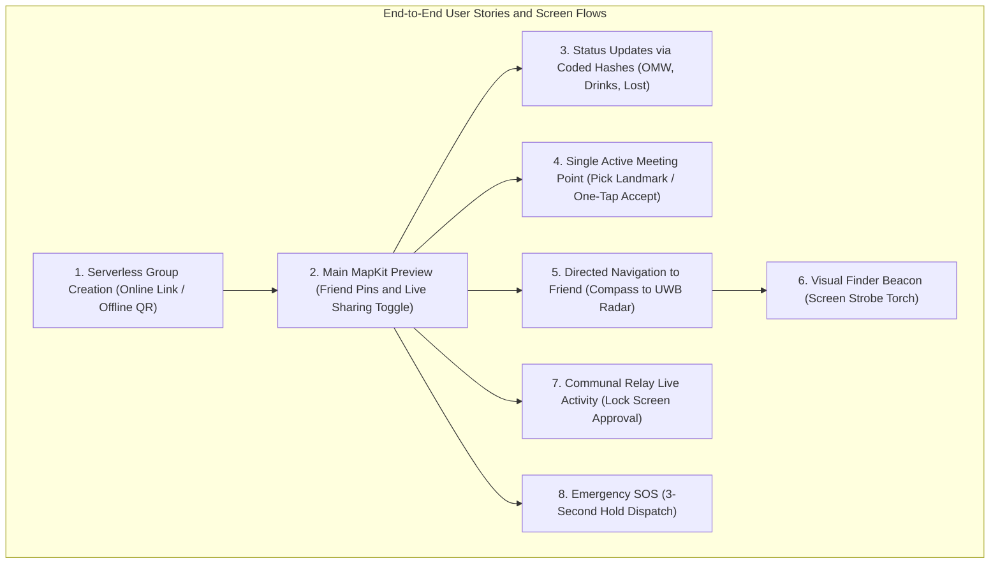

# Master Agent Instructions --- Offline Concert-Finding Mesh App

> **Purpose:** This document is the source of truth for AI coding agents
> and developers working on the iOS app. Follow it before making
> architectural or implementation decisions. When requirements conflict,
> prioritize user safety, security, iOS platform rules, and the explicit
> product requirements in this file.
> 
> *Companion Documents:*
> - [AI Coding Agent System Prompt & Task Playbook (docs/AGENT_PROMPT.md)](docs/AGENT_PROMPT.md)
> - [Technical Requirements Document (docs/TechnicalRequirements.md)](docs/TechnicalRequirements.md)
> 
> *Last Verified via /grill-me:* 2026-10-27 (Architecture, Tech Stack, 8 Blind Spots, Full User Story, & 56-Byte Binary Package Confirmed)

---

## 1. Product Summary

Build an **offline-first iOS app for finding friends at crowded
concerts, festivals, and venues**. Users form a group, share their
latest location and status, see other members on a map, choose meeting
points, and navigate toward a selected person.

The system is designed for venues with weak or unavailable internet.
Participating phones communicate directly (Phase 1 MVP) and opportunistically
relay encrypted packets for other users in a multi-hop mesh (Phase 2).
Relay participation must be explicit and opt-in.

### Product Principles

1.  **Offline-first:** Core group coordination must never require a cloud
    server during an active offline session.
2.  **Location + status:** Ordinary periodic updates carry the sender's
    latest available location and current status together.
3.  **SOS is exceptional:** SOS is sent immediately, independently of
    the normal location-ping interval, and receives high-priority
    bounded forwarding.
4.  **Battery-aware:** Avoid unnecessary GPS work, peer discovery,
    connection churn, retransmissions, and duplicate forwarding.
5.  **Privacy by design:** Collect and retain as little location data as
    practical. Never expose group payload contents to unrelated relay
    phones. Session state is strictly ephemeral.
6.  **Honest UX:** Show location age, reported accuracy, and delivery
    state. Never imply a stale location is current or that an SOS
    reached its destination when only a nearby relay received it.
7.  **iOS-realistic:** Never assume unrestricted background execution or
    continuous background mesh relaying. Screen-on for active navigation;
    hybrid background wakeups for emergency SOS.
8.  **Security before packet minimization:** Never weaken cryptography
    or replay protection just to fit a 56-byte packet.
9.  **User-controlled live sharing:** Location broadcasting is governed by
    an explicit "Live Sharing" master toggle (active when navigating or
    finding friends, paused when resting/watching shows). SOS is unconditional.
10. **Verified-only emergency scope:** Group coordination and emergency SOS alerts
    require authenticated group membership (established via in-person QR key exchange
    or pre-shared serverless link). Rogue stranger packets are dropped cryptographically.
11. **Radical Simplicity:** Keep the architecture dead-simple (pure MVVM without coordinators,
    zero external dependencies, and standard Apple frameworks).

---

## 2. Core Product Requirements & User Stories

### 2.1 Group Sessions & Pairing (100% Serverless)

-   **Zero-Backend Group Formation:** Users create and join groups both offline and online
    without requiring any cloud database, user accounts, or backend servers.
-   **Serverless Shareable Invite Link (Online):** When friends are at home or in the car
    with internet, the host taps "Share Invite Link". The app generates a universal link
    (e.g., `teekum://join#key=Base64Key&name=Group`) packing the session details and
    symmetric encryption key directly into the URL fragment. Tapping the link in iMessage
    or WhatsApp opens the app and joins immediately.
-   **In-Person QR Barcode (Offline):** At the festival with zero reception, the host
    displays a QR barcode encoding the exact same serverless URL string. Friends scan it
    with their camera on-site to exchange the key in seconds.
-   **Short-Lived & Ephemeral:** Sessions expire after the event.
-   **Session Teardown & Ephemeral Cleanup:** When a member leaves or the session ends,
    all session tracking, encryption keys, and cached relay data are wiped immediately
    from memory and local storage. No persistent tracking history is retained.

### 2.2 Location and Status Behavior

-   **Latest Local State:** The app maintains the latest locally available location,
    its measurement timestamp, and reported accuracy.
-   **User Status State:** The app maintains the user's current status as local state.
-   **User-Controlled "Live Sharing" Toggle:**
    -   When **ON**: The app actively publishes periodic location pings while
        the user is walking or navigating.
    -   When **OFF**: Location publishing is paused (saving battery and respecting
        privacy while watching a performance).
    -   **SOS Override**: Triggering SOS broadcasts immediately regardless of the
        Live Sharing toggle state.
-   **Normal Location Ping:** Includes the latest available location and current status.
-   **Ordinary Status Change:** Update local state immediately, but include the
    changed status in the *next normal location ping*. Do not send a separate
    status packet.
-   **Status Chips with Smart Targets:** Statuses can attach an optional target reference
    (e.g., status `0x07 GOING_TO` + target ID of a friend or a venue meeting point).
-   **SOS Emergency Trigger:**
    -   **3-Second Hold:** Users must press and hold the SOS button for 3 seconds
        to trigger, preventing accidental pocket taps while dancing.
    -   **Immediate Dispatch:** Transmit an SOS event immediately without waiting
        for a location ping or a fresh GPS fix. Uses freshest valid coordinate.
    -   **Honest Delivery Feedback:** Display distinct states: `LOCAL_SENDING`,
        `RELAY_ACK`, `DELIVERED_TO_FRIEND`, or `SEARCHING_PEERS`.
-   **No False Freshness:** Normal pings must not imply stale coordinates are fresh.
    Relays must never alter or refresh the original location measurement timestamp.
-   **Disconnected State:** Keep only the relevant latest state rather than queuing
    obsolete past pings.

### 2.3 Expanded Festival Status Enum (Coded Hashes)

Statuses are processed locally on the device and transmitted strictly as **1-byte compact coded hashes**
over the air to preserve radio bandwidth. Display strings are localized on the receiver.

-   `0x00 AVAILABLE` (Default green indicator / idle)
-   `0x01 SOS` (Urgent emergency siren / high-priority event)
-   `0x02 OMW` (On My Way)
-   `0x03 LOST` ("I'm lost!")
-   `0x04 EXPLORING` (Roaming the venue)
-   `0x05 WAIT` ("Wait for me")
-   `0x06 COME_TO_ME` ("Please come to me")
-   `0x07 GOING_TO` (Attaches target friend ID or meeting point ID)
-   `0x08 CANCEL_MEETING` ("Meeting cancelled")
-   `0x09 AT_MEETING_POINT` ("At the meeting point")
-   `0x0A GETTING_DRINKS` ("Grabbing drinks / at bar")
-   `0x0B RESTROOM` ("In restroom / toilet line")
-   `0x0C FOOD_MERCH` ("Getting food / merchandise")
-   `0x0D MEDICAL` ("At first aid / medical tent")

---

### 2.4 Detailed User Stories & Feature Specifications



#### User Story 1: Group Formation (Serverless Online & Offline)
- **Goal:** Form a private group with zero internet at the venue or pre-share before arriving.
- **Online Flow:** Host opens app -> taps "Create Group" -> taps "Share Invite Link" -> sends via iMessage/WhatsApp. Friends tap link -> app opens, extracts key from URL hash, and joins instantly.
- **Offline Flow:** Host opens app -> displays on-screen QR barcode. Friends tap "Join Group" -> camera scans barcode -> key imported to Keychain -> joined.
- **Security:** Group key never touches a cloud server. Only users with the key can decrypt locations or send verified alerts.

#### User Story 2: Main Map View & Live Sharing
- **Goal:** See all group members on the venue map.
- **UI:** MapKit preview rendering friend pins with initials/avatars and current status emojis.
- **Live Sharing Toggle:** Prominent toggle on map (`Live Sharing: ON/OFF`). When OFF, GPS is paused to save battery; when ON, updates broadcast every 3–5 seconds.
- **Honest UX:** Friends out of direct radio range appear as faded pins with badges: *"Last seen 4 mins ago near Stage B"*.

#### User Story 3: Directed Navigation to a Friend (Compass to Ultra-Wideband)
- **Goal:** Walk through a dense crowd directly to a friend.
- **No Approval Needed:** Navigating to a verified group member is automatic and friction-free.
- **Long-Range (>8 meters):** Shows a full-screen or split directional view with a 360° compass arrow pointing toward the friend's GPS bearing, with estimated distance in meters.
- **Close-Range Transition (<8 meters):** Smoothly and automatically transitions into Apple Nearby Interaction (Ultra-Wideband U1/U2) precision radar, pointing with centimeter accuracy ("3.2m at 2 o'clock").
- **Visual Strobe Beacon:** 1-tap button turns the screen into a high-visibility flashing neon torch to hold above the crowd.

#### User Story 4: Single Active Meeting Point & One-Tap Acceptance
- **Goal:** Synchronize a group rendezvous spot without confusing duplicates.
- **Single Active Rule:** Only **ONE** active meeting point exists for the group at any given time.
- **Creation:** Any member can propose a meeting point by picking an official venue landmark (Gate 3, Stage 2), dropping a custom pin, or tapping "Meet where I am now", with an optional time (e.g., "10:15 PM").
- **Acceptance:** Friends receive a non-intrusive banner notification and tap **"I'll be there"** or **"Can't make it"**, syncing attendance status to everyone's map.

#### User Story 5: Status Updates via Coded Hashes
- **Goal:** Quickly inform friends of current activity with one hand without typing text.
- **UI:** Horizontal quick-tap carousel docked directly below the map.
- **Interaction:** Tapping a chip (e.g., `Getting Drinks`, `Restroom`, `Lost`) updates local state and transmits the 1-byte coded hash on the next ping. Tapping `Coming to...` opens a 1-tap sheet to select a friend or meeting point.

#### User Story 6: MapKit Venue Preview
- **Goal:** Navigate venue geography offline.
- **Implementation:** Uses Apple MapKit's offline cached map system. Custom vector venue floorplans are planned for future development.

#### User Story 7: Lock Screen Live Activity & Communal Relay Approval
- **Goal:** Monitor group status from the Lock Screen / Dynamic Island and manage battery-conscious community relaying.
- **Friend Navigation:** Passively updates friend distance; does not require interactive approval.
- **Communal Relay Approval:** When stranger packets in the venue mesh need a forwarding hop, an interactive Lock Screen Live Activity surfaces:
  - Prompt: *"Nearby festival-goers need relay help: [Approve Relay] [Decline]"*
  - Options: User selects **"Timed (e.g., 30 mins)"** (auto-pauses to save battery) or **"Always Active"** (until manually stopped or battery hits <20%).

#### User Story 8: Emergency SOS
- **Goal:** Instantly summon friends during an emergency.
- **Interaction:** Press and hold SOS button for 3 full seconds (visual progress ring fills). Prevents misfires while dancing.
- **Dispatch:** Bypasses normal ping intervals and dispatches immediately with maximum queue priority.
- **Alert:** Friend devices play a distinct audible alert, trigger strong haptic vibration, and display honest delivery acknowledgements (`LOCAL_SENDING`, `DELIVERED_TO_FRIEND`).

---

## 3. Recommended Technology Stack

Use **100% native Apple frameworks (Zero External Dependencies)** to guarantee stability,
tiny binary size, zero supply-chain risk, and instant build times.

-   **Language:** Swift (Swift 5.9+ / Swift 6 modern concurrency).
-   **UI & State:** SwiftUI with Modern Swift Observation (`@Observable`) in simple **MVVM**.
    -   **No Coordinators (No MVVM+C):** Navigation is handled natively with SwiftUI
        `NavigationStack` or simple state switching (`if hasActiveSession { MainMapView() } else { GroupPairingView() }`).
-   **Platform Target:** Modern iOS (iOS 17+ / latest iOS platform capabilities).
-   **Location:** Core Location (`CLLocationCoordinate2D`, `CLLocationDegrees` as `Double`).
-   **Local Persistence:** Ephemeral in-memory actor state backed by lightweight native SQLite (`libsqlite3`)
    for crash recovery (resumes active session if user switches to Camera/Instagram). Wiped on leave.
-   **Cryptography:** CryptoKit (AES-256-GCM / ChaChaPoly authenticated encryption).
-   **Secret Storage:** iOS Keychain Services.
-   **Peer Transport Abstraction:** Modular `PeerTransport` interface.
    -   **Primary Adapter:** Apple's modern `Network.framework` P2P (`NWListener` & `NWConnection`
        with Bonjour `includePeerToPeer: true` operating over AWDL / Wi-Fi Direct and BLE).
-   **Close-Range Direction & Finding ("Last 10 Meters"):**
    -   **Nearby Interaction (Ultra-Wideband U1/U2):** High-precision directional arrow.
    -   **Visual Screen Strobe Beacon:** High-contrast full-screen flashing beacon to hold up in crowds.
-   **Maps & Venue Navigation:** MapKit Offline Map System (using downloaded/cached offline regions).
-   **Live Presentations:** ActivityKit (Dynamic Island / Lock Screen Live Activity with communal relay controls).
-   **Observability:** Built-in On-Device Diagnostics Sheet (Debug HUD) showing live RSSI (dBm),
    connected peers, GPS accuracy, and packet delivery logs.
-   **Testing:** Physical Device Testing on real iPhones in real wireless environments.

---

## 4. Simplified Architecture (Pure MVVM --- As Simple As Possible)

Keep the architecture dead-simple and approachable. Avoid complex multi-tier coordinators,
redundant abstraction layers, or over-engineered design patterns.

```text
TeeKum/
├── App/
│   └── TeeKumApp.swift                // App entry point & root state switch
├── Models/                            // Plain Swift data structures & packets
│   ├── Member.swift                   // Member model (id, name, lastSeen)
│   ├── LocationPin.swift              // CoreLocation Coordinate (Double), accuracy, timestamp
│   ├── Status.swift                   // Status enum & smart target
│   ├── MeetingPoint.swift             // Venue rendezvous landmark & time
│   └── Packet.swift                   // 56-byte binary packet representation & codec
├── Views/                             // SwiftUI Views (Pure visual layer)
│   ├── MainMapView.swift              // Map, friend pins, accuracy rings, status pills
│   ├── GroupPairingView.swift         // QR code generator & camera scanner / Link share
│   ├── StatusPickerView.swift         // Quick-tap status chips carousel
│   ├── SOSButtonView.swift            // 3-second hold SOS emergency button
│   ├── FinderBeaconView.swift         // Compass arrow -> UWB radar + screen strobe flasher
│   ├── MeetingPointsView.swift        // Meeting point selector & attendance cards
│   └── DiagnosticsView.swift          // On-device Debug HUD (RSSI dBm, peer list, packet logs)
├── ViewModels/                        // Pure MVVM: @Observable ViewModels
│   ├── MapViewModel.swift             // Map viewport, friend locations, Live Sharing toggle
│   ├── GroupSessionViewModel.swift    // Session lifecycle, QR/Link pairing, member management
│   ├── MeetingPointViewModel.swift    // Single active meeting point & attendance sync
│   └── SOSViewModel.swift             // 3-second countdown hold, delivery state feedback
├── Services/                          // Pure Native Apple Services (Swift Actors)
│   ├── LocationService.swift          // CoreLocation wrapper & adaptive cadence
│   ├── PeerTransportService.swift     // Network.framework P2P (NWListener / NWConnection)
│   ├── CryptoService.swift            // CryptoKit encryption/decryption & keygen
│   └── SessionStorage.swift           // In-memory actor + ephemeral SQLite crash recovery
├── docs/
│   ├── TechnicalRequirements.md       // Technical system requirements specification
│   ├── Architecture.md
│   └── AGENT_PROMPT.md                // AI coding agent onboarding & task playbook
└── Tests/
    └── UnitTests/
        ├── PacketCodecTests.swift
        └── CryptoSecurityTests.swift
```

### Architectural Rules

-   **Pure MVVM:** Views observe ViewModels (`@Observable`). ViewModels call Services. No Coordinators.
-   **Navigation:** Managed directly by SwiftUI (`NavigationStack` or simple state switches in `TeeKumApp.swift`).
-   **Thread Safety:** Services that handle asynchronous radio packets, encryption keys, and disk writes are Swift `actor`s (`actor PeerTransportService`, `actor SessionStorage`).
-   **Zero External Dependencies:** Every single file imports only official Apple frameworks.

---

## 5. Location Publisher and Battery Policy

Treat the app as a **periodic state publisher**, not a continuous coordinate stream.

### 5.1 The 4 Pillars of Festival Battery Conservation

1. **Motion-Aware GPS (CoreMotion Coprocessor):** The app monitors `CMMotionActivityManager`. When attendees are standing still watching a concert or dancing in place, CoreLocation GPS powers down or sleeps; when walking to find someone, high-accuracy GPS wakes up automatically. This saves ~70% of GPS battery.
2. **Micro-Burst Radio Duty-Cycling (AWDL / Wi-Fi Direct):** Packets transmit in <1 millisecond, allowing the radio baseband modem and CPU to immediately drop back into deep sleep (C-states). Normal pings fire every 3–5 seconds while moving, and 15–30 seconds while resting.
3. **Pure AMOLED Dark Mode (#000000 Pitch Black):** On iPhone OLED screens, black pixels consume 0 milliwatts. By default, maps and views use pure black backgrounds with high-contrast neon accents, saving ~35% display power outdoors.
4. **Hard 20% Cutoff (Festival Survival Mode):** The moment device battery drops to 20% (or Low Power Mode), stranger mesh relaying is immediately terminated to preserve remaining battery for SOS alerts and viewing the offline meeting map.

### 5.2 Approximate Power Draw & Usage Breakdown (8-Hour Festival Budget)

Target battery budget: **~3% to 5% per hour**.

| Operational State | Subsystems Running | Power Draw | Hourly Battery Drain |
| :--- | :--- | :--- | :--- |
| **Pocket / Show Watching** *(Idle state, ~80% of festival)* | Screen OFF, GPS asleep via CoreMotion, radio in micro-burst sleep tick (15–30s). | ~10 mA | **~0.3% to 0.5% / hour** *(Negligible)* |
| **Active Navigating** *(Finding a friend, ~20% of festival)* | Screen ON (AMOLED dark mode), GPS active (3–5s), compass heading, UWB radar within 8m. | ~220 mA | **~6% to 7% / hour** *(Only while actively navigating)* |
| **Communal Mesh Relaying** *(When enabled by user)* | Forwarding packets for strangers (capped at 2 packets/second). | ~15 mA | **~0.5% / hour** *(Auto-stops at 20% battery)* |

**Realistic 8-Hour Festival Estimate:**
- 6.5 Hours in pocket watching performances: `~2.5%`
- 1.5 Hours active screen navigation & meetups: `~10.0%`
- Communal relaying (when approved): `~2.5%`
- **Total Expected App Battery Consumption over 8 Hours: ~15% to 18%** (leaves plenty of power for 4K concert videos and rides home).

### 5.3 Smart Adaptive Cadence (When Live Sharing is ON)

-   **Moving / Navigating:** Ping every **3–5 seconds**.
-   **Stationary / Resting:** Drop to every **15–30 seconds**.
-   **Ordinary Status Change:** Update local state immediately; publish with next normal ping.
-   **SOS:** Dispatch immediately through the urgent path.
-   **Disconnected:** Retain latest useful state; back off retries with jitter.

### 5.4 Festival Survival Mode (<20% Battery)

-   Automatically detect device battery level < 20% or system Low Power Mode.
-   **Hard Relay Cutoff:** Instantly terminate all stranger packet forwarding.
-   **Throttle GPS:** Drop location checks to once every 1–2 minutes or on-demand only.
-   **Preserve Core Safety:** Reserve remaining battery strictly for SOS alerts and viewing offline meeting points.

---

## 6. Message and Packet Protocol (56-Byte Wire Specification)

The app utilizes a **Fixed 56-Byte Secure Binary Wire Format** transmitted over Apple's
`Network.framework` P2P datagram connections.

```text
+-----------------------+-----------------------------+-------------------------+
|  Outer Envelope (10B) |   Encrypted Payload (30B)   |   Auth Tag (16B)        |
|  (Cleartext Routing)  |   (Zero-Knowledge Cipher)   |   (Poly1305 / AES-GCM)  |
+-----------------------+-----------------------------+-------------------------+
0                       10                            40                        56 Bytes
```

### 6.1 Binary Layout & CoreLocation Data Type Mapping

| Byte Range | Field Name | Wire Type | Swift / CoreLocation Type | Description & Endianness |
| :--- | :--- | :--- | :--- | :--- |
| **0** | `versionAndType` | `UInt8` | `(UInt8, PacketType)` | High 4 bits = Version (`0x1`), Low 4 bits = Type (`0x1` Ping, `0x2` SOS, `0x3` Meeting, `0x6` ACK). |
| **1** | `hopMetadata` | `UInt8` | `(UInt8, UInt8)` | High 4 bits = Hop Limit (`8`), Low 4 bits = Hop Count (starts at `0`, incremented per relay). |
| **2..5** | `sessionId` | `UInt32` | `UInt32` | Big-endian hash identifying the group session network. |
| **6..9** | `sequenceNumber` | `UInt32` | `UInt32` | Big-endian counter for replay protection & duplicate cache key. |
| **10..13** | `latitudeRaw` | `Int32` | `CLLocationDegrees` (`Double`) | Signed 32-bit big-endian integer. Conversion: `Int32((latitude * 1_000_000).rounded())` (~11cm precision). |
| **14..17** | `longitudeRaw` | `Int32` | `CLLocationDegrees` (`Double`) | Signed 32-bit big-endian integer. Conversion: `Int32((longitude * 1_000_000).rounded())` (~11cm precision). |
| **18..21** | `timestamp` | `UInt32` | `Date` | Big-endian Unix epoch seconds (`UInt32(date.timeIntervalSince1970)`). Fixed measurement time. |
| **22** | `accuracy` | `UInt8` | `CLLocationAccuracy` (`Double`) | Horizontal accuracy radius in meters (`UInt8(min(255, max(0, accuracy.rounded())))`). |
| **23** | `statusCode` | `UInt8` | `StatusCode` (`enum: UInt8`) | Compact 1-byte festival activity hash (`0x00` Available, `0x0A` Drinks, `0x0B` Restroom, etc.). |
| **24..27** | `targetRefId` | `UInt32` | `UInt32?` | Optional 32-bit big-endian ID of target member or meeting point (`0x00000000` if none). |
| **28..31** | `senderId` | `UInt32` | `UInt32` | Ephemeral session-scoped member ID of sender. |
| **32..39** | `variantData` | `8 Bytes` | `VariantSpecificData` | 8 bytes reserved for variant-specific payloads (see Section 6.2). |
| **40..55** | `authTag` | `16 Bytes` | `Data` (CryptoKit Tag) | 128-bit Poly1305 / AES-GCM authentication tag verifying payload + envelope AAD. |

#### Why Int32 Quantization for CoreLocation `Double`?
- **Swift / Model Layer:** The app models coordinates strictly using standard Apple `CLLocationCoordinate2D` where `latitude` and `longitude` are native 64-bit IEEE 754 `Double` (`CLLocationDegrees`).
- **Wire Layer:** Encoding `Double` directly takes 16 bytes (8 bytes each). By multiplying by `1,000,000` and serializing as a signed 32-bit integer (`Int32`), we achieve **0.000001° resolution (~11 centimeters)** worldwide while saving 8 entire bytes on the radio packet.
- **Conversion Safety:**
  ```swift
  // Encoding: Double -> Int32
  let rawLat = Int32((coordinate.latitude * 1_000_000.0).rounded())
  let latBytes = rawLat.bigEndian

  // Decoding: Int32 -> Double
  let latitude = Double(Int32(bigEndian: latBytes)) / 1_000_000.0
  ```

---

### 6.2 Exact Wire Layout for Each Package Type

Every packet is strictly **56 bytes** total. Below are the exact byte layouts for each message type.

#### Type 1: `0x01` — `LOCATION_PING` (Normal Location & Status)
*Sent every 3–5 seconds while moving, or 15–30 seconds while stationary.*

| Byte Range | Field Name | Wire Type | Swift / CoreLocation Type | Description & Endianness |
| :--- | :--- | :--- | :--- | :--- |
| **0** | `versionAndType` | `UInt8` | `(UInt8, PacketType)` | `0x11` (High nibble = Version `1`, Low nibble = Type `1`). |
| **1** | `hopMetadata` | `UInt8` | `(UInt8, UInt8)` | High 4 bits = Hop Limit (`8`), Low 4 bits = Hop Count (`0` initially). |
| **2..5** | `sessionId` | `UInt32` | `UInt32` | 32-bit big-endian hash of the active group session. |
| **6..9** | `sequenceNumber` | `UInt32` | `UInt32` | Big-endian counter (1, 2, 3...) for replay rejection & duplicate cache. |
| **10..13** | `latitudeRaw` | `Int32` | `CLLocationDegrees` (`Double`) | Signed 32-bit big-endian: `Int32((latitude * 1_000_000).rounded())` (~11cm res). |
| **14..17** | `longitudeRaw` | `Int32` | `CLLocationDegrees` (`Double`) | Signed 32-bit big-endian: `Int32((longitude * 1_000_000).rounded())` (~11cm res). |
| **18..21** | `timestamp` | `UInt32` | `Date` | Big-endian Unix epoch seconds (`UInt32(date.timeIntervalSince1970)`). |
| **22** | `accuracy` | `UInt8` | `CLLocationAccuracy` (`Double`) | Horizontal accuracy radius in meters (`0` to `255`m). |
| **23** | `statusCode` | `UInt8` | `StatusCode` (`enum: UInt8`) | Coded activity hash (`0x00` Available, `0x0A` Drinks, `0x0B` Restroom, etc.). |
| **24..27** | `targetRefId` | `UInt32` | `UInt32?` | Big-endian ID of target friend or landmark (`0x00000000` if none). |
| **28..31** | `senderId` | `UInt32` | `UInt32` | Big-endian 32-bit session ID of the transmitting member. |
| **32** | `batteryLevel` | `UInt8` | `Float` | Sender battery percentage (`0` to `100`%). |
| **33** | `heading` | `UInt8` | `CLLocationDirection` (`Double`) | Compass heading (`0–255` representing 0–360°, `degrees * 255 / 360`). |
| **34..39** | `reserved` | `6 Bytes` | `Data` | Reserved for future expansion (padded with `0x000000000000`). |
| **40..55** | `authTag` | `16 Bytes`| `Data` (CryptoKit Tag) | 128-bit Poly1305 / AES-GCM MAC tag sealing payload + envelope AAD. |

#### Type 2: `0x02` — `SOS` (Urgent Emergency Alert)
*Sent immediately upon 3-second hold. Preempts all queues and transmits with bounded retries.*

| Byte Range | Field Name | Wire Type | Swift / CoreLocation Type | Description & Endianness |
| :--- | :--- | :--- | :--- | :--- |
| **0** | `versionAndType` | `UInt8` | `(UInt8, PacketType)` | `0x12` (High nibble = Version `1`, Low nibble = Type `2`). |
| **1** | `hopMetadata` | `UInt8` | `(UInt8, UInt8)` | High 4 bits = Hop Limit (`8`), Low 4 bits = Hop Count (`0` initially). |
| **2..5** | `sessionId` | `UInt32` | `UInt32` | 32-bit big-endian hash of the active group session. |
| **6..9** | `sequenceNumber` | `UInt32` | `UInt32` | Big-endian sequence counter. |
| **10..13** | `latitudeRaw` | `Int32` | `CLLocationDegrees` (`Double`) | Freshest available latitude (`Double * 1_000_000`, signed 32-bit big-endian). |
| **14..17** | `longitudeRaw` | `Int32` | `CLLocationDegrees` (`Double`) | Freshest available longitude (`Double * 1_000_000`, signed 32-bit big-endian). |
| **18..21** | `timestamp` | `UInt32` | `Date` | Measurement timestamp of that coordinate (epoch seconds). |
| **22** | `accuracy` | `UInt8` | `CLLocationAccuracy` (`Double`) | Accuracy radius in meters at measurement time. |
| **23** | `statusCode` | `UInt8` | `StatusCode` | Fixed urgent status code: `0x01` (`SOS`). |
| **24..27** | `sosEventId` | `UInt32` | `UInt32` | Unique random 32-bit event ID (used to deduplicate multi-hop copies). |
| **28..31** | `senderId` | `UInt32` | `UInt32` | Big-endian ID of the member in distress. |
| **32** | `emergencyType` | `UInt8` | `SOSType` (`enum: UInt8`) | `0x01` Medical, `0x02` Lost/Separated, `0x03` Harassment/Security, `0x00` General. |
| **33** | `batteryLevel` | `UInt8` | `Float` | Current battery % of sender's phone (`0` to `100`%). |
| **34..39** | `reserved` | `6 Bytes` | `Data` | Reserved padding (`0x000000000000`). |
| **40..55** | `authTag` | `16 Bytes`| `Data` (CryptoKit Tag) | 128-bit MAC tag verifying group signature (prevents stranger fake alarms). |

#### Type 3: `0x03` — `MEETING_UPDATE` (Rendezvous Landmark & Attendance)
*Sent when proposing, accepting ("I'll be there"), or cancelling a single active meeting point.*

| Byte Range | Field Name | Wire Type | Swift / CoreLocation Type | Description & Endianness |
| :--- | :--- | :--- | :--- | :--- |
| **0** | `versionAndType` | `UInt8` | `(UInt8, PacketType)` | `0x13` (High nibble = Version `1`, Low nibble = Type `3`). |
| **1** | `hopMetadata` | `UInt8` | `(UInt8, UInt8)` | High 4 bits = Hop Limit (`8`), Low 4 bits = Hop Count (`0`). |
| **2..5** | `sessionId` | `UInt32` | `UInt32` | 32-bit big-endian hash of the active group session. |
| **6..9** | `sequenceNumber` | `UInt32` | `UInt32` | Big-endian sequence counter. |
| **10..13** | `meetingLat` | `Int32` | `CLLocationDegrees` (`Double`) | Rendezvous spot latitude (`Double * 1_000_000`, signed 32-bit big-endian). |
| **14..17** | `meetingLon` | `Int32` | `CLLocationDegrees` (`Double`) | Rendezvous spot longitude (`Double * 1_000_000`, signed 32-bit big-endian). |
| **18..21** | `meetupTime` | `UInt32` | `Date` | Target rendezvous time (Unix epoch seconds, e.g. 10:15 PM). |
| **22** | `meetingAction` | `UInt8` | `MeetingAction` (`enum: UInt8`) | `0x01` Propose, `0x02` Accept ("I'll be there"), `0x03` Decline, `0x04` Cancel. |
| **23** | `attendanceStatus`| `UInt8` | `StatusCode` | `0x01` Attending, `0x02` Can't Make It, `0x09` At Meeting Point. |
| **24..27** | `meetingPointId`| `UInt32` | `UInt32` | Unique 32-bit ID for this rendezvous instance. |
| **28..31** | `senderId` | `UInt32` | `UInt32` | Member ID of who proposed or accepted. |
| **32..35** | `landmarkId` | `UInt32` | `UInt32?` | Pre-set venue landmark ID (`0x00000001` Gate 1, `0x00000002` Stage A; `0` if pin). |
| **36..39** | `reserved` | `4 Bytes` | `Data` | Padding (`0x00000000`). |
| **40..55** | `authTag` | `16 Bytes`| `Data` (CryptoKit Tag) | 128-bit Poly1305 / AES-GCM MAC tag. |

#### Type 4: `0x06` — `ACK` (Receipt Confirmation)
*Sent to confirm delivery of an SOS alert, a targeted status, or a rendezvous update.*

| Byte Range | Field Name | Wire Type | Swift / CoreLocation Type | Description & Endianness |
| :--- | :--- | :--- | :--- | :--- |
| **0** | `versionAndType` | `UInt8` | `(UInt8, PacketType)` | `0x16` (High nibble = Version `1`, Low nibble = Type `6`). |
| **1** | `hopMetadata` | `UInt8` | `(UInt8, UInt8)` | High 4 bits = Hop Limit (`8`), Low 4 bits = Hop Count (`0`). |
| **2..5** | `sessionId` | `UInt32` | `UInt32` | 32-bit big-endian group session ID. |
| **6..9** | `sequenceNumber` | `UInt32` | `UInt32` | Big-endian sequence counter. |
| **10..13** | `ackedSeqNumber`| `UInt32` | `UInt32` | The exact sequence number of the message being acknowledged. |
| **14..17** | `ackedSenderId` | `UInt32` | `UInt32` | The original sender whose message is being confirmed. |
| **18..21** | `ackTimestamp` | `UInt32` | `Date` | Timestamp when the receiver got the message (epoch seconds). |
| **22** | `ackStatus` | `UInt8` | `ACKStatus` (`enum: UInt8`) | `0x01` Delivered to Intended Recipient, `0x02` Relayed by Mesh Hop. |
| **23** | `receivedRssi` | `Int8` | `Int8` | Signal strength in dBm observed on arrival (e.g., `-65` dBm). |
| **24..27** | `originalEventId`| `UInt32` | `UInt32` | Original event ID (matching `sosEventId` or `meetingPointId`). |
| **28..31** | `responderId` | `UInt32` | `UInt32` | Member ID of the device confirming receipt. |
| **32..39** | `reserved` | `8 Bytes` | `Data` | Padding (`0x0000000000000000`). |
| **40..55** | `authTag` | `16 Bytes`| `Data` (CryptoKit Tag) | 128-bit Poly1305 / AES-GCM MAC tag. |

#### Types 5 & 6: `0x04` / `0x05` — `ROUTE_REQ` & `ROUTE_RESP` (Phase 2 Mesh Discovery)
*Used in Phase 2 for on-demand AODV route discovery when finding multi-hop paths across large venues.*

| Byte Range | Field Name | Wire Type | Swift / CoreLocation Type | Description & Endianness |
| :--- | :--- | :--- | :--- | :--- |
| **0** | `versionAndType` | `UInt8` | `(UInt8, PacketType)` | `0x14` (`ROUTE_REQ`) or `0x15` (`ROUTE_RESP`). |
| **1** | `hopMetadata` | `UInt8` | `(UInt8, UInt8)` | High 4 bits = Hop Limit (`8`), Low 4 bits = Hop Count (`0` initially). |
| **2..5** | `sessionId` | `UInt32` | `UInt32` | 32-bit big-endian group session ID. |
| **6..9** | `sequenceNumber` | `UInt32` | `UInt32` | Big-endian sequence counter. |
| **10..13** | `originatorId` | `UInt32` | `UInt32` | Member ID seeking the route. |
| **14..17** | `targetMemberId`| `UInt32` | `UInt32` | Member ID of the destination friend being searched for. |
| **18..21** | `discoveryNonce`| `UInt32` | `UInt32` | Unique random nonce to suppress duplicate route broadcasts. |
| **22** | `routeCost` | `UInt8` | `UInt8` | Cumulative path cost / metric (hop count + link quality penalty). |
| **23..39** | `reserved` | `17 Bytes`| `Data` | Reserved routing metadata / path tracking. |
| **40..55** | `authTag` | `16 Bytes`| `Data` (CryptoKit Tag) | 128-bit MAC tag verifying legitimate group member request. |

---

### 6.3 Envelope & Relay Separation Architecture

- **Outer Envelope (Bytes 0–9):** Transmitted in the clear so stranger relays can inspect `hopCount`, `hopLimit`, `sessionId`, and `sequenceNumber` to forward packets and reject duplicates.
- **Inner Payload (Bytes 10–39):** Encrypted using the group's symmetric key. Unrelated relay nodes possess no group keys and see only opaque ciphertext.
- **Associated Authenticated Data (AAD):** The 10-byte outer envelope is injected as Associated Data into the cryptographic cipher. If any rogue node tampers with the `sessionId`, `sequenceNumber`, or payload bytes, the 16-byte Poly1305 authentication tag fails verification upon reception and the packet is immediately dropped.

---

### 6.4 Ingestion & Outbox Pipeline

1. **Coalescing Outbox:** The outbox queue keeps only the freshest normal location ping (superseded unsent pings are overwritten). Emergency SOS packets cut the line into the URGENT priority lane and transmit immediately with bounded retries.
2. **6-Step Inbound Filter:**
   1. *Size Check:* Ensure exactly 56 bytes.
   2. *Version Check:* Ensure `version == 0x01`.
   3. *Deduplication Check:* Drop if `(sessionId, sequenceNumber)` is in the 5-minute LRU packet cache.
   4. *Crypto Verification:* Verify 16-byte auth tag using group key. Drop on failure.
   5. *Sequence & Timestamp Check:* Verify sequence number is fresh; do not overwrite newer member state with delayed coordinates.
   6. *UI & Siren Dispatch:* Update map pins and trigger audible/haptic alert if SOS.

---

## 7. Mesh Routing and Forwarding

Use an **AODV-inspired on-demand routing approach** with bounded flooding fallback.

-   **Phase 1 (Direct Offline MVP):** Direct peer-to-peer connections between group members.
-   **Phase 2 (Multi-Hop Stranger Mesh):**
    -   Phones act as blind relays for encrypted packets.
    -   Relay participation requires explicit user opt-in (via Settings or Lock Screen Live Activity).
    -   Relay nodes **cannot** decrypt location or status payloads (zero-knowledge relaying).
    -   **Hop Limit (TTL):** Set to a maximum of **8 hops** to allow coverage across massive multi-kilometer festival grounds.
    -   **Relay Rate Limit:** Stranger relays cap re-transmissions to **2 packets/second** to preserve battery. SOS packets are exempt from rate limits.
    -   Duplicate suppression via 5-minute LRU packet cache.

---

## 8. Security and Privacy Requirements

-   **CryptoKit First:** Use standard AES-256-GCM or ChaCha20-Poly1305. Never build custom cryptographic primitives.
-   **Serverless Key Exchange:** Symmetric group keys are generated on-device and shared strictly via URL fragment link or offline QR barcode.
-   **Rogue SOS & Panic Protection:** Every SOS packet must carry a valid group signature. Stranger packets or unverified alerts cannot trigger audible sirens on a user's device.
-   **Zero-Knowledge Relaying:** Relays handle opaque bytes; mutable hop metadata is authenticated separately from encrypted payloads.
-   **Keychain Storage:** Key material is stored in iOS Keychain; never written to plaintext logs or files.
-   **Ephemeral Retention:** Only the latest location per friend is displayed. Historical tracks are not logged or stored. Session teardown purges all keys and cached frames.

---

## 9. Offline Maps and Navigation

-   **MapKit Offline System:** Leverage iOS offline map download capabilities for base street maps.
-   **Single Active Meeting Point:** Friends synchronize one group rendezvous spot; friends accept with one tap ("I'll be there").
-   **Proximity Reconnection:** When disconnected in crowds, the app navigates friends to the agreed meeting point and automatically resumes wireless link upon proximity.
-   **Honest Uncertainty Display:** In the presence of radio blockage or indoor GPS degradation, show faded pins with explicit time elapsed (*"Last seen 4m ago"*) and an accuracy radius circle. Never present a stale fix as live.
-   **"Last 10 Meters" Finder:**
    -   Nearby Interaction (UWB) provides directional guidance ("3 meters to your right").
    -   Screen Strobe Beacon turns the screen into a flashing neon torch to wave above the crowd.

---

## 10. iOS Platform Constraints & Background Strategy

-   **Active Background Session with Status Pill:**
    -   To keep communal mesh relaying alive while an iPhone is locked in a pocket without iOS freezing the app, the app runs an active background session with `showsBackgroundLocationIndicator = true`.
    -   This displays Apple's standard blue location arrow / Dynamic Island indicator, granting the app continuous background execution privileges so `NWListener` and `NWConnection` can receive and relay packets.
    -   **Battery Protection:** Even with background execution granted, GPS hardware remains asleep via `CoreMotion` when stationary. Sockets only wake up for <1ms per packet relay (capped at 2 pkts/sec).
    -   **Hard 20% Cutoff:** At 20% battery, the background session and status pill are automatically terminated.
-   **Hybrid Background Strategy:**
    -   **Foreground / Screen-On:** Full active navigation, compass pointing, and periodic location updates.
    -   **Locked / Pocket (Relay OFF):** App suspends normal GPS pings to preserve battery and respect iOS limits; wakes up only for urgent incoming SOS alerts.
    -   **Locked / Pocket (Relay ON):** Active background session maintains communal relaying for the festival crowd.
-   **Onboarding Permission Primers:**
    -   Show friendly, informative pre-permission screens *before* triggering Apple system dialogs for Bluetooth, Local Network, and Location, preventing accidental "Don't Allow" taps.
-   **Non-Intrusive Error Feedback:**
    -   Use subtle in-app status pills at the top of the map (*"Searching for friends..."*, *"GPS weak under roof"*); avoid modal popup alerts.

---

## 11. Testing and Observability

-   **Physical Device Testing Focus:** Testing must be conducted on real physical iPhones with active Apple radios in real physical environments.
-   **On-Device Debug HUD (`DiagnosticsView.swift`):**
    -   Inspect live radio signal strength (RSSI in dBm) for connected peers.
    -   View active peer count, packets sent/received/dropped.
    -   Inspect true CoreLocation GPS accuracy (± meters and measurement age).
    -   Inspect active cryptographic key fingerprint.
-   **Unit Tests:**
    -   Binary packet encoder/decoder tests with boundary conditions.
    -   CryptoKit encryption/decryption round-trip tests and replay rejection.

---

## 12. Delivery Roadmap

### Phase 1 --- Direct Offline MVP (Simple MVVM)
-   [x] Architecture & Blind Spot verification via `/grill-me`.
-   [x] Technical stack alignment (Pure MVVM, 0 external dependencies, physical testing).
-   [x] Complete User Story & Screen Journey verification.
-   [x] 56-Byte Binary Packet Wire Protocol & Network.framework P2P specification.
-   [ ] Initialize clean Xcode project with simple MVVM structure (`Views`, `ViewModels`, `Models`, `Services`).
-   [ ] Serverless Group Creation (Shareable Link & In-Person QR Barcode).
-   [ ] Direct Apple Peer-to-Peer transport service (`PeerTransportService`).
-   [ ] Live Sharing toggle & smart adaptive location publisher.
-   [ ] MapKit offline preview with friend pins, accuracy rings, and status pills.
-   [ ] Horizontal status chips carousel with festival activity codes (`Drinks`, `Restroom`, `Lost`, etc.).
-   [ ] Single Active Meeting Point creation & one-tap attendance sync.
-   [ ] Directed navigation: 360° Compass Arrow -> Seamless Ultra-Wideband Radar transition.
-   [ ] 1-Tap Screen Strobe Beacon for visual crowd finding.
-   [ ] 3-Second Hold SOS trigger with immediate delivery feedback.
-   [ ] On-Device Debug HUD Sheet (`DiagnosticsView.swift`).
-   [ ] Festival Survival Mode (<20% battery throttling).

### Phase 2 --- Multi-Hop Mesh & Communal Relay
-   [ ] Neighbor and routing tables (AODV-style on-demand).
-   [ ] Blind packet relaying with opt-in user toggle.
-   [ ] Lock Screen Live Activity for communal relay approval (Timed 30m vs Always Active).
-   [ ] Forwarding budget, hop limits (max 8), and packet cache deduplication.
-   [ ] Multi-hop SOS forwarding on physical devices.

### Phase 3 --- Venue Intelligence & Polish
-   [ ] Custom venue event vector overlays (stages, medical, water stations).
-   [ ] Apple Watch companion extension for haptic notifications.

---

## 13. Non-Negotiable Summary

1.  Normal pings carry **location + current status**.
2.  Ordinary status changes are piggybacked on the **next normal ping**.
3.  SOS is a **separate immediate, high-priority event** (3-second hold to trigger) and never waits for the normal interval.
4.  SOS is signed and authenticated; unauthenticated stranger SOS packets are rejected.
5.  Location broadcasting is governed by the **Live Sharing** user toggle.
6.  Battery is protected by **Smart Adaptive intervals** and automatic **Festival Survival Mode** at <20%.
7.  Session data is **strictly ephemeral**; all keys and locations are purged when the session ends.
8.  Never show a stale coordinate as a live position; show honest time badges and accuracy radii.
9.  Never compromise cryptography to hit a packet size target.
10. Architecture must remain **pure, simple MVVM** with **zero external dependencies**.
11. Group creation is **100% serverless** via URL fragment links and QR barcodes.
12. There is **only ONE active meeting point** at a time for the group.
13. Wire format is fixed at **56 bytes** with big-endian integer coordinates and full 16-byte authentication tags.

---

## 14. Field-Tested Realities & Blind Spot Mitigations

| # | Blind Spot | Real-World Risk | Confirmed Solution |
| :--- | :--- | :--- | :--- |
| **1** | **Phone in Pocket (iOS Sleep)** | iOS terminates background mesh scanning and sockets when the phone is locked. | **Active Background with Status Pill:** Uses Apple's official location indicator pill (`showsBackgroundLocationIndicator = true`) to keep mesh relay sockets running while locked in a pocket, with CoreMotion sleeping GPS when stationary. |
| **2** | **"Human Wall" Radio Blockage** | 40,000 human bodies absorb 2.4 GHz radio signals, shrinking range from 40m down to 10m. | **Honest UX:** Show faded pins with *"Last seen X mins ago"* and accuracy circles instead of vanishing. |
| **3** | **"Last 10 Meters" in Dark Crowd** | GPS accuracy is ±10m; users cannot identify which person in a dark crowd is their friend. | **Visual Strobe + UWB:** Directional arrow on screen + high-contrast flashing screen torch to hold in the air. |
| **4** | **Sparse Mesh (Cold Start)** | On day one, only 4 friends have the app; no stranger relays exist to bridge long distances. | **Pre-Set Meeting Points:** Agreed rendezvous spots on offline map; auto-reconnects when within range. |
| **5** | **Festival Battery Drain** | Video recording drains batteries to 15%; continuous mesh relays kill the phone completely. | **Festival Survival Mode (Hard 20% Cutoff):** Automatic shutoff at 20% battery; stops stranger relaying completely, saving battery for SOS and meeting maps. |
| **6** | **Unintentional Tracking** | Users don't want constant tracking while resting or watching a band. | **Live Sharing Master Toggle:** Turn ON to navigate/find friends; turn OFF to pause tracking. SOS always sends. |
| **7** | **Panic & Rogue SOS Spam** | Malicious nearby nodes could broadcast fake emergencies to cause a crowd surge. | **Verified Friend Signature:** Only friends who scanned the QR code in person hold the key to trigger emergency alerts. |
| **8** | **Accidental "Don't Allow" Tap** | Tapping "Don't Allow" on Apple's Bluetooth/Local Network popups permanently breaks offline connectivity. | **Pre-Permission Primers:** Friendly educational screens explaining the need for permissions before Apple dialogs appear. |
