# Volume 00: Master Index, Architecture & Engineering Handbook

## Design and UX Guide (Zero Code Required)

### Primary Reading Path for Non-Technical Teammates
If you are a product designer, mission coordinator, disaster response planner, or exhibition booth presenter who knows nothing about software engineering, **do not start here**. 

Begin your journey with **[Volume 14: Non-Technical, Operational & Exhibition Guide](14_non_technical_and_exhibition_guide.md)**. Volume 14 contains the complete, cover-to-cover project story, urban collapse and grid blackout challenge breakdowns, operational personas, deployment phases, everyday explanations of multi-hop mesh networking and encryption, competitive objection analysis, a 3-minute live booth demo script, and an end-to-end plain-English walkthrough of every feature in Meepo with zero Swift code blocks and zero technical jargon.

Once you have read Volume 14, consult the specialized `## Design and UX Guide (Zero Code Required)` sections located at the top of Volumes [06](06_location_and_live_activity.md), [07](07_feature_sos.md), [08](08_feature_chat.md), [09](09_feature_map.md), [10](10_feature_finder.md), [11](11_feature_pairing_and_meeting.md), and [12](12_feature_diagnostics.md) for screen-level interaction rules, visual edge cases, and design constraints.

---

### Plain-Language Product & Disaster Physics Overview
Meepo (internally codenamed TeeKum during early engineering development) is a private, serverless search-and-rescue team locator, tactical proximity radar, and emergency distress lifeline designed specifically for post-disaster environments where municipal telecommunications, cellular towers, and electrical grids have completely collapsed.

Traditional internet-dependent applications assume an intact global infrastructure: reliable power outlets, operational cellular towers, underground fiber lines, and cloud data centers. In a major earthquake, tsunami, hurricane, or urban structural collapse, that infrastructure fails immediately:
1. **Total Grid Blackout:** Power stations trip, fiber backbones snap under shifting pavement, and cellular towers shut down once backup batteries drain.
2. **Severe Radio Wave Absorption:** Concrete slabs, steel rebar, shattered masonry, and fallen debris absorb and scatter short-range radio signals aggressively, reducing direct phone-to-phone Bluetooth range from one hundred meters down to ten or fifteen meters.
3. **Deafening Sensory Chaos:** Screaming sirens, rubble-clearing heavy machinery, howling storm winds, and roaring emergency generators completely swallow delicate smartphone notification chimes and gentle pocket vibrations.
4. **Complete Visual Blackout:** Darkness, dense fire smoke, and airborne masonry dust clouds make it impossible to visually identify squad members who are standing only ten meters away.
5. **Critical 72-Hour Power Scarcity:** Responders and survivors must operate for days without electrical outlets, turning power conservation into a direct matter of survival.

Meepo overcomes these physical constraints by turning standard smartphones into an ad-hoc, cooperative radio mesh network. Devices pass encrypted packets quietly from pocket to pocket across the disaster zone like a humanitarian bucket brigade, allowing emergency coordination to travel across ruined city blocks without internet, cell towers, or centralized servers.

---

### "Why Can't We Just...?" Master FAQ for Designers

When product designers first design interfaces for Meepo, they naturally ask why certain conventions from standard cloud-connected consumer apps (like WhatsApp, iMessage, or Google Maps) cannot be used in a disaster scenario. Below are the definitive engineering realities behind Meepo's unique design constraints:

#### 1. "Why can't we allow longer tactical messages or voice memos?"
- **The Constraint:** Text messages in Meepo are strictly capped at twenty bytes of UTF-8 text (twenty characters of basic text, or five four-byte emojis). Audio recordings and photo attachments are strictly forbidden.
- **Why It Exists:** Radio packets traveling across a multi-hop mesh must be microscopic to survive extreme interference and weak links between collapsed buildings. Every packet in Meepo is packed into a strictly fixed 56-byte wire datagram. If packets were larger, they would fragment across multiple Bluetooth Low Energy frames. In a disaster zone where concrete and debris constantly block signals, multi-fragment messages suffer catastrophic packet loss. Compact twenty-byte messages slip through the narrowest radio windows in milliseconds. Emojis consume four bytes each because international Unicode standards represent complex pictographs with four 8-bit bytes.

#### 2. "Why can't the emergency SOS activate with a single quick tap?"
- **The Constraint:** Activating emergency SOS requires holding the red distress button firmly for three full seconds, or performing a deliberate, continuous upward swipe of at least 64 points.
- **Why It Exists:** Rescue workers scramble over unstable rubble, crawl through tight spaces, carry heavy equipment, and bump into obstacles. A single-tap emergency button would trigger dozens of accidental false alarms every shift, exhausting rescue resources. A continuous three-second hold or deliberate upward drag guarantees conscious human intent while remaining simple enough for a panicked, trapped, or injured responder to execute with heavy gloves.

#### 3. "Why can't we show a standard delivered checkmark as soon as a message leaves the phone?"
- **The Constraint:** Meepo enforces the Honest Delivery Triad: *Sent* (one gray dot: broadcast into local air), *Relayed* (two blue dots: picked up and carried by an intermediate helper phone), and *Delivered* (bright green double check: verified received on your teammate's screen).
- **Why It Exists:** In a disconnected disaster mesh, a message leaving your antenna does not mean your team lead has received it; they might be inside a reinforced basement shelter or their phone might be powered off. Falsely indicating delivery when a message has only reached an intermediate volunteer creates dangerous operational illusions that could delay a rescue.

#### 4. "Why can't multiple squad members propose different rally points simultaneously?"
- **The Constraint:** A squad shares exactly one active rally point at any given time, governed by the Setter Lock rule: only the incident commander or responder who established the rally point has the authority to move or cancel it.
- **Why It Exists:** In high-stress, noisy disaster operations, multiple competing rally pins cause chaos, split rescue squads, and lead to casualties arriving at unstaffed evacuation sites. Enforcing a single active assembly area with a designated setter lock ensures unambiguous operational clarity. Team members can RSVP *"I'll be there"* or *"Can't make it"*, but the destination remains rock-solid.

#### 5. "Why can't the radar show team members who are hundreds of meters away?"
- **The Constraint:** The tactical proximity radar has a hard boundary of sixty meters. Responders beyond sixty meters are clamped to the outer perimeter rim of the circle with directional arrows and exact distance numbers.
- **Why It Exists:** The tactical radar is a close-range recovery tool designed for immediate visual contact in smoke, dust, or darkness. If the radar displayed a five-hundred-meter radius, teammates who are ten meters away searching the same collapsed structure would overlap into an illegible cluster in the center of the screen. Clamping distant members to the perimeter rim keeps close-range search grids clear while maintaining bearing and distance readouts for distant squads.

#### 6. "Why do users have to accept the Mesh Agreement modal before joining a squad?"
- **The Constraint:** The `MeshAgreementView` modal requires users to explicitly consent to cooperative background relaying before activating their session.
- **Why It Exists:** Operating as an emergency relay involves consuming small amounts of battery power and radio bandwidth to forward encrypted life-safety packets for neighboring squads and survivors. Both Apple App Store guidelines and international privacy laws mandate explicit, informed consent before an application uses device radios for background peer-to-peer mesh routing.

---

### Editable Design Tokens vs. Locked Engineering Rules

The table below provides clear boundaries for product designers and front-end engineers, detailing which elements can be freely customized versus the immutable engineering rules that cannot be altered without breaking protocol compatibility:

| Component / Subsystem | Editable Design Tokens (Safe for UI Iteration) | Locked Engineering Rules (Immutable / Protocol-Breaking) |
| :--- | :--- | :--- |
| **Tactical Dark Theme & Palette** | High-visibility emergency accents, card corner radii, sheet presentations (`Theme.swift`). | Pure-black background (`Color.black`) must be maintained on primary screens to preserve OLED pixel power shutoff. |
| **Squad Callsign Colors** | Exact hex codes for UI rendering of avatar badges (`MemberColor.swift`). | Wire color codes are strictly 1 byte (`0x01` through `0x0B`); adding new colors requires registering unique byte codes. |
| **Tactical Chat Presets** | Preset button labels, ordering, and icon styling (`ChatMessagePayload.swift`). | Micro-message length is strictly capped at 20 UTF-8 bytes; messages exceeding 20 bytes throw serialization errors. |
| **Tactical Radar Canvas** | Distance ring line opacities, blip pulse animations, optical strobe cadence (`RadarCirclesView.swift`). | Hard maximum radar radius is strictly 60 meters (15m, 30m, 60m rings); coordinates outside 60m must clamp to the rim. |
| **Rally & Triage Point Rendezvous**| Pin icon assets, RSVP badge styling, sheet layout (`MeetingPointCardView.swift`). | Arrival geofence radius is strictly 25 meters; rally points automatically expire and dissolve after 60 minutes. |
| **Emergency SOS Beacon** | Swipe button color gradients, haptic feedback intensity, siren volume (`SOSSwipeButtonView.swift`). | Universal emergency override is mandatory; SOS must transmit even when battery is low or sharing is paused. |
| **Stillness Guard (Man-Down)** | Warning countdown dialog copy, pre-alert chime sounds (`InactivityGuardService.swift`). | Motionlessness threshold is strictly 180 seconds; pre-distress warning countdown is strictly 30 seconds. |
| **Battery Survival Mode** | Low-power banner copy, icon presentation, warning dialog text (`OrbitSettingsView.swift`). | Survival Mode cutoff is strictly locked at 20% battery; non-emergency relay and chat transmission must halt at $\le 20\%$. |
| **Wire Protocol Layout** | None (Zero visual presentation). | Datagram size is strictly 56 bytes (10 Envelope + 30 Ciphertext + 16 Poly1305 Tag); any change breaks network compatibility. |
| **Cryptographic Primitives** | None (Zero visual presentation). | ChaCha20-Poly1305 AEAD with 12-byte nonces and 10-byte masked AAD (`hopCount = 0`) is mathematically enforced. |

---

## Master Navigation Index Table

The Meepo Engineering Handbook is organized into fifteen comprehensive volumes covering the entire architectural, cryptographic, networking, domain, and user-experience surface of the repository.

Every Swift source file (213 files), configuration manifest (4 files), and bridging header (1 file) discovered on disk is accounted for across Volumes 01 through 13. Volume 14 serves as the zero-code product and exhibition guide, while Volume 00 serves as the master architectural index:

| Volume | Title & Primary Focus | File Count | Line Count (`wc -l`) | Target Audience & Prerequisites |
| :---: | :--- | :---: | :---: | :--- |
| **[00](00_index_and_architecture.md)** | **Master Index, Architecture & Engineering Handbook**<br>*Master navigation, reading tracks, cookbook, system architecture, and technical glossary.* | 1 Master Index | ~1,100 | All engineers, fresh graduates, and technical leads. |
| **[01](01_app_lifecycle.md)** | **Application Lifecycle, Architecture & Shared UI**<br>*SwiftUI App entry, SessionController orchestration, dependency injection, and shared tokens.* | 6 Swift + 3 Configs | 902 | App architects, iOS leads, and UI engineers. |
| **[02](02_models_and_wire_types.md)** | **Binary Models, Wire Types & Session Domain Entities**<br>*56-byte datagrams, 10-byte envelopes, payload codecs, and centralized MeepoConfiguration.* | 29 Swift Files | 2,258 | Protocol engineers and systems developers. |
| **[03](03_transport_and_security.md)** | **Peer Transport, Stream Framing & Cryptographic Security**<br>*Network.framework, Bonjour discovery, stream framing, and ChaCha20-Poly1305 AEAD.* | 26 Swift Files | 2,626 | Security engineers and radio transport specialists. |
| **[04](04_mesh_routing_engine.md)** | **Mesh Routing Engine, AODV & Relay Policy**<br>*Multi-hop packet router, AODV discovery, store-and-forward carry custody, and rate limiters.* | 29 Swift Files | 2,565 | Network protocol designers and mesh engineers. |
| **[05](05_messaging_and_codecs.md)** | **Messaging Dispatch, Priority Outbox & Initials Codec**<br>*4-tier priority outbox queues, Base-37 initials compression, and message dispatcher.* | 8 Swift Files | 891 | Core systems engineers and optimization specialists. |
| **[06](06_location_and_live_activity.md)** | **Location Services, Adaptive Hardware & Live Activity**<br>*Adaptive CoreLocation filtering, motion stillness sleep, and ActivityKit Dynamic Island.* | 17 Swift + 1 Config | 1,758 | iOS engineers, sensor specialists, and widget authors. |
| **[07](07_feature_sos.md)** | **Feature SOS, Forwarding Engine & Inactivity Guard**<br>*Distress dispatch, audio sirens, 180s stillness guard, 30s countdown, and edge glow.* | 21 Swift Files | 1,986 | Safety systems engineers and feature developers. |
| **[08](08_feature_chat.md)** | **Feature Chat, Ephemeral Messaging & Delivery Pipeline**<br>*20-byte micro-chat, one-handed presets, delivery receipts, and 20% power gating.* | 17 Swift Files | 1,607 | Front-end iOS developers and feature teams. |
| **[09](09_feature_map.md)** | **Feature Map, Orbit Canvas & Geographic Overlays**<br>*Offline MapKit canvas, neon avatar pins, facing cones, and stale pin fading.* | 16 Swift Files | 1,720 | MapKit developers and visual UI engineers. |
| **[10](10_feature_finder.md)** | **Feature Finder, Directional Guidance & Radar Mathematics**<br>*60m tactical radar, pure GPS+Compass polar trigonometry, and optical strobe torch.* | 3 Swift Files | 332 | Mathematical engineers and graphics developers. |
| **[11](11_feature_pairing_and_meeting.md)** | **Feature Group Pairing, Rendezvous & Setter Lock**<br>*Zero-cloud QR pairing, key fingerprints, Setter Lock rally rules, and 25m arrival.* | 27 Swift Files | 1,964 | Security architects and product feature developers. |
| **[12](12_feature_diagnostics.md)** | **Feature Diagnostics, Packet Telemetry & Network Health**<br>*100-packet ring buffer sniffer, connection HUD, triage health check, and virtual sandbox.* | 6 Swift Files | 305 | Field engineers, QA leads, and triage specialists. |
| **[13](13_automated_testing_and_verification.md)** | **Automated Testing, Wire Parity & Verification Harnesses**<br>*70 automated tests (XCTest + Swift Testing), virtual TestMeshClock, and wire parity.* | 8 Swift + 1 Header | 2,338 | QA engineers, automation authors, and CI maintainers. |
| **[14](14_non_technical_and_exhibition_guide.md)** | **Non-Technical, Operational & Exhibition Guide**<br>*Zero-code project story, disaster physics, 5 operational personas, 7 deployment phases, ELI5 feature walkthroughs, competitive objection analysis, 3-minute live booth demo script, and 20-term everyday glossary.* | Zero Code Guide | ~600 | Product managers, designers, first responder liaisons, and exhibition presenters. |
| **Total** | **The Complete Meepo Engineering Codebase** | **218 Physical Files** | **22,689 Lines** | **100% Repository Coverage Across All Subsystems** |

---

## Four Role-Based Reading Tracks

To maximize efficiency and provide an optimal learning trajectory for different technical backgrounds and responsibilities, the handbook provides four structured reading tracks:

```
+-----------------------------------------------------------------------------------+
|                            ROLE-BASED READING TRACKS                              |
+-----------------------------------------------------------------------------------+
|                                                                                   |
|  [TRACK A: SYSTEMS & PROTOCOL]       [TRACK B: FRONTEND & JUNIORS]                |
|  Bottom-Up (Wire -> Transport -> UI) Top-Down (UI -> ViewModel -> Engine)         |
|  02 -> 03 -> 04 -> 05 -> 13 -> 01    01 -> 08 -> 09 -> 10 -> 11 -> 06 -> 07       |
|                                                                                   |
|  [TRACK C: VERIFICATION & QA]        [TRACK D: DESIGN & NON-TECHNICAL]            |
|  Test-Driven (Contracts & Diagnostics) Zero-Code (Story -> UX Guides)             |
|  13 -> 12 -> 02 -> 03 -> 04          14 -> Top of 06..12 -> 00 FAQ                |
|                                                                                   |
+-----------------------------------------------------------------------------------+
```

### Track A: Wire-to-UI Bottom-Up (Systems & Protocol Engineers)
*Designed for senior backend, embedded, systems, and cryptographic engineers who want to understand network invariants before touching user interfaces:*
1. Start with **[Volume 02: Models & Wire Types](02_models_and_wire_types.md)** to master the fixed 56-byte wire layout, 10-byte cleartext envelope, sequence number partitioning, and payload serializations.
2. Advance to **[Volume 03: Transport & Security](03_transport_and_security.md)** to understand `Network.framework` stream framing, Bonjour discovery, and ChaCha20-Poly1305 encryption.
3. Master **[Volume 04: Mesh Routing Engine](04_mesh_routing_engine.md)** to examine multi-hop packet routing, reactive AODV discovery, store-and-forward custody, and token-bucket rate limiting.
4. Review **[Volume 05: Messaging & Codecs](05_messaging_and_codecs.md)** for priority outbox scheduling and Base-37 initials compression.
5. Study **[Volume 13: Automated Testing & Verification](13_automated_testing_and_verification.md)** to verify wire parity contracts and virtual time simulation.
6. Conclude with **[Volume 01: Application Lifecycle](01_app_lifecycle.md)** to see how root dependency wiring and concurrency boundaries tie into the application entry point.

### Track B: UI-to-Radio Top-Down (Fresh Graduates & Frontend iOS Developers)
*Designed for fresh university graduates, Apple Developer Academy alumni, and SwiftUI front-end developers who prefer building from visible screens down to background services:*
1. Start with **[Volume 01: Application Lifecycle](01_app_lifecycle.md)** to understand the root navigation router (`AppRootView`) and state management (`SessionController`).
2. Move to **[Volume 08: Feature Chat](08_feature_chat.md)** to explore SwiftUI chat lists, preset chips, and delivery receipt states.
3. Explore **[Volume 09: Feature Map](09_feature_map.md)** to master offline MapKit canvas rendering, neon avatar markers, and stale pin fading.
4. Study **[Volume 10: Feature Finder](10_feature_finder.md)** to understand the rotating 60m tactical radar canvas and optical strobe beacon.
5. Review **[Volume 11: Feature Pairing & Meeting](11_feature_pairing_and_meeting.md)** for QR invite scanning and rendezvous RSVP sheets.
6. Examine **[Volume 06: Location & Live Activity](06_location_and_live_activity.md)** and **[Volume 07: Feature SOS](07_feature_sos.md)** to learn how sensor feeds, ActivityKit widgets, and emergency alert modals interact with UI components.

### Track C: Verification & QA (Testing & Adversarial Checks)
*Designed for QA leads, automation engineers, and security auditors looking to verify platform stability and cryptographic correctness:*
1. Start with **[Volume 13: Automated Testing & Verification](13_automated_testing_and_verification.md)** to understand the dual XCTest/Swift Testing harness, the 70 test cases, deterministic `TestMeshClock` time travel, and `LocationService+Testing` GPS injection.
2. Advance to **[Volume 12: Feature Diagnostics](12_feature_diagnostics.md)** to examine on-device packet sniffing, ring buffer telemetry, and the synthetic packet injection sandbox.
3. Cross-reference **[Volume 02: Models & Wire Types](02_models_and_wire_types.md)** and **[Volume 03: Transport & Security](03_transport_and_security.md)** to inspect boundary values, coordinate quantization precision, and Poly1305 MAC tampering defenses.
4. Audit **[Volume 04: Mesh Routing Engine](04_mesh_routing_engine.md)** to verify relay loop prevention, token bucket bandwidth bounds, and delay-tolerant store-and-forward retention schedules.

### Track D: Non-Technical, Design & Exhibition Track (Zero Code)
*Designed for product managers, UI/UX designers, disaster relief coordinators, and exhibition booth presenters:*
1. Read **[Volume 14: Non-Technical, Operational & Exhibition Guide](14_non_technical_and_exhibition_guide.md)** cover-to-cover to master the complete human story, the five disaster physical bottlenecks, the bucket brigade mesh analogy, operational personas, deployment phases, and plain-language feature explanations.
2. Review the top `## Design and UX Guide (Zero Code Required)` section of **Volume 00** (this document) for the "Why Can't We Just...?" FAQ and the Editable Tokens vs. Locked Rules table.
3. Consult the specialized `## Design and UX Guide (Zero Code Required)` sections at the start of Volumes **[06](06_location_and_live_activity.md)**, **[07](07_feature_sos.md)**, **[08](08_feature_chat.md)**, **[09](09_feature_map.md)**, **[10](10_feature_finder.md)**, **[11](11_feature_pairing_and_meeting.md)**, and **[12](12_feature_diagnostics.md)** when designing specific screens or explaining features to field volunteers.

---

## "Where Do I Edit If I Want To...?" Cookbook

For fresh university graduates, Apple Developer Academy alumni, and newly onboarded engineers, modifying an asynchronous mesh networking platform can feel intimidating. The cookbook below provides a direct, task-oriented lookup table mapping common product modification requests directly to the exact source files and corresponding handbook volumes:

| Practical Real-World Task | Exact Repo-Relative Source File(s) to Modify | Primary Volume | Key Variables / Methods to Touch |
| :--- | :--- | :---: | :--- |
| **Change or add quick chat preset buttons** | `Teekum/Teekum/Core/Packets/ChatMessagePayload.swift`<br>`Teekum/Teekum/Features/Chat/ViewModels/ChatViewModel.swift` | [05](05_messaging_and_codecs.md)<br>[08](08_feature_chat.md) | `presetAtTheShelter`, `presetINeedHelp`, `presetChips`<br>`sendPresetMessage(_:)` |
| **Adjust 60m radar ring radii or stroke colors** | `Teekum/Teekum/Features/OrbitMap/Views/RadarCirclesView.swift`<br>`Teekum/Teekum/Features/OrbitMap/ViewModels/OrbitMapViewModel.swift` | [09](09_feature_map.md)<br>[10](10_feature_finder.md) | `radarRadius = 60.0`, `ringRadii = [15, 30, 60]`<br>`ringStrokeColor`, `radarRange` |
| **Modify SOS hold duration or swipe distance** | `Teekum/Teekum/Features/SOS/Views/Components/SOSSwipeButtonView.swift`<br>`Teekum/Teekum/Features/SOS/ViewModels/SOSViewModel.swift` | [07](07_feature_sos.md) | `completesSwipe(dragOffset)` (64pt threshold)<br>`holdDuration = 3.0`, `triggerSOS()` |
| **Change stale pin timeout or uncertainty radius** | `Teekum/Teekum/Core/Configuration/MeepoConfiguration.swift`<br>`Teekum/Teekum/Core/Session/SessionStore.swift` | [02](02_models_and_wire_types.md)<br>[06](06_location_and_live_activity.md) | `timing.stalePeerThreshold = 180`<br>`refreshMemberVisibility(now:peers:)` |
| **Edit Lock Screen Live Activity & Dynamic Island** | `TeekumWidgets/SessionLiveActivityWidget.swift`<br>`Teekum/Teekum/Core/LiveActivity/SessionActivityAttributes.swift` | [06](06_location_and_live_activity.md) | `DynamicIsland { ... }`, `compactLeading`, `compactTrailing`<br>`SessionActivityAttributes.ContentState` |
| **Update rally point arrival geofence (25m)** | `Teekum/Teekum/Core/Configuration/MeepoConfiguration.swift`<br>`Teekum/Teekum/Core/Meeting/MeetingPointService.swift` | [02](02_models_and_wire_types.md)<br>[11](11_feature_pairing_and_meeting.md) | `arrivalRadiusMeters = 25.0`<br>`checkArrival(userLocation:)` |
| **Add a new member avatar color** | `Teekum/Teekum/Core/Session/MemberColor.swift`<br>`Teekum/Teekum/Shared/UI/Theme.swift` | [02](02_models_and_wire_types.md)<br>[01](01_app_lifecycle.md) | `MemberColor` enum cases, `wireColorCode`<br>`selectableColors`, `swiftUIColor` mapping |
| **Adjust Stillness Guard timeout (180s stillness)** | `Teekum/Teekum/Features/SOS/Services/InactivityGuardService.swift`<br>`Teekum/Teekum/Core/Configuration/MeepoConfiguration.swift` | [07](07_feature_sos.md)<br>[02](02_models_and_wire_types.md) | `stillnessThreshold = 180.0`<br>`warningCountdownSeconds = 30.0` |
| **Modify battery survival mode threshold (20%)** | `Teekum/Teekum/Core/Configuration/MeepoConfiguration.swift`<br>`Teekum/Teekum/Features/Chat/ViewModels/ChatViewModel.swift`<br>`Teekum/Teekum/Core/Relay/RelayPolicyManager.swift` | [02](02_models_and_wire_types.md)<br>[04](04_mesh_routing_engine.md)<br>[08](08_feature_chat.md) | `battery.survivalThreshold = 0.20`<br>`updateBattery(level:isLowPower:)`<br>`evaluateRelayPermission(batteryLevel:)` |
| **Add a synthetic test packet in Diagnostics** | `Teekum/Teekum/Core/Transport/PeerTransportService+Diagnostics.swift`<br>`Teekum/Teekum/Features/Diagnostics/ViewModels/MeshDebuggerViewModel.swift` | [12](12_feature_diagnostics.md) | `simulatePacketArrival(envelope:payload:fromPeerId:rssi:)`<br>`injectSyntheticPacket()` |

---

## High-Level System Architecture & ELI5 Overview

The Meepo architecture is organized into four cleanly isolated tiers: Presentation & Views, Coordination & Domain ViewModels, Core Engines & Mesh Routers, and Hardware Abstraction Mocks.

```mermaid
graph TD
    subgraph UI ["Presentation & UI Layer (SwiftUI / @MainActor)"]
        Root["AppRootView / TeekumApp"]
        MapUI["OrbitMapView (Offline MapKit)"]
        RadarUI["FriendFinderView (60m Tactical Radar)"]
        ChatUI["ChatConversationView (20-Byte Chat)"]
        SOSUI["SOSView (Emergency Modal & Edge Glow)"]
        PairingUI["GroupPairingView (QR Scanner)"]
        WidgetUI["SessionLiveActivityWidget (ActivityKit)"]
    end

    subgraph VM ["Coordination & ViewModels (@MainActor)"]
        Ctrl["SessionController (Lifecycle Orchestrator)"]
        Store["SessionStore (Observable Global State)"]
        MapVM["OrbitMapViewModel"]
        ChatVM["ChatViewModel"]
        SOSVM["SOSViewModel"]
        PairingVM["PairingViewModel"]
        DiagVM["MeshDebuggerViewModel"]
    end

    subgraph Core ["Core Engines & Mesh Actors (Background Concurrency)"]
        Router["PacketRouter (Actor: Inbound Demux & Relay)"]
        Outbox["PriorityOutboxQueue (Actor: 4-Tier Scheduling)"]
        ChatEngine["ChatMessageEngine (Delivery State & Dedup)"]
        SOSEngine["SOSForwardingEngine (Retry Cadence & Siren)"]
        AODV["RouteDiscoveryService (Reactive Multi-Hop Routes)"]
        Custody["CarryMessageStore (Delay-Tolerant Carry & Forward)"]
        Limiter["ForwardingRateLimiter (Token Bucket Limiter)"]
        SeqAlloc["PacketSequenceAllocator (Keychain Monotonic Counter)"]
    end

    subgraph Transport ["Transport & Security (Network.framework & CryptoKit)"]
        PTS["PeerTransportService (Actor: NWListener / NWBrowser)"]
        Crypto["CryptoService (ChaCha20-Poly1305 AEAD)"]
        BLE["BLEFrameCodec (MTU Segmentation & Reassembly)"]
        Sensors["LocationService (CoreLocation & Motion Filter)"]
        Clock["TestMeshClock / SystemClock (MeshClock Protocol)"]
    end

    Root --> Ctrl
    Ctrl --> Store
    MapUI --> MapVM
    RadarUI --> MapVM
    ChatUI --> ChatVM
    SOSUI --> SOSVM
    PairingUI --> PairingVM
    WidgetUI --> Store

    MapVM --> Store
    ChatVM --> ChatEngine
    SOSVM --> SOSEngine
    PairingVM --> Store
    DiagVM --> PTS

    Ctrl --> Router
    Router --> Crypto
    Router --> Custody
    Router --> AODV
    Router --> Limiter
    Router --> Outbox

    ChatEngine --> Outbox
    SOSEngine --> Outbox
    Outbox --> PTS
    PTS --> BLE
    PTS --> Crypto
    Sensors --> Store
    Clock -.-> Core
```



### ELI5 System Overview: The Autonomous Disaster Fleet

To understand how these twenty-nine core services and actors work together as an emergency coordination unit, imagine a fleet of humanitarian disaster vehicles deployed into a collapsed, flooded city with zero cellular towers:

1. **The Tactical Command Cabin (`UI` & `ViewModels`):** Inside each vehicle's cabin, the rescue workers look at ruggedized, high-contrast digital displays, tactical radars, and urgent casualty alert screens (`OrbitMapView`, `FriendFinderView`, `SOSView`). The field medics don't need to understand packet routing; they see where trapped victims are, where the team lead is, and which direction to drive.
2. **The Operations Logbook (`SessionStore` & `SessionController`):** Sitting next to the driver, the squad leader maintains the master mission log (`SessionStore`). Whenever a scout radios in a casualty location or establishes an evacuation point, the squad leader logs it. All screens inside the vehicle update instantly through observation.
3. **The Tactical Routing Engine (`PacketRouter` & `Core Engines`):** In the back of the vehicle sits the automated radio routing computer (`PacketRouter`). When an encrypted packet arrives through the antenna, the router checks its header: if it is addressed to this squad, it hands it to the medic (`ChatMessageEngine` or `SOSForwardingEngine`); if it is an emergency distress call from an adjacent neighborhood, it passes it to the high-priority transmitter (`PriorityOutboxQueue`) to bounce it across the rubble toward the main hospital.
4. **The Armored Transmitter (`Transport` & `CryptoService`):** Mounted to the vehicle's roof is the high-security radio transmitter (`PeerTransportService`). Every message broadcast into the disaster zone is sealed inside an encrypted digital titanium capsule by `CryptoService`. Even if unauthorized individuals intercept the radio waves, they hear only random static noise.

---

## Master Technical Glossary & ELI5 Quick Reference

The comprehensive glossary below provides clear, formal definitions paired with concrete everyday analogies for twenty foundational technical terms used throughout the Meepo platform and handbook:

| Technical Term | Formal Engineering Definition | Concrete Everyday Analogy (ELI5) |
| :--- | :--- | :--- |
| **`actor`** | A Swift reference type providing automatic synchronization and mutual exclusion, protecting internal mutable state from concurrent data races across threads. | A single-window triage intake desk at an emergency field clinic: responders must wait in an orderly single-file line; only one medic logs a casualty into the master register at any given moment. |
| **`@MainActor`** | A globally unique Swift actor that executes all operations strictly on the application's main thread, mandatory for all SwiftUI views and UI state updates. | The disaster operations board officer at an Incident Command Post: only this designated officer is permitted to update the master situational map and tactical heads-up display observed by field leads. |
| **`@Observable`** | A Swift macro that automatically tracks property reads and triggers seamless, granular SwiftUI view invalidation when observed properties mutate. | An automated tactical status board in a disaster dispatch center that instantly redraws field medic screens the exact millisecond an incident commander logs a new triage order. |
| **`Sendable`** | A Swift protocol indicating that a type's values can be safely transferred across concurrent actor boundaries without risking data races or memory corruption. | A certified, hermetically sealed medical transit container that can be safely handed across search squads or transported over rough rubble without any risk of internal data leaks. |
| **`[weak self]`** | A closure capture modifier that prevents reference cycles (memory leaks) by holding a non-owning, optional reference to the enclosing instance. | A rescue specialist tethered by a quick-release safety clip to an inflatable evacuation raft; if the raft is swept down a flash-flood spillway, the specialist's clip releases instantly so they aren't dragged underwater. |
| **`AsyncStream`** | An asynchronous sequence conforming to `AsyncSequence`, providing a bridge to yield values from callback-based or delegate-based APIs into Swift structured concurrency. | An automated sensor stream from a seismic rubble monitor that dishes out acoustic shockwave alerts one by one as subterranean sensors detect structural shifting. |
| **Apple Wireless Direct Link (AWDL)** | Apple's proprietary peer-to-peer Wi-Fi protocol operating on channel 6 and 44/149, powering AirDrop and AirPlay without an external Wi-Fi router. | A direct high-bandwidth tactical radio link between two search teams operating within 30 meters of each other, sharing offline map tiles and squad rosters without requiring a cell tower. |
| **Bonjour (`_teekum._tcp`)** | Zero-configuration networking architecture using multicast DNS (mDNS) to discover services and peer endpoints on local links without a central DNS server. | Blowing an ultrasonic search-and-rescue beacon whistle across a blacked-out disaster rubble zone that only team transceivers and search K9 tracking collars can hear and lock onto. |
| **ChaCha20-Poly1305** | High-speed, high-security Authenticated Encryption with Associated Data (AEAD) combining the ChaCha20 stream cipher with the Poly1305 authenticator. | An armored, water-tight titanium dispatch capsule sealed with a tamper-evident chemical lock; if anyone in the rubble field attempts to pry it open or alter the contents, the chemical seal visibly shatters. |
| **Authenticated Associated Data (AAD)** | Cleartext header bytes verified by a cryptographic MAC tag without being encrypted, allowing routing headers to be inspected in transit. | The cleartext tactical routing slip slipped into the transparent outer pouch of a medical specimen bag: any field runner can read the destination sector and hop counter, but opening the specimen requires breaking the seal. |
| **AAD Hop-Count Masking** | Masking the `hopCount` byte to `0x00` during MAC tag generation, allowing intermediate routers to increment the hop counter without invalidating the authentication tag. | Stamping a field courier log with specialized thermal ink that allows intermediary rubble relay runners to stamp their hop progression into the margin without voiding the commander's master cryptographic seal. |
| **Ad-hoc On-Demand Distance Vector (AODV)** | A reactive routing protocol that discovers network paths only when a packet needs to be sent, using Route Request (RREQ) and Route Response (RREP) packets. | Asking the responder at an evacuation checkpoint: *"Can you radio the next sector relay until you locate Search Squad Lead Sarah?"* and recording each runner's post along the return route. |
| **Fixed-Point Coordinate Quantization** | Scaling double-precision latitude/longitude degrees by $10^7$ into signed 32-bit integers, preserving sub-11cm spatial precision in 8 bytes. | Marking search grid coordinates on a tactical physical operations map with pre-printed 10-meter grid squares rather than calculating infinite decimal degrees in the field. |
| **Token Bucket Limiter** | A congestion control algorithm accumulating virtual tokens at a steady rate to enforce average throughput bounds while permitting burst transmissions. | An emergency water rationing station that dispenses one 1-liter canteen every five seconds, allowing a parched squad to quickly grab a ration while preventing any single unit from draining the central reservoir. |
| **`MeepoConfiguration` / `TeeKumConfiguration`** | The centralized configuration repository declaring all network timers, hop limits, retry backoffs, battery cutoffs, and UI thresholds in one place. | The standardized Incident Action Plan (IAP) and operational doctrine manual distributed to every search team at morning briefing, ensuring all squads use identical radio frequencies, timeout thresholds, and survival cutoffs. |
| **Store-and-Forward Custody** | Storing encrypted datagrams in persistent memory when no network path exists, carrying them physically until encountering a reachable peer. | A disaster response motorcycle courier carrying an urgent triage dispatch pouch through a radio dead-zone valley, holding custody until riding within radio range of the field hospital basecamp. |
| **Dead-Man Inactivity Guard** | A sensor-driven safety system monitoring accelerometer stillness, initiating distress countdowns if lack of movement suggests injury or loss of consciousness. | An acoustic and motion sensor attached to a search technician's harness inside a collapsed parking garage; if the technician remains completely motionless for 45 seconds following a secondary tremor, it triggers a loud distress siren and broadcasts an SOS beacon. |
| **ActivityKit Live Activity** | An iOS system capability projecting real-time status widgets onto the Lock Screen and Dynamic Island without launching the main application. | A heads-up display projected directly onto the corner of a search-and-rescue helmet visor, showing squad member distances, compass bearings, and triage alerts without taking hands off rescue tools. |
| **Battery Survival Mode (20%)** | An automatic power conservation threshold halting non-emergency background mesh relays and chat to reserve battery for emergency SOS beacons. | An automated power-conservation protocol on an emergency field radio that shuts down non-essential repeater circuits when the battery hits 20%, reserving all remaining power strictly for emergency SOS beacons and distress locating. |
| **Setter Lock Rule** | An authorization invariant restricting rendezvous cancellation and relocation strictly to the member who initially proposed the meeting point. | Planting a designated Incident Command flag at a disaster rally point: all rescue teams and civilian evacuees can navigate to the flag, but only the Incident Commander who planted the flag is authorized to move or dismiss it. |
---

## Handbook Architecture & Cross-Volume Verification Summary

With the completion of this volume, the Meepo Engineering Handbook establishes a comprehensive, zero-drift technical reference across the physical codebase:
- **15 Integrated Volumes (`00` through `14`):** Covering architecture, models, transport, mesh routing, priority dispatch, sensors, emergency SOS, chat, offline maps, tactical radar, group pairing, live diagnostics, automated testing, and non-technical disaster response storytelling.
- **100% Repository Source Coverage:** Exactly 213 Swift source files, 4 configuration manifests, and 1 bridging header assigned, indexed, and analyzed with zero unmapped or orphaned files.
- **Strict Verification Standards:** Verified against live physical file line counts, active `CryptoKit` ChaCha20-Poly1305 implementations, `Network.framework` Bonjour multipeer topologies, and exact 70-test verification suites.

---

## Footer Navigation

- **[Volume 01: Application Lifecycle, Architecture & Shared UI](01_app_lifecycle.md)**
- **[Volume 02: Binary Models, Wire Types & Session Domain Entities](02_models_and_wire_types.md)**
- **[Volume 14: Non-Technical, Operational & Exhibition Guide](14_non_technical_and_exhibition_guide.md)**
