# Volume 01: Application Lifecycle, Architecture & Shared UI (Meepo)

## 1. Executive Summary & Big-Picture Overview

Volume 01 establishes the foundational execution pipeline, service composition graph, lifecycle state machine, and shared user interface primitives of the Meepo mesh networking client. It details the runtime mechanisms through which the application initializes from a compiled Mach-O binary into a responsive, actor-isolated SwiftUI environment capable of discovering peers, exchanging cryptographically sealed frames, and sustaining emergency communication without internet connectivity.

At the core of Meepo's architecture is a strict separation of concerns between:
1. **Application Lifecycle & Composition:** Managed by `TeekumApp` and `SessionController`, governing startup, background scene transitions, deep linking, and transactional session switching.
2. **Root Navigation & Structural Identity:** Coordinated declaratively by `AppRootView` using SwiftUI structural identity rather than heavyweight UIKit coordinators.
3. **Cross-Cutting Utilities & Design Tokens:** Centralized in `Formatters`, `PrimaryButtonView`, and `Theme`, delivering zero-allocator formatting, fixed-point wire quantization, and high-contrast emergency dark-mode styling.
4. **Declarative Build & Security Manifests:** Defined via XcodeGen (`project.yml`, `project-parity.yml`) and Apple Property Lists (`Info.plist`), locking down Bonjour service registration, background hardware capabilities, and sandbox privacy usage descriptions.

---

### ELI5 System Boot Overview

Imagine the Meepo application as an autonomous, high-tech Incident Command Post deployed into a severe disaster zone—such as an earthquake rubble field, flooded river basin, or blacked-out urban grid—where cellular towers and commercial Wi-Fi have completely collapsed:

1. **Unlocking the Gate (`@main` & Mach-O Launch):** When you tap the Meepo icon on your iPhone, the operating system's kernel and dynamic linker (`dyld`) load the application binary into memory. The `@main` attribute in `TeekumApp.swift` acts as the master key that powers up the basecamp command post.
2. **Booting the Command Officer (`SessionController`):** The application instantiates `SessionController`. Like a Chief Operating Officer, `SessionController` brings up the basecamp's radio transmitter (`PeerTransportService`), initializes the cryptographic safe (`CryptoService`), readies the emergency siren (`SOSForwardingEngine`), and prepares the GPS compass (`LocationService`).
3. **Checking the Credentials (Asynchronous State Restoration):** Immediately after the window lights up, the command officer checks the local safe (`.task { await controller.restore() }`). If the device was already enrolled in an active rescue squad before the app was suspended, the command officer retrieves the 256-bit squad key from the iOS Keychain, re-establishes the ad-hoc radio link on `_teekum._tcp`, and resumes the Dynamic Island tactical telemetry display.
4. **Opening the Right Door (`AppRootView`):** The basecamp check-in gate (`AppRootView`) verifies whether the device holds an active squad session. If enrolled, it transitions directly to the tactical search radar and squad map (`OrbitMapView`). If mobilizing fresh, it routes the operator to squad pairing (`GroupPairingView`) to establish a new search squad or scan an incident leader's QR dispatch code.
5. **Protecting Battery & Power (`updatePower()` & Inactivity Guard):** Whenever you switch back to the app (`scenePhase == .active`), the command officer checks your battery level. If the device battery drops below 20%, it automatically trips the "Survival Mode" cutoff, disabling non-essential background mesh forwarding and conserving remaining power exclusively for critical emergency SOS distress beacons and high-priority triage ACKs across a multi-day grid blackout.

---

## Included Source Files

The following table itemizes every source code and configuration file assigned to Volume 01. Every file path is linked relative to this document, accompanied by its verified line count (`wc -l`) and singular architectural responsibility:

| File Path | Category | Line Count (`wc -l`) | Architectural Role |
| :--- | :--- | :---: | :--- |
| [TeekumApp.swift](../../Teekum/Teekum/App/TeekumApp.swift) | Swift Source | 47 | Binary entry point (`@main`), scene phase observer, root view host, toast banner presenter, and deep link receiver. |
| [AppRootView.swift](../../Teekum/Teekum/App/AppRootView.swift) | Swift Source | 36 | Declarative root view switchboard routing between `GroupPairingView` and `OrbitMapView` based on active session state. |
| [SessionController.swift](../../Teekum/Teekum/App/SessionController.swift) | Swift Source | 383 | Central composition root, service lifecycle coordinator, generation-based state transition engine, and concurrency bridge. |
| [Formatters.swift](../../Teekum/Teekum/Shared/Formatters.swift) | Swift Source | 158 | Shared formatting utilities, cached date formatters, metric distance display, and fixed-point wire quantization codecs. |
| [PrimaryButtonView.swift](../../Teekum/Teekum/Shared/UI/PrimaryButtonView.swift) | Swift Source | 38 | Standardized primary action button component with 50pt minimum touch target height and capsule shape, optimized for rapid one-tap activation with rescue gloves. |
| [Theme.swift](../../Teekum/Teekum/Shared/UI/Theme.swift) | Swift Source | 44 | Centralized brand design tokens, high-contrast emergency dark-mode palette, card backgrounds, and bitwise hex color initializer. |
| [Info.plist](../../Config/Info.plist) | Configuration Manifest | 52 | Application property list declaring URL scheme `teekum://`, Bonjour services (`_teekum._tcp`, `_teekum._udp`), and background modes. |
| [project.yml](../../project.yml) | Configuration Manifest | 96 | Master XcodeGen project specification defining targets (`Teekum`, `TeekumWidgets`, `TeekumTests`), Swift 6.0, and privacy permissions. |
| [project-parity.yml](../../project-parity.yml) | Configuration Manifest | 48 | Extended XcodeGen manifest configuring sibling prototype reference targets and differential parity contract test schemes. |
| **Total Volume 01 Artifacts** | **9 Files** | **902** | **100% Volume 01 Codebase Accounting** |

---

## Startup & Dependency Graph Architecture

Meepo utilizes a unified composition root pattern hosted within `@MainActor final class SessionController`. When the process boots, dependencies are instantiated in a strictly ordered, topologically sorted graph to ensure that low-level cryptographic and transport actors are available before high-level feature engines and ViewModels connect to them.

The following diagram illustrates the complete boot sequence, service instantiation topology, and view routing hierarchy:

```mermaid
graph TD
    subgraph OS_Boot ["Operating System & Binary Loader"]
        dyld["dyld (Dynamic Link Editor)"] --> KernelExec["Kernel Exec (Mach-O Load Commands)"]
        KernelExec --> MainStub["@main Entry Stub (TeekumApp.$main)"]
        MainStub --> AppInit["TeekumApp.init()"]
    end

    subgraph Composition_Root ["SessionController (Composition Root)"]
        AppInit --> StateCtrl["@State controller = SessionController()"]
        
        StateCtrl --> Store["SessionStore (Observable Domain Model)"]
        StateCtrl --> Holder["SessionHolder (Indirect Session Reference)"]
        StateCtrl --> Crypto["CryptoService (ChaCha20-Poly1305 Actor)"]
        StateCtrl --> SeqAlloc["PacketSequenceAllocator (Anti-Replay Counter)"]
        StateCtrl --> Transport["PeerTransportService (Network.framework NWListener/NWBrowser)"]
        StateCtrl --> LocService["LocationService (CoreLocation & CoreMotion)"]
        StateCtrl --> NotifService["NotificationService (UserNotifications Banner Dispatch)"]
        StateCtrl --> LiveAct["LiveActivityManager (ActivityKit Dynamic Island)"]
        StateCtrl --> Persist["SessionPersistence (Keychain & Disk Store)"]
        StateCtrl --> SeenCache["SeenPacketCache (1024-Entry Deduplication Cache)"]
        
        Transport --> RoutingTable["RoutingTable (AODV Hop Table)"]
        Transport --> NeighborTable["NeighborTable (1-Hop Link Registry)"]
        Transport --> RelayMgr["RelayPolicyManager (Token-Bucket & Battery Gate)"]
        
        Crypto & SeqAlloc & Transport & RoutingTable & NeighborTable --> RouteDiscovery["RouteDiscoveryService (Reactive AODV Engine)"]
        Crypto & SeqAlloc & Transport & RoutingTable & NeighborTable & RelayMgr --> ChatEngine["ChatMessageEngine (RAM Ephemeral Store)"]
        Crypto & SeqAlloc & Transport & RoutingTable & NeighborTable & RelayMgr --> SOSEngine["SOSForwardingEngine (Distress Broadcast Pipeline)"]
        
        ChatEngine --> ChatVM["ChatViewModel"]
        SOSEngine & LocService --> SOSVM["SOSViewModel"]
        Store & Crypto & Transport & SeqAlloc --> MeetingService["MeetingPointService (Rendezvous & Setter Lock)"]
    end

    subgraph Navigation_Hierarchy ["AppRootView (Structural Routing)"]
        AppInit --> RootView["AppRootView(sessionStore, controller)"]
        
        RootView --> Decision{"sessionStore.hasActiveSession?"}
        Decision -- "false (No Active Session)" --> PairingNav["NavigationStack -> GroupPairingView"]
        Decision -- "true (Session Active)" --> OrbitCanvas["OrbitMapView (Tactical Radar Canvas)"]
        
        OrbitCanvas --> InjectedDeps["Injected Sub-Services: Location, Chat, SOS, Meeting, Relay, Diagnostics"]
    end

    subgraph Lifecycle_Hooks ["Runtime Execution Loops"]
        AppInit --> TaskRestore[".task { await controller.restore() }"]
        TaskRestore --> PersistLoad["SessionPersistence.load()"]
        PersistLoad -- "Session Restored" --> Transition["transition(to: session)"]
        
        AppInit --> URLHook[".onOpenURL -> controller.handleURL(_)"]
        AppInit --> SceneHook[".onChange(of: scenePhase) -> updatePower() & resetStillness()"]
    end
```



---
## 1. Teekum/Teekum/App/TeekumApp.swift

### File Metadata
| Attribute | Specification |
| :--- | :--- |
| **Repository-Relative Path** | `Teekum/Teekum/App/TeekumApp.swift` |
| **Line Count (`wc -l`)** | 47 lines |
| **File Type** | Swift Source File |
| **Compilation Target** | `Teekum` (Application Target) |
| **Concurrency Domain** | `@MainActor` (Implicitly isolated via SwiftUI `App` and `Scene` protocols) |
| **Architectural Role** | Application Entry Point, Root Composition Anchor, Scene Lifecycle & Deep Link Observer |

### What This File Does
`TeekumApp.swift` serves as the binary entry point for the Meepo iOS application, executing the initial setup when the operating system launches the process. It instantiates and owns the long-lived `SessionController` via `@State`, monitors application lifecycle state transitions through `scenePhase`, and routes inbound deep link URLs to the session manager. Additionally, it mounts `AppRootView` within a `WindowGroup`, forces a dark color scheme for low-light disaster field operations and OLED power conservation, and hosts top-level toast error banners and group switch confirmation dialogs.

### ELI5 Analogy
Think of `TeekumApp.swift` as the master control console and entry hatch of an Incident Command Post. When the emergency response boots up (`@main`), the console initializes the central tactical communications radio system (`SessionController`), locks the interface into a high-contrast dark mode to protect night-adapted vision during rubble searches (`.preferredColorScheme(.dark)`), monitors whether responders are active on screen or conducting background search sweeps (`scenePhase`), and processes inbound incident dispatch links (`.onOpenURL`) whenever a responder opens a mission assignment URL.

### Technical Terms Defined
- **`Mach-O` (Mach Object):** The standard binary executable file format used by iOS and macOS. A Mach-O binary contains compiled machine code, symbol tables, dynamic linker commands, and metadata divided into segments (such as `__TEXT` for executable instructions, `__DATA` for mutable variables, and `__LINKEDIT` for dynamic linker information).
- **`dyld` (Dynamic Link Editor):** The low-level operating system program loaded by the kernel into the process space during app launch. `dyld` reads the Mach-O load commands, loads shared dynamic libraries (such as `SwiftUI.framework`, `Network.framework`, and `CoreLocation.framework`), binds unresolved symbols, executes C++ static initializers, and transfers execution control to the binary's entry point.
- **`@main`:** A Swift language attribute indicating the primary entry point of the executable. When applied to a type conforming to `App` or `UIApplicationDelegate`, the Swift compiler synthesizes a hidden C-level `main(argc, argv)` function that initializes runtime structures and calls the static method `$main()` on the annotated type.
- **`App` Protocol:** The declarative protocol introduced in SwiftUI 2.0 that defines the lifecycle, structure, and window hierarchy of an application. Types conforming to `App` implement a `body` property returning one or more scenes (such as `WindowGroup`).
- **`WindowGroup`:** A fundamental SwiftUI scene container that presents a window hierarchy. On iOS, a `WindowGroup` manages a single primary `UIWindow` backed by a `UIWindowScene`, adapting automatically to iPadOS multi-windowing if enabled.
- **`@State`:** A SwiftUI property wrapper used to declare local, view-owned sources of truth. When applied inside an `App` or `View`, SwiftUI allocates and persists the underlying storage outside the view struct itself, guaranteeing that re-evaluations of the `body` property do not re-instantiate the state object.
- **`@Environment(\.scenePhase)`:** A property wrapper reading the current execution state of the operational scene from the SwiftUI environment. The `ScenePhase` enum exposes three distinct states: `.active` (the scene is in the foreground and receiving user interaction), `.inactive` (the scene is visible but not receiving events, e.g., during app switcher display or system alerts), and `.background` (the scene is completely hidden and eligible for suspension).
- **`.task` Modifier:** A SwiftUI lifecycle modifier that schedules an asynchronous Swift Concurrency `Task` when the associated view appears on screen. The runtime automatically cancels the spawned task if the view is dismissed before the task finishes.
- **`.onOpenURL(perform:)`:** A declarative scene modifier that registers a callback closure invoked whenever the application receives an incoming custom URL scheme (such as `teekum://`) or Universal Link.
- **`.alert(_:isPresented:actions:message:)`:** A presentation modifier that renders a native modal dialog over the view hierarchy, bound to a two-way binding (`Binding<Bool>`).
- **`.preferredColorScheme(.dark)`:** A view modifier that overrides the system-wide appearance, forcing the view hierarchy and all presented sheets/modals to render exclusively using dark mode color tokens and backgrounds.

### Code-Block and Line-by-Line Walkthrough

```swift
// Line 1-8
//
//  TeekumApp.swift
//  Teekum
//
//  Created by DIMAS DAFFA ERNANDA on 27/10/26.
//

import SwiftUI
```
- **Line 1–6:** File header documenting author and creation date.
- **Line 8:** `import SwiftUI` imports the declarative user interface and lifecycle framework.

```swift
// Line 10-14
@main
struct TeekumApp: App {
    @State private var controller = SessionController()
    @Environment(\.scenePhase) private var scenePhase
```
- **Line 10:** `@main` designates `TeekumApp` as the executable entry point. The Swift compiler synthesizes an entry stub that invokes `TeekumApp.$main()`, which in turn initializes the underlying `UIApplication` and `UIWindowScene` infrastructure.
- **Line 11:** `struct TeekumApp: App` declares the root application structure conforming to the `App` protocol.
- **Line 12:** `@State private var controller = SessionController()` instantiates the master session coordinator as a private, persistent source of truth. Because `@State` is tied to the app's top-level container, `SessionController` is allocated exactly once when the process begins and remains alive throughout the app's entire execution lifetime.
- **Line 13:** `@Environment(\.scenePhase) private var scenePhase` reads the system-managed lifecycle phase of the active window scene.

```swift
// Line 15-20
    var body: some Scene {
        WindowGroup {
            AppRootView(sessionStore: controller.store, controller: controller)
                .preferredColorScheme(.dark)
                .disabled(controller.isTransitioning)
                .overlay(alignment: .top) {
```
- **Line 15:** `var body: some Scene` defines the application's root scene content.
- **Line 16:** `WindowGroup` creates the platform window presentation container.
- **Line 17:** `AppRootView(sessionStore: controller.store, controller: controller)` instantiates the root navigation coordinator, injecting the centralized `SessionStore` and passing `controller` as an optional coordinator reference.
- **Line 18:** `.preferredColorScheme(.dark)` enforces dark appearance across the entire application window, guaranteeing that UI elements, navigation bars, and system sheets default to dark styling for nighttime emergency search operations and OLED battery conservation.
- **Line 19:** `.disabled(controller.isTransitioning)` temporarily disables all user interaction across the entire screen whenever the session controller is performing an asynchronous session state transition (such as creating, joining, or leaving a group). This prevents double-taps, race conditions, or navigation actions during session teardown.
- **Line 20:** `.overlay(alignment: .top)` attaches a floating notification overlay aligned to the top edge of the window.

```swift
// Line 21-30
                    if let message = controller.errorMessage {
                        VStack {
                            Text(message).font(.subheadline)
                            Button("Dismiss") { controller.errorMessage = nil }
                        }
                        .padding()
                        .background(Color.blackCard, in: .rect(cornerRadius: 16))
                        .padding()
                    }
                }
```
- **Line 21:** `if let message = controller.errorMessage` checks whether an operational error has been recorded on the controller.
- **Line 22–25:** `VStack` renders the error message string in `.subheadline` typography and provides a "Dismiss" `Button` whose action resets `controller.errorMessage` to `nil`, dismissing the toast.
- **Line 26–28:** Sets inner padding, applies `Color.blackCard` background shaped with a 16pt corner radius rectangle, and adds outer padding to inset the card from the screen edges.
- **Line 29–30:** Closes the overlay closure.

```swift
// Line 31-38
                .task { await controller.restore() }
                .onOpenURL(perform: controller.handleURL)
                .alert("Join another group?", isPresented: $controller.isShowingGroupSwitch) {
                    Button("Cancel", role: .cancel, action: controller.cancelPendingInvite)
                    Button("Leave and join", role: .destructive, action: controller.joinPendingInvite)
                } message: {
                    Text("This leaves your current group and clears its conversation before opening the invite.")
                }
```
- **Line 31:** `.task { await controller.restore() }` initiates an asynchronous task as soon as `WindowGroup` appears. It calls `controller.restore()` to load any previously saved active session from encrypted local storage (`SessionPersistence`) without blocking the main UI thread during app startup.
- **Line 32:** `.onOpenURL(perform: controller.handleURL)` registers `controller.handleURL(_:)` as the receiver for inbound custom URL scheme invocations (`teekum://`).
- **Line 33:** `.alert("Join another group?", isPresented: $controller.isShowingGroupSwitch)` binds a system alert to `controller.isShowingGroupSwitch`, which becomes `true` when a user scans or clicks an invite link while already participating in an active group.
- **Line 34:** `Button("Cancel", role: .cancel, action: controller.cancelPendingInvite)` provides a cancellation action that discards the pending invite and dismisses the alert.
- **Line 35:** `Button("Leave and join", role: .destructive, action: controller.joinPendingInvite)` presents a destructive action that leaves the current active session, wipes its ephemeral history, and joins the new group.
- **Line 36–38:** `message: { Text(...) }` displays an explanatory message warning the user that their current group will be left and its conversation cleared.

```swift
// Line 39-47
                .onChange(of: scenePhase) { _, phase in
                    if phase == .active {
                        controller.sos.recordUserInteraction()
                        Task { await controller.updatePower() }
                    }
                }
        }
    }
}
```
- **Line 39:** `.onChange(of: scenePhase) { _, phase in` listens for transitions in the system scene phase.
- **Line 40:** `if phase == .active` checks if the application has just transitioned into the active foreground state.
- **Line 41:** `controller.sos.recordUserInteraction()` notifies the emergency SOS subsystem that the user has interacted with the device, resetting the CoreMotion Inactivity Guard ("Man Down") countdown timer.
- **Line 42:** `Task { await controller.updatePower() }` launches an asynchronous task to poll battery status, charging state, and iOS Low Power Mode, updating forwarding quotas in `RelayPolicyManager`.
- **Line 44–47:** Closes the scene phase handler, `WindowGroup`, `TeekumApp`, and file.

### Engineering Rationale and Edge Cases
- **Why `@State private var controller = SessionController()` is used instead of `@StateObject`:** In Swift 5.9 and Swift 6, types conforming to the `@Observable` macro are tracked automatically by the Observation runtime. Unlike legacy `ObservableObject` types that required `@StateObject` to avoid repeated re-instantiation, `@Observable` classes are managed directly via standard `@State`, reducing runtime overhead and eliminating `@Published` boilerplate.
- **Launch Watchdog Protection (`0x8badf00d`):** The iOS springboard terminates any app that blocks the main thread during launch for longer than the system watchdog threshold (typically 10–20 seconds). By calling `await controller.restore()` inside a `.task` view modifier rather than inside `SessionController.init()`, all disk I/O and Keychain lookups occur asynchronously after the initial Mach-O launch sequence completes.
- **URL Scheme Misconfiguration:** If `CFBundleURLSchemes` is missing from `Info.plist`, incoming deep links (`teekum://invite/...`) will fail to open the application entirely, leaving `.onOpenURL` dormant.
- **Screen Disabling During Transitions:** The `.disabled(controller.isTransitioning)` modifier mitigates race conditions where a user might tap buttons while cryptographic keys are being generated or wiped, preventing inconsistent state transitions.

---

## 2. Teekum/Teekum/App/AppRootView.swift

### File Metadata
| Attribute | Specification |
| :--- | :--- |
| **Repository-Relative Path** | `Teekum/Teekum/App/AppRootView.swift` |
| **Line Count (`wc -l`)** | 36 lines |
| **File Type** | Swift Source File |
| **Compilation Target** | `Teekum` (Application Target) |
| **Concurrency Domain** | `@MainActor` (Implicitly isolated via SwiftUI `View` protocol) |
| **Architectural Role** | Root Navigation Coordinator, State-Driven Structural Switchboard & DI Assembly Node |

### What This File Does
`AppRootView.swift` serves as the primary view coordinator and root navigation switchboard of the application. It inspects `sessionStore.hasActiveSession` to conditionally render either `OrbitMapView` (the active tactical squad mesh view) or `GroupPairingView` (the onboarding and session creation/joining view). It acts as a lightweight dependency injection gateway, passing down relevant sub-services and callbacks to child views while omitting heavyweight navigation patterns like UIKit coordinators.

### ELI5 Analogy
Imagine the field staging gate at an emergency disaster basecamp. If a responder is not yet enrolled in an active rescue squad (`!sessionStore.hasActiveSession`), the gate directs them to the pairing counter (`GroupPairingView`) to establish a squad or scan an incident leader's cryptographic QR code. Once the device is activated in an active rescue session (`sessionStore.hasActiveSession`), the gate clears and displays the tactical operations dashboard (`OrbitMapView`), providing live GPS locations of squad members, search radar, and encrypted micro-dispatches.

### Technical Terms Defined
- **`View` Protocol:** The fundamental SwiftUI protocol representing a piece of user interface. Types conforming to `View` provide a `body` property that declaratively describes their layout and hierarchy.
- **Structural Identity:** The mechanism SwiftUI uses to track views based on their lexical position within an `if-else` branching control flow. When `sessionStore.hasActiveSession` toggles, SwiftUI destroys the view hierarchy of the inactive branch and constructs a completely fresh view hierarchy for the active branch, guaranteeing state cleanliness.
- **Dependency Injection (DI):** A software engineering design pattern where an object receives its collaborating dependencies from an external caller (`AppRootView` receiving `sessionStore` and passing services to `OrbitMapView`) rather than creating them directly.
- **`@MainActor`:** A Swift global actor that restricts code execution to the operating system's main thread, guaranteeing that all UI updates, animations, and view state mutations occur without data races.
- **Closure Projection / Mapping:** The technique of transforming an optional reference into a parameterless closure (`controller.map { owner in { owner.leave() } }`), shielding child views from retaining direct references to their parent controllers.
- **`#Preview`:** A Swift macro introduced in Xcode 15 that creates preview canvas providers using lightweight trailing closure syntax, replacing legacy `PreviewProvider` structs.

### Code-Block and Line-by-Line Walkthrough

```swift
// Line 1-8
//
//  AppRootView.swift
//  Teekum
//
//  Created by DIMAS DAFFA ERNANDA on 02/11/26.
//

import SwiftUI
```
- **Line 1–6:** File header documenting author and creation date.
- **Line 8:** `import SwiftUI` imports the framework needed for declarative view composition.

```swift
// Line 10-13
struct AppRootView: View {
    let sessionStore: SessionStore
    var controller: SessionController?
```
- **Line 10:** `struct AppRootView: View` defines the root view struct.
- **Line 11:** `let sessionStore: SessionStore` stores an immutable reference to the observable session state store.
- **Line 12:** `var controller: SessionController?` stores an optional reference to the top-level session coordinator. Marking it optional enables `AppRootView` to be previewed or tested without instantiating full radio hardware controllers.

```swift
// Line 14-26
    var body: some View {
        if sessionStore.hasActiveSession {
            OrbitMapView(sessionStore: sessionStore, location: controller?.location,
                chat: controller?.chat, sos: controller?.sos, meetingService: controller?.meeting,
                relayPolicy: controller?.relayPolicy, relayState: controller?.relayState ?? .init(mode: .disabled),
                diagnostics: { controller?.diagnostics }, notifications: controller?.notifications,
                onLeaveGroup: controller.map { owner in { owner.leave() } })
        } else {
            NavigationStack {
                GroupPairingView(sessionStore: sessionStore, onActivate: activateSession)
            }
        }
    }
```
- **Line 14:** `var body: some View` describes the root view layout.
- **Line 15:** `if sessionStore.hasActiveSession` evaluates whether a verified `GroupSession` is active.
- **Line 16–20:** Active branch: Instantiates `OrbitMapView`, passing down `sessionStore`, location service (`controller?.location`), chat ViewModel (`controller?.chat`), SOS ViewModel (`controller?.sos`), rendezvous service (`controller?.meeting`), relay policy manager (`controller?.relayPolicy`), relay state (`controller?.relayState ?? .init(mode: .disabled)`), diagnostics closure (`{ controller?.diagnostics }`), notification service (`controller?.notifications`), and an `onLeaveGroup` closure constructed via `controller.map { owner in { owner.leave() } }`.
- **Line 21:** `else` branch executed when no active session exists.
- **Line 22–25:** Inactive branch: Wraps `GroupPairingView` in a `NavigationStack` to provide navigation bar hierarchy during QR scanning and group creation, passing down `sessionStore` and the `activateSession` closure.

```swift
// Line 28-36
    private var activateSession: (@MainActor (GroupSession) -> Void)? {
        guard let controller else { return nil }
        return { controller.activate($0) }
    }
}

#Preview {
    AppRootView(sessionStore: .preview)
}
```
- **Line 28–31:** `private var activateSession` returns an optional closure taking a `GroupSession` and calling `controller.activate($0)` on the main actor. If `controller` is `nil` (e.g. in standalone previews), it returns `nil`.
- **Line 32:** Closes `AppRootView`.
- **Line 34–36:** `#Preview` renders `AppRootView` with a preview stub `SessionStore.preview` in the Xcode canvas.

### Engineering Rationale and Edge Cases
- **Why UIKit Coordinators Are Omitted:** In traditional UIKit architectures, a Coordinator pattern manages navigation stacks, modal presentations, and deep links. In SwiftUI, declarative conditional branching (`if sessionStore.hasActiveSession { OrbitMapView(...) } else { GroupPairingView(...) }`) leverages structural identity. When `hasActiveSession` changes, SwiftUI automatically tears down the entire view graph of the discarded state, ensuring zero view controller desynchronization bugs.
- **Memory Leak and State Bleed Prevention:** Because `OrbitMapView` is completely unmounted when leaving a session, all transient SwiftUI state in child views (such as chat sheets, text input buffers, and selected radar targets) is deallocated immediately, preventing private disaster squad data and triage telemetry from lingering in memory.
- **Decoupled Architecture for Previews:** Keeping `controller` optional allows SwiftUI previews to instantiate `AppRootView` with lightweight mock stores, avoiding attempts to start Bonjour listener sockets or Bluetooth hardware in Xcode preview runners.

---

## 3. Teekum/Teekum/App/SessionController.swift

### File Metadata
| Attribute | Specification |
| :--- | :--- |
| **Repository-Relative Path** | `Teekum/Teekum/App/SessionController.swift` |
| **Line Count (`wc -l`)** | 383 lines |
| **File Type** | Swift Source File |
| **Compilation Target** | `Teekum` (Application Target) |
| **Concurrency Domain** | `@MainActor` (Explicitly annotated, class-level actor isolation), `@Observable` |
| **Architectural Role** | Central Composition Root, Service Lifecycle Coordinator, Generation-Based State Transition Engine, Concurrency Bridge & Deep Link Dispatcher |

### What This File Does
`SessionController.swift` functions as the central composition root, coordinator, and lifecycle manager for the entire application. It instantiates, wires, and governs the lifetimes of all low-level subsystems, including radio transport (`PeerTransportService`), cryptography (`CryptoService`), sequence allocation (`PacketSequenceAllocator`), routing (`RouteDiscoveryService`), chat (`ChatMessageEngine`), emergency SOS (`SOSForwardingEngine`), location tracking (`LocationService`), and Live Activities (`LiveActivityManager`). It enforces a transactional generation-based session transition model that guarantees complete teardown, Keychain sanitization, and cancellation of obsolete tasks when leaving or switching groups.

### ELI5 Analogy
Imagine `SessionController` as the Incident Commander at an emergency operations center. The Commander orchestrates all ad-hoc radio links, encryption keys, search-and-rescue squads, and responder rosters. When a rescue operation commences, the Commander boots up local radios (`PeerTransportService`), initializes ChaCha20-Poly1305 encryption keys, routes squad location telemetry, and monitors responder battery reserves and link health. If an operative is demobilized or leaves the mission, the Commander orders all radio channels silenced, cryptographically purges session keys from the iOS Keychain (`SecItemDelete`), and completely wipes tactical maps and cached micro-dispatches so no sensitive triage coordinates fall into unauthorized hands.

### Technical Terms Defined
- **`@Observable` Macro:** Introduced in Swift 5.9 as part of the `Observation` framework. It transforms a class into an observable type at compile time by generating observation tracking hooks on property accesses, enabling SwiftUI views to re-render only when specific accessed properties change (replacing `ObservableObject` and `@Published`).
- **Composition Root:** The unique structural location in an application where all dependency graphs are assembled, dependencies are injected into controllers and ViewModels, and service lifetimes are governed.
- **Generation Token Pattern (`UUID`):** A concurrency synchronization pattern that generates a fresh identifier (here `UUID`) on each state transition. Long-running asynchronous tasks capture the generation token at their start; if a new transition occurs, the controller updates its internal generation, and background tasks discard their results upon detecting a mismatch (`generation == current`).
- **Structured Concurrency (`withTaskGroup`):** A concurrency design in Swift where child tasks are bound to the lexical scope of a parent task group. All child tasks must complete or be explicitly cancelled before the task group returns, eliminating orphaned or dangling background threads.
- **`AsyncStream`:** An asynchronous sequence in Swift Concurrency that acts as a bridge between traditional callback-based, delegate-based, or socket-based event sources and modern `for await ... in` loops.
- **Delay-Tolerant Networking (DTN) / Carry-Custody:** A networking architecture designed for disconnected or intermittently connected mesh environments. When intermediate hops are unavailable, packets are stored in non-volatile memory or RAM and physically transported ("carried") by moving nodes until an encounter with the target or another relay occurs.
- **Replay Attack:** A network attack where an adversary eavesdrops on valid encrypted radio frames and re-transmits them at a later time to trigger unauthorized actions (e.g., repeating an SOS alarm). Meepo prevents replay attacks by verifying monotonically increasing sequence numbers per member slot.
- **ActivityKit / Dynamic Island:** Apple's framework for displaying live, continuously updated application data on the iPhone Lock Screen and inside the Dynamic Island hardware enclosure.

### Code-Block and Line-by-Line Walkthrough

#### Block 1: Imports and Class Declaration (Lines 1–29)
```swift
// Line 1-29
//
//  SessionController.swift
//  Teekum
//
//  Created by DIMAS DAFFA ERNANDA on 11/11/26.
//

import CoreLocation
import Foundation
import Observation

/// App composition and session lifetimes. Feature state and packet rules remain with their owners.
@MainActor
@Observable
final class SessionController {
    let store: SessionStore
    let location: LocationService
    let transport: PeerTransportService
    let relayPolicy: RelayPolicyManager
    let chat: ChatViewModel
    let sos: SOSViewModel
    let meeting: MeetingPointService
    let notifications = NotificationService()
    private(set) var relayState = RelayPolicyState(mode: .disabled)
    private(set) var diagnostics: TransportDiagnostics?
    var errorMessage: String?
    var isTransitioning = false
    var isShowingGroupSwitch = false
```
- **Line 1–6:** File header documenting author and creation date.
- **Line 8–10:** Imports `CoreLocation` (for coordinate calculations), `Foundation` (for timers, dates, UUIDs), and `Observation` (for the `@Observable` macro).
- **Line 12:** Engineering comment clarifying architectural scope: composition and lifetimes belong here, while domain state and packet routing remain with their respective owners.
- **Line 13–15:** `@MainActor @Observable final class SessionController` declares the class isolated to the main actor, observable by SwiftUI, and closed to subclassing.
- **Line 16–23:** Public immutable services instantiated during composition: `store` (roster and session state), `location` (GPS tracking), `transport` (Bonjour radio transport), `relayPolicy` (battery and forwarding governor), `chat` (ephemeral chat interface), `sos` (emergency interface), `meeting` (rendezvous synchronization), and `notifications` (push and banner alerts).
- **Line 24–29:** Public observable properties: `relayState` (current forwarding mode), `diagnostics` (latest radio telemetry snapshot), `errorMessage` (transient toast message), `isTransitioning` (flags active session setup/teardown), and `isShowingGroupSwitch` (triggers invite switch alert).

#### Block 2: Private Dependencies and State (Lines 30–47)
```swift
// Line 30-47
    private let holder: SessionHolder
    private let crypto = CryptoService()
    private let sequences = PacketSequenceAllocator()
    private let routes: RouteDiscoveryService
    private let chatEngine: ChatMessageEngine
    private let sosEngine: SOSForwardingEngine
    private let seen = SeenPacketCache()
    private let persistence = SessionPersistence()
    private let liveActivity = LiveActivityManager()
    private var publisher: LocationPublisher?
    private var router: PacketRouter?
    private var sessionTask: Task<Void, Never>?
    private var transitionTask: Task<Void, Never>?
    private var generation = UUID()
    private var didRestore = false
    private var directPeers: Set<String> = []
    private var routeProbes: [String: Task<Void, Never>] = [:]
```
- **Line 30–38:** Internal architectural services: `holder` (indirect session reference provider), `crypto` (ChaCha20-Poly1305 actor), `sequences` (anti-replay allocator), `routes` (AODV reactive routing), `chatEngine` (RAM chat pipeline), `sosEngine` (emergency broadcast pipeline), `seen` (1024-entry deduplication cache), `persistence` (Keychain/disk store), and `liveActivity` (ActivityKit manager).
- **Line 39–47:** Dynamic session state: optional `publisher` (periodic location pings), optional `router` (inbound packet dispatcher), `sessionTask` (structured background task group), `transitionTask` (serialized transition runner), `generation` (UUID token for race prevention), `didRestore` (prevents double restoration), `directPeers` (1-hop physical neighbor peer IDs), and `routeProbes` (in-flight AODV route discovery tasks per peer).

#### Block 3: Dependency Graph Initialization (Lines 48–80)
```swift
// Line 48-80
    init(store: SessionStore = SessionStore()) {
        self.store = store
        let holder = SessionHolder()
        self.holder = holder
        let location = LocationService()
        self.location = location
        let transport = PeerTransportService()
        self.transport = transport
        relayPolicy = RelayPolicyManager(transport: transport)
        let routing = RoutingTable()
        routes = RouteDiscoveryService(routingTable: routing, neighborTable: transport.neighborTable,
            transport: transport, cryptoService: crypto, sequenceAllocator: sequences)
        let chatEngine = ChatMessageEngine(transport: transport, cryptoService: crypto,
            routingTable: routing, neighborTable: transport.neighborTable, rateLimiter: transport.rateLimiter,
            sequenceAllocator: sequences)
        self.chatEngine = chatEngine
        chat = ChatViewModel(service: chatEngine, sessionProvider: { holder.session })
        let sosEngine = SOSForwardingEngine(transport: transport, cryptoService: crypto,
            routingTable: routing, neighborTable: transport.neighborTable, rateLimiter: transport.rateLimiter,
            sequenceAllocator: sequences, sessionProvider: { holder.session }, audioAlerter: DefaultSOSAudioAlerter())
        self.sosEngine = sosEngine
        sos = SOSViewModel(engine: sosEngine, locationService: location, sessionProvider: { holder.session })
        meeting = MeetingPointService(sessionStore: store, cryptoService: crypto, transport: transport,
            sequenceAllocator: sequences)
        sos.onIncomingAlert = { [weak self] alert in
            guard let self, holder.session != nil else { return }
            store.setEmergency(true, for: alert.senderInitials)
            notifications.notify(title: "SOS from \(alert.senderInitials)", body: alert.emergencyType.title, showBanner: false)
        }
        sos.onIncomingSOSResolved = { [weak store] initials in
            store?.setEmergency(false, for: initials)
        }
    }
```
- **Line 48–56:** `init` assigns the provided or newly created `SessionStore`, allocates `SessionHolder`, `LocationService`, `PeerTransportService`, and wires `RelayPolicyManager`.
- **Line 57–64:** Instantiates `RoutingTable`, sets up `RouteDiscoveryService`, configures `ChatMessageEngine`, and builds `ChatViewModel` passing a dynamic provider `{ holder.session }`.
- **Line 65–71:** Configures `SOSForwardingEngine` with `DefaultSOSAudioAlerter`, builds `SOSViewModel`, and constructs `MeetingPointService`.
- **Line 72–79:** Hooks cross-cutting emergency callbacks: when an alert arrives, marks the member in emergency state in `SessionStore` and triggers local audio notifications; when resolved, clears the emergency flag.

#### Block 4: Session Lifecycle & Transitions (Lines 82–160)
```swift
// Line 82-160
    func restore() async {
        guard !didRestore, ProcessInfo.processInfo.environment["XCTestConfigurationFilePath"] == nil else { return }
        didRestore = true
        do {
            if let session = try await persistence.load(), store.activeSession == nil {
                transition(to: session, acceptedConsent: false)
            } else {
                await liveActivity.stop()
            }
        } catch { errorMessage = "Unable to restore your group. Please join again." }
    }

    func activate(_ session: GroupSession) { transition(to: session, acceptedConsent: true) }
    func leave() { transition(to: nil, acceptedConsent: false) }

    func joinPendingInvite() {
        guard let invite = store.pendingInvite else { return }
        leave()
        store.pendingInvite = invite
        isShowingGroupSwitch = false
    }

    func cancelPendingInvite() {
        store.pendingInvite = nil
        isShowingGroupSwitch = false
    }

    private func transition(to session: GroupSession?, acceptedConsent: Bool) {
        generation = UUID()
        let current = generation
        router?.stop()
        holder.session = nil
        let previous = transitionTask
        previous?.cancel()
        let oldSessionTask = sessionTask
        oldSessionTask?.cancel()
        for probe in routeProbes.values { probe.cancel() }
        routeProbes.removeAll()
        sessionTask = nil
        store.resetSessionState()
        store.activeSession = session
        errorMessage = nil
        isTransitioning = true
        transitionTask = Task { [weak self] in
            await previous?.value
            await oldSessionTask?.value
            guard let self else { return }
            await stopServices()
            guard generation == current, !Task.isCancelled else { return }
            guard let session else {
                do { try await persistence.clear() }
                catch { errorMessage = "Your group was left, but its saved key could not be removed." }
                guard generation == current else { return }
                isTransitioning = false
                return
            }
            do {
                try await persistence.save(session)
                guard generation == current, !Task.isCancelled else { return }
                holder.session = session
                if acceptedConsent { await relayPolicy.setParticipationMode(.communalRelayActive) }
                await prepareServices(session, generation: current)
                guard generation == current, !Task.isCancelled else { return }
                isTransitioning = false
                sessionTask = Task { [weak self] in
                    guard let self else { return }
                    await consumeSession(session, generation: current)
                }
            } catch {
                guard generation == current else { return }
                holder.session = nil
                store.resetSessionState()
                errorMessage = error.localizedDescription
                isTransitioning = false
                await stopServices()
            }
        }
    }
```
- **Line 82–92:** `restore()` checks `didRestore` and verifies that the process is not running inside an Xcode unit test runner (`XCTestConfigurationFilePath == nil`). If a saved session exists, initiates transition into it.
- **Line 94–107:** Public intent methods: `activate` (joins a new session with consent), `leave` (transitions to `nil`), `joinPendingInvite` (leaves current group and sets pending invite), and `cancelPendingInvite` (discards pending invite).
- **Line 109–124:** `transition` increments `generation = UUID()`, stops active router, clears `holder.session`, cancels `transitionTask`, cancels `sessionTask`, cancels all route discovery probes, clears `sessionStore`, and sets `isTransitioning = true`.
- **Line 125–137:** Asynchronous transition task waits for previous tasks to conclude (`await previous?.value`, `await oldSessionTask?.value`), tears down old services (`stopServices()`), and if `session == nil`, securely wipes the Keychain via `persistence.clear()`.
- **Line 138–158:** If activating a session, saves credentials to Keychain (`persistence.save`), sets communal relay mode if consent was granted, prepares all services (`prepareServices`), resets `isTransitioning = false`, and spawns `sessionTask` executing `consumeSession`.

#### Block 5: Service Preparation and Teardown (Lines 161–214)
```swift
// Line 161-214
    private func prepareServices(_ session: GroupSession, generation current: UUID) async {
        guard generation == current, !Task.isCancelled else { return }
        do { try location.startTracking() }
        catch { errorMessage = error.localizedDescription }
        await notifications.requestAuthorization()
        guard generation == current, !Task.isCancelled else { return }
        await relayPolicy.synchronizePersistedParticipation()
        await updatePower()
        await chatEngine.configure(sessionProvider: { [holder] in holder.session }, recipientsProvider: { [weak store] in
            store?.members.map(\.id) ?? []
        })
        await chat.start()
        await sos.start()
        guard generation == current, !Task.isCancelled else { return }
        do { try await transport.start(serviceType: "_teekum._tcp", session: session) }
        catch { errorMessage = error.localizedDescription }
        guard generation == current, !Task.isCancelled else { return }
        location.hasDistantPeersProvider = { [weak self] in self?.hasDistantMembers ?? false }
        location.hasStalePeersProvider = { [weak store] in store?.members.contains { $0.isWithinStaleRecoveryWindow() } ?? false }
        await routes.setOnTargetReached { [weak self] _ in
            Task { @MainActor [weak self] in
                guard let self, generation == current else { return }
                location.triggerBurstPings()
            }
        }
        let publisher = LocationPublisher(locationService: location, sessionProvider: { [holder] in holder.session },
            cryptoService: crypto, transport: transport, sequenceAllocator: sequences)
        self.publisher = publisher
        publisher.start()
        router = makeRouter(generation: current)
        await liveActivity.start(session: session)
    }

    private func stopServices() async {
        router?.stop()
        router = nil
        publisher?.stop()
        publisher = nil
        holder.session = nil
        meeting.reset()
        notifications.clear()
        await liveActivity.stop()
        location.clearSessionMeasurements()
        await chat.stop()
        await chatEngine.configure(sessionProvider: nil)
        await chatEngine.clearHistory()
        await sos.stop()
        await transport.stop()
        await routes.setOnTargetReached(nil)
        await routes.teardown()
        await seen.removeAll()
        diagnostics = nil
        directPeers.removeAll()
    }
```
- **Line 161–174:** `prepareServices` starts GPS tracking, requests user notification authorization, synchronizes relay modes, updates battery metrics, configures chat engine recipients, and boots chat and SOS engines.
- **Line 175–177:** Boots `PeerTransportService` with service type `_teekum._tcp` for the active `session`.
- **Line 178–185:** Injects dynamic peer proximity and staleness providers into `LocationService`, and wires a callback on `routes` to trigger burst location pings whenever an AODV route discovery succeeds.
- **Line 186–192:** Creates and starts `LocationPublisher`, constructs `PacketRouter`, and launches the ActivityKit Live Activity.
- **Line 194–214:** `stopServices` halts every active engine: stops router, stops location publisher, wipes `holder.session`, resets meeting state, clears notification badges, ends Live Activity, clears location history, stops chat and wipes chat RAM history, stops SOS, stops radio transport, tears down AODV routing tables, purges the seen packet cache, clears diagnostics, and empties peer sets.

#### Block 6: Session Consumption Loops (Lines 216–288)
```swift
// Line 216-288
    private func consumeSession(_ session: GroupSession, generation current: UUID) async {
        guard let router else { return }
        let inbound = await transport.inboundPackets
        let peers = await transport.peerUpdates
        await withTaskGroup(of: Void.self) { tasks in
            tasks.addTask { [weak self] in
                await self?.consumeInbound(inbound, router: router, session: session, generation: current)
            }
            tasks.addTask { [weak self] in
                await self?.consumePeers(peers, generation: current)
            }
            tasks.addTask { [weak self] in
                await self?.maintainSession(session, generation: current)
            }
        }
    }

    private func consumeInbound(_ inbound: AsyncStream<InboundPacket>, router: PacketRouter,
                                session: GroupSession, generation current: UUID) async {
        for await packet in inbound {
            guard generation == current, !Task.isCancelled else { break }
            await router.routeInboundPacket(packet, for: session)
        }
    }

    private func consumePeers(_ peers: AsyncStream<[PeerInfo]>, generation current: UUID) async {
        for await update in peers {
            guard generation == current, !Task.isCancelled else { break }
            await acceptPeerUpdate(update)
        }
    }

    private func maintainSession(_ session: GroupSession, generation current: UUID) async {
        var lastGlobalProbe = Date.distantPast
        var lastProbe: [String: Date] = [:]
        while !Task.isCancelled {
            do { try await Task.sleep(for: .seconds(1)) } catch { break }
            guard generation == current else { break }
            await updatePower()
            let snapshot = await transport.getDiagnostics()
            guard generation == current else { break }
            diagnostics = snapshot
            let losses = store.refreshMemberVisibility(now: .now, peers: snapshot.activeDirectPeers)
            notifications.notifyGroupActivity(losses.map(\.initials), joined: false)
            meeting.checkExpiration()
            if let coordinate = location.currentLocation?.coordinate { meeting.checkArrival(userLocation: coordinate) }
            let stale = store.members.contains { $0.isWithinStaleRecoveryWindow() }
            if location.hasStalePeers != stale {
                location.hasStalePeers = stale
                if stale { location.triggerCadenceEvaluation() }
            }
            await liveActivity.update(peerCount: store.visibleMembers.count + 1, unreadCount: chat.unreadCount,
                meeting: store.activeMeetingPoint, location: location.currentLocation,
                sosSender: sos.outgoingEventId != nil ? session.localInitials : store.members.first(where: \.isEmergency)?.id,
                relay: relayState)
            guard generation == current else { break }
            let now = Date.now
            if now.timeIntervalSince(lastGlobalProbe) >= MeshTimingConfiguration.default.staleRouteReqStaggerInterval,
               let target = store.members.filter({
                   routeProbes[$0.id] == nil && $0.isEligibleForStaleRouteDiscovery() && now.timeIntervalSince(lastProbe[$0.id] ?? .distantPast) >= 10
               }).min(by: { $0.lastSeen < $1.lastSeen }) {
                lastGlobalProbe = now
                lastProbe[target.id] = now
                let id = target.id
                routeProbes[id] = Task { [weak self, routes] in
                    guard !Task.isCancelled else { return }
                    _ = try? await routes.initiateDiscovery(to: id, session: session, timeout: 3)
                    guard let self, generation == current else { return }
                    routeProbes.removeValue(forKey: id)
                }
            }
        }
    }
```
- **Line 216–231:** `consumeSession` opens an asynchronous structured task group (`withTaskGroup`) spawning three concurrent workers: `consumeInbound`, `consumePeers`, and `maintainSession`.
- **Line 233–239:** `consumeInbound` iterates through `transport.inboundPackets` AsyncStream, routing every 56-byte packet via `router.routeInboundPacket`.
- **Line 241–246:** `consumePeers` iterates through `transport.peerUpdates` AsyncStream, updating neighbor states.
- **Line 248–288:** `maintainSession` runs a 1-second maintenance loop: updates battery and power status, takes transport diagnostic snapshots, detects member contact losses, checks meeting point arrival and 1-hour expiration, updates Live Activity, and initiates staggered AODV route discovery probes for stale group members.

#### Block 7: Packet Router Factory and Callbacks (Lines 290–332)
```swift
// Line 290-332
    private func makeRouter(generation current: UUID) -> PacketRouter {
        PacketRouter(cryptoService: crypto, peerTransport: transport, relayPolicyManager: relayPolicy,
            routeDiscoveryService: routes, seenPacketCache: seen,
            onLocationPing: { [weak self] ping, inbound in
                guard let self, generation == current else { return }
                let isNew = !store.members.contains { $0.id == ping.senderInitials }
                store.applyLocationPing(ping, inbound: inbound)
                if isNew { notifications.notifyGroupActivity([ping.senderInitials], joined: true) }
            }, onSOS: { [weak self] payload, inbound in
                guard let self, generation == current else { return }
                let isNew = !store.members.contains { $0.id == payload.senderInitials }
                store.applySOSLocation(payload, inbound: inbound)
                if isNew { notifications.notifyGroupActivity([payload.senderInitials], joined: true) }
                try? await sosEngine.handleInboundSOSPacket(rawPacket: inbound.rawPacket, fromPeerId: inbound.sourcePeerId)
            }, onACK: { [weak self] inbound in
                guard let self, generation == current else { return }
                await sosEngine.handleInboundACK(rawPacket: inbound.rawPacket, fromPeerId: inbound.sourcePeerId)
                guard generation == current else { return }
                _ = await chatEngine.processDeliveryACK(rawPacket: inbound.rawPacket, fromPeerId: inbound.sourcePeerId)
            }, onMeetingUpdate: { [weak self] update in
                guard let self, generation == current, meeting.applyInboundUpdate(update) else { return }
                if update.senderInitials != store.activeSession?.localInitials {
                    switch update.action {
                    case .propose:
                        notifications.notify(title: "Meeting point", body: "\(update.senderInitials) updated the group rendezvous.")
                    case .cancel:
                        notifications.notify(title: "Meeting point", body: "\(update.senderInitials) cancelled the group rendezvous.")
                    case .accept, .decline:
                        break
                    }
                }
            }, onChat: { [weak self] inbound in
                guard let self, generation == current,
                      let outcome = try? await chatEngine.handleInboundPacket(inbound, relay: false) else { return }
                guard generation == current else { return }
                if let message = outcome.deliveredMessage {
                    notifications.notifyChat(sender: message.senderInitials, body: message.text)
                }
            }, onSOSResolved: { [weak self] event in
                guard let self, generation == current else { return }
                await sos.acceptResolution(event)
            })
    }
```
- **Line 290–292:** `makeRouter` builds `PacketRouter` with cryptographic and transport references.
- **Line 293–297:** `onLocationPing`: Updates member coordinates in `SessionStore` and notifies user if a new member was detected.
- **Line 298–303:** `onSOS`: Applies distress coordinates, notifies user, and dispatches to `sosEngine.handleInboundSOSPacket`.
- **Line 304–308:** `onACK`: Delivers ACK frames to `sosEngine` and `chatEngine` to advance delivery state machines.
- **Line 309–320:** `onMeetingUpdate`: Applies rendezvous updates to `meeting` and presents notification banners for new or cancelled meetings.
- **Line 321–327:** `onChat`: Passes chat datagrams to `chatEngine` and displays push notifications for newly delivered text messages.
- **Line 328–331:** `onSOSResolved`: Passes emergency resolution events to `sos.acceptResolution`.

#### Block 8: Peer Updates, Power and Deep Links (Lines 334–383)
```swift
// Line 334-383
    private func acceptPeerUpdate(_ peers: [PeerInfo]) async {
        let current = generation
        let connected = Set(peers.filter(\.isDirectLink).map(\.id))
        let disconnected = directPeers.subtracting(connected)
        let newlyConnected = connected.subtracting(directPeers)
        directPeers = connected
        for peer in disconnected {
            await routes.handleNeighborDisconnected(peerId: peer)
            guard generation == current else { return }
        }
        let knownMembers = Set(store.members.map(\.id))
        store.applyPeerSnapshot(peers, connected: connected)
        notifications.notifyGroupActivity(store.members.map(\.id).filter { !knownMembers.contains($0) }, joined: true)
        if !connected.isEmpty {
            location.publishCurrentState()
        }
        if !newlyConnected.isEmpty {
            await meeting.syncActiveMeetingPointToPeers()
        }
    }

    private var hasDistantMembers: Bool {
        store.members.contains { member in
            if let rssi = member.rssi, rssi <= MeshTimingConfiguration.default.distantRSSIThreshold { return true }
            guard let local = location.currentLocation, let coordinate = member.coordinate else { return false }
            return local.distance(to: coordinate) >= MeshTimingConfiguration.default.distantDistanceThresholdMeters
        }
    }

    func updatePower() async {
        location.updateBatteryState()
        await relayPolicy.updatePowerMetrics(batteryLevel: location.currentBatteryLevel, isLowPowerMode: location.isLowPowerMode)
        await transport.updateCarryPowerMetrics(location.currentBatteryLevel, isLowPowerMode: location.isLowPowerMode)
        await chatEngine.setBatteryLevel(location.currentBatteryLevel, isLowPowerMode: location.isLowPowerMode)
        chat.updateBattery(level: location.currentBatteryLevel, isLowPower: location.isLowPowerMode)
        relayState = await relayPolicy.currentState()
    }

    func handleURL(_ url: URL) {
        if url.scheme == "teekum", url.host == "session" { leave(); return }
        if url.scheme == "teekum", ["meeting", "sos"].contains(url.host ?? ""), store.hasActiveSession {
            store.pendingDeepLink = url
            return
        }
        if let invite = GroupSession.parseInvite(from: url) {
            store.pendingInvite = invite
            isShowingGroupSwitch = store.hasActiveSession
        }
    }
}
```
- **Line 334–353:** `acceptPeerUpdate` computes set differences between previously connected direct peers and new snapshots. Notifies routing tables of link breaks (`handleNeighborDisconnected`), synchronizes rendezvous points to newly joined peers, and triggers immediate location publishing.
- **Line 355–361:** `hasDistantMembers` computes whether any group member is weaker than -75 dBm RSSI or further than 30 meters, triggering high-frequency GPS tracking in `LocationService`.
- **Line 363–370:** `updatePower` synchronizes battery percentages and low-power modes across location, relay policies, carry stores, and chat engines.
- **Line 372–383:** `handleURL` routes custom schemes: `teekum://session` leaves the active group; `teekum://meeting` and `teekum://sos` store pending deep links; and valid group invite URLs set `store.pendingInvite` and prompt the user if already in a session.

### Engineering Rationale and Edge Cases
- **Generation Token Concurrency Isolation:** Without `generation = UUID()`, if a user rapidly creates a group, leaves it, and creates another, slow network tasks or delayed disk writes from the first group could execute in the context of the second group. The generation check (`guard generation == current`) before every state-mutating statement acts as an airtight concurrency firewall.
- **Memory Sanitization on Leave:** When `leave()` executes, `stopServices()` calls `chatEngine.clearHistory()`, `persistence.clear()`, and resets `SessionStore`. This ensures that symmetric keys and message payloads never remain in memory after leaving a group.
- **Emergency Survival Mode Gate:** In `updatePower()`, if `location.currentBatteryLevel` drops below 20%, `relayPolicy.updatePowerMetrics` trips the battery cutoff, disabling stranger packet relaying and throttling location pings to 60-second intervals to preserve emergency phone life.
- **Replay Protection Persistence:** When leaving a group, `sequences` is intentionally preserved or safely re-initialized to prevent re-using sequence counters with the same symmetric key.

---

## 4. Teekum/Teekum/Shared/Formatters.swift

### File Metadata
| Attribute | Specification |
| :--- | :--- |
| **Repository-Relative Path** | `Teekum/Teekum/Shared/Formatters.swift` |
| **Line Count (`wc -l`)** | 158 lines |
| **File Type** | Swift Source File |
| **Compilation Target** | `Teekum` (Application Target) |
| **Concurrency Domain** | Unscoped public extensions on Foundation and CoreLocation value types; stateless, immutable, thread-safe (`nonisolated` / `Sendable` compatible) |
| **Architectural Role** | Shared UI Formatters, Wire Quantization Codecs & Metric Conversion Utilities |

### What This File Does
`Formatters.swift` provides centralized formatting and numerical quantization extensions across the entire codebase. It converts floating-point distances into metric strings, maps battery floats into quantized integers and SF Symbol names, formats timestamps without repeated allocator churn, and compresses geographic coordinates and compass headings into fixed-point binary representations for the 56-byte wire protocol.

### ELI5 Analogy
Think of `Formatters.swift` as the universal tactical translator and field gauge for search-and-rescue personnel. Instead of shouting unreadable 8-byte floating-point coordinates or raw electrical voltage millivolts over crackling radios, this toolbelt converts raw sensor telemetry into rapid situational readings: "45 meters away", "Sector 3 o'clock", "Battery 42% (Normal)", or "Last beacon: 2 minutes ago". Simultaneously, when packing data into minuscule 56-byte radio frames, it acts as a fixed-point precision quantizer, condensing floating coordinates into signed 32-bit integers with sub-11cm accuracy.

### Technical Terms Defined
- **`CLLocationDistance`:** A CoreLocation type alias for `Double` representing distance in meters.
- **Fixed-Point Quantization:** A numerical encoding technique where continuous floating-point numbers are multiplied by a fixed scaling factor and rounded into integers. This allows high precision (such as ~11cm GPS resolution worldwide using a 32-bit signed integer) while eliminating non-deterministic floating-point serialization differences across architectures.
- **Static Formatter Caching:** The practice of instantiating expensive formatting classes (such as `DateFormatter`) once inside static properties. In iOS, allocating a `DateFormatter` requires looking up timezone, calendar, and locale databases; caching static instances prevents main-thread frame drops during rapid UI renders.
- **SF Symbols:** Apple's proprietary library of over 5,000 vector-based iconography glyphs integrated directly into San Francisco typography.
- **Compass Heading (`CLLocationDirection`):** A CoreLocation type alias for `Double` representing degrees relative to magnetic or true north (0.0 to 359.9 degrees).
- **Tactical Clock Direction:** A relative angular navigation system that divides the 360-degree circle around the user into 12 equal 30-degree sectors corresponding to hours on an analog clock face ("Ahead", "12 o'clock", "3 o'clock", "Behind").

### Code-Block and Line-by-Line Walkthrough

#### Block 1: Distance Formatting (Lines 1–29)
```swift
// Line 1-29
//
//  Formatters.swift
//  Teekum
//
//  Created by Nicho on 05/11/26.
//

import Foundation
import CoreLocation

// MARK: - Distance Formatting Extension

extension CLLocationDistance {
    /// Formats a distance into a human-readable metric string (e.g. "45 m", "1.2 km").
    ///
    /// - Parameters:
    ///   - spaced: Whether to place a space between the number and unit (e.g. "1.2 km" vs "1.2km"). Default is true.
    ///   - includeSuffix: If true, appends " away" (e.g. "1.2 km away"). Default is false.
    public func formattedDistance(spaced: Bool = true, includeSuffix: Bool = false) -> String {
        let text: String
        let space = spaced ? " " : ""
        if self >= 1000.0 {
            text = String(format: "%.1f\(space)km", self / 1000.0)
        } else {
            text = String(format: "%.0f\(space)m", self)
        }
        return includeSuffix ? "\(text) away" : text
    }
}
```
- **Line 1–9:** File header and imports (`Foundation` and `CoreLocation`).
- **Line 11–13:** Extends `CLLocationDistance`.
- **Line 19–28:** `formattedDistance`: checks if distance is `>= 1000.0` meters; if so, divides by 1000.0 and formats to one decimal place (`"%.1f km"`); otherwise formats to nearest whole integer (`"%.0f m"`). Appends `" away"` if `includeSuffix` is true.

#### Block 2: Battery Formatting & Quantization (Lines 31–56)
```swift
// Line 31-56
// MARK: - Battery Formatting & Quantization Extension

extension Float {
    /// Converts a normalized battery level (0.0 to 1.0) into a clamped 0...100 UInt8 percentage.
    public var asBatteryPercentage: UInt8 {
        UInt8(min(100, max(0, Int((self * 100.0).rounded()))))
    }
    
    /// Formats normalized battery level as a percentage string (e.g. "85%").
    public var formattedBatteryPercentage: String {
        String(format: "%.0f%%", (self * 100.0).rounded())
    }
    
    /// Returns the standard SF Symbol icon name corresponding to this normalized battery level (0.0 to 1.0).
    public var batterySystemImage: String {
        if self <= 0.20 {
            return "battery.25"
        } else if self <= 0.50 {
            return "battery.50"
        } else if self <= 0.75 {
            return "battery.75"
        } else {
            return "battery.100"
        }
    }
}
```
- **Line 33–37:** `asBatteryPercentage`: multiplies float (0.0 to 1.0) by 100.0, rounds to integer, and clamps between 0 and 100 as `UInt8` for wire payload serialization.
- **Line 39–42:** `formattedBatteryPercentage`: formats normalized battery level as a clean percentage string (`"85%"`).
- **Line 44–55:** `batterySystemImage`: maps battery percentage thresholds to appropriate SF Symbol names: `<= 0.20` returns `"battery.25"`, `<= 0.50` returns `"battery.50"`, `<= 0.75` returns `"battery.75"`, and higher returns `"battery.100"`.

#### Block 3: Date Formatting Extensions (Lines 58–107)
```swift
// Line 58-107
// MARK: - Relative Date Formatting & Time Display Extensions

extension Date {
    private static let shortTimeFormatter: DateFormatter = {
        let f = DateFormatter()
        f.dateFormat = "HH:mm"
        return f
    }()
    
    private static let secondsTimeFormatter: DateFormatter = {
        let f = DateFormatter()
        f.dateFormat = "HH:mm:ss"
        return f
    }()
    
    private static let meetupTimeFormatter: DateFormatter = {
        let f = DateFormatter()
        f.dateFormat = "h:mm a"
        return f
    }()
    
    /// Formats date to "HH:mm" (e.g. "14:35") without reallocating formatters.
    public var formattedShortTime: String {
        Self.shortTimeFormatter.string(from: self)
    }

    /// Formats date to "HH:mm:ss" (e.g. "14:35:12") without reallocating formatters.
    public var formattedSecondsTime: String {
        Self.secondsTimeFormatter.string(from: self)
    }

    /// Formats date to "h:mm a" (e.g. "2:35 PM") without reallocating formatters.
    public var formattedMeetupTime: String {
        Self.meetupTimeFormatter.string(from: self)
    }

    /// Formats the elapsed time since this date into a compact tactical elapsed-time badge (e.g. "12s ago", "4m ago", "2h ago").
    public func compactTimeAgo(from now: Date = Date()) -> String {
        let elapsed = max(0, now.timeIntervalSince(self))
        if elapsed < 60 {
            return "\(Int(elapsed))s ago"
        }
        let minutes = Int(elapsed / 60)
        if minutes < 60 {
            return "\(minutes)m ago"
        }
        let hours = Int(minutes / 60)
        return "\(hours)h ago"
    }
}
```
- **Line 60–77:** Declares three cached private static `DateFormatter` singletons: `shortTimeFormatter` (`"HH:mm"`), `secondsTimeFormatter` (`"HH:mm:ss"`), and `meetupTimeFormatter` (`"h:mm a"`).
- **Line 79–92:** Public computed properties executing formatting against the cached formatters without memory allocation overhead.
- **Line 94–106:** `compactTimeAgo(from:)`: computes elapsed seconds from `now`. If `< 60s`, returns `"[X]s ago"`; if `< 60m`, returns `"[X]m ago"`; otherwise returns `"[X]h ago"`.

#### Block 4: Coordinate Quantization (Lines 109–126)
```swift
// Line 109-126
// MARK: - Coordinate Quantization Extension

extension CLLocationCoordinate2D {
    /// Big-endian signed 32-bit integer representing latitude (~11cm resolution worldwide).
    public var rawLatitude: Int32 {
        Int32((latitude * LocationPin.coordinateScalingFactor).rounded())
    }
    
    /// Big-endian signed 32-bit integer representing longitude (~11cm resolution worldwide).
    public var rawLongitude: Int32 {
        Int32((longitude * LocationPin.coordinateScalingFactor).rounded())
    }
    
    /// Dequantizes signed 32-bit raw integer coordinates back into a native `CLLocationCoordinate2D`.
    public static func dequantize(latitudeRaw: Int32, longitudeRaw: Int32) -> CLLocationCoordinate2D {
        LocationPin.dequantize(latitudeRaw: latitudeRaw, longitudeRaw: longitudeRaw)
    }
}
```
- **Line 111–120:** `rawLatitude` and `rawLongitude`: multiplies latitude/longitude by `LocationPin.coordinateScalingFactor` (`10,000,000.0`), rounding to a signed 32-bit integer (`Int32`). This yields sub-meter precision (~1.1 cm at the equator) while fitting each coordinate into 4 binary wire bytes.
- **Line 122–125:** `dequantize`: reverses the fixed-point scaling factor to reconstruct native floating-point coordinates.

#### Block 5: Compass Heading & Tactical Clock Direction (Lines 128–158)
```swift
// Line 128-158
// MARK: - Compass Heading Quantization Extension

extension CLLocationDirection {
    /// Quantizes compass heading (0..<360) into a single 1-byte integer (0...255).
    public var quantizedHeadingByte: UInt8 {
        UInt8(min(255, max(0, Int((self * 255.0 / 360.0).rounded()))))
    }
    
    /// Reconstructs compass heading in degrees from a 1-byte quantized integer.
    public static func fromHeadingByte(_ byte: UInt8) -> CLLocationDirection {
        Double(byte) * 360.0 / 255.0
    }
}

// MARK: - Relative Clock Direction Extension

extension Double {
    /// Formats a relative bearing (0..<360 degrees) into a tactical clock direction (e.g. "Ahead", "2 o'clock", "Behind").
    public var clockDirection: String {
        let normalized = (self + 360.0).truncatingRemainder(dividingBy: 360.0)
        let hour = Int((normalized + 15.0) / 30.0) % 12
        let displayHour = hour == 0 ? 12 : hour
        if displayHour == 12 {
            return "Ahead"
        } else if displayHour == 6 {
            return "Behind"
        } else {
            return "\(displayHour) o'clock"
        }
    }
}
```
- **Line 130–140:** `quantizedHeadingByte`: scales 0.0..<360.0 compass degrees into an 8-bit unsigned integer (0...255) for location ping packets, saving 7 bytes compared to raw 64-bit `Double`. `fromHeadingByte` reconstructs degrees.
- **Line 144–157:** `clockDirection`: normalizes bearing angle into 0..<360, offsets by 15 degrees to center the 30-degree clock sectors, computes modulo 12, and formats as `"Ahead"` (12), `"Behind"` (6), or `"[X] o'clock"`.

### Engineering Rationale and Edge Cases
- **Fixed-Point Scaling Choice:** Using a scaling factor of $10^7$ maps coordinates across [-90.0, 90.0] and [-180.0, 180.0] to $[-900,000,000, 900,000,000]$ and $[-1,800,000,000, 1,800,000,000]$. Both ranges fit comfortably within the $[-2,147,483,648, 2,147,483,647]$ limits of a signed 32-bit integer (`Int32`), preventing integer overflow.
- **Static DateFormatter Thread Safety:** In Swift on Apple platforms, `DateFormatter` is thread-safe for formatting operations. Caching instances as `private static let` guarantees that background threads and the main actor can format timestamps without lock contention.
- **Modulo Arithmetic on Angles:** Using `(self + 360.0).truncatingRemainder(dividingBy: 360.0)` prevents negative bearing values from yielding invalid clock directions.

---

## 5. Teekum/Teekum/Shared/UI/PrimaryButtonView.swift

### File Metadata
| Attribute | Specification |
| :--- | :--- |
| **Repository-Relative Path** | `Teekum/Teekum/Shared/UI/PrimaryButtonView.swift` |
| **Line Count (`wc -l`)** | 38 lines |
| **File Type** | Swift Source File |
| **Compilation Target** | `Teekum` (Application Target) |
| **Concurrency Domain** | `@MainActor` (Implicitly isolated via SwiftUI `View` protocol) |
| **Architectural Role** | Reusable Primary Action Button Component, Accessibility Target & Standardized Touch Surface |

### What This File Does
`PrimaryButtonView.swift` renders the standardized high-contrast primary action button component used across the application's pairing and onboarding workflows. It encapsulates button styling, minimum touch target height requirements (50 points), horizontal icon spacing, dynamic font scaling, and capsule clipping shapes with zero reliance on UIKit button coordinators.

### ELI5 Analogy
Think of `PrimaryButtonView` as the heavy-duty, illuminated rubber push-button on a ruggedized military radio or search-and-rescue call box. It is engineered with a generous 50pt hit target so that exhausted responders can reliably activate it in heavy rain, in total darkness, or while wearing thick structural firefighting gloves, reinforced by crisp haptic feedback and distinct icons that prevent accidental taps under extreme stress.

### Technical Terms Defined
- **`LocalizedStringKey`:** A SwiftUI structure representing a localization key looked up in the app's `Localizable.strings` table at runtime.
- **Human Interface Guidelines (HIG) Touch Targets:** Apple's accessibility guideline mandating minimum interactive touch target areas of at least 44x44 points (here reinforced with a 50pt minimum height).
- **Dynamic Type & `relativeTo`:** SwiftUI font scaling modifier that scales custom fonts proportionally with system accessibility text size settings.
- **Capsule Shape:** A rounded rectangle whose corner radius equals half its height, creating hemispherical end caps.
- **`.buttonStyle(.plain)`:** A SwiftUI modifier stripping platform-default button styles to prevent unwanted highlight flashes or conflicts with custom background colors.

### Code-Block and Line-by-Line Walkthrough

```swift
// Line 1-9
//
//  PrimaryButtonView.swift
//  Teekum
//
//  Created by Ari Hasan on 05/11/26.
//

import SwiftUI
```
- **Line 1–7:** File header documenting author and creation date.
- **Line 9:** `import SwiftUI` imports the framework.

```swift
// Line 10-14
struct PrimaryButtonView: View {
    let title: LocalizedStringKey
    var trailingSystemImage: String? = nil
    let action: () -> Void
```
- **Line 10:** Declares `struct PrimaryButtonView: View`.
- **Line 11:** `let title: LocalizedStringKey` accepts a localizable button label.
- **Line 12:** `var trailingSystemImage: String? = nil` accepts an optional SF Symbol icon name.
- **Line 13:** `let action: () -> Void` stores the click callback closure.

```swift
// Line 15-32
    var body: some View {
        Button(action: action) {
            HStack(spacing: 8) {
                Text(title)
                if let trailingSystemImage {
                    Image(systemName: trailingSystemImage)
                        .accessibilityHidden(true)
                }
            }
            .font(.custom("Helvetica", size: 16, relativeTo: .headline))
            .bold()
            .foregroundStyle(.black)
            .frame(maxWidth: .infinity, minHeight: 50)
            .background(Color.buttonPrimary, in: Capsule())
        }
        .buttonStyle(.plain)
    }
}
```
- **Line 15–16:** Defines `body` containing a native SwiftUI `Button`.
- **Line 17–23:** Horizontal stack with 8pt spacing rendering the button title and optional trailing system image. The icon is marked `.accessibilityHidden(true)` so VoiceOver announces only the button title.
- **Line 24–28:** Configures bold custom typography (`Helvetica`, 16pt, relative to `.headline`), high-contrast black foreground text, full width expansion (`maxWidth: .infinity`), minimum 50pt touch height, and a pastel blue `Color.buttonPrimary` capsule background.
- **Line 30:** `.buttonStyle(.plain)` removes platform highlight artifacts.
- **Line 32:** Closes view.

```swift
// Line 34-38
#Preview {
    PrimaryButtonView(title: "Generate QR", action: {})
        .padding(24)
        .background(.black)
}
```
- **Line 34–38:** `#Preview` renders the button against a black background.

### Engineering Rationale and Edge Cases
- **Accessibility and VoiceOver:** Marking decorative trailing icons as `.accessibilityHidden(true)` prevents screen readers from reading raw SF Symbol names (e.g. "arrow right circle"), ensuring VoiceOver announces only the semantic button title.
- **WCAG Contrast Ratios:** Black text on `Color.buttonPrimary` (`#A9CFF5`) provides high contrast (exceeding 8:1), well above the WCAG AA requirement of 4.5:1.

---

## 6. Teekum/Teekum/Shared/UI/Theme.swift

### File Metadata
| Attribute | Specification |
| :--- | :--- |
| **Repository-Relative Path** | `Teekum/Teekum/Shared/UI/Theme.swift` |
| **Line Count (`wc -l`)** | 44 lines |
| **File Type** | Swift Source File |
| **Compilation Target** | `Teekum` (Application Target) and `TeekumWidgets` (Widget Extension Target) |
| **Concurrency Domain** | Extension on SwiftUI `Color` type; immutable static properties and initializers; thread-safe and `@MainActor` agnostic |
| **Architectural Role** | Centralized Design Tokens, Palette Constants & Hex Color Initializer |

### What This File Does
`Theme.swift` defines the centralized visual design tokens and color palette for the Meepo application and its widget extension. It declares branded color constants for dark-mode emergency field usage, emergency alert highlights, card surfaces, and member profile identities, accompanied by a hex-integer color initialization extension.

### ELI5 Analogy
Think of `Theme.swift` as the official emergency design specification and night-vision color palette for disaster response equipment. Instead of allowing each screen or map layer to use arbitrary colors, this master design token library enforces exact tactical contrast standards—such as high-visibility Coconut Milk (`themePrimary`) for zero-glare text against midnight backgrounds, caution Amber for battery alerts, and high-intensity Siren Red (`alertRedFire`) for life-critical SOS emergency beacons.

### Technical Terms Defined
- **Design Tokens:** Centralized semantic variables that store design decisions (colors, typography, spacing) to ensure visual consistency across an application and its extensions.
- **sRGB Color Space:** Standard Red Green Blue color space used across digital displays, defined by IEC 61966-2-1.
- **Hexadecimal Color Parsing:** Bitwise arithmetic extracting 8-bit Red, Green, and Blue color channel components from a 24-bit or 32-bit unsigned integer (`(hex & 0xFF0000) >> 16`).
- **Bit Shift & Masking:** Low-level bitwise operations (`&`, `>>`) isolating specific byte ranges from an integer value.

### Code-Block and Line-by-Line Walkthrough

```swift
// Line 1-9
//
//  Theme.swift
//  Teekum
//
//  Created by DIMAS DAFFA ERNANDA on 02/11/26.
//

import SwiftUI
```
- **Line 1–7:** File header documenting author and creation date.
- **Line 9:** `import SwiftUI` imports the framework.

```swift
// Line 10-33
extension Color {
    
    // MARK: - Brand & Accent Colors
    static let themePrimary     = Color(hex: 0xF2EFE7) // Pantone Coconut Milk
    static let themeMaple       = Color(hex: 0xC36316) // Pantone Autumn Maple
    static let alertRed       = Color(hex: 0x910002) // Alert Red
    static let alertRedFire = Color(hex: 0xF82F0D)
    
    // MARK: - Backgrounds & Shadows
    static let themeShadow      = Color(hex: 0x1C1F2A) // Pantone 532 C
    static let blackCard        = Color(hex: 0x141414)
    
    // MARK: - Button Color
    static let buttonPrimary = Color(hex: 0xA9CFF5)
    
    // MARK: - Profile Color
    static let yellowProfile = Color(hex: 0xF3EBA3)
    static let redProfile = Color(hex: 0xF4A5A6)
    static let greenProfile = Color(hex: 0x9EEBCE)
    static let purpleProfile = Color(hex: 0xBAAFE0)
    static let pinkProfile = Color(hex: 0xE9ACE1)
   
}
```
- **Line 10:** Extends SwiftUI `Color`.
- **Line 13–16:** Brand and accent colors: `themePrimary` (0xF2EFE7 Coconut Milk), `themeMaple` (0xC36316 Autumn Maple), `alertRed` (0x910002 dark emergency red), and `alertRedFire` (0xF82F0D active beacon red).
- **Line 19–20:** Background and elevation tokens: `themeShadow` (0x1C1F2A) and `blackCard` (0x141414).
- **Line 23:** Primary button accent: `buttonPrimary` (0xA9CFF5).
- **Line 26–30:** Participant profile identity colors: `yellowProfile`, `redProfile`, `greenProfile`, `purpleProfile`, and `pinkProfile`.

```swift
// Line 35-44
// MARK: - Convenience Initializers
extension Color {
    
    /// Initialize a color using a hex integer value (e.g., `0xF2EFE7`)
    init(hex: UInt32, opacity: Double = 1.0) {
        let red   = Double((hex & 0xFF0000) >> 16) / 255.0
        let green = Double((hex & 0x00FF00) >> 8)  / 255.0
        let blue  = Double(hex & 0x0000FF)         / 255.0
        self.init(.sRGB, red: red, green: green, blue: blue, opacity: opacity)
    }
}
```
- **Line 35–37:** Extends `Color` with a hex convenience initializer.
- **Line 38–41:** Bitwise extraction: shifts and masks Red `(hex & 0xFF0000) >> 16`, Green `(hex & 0x00FF00) >> 8`, and Blue `hex & 0x0000FF`, dividing by 255.0 to produce normalized components in [0.0, 1.0].
- **Line 42:** Calls `self.init(.sRGB, red:green:blue:opacity:)`.

### Engineering Rationale and Edge Cases
- **Cross-Target Target Compilation:** In `project.yml`, `Theme.swift` is compiled into both `Teekum` and `TeekumWidgets`. This enables Lock Screen and Dynamic Island widgets to share identical color tokens with the main app without code duplication.
- **Integer Hex Over Strings:** Parsing hex from an integer (`0xF2EFE7`) evaluates at compile-time with zero string allocation or regex parsing overhead.

---

## 7. Config/Info.plist

### File Metadata
| Attribute | Specification |
| :--- | :--- |
| **Repository-Relative Path** | `Config/Info.plist` |
| **Line Count (`wc -l`)** | 52 lines |
| **File Type** | XML Property List Manifest |
| **Compilation Target** | `Teekum` (Application Target Bundle Configuration) |
| **Concurrency Domain** | Static build-time configuration manifest parsed by iOS Springboard and runtime subsystem |
| **Architectural Role** | Application Security Manifest, Background Execution Declarations & Bonjour Protocol Entitlement |

### What This File Does
`Config/Info.plist` serves as the primary configuration manifest for the main application bundle. It declares critical operating system entitlements and capabilities, including custom URL scheme registrations (`teekum://`), local Bonjour service types (`_teekum._tcp`, `_teekum._udp`), ActivityKit Live Activity support, and background execution modes (`location`, `bluetooth-central`, `bluetooth-peripheral`).

### ELI5 Analogy
Think of `Config/Info.plist` as the official tactical operating license and security clearance that Meepo presents to iOS system security. It officially registers the special background privileges required for disaster field survival—such as maintaining low-energy radio discovery while locked in a responder's tactical pouch (`bluetooth-central`), broadcasting its peer discovery beacon on local ad-hoc channels (`_teekum._tcp`), and tracking squad GPS coordinates in the background (`location`).

### Technical Terms Defined
- **Information Property List (`Info.plist`):** An XML-structured key-value file packaged inside every iOS application bundle that defines executable metadata, bundle identifiers, versioning, and runtime permissions.
- **`CFBundleURLTypes` & `CFBundleURLSchemes`:** Configuration keys that register custom URL schemes with the operating system, allowing external apps, Safari links, NFC tags, or QR code scans to route deep links into the app.
- **`NSBonjourServices`:** A mandatory security key required by Apple since iOS 14. Any application that uses `Network.framework` or Bonjour APIs to discover or advertise services on the local network must explicitly declare the service types in this array; undeclared services are blocked by the OS.
- **`NSSupportsLiveActivities`:** A boolean capability flag indicating whether the app is permitted to initiate and update ActivityKit Live Activities.
- **`UIBackgroundModes`:** An array of capabilities that grant the app background execution privileges. Without these declarations, the iOS watchdog terminates background network sockets and location streams within seconds of the user locking their phone.

### Code-Block and Line-by-Line Walkthrough

```xml
<!-- Lines 1-10 -->
<?xml version="1.0" encoding="UTF-8"?>
<!--
Info.plist
Teekum

Created by DIMAS DAFFA ERNANDA on 11/11/26.
-->
<!DOCTYPE plist PUBLIC "-//Apple//DTD PLIST 1.0//EN" "http://www.apple.com/DTDs/PropertyList-1.0.dtd">
<plist version="1.0">
<dict>
```
- **Line 1–9:** XML prologue, file header comments, Document Type Definition (DTD) declaring adherence to Apple's Property List 1.0 specification, and root `<plist><dict>` tags.

```xml
<!-- Lines 11-24 -->
	<key>CFBundleDevelopmentRegion</key>
	<string>$(DEVELOPMENT_LANGUAGE)</string>
	<key>CFBundleExecutable</key>
	<string>$(EXECUTABLE_NAME)</string>
	<key>CFBundleIdentifier</key>
	<string>$(PRODUCT_BUNDLE_IDENTIFIER)</string>
	<key>CFBundleInfoDictionaryVersion</key>
	<string>6.0</string>
	<key>CFBundleName</key>
	<string>$(PRODUCT_NAME)</string>
	<key>CFBundlePackageType</key>
	<string>APPL</string>
	<key>CFBundleShortVersionString</key>
	<string>1.0</string>
```
- **Line 11–24:** Core bundle identity parameters populated via build setting expansion variables (`$(DEVELOPMENT_LANGUAGE)`, `$(EXECUTABLE_NAME)`, `$(PRODUCT_BUNDLE_IDENTIFIER)`, `$(PRODUCT_NAME)`), package type `APPL` (Application), and marketing version `1.0`.

```xml
<!-- Lines 25-37 -->
	<key>CFBundleURLTypes</key>
	<array>
		<dict>
			<key>CFBundleURLName</key>
			<string>com.fantasticenam.meepo</string>
			<key>CFBundleURLSchemes</key>
			<array>
				<string>teekum</string>
			</array>
		</dict>
	</array>
	<key>CFBundleVersion</key>
	<string>1</string>
```
- **Line 25–35:** Registers custom URL scheme `teekum` under bundle identifier `com.fantasticenam.meepo`. This enables deep linking formats such as `teekum://invite/...`, `teekum://meeting`, and `teekum://sos`.
- **Line 36–37:** `CFBundleVersion` build counter set to `1`.

```xml
<!-- Lines 38-52 -->
	<key>NSBonjourServices</key>
	<array>
		<string>_teekum._tcp</string>
		<string>_teekum._udp</string>
	</array>
	<key>NSSupportsLiveActivities</key>
	<true/>
	<key>UIBackgroundModes</key>
	<array>
		<string>location</string>
		<string>bluetooth-central</string>
		<string>bluetooth-peripheral</string>
	</array>
</dict>
</plist>
```
- **Line 38–42:** `NSBonjourServices` authorizes the app to browse and advertise `_teekum._tcp` and `_teekum._udp` via `Network.framework`.
- **Line 43–44:** `NSSupportsLiveActivities` set to `<true/>`, granting permission to launch Dynamic Island sessions.
- **Line 45–50:** `UIBackgroundModes` declares background capabilities for `location` (continuous GPS location tracking), `bluetooth-central` (connecting to nearby peers over BLE while locked), and `bluetooth-peripheral` (broadcasting discovery beacons while locked).
- **Line 51–52:** Closing XML dictionary and plist tags.

### Engineering Rationale and Edge Cases
- **Silent Failure of Undeclared Bonjour Services:** If `_teekum._tcp` is removed from `NSBonjourServices`, `NWBrowser` will start scanning without throwing an immediate error, but will discover zero devices due to iOS local network privacy sandboxing.
- **Background Suspension Kill:** If `location` or `bluetooth-central` are omitted from `UIBackgroundModes`, the iOS kernel suspends the app's threads within 5 to 30 seconds of screen lock, terminating peer message forwarding and breaking multi-hop mesh continuity.

---

## 8. project.yml

### File Metadata
| Attribute | Specification |
| :--- | :--- |
| **Repository-Relative Path** | `project.yml` |
| **Line Count (`wc -l`)** | 96 lines |
| **File Type** | YAML Project Specification Manifest (XcodeGen) |
| **Compilation Target** | Build Configuration Definition for all targets |
| **Concurrency Domain** | Static build specification processed by the `xcodegen` CLI |
| **Architectural Role** | Declarative Project Generator, Target Definition, Dependency Graph Specification & Privacy Manifest Registry |

### What This File Does
`project.yml` is the declarative project generator specification used by XcodeGen to generate the `Teekum.xcodeproj` project. It configures deployment targets (iOS 27.0), Swift version (6.0), and target definitions for the main application (`Teekum`), widget extension (`TeekumWidgets`), and unit testing bundle (`TeekumTests`), including source directory paths, cross-target dependencies, build settings, and privacy permission usage strings.

### ELI5 Analogy
Think of `project.yml` as the master architectural blueprint for building the entire software factory. Instead of having software engineers manually click hundreds of buttons inside Xcode's complex settings screens—which often results in messy file corruption and merge conflicts—this single blueprint file automatically tells the computer exactly how to construct the Xcode project from scratch every single time.

### Technical Terms Defined
- **XcodeGen:** A command-line tool that synthesizes an Xcode project file (`.xcodeproj`) from a human-readable YAML specification (`project.yml`), completely eliminating merge conflicts in `project.pbxproj`.
- **Target:** An end product built by Xcode, such as an executable iOS app (`Teekum`), an app extension (`TeekumWidgets`), or a test bundle (`TeekumTests`).
- **Target Dependency Embedding:** An Xcode configuration where one target (such as a WidgetKit extension) is compiled and copied into the host application's `PlugIns/` directory so the operating system can load it.
- **Privacy Usage Descriptions (`INFOPLIST_KEY_*`):** Required strings displayed to the user when the app requests access to sensitive hardware sensors (Camera, Location, Bluetooth, Local Network, CoreMotion).
- **`APPLICATION_EXTENSION_API_ONLY`:** A build setting that restricts an app extension to using only APIs that are safe for background extension execution, forbidding unsafe calls like `UIApplication.shared`.

### Code-Block and Line-by-Line Walkthrough

```yaml
# Lines 1-18
name: Teekum

options:
  minimumXcodeGenVersion: "2.46.0"
  deploymentTarget:
    iOS: "27.0"

settings:
  base:
    SWIFT_VERSION: "6.0"
    CODE_SIGN_STYLE: Automatic
    GENERATE_INFOPLIST_FILE: YES
    ENABLE_PREVIEWS: YES
    MARKETING_VERSION: "1.0"
    CURRENT_PROJECT_VERSION: "1"
    ASSETCATALOG_COMPILER_APPICON_NAME: AppIcon
    ASSETCATALOG_COMPILER_GLOBAL_ACCENT_COLOR_NAME: AccentColor
```
- **Line 1–7:** Sets project name `Teekum`, minimum XcodeGen version `2.46.0`, and deployment target `iOS: "27.0"`.
- **Line 8–18:** Base build settings: Swift version `6.0`, automatic code signing, automatic `Info.plist` generation, previews enabled, versioning `1.0 (1)`, and asset catalog bindings for app icon and global accent color.

```yaml
# Lines 19-52
targets:
  Teekum:
    type: application
    platform: iOS
    sources:
      - path: Teekum/Teekum
    info:
      path: Config/Info.plist
      properties:
        NSBonjourServices: ["_teekum._tcp", "_teekum._udp"]
        UIBackgroundModes: [location, bluetooth-central, bluetooth-peripheral]
        NSSupportsLiveActivities: true
        CFBundleURLTypes:
          - CFBundleURLName: com.fantasticenam.meepo
            CFBundleURLSchemes: [teekum]
    dependencies:
      - target: TeekumWidgets
        embed: true
    settings:
      base:
        PRODUCT_BUNDLE_IDENTIFIER: com.fantasticenam.meepo
        TARGETED_DEVICE_FAMILY: "1"
        INFOPLIST_KEY_NSCameraUsageDescription: "Use the camera to preview a group QR code when joining a group."
        INFOPLIST_KEY_NSLocationWhenInUseUsageDescription: "Show your location on the map when choosing a group meeting point."
        INFOPLIST_KEY_NSLocationAlwaysAndWhenInUseUsageDescription: "Share your location with your group during an active session."
        INFOPLIST_KEY_NSLocalNetworkUsageDescription: "Discover nearby phones and exchange encrypted group messages without internet."
        INFOPLIST_KEY_NSBluetoothAlwaysUsageDescription: "Exchange encrypted messages with nearby phones without internet."
        INFOPLIST_KEY_NSMotionUsageDescription: "Adjust location updates to your movement and monitor inactivity when you choose to enable it."
        INFOPLIST_KEY_CFBundleDisplayName: Meepo
        INFOPLIST_KEY_UIApplicationSceneManifest_Generation: YES
        INFOPLIST_KEY_UIApplicationSupportsIndirectInputEvents: YES
        INFOPLIST_KEY_UILaunchScreen_Generation: YES
        INFOPLIST_KEY_UISupportedInterfaceOrientations_iPhone: UIInterfaceOrientationPortrait
```
- **Line 19–24:** Defines application target `Teekum`, pulling sources from `Teekum/Teekum`.
- **Line 25–34:** Merges `Config/Info.plist` and injects Bonjour services, background modes, Live Activities, and URL schemes.
- **Line 35–37:** Declares embedded dependency on `TeekumWidgets`.
- **Line 38–51:** Configures bundle identifier `com.fantasticenam.meepo`, device family `1` (iPhone), and privacy usage description strings for Camera, Location, Local Network, Bluetooth, and CoreMotion.

```yaml
# Lines 53-85
  TeekumWidgets:
    type: app-extension
    platform: iOS
    sources:
      - path: TeekumWidgets
      - path: Teekum/Teekum/Core/LiveActivity/SessionActivityAttributes.swift
      - path: Teekum/Teekum/Core/Session/MemberColor.swift
      - path: Teekum/Teekum/Shared/UI/Theme.swift
    info:
      path: Config/Widgets-Info.plist
      properties:
        NSExtension:
          NSExtensionPointIdentifier: com.apple.widgetkit-extension
    settings:
      base:
        PRODUCT_BUNDLE_IDENTIFIER: com.fantasticenam.meepo.widgets
        TARGETED_DEVICE_FAMILY: "1"
        SKIP_INSTALL: YES
        APPLICATION_EXTENSION_API_ONLY: YES
        ASSETCATALOG_COMPILER_APPICON_NAME: ""

  TeekumTests:
    type: bundle.unit-test
    platform: iOS
    sources:
      - path: TeekumTests
        excludes: [PacketCodecTest.swift, TeekumTests-Bridging-Header.h]
    dependencies:
      - target: Teekum
    settings:
      base:
        PRODUCT_BUNDLE_IDENTIFIER: com.fantasticenam.meepo.tests
```
- **Line 53–61:** Defines widget extension `TeekumWidgets`, pulling `TeekumWidgets` plus explicitly compiling shared source files: `SessionActivityAttributes.swift`, `MemberColor.swift`, and `Theme.swift`.
- **Line 62–73:** Links `Config/Widgets-Info.plist`, sets extension point `com.apple.widgetkit-extension`, bundle ID `com.fantasticenam.meepo.widgets`, and enables `APPLICATION_EXTENSION_API_ONLY`.
- **Line 74–85:** Defines unit test target `TeekumTests`, excluding `PacketCodecTest.swift` and `TeekumTests-Bridging-Header.h`, and declaring dependency on `Teekum`.

```yaml
# Lines 86-96
schemes:
  Teekum:
    build:
      targets:
        Teekum: all
    run:
      config: Debug
    test:
      targets:
        - TeekumTests
      gatherCoverageData: false
```
- **Line 86–96:** Defines scheme `Teekum` for building, running under Debug, and executing test target `TeekumTests`.

### Engineering Rationale and Edge Cases
- **Immediate Crash on Missing Usage Descriptions:** In iOS, accessing hardware (Camera, GPS, Bluetooth, Local Network, CoreMotion) without an associated `NS*UsageDescription` string in `Info.plist` triggers an immediate uncatchable process kill (`SIGABRT / EXC_CRASH`). Defining them centrally in `project.yml` guarantees their inclusion in generated builds.
- **Cross-Target Source Compilation:** Rather than creating a separate dynamic framework for three shared files (`SessionActivityAttributes`, `MemberColor`, `Theme`), `project.yml` compiles them directly into both targets. This avoids dynamic library loading overhead (`dyld`) during app startup.

---

## 9. project-parity.yml

### File Metadata
| Attribute | Specification |
| :--- | :--- |
| **Repository-Relative Path** | `project-parity.yml` |
| **Line Count (`wc -l`)** | 48 lines |
| **File Type** | YAML Project Extension Manifest (XcodeGen) |
| **Compilation Target** | Parity Verification Testing Harness |
| **Concurrency Domain** | Static build specification processed by XcodeGen for regression testing |
| **Architectural Role** | Prototype Reference Harness, Parity Test Target & Cross-Architecture Scheme Generator |

### What This File Does
`project-parity.yml` is an extended XcodeGen specification that imports `project.yml` and defines additional test targets for behavioral and protocol parity verification against the sibling reference prototype. It creates a `PrototypeReference` framework target (compiling prototype files with Swift 5.0 and `MainActor` isolation) and a `PrototypeParityTests` target running `ParityContractTests.swift` under the `PROTOTYPE_REFERENCE` compilation condition.

### ELI5 Analogy
Think of `project-parity.yml` as an engineering comparison test rig. It allows engineers to place the old prototype engine alongside the brand-new production engine, feed identical electrical inputs and radio signals into both, and verify that the new engine produces the exact same wire packets and cryptographic signatures down to the very last byte, without modifying the old prototype.

### Technical Terms Defined
- **XcodeGen `include`:** Directive importing another YAML configuration file, merging targets, settings, and schemes.
- **Active Compilation Conditions (`SWIFT_ACTIVE_COMPILATION_CONDITIONS`):** Preprocessor flags passed to `swiftc` (e.g. `PROTOTYPE_REFERENCE`), enabling conditional compilation via `#if PROTOTYPE_REFERENCE`.
- **Sibling Reference Target:** A testing strategy compiling an external or legacy codebase as a read-only reference framework to execute automated differential testing against a new implementation.
- **Parity Testing:** Automated verification that a rewritten or refactored system produces identical outputs, side effects, and wire representations for identical inputs as the legacy baseline.

### Code-Block and Line-by-Line Walkthrough

```yaml
# Lines 1-8
#  project-parity.yml
#  Teekum
#
#  Created by DIMAS DAFFA ERNANDA on 11/11/26.

include:
  - project.yml
```
- **Line 1–4:** File header comments.
- **Line 6–8:** `include: - project.yml` imports the entire base project definition, merging its targets, options, and schemes.

```yaml
# Lines 9-26
# Optional reference test target; reads the sibling prototype without modifying it.
targets:
  PrototypeReference:
    type: framework
    platform: iOS
    sources:
      - path: "../TeeKum-Prototype/TeeKum Prototype/Core"
        excludes: [Messaging/PacketRouter.swift, Notifications, LiveActivity, Transport/SimulatedMeshTransport.swift]
      - path: "../TeeKum-Prototype/TeeKum Prototype/Shared/UI/Formatters.swift"
      - path: "../TeeKum-Prototype/TeeKum Prototype/Features/Chat/Services"
      - path: "../TeeKum-Prototype/TeeKum Prototype/Features/SOS/Services"
      - path: "../TeeKum-Prototype/TeeKum Prototype/Features/SOS/ViewModels/SOSViewModel.swift"
    settings:
      base:
        SWIFT_VERSION: "5.0"
        SWIFT_DEFAULT_ACTOR_ISOLATION: MainActor
        PRODUCT_BUNDLE_IDENTIFIER: com.fantasticenam.meepo.prototype-reference
```
- **Line 9–21:** Defines `PrototypeReference` framework target, compiling sources from the sibling prototype directory `../TeeKum-Prototype/Meepo Prototype/Core`, excluding non-portable services.
- **Line 22–26:** Configures `SWIFT_VERSION: "5.0"` and `SWIFT_DEFAULT_ACTOR_ISOLATION: MainActor` to compile legacy prototype code without strict Swift 6 actor-isolation diagnostics, under bundle ID `com.fantasticenam.meepo.prototype-reference`.

```yaml
# Lines 27-48
  PrototypeParityTests:
    type: bundle.unit-test
    platform: iOS
    sources:
      - path: TeekumTests/ParityContractTests.swift
    dependencies:
      - target: Teekum
      - target: PrototypeReference
    settings:
      base:
        SWIFT_ACTIVE_COMPILATION_CONDITIONS: "$(inherited) PROTOTYPE_REFERENCE"
        PRODUCT_BUNDLE_IDENTIFIER: com.fantasticenam.meepo.prototype-parity-tests

schemes:
  TeekumParity:
    build:
      targets:
        Teekum: all
    test:
      targets:
        - TeekumTests
        - PrototypeParityTests
```
- **Line 27–39:** Defines `PrototypeParityTests` unit test target sourcing `TeekumTests/ParityContractTests.swift`, linking both `Teekum` and `PrototypeReference`, and activating the `PROTOTYPE_REFERENCE` compiler flag.
- **Line 40–48:** Defines scheme `TeekumParity` building `Teekum` and running both standard `TeekumTests` and `PrototypeParityTests`.

### Engineering Rationale and Edge Cases
- **Non-Invasive Verification:** By referencing `../TeeKum-Prototype` as a read-only sibling directory, engineers can perform automated differential tests without copying prototype files into the production repository.
- **Compiler Isolation Boundary:** Specifying `SWIFT_VERSION: "5.0"` on `PrototypeReference` prevents compiler errors resulting from the prototype's pre-Swift 6 concurrency model while maintaining full Swift 6 concurrency enforcement on `Teekum`.

---

---

## Footer Navigation

| Navigation Anchor | Target Document | Description |
| :--- | :--- | :--- |
| **Previous Volume** | [Volume 00: Master Index & System Architecture](00_index_and_architecture.md) | Handbook index, system topology, component dependency graph, and protocol architecture. |
| **Current Volume** | **Volume 01: Application Lifecycle, Architecture & Shared UI** | Active document. |
| **Next Volume** | [Volume 02: Binary Models, Wire Types & Session Domain Entities](02_models_and_wire_types.md) | 56-byte wire datagram, cleartext envelope, binary payloads, and domain models. |

---
