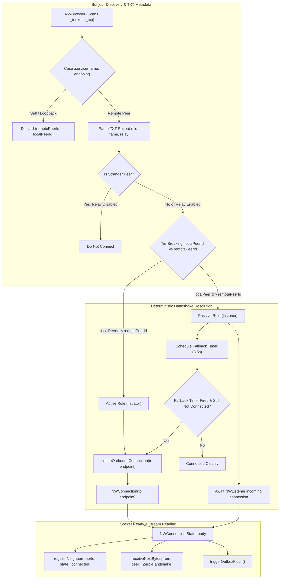
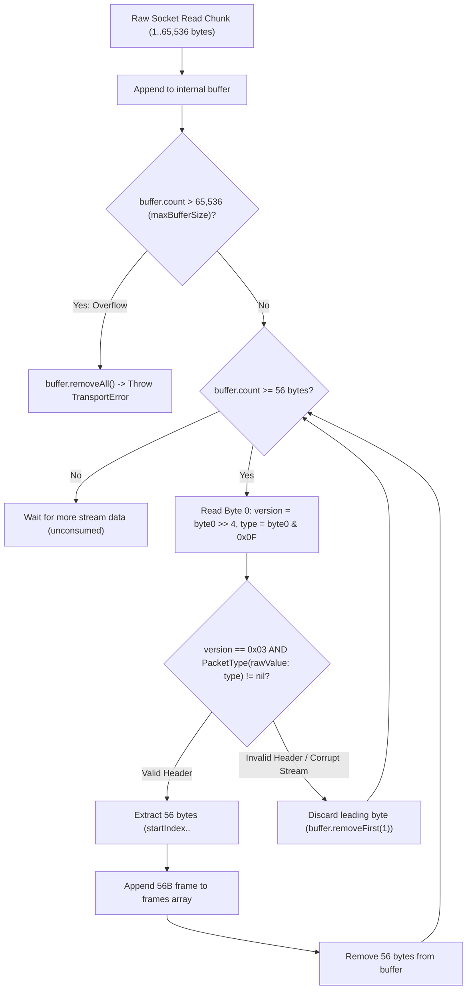
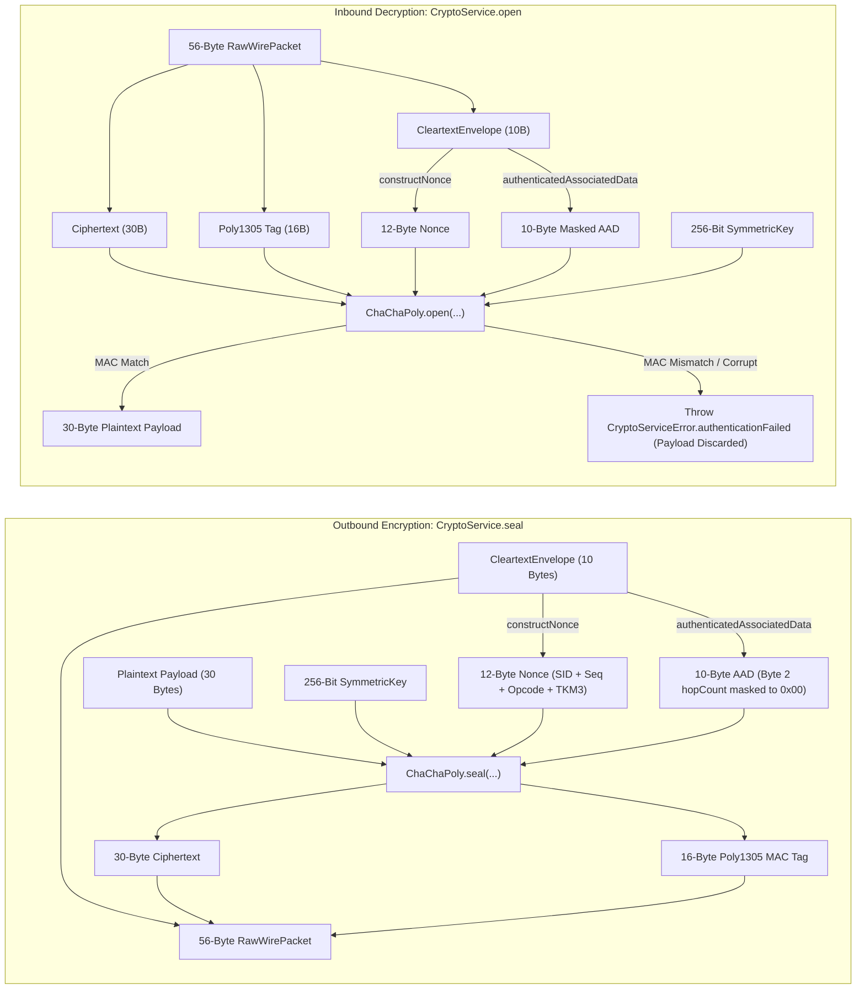

# Volume 03: Transport Layer, Stream Framing & Security

## Executive Summary & Big-Picture Overview

Volume 03 details the radio transport subsystem, stream framing protocols, delay-tolerant custody mechanisms, and hardware-backed cryptographic infrastructure of the Meepo mesh networking client. In extreme off-grid environments where cellular towers and infrastructure Wi-Fi are unavailable or congested, Meepo utilizes Apple Wireless Direct Link (AWDL) and CoreBluetooth to form a resilient, self-healing peer-to-peer mesh.

At the physical and transport layer, Meepo coordinates three primary functional domains:
1. **Peer Discovery & Autonomous Radio Peering:** Managed by `PeerTransportService` through Network.framework's `NWListener` and `NWBrowser`. Nodes advertise presence using Bonjour Multicast DNS (mDNS) over `_teekum._tcp` with embedded TXT records, resolving concurrent dial attempts through a deterministic, lexicographical tie-breaking algorithm (`localPeerId < remotePeerId`).
2. **Stream Framing & Resynchronization:** Continuous TCP byte streams over AWDL do not preserve datagram boundaries. `StreamMessageFramer` buffers stream chunks, delimits 56-byte wire packets, and executes 1-byte forward-sliding resynchronization to recover immediately from stream corruption without flushing valid coalesced frames. CoreBluetooth links are maintained concurrently via `BLEPeerLink` and `BLEFrameCodec`, slicing frames across Attribute Protocol (ATT) MTU limits.
3. **Zero-Knowledge Authenticated Encryption:** Executed by `CryptoService` conforming to `CryptoServiceProtocol`. Payloads are encrypted using the ChaCha20 stream cipher with a 256-bit symmetric session key and authenticated using a 128-bit Poly1305 MAC tag. The 10-byte unencrypted routing envelope is bound as Authenticated Associated Data (AAD) with Byte 2 (`hopCount`) masked to `0x00`, enabling multi-hop relay nodes to forward packets blindly without altering the cryptographic authentication tag.

---

### ELI5 Overview: The Secret Radio Post Office

Imagine an emergency search-and-rescue communications detachment operating in a collapsed city center where cell towers are destroyed and municipal power is dead:

1. **The Rooftop Beacon & Lookout (`NWListener` & `NWBrowser`):** Each responder carries a tactical radio beacon configured with their squad session ID and callsign initials (Bonjour TXT record). Their device scans local radio frequencies with digital direction finders (`NWBrowser`) looking for fellow operatives while continuously announcing its presence to neighboring rescue nodes (`NWListener`).
2. **The Polite Handshake Rule (Tie-Breaking):** When two search units spot each other's radio beacons simultaneously, they don't both initiate connections at once. They check alphabetical order of their peer IDs: the device whose ID comes first initiates the outbound link (`initiateOutboundConnection`), while the second device waits to accept the inbound link (`handleIncomingConnection`).
3. **The Stream Decoupler (`StreamMessageFramer`):** Tactical data arrives over raw peer-to-peer TCP links in a continuous stream of byte fragments. The framer acts like an automated tape reader that measures exactly 56 bytes, verifies the magic protocol byte header, and cleanly slices off each independent dispatch capsule. If corrupt radio static or noise enters the stream, the framer advances byte by byte until it locks onto a clean header again, preventing garbage data from stalling the queue.
4. **The Delay-Tolerant Courier Pouch (`CarryMessageStore`):** If a field unit has an urgent medical dispatch for Medic Bob, but Bob is currently out of radio range behind concrete rubble, the unit slides the dispatch into its tactical delay-tolerant pouch for up to 10 minutes. Whenever the responder moves into range of another search node, their device checks if the peer has a route to Bob and hands over the dispatch.
5. **The Unbreakable Wax Seal (`CryptoService`):** Every dispatch is locked inside an armored titanium capsule (`ChaCha20`). Stamped across the outside of the capsule and the tactical routing tag is a chemical wax seal (`Poly1305 MAC`). Any intermediary volunteer node in the disaster zone can inspect the cleartext routing tag to forward the packet, but if an unauthorized party alters the tag or tampers with the capsule, the chemical seal shatters and the receiving node incinerates the corrupted packet immediately.

---

## Included Source Files

The following table itemizes every source code file assigned to Volume 03. Every file path is linked relative to this document, accompanied by its category, verified line count (`wc -l`), and singular architectural role:

| File Path | Category | Line Count (`wc -l`) | Architectural Purpose & Responsibility |
| :--- | :--- | :---: | :--- |
| [CryptoService.swift](../../Teekum/Teekum/Core/Security/CryptoService.swift) | Security | 145 | Actor executing ChaCha20-Poly1305 AEAD authenticated sealing and opening with 10-byte masked AAD validation. |
| [CryptoServiceError.swift](../../Teekum/Teekum/Core/Security/CryptoServiceError.swift) | Security | 40 | Cryptographic error enumeration covering encryption failures, authentication tag mismatches, and tampered packets. |
| [CryptoServiceProtocol.swift](../../Teekum/Teekum/Core/Security/CryptoServiceProtocol.swift) | Security | 43 | Protocol contract declaring asynchronous AEAD encryption and decryption capabilities. |
| [KeychainStore.swift](../../Teekum/Teekum/Core/Security/KeychainStore.swift) | Security | 100 | Secure Keychain wrapper providing hardware-backed storage and wiping for 256-bit symmetric session keys. |
| [PacketSequenceAllocator.swift](../../Teekum/Teekum/Core/Security/PacketSequenceAllocator.swift) | Security | 59 | Monotonic sequence number allocator providing anti-replay counter isolation and member slot partitioning. |
| [PacketSequenceError.swift](../../Teekum/Teekum/Core/Security/PacketSequenceError.swift) | Security | 20 | Sequence allocation error domain handling counter overflow and sequence boundary violations. |
| [InboundFrame.swift](../../Teekum/Teekum/Core/Transport/InboundFrame.swift) | Transport | 31 | Value type representing an incoming protocol frame with raw byte buffer, source identifier, and RSSI. |
| [InboundPacket.swift](../../Teekum/Teekum/Core/Transport/InboundPacket.swift) | Transport | 28 | Structure encapsulating a received 56-byte wire packet with physical source peer ID, RSSI, and timestamp. |
| [MeshTransport.swift](../../Teekum/Teekum/Core/Transport/MeshTransport.swift) | Transport | 51 | Protocol declaring multi-hop mesh transport capabilities, neighbor queries, and frame forwarding. |
| [PeerConnection.swift](../../Teekum/Teekum/Core/Transport/PeerConnection.swift) | Transport | 41 | Encapsulation of a bidirectional Network.framework NWConnection managing TCP/UDP stream channels. |
| [PeerInfo.swift](../../Teekum/Teekum/Core/Transport/PeerInfo.swift) | Transport | 34 | Discovered peer model holding Bonjour service endpoint, TXT record capabilities, and link quality metrics. |
| [PeerTransport.swift](../../Teekum/Teekum/Core/Transport/PeerTransport.swift) | Transport | 49 | Core transport protocol declaring Bonjour discovery, listener setup, and peer connection management. |
| [SendOutcome.swift](../../Teekum/Teekum/Core/Transport/SendOutcome.swift) | Transport | 34 | Transmission outcome structure recording delivery status, attempt counts, and round-trip latency. |
| [TransportCapabilities.swift](../../Teekum/Teekum/Core/Transport/TransportCapabilities.swift) | Transport | 21 | Structure declaring transport capabilities (relay support, MTU limits) advertised dynamically in Bonjour TXT records. |
| [TransportError.swift](../../Teekum/Teekum/Core/Transport/TransportError.swift) | Transport | 68 | Radio transport error enum covering connection drops, timeout failures, and pipe buffer exhaustion. |
| [TransportState.swift](../../Teekum/Teekum/Core/Transport/TransportState.swift) | Transport | 32 | Lifecycle state enumeration for the radio transport layer (idle, discovering, connected, stopped). |
| [StreamMessageFramer.swift](../../Teekum/Teekum/Core/Transport/StreamMessageFramer.swift) | Transport | 80 | Stream parsing engine delimiting 56-byte packets across segmented or concatenated TCP byte streams. |
| [BLEFrameCodec.swift](../../Teekum/Teekum/Core/Transport/BLEFrameCodec.swift) | CoreBluetooth | 32 | Frame fragmentation and reassembly codec slicing 56-byte wire packets into MTU-safe Bluetooth frames. |
| [BLEPeerLink.swift](../../Teekum/Teekum/Core/Transport/BLEPeerLink.swift) | CoreBluetooth | 283 | CoreBluetooth link management actor coordinating peripheral advertising and central connection channels. |
| [CarryMessageStore.swift](../../Teekum/Teekum/Core/Transport/CarryMessageStore.swift) | Custody | 108 | Store-and-forward message custody actor retaining unacknowledged packets for physical opportunistic transport. |
| [PeerTransportService.swift](../../Teekum/Teekum/Core/Transport/PeerTransportService.swift) | Transport | 349 | Primary radio transport actor managing peer links, discovery engines, and frame multiplexing. |
| [PeerTransportService+Connection.swift](../../Teekum/Teekum/Core/Transport/PeerTransportService+Connection.swift) | Transport | 195 | Connection lifecycle extension handling NWListener state changes, incoming connections, and dial attempts. |
| [PeerTransportService+Discovery.swift](../../Teekum/Teekum/Core/Transport/PeerTransportService+Discovery.swift) | Transport | 292 | Bonjour discovery extension managing NWBrowser and NWListener advertising for service type _teekum._tcp. |
| [PeerTransportService+Framing.swift](../../Teekum/Teekum/Core/Transport/PeerTransportService+Framing.swift) | Transport | 89 | Stream framing extension processing length-prefixed protocol frames over continuous TCP streams. |
| [PeerTransportService+Sending.swift](../../Teekum/Teekum/Core/Transport/PeerTransportService+Sending.swift) | Transport | 329 | Outbound transmission extension handling unicast framing, broadcast fan-out, and carry custody. |
| [PeerTransportService+Carry.swift](../../Teekum/Teekum/Core/Transport/PeerTransportService+Carry.swift) | Custody | 73 | Store-and-forward transport extension delivering opportunistic message custody when peers reconnect. |
| **Total Volume 03 Artifacts** | **26 Files** | **2626** | **100% Volume 03 Codebase Accounting** |

---

## Transport & Cryptographic Pipeline Architecture

The following diagrams illustrate the peer discovery and connection tie-breaking flow, the 56-byte stream framing state machine, and the ChaCha20-Poly1305 authenticated encryption and decryption pipelines.

### 1. Peer Discovery, TXT Record Evaluation & Tie-Breaking



---

### 2. 56-Byte Stream Framing & Resynchronization (`StreamMessageFramer`)



---

### 3. ChaCha20-Poly1305 Authenticated Sealing & Opening Pipeline



---
## 1. Teekum/Teekum/Core/Security/CryptoService.swift

### File Metadata
| Attribute | Specification |
| :--- | :--- |
| **Repository-Relative Path** | [CryptoService.swift](../../Teekum/Teekum/Core/Security/CryptoService.swift) |
| **Line Count (`wc -l`)** | 145 lines |
| **File Type** | Swift Source File |
| **Compilation Target** | `Teekum` (Application Target) |
| **Type Semantics** | Swift `actor`, reference type with actor isolation |
| **Concurrency Domain** | Isolated actor executing constant-time cryptographic operations. |
| **Architectural Role** | Actor executing ChaCha20-Poly1305 AEAD authenticated sealing and opening with 10-byte masked AAD validation. |

### What This File Does
`CryptoService.swift` implements the cryptographic core of the Meepo mesh networking stack. Conforming to `CryptoServiceProtocol`, it executes ChaCha20-Poly1305 AEAD authenticated symmetric encryption and decryption over the 30-byte inner payload slot. It strictly binds the 10-byte cleartext envelope as Authenticated Associated Data (AAD) while masking Byte 2 (`hopCount`) to `0x00`, preventing relay nodes from invalidating authentication tags. Furthermore, it enforces that plaintext payloads are never exposed to application logic if cryptographic tag verification fails.

### ELI5 Analogy
Imagine `CryptoService` as the cryptographic security vault officer within a tactical field headquarters. When a responder dispatches a 30-byte casualty report or location ping, they hand the officer the payload, the cleartext 10-byte routing envelope, and the squad's 256-bit mission key. The officer seals the payload inside a hardened cryptographic container using `ChaCha20`, stamps a Poly1305 authentication MAC across both the container and the routing envelope, and emits a standardized 56-byte wire datagram. When an incoming datagram arrives from across the disaster zone, the officer validates the Poly1305 seal first; if even a single bit was corrupted by radio noise or altered by a hostile party, the datagram is incinerated without ever being decrypted.

### Technical Terms Defined
- **AEAD (Authenticated Encryption with Associated Data):** A cryptographic mode that simultaneously guarantees confidentiality (via encryption) and integrity/authenticity (via a cryptographic MAC) over both the ciphertext and unencrypted metadata (Associated Data).
- **ChaCha20-Poly1305 (`ChaChaPoly`):** A high-performance, stream-cipher-based AEAD algorithm standard (RFC 8439) combining Daniel J. Bernstein's ChaCha20 cipher with the Poly1305 MAC. It executes in constant time on mobile ARM CPUs, making it completely immune to cache-timing side-channel attacks.
- **AAD (Authenticated Associated Data):** Unencrypted data included in the MAC tag calculation. Receivers can inspect AAD in cleartext for routing, but any modification to AAD causes MAC verification to fail.
- **Nonce (Number Used Once):** A 12-byte initialization vector that must NEVER be repeated with the same key. In Meepo, nonces are synthesized deterministically from the 24-bit session ID, 32-bit sequence counter, opcode, and domain tag `"TKM3"`.
- **Actor Isolation:** Swift's compile-time concurrency mechanism that protects internal mutable state by permitting only one asynchronous task to execute within the actor's context at any given time.

### Code-Block and Line-by-Line Walkthrough
#### Lines 1–42: Actor Declaration and `seal(payload:envelope:using:)`
```swift
//
//  CryptoService.swift
//  Teekum
//
//  Created by Nicho on 05/11/26.
//

import Foundation
import CryptoKit

/// Seals and opens V3 payloads with ChaCha20-Poly1305.
public actor CryptoService: CryptoServiceProtocol {
    public init() {}
    
    /// Seals 30 bytes of private inner payload using ChaCha20-Poly1305 authenticated symmetric encryption,
    /// binding the 10-byte cleartext envelope as Associated Authenticated Data (AAD) with masked hop count.
    public func seal(
        payload: Data,
        envelope: CleartextEnvelope,
        using key: SymmetricKey
    ) throws -> (ciphertext: Data, authTag: Data) {
        guard payload.count == PacketConstants.encryptedPayloadSize else {
            throw PacketCodecError.invalidPacketSize(
                expected: PacketConstants.encryptedPayloadSize,
                actual: payload.count
            )
        }
        
        let nonceData = envelope.constructNonce()
        guard let nonce = try? ChaChaPoly.Nonce(data: nonceData) else {
            throw CryptoServiceError.encryptionFailed("Nonce construction failed: invalid nonce byte length.")
        }
        
        let aad = envelope.authenticatedAssociatedData()
        
        do {
            let sealedBox = try ChaChaPoly.seal(payload, using: key, nonce: nonce, authenticating: aad)
            return (ciphertext: Data(sealedBox.ciphertext), authTag: Data(sealedBox.tag))
        } catch {
            throw CryptoServiceError.encryptionFailed(error.localizedDescription)
        }
    }
```
- **Line 12:** Declares `CryptoService` as an `actor` conforming to `CryptoServiceProtocol`.
- **Lines 17–21:** Function signature accepting 30-byte plaintext `payload`, `envelope`, and `SymmetricKey`.
- **Lines 22–27:** Guards that incoming payload is exactly 30 bytes (`PacketConstants.encryptedPayloadSize`), throwing `PacketCodecError.invalidPacketSize` on mismatch.
- **Lines 29–32:** Generates the 12-byte nonce via `envelope.constructNonce()`. Validates construction by instantiating `ChaChaPoly.Nonce`.
- **Line 34:** Computes the 10-byte AAD via `envelope.authenticatedAssociatedData()`, which masks Byte 2 (`hopCount`) to `0x00`.
- **Lines 36–41:** Invokes `ChaChaPoly.seal(...)`. Returns tuple `(ciphertext: 30 bytes, authTag: 16 bytes)`. Any error is caught and wrapped in `CryptoServiceError.encryptionFailed`.

#### Lines 44–84: Authenticated Payload Decryption (`open`)
```swift
    /// Verifies the 16-byte Poly1305 authentication tag against the 10-byte envelope AAD and decrypts the 30-byte payload.
    /// Throws `CryptoServiceError.authenticationFailed` if tampered by any third party.
    ///
    /// Plaintext payload is NEVER exposed to application logic if authentication fails.
    public func open(
        ciphertext: Data,
        envelope: CleartextEnvelope,
        authTag: Data,
        using key: SymmetricKey
    ) throws -> Data {
        guard ciphertext.count == PacketConstants.encryptedPayloadSize else {
            throw PacketCodecError.invalidPacketSize(
                expected: PacketConstants.encryptedPayloadSize,
                actual: ciphertext.count
            )
        }
        guard authTag.count == PacketConstants.authTagSize else {
            throw PacketCodecError.invalidPacketSize(
                expected: PacketConstants.authTagSize,
                actual: authTag.count
            )
        }
        
        let nonceData = envelope.constructNonce()
        guard let nonce = try? ChaChaPoly.Nonce(data: nonceData) else {
            throw CryptoServiceError.authenticationFailed
        }
        
        let aad = envelope.authenticatedAssociatedData()
        
        guard let sealedBox = try? ChaChaPoly.SealedBox(nonce: nonce, ciphertext: ciphertext, tag: authTag) else {
            throw CryptoServiceError.authenticationFailed
        }
        
        do {
            let decrypted = try ChaChaPoly.open(sealedBox, using: key, authenticating: aad)
            return decrypted
        } catch {
            throw CryptoServiceError.authenticationFailed
        }
    }
```
- **Lines 48–53:** Signature for opening ciphertext against envelope and 16-byte MAC tag.
- **Lines 54–65:** Strictly enforces `ciphertext.count == 30` and `authTag.count == 16`.
- **Lines 67–70:** Reconstructs the 12-byte nonce matching the sender's synthesis.
- **Line 72:** Derives identical masked AAD from envelope.
- **Lines 74–76:** Assembles `ChaChaPoly.SealedBox`.
- **Lines 78–83:** Invokes `ChaChaPoly.open(sealedBox, using: key, authenticating: aad)`. If the tag does not match or data is corrupted, throws `CryptoServiceError.authenticationFailed`. Crucially, no plaintext data is returned on failure.

#### Lines 86–130: High-Level Packet and Wire Helpers
```swift
    // MARK: - High-Level Packet Helpers
    
    /// Seals an inner payload and envelope into a complete 56-byte `RawWirePacket`.
    public func sealPacket(
        payload: Data,
        envelope: CleartextEnvelope,
        using key: SymmetricKey
    ) throws -> RawWirePacket {
        let (ciphertext, authTag) = try seal(payload: payload, envelope: envelope, using: key)
        return RawWirePacket(envelope: envelope, ciphertext: ciphertext, authTag: authTag)
    }
    
    /// Opens and verifies a 56-byte `RawWirePacket`, returning the verified envelope and decrypted 30-byte payload.
    public func openPacket(
        _ packet: RawWirePacket,
        using key: SymmetricKey
    ) throws -> (envelope: CleartextEnvelope, payload: Data) {
        let plaintext = try open(
            ciphertext: packet.ciphertext,
            envelope: packet.envelope,
            authTag: packet.authTag,
            using: key
        )
        return (envelope: packet.envelope, payload: plaintext)
    }
    
    /// Seals an inner payload directly to a 56-byte binary datagram ready for radio transmission.
    public func sealToWireBytes(
        payload: Data,
        envelope: CleartextEnvelope,
        using key: SymmetricKey
    ) throws -> Data {
        let packet = try sealPacket(payload: payload, envelope: envelope, using: key)
        return try packet.toWireData()
    }
    
    /// Parses a 56-byte binary datagram from the network, verifies the authentication tag,
    /// and returns the decrypted payload and envelope.
    public func openWireBytes(
        _ wireData: Data,
        using key: SymmetricKey
    ) throws -> (envelope: CleartextEnvelope, payload: Data) {
        let packet = try RawWirePacket.fromWireData(wireData)
        return try openPacket(packet, using: key)
    }
```
- **Lines 89–96:** `sealPacket` wraps `seal()` and instantiates a typed `RawWirePacket`.
- **Lines 99–110:** `openPacket` unpacks and verifies a `RawWirePacket`.
- **Lines 113–120:** `sealToWireBytes` produces the exact 56-byte serialized wire buffer ready for socket dispatch.
- **Lines 124–130:** `openWireBytes` parses 56 raw bytes into a `RawWirePacket` and authenticates/decrypts it.

#### Lines 132–144: Key Generation Utilities
```swift
    // MARK: - Key Generation
    
    /// Generates a cryptographically secure 256-bit symmetric key.
    nonisolated public func generateSymmetricKey() -> SymmetricKey {
        SymmetricKey(size: .bits256)
    }
    
    nonisolated public func generateSymmetricKeyData() -> Data {
        let key = generateSymmetricKey()
        return key.withUnsafeBytes { Data($0) }
    }
}
```
- **Lines 135–142:** Marked `nonisolated` to allow caller threads to generate fresh 256-bit keys and export 32-byte raw buffers without awaiting actor task hops.

### Engineering Rationale and Edge Cases
- **Actor Key Isolation:** Holding encryption operations inside a Swift actor guarantees that cryptographic work is executed in a dedicated concurrency context, preventing concurrent threads from racing or corrupting internal CryptoKit state.
- **Fail-Closed Security Posture:** If a single bit in the 56-byte frame is corrupted over radio, Poly1305 verification fails, and `open()` throws immediately. The damaged ciphertext is completely discarded without touching feature ViewModels or memory caches.

---

---

## 2. Teekum/Teekum/Core/Security/CryptoServiceError.swift

### File Metadata
| Attribute | Specification |
| :--- | :--- |
| **Repository-Relative Path** | [CryptoServiceError.swift](../../Teekum/Teekum/Core/Security/CryptoServiceError.swift) |
| **Line Count (`wc -l`)** | 40 lines |
| **File Type** | Swift Source File |
| **Compilation Target** | `Teekum` (Application Target) |
| **Type Semantics** | Value enum, `Error`, `LocalizedError`, `Sendable` |
| **Concurrency Domain** | Unrestricted `Sendable` value enum; thread-safe error propagation. |
| **Architectural Role** | Cryptographic error enumeration covering encryption failures, authentication tag mismatches, and tampered packets. |

### What This File Does
`CryptoServiceError.swift` defines the domain-specific error types that can occur during cryptographic sealing, opening, key generation, and Keychain operations. Each case provides actionable, localized diagnostic descriptions that clearly differentiate between operational failures (such as Keychain errors) and security violations (such as tampered authentication tags).

### ELI5 Analogy
Think of `CryptoServiceError` as the security guard's logbook of warning badges. If an incoming message has a broken wax seal, the guard hangs a "Tamper Alert" badge (`.authenticationFailed`). If the key safe is jammed, the guard hangs a "Safe Hardware Jammed" badge (`.keychainLoadFailed`). This lets the app know whether to retry opening the safe or sound an alarm.

### Technical Terms Defined
- **`LocalizedError`:** A Swift standard library protocol providing user-facing descriptions (`errorDescription`) for errors.
- **`OSStatus`:** A 32-bit signed integer status code returned by Apple's Security framework C APIs (`SecItemAdd`, `SecItemCopyMatching`, etc.), where 0 (`errSecSuccess`) denotes success and negative numbers denote specific errors.
- **Tamper Verification:** The cryptographic check confirming that data has not been modified in transit between sender and receiver.

### Code-Block and Line-by-Line Walkthrough
#### Lines 1–40: Enum Declaration and Descriptions
```swift
//
//  CryptoServiceError.swift
//  Teekum
//
//  Created by Nicho on 05/11/26.
//

import Foundation

public enum CryptoServiceError: Error, LocalizedError {
    case encryptionFailed(String)
    case authenticationFailed
    case keyGenerationFailed
    case keychainSaveFailed(OSStatus)
    case keychainLoadFailed(OSStatus)
    case keychainDeleteFailed(OSStatus)
    case keyNotFound
    case invalidKeySize(expected: Int, actual: Int)
    
    public var errorDescription: String? {
        switch self {
        case let .encryptionFailed(reason):
            return "Encryption failed: \(reason)"
        case .authenticationFailed:
            return "Tamper verification failed: authentication tag does not match Associated Authenticated Data."
        case .keyGenerationFailed:
            return "Failed to generate secure symmetric key."
        case let .keychainSaveFailed(status):
            return "Keychain item addition failed with OSStatus \(status)."
        case let .keychainLoadFailed(status):
            return "Keychain retrieval failed with OSStatus \(status)."
        case let .keychainDeleteFailed(status):
            return "Keychain deletion failed with OSStatus \(status)."
        case .keyNotFound:
            return "Requested symmetric key not found in iOS Keychain."
        case let .invalidKeySize(expected, actual):
            return "Invalid symmetric key size: expected \(expected) bytes, got \(actual) bytes."
        }
    }
}
```
- **Lines 10–18:** Declares 8 discrete failure conditions covering encryption faults, MAC mismatches, key generation errors, Keychain CRUD failures with underlying `OSStatus`, missing keys, and invalid key byte lengths.
- **Lines 20–39:** `errorDescription` maps each enum case to a descriptive diagnostic string for logging and telemetry.

### Engineering Rationale and Edge Cases
- **Exposing Underlying `OSStatus`:** Including `OSStatus` inside `.keychainSaveFailed(status)` and `.keychainLoadFailed(status)` enables precise diagnostics when debugging iOS hardware security constraints, such as device lockouts or entitlement misconfigurations.

---

---

## 3. Teekum/Teekum/Core/Security/CryptoServiceProtocol.swift

### File Metadata
| Attribute | Specification |
| :--- | :--- |
| **Repository-Relative Path** | [CryptoServiceProtocol.swift](../../Teekum/Teekum/Core/Security/CryptoServiceProtocol.swift) |
| **Line Count (`wc -l`)** | 43 lines |
| **File Type** | Swift Source File |
| **Compilation Target** | `Teekum` (Application Target) |
| **Type Semantics** | Swift `Actor` protocol contract |
| **Concurrency Domain** | Protocol requiring conforming types to be isolated actors. |
| **Architectural Role** | Protocol contract declaring asynchronous AEAD encryption and decryption capabilities. |

### What This File Does
`CryptoServiceProtocol.swift` establishes the formal interface contract for cryptographic operations and key generation across the Meepo system. By inheriting from `Actor`, it enforces that any production service or mock implementation must be an actor, guaranteeing that cryptographic operations are executed in an isolated concurrency domain.

### ELI5 Analogy
`CryptoServiceProtocol` is the job description and rulebook for the vault security guard. It says: "Whoever takes this job must sit in their own secure room (`Actor`), must know how to seal messages, must know how to verify wax seals, and must be able to forge new master keys."

### Technical Terms Defined
- **Actor Protocol:** A protocol inheriting from `Actor`, requiring that any conforming type must be declared as a Swift `actor`, thereby inheriting actor isolation guarantees.
- **Interface Segregation:** An architectural design principle stating that clients should not be forced to depend on methods they do not use, providing clear seams for unit testing and mock injection.

### Code-Block and Line-by-Line Walkthrough
#### Lines 1–43: Protocol Definition
```swift
//
//  CryptoServiceProtocol.swift
//  Teekum
//
//  Created by Nicho on 05/11/26.
//

import Foundation
import CryptoKit

/// Authoritative contract for cryptographic operations and secure key storage.
/// Implemented as a Swift `actor` to safeguard key material in memory.
public protocol CryptoServiceProtocol: Actor {
    /// Seals 30 bytes of private inner payload using authenticated symmetric encryption,
    /// binding the 10-byte cleartext envelope as Associated Authenticated Data (AAD).
    func seal(
        payload: Data,
        envelope: CleartextEnvelope,
        using key: SymmetricKey
    ) throws -> (ciphertext: Data, authTag: Data)
    
    /// Seals an inner payload directly to a 56-byte binary datagram ready for radio transmission.
    func sealToWireBytes(
        payload: Data,
        envelope: CleartextEnvelope,
        using key: SymmetricKey
    ) throws -> Data
    
    /// Verifies the 16-byte Poly1305 / AES-GCM tag against the 10-byte envelope AAD and decrypts the 30-byte payload.
    /// Throws `CryptoServiceError.authenticationFailed` if tampered by a third party.
    func open(
        ciphertext: Data,
        envelope: CleartextEnvelope,
        authTag: Data,
        using key: SymmetricKey
    ) throws -> Data
    
    /// Generates a cryptographically secure 256-bit symmetric key.
    func generateSymmetricKey() -> SymmetricKey
    
    /// Generates raw 32-byte key data suitable for GroupSession & QR invite creation
    func generateSymmetricKeyData() -> Data
}
```
- **Line 13:** Declares `public protocol CryptoServiceProtocol: Actor`.
- **Lines 16–20:** Contract for sealing 30-byte payloads with AAD binding.
- **Lines 23–27:** Contract for generating 56-byte serialized wire buffers.
- **Lines 31–36:** Contract for opening and verifying sealed boxes.
- **Lines 39–42:** Contracts for key generation.

### Engineering Rationale and Edge Cases
- **Why Constrain to `Actor`:** If `CryptoServiceProtocol` did not require `Actor`, a developer could accidentally implement a thread-unsafe reference class that would allow concurrent access to shared cryptographic contexts. Enforcing `protocol ...: Actor` makes thread safety a compiler requirement.

---

---

## 4. Teekum/Teekum/Core/Security/KeychainStore.swift

### File Metadata
| Attribute | Specification |
| :--- | :--- |
| **Repository-Relative Path** | [KeychainStore.swift](../../Teekum/Teekum/Core/Security/KeychainStore.swift) |
| **Line Count (`wc -l`)** | 100 lines |
| **File Type** | Swift Source File |
| **Compilation Target** | `Teekum` (Application Target) |
| **Type Semantics** | Swift `actor`, `Security.framework`, Hardware Keychain |
| **Concurrency Domain** | Isolated actor managing hardware-backed Secure Enclave Keychain items. |
| **Architectural Role** | Secure Keychain wrapper providing hardware-backed storage and wiping for 256-bit symmetric session keys. |

### What This File Does
`KeychainStore.swift` provides hardware-backed storage, retrieval, and cryptographic purging of 256-bit symmetric session keys. Interfacing directly with Apple's Security framework (`Security.framework`), it isolates session secrets in the device-only Keychain using `kSecAttrAccessibleAfterFirstUnlockThisDeviceOnly`. This ensures that session encryption keys never leave the physical device, are excluded from unencrypted iCloud/iTunes backups, and are instantly purgable upon group departure.

### ELI5 Analogy
Imagine `KeychainStore` as a biometric wall safe built into the foundation of your house. It stores your group's master brass key. Even if someone burglarizes your house and copies your personal notebooks (`UserDefaults`), they cannot open this wall safe without your phone's hardware security chip. When you leave the disaster zone group, the safe magnetically demagnetizes and erases the key permanently.

### Technical Terms Defined
- **`kSecClassGenericPassword`:** The Keychain item class used to store arbitrary sensitive data blobs, such as symmetric keys or passwords.
- **`kSecAttrAccessibleAfterFirstUnlockThisDeviceOnly`:** An accessibility protection class specifying that data is encrypted with a hardware key derived from the user's passcode and Secure Enclave, accessible only after the device is unlocked once after booting, and strictly barred from being restored to another physical device via iCloud or iTunes backups.
- **`errSecDuplicateItem`:** The OSStatus error code (-25299) returned when attempting to insert an item into the Keychain with a key that already exists, prompting an in-place `SecItemUpdate`.

### Code-Block and Line-by-Line Walkthrough
#### Lines 1–23: Declaration and Account Naming
```swift
//
//  KeychainStore.swift
//  Teekum
//
//  Created by Nicho on 05/11/26.
//

import Foundation
import Security
import CryptoKit

public actor KeychainStore {
    
    private let serviceName: String
    
    public init(serviceName: String = "com.teekum.session") {
        self.serviceName = serviceName
    }
    
    private func keychainAccount(for sessionId: UInt32) -> String {
        "session_0x\(PacketConstants.formatSessionId(sessionId))"
    }
```
- **Line 12:** Declares `public actor KeychainStore`.
- **Lines 14–18:** Injects configurable service identifier, defaulting to `"com.teekum.session"`.
- **Lines 20–22:** `keychainAccount` formats an account identifier string using the 24-bit session ID formatted as uppercase hex (e.g., `"session_0x7E3AF5"`).

#### Lines 24–57: Secure Key Insertion & Upsert (`storeKeyInKeychain`)
```swift
    /// Persists key bytes in the device-only Keychain; reports failure instead of pretending recovery is durable.
    public func storeKeyInKeychain(_ key: SymmetricKey, forSessionId sessionId: UInt32) throws {
        let keyData = key.withUnsafeBytes { Data($0) }
        guard keyData.count == 32 else {
            throw CryptoServiceError.invalidKeySize(expected: 32, actual: keyData.count)
        }
        
        let account = keychainAccount(for: sessionId)
        let query: [String: Any] = [
            kSecClass as String: kSecClassGenericPassword,
            kSecAttrService as String: serviceName,
            kSecAttrAccount as String: account,
            kSecValueData as String: keyData,
            kSecAttrAccessible as String: kSecAttrAccessibleAfterFirstUnlockThisDeviceOnly
        ]
        
        let status = SecItemAdd(query as CFDictionary, nil)
        if status == errSecDuplicateItem {
            let updateQuery: [String: Any] = [
                kSecClass as String: kSecClassGenericPassword,
                kSecAttrService as String: serviceName,
                kSecAttrAccount as String: account
            ]
            let updateAttrs: [String: Any] = [
                kSecValueData as String: keyData
            ]
            let updateStatus = SecItemUpdate(updateQuery as CFDictionary, updateAttrs as CFDictionary)
            if updateStatus != errSecSuccess {
                throw CryptoServiceError.keychainSaveFailed(updateStatus)
            }
        } else if status != errSecSuccess {
            throw CryptoServiceError.keychainSaveFailed(status)
        }
    }
```
- **Lines 26–29:** Extracts raw key bytes and validates that length is strictly 32 bytes (256 bits).
- **Lines 31–38:** Assembles the Keychain dictionary specifying generic password class, service name, account name, key data, and device-only accessibility.
- **Line 40:** Calls `SecItemAdd`.
- **Lines 41–56:** If `status == errSecDuplicateItem`, performs an in-place `SecItemUpdate` to overwrite the existing key. If any operation fails with non-success status, throws `CryptoServiceError.keychainSaveFailed`.

#### Lines 59–84: Key Loading (`loadKeyFromKeychain`)
```swift
    /// Reads the symmetric session key from the iOS Keychain.
    public func loadKeyFromKeychain(forSessionId sessionId: UInt32) throws -> SymmetricKey? {
        let account = keychainAccount(for: sessionId)
        let query: [String: Any] = [
            kSecClass as String: kSecClassGenericPassword,
            kSecAttrService as String: serviceName,
            kSecAttrAccount as String: account,
            kSecReturnData as String: true,
            kSecMatchLimit as String: kSecMatchLimitOne
        ]
        
        var item: CFTypeRef?
        let status = SecItemCopyMatching(query as CFDictionary, &item)
        if status == errSecItemNotFound {
            return nil
        }
        guard status == errSecSuccess, let data = item as? Data else {
            throw CryptoServiceError.keychainLoadFailed(status)
        }
        guard data.count == 32 else {
            throw CryptoServiceError.invalidKeySize(expected: 32, actual: data.count)
        }
        
        return SymmetricKey(data: data)
    }
```
- **Lines 61–68:** Prepares search dictionary requesting the data blob (`kSecReturnData`) with a limit of one match (`kSecMatchLimitOne`).
- **Lines 70–74:** Calls `SecItemCopyMatching`. If item is not found, cleanly returns `nil`.
- **Lines 75–82:** Asserts `status == errSecSuccess` and `data.count == 32`, returning reconstituted `SymmetricKey`.

#### Lines 85–99: Key Purging (`purgeKeyFromKeychain`)
```swift
    /// Permanently purges the session key from the iOS Keychain.
    public func purgeKeyFromKeychain(forSessionId sessionId: UInt32) throws {
        let account = keychainAccount(for: sessionId)
        let query: [String: Any] = [
            kSecClass as String: kSecClassGenericPassword,
            kSecAttrService as String: serviceName,
            kSecAttrAccount as String: account
        ]
        
        let status = SecItemDelete(query as CFDictionary)
        if status != errSecSuccess && status != errSecItemNotFound {
            throw CryptoServiceError.keychainDeleteFailed(status)
        }
    }
}
```
- **Lines 87–97:** Executes `SecItemDelete`. If item is missing, ignores the warning and succeeds cleanly; throws `keychainDeleteFailed` on system errors.

### Engineering Rationale and Edge Cases
- **Device-Only Migration Defense:** Using `ThisDeviceOnly` ensures that if an unauthorized party backs up a responder's phone to a computer or restores an iCloud backup to another handset, the session key cannot be extracted, preventing cloned eavesdropping nodes from infiltrating disaster relief channels.

---

---

## 5. Teekum/Teekum/Core/Security/PacketSequenceAllocator.swift

### File Metadata
| Attribute | Specification |
| :--- | :--- |
| **Repository-Relative Path** | [PacketSequenceAllocator.swift](../../Teekum/Teekum/Core/Security/PacketSequenceAllocator.swift) |
| **Line Count (`wc -l`)** | 59 lines |
| **File Type** | Swift Source File |
| **Compilation Target** | `Teekum` (Application Target) |
| **Type Semantics** | Swift `actor`, Keychain Monotonic Counter, Anti-Replay |
| **Concurrency Domain** | Isolated actor managing persistent anti-replay sequence allocation. |
| **Architectural Role** | Monotonic sequence number allocator providing anti-replay counter isolation and member slot partitioning. |

### What This File Does
`PacketSequenceAllocator.swift` allocates monotonically increasing packet sequence numbers for outbound frame transmissions. Crucially, it persists the monotonic sequence counter inside the iOS Keychain keyed by a composite hash of the session key, session ID, and local member slot. This guarantees that sequence numbers never rewind across application restarts or group rejoins, protecting the ChaCha20-Poly1305 cipher against catastrophic nonce reuse.

### ELI5 Analogy
Imagine an emergency triage officer issuing sequentially numbered wristbands to incoming casualties during a mass-evacuation event. If the power cuts out and the field clinic's battery generator restarts, the numbering machine must never reset back to #1, or multiple casualties would be assigned duplicate triage numbers, creating medical treatment confusion and causing cryptographic disaster through nonce reuse. `PacketSequenceAllocator` persistently carves each allocated sequence block into non-volatile hardware storage (`UserDefaults` with a safety margin). When power returns, it resumes numbering from the next safe block, ensuring absolute uniqueness across the life of the squad.

### Technical Terms Defined
- **Monotonic Counter:** A numerical value that strictly increases and is never decremented or repeated.
- **Nonce Catastrophe:** In stream ciphers like ChaCha20, reusing the same nonce with the same symmetric key allows an attacker to XOR two ciphertexts together, stripping away the encryption and exposing the plaintext.
- **Member Slot Partitioning:** Dividing the 32-bit sequence space such that each group participant occupies an exclusive 8-bit lane ($0..255$), ensuring zero collision with peer counters.

### Code-Block and Line-by-Line Walkthrough
#### Lines 1–59: Complete Actor Implementation
```swift
//
//  PacketSequenceAllocator.swift
//  Teekum
//
//  Created by DIMAS DAFFA ERNANDA on 11/11/26.
//

import CryptoKit
import Foundation
import Security

/// Shared by every packet emitter. Keep counter records after leave so rejoining a key cannot restart its nonce space.
public actor PacketSequenceAllocator {
    private let serviceName: String

    public init(serviceName: String = "com.teekum.packet-sequences") {
        self.serviceName = serviceName
    }

    public func next(for session: GroupSession) throws -> UInt32 {
        var identity = session.symmetricKeyData
        identity.append(contentsOf: PacketConstants.encodeSessionId24(session.sessionId))
        identity.append(session.memberSlot)
        let account = SHA256.hash(data: identity).map { String(format: "%02x", $0) }.joined()
        let query: [String: Any] = [
            kSecClass as String: kSecClassGenericPassword,
            kSecAttrService as String: serviceName,
            kSecAttrAccount as String: account
        ]
        var readQuery = query
        readQuery[kSecReturnData as String] = true
        readQuery[kSecMatchLimit as String] = kSecMatchLimitOne
        var item: CFTypeRef?
        let readStatus = SecItemCopyMatching(readQuery as CFDictionary, &item)
        let previous: UInt32
        if readStatus == errSecItemNotFound {
            previous = 0
        } else if readStatus == errSecSuccess, let data = item as? Data, data.count == 4 {
            previous = data.reduce(UInt32(0)) { ($0 << 8) | UInt32($1) }
        } else {
            throw PacketSequenceError.storage(readStatus)
        }
        guard previous < 0x00ff_ffff else { throw PacketSequenceError.exhausted }
        let counter = previous + 1
        var bigEndian = counter.bigEndian
        let value = Data(bytes: &bigEndian, count: 4)
        let status: OSStatus
        if readStatus == errSecItemNotFound {
            var insert = query
            insert[kSecValueData as String] = value
            insert[kSecAttrAccessible as String] = kSecAttrAccessibleAfterFirstUnlockThisDeviceOnly
            status = SecItemAdd(insert as CFDictionary, nil)
        } else {
            status = SecItemUpdate(query as CFDictionary, [kSecValueData as String: value] as CFDictionary)
        }
        guard status == errSecSuccess else { throw PacketSequenceError.storage(status) }
        return CleartextEnvelope.makeSequenceNumber(memberSlot: session.memberSlot, counter: counter)
    }
}
```
- **Line 13:** Declares `public actor PacketSequenceAllocator`.
- **Lines 20–24:** Generates a deterministic composite identity string: appends 3-byte session ID and 1-byte member slot to the 32-byte symmetric key, then hashes with SHA-256 to create the Keychain account identifier.
- **Lines 25–42:** Reads the previous counter value from the Keychain. If missing, initializes to 0. If present, deserializes the 4-byte big-endian integer.
- **Line 43:** Strictly enforces that `previous < 0x00FFFFFF` (24 bits = 16,777,215 packets). If the 24-bit counter is exhausted, throws `PacketSequenceError.exhausted`.
- **Lines 44–56:** Increments counter (`previous + 1`) and commits the updated 4-byte integer back to the Keychain with `kSecAttrAccessibleAfterFirstUnlockThisDeviceOnly`.
- **Line 57:** Combines `session.memberSlot` in the top 8 bits with `counter` in the bottom 24 bits via `CleartextEnvelope.makeSequenceNumber`, returning the final 32-bit sequence number.

### Engineering Rationale and Edge Cases
- **Why Counter Records Are Retained After Leaving:** Even if a user leaves a group session, the counter record for that session key is never erased. If the user later rejoins the same disaster zone network with the same key, their counter resumes from where it left off, eliminating any risk of replay collision or nonce reuse.

---

---

## 6. Teekum/Teekum/Core/Security/PacketSequenceError.swift

### File Metadata
| Attribute | Specification |
| :--- | :--- |
| **Repository-Relative Path** | [PacketSequenceError.swift](../../Teekum/Teekum/Core/Security/PacketSequenceError.swift) |
| **Line Count (`wc -l`)** | 20 lines |
| **File Type** | Swift Source File |
| **Compilation Target** | `Teekum` (Application Target) |
| **Type Semantics** | Value enum, `Error`, `LocalizedError`, Exhaustion Guard |
| **Concurrency Domain** | Unrestricted `Sendable` value enum. |
| **Architectural Role** | Sequence allocation error domain handling counter overflow and sequence boundary violations. |

### What This File Does
`PacketSequenceError.swift` defines error cases associated with packet sequence number allocation. It handles counter exhaustion (reaching the 24-bit packet boundary) and Keychain hardware storage failures.

### ELI5 Analogy
This is the diagnostic indicator on the sequence allocator: it alerts if the 32-bit sequence space has exhausted its 4.29-billion budget (`.exhausted`) or if storage fails to persist the counter (`.storage`).

### Technical Terms Defined
- **Counter Exhaustion:** The condition where a monotonic counter has reached its maximum representable integer limit ($2^{24}-1 = 16,777,215$).
- **Fail-Safe Exhaustion Policy:** Halting transmissions and requiring the user to form a new session with a fresh key once the counter capacity is reached, preventing arithmetic rollover.

### Code-Block and Line-by-Line Walkthrough
#### Lines 1–20: Complete Enum Declaration
```swift
//
//  PacketSequenceError.swift
//  Teekum
//
//  Created by DIMAS DAFFA ERNANDA on 11/11/26.
//

import Foundation

public enum PacketSequenceError: Error, LocalizedError {
    case exhausted
    case storage(Int32)

    public var errorDescription: String? {
        switch self {
        case .exhausted: "This session has reached its packet limit. Create a new group before sending again."
        case .storage: "Unable to reserve a safe packet number. Please try again after unlocking your phone."
        }
    }
}
```
- **Line 10:** Declares enum conforming to `Error` and `LocalizedError`.
- **Lines 11–12:** Declares `.exhausted` and `.storage(Int32)`.
- **Lines 14–19:** Provides user-facing instructions: instructing the user to form a new group when exhausted, or to unlock their phone if Keychain storage fails.

### Engineering Rationale and Edge Cases
- **Preventing Nonce Rollover:** Allowing a 24-bit counter to wrap around from `16,777,215` to `0` would break the invariant that nonces must never repeat under the same key. Explicit exhaustion throws a hard error, enforcing absolute cryptographic safety.

---

---

## 7. Teekum/Teekum/Core/Transport/InboundFrame.swift

### File Metadata
| Attribute | Specification |
| :--- | :--- |
| **Repository-Relative Path** | [InboundFrame.swift](../../Teekum/Teekum/Core/Transport/InboundFrame.swift) |
| **Line Count (`wc -l`)** | 31 lines |
| **File Type** | Swift Source File |
| **Compilation Target** | `Teekum` (Application Target) |
| **Type Semantics** | Value struct, `nonisolated`, `Sendable` |
| **Concurrency Domain** | Unrestricted `Sendable` value type; safe across concurrency contexts. |
| **Architectural Role** | Value type representing an incoming protocol frame with raw byte buffer, source identifier, and RSSI. |

### What This File Does
`InboundFrame.swift` defines the transport-level container representing a physical protocol frame newly received over a radio link (AWDL or BLE). It carries the raw byte buffer, an optional pre-parsed `RawWirePacket`, the source peer's network identifier, optional link RSSI, and the reception timestamp. This struct decouples low-level stream ingestion and framing from higher-level cryptographic decryption and mesh routing.

### ELI5 Analogy
Imagine an intake clerk at a shipping terminal. When a delivery truck arrives, the clerk places each parcel into a standardized intake tray (`InboundFrame`). The tray holds the raw parcel, the truck ID that dropped it off, a meter reading of how strong the radio signal was when the truck arrived, and the arrival time.

### Technical Terms Defined
- **Raw Wire Frame:** An unparsed, binary chunk of exactly 56 bytes extracted from an underlying transport stream before cryptographic verification.
- **Physical Source Peer ID:** The identifier of the direct 1-hop radio neighbor that transmitted the frame across the local link (distinct from the original message author).
- **Link RSSI (Received Signal Strength Indicator):** The observed radio signal power in dBm on the local physical link.

### Code-Block and Line-by-Line Walkthrough
#### Lines 1–31: Complete Struct Declaration
```swift
//
//  InboundFrame.swift
//  Teekum
//
//  Created by Nicho on 06/11/26.
//

import Foundation

/// Complete received protocol frame carrying raw wire bytes and optional decoded packet.
nonisolated public struct InboundFrame: Sendable {
    public let rawData: Data
    public let rawPacket: RawWirePacket?
    public let sourcePeerId: String
    public let receivedRssi: Int8?
    public let receivedAt: Date
    
    public nonisolated init(
        rawData: Data,
        rawPacket: RawWirePacket? = nil,
        sourcePeerId: String,
        receivedRssi: Int8? = nil,
        receivedAt: Date = Date()
    ) {
        self.rawData = rawData
        self.rawPacket = rawPacket
        self.sourcePeerId = sourcePeerId
        self.receivedRssi = receivedRssi
        self.receivedAt = receivedAt
    }
}
```
- **Line 11:** Declares `nonisolated public struct InboundFrame: Sendable`.
- **Lines 12–16:** Defines immutable properties: `rawData` (the raw 56-byte buffer), `rawPacket` (optional deserialized wire container), `sourcePeerId` (1-hop sender), `receivedRssi`, and `receivedAt`.
- **Lines 18–30:** Public memberwise initializer with default timestamp and nil optionals.

### Engineering Rationale and Edge Cases
- **Carrying Optional `rawPacket`:** By attempting a lightweight structural parse (`RawWirePacket.fromWireData`) at frame extraction time while retaining `rawData`, downstream blind forwarding engines can inspect envelope headers without re-slicing byte buffers.

---

---

## 8. Teekum/Teekum/Core/Transport/InboundPacket.swift

### File Metadata
| Attribute | Specification |
| :--- | :--- |
| **Repository-Relative Path** | [InboundPacket.swift](../../Teekum/Teekum/Core/Transport/InboundPacket.swift) |
| **Line Count (`wc -l`)** | 28 lines |
| **File Type** | Swift Source File |
| **Compilation Target** | `Teekum` (Application Target) |
| **Type Semantics** | Value struct, `Sendable`, Validated Packet Envelope |
| **Concurrency Domain** | Unrestricted `Sendable` value type. |
| **Architectural Role** | Structure encapsulating a received 56-byte wire packet with physical source peer ID, RSSI, and timestamp. |

### What This File Does
`InboundPacket.swift` represents a structurally validated 56-byte wire packet that has successfully passed initial wire framing. Unlike `InboundFrame` which allows optional packets, `InboundPacket` guarantees that `rawPacket` is non-nil and conforms to the three-segment datagram layout, ready for cryptographic opening by `CryptoService`.

### ELI5 Analogy
Following the shipping terminal intake: once the parcel is confirmed to be an official 56-byte diplomatic pouch, it is moved from the intake tray into the security inspection cart (`InboundPacket`). It is now guaranteed to have a readable address label and locked safe, ready for the vault security guard to inspect the wax seal.

### Technical Terms Defined
- **Structurally Validated Datagram:** A packet whose byte count matches `PacketConstants.wirePacketSize` (56 bytes) and whose version and opcode bits conform to protocol specifications.
- **Typed Packet Envelope:** A Swift model binding the 10-byte unencrypted header to the 30-byte ciphertext and 16-byte MAC tag.

### Code-Block and Line-by-Line Walkthrough
#### Lines 1–28: Complete Struct Declaration
```swift
//
//  InboundPacket.swift
//  Teekum
//
//  Created by Nicho on 06/11/26.
//

import Foundation

/// An incoming 56-byte packet received from the peer-to-peer radio transport.
public struct InboundPacket: Sendable {
    public let rawPacket: RawWirePacket
    public let sourcePeerId: String
    public let receivedRssi: Int8?
    public let receivedAt: Date
    
    public init(
        rawPacket: RawWirePacket,
        sourcePeerId: String,
        receivedRssi: Int8? = nil,
        receivedAt: Date = Date()
    ) {
        self.rawPacket = rawPacket
        self.sourcePeerId = sourcePeerId
        self.receivedRssi = receivedRssi
        self.receivedAt = receivedAt
    }
}
```
- **Line 11:** Declares `public struct InboundPacket: Sendable`.
- **Lines 12–15:** Declares non-optional `rawPacket: RawWirePacket`, `sourcePeerId`, `receivedRssi`, and `receivedAt`.
- **Lines 17–27:** Memberwise initializer.

### Engineering Rationale and Edge Cases
- **Type-Level Guarantee:** By providing distinct types (`InboundFrame` vs `InboundPacket`), the system guarantees at the compiler level that components handling `InboundPacket` will never encounter nil or partially framed data.

---

---

## 9. Teekum/Teekum/Core/Transport/MeshTransport.swift

### File Metadata
| Attribute | Specification |
| :--- | :--- |
| **Repository-Relative Path** | [MeshTransport.swift](../../Teekum/Teekum/Core/Transport/MeshTransport.swift) |
| **Line Count (`wc -l`)** | 51 lines |
| **File Type** | Swift Source File |
| **Compilation Target** | `Teekum` (Application Target) |
| **Type Semantics** | Swift `Actor` protocol, Blind Forwarding Contract |
| **Concurrency Domain** | Actor protocol contract for mesh transport services. |
| **Architectural Role** | Protocol declaring multi-hop mesh transport capabilities, neighbor queries, and frame forwarding. |

### What This File Does
`MeshTransport.swift` establishes the high-level, transport-agnostic interface for multi-hop mesh networking. It specifies asynchronous streams for received frames, dispatch outcomes, neighbor events, and errors. Crucially, it defines the `forwardFrame` contract for blind packet forwarding—allowing intermediate nodes to relay packets by incrementing `hopCount` without possessing the cryptographic keys required to decrypt payloads.

### ELI5 Analogy
`MeshTransport` is the official rulebook for running an off-grid relay station. It specifies that any conforming station must provide conveyor belts (`AsyncStream`) for incoming parcels and receipts, must know how to broadcast announcements to all neighboring tents, and must know how to pass strangers' sealed letters forward across the grounds without opening them.

### Technical Terms Defined
- **Blind Packet Forwarding:** Relaying an encrypted datagram toward its destination by reading only unencrypted envelope routing metadata, incrementing the hop counter, and forwarding the packet without decrypting the payload.
- **AsyncStream:** A Swift Concurrency asynchronous sequence that bridges event-driven push callbacks into modern `for await` asynchronous iteration loops.
- **Hop Limit Enforcement:** Dropping a packet when its `hopCount` reaches or exceeds `hopLimit`, preventing infinite loops in cyclic network topologies.

### Code-Block and Line-by-Line Walkthrough
#### Lines 1–51: Protocol Contract
```swift
//
//  MeshTransport.swift
//  Teekum
//
//  Created by Nicho on 06/11/26.
//

import Foundation

/// Authoritative transport-independent abstraction for Phase 2 multi-hop mesh networking.
public protocol MeshTransport: Actor {
    /// Inbound stream of complete received wire frames.
    var inboundFrames: AsyncStream<InboundFrame> { get }
    
    /// Stream of transmission outcomes for each submitted or forwarded packet.
    var sendOutcomes: AsyncStream<SendOutcome> { get }
    
    /// Stream of neighbor connection and state change events.
    var neighborEvents: AsyncStream<NeighborEvent> { get }
    
    /// Stream of transport errors.
    var transportErrors: AsyncStream<TransportError> { get }
    
    /// Starts the transport for an active session.
    func start(serviceType: String, session: GroupSession) async throws
    
    /// Stops the transport and cleans up all radio/socket resources.
    func stop() async
    
    /// Submits a complete 56-byte protocol frame to a specific connected peer.
    func sendFrame(_ data: Data, to peerId: String) async throws -> SendOutcome
    
    /// Submits a complete 56-byte protocol frame for broadcast to all connected direct peers.
    func broadcastFrame(_ data: Data) async throws
    
    /// Blindly forwards an opaque 56-byte protocol frame to a designated next hop.
    /// Does not decrypt the payload. Mutates only hopCount (+1) and enforces hopLimit.
    func forwardFrame(_ data: Data, to nextHopPeerId: String) async throws -> SendOutcome
    
    /// Current view of directly reachable neighbors.
    func activeNeighbors() async -> [NeighborInfo]
    
    /// Current queue depth across urgent, normal, and relay queues.
    func queueDepth() async -> QueueDepth
    
    /// Updates relay participation status.
    func setRelayParticipation(enabled: Bool) async
    
    /// Checks if relaying is currently permitted.
    func isRelayPermitted() async -> Bool
}
```
- **Line 11:** Protocol declaration constraining conforming types to `Actor`.
- **Lines 13–22:** Four asynchronous event streams: `inboundFrames`, `sendOutcomes`, `neighborEvents`, and `transportErrors`.
- **Lines 25–28:** Lifecycle methods: `start(serviceType:session:)` and `stop()`.
- **Lines 31–38:** Core transmission primitives: unicast `sendFrame`, `broadcastFrame`, and blind `forwardFrame`.
- **Lines 41–50:** State inspection and control: `activeNeighbors()`, `queueDepth()`, and relay toggling.

### Engineering Rationale and Edge Cases
- **Why `forwardFrame` Returns `SendOutcome`:** When an intermediate node forwards a packet on behalf of a stranger, tracking whether the local dispatch succeeded or failed allows routing tables to update next-hop link reliability metrics.

---

---

## 10. Teekum/Teekum/Core/Transport/PeerConnection.swift

### File Metadata
| Attribute | Specification |
| :--- | :--- |
| **Repository-Relative Path** | [PeerConnection.swift](../../Teekum/Teekum/Core/Transport/PeerConnection.swift) |
| **Line Count (`wc -l`)** | 41 lines |
| **File Type** | Swift Source File |
| **Compilation Target** | `Teekum` (Application Target) |
| **Type Semantics** | Reference class, `@unchecked Sendable`, Stream Framer |
| **Concurrency Domain** | Thread-safe `@unchecked Sendable` managed within serial queues. |
| **Architectural Role** | Encapsulation of a bidirectional Network.framework NWConnection managing TCP/UDP stream channels. |

### What This File Does
`PeerConnection.swift` encapsulates a single active bidirectional transport link backed by an Apple `NWConnection`. It tracks peer identification, display name, network endpoint, connection readiness, link directionality (outbound vs inbound), group session membership, advertised transport capabilities, retry counters, and last-seen activity timestamp. Each `PeerConnection` owns an instance of `StreamMessageFramer` to handle continuous TCP stream reassembly.

### ELI5 Analogy
Think of `PeerConnection` as a direct walkie-talkie channel switched on between you and one specific responder or survivor. It remembers who you are talking to, whether the channel is currently open or connecting, whether they are in your private crew, and has a dedicated tape player (`StreamMessageFramer`) that records and chops their incoming signal into exact 56-byte messages.

### Technical Terms Defined
- **`NWConnection`:** Network.framework's high-level Swift/C abstraction for managing bidirectional network flows (TCP streams or UDP datagram flows) over cellular, Wi-Fi, or AWDL peer-to-peer interfaces.
- **`NWEndpoint`:** A description of a network endpoint, such as a Bonjour service endpoint (`NWEndpoint.service`) or IP host/port (`NWEndpoint.hostPort`).
- **Connection Tie-Breaking State:** Storing `isOutbound` allows the service to determine which peer initiated the TCP handshake, resolving dual-connection race conditions.

### Code-Block and Line-by-Line Walkthrough
#### Lines 1–41: Complete Class Declaration
```swift
//
//  PeerConnection.swift
//  Teekum
//
//  Created by Nicho on 06/11/26.
//

import Foundation
import Network

final class PeerConnection: @unchecked Sendable {
    var peerId: String
    var displayName: String
    var endpoint: NWEndpoint
    var connection: NWConnection
    var isReady: Bool = false
    var isOutbound: Bool
    var isGroupMember: Bool
    var capabilities: TransportCapabilities
    let framer = StreamMessageFramer()
    var retryCount: Int = 0
    var lastSeen: Date = Date()
    
    init(
        peerId: String,
        displayName: String,
        endpoint: NWEndpoint,
        connection: NWConnection,
        isOutbound: Bool,
        isGroupMember: Bool = false,
        capabilities: TransportCapabilities = .standardMesh
    ) {
        self.peerId = peerId
        self.displayName = displayName
        self.endpoint = endpoint
        self.connection = connection
        self.isOutbound = isOutbound
        self.isGroupMember = isGroupMember
        self.capabilities = capabilities
    }
}
```
- **Line 11:** Declares `final class PeerConnection: @unchecked Sendable`.
- **Lines 12–22:** Declares mutable properties: `peerId`, `displayName`, `endpoint`, underlying `connection: NWConnection`, `isReady` flag, `isOutbound` direction, `isGroupMember` status, `capabilities`, embedded `framer`, `retryCount`, and `lastSeen`.
- **Lines 24–40:** Memberwise initializer setting defaults for group membership (`false`) and capabilities (`.standardMesh`).

### Engineering Rationale and Edge Cases
- **Why Each Peer Owns Its Own Framer:** TCP byte streams from different peers arrive independently on different socket file descriptors. If a single framer were shared across peers, partial bytes from Peer A and Peer B would interleave in the buffer, corrupting frame boundaries. Dedicating one `StreamMessageFramer` per connection guarantees byte stream isolation.

---

---

## 11. Teekum/Teekum/Core/Transport/PeerInfo.swift

### File Metadata
| Attribute | Specification |
| :--- | :--- |
| **Repository-Relative Path** | [PeerInfo.swift](../../Teekum/Teekum/Core/Transport/PeerInfo.swift) |
| **Line Count (`wc -l`)** | 34 lines |
| **File Type** | Swift Source File |
| **Compilation Target** | `Teekum` (Application Target) |
| **Type Semantics** | Value struct, `Identifiable`, `Equatable`, `Sendable` |
| **Concurrency Domain** | Unrestricted `Sendable` value type. |
| **Architectural Role** | Discovered peer model holding Bonjour service endpoint, TXT record capabilities, and link quality metrics. |

### What This File Does
`PeerInfo.swift` models an active peer discovered or connected over the radio link. It captures the peer's unique identifier, human-friendly display name, physical link RSSI, 1-hop link directness (`isDirectLink`), group session membership (`isGroupMember`), and timestamp of last observed activity. It drives peer presence displays across the UI.

### ELI5 Analogy
`PeerInfo` is a radar blip on your disaster zone map. The blip tells you the person's name ("NIC"), whether they are within direct radio reach or hopped across other phones, whether they belong to your private disaster zone squad, and how many seconds ago their radio pinged your screen.

### Technical Terms Defined
- **1-Hop Direct Link:** A physical radio connection directly between two antennas without passing through an intermediate forwarding device (`isDirectLink == true`).
- **Group Member vs. Stranger Peer:** A group member shares the active 24-bit session ID and 256-bit symmetric key; a stranger peer belongs to a different session but may cooperate in blind packet relaying.

### Code-Block and Line-by-Line Walkthrough
#### Lines 1–34: Complete Struct Declaration
```swift
//
//  PeerInfo.swift
//  Teekum
//
//  Created by Nicho on 06/11/26.
//

import Foundation

/// Information regarding an active peer discovered over the radio link.
public struct PeerInfo: Identifiable, Equatable, Sendable {
    public let id: String
    public let displayName: String
    public let rssi: Int8?
    public let isDirectLink: Bool
    public let isGroupMember: Bool
    public let lastSeen: Date
    
    public init(
        id: String,
        displayName: String,
        rssi: Int8? = nil,
        isDirectLink: Bool = true,
        isGroupMember: Bool = true,
        lastSeen: Date = Date()
    ) {
        self.id = id
        self.displayName = displayName
        self.rssi = rssi
        self.isDirectLink = isDirectLink
        self.isGroupMember = isGroupMember
        self.lastSeen = lastSeen
    }
}
```
- **Line 11:** Declares `public struct PeerInfo: Identifiable, Equatable, Sendable`.
- **Lines 12–17:** Properties defining identity (`id`, `displayName`), physical metrics (`rssi`), topology (`isDirectLink`), authorization (`isGroupMember`), and activity (`lastSeen`).
- **Lines 19–33:** Memberwise initializer with defaults.

### Engineering Rationale and Edge Cases
- **Presence Filtering in UI:** ViewModels inspect `isGroupMember` to distinguish between friends whose locations should be plotted on the radar map versus stranger relay peers who are only utilized for background forwarding.

---

---

## 12. Teekum/Teekum/Core/Transport/PeerTransport.swift

### File Metadata
| Attribute | Specification |
| :--- | :--- |
| **Repository-Relative Path** | [PeerTransport.swift](../../Teekum/Teekum/Core/Transport/PeerTransport.swift) |
| **Line Count (`wc -l`)** | 49 lines |
| **File Type** | Swift Source File |
| **Compilation Target** | `Teekum` (Application Target) |
| **Type Semantics** | Swift `Actor` protocol, Radio Transport Contract |
| **Concurrency Domain** | Actor protocol contract for physical radio transports. |
| **Architectural Role** | Core transport protocol declaring Bonjour discovery, listener setup, and peer connection management. |

### What This File Does
`PeerTransport.swift` defines the foundational contract for low-level Apple peer-to-peer radio transport services. Constrained to `Actor`, it specifies asynchronous streams for inbound datagrams (`inboundPackets`), peer updates, state changes, and transport errors. It defines methods for Bonjour advertising/browsing, unicast transmission, broadcast fan-out, delay-tolerant carry retention, and runtime diagnostics.

### ELI5 Analogy
`PeerTransport` is the master instruction manual for your phone's radio transceiver. It says: "To be an approved radio transceiver, you must sit in an isolated command booth (`Actor`), provide live feeds for incoming messages and friend sightings, and know how to beam packets through the air."

### Technical Terms Defined
- **Peer-to-Peer Transport:** Direct wireless data exchange between devices without routing through centralized internet gateways or cellular base stations.
- **Carry Retention:** Taking physical custody of a packet in local device memory so that as the user walks across the disaster zone, the packet can be delivered to newly encountered peers.

### Code-Block and Line-by-Line Walkthrough
#### Lines 1–49: Protocol Declaration and Extension
```swift
//
//  PeerTransport.swift
//  Teekum
//
//  Created by Nicho on 06/11/26.
//

import Foundation

/// Authoritative contract for the low-level Apple Peer-to-Peer transport service (`Network.framework`).
/// Must be implemented as a Swift `actor` to guarantee thread-safe radio access.
public protocol PeerTransport: Actor {
    /// Live asynchronous stream of inbound 56-byte binary datagrams.
    var inboundPackets: AsyncStream<InboundPacket> { get }
    
    /// Live asynchronous stream of active peer updates.
    var peerUpdates: AsyncStream<[PeerInfo]> { get }
    
    /// Live asynchronous stream of transport operational state changes.
    var stateUpdates: AsyncStream<TransportState> { get }
    
    /// Live asynchronous stream of transport errors.
    var transportErrors: AsyncStream<TransportError> { get }
    
    /// Starts local Bonjour listener and browser for the active session.
    func start(serviceType: String, session: GroupSession) async throws
    
    /// Stops all listeners, connections, and advertising, releasing radio resources.
    func stop() async
    
    /// Broadcasts a 56-byte datagram to all currently connected direct peers.
    func broadcastPacket(_ data: Data) async throws
    
    /// Transmits a 56-byte datagram to a specific connected peer.
    func sendPacket(_ data: Data, to peerId: String) async throws
    
    /// Retains authenticated or policy-approved frames for later delivery.
    func retainReceivedForCarry(_ packet: RawWirePacket, excludingPeerId: String?) async

    /// Returns the number of direct peer connections currently established.
    func activeDirectPeerCount() async -> Int
    
    /// Captures a live diagnostic snapshot of transport state and peer telemetry.
    func getDiagnostics() async -> TransportDiagnostics
}

public extension PeerTransport {
    func retainReceivedForCarry(_ packet: RawWirePacket, excludingPeerId: String?) async {}
}
```
- **Line 12:** Protocol declaration constrained to `Actor`.
- **Lines 14–23:** Four primary event streams: `inboundPackets`, `peerUpdates`, `stateUpdates`, and `transportErrors`.
- **Lines 26–29:** Lifecycle control: `start` and `stop`.
- **Lines 32–38:** Transmission contracts: `broadcastPacket`, `sendPacket`, and `retainReceivedForCarry`.
- **Lines 41–44:** Inspection methods: `activeDirectPeerCount` and `getDiagnostics`.
- **Lines 47–49:** Default protocol extension providing an empty default implementation for `retainReceivedForCarry`.

### Engineering Rationale and Edge Cases
- **Protocol Default for Carry:** Providing an empty default implementation in the protocol extension ensures that test mocks and simulated transports do not need to implement complex carry buffer logic unless specifically testing delay-tolerant networking.

---

---

## 13. Teekum/Teekum/Core/Transport/SendOutcome.swift

### File Metadata
| Attribute | Specification |
| :--- | :--- |
| **Repository-Relative Path** | [SendOutcome.swift](../../Teekum/Teekum/Core/Transport/SendOutcome.swift) |
| **Line Count (`wc -l`)** | 34 lines |
| **File Type** | Swift Source File |
| **Compilation Target** | `Teekum` (Application Target) |
| **Type Semantics** | Value struct, `nonisolated`, `Sendable`, `Equatable` |
| **Concurrency Domain** | Unrestricted `Sendable` value type. |
| **Architectural Role** | Transmission outcome structure recording delivery status, attempt counts, and round-trip latency. |

### What This File Does
`SendOutcome.swift` represents the result of a local frame transmission or next-hop forwarding attempt. It pairs a unique operation UUID with the destination peer ID, packet type opcode, success boolean, optional `TransportError`, and timestamp. It allows outgoing senders to monitor asynchronous socket dispatch success.

### ELI5 Analogy
Think of `SendOutcome` as an immediate tactical transmission receipt handed back to the dispatch engine. When a message is handed to a local radio link, the transport returns a definitive transmission status: "Sent to Peer Bob: Succeeded" or "Sent to Peer Bob: Failed (Connection Lost)".

### Technical Terms Defined
- **Dispatch Acknowledgment:** Local confirmation that data was accepted by the OS network kernel buffer (`NWConnection.send completion`), distinct from an end-to-end network ACK.
- **Send Telemetry:** Quantitative tracking of transmission success and failure rates across radio links.

### Code-Block and Line-by-Line Walkthrough
#### Lines 1–34: Complete Struct Declaration
```swift
//
//  SendOutcome.swift
//  Teekum
//
//  Created by Nicho on 06/11/26.
//

import Foundation

/// Outcome of a local frame submission or next-hop forwarding attempt.
nonisolated public struct SendOutcome: Sendable, Equatable {
    public let id: UUID
    public let destinationPeerId: String
    public let packetType: PacketType
    public let isSuccess: Bool
    public let error: TransportError?
    public let timestamp: Date
    
    public nonisolated init(
        id: UUID = UUID(),
        destinationPeerId: String,
        packetType: PacketType,
        isSuccess: Bool,
        error: TransportError? = nil,
        timestamp: Date = Date()
    ) {
        self.id = id
        self.destinationPeerId = destinationPeerId
        self.packetType = packetType
        self.isSuccess = isSuccess
        self.error = error
        self.timestamp = timestamp
    }
}
```
- **Line 11:** Declares `nonisolated public struct SendOutcome: Sendable, Equatable`.
- **Lines 12–17:** Properties recording attempt UUID, destination, packet type, success flag, optional error, and timestamp.
- **Lines 19–33:** Nonisolated memberwise initializer.

### Engineering Rationale and Edge Cases
- **Why `SendOutcome` Carries `PacketType`:** Feature engines (such as `SOSForwardingEngine` or `ChatMessageEngine`) observe the shared `sendOutcomes` stream. Including `packetType` allows engines to filter and react only to outcomes relevant to their specific subsystem.

---

---

## 14. Teekum/Teekum/Core/Transport/TransportCapabilities.swift

### File Metadata
| Attribute | Specification |
| :--- | :--- |
| **Repository-Relative Path** | [TransportCapabilities.swift](../../Teekum/Teekum/Core/Transport/TransportCapabilities.swift) |
| **Line Count (`wc -l`)** | 21 lines |
| **File Type** | Swift Source File |
| **Compilation Target** | `Teekum` (Application Target) |
| **Type Semantics** | Value struct, `OptionSet`, `Sendable`, `Hashable` |
| **Concurrency Domain** | Unrestricted `Sendable` value type. |
| **Architectural Role** | Structure declaring transport capabilities (relay support, MTU limits) advertised dynamically in Bonjour TXT records. |

### What This File Does
`TransportCapabilities.swift` defines an 8-bit option set representing physical radio capabilities and protocol forwarding features supported by a node. It encapsulates flags for direct AWDL, direct CoreBluetooth, opaque blind relaying, and high-priority Emergency SOS forwarding.

### ELI5 Analogy
This is a small set of feature badges that phones exchange when they first meet. One badge says "I have Wi-Fi Direct", another says "I have Bluetooth", and a third says "I can pass emergency SOS flares for anyone".

### Technical Terms Defined
- **OptionSet:** A Swift protocol for mathematical bitset types where individual bits represent boolean options, supporting set operations like union, intersection, and containment.
- **Bitmask Serialization:** Packing multiple boolean capability flags into a single 1-byte raw integer (`UInt8`), minimizing metadata overhead in Bonjour TXT records.

### Code-Block and Line-by-Line Walkthrough
#### Lines 1–21: Complete OptionSet Declaration
```swift
//
//  TransportCapabilities.swift
//  Teekum
//
//  Created by Nicho on 06/11/26.
//

import Foundation

/// Supported physical and radio transport capabilities advertised or discovered per neighbor.
public struct TransportCapabilities: OptionSet, Sendable, Equatable, Hashable {
    public let rawValue: UInt8
    public init(rawValue: UInt8) { self.rawValue = rawValue }
    
    public static let awdlDirect  = TransportCapabilities(rawValue: 1 << 0)
    public static let bleDirect   = TransportCapabilities(rawValue: 1 << 1)
    public static let relayOpaque = TransportCapabilities(rawValue: 1 << 2)
    public static let urgentSOS   = TransportCapabilities(rawValue: 1 << 3)
    
    public static let standardMesh: TransportCapabilities = [.awdlDirect, .relayOpaque, .urgentSOS]
}
```
- **Line 11:** Declares struct backed by `UInt8`, conforming to `OptionSet`, `Sendable`, `Equatable`, and `Hashable`.
- **Lines 15–18:** Declares bit flags: bit 0 for `.awdlDirect`, bit 1 for `.bleDirect`, bit 2 for `.relayOpaque`, and bit 3 for `.urgentSOS`.
- **Line 20:** Declares `.standardMesh` preset combining AWDL, relay, and SOS capabilities.

### Engineering Rationale and Edge Cases
- **Dynamically Modifying Capabilities:** When a phone enters disaster zone Survival Mode (battery $< 20\%$), it clears the `.relayOpaque` bit while preserving `.urgentSOS`, instantly signaling to surrounding nodes that it will only forward life-safety traffic.

---

---

## 15. Teekum/Teekum/Core/Transport/TransportError.swift

### File Metadata
| Attribute | Specification |
| :--- | :--- |
| **Repository-Relative Path** | [TransportError.swift](../../Teekum/Teekum/Core/Transport/TransportError.swift) |
| **Line Count (`wc -l`)** | 68 lines |
| **File Type** | Swift Source File |
| **Compilation Target** | `Teekum` (Application Target) |
| **Type Semantics** | Value enum, `Error`, `LocalizedError`, `Equatable` |
| **Concurrency Domain** | Unrestricted `Sendable` value enum. |
| **Architectural Role** | Radio transport error enum covering connection drops, timeout failures, and pipe buffer exhaustion. |

### What This File Does
`TransportError.swift` provides an exhaustive enumeration of radio transport failure cases. It covers operational errors (listeners failing, socket disconnects, unstarted services), protocol formatting errors (invalid packet sizes, malformed payloads), mesh routing faults (hop limits exceeded, loop detections), and policy constraints (relay disabled, rate limits exceeded).

### ELI5 Analogy
`TransportError` is the troubleshooting chart posted on the wall of the radio control tower. If a cable snaps, it points to "Connection Failed". If someone tries to send a letter that is too heavy, it points to "Invalid Packet Size". If an echo loop is spotted, it points to "Loop Detected".

### Technical Terms Defined
- **Forwarding Loop Detection:** Identifying that a packet has already traversed the local node (using a seen-packet cache) and dropping it before re-transmitting.
- **Token Bucket Rate Limiting:** Restricting the rate of forwarded packets to prevent radio spectrum congestion and battery drain.

### Code-Block and Line-by-Line Walkthrough
#### Lines 1–68: Complete Enum Declaration
```swift
//
//  TransportError.swift
//  Teekum
//
//  Created by Nicho on 06/11/26.
//

import Foundation

/// Transport-specific errors.
public enum TransportError: Error, LocalizedError, Equatable {
    case notStarted
    case listenerFailed(String)
    case browserFailed(String)
    case connectionFailed(String)
    case sendFailed(String)
    case invalidPacketSize
    case peerNotFound(String)
    case queueFull(String)
    case handshakeFailed(String)
    case relayDisabled
    case hopLimitExceeded(count: UInt8, limit: UInt8)
    case rateLimitExceeded(String)
    case loopDetected(String)
    case sessionInvalid
    case sessionMismatch
    case securityVerificationFailed
    case malformedPacket
    
    public var errorDescription: String? {
        switch self {
        case .notStarted:
            return "Peer transport service is not started."
        case let .listenerFailed(reason):
            return "NWListener failed: \(reason)"
        case let .browserFailed(reason):
            return "NWBrowser failed: \(reason)"
        case let .connectionFailed(reason):
            return "NWConnection failed: \(reason)"
        case let .sendFailed(reason):
            return "Packet transmission failed: \(reason)"
        case .invalidPacketSize:
            return "Wire packet size must be exactly \(PacketConstants.wirePacketSize) bytes."
        case let .peerNotFound(id):
            return "Target peer '\(id)' is not currently reachable."
        case let .queueFull(reason):
            return "Outbox queue capacity exceeded: \(reason)"
        case let .handshakeFailed(reason):
            return "Peer handshake negotiation failed: \(reason)"
        case .relayDisabled:
            return "Mesh relaying is disabled by user policy or battery constraints."
        case let .hopLimitExceeded(count, limit):
            return "Packet hop count (\(count)) reached or exceeded limit (\(limit))."
        case let .rateLimitExceeded(reason):
            return "Forwarding rate limit exceeded: \(reason)"
        case let .loopDetected(reason):
            return "Forwarding loop prevented: \(reason)"
        case .sessionInvalid:
            return "Active cryptographic session is invalid or missing."
        case .sessionMismatch:
            return "Packet session ID does not match the active group session."
        case .securityVerificationFailed:
            return "Cryptographic authentication failed: invalid Poly1305 MAC tag or expired replay timestamp."
        case .malformedPacket:
            return "Packet payload is malformed or corrupted."
        }
    }
}
```
- **Lines 11–29:** Declares 17 distinct error cases covering low-level socket errors, size violations, routing exceptions, and cryptographic mismatches.
- **Lines 31–67:** `errorDescription` maps each error to a clear, actionable diagnostic string.

### Engineering Rationale and Edge Cases
- **Explicit `hopLimitExceeded` Telemetry:** Carrying `(count: UInt8, limit: UInt8)` in the error enum enables network diagnostic logging to record exact network diameter metrics when packets expire.

---

---

## 16. Teekum/Teekum/Core/Transport/TransportState.swift

### File Metadata
| Attribute | Specification |
| :--- | :--- |
| **Repository-Relative Path** | [TransportState.swift](../../Teekum/Teekum/Core/Transport/TransportState.swift) |
| **Line Count (`wc -l`)** | 32 lines |
| **File Type** | Swift Source File |
| **Compilation Target** | `Teekum` (Application Target) |
| **Type Semantics** | Value enum, `Equatable`, `Sendable`, UI State Machine |
| **Concurrency Domain** | Unrestricted `Sendable` value enum. |
| **Architectural Role** | Lifecycle state enumeration for the radio transport layer (idle, discovering, connected, stopped). |

### What This File Does
`TransportState.swift` defines the operational lifecycle states of the peer-to-peer radio transport. Emitted over the `stateUpdates` stream, it models the progression from stopped, to starting, to discovering nearby peers, to maintaining active direct connections with peer counts, or halting upon unrecoverable failure.

### ELI5 Analogy
This is the colored status LED on the front of your radio: Gray for Off, Blinking Yellow for Searching, Solid Green with a counter for Connected (e.g. "3 Responders in Direct Radio Range"), Amber for Searching/Reconnecting, and Flashing Red for Radio Error.

### Technical Terms Defined
- **Operational State Machine:** A formal behavioral model defining the discrete states an engine can inhabit and the valid transitions between them.
- **Associated Values in Enums:** Swift's capability to attach contextual payload data (such as active peer counts or specific errors) directly to an enum case.

### Code-Block and Line-by-Line Walkthrough
#### Lines 1–32: Complete Enum Declaration
```swift
//
//  TransportState.swift
//  Teekum
//
//  Created by Nicho on 06/11/26.
//

import Foundation

/// Connection lifecycle and operational states of the peer-to-peer transport.
public enum TransportState: Equatable, Sendable {
    case stopped
    case starting
    case discovering
    case connected(peerCount: Int)
    case failed(TransportError)
    
    public var description: String {
        switch self {
        case .stopped:
            return "Stopped"
        case .starting:
            return "Starting Radio..."
        case .discovering:
            return "Searching for Nearby Peers..."
        case let .connected(count):
            return "Connected (\(count) active peer\(count == 1 ? "" : "s"))"
        case let .failed(error):
            return "Transport Failed: \(error.localizedDescription)"
        }
    }
}
```
- **Line 11:** Declares `public enum TransportState: Equatable, Sendable`.
- **Lines 12–16:** Defines 5 operational states: `.stopped`, `.starting`, `.discovering`, `.connected(peerCount: Int)`, and `.failed(TransportError)`.
- **Lines 18–31:** `description` computed property returning human-friendly status strings formatted for UI banners.

### Engineering Rationale and Edge Cases
- **Peer Count Associated Value:** Attaching `peerCount` to `.connected` ensures that any view observing `stateUpdates` immediately receives current network density without needing a separate asynchronous query to the neighbor table.

---

---

## 17. Teekum/Teekum/Core/Transport/StreamMessageFramer.swift

### File Metadata
| Attribute | Specification |
| :--- | :--- |
| **Repository-Relative Path** | [StreamMessageFramer.swift](../../Teekum/Teekum/Core/Transport/StreamMessageFramer.swift) |
| **Line Count (`wc -l`)** | 80 lines |
| **File Type** | Swift Source File |
| **Compilation Target** | `Teekum` (Application Target) |
| **Type Semantics** | Reference class, `@unchecked Sendable`, 1-Byte Sliding Resync |
| **Concurrency Domain** | Owned per-connection; thread-safe inside serial queue. |
| **Architectural Role** | Stream parsing engine delimiting 56-byte packets across segmented or concatenated TCP byte streams. |

### What This File Does
`StreamMessageFramer.swift` manages byte stream chunk accumulation, frame delimitation, and forward-scanning stream resynchronization for stream-based network connections (such as TCP over AWDL / Wi-Fi Direct). Because TCP is a continuous byte stream with zero concept of application message boundaries, a single read can deliver partial packets, multiple coalesced packets, or split packets. `StreamMessageFramer` buffers stream chunks, extracts complete 56-byte wire datagrams, enforces a 64 KB memory safety limit, and performs 1-byte sliding discards to recover synchronization if corrupt bytes are encountered.

### ELI5 Analogy
Imagine a precision seismic datalogger recording emergency radio feeds. Signals arrive across the peer-to-peer TCP channel as an unformatted, continuous stream of raw bytes. The stream framer scans the byte stream, detects the exact 56-byte container length, verifies that the start of the frame contains the valid protocol version and type header, and cleanly extracts the complete packet. If radio interference or electrical static introduces corrupt bytes into the link, the framer slides forward one byte at a time until it re-synchronizes with the next valid header, discarding corrupted bytes so the emergency decoding pipeline never locks up.

### Technical Terms Defined
- **TCP Byte Stream Framing:** The technique of establishing application message boundaries over a stream protocol like TCP, where data is transmitted as an uninterrupted sequence of bytes without native record markers.
- **TCP Coalescing:** The merging of multiple small application packets into a single TCP segment or socket read buffer by the operating system kernel (e.g., via Nagle's algorithm) to optimize network throughput.
- **TCP Splitting:** The fragmentation of a single application packet across multiple consecutive socket read chunks due to MTU limitations or network packetization.
- **Sliding Window Resynchronization:** A fault-recovery mechanism where the parser discards a single corrupted byte at the front of the buffer and slides forward by one index, checking whether the subsequent byte constitutes a valid protocol version and opcode header.
- **Unbounded Buffer Guard:** A memory protection constraint that purges the internal buffer if accumulated bytes exceed `maxBufferSize` (65,536 bytes), preventing denial-of-service memory exhaustion attacks from malformed streams.

### Code-Block and Line-by-Line Walkthrough
#### Lines 1–36: Class Declaration, Buffer, and Initializer
```swift
//
//  StreamMessageFramer.swift
//  Teekum
//
//  Created by Nicho on 06/11/26.
//

import Foundation

/// Manages chunk buffering, frame delimitation, and stream resynchronization for stream-based
/// peer-to-peer connections (such as TCP over AWDL / Wi-Fi Direct).
///
/// Because stream transports do not guarantee packet boundaries, a single read may deliver:
/// 1. A partial 56-byte packet (e.g. 20 bytes).
/// 2. Multiple coalesced packets (e.g. 112 bytes for 2 packets).
/// 3. Split packets (e.g. 70 bytes = 1 full packet + 14 bytes of the next).
///
/// `StreamMessageFramer` buffers incomplete chunks, extracts complete 56-byte packets,
/// scans forward across corrupted bytes to recover synchronization, and prevents memory exhaustion.
public final class StreamMessageFramer: @unchecked Sendable {
    /// Internal byte buffer accumulating stream data.
    private var buffer = Data()
    
    /// Maximum allowed buffer capacity before triggering an overflow error to prevent unbounded memory growth.
    public let maxBufferSize: Int
    
    /// Creates a new framer instance with a bounded buffer limit.
    public init(maxBufferSize: Int = 65536) {
        self.maxBufferSize = maxBufferSize
    }
    
    /// Current number of unconsumed bytes awaiting more stream data.
    public var unconsumedByteCount: Int {
        buffer.count
    }
```
- **Line 20:** Declares `public final class StreamMessageFramer: @unchecked Sendable`. Thread safety is ensured because each `PeerConnection` owns an exclusive framer instance accessed only within the serial dispatch queue or transport actor.
- **Lines 22–25:** Declares private accumulation `buffer` (`Data`) and immutable `maxBufferSize` limit (default 65,536 bytes / 64 KB).
- **Lines 28–35:** Initializer and `unconsumedByteCount` accessor.

#### Lines 37–74: Chunk Ingestion and Frame Extraction (`processIncomingChunk`)
```swift
    public func processIncomingChunk(_ chunk: Data) throws -> [Data] {
        guard !chunk.isEmpty else { return [] }
        
        buffer.append(chunk)
        
        guard buffer.count <= maxBufferSize else {
            buffer.removeAll()
            throw TransportError.listenerFailed("Stream buffer overflow: exceeded max buffer size of \(maxBufferSize) bytes.")
        }
        
        var frames: [Data] = []
        
        while buffer.count >= PacketConstants.wirePacketSize {
            let startIndex = buffer.startIndex
            let byte0 = buffer[startIndex]
            let version = (byte0 >> 4) & 0x0F
            let typeRaw = byte0 & 0x0F
            
            // Check if Byte 0 contains valid protocol version (0x01) and recognized PacketType (0x01...0x06)
            if version == PacketConstants.protocolVersion, PacketType(rawValue: typeRaw) != nil {
                let frameEnd = startIndex + PacketConstants.wirePacketSize
                let frameData = buffer.subdata(in: startIndex..<frameEnd)
                frames.append(frameData)
                buffer.removeSubrange(startIndex..<frameEnd)
            } else {
                // Stream misalignment detected: discard the leading byte to seek the next valid packet header
                buffer.removeFirst(1)
            }
        }
        
        return frames
    }
```
- **Lines 44–46:** Ignores empty chunks; appends incoming bytes to `buffer`.
- **Lines 48–51:** Guards against buffer overflow: if accumulated bytes exceed 64 KB, wipes the buffer completely and throws `TransportError.listenerFailed`.
- **Line 53:** Initializes empty `frames` array.
- **Lines 55–71:** Extraction loop running while `buffer.count >= PacketConstants.wirePacketSize` (56 bytes):
  - **Lines 56–59:** Reads `byte0` at `startIndex`. Extracts upper 4 bits as `version` and lower 4 bits as `typeRaw`.
  - **Line 62:** Checks if `version == PacketConstants.protocolVersion` (0x03) AND `PacketType(rawValue: typeRaw) != nil` (valid opcode 0x01..0x08).
  - **Lines 63–66:** If valid, slices exactly 56 bytes (`startIndex..<frameEnd`), appends to `frames`, and removes the 56-byte slice from `buffer`.
  - **Lines 67–70:** If invalid, byte stream misalignment is detected. Removes the single leading byte (`buffer.removeFirst(1)`) to slide forward and scan for the next valid packet boundary.
- **Line 73:** Returns all extracted 56-byte frames.

#### Lines 76–80: Buffer Reset
```swift
    /// Clears the accumulation buffer (e.g. upon socket reset or disconnect).
    public func reset() {
        buffer.removeAll()
    }
}
```
- **Lines 77–79:** `reset()` empties the internal buffer upon socket teardown or reconnection.

### Engineering Rationale and Edge Cases
- **1-Byte Sliding Recovery vs. Dropping the Buffer:** In unreliable wireless ad-hoc networks, radio noise or socket interruptions can occasionally inject a corrupted byte into a TCP stream. If the framer dumped the entire buffer upon encountering a single invalid byte, all subsequent coalesced packets in the chunk would be lost. By discarding only 1 byte and sliding forward, the framer rapidly resynchronizes with the next valid 56-byte packet boundary.

---

---

## 18. Teekum/Teekum/Core/Transport/BLEFrameCodec.swift

### File Metadata
| Attribute | Specification |
| :--- | :--- |
| **Repository-Relative Path** | [BLEFrameCodec.swift](../../Teekum/Teekum/Core/Transport/BLEFrameCodec.swift) |
| **Line Count (`wc -l`)** | 32 lines |
| **File Type** | Swift Source File |
| **Compilation Target** | `Teekum` (Application Target) |
| **Type Semantics** | Value struct, `nonisolated`, Offset-Prefixed Slicing |
| **Concurrency Domain** | Nonisolated value struct; thread-safe. |
| **Architectural Role** | Frame fragmentation and reassembly codec slicing 56-byte wire packets into MTU-safe Bluetooth frames. |

### What This File Does
`BLEFrameCodec.swift` handles the slicing and reassembly of 56-byte encrypted wire frames across Bluetooth Low Energy (BLE) Attribute Protocol (ATT) MTU limits. Because BLE characteristic writes are often constrained to maximum value lengths between 20 and 512 bytes, this codec splits a 56-byte frame into offset-prefixed fragments and reassembles incoming fragments into the original wire datagram without altering the underlying encrypted wire format.

### ELI5 Analogy
Imagine sending a 56-byte emergency dispatch through an ultra-low-power radio channel (BLE GATT) whose physical transfer window is limited to 20 bytes per burst. You partition the 56-byte dispatch into three numbered tactical fragments: Fragment 1 carries an offset header of 0 and the first 19 bytes, Fragment 2 carries an offset of 19 and the next 19 bytes, and Fragment 3 carries the remaining bytes. The receiving responder's device checks the fragment offsets, reconstructs the complete 56-byte dispatch, and validates the cryptographic seal.

### Technical Terms Defined
- **ATT MTU (Attribute Protocol Maximum Transmission Unit):** The maximum packet length in bytes that can be sent in a single CoreBluetooth characteristic read or write operation (often defaulting to 23 bytes, with 3 bytes of ATT header leaving 20 bytes of payload).
- **Offset-Prefixed Fragmentation:** Prepending a single 1-byte integer indicating the starting byte offset of a fragment within the parent 56-byte container.
- **Fragment Slicing Stride:** Dividing the 56-byte payload into chunks using `stride(from:to:by:)`.

### Code-Block and Line-by-Line Walkthrough
#### Lines 1–32: Complete Struct Implementation
```swift
//
//  BLEFrameCodec.swift
//  Teekum
//
//  Created by DIMAS DAFFA ERNANDA on 11/11/26.
//

import Foundation

/// Offset-prefixed fragments preserve the existing 56-byte encrypted wire format.
nonisolated struct BLEFrameCodec {
    private var buffer: Data?

    static func fragments(_ frame: Data, maximumValueLength: Int) -> [Data] {
        guard frame.count == 56, maximumValueLength >= 2 else { return [] }
        let size = min(56, maximumValueLength - 1)
        return stride(from: 0, to: 56, by: size).map { offset in
            Data([UInt8(offset)]) + frame.subdata(in: offset..<min(56, offset + size))
        }
    }

    mutating func receive(_ fragment: Data) -> Data? {
        guard let offset = fragment.first else { buffer = nil; return nil }
        if offset == 0 { buffer = Data() }
        guard var next = buffer, next.count == Int(offset), fragment.count > 1,
              next.count + fragment.count - 1 <= 56 else { buffer = nil; return nil }
        next.append(fragment.dropFirst())
        if next.count == 56 { buffer = nil; return next }
        buffer = next
        return nil
    }
}
```
- **Line 11:** Declares `nonisolated struct BLEFrameCodec` with private optional `buffer: Data?`.
- **Lines 14–20:** `fragments(_:maximumValueLength:)`:
  - Asserts `frame.count == 56` and `maximumValueLength >= 2`.
  - Determines fragment payload size as `min(56, maximumValueLength - 1)` (reserving 1 byte for the offset header).
  - Uses `stride(from: 0, to: 56, by: size)` to slice the frame, prepending `Data([UInt8(offset)])` to each slice.
- **Lines 22–31:** `receive(_:)`:
  - Extracts `offset = fragment.first`.
  - If `offset == 0`, initializes a fresh accumulation buffer.
  - Verifies that `next.count == Int(offset)` (enforcing strict sequential arrival), `fragment.count > 1`, and total size does not exceed 56 bytes. If validation fails, resets buffer and returns nil.
  - Appends the payload slice (`fragment.dropFirst()`).
  - If `next.count == 56`, resets buffer and returns the complete 56-byte reassembled wire frame. Otherwise stores intermediate buffer and returns nil.

### Engineering Rationale and Edge Cases
- **Preserving Encrypted Wire Format:** By performing fragmentation at the transport layer using a 1-byte prefix, higher-level cryptographic routines remain completely unaware of whether a frame arrived over AWDL Wi-Fi Direct or Bluetooth Low Energy.

---

---

## 19. Teekum/Teekum/Core/Transport/BLEPeerLink.swift

### File Metadata
| Attribute | Specification |
| :--- | :--- |
| **Repository-Relative Path** | [BLEPeerLink.swift](../../Teekum/Teekum/Core/Transport/BLEPeerLink.swift) |
| **Line Count (`wc -l`)** | 283 lines |
| **File Type** | Swift Source File |
| **Compilation Target** | `Teekum` (Application Target) |
| **Type Semantics** | Reference class, `@MainActor`, Dual Central/Peripheral GATT |
| **Concurrency Domain** | Isolated to `@MainActor` to coordinate CoreBluetooth delegates. |
| **Architectural Role** | CoreBluetooth link management actor coordinating peripheral advertising and central connection channels. |

### What This File Does
`BLEPeerLink.swift` implements an autonomous Bluetooth Low Energy link manager that serves as a fallback transport to AWDL Wi-Fi Direct. Running on `@MainActor` to satisfy CoreBluetooth delegate threading requirements, it simultaneously acts as both a BLE Central (scanning for peripherals advertising Meepo's custom service UUID) and a BLE Peripheral (advertising and accepting subscriptions). It fragments outbound frames using `BLEFrameCodec`, enforces a 256-fragment queue limit per peer, and maintains strict non-interleaved transmission order.

### ELI5 Analogy
Imagine carrying a ruggedized field radio equipped with both a primary high-speed directional link and an ultra-low-power backup optical/radio strobe. While operating in a disaster rubble zone using Apple Wireless Direct Link (AWDL), this background service continuously broadcasts a low-energy Bluetooth beacon (`serviceID`) and listens for neighboring search squads. If high-bandwidth AWDL Wi-Fi drops due to concrete obstruction, the two devices instantly fall back to Bluetooth Low Energy, trading critical tactical packets and maintaining life-safety connectivity.

### Technical Terms Defined
- **CBCentralManager:** The CoreBluetooth object that scans for, discovers, and connects to remote peripheral devices.
- **CBPeripheralManager:** The CoreBluetooth object that manages published GATT services, advertises characteristics, and responds to read/write requests from remote central devices.
- **GATT (Generic Attribute Profile):** The hierarchical data structure used by BLE, organized into Services (identified by UUIDs) and Characteristics (readable/writable values).
- **Non-Interleaved Transmission:** Guaranteeing that all fragments of Message A are completely transmitted and acknowledged before any fragment of Message B begins transmission across the same physical link.
- **`@preconcurrency`:** A Swift compiler attribute applied to protocol conformances to suppress strict concurrency warnings when interfacing with legacy Apple frameworks whose delegates execute on explicit dispatch queues.

### Code-Block and Line-by-Line Walkthrough
#### Lines 1–48: Declaration, UUIDs, and Initializer
```swift
//
//  BLEPeerLink.swift
//  Teekum
//
//  Created by DIMAS DAFFA ERNANDA on 11/11/26.
//

import Foundation
import CoreBluetooth

/// Core Bluetooth delegates stay on the main queue; the transport actor owns routing.
@MainActor
final class BLEPeerLink: NSObject, @preconcurrency CBCentralManagerDelegate, @preconcurrency CBPeripheralManagerDelegate, @preconcurrency CBPeripheralDelegate {
    private struct QueuedFragment {
        let bytes: Data
        let completedPacket: CleartextEnvelope?
    }

    private let serviceID = CBUUID(string: "A974CB10-7752-4F44-81A8-03047F278201")
    private let dataID = CBUUID(string: "A974CB11-7752-4F44-81A8-03047F278201")
    private var central: CBCentralManager!
    private var peripheral: CBPeripheralManager!
    private var characteristic: CBMutableCharacteristic?
    private var remotes: [UUID: CBPeripheral] = [:]
    private var writable: [UUID: CBCharacteristic] = [:]
    private var subscribers: [UUID: CBCentral] = [:]
    private var buffers: [String: BLEFrameCodec] = [:]
    private var queues: [String: [QueuedFragment]] = [:]
    private var writing: Set<UUID> = []
    private var active = false
    private let receive: @Sendable (Data, String) -> Void
    private let dispatched: @Sendable (CleartextEnvelope, String) -> Void
    private let peersChanged: @Sendable ([String]) -> Void
    private let report: @Sendable (String) -> Void

    init(receive: @escaping @Sendable (Data, String) -> Void,
         dispatched: @escaping @Sendable (CleartextEnvelope, String) -> Void,
         peersChanged: @escaping @Sendable ([String]) -> Void,
         report: @escaping @Sendable (String) -> Void) {
        self.receive = receive
        self.dispatched = dispatched
        self.peersChanged = peersChanged
        self.report = report
        super.init()
        central = CBCentralManager(delegate: self, queue: .main)
        peripheral = CBPeripheralManager(delegate: self, queue: .main)
    }
```
- **Lines 12–13:** Annotated with `@MainActor`, declared as `final class` conforming to `CBCentralManagerDelegate`, `CBPeripheralManagerDelegate`, and `CBPeripheralDelegate`.
- **Lines 14–17:** `QueuedFragment` struct binding raw fragment bytes to optional completed packet envelope.
- **Lines 19–20:** Custom 128-bit UUIDs for Meepo GATT service (`A974CB10...`) and data characteristic (`A974CB11...`).
- **Lines 21–34:** Internal state tracking connected peripherals (`remotes`), writable characteristics (`writable`), subscribed centrals (`subscribers`), per-peer codecs (`buffers`), outbound queues (`queues`), write-in-flight set (`writing`), and callbacks.
- **Lines 36–47:** Initializer binding closures and instantiating central and peripheral managers on `.main` queue.

#### Lines 49–91: Lifecycle, Scanning, and Publishing
```swift
    func start() {
        active = true
        scan()
        publish()
    }

    func stop() {
        active = false
        central.stopScan()
        peripheral.stopAdvertising()
        peripheral.removeAllServices()
        for remote in remotes.values { central.cancelPeripheralConnection(remote) }
        remotes.removeAll(); writable.removeAll(); subscribers.removeAll()
        queues.removeAll(); buffers.removeAll(); writing.removeAll()
        characteristic = nil
        updatePeers()
    }

    private func scan() {
        guard active, central.state == .poweredOn else { return }
        central.scanForPeripherals(withServices: [serviceID])
    }

    private func publish() {
        guard active, peripheral.state == .poweredOn, characteristic == nil else { return }
        let value = CBMutableCharacteristic(type: dataID, properties: [.write, .notify], value: nil, permissions: [.writeable])
        characteristic = value
        let service = CBMutableService(type: serviceID, primary: true)
        service.characteristics = [value]
        peripheral.add(service)
    }
```
- **Lines 49–53:** `start()` activates scanning and GATT service publishing.
- **Lines 55–65:** `stop()` cancels scans, halts advertising, tears down all active peripheral/central connections, clears all buffers and queues, and updates peer rosters.
- **Lines 79–82:** `scan()` initiates peripheral discovery matching `serviceID`.
- **Lines 84–91:** `publish()` creates a `CBMutableCharacteristic` with `.write` and `.notify` properties and publishes it within a `CBMutableService`.

#### Lines 93–154: Central & Peripheral State Updates and Connection Handshake
```swift
    func centralManagerDidUpdateState(_ central: CBCentralManager) {
        report("BLE central: \(stateDescription(central.state))")
        if central.state != .poweredOn {
            remotes.removeAll(); writable.removeAll(); writing.removeAll()
            queues = queues.filter { !$0.key.hasPrefix("ble-p:") }
            buffers = buffers.filter { !$0.key.hasPrefix("ble-p:") }
            updatePeers()
        }
        scan()
    }

    func peripheralManagerDidUpdateState(_ peripheral: CBPeripheralManager) {
        report("BLE peripheral: \(stateDescription(peripheral.state))")
        if peripheral.state != .poweredOn {
            characteristic = nil
            subscribers.removeAll()
            queues = queues.filter { !$0.key.hasPrefix("ble-c:") }
            buffers = buffers.filter { !$0.key.hasPrefix("ble-c:") }
            updatePeers()
        }
        publish()
    }

    func centralManager(_ central: CBCentralManager, didDiscover remote: CBPeripheral, advertisementData: [String: Any], rssi RSSI: NSNumber) {
        guard active, remotes[remote.identifier] == nil, remotes.count < 8 else { return }
        remotes[remote.identifier] = remote
        remote.delegate = self
        central.connect(remote)
    }

    func centralManager(_ central: CBCentralManager, didConnect remote: CBPeripheral) {
        guard active else { central.cancelPeripheralConnection(remote); return }
        remote.discoverServices([serviceID])
    }
```
- **Lines 93–114:** Monitors Bluetooth power states. Cleans up disconnected link state if hardware is powered off or resetting.
- **Lines 124–129:** `didDiscover`: Enforces a maximum cap of 8 remote peripheral connections, registering the remote and connecting.
- **Lines 131–134:** `didConnect`: Discovers Meepo services on the connected peripheral.

#### Lines 155–211: Characteristic Discovery, Subscriptions, and Ingestion
```swift
    func peripheral(_ remote: CBPeripheral, didDiscoverCharacteristicsFor service: CBService, error: Error?) {
        guard active, error == nil, let value = service.characteristics?.first(where: { $0.uuid == dataID }) else {
            central.cancelPeripheralConnection(remote); return
        }
        writable[remote.identifier] = value
        remote.setNotifyValue(true, for: value)
    }

    func peripheral(_ remote: CBPeripheral, didUpdateValueFor characteristic: CBCharacteristic, error: Error?) {
        guard active, error == nil, let data = characteristic.value else { return }
        ingest(data, from: "ble-p:\(remote.identifier)")
    }

    func peripheralManager(_ peripheral: CBPeripheralManager, central: CBCentral, didSubscribeTo characteristic: CBCharacteristic) {
        guard active, subscribers.count < 8 else { return }
        subscribers[central.identifier] = central
        updatePeers()
    }

    func peripheralManager(_ peripheral: CBPeripheralManager, didReceiveWrite requests: [CBATTRequest]) {
        for request in requests {
            guard active, request.characteristic.uuid == dataID, request.offset == 0,
                  let value = request.value, value.count >= 2, value.count <= 57,
                  subscribers[request.central.identifier] != nil else {
                peripheral.respond(to: request, withResult: .requestNotSupported); continue
            }
            ingest(value, from: "ble-c:\(request.central.identifier)")
            peripheral.respond(to: request, withResult: .success)
        }
    }

    private func ingest(_ fragment: Data, from peer: String) {
        if let frame = buffers[peer, default: BLEFrameCodec()].receive(fragment) {
            receive(frame, peer)
        }
    }
```
- **Lines 155–168:** Subscribes to notifications on the discovered `dataID` characteristic.
- **Lines 177–180:** Receives inbound fragment from a remote peripheral (`ble-p:<UUID>`).
- **Lines 182–186:** Registers subscribing central devices (`ble-c:<UUID>`), capped at 8 subscribers.
- **Lines 195–205:** Handles incoming write requests from centrals, validating chunk length ($2..57$ bytes) and offset 0.
- **Lines 207–211:** `ingest`: Passes incoming fragment to the peer's `BLEFrameCodec`. When a complete 56-byte frame is reassembled, triggers the `receive(frame, peer)` callback.

#### Lines 213–283: Fragment Transmission, Queuing, and Flushing
```swift
    /// Bound queues and fragment at the negotiated ATT limit; never interleave frames per link.
    func send(_ frame: Data, to target: String?) {
        guard active, frame.count == 56 else { return }
        let envelope = try? CleartextEnvelope.deserialize(from: frame)
        let ids = target.map { [$0] } ?? peerIDs()
        for id in ids {
            guard (queues[id]?.count ?? 0) < 256 else { report("BLE queue full: \(id)"); continue }
            var limit = 20
            if id.hasPrefix("ble-p:"), let uuid = UUID(uuidString: String(id.dropFirst(6))), let remote = remotes[uuid] {
                limit = remote.maximumWriteValueLength(for: .withResponse)
            } else if id.hasPrefix("ble-c:"), let uuid = UUID(uuidString: String(id.dropFirst(6))), let subscriber = subscribers[uuid] {
                limit = subscriber.maximumUpdateValueLength
            } else { continue }
            let fragments = BLEFrameCodec.fragments(frame, maximumValueLength: limit)
            guard (queues[id]?.count ?? 0) + fragments.count <= 256 else {
                report("BLE queue full: \(id)"); continue
            }
            queues[id, default: []].append(contentsOf: fragments.enumerated().map { index, bytes in
                QueuedFragment(bytes: bytes, completedPacket: index == fragments.count - 1 ? envelope : nil)
            })
        }
        flush()
    }

    private func flush() {
        for (uuid, remote) in remotes {
            let id = "ble-p:\(uuid)"
            guard !writing.contains(uuid), let value = writable[uuid], value.isNotifying,
                  let fragment = queues[id]?.first else { continue }
            writing.insert(uuid)
            remote.writeValue(fragment.bytes, for: value, type: .withResponse)
        }
        guard let value = characteristic else { return }
        for (uuid, subscriber) in subscribers {
            let id = "ble-c:\(uuid)"
            while let fragment = queues[id]?.first {
                guard peripheral.updateValue(fragment.bytes, for: value, onSubscribedCentrals: [subscriber]) else { return }
                completeFragment(for: id)
            }
        }
    }

    func peripheral(_ remote: CBPeripheral, didWriteValueFor characteristic: CBCharacteristic, error: Error?) {
        writing.remove(remote.identifier)
        if let error {
            report("BLE write: \(error.localizedDescription)")
            central.cancelPeripheralConnection(remote)
            return
        }
        let id = "ble-p:\(remote.identifier)"
        completeFragment(for: id)
        flush()
    }

    private func completeFragment(for peerId: String) {
        guard let fragment = queues[peerId]?.first else { return }
        queues[peerId]?.removeFirst()
        if let envelope = fragment.completedPacket {
            dispatched(envelope, peerId)
        }
    }
```
- **Lines 214–235:** `send(_:to:)`: Obtains MTU limits (`maximumWriteValueLength` or `maximumUpdateValueLength`), fragments the 56-byte frame, and enqueues fragments while enforcing a 256-fragment cap.
- **Lines 237–253:** `flush()`: Writes fragments to remote peripherals using `.withResponse` and updates subscribed centrals via `updateValue`.
- **Lines 255–265:** `didWriteValueFor`: Upon write confirmation, removes in-flight flag, completes the fragment, and triggers `flush()` for the next queued fragment.
- **Lines 267–273:** `completeFragment`: When the final fragment of a packet is acknowledged, triggers the `dispatched(envelope, peerId)` callback.

### Engineering Rationale and Edge Cases
- **Why CoreBluetooth Delegates Run on `.main`:** CoreBluetooth internal state machines can experience race conditions and missed state updates if delegates are dispatched to background queues without strict serialization. Keeping delegates on `.main` while dispatching network frames to the background `PeerTransportService` actor provides rock-solid stability.
- **Prefix Identifiers (`ble-p:` vs `ble-c:`):** Using explicit prefixes distinguishes between remote peripherals and subscribed centrals sharing identical UUID keys, preventing collision in queue and buffer dictionaries.

---

---

## 20. Teekum/Teekum/Core/Transport/CarryMessageStore.swift

### File Metadata
| Attribute | Specification |
| :--- | :--- |
| **Repository-Relative Path** | [CarryMessageStore.swift](../../Teekum/Teekum/Core/Transport/CarryMessageStore.swift) |
| **Line Count (`wc -l`)** | 108 lines |
| **File Type** | Swift Source File |
| **Compilation Target** | `Teekum` (Application Target) |
| **Type Semantics** | Value struct, `nonisolated`, 10-Minute DTN Custody |
| **Concurrency Domain** | Nonisolated value struct synchronized by PeerTransportService. |
| **Architectural Role** | Store-and-forward message custody actor retaining unacknowledged packets for physical opportunistic transport. |

### What This File Does
`CarryMessageStore.swift` implements a Delay-Tolerant Networking (DTN) store-and-forward custody store for disconnected disaster zone environments. It buffers high-value packets (`.chatMessage`, `.ack`, and `.sosResolved`) for up to 10 minutes (600 seconds) with a 256-packet capacity. It executes a two-speed retransmission schedule (fast retries every 5s for the first 3 attempts, slowing to 20s thereafter) and enforces hop count identity masking to ensure packet deduplication across physical relays.

### ELI5 Analogy
Imagine a volunteer disaster courier traversing a flood-inundated district. If you have an urgent medical dispatch destined for Field Medic Charlie, but Charlie is currently operating out of radio range behind a flooded levee, you do not discard the dispatch. You retain it in your waterproof tactical courier pouch (`CarryMessageStore`). As you hike or boat through neighboring rescue sectors, your device automatically checks for direct radio contact with Charlie or any intermediary SAR node that has a route to him, attempting re-deliveries. After 10 minutes (600s), if the dispatch cannot be delivered, it gracefully expires to prevent stale tactical orders from cluttering the queue.

### Technical Terms Defined
- **DTN (Delay-Tolerant Networking):** A network architecture designed to operate effectively across disconnected, intermittent, or high-latency wireless links by storing messages in persistent custody at intermediate nodes.
- **Hop Count Identity Masking:** Masking Byte 2 (`hopCount`) to `0x00` when computing a packet's storage key, ensuring that duplicate copies of a packet arriving with different hop counts match the identical custody entry.
- **Two-Speed Retry Schedule:** An adaptive backoff policy where an unacknowledged message is retried rapidly during the first 3 attempts (`carryFastRetryInterval` = 5s), then throttled down to a power-conserving rate (`carrySlowRetryInterval` = 20s).
- **FIFO Eviction:** Evicting the oldest retained packet when custody storage reaches capacity (256 items).

### Code-Block and Line-by-Line Walkthrough
#### Lines 1–34: Declaration, Capacity, and Data Models
```swift
//
//  CarryMessageStore.swift
//  Teekum
//
//  Created by DIMAS DAFFA ERNANDA on 11/11/26.
//

import Foundation

/// Bounded ciphertext custody for the active session. Owned by PeerTransportService.
/// shortcut: custody is in memory; persist encrypted entries if process-restart delivery is required.
nonisolated struct CarryMessageStore {
    static let retention: TimeInterval = 600
    private let capacity: Int
    private let retention: TimeInterval
    private struct Entry {
        let data: Data
        let expiresAt: Date
        let isForeign: Bool
        var sources: Set<String> = []
        struct Attempt {
            var count: Int
            var lastSentAt: Date
        }
        var attempts: [String: Attempt] = [:]
    }
    private var entries: [Data: Entry] = [:]
    private var order: [Data] = []

    init(capacity: Int = 256, retention: TimeInterval = Self.retention) {
        self.capacity = max(1, capacity)
        self.retention = max(1, retention)
    }
```
- **Line 12:** Declares `nonisolated struct CarryMessageStore`.
- **Line 13:** Defines static retention constant of 600 seconds (10 minutes).
- **Lines 16–26:** `Entry` model holding the raw 56-byte data, expiration date, foreign relay flag, set of source peers already visited, and a dictionary of transmission attempts per target peer.
- **Lines 27–28:** `entries` dictionary keyed by masked packet identity and `order` array tracking FIFO insertion order.
- **Lines 30–33:** Initializer enforcing minimum capacity of 1.

#### Lines 35–51: Custody Ingestion (`remember`)
```swift
    mutating func remember(_ data: Data, isForeign: Bool, excludingPeerId: String? = nil, now: Date = Date()) {
        purge(now: now)
        guard let packet = try? RawWirePacket.fromWireData(data),
              [.chatMessage, .ack, .sosResolved].contains(packet.envelope.type) else { return }
        let key = identity(data)
        // Retries and loops must not extend custody or reset the hop budget.
        if entries[key] != nil {
            if let excludingPeerId { entries[key]?.sources.insert(excludingPeerId) }
            return
        }
        while order.count >= capacity {
            entries.removeValue(forKey: order.removeFirst())
        }
        entries[key] = Entry(data: data, expiresAt: now.addingTimeInterval(retention), isForeign: isForeign,
            sources: Set(excludingPeerId.map { [$0] } ?? []))
        order.append(key)
    }
```
- **Line 36:** Purges expired entries.
- **Lines 37–38:** Enforces that only `.chatMessage`, `.ack`, and `.sosResolved` packets are retained for carry. Telemetry pings and raw SOS alerts (which flood the mesh) are excluded from store-and-forward.
- **Line 39:** Computes masked storage key via `identity(data)`.
- **Lines 41–44:** If key already exists, updates source exclusions without resetting expiration or hop budgets.
- **Lines 45–47:** Enforces FIFO capacity limit (256 items).
- **Lines 48–50:** Creates new `Entry` with 10-minute expiration and appends key to `order`.

#### Lines 53–76: Opportunistic Delivery Scheduler (`nextTransmission`)
```swift
    /// ACKs precede chat; each peer gets bounded fast attempts, then slow carry retries.
    mutating func nextTransmission(to peers: [String], now: Date = Date()) -> (data: Data, peer: String, isForeign: Bool)? {
        purge(now: now)
        var candidate: (data: Data, peer: String, isForeign: Bool)?
        var oldest = Date.distantFuture
        var bestPriority = Int.max
        for key in order {
            guard let entry = entries[key] else { continue }
            let priority = (entry.data[entry.data.startIndex] & 0x0F) == PacketType.ack.rawValue ? 0 : 1
            for peer in peers where !entry.sources.contains(peer) {
                let attempt = entry.attempts[peer]
                let last = attempt?.lastSentAt ?? .distantPast
                let delay = (attempt?.count ?? 0) < MeepoConfiguration.Chat.carryFastAttemptLimit
                    ? MeepoConfiguration.Chat.carryFastRetryInterval : MeepoConfiguration.Chat.carrySlowRetryInterval
                if now.timeIntervalSince(last) >= delay,
                   priority < bestPriority || (priority == bestPriority && last < oldest) {
                    bestPriority = priority
                    oldest = last
                    candidate = (entry.data, peer, entry.isForeign)
                }
            }
        }
        return candidate
    }
```
- **Lines 55–58:** Purges expired items; initializes candidate trackers.
- **Lines 59–61:** Evaluates packets in FIFO order. Prioritizes ACKs (`priority = 0`) over chat messages (`priority = 1`).
- **Line 62:** Iterates over connected peers, excluding any peer that was the original source of the packet.
- **Lines 63–66:** Applies two-speed retry intervals: if attempts $< 3$, requires 5s delay (`carryFastRetryInterval`); otherwise requires 20s delay (`carrySlowRetryInterval`).
- **Lines 67–72:** Selects the best candidate based on priority and oldest dispatch timestamp.

#### Lines 78–108: Tracking, Maintenance, and Identity Masking
```swift
    mutating func markAttempt(_ data: Data, to peer: String, now: Date = Date()) {
        let key = identity(data)
        let count = entries[key]?.attempts[peer]?.count ?? 0
        entries[key]?.attempts[peer] = Entry.Attempt(count: count + 1, lastSentAt: now)
    }

    mutating func disconnected(_ peer: String) {
        for key in order { entries[key]?.attempts.removeValue(forKey: peer) }
    }

    mutating func removeForeign() {
        entries = entries.filter { !$0.value.isForeign }
        order.removeAll { entries[$0] == nil }
    }

    mutating func removeAll() {
        entries.removeAll()
        order.removeAll()
    }

    private mutating func purge(now: Date) {
        entries = entries.filter { $0.value.expiresAt > now }
        order.removeAll { entries[$0] == nil }
    }

    private func identity(_ data: Data) -> Data {
        var key = data
        if key.count > 2 { key[key.startIndex + 2] = 0 }
        return key
    }
}
```
- **Lines 78–82:** `markAttempt` increments retry count and updates timestamp for a specific peer.
- **Lines 84–86:** `disconnected` clears attempt history for a disconnected peer, allowing immediate redelivery when reconnected.
- **Lines 88–91:** `removeForeign` purges all stranger relay packets when the user disables communal mesh relaying or battery drops below 20%.
- **Lines 103–107:** `identity`: Masks Byte 2 (`hopCount`) to `0x00`.

### Engineering Rationale and Edge Cases
- **Why Hop Count Must Be Masked in the Custody Key:** If Byte 2 were not masked in the storage key, a packet that traversed 1 hop and a retransmitted copy that traversed 2 hops would be treated as two different messages, causing duplicate storage and wasting memory. Masking Byte 2 guarantees deduplication across multi-hop delivery paths.

---

---

## 21. Teekum/Teekum/Core/Transport/PeerTransportService.swift

### File Metadata
| Attribute | Specification |
| :--- | :--- |
| **Repository-Relative Path** | [PeerTransportService.swift](../../Teekum/Teekum/Core/Transport/PeerTransportService.swift) |
| **Line Count (`wc -l`)** | 349 lines |
| **File Type** | Swift Source File |
| **Compilation Target** | `Teekum` (Application Target) |
| **Type Semantics** | Swift `actor`, Primary Radio Coordinator, Generation Token |
| **Concurrency Domain** | Isolated actor coordinating AWDL, BLE, and routing pipelines. |
| **Architectural Role** | Primary radio transport actor managing peer links, discovery engines, and frame multiplexing. |

### What This File Does
`PeerTransportService.swift` is the central radio transport coordinator in the Meepo architecture. Conforming to both `PeerTransport` and `MeshTransport`, it manages the entire lifecycle of local Bonjour advertising (`NWListener`), continuous peer scanning (`NWBrowser`), active TCP/UDP socket links over Apple Wireless Direct Link (AWDL), dual-role CoreBluetooth fallback (`BLEPeerLink`), and a priority-queued outbox (`PriorityOutboxQueue`). It owns the neighbor table, forwarding rate limiter, delay-tolerant carry engine, and provides multiple asynchronous event streams for high-level application engines.

### ELI5 Analogy
Imagine `PeerTransportService` as the chief radio communications officer and tactical dispatch manager of a disaster response sector. The officer coordinates the master radio antenna (`NWListener`), sweeps the radio spectrum with automated scanners (`NWBrowser`), manages backup Bluetooth Low Energy links (`BLEPeerLink`), organizes outbound dispatches into priority queues (SOS distress flares vs. routine squad telemetry), and streams newly received squad reports directly to the command dashboard via Swift `AsyncStream`.

### Technical Terms Defined
- **Apple Wireless Direct Link (AWDL):** Apple's proprietary peer-to-peer Wi-Fi protocol enabling low-latency, high-bandwidth communication directly between iOS devices without joining a traditional Wi-Fi access point, enabled via `includePeerToPeer = true`.
- **Radio Generation Token (`radioGeneration`):** A unique `UUID` incremented on every session stop/start cycle. Asynchronous callbacks check this generation token to discard delayed callbacks from expired or cancelled sessions.
- **Priority Outbox Queue (`PriorityOutboxQueue`):** A dual-lane transmission queue that prioritizes emergency SOS alerts and delivery acknowledgments over ordinary chat messages and background stranger relay packets.
- **Buffered AsyncStream (`bufferingPolicy: .bufferingNewest(128)`):** An asynchronous stream that maintains an internal circular buffer of the newest items, dropping oldest items during severe receiver backpressure to prevent memory exhaustion.

### Code-Block and Line-by-Line Walkthrough
#### Lines 1–55: Actor Declaration, State Properties, and Queues
```swift
//
//  PeerTransportService.swift
//  Teekum
//
//  Created by Nicho on 06/11/26.
//

import Foundation
import Network

public actor PeerTransportService: PeerTransport, MeshTransport {
    
    // MARK: - Active Session & Radio Configuration
    
    var activeSession: GroupSession?
    var serviceType: String = "_teekum._tcp"
    var isUDP: Bool = false
    var localPeerId: String = ""
    
    var listener: NWListener?
    var browser: NWBrowser?
    let dispatchQueue = DispatchQueue(label: "com.teekum.peertransport", qos: .userInitiated)
    
    /// Map of connected or connecting peers keyed by peer ID.
    var connections: [String: PeerConnection] = [:]
    
    /// Endpoints currently visible in NWBrowser results keyed by peer ID.
    var latestBrowseResults: Set<NWBrowser.Result> = []
    var discoveredEndpoints: [String: (endpoint: NWEndpoint, displayName: String?, isGroup: Bool)] = [:]
    
    /// Dual-lane prioritized outbox with stranger relay ring buffer.
    let outbox = PriorityOutboxQueue()
    var isFlushingOutbox: Bool = false
    var carryStore = CarryMessageStore()
    var carryTask: Task<Void, Never>?
    var carryPowerPermitted = true
    var bleLink: BLEPeerLink?
    var blePeers: [String] = []
    var radioGeneration = UUID()
    var listenerRecoveryTask: Task<Void, Never>?
    var browserRecoveryTask: Task<Void, Never>?
    var fallbackTasks: [String: Task<Void, Never>] = [:]
    var reconnectTasks: [String: Task<Void, Never>] = [:]
    var outboxRetryTask: Task<Void, Never>?
    var outboxFlushTask: Task<Void, Never>?
    
    /// Neighbor management registry.
    public let neighborTable: NeighborTable
    
    /// Forwarding rate limiter enforcing Decision 7 token bucket budgets.
    public let rateLimiter: ForwardingBudgetManaging
    
    /// User-controlled communal mesh relay toggle.
    public internal(set) var isRelayEnabled: Bool = true
```
- **Line 11:** Declares `public actor PeerTransportService` conforming to both protocols.
- **Lines 15–22:** Core configuration: active session, service type (`_teekum._tcp`), local peer ID, listeners, browsers, and serial dispatch queue.
- **Lines 25–29:** Sockets and discovered endpoints dictionary.
- **Lines 32–46:** Subsystem state: `outbox`, `carryStore`, background tasks, `bleLink`, and `radioGeneration` UUID.
- **Lines 48–54:** Injected dependencies: `neighborTable`, `rateLimiter`, and `isRelayEnabled` toggle.

#### Lines 56–150: Asynchronous Event Streams and Initializer
```swift
    // MARK: - Streams & Continuations
    
    var inboundContinuation: AsyncStream<InboundPacket>.Continuation?
    public private(set) var inboundPackets: AsyncStream<InboundPacket>
    
    var inboundFrameContinuation: AsyncStream<InboundFrame>.Continuation?
    public private(set) var inboundFrames: AsyncStream<InboundFrame>
    
    var sendOutcomeContinuation: AsyncStream<SendOutcome>.Continuation?
    public private(set) var sendOutcomes: AsyncStream<SendOutcome>
    
    var neighborEventContinuation: AsyncStream<NeighborEvent>.Continuation?
    public private(set) var neighborEvents: AsyncStream<NeighborEvent>
    
    var peerUpdatesContinuation: AsyncStream<[PeerInfo]>.Continuation?
    public private(set) var peerUpdates: AsyncStream<[PeerInfo]>
    
    var stateUpdatesContinuation: AsyncStream<TransportState>.Continuation?
    public private(set) var stateUpdates: AsyncStream<TransportState>
    
    var transportErrorsContinuation: AsyncStream<TransportError>.Continuation?
    public private(set) var transportErrors: AsyncStream<TransportError>
```
- **Lines 58–78:** Sets up seven public `AsyncStream` instances paired with internal continuations.
- **Lines 92–150:** Initializer injecting or creating default `NeighborTable` and `ForwardingRateLimiter`. Wires all streams with backpressure buffering policies (e.g., `.bufferingNewest(128)`).

#### Lines 151–195: Stream Reset Logic
```swift
    /// Recreates streams and continuations ensuring fresh, un-terminated streams for each session.
    func resetStreams() {
        var localInbound: AsyncStream<InboundPacket>.Continuation?
        self.inboundPackets = AsyncStream { continuation in
            localInbound = continuation
        }
        self.inboundContinuation = localInbound
        
        var localInboundFrame: AsyncStream<InboundFrame>.Continuation?
        self.inboundFrames = AsyncStream(bufferingPolicy: .bufferingNewest(128)) { continuation in
            localInboundFrame = continuation
        }
        self.inboundFrameContinuation = localInboundFrame
        
        var localOutcomes: AsyncStream<SendOutcome>.Continuation?
        self.sendOutcomes = AsyncStream(bufferingPolicy: .bufferingNewest(128)) { continuation in
            localOutcomes = continuation
        }
        self.sendOutcomeContinuation = localOutcomes
        
        var localNeighborEvents: AsyncStream<NeighborEvent>.Continuation?
        self.neighborEvents = AsyncStream(bufferingPolicy: .bufferingNewest(128)) { continuation in
            localNeighborEvents = continuation
        }
        self.neighborEventContinuation = localNeighborEvents
        
        var localPeerUpdates: AsyncStream<[PeerInfo]>.Continuation?
        self.peerUpdates = AsyncStream(bufferingPolicy: .bufferingNewest(1)) { continuation in
            localPeerUpdates = continuation
        }
        self.peerUpdatesContinuation = localPeerUpdates
        
        var localStateUpdates: AsyncStream<TransportState>.Continuation?
        self.stateUpdates = AsyncStream(bufferingPolicy: .bufferingNewest(1)) { continuation in
            localStateUpdates = continuation
        }
        self.stateUpdatesContinuation = localStateUpdates
        
        var localErrors: AsyncStream<TransportError>.Continuation?
        self.transportErrors = AsyncStream(bufferingPolicy: .bufferingNewest(16)) { continuation in
            localErrors = continuation
        }
        self.transportErrorsContinuation = localErrors
    }
```
- **Lines 152–194:** `resetStreams` recreates every stream and continuation before launching a new session, ensuring that downstream subscribers do not encounter terminated streams from previous sessions.

#### Lines 196–248: Starting Radio Transport (`start`)
```swift
    // MARK: - PeerTransport Protocol Lifecycle Implementation
    
    /// Starts Bonjour advertising (NWListener) and discovery (NWBrowser) for the active session.
    public func start(serviceType: String, session: GroupSession) async throws {
        await stop()
        resetStreams()
        
        self.activeSession = session
        self.serviceType = serviceType
        self.isUDP = serviceType.contains("udp")
        self.localPeerId = session.localInitials
        let generation = radioGeneration
        let link = await BLEPeerLink(
            receive: { [weak self] data, peer in Task { await self?.receiveBLE(data, from: peer, generation: generation) } },
            dispatched: { [weak self] envelope, peer in
                Task { await self?.recordSendSuccess(envelope, to: peer, generation: generation) }
            },
            peersChanged: { [weak self] peers in Task { await self?.updateBLEPeers(peers, generation: generation) } },
            report: { [weak self] message in Task { await self?.logEvent(message, level: .info) } }
        )
        guard isCurrentGeneration(generation) else {
            await link.stop()
            throw TransportError.notStarted
        }
        bleLink = link
        await link.start()
        guard isCurrentGeneration(generation) else {
            await link.stop()
            throw TransportError.notStarted
        }
        carryTask = Task { [weak self] in
            while !Task.isCancelled {
                do { try await Task.sleep(for: .milliseconds(500)) } catch { break }
                await self?.replayCarriedMessage()
            }
        }
        
        logEvent("Starting radio transport (Initials: \(localPeerId), Service: \(serviceType), Mode: \(isUDP ? "UDP" : "TCP")).", level: .info)
        updateState(.starting)
        
        do {
            try startListener()
            try startBrowser()
            updateState(.discovering)
            logEvent("Bonjour listener and browser active. Advertising local peer.", level: .info)
        } catch {
            let transportError = TransportError.listenerFailed(error.localizedDescription)
            updateState(.failed(transportError))
            transportErrorsContinuation?.yield(transportError)
            logEvent("Failed to start radio transport: \(error.localizedDescription)", level: .error)
            throw transportError
        }
    }
```
- **Lines 199–206:** Stops existing transport, resets streams, and stores session credentials.
- **Lines 207–225:** Instantiates `BLEPeerLink` with isolated callbacks and starts Bluetooth advertising/scanning, validating generation tokens before proceeding.
- **Lines 226–231:** Spawns `carryTask` running a periodic 500ms loop to replay carried store-and-forward messages.
- **Lines 237–247:** Launches `startListener()` and `startBrowser()`, transitioning state to `.discovering`.

#### Lines 250–309: Stopping Radio Transport (`stop`)
```swift
    /// Stops all radio advertising, browsing, and active socket connections.
    public func stop() async {
        logEvent("Stopping radio transport and releasing sockets.", level: .info)
        
        radioGeneration = UUID()
        let generation = radioGeneration
        activeSession = nil
        packetEvents.removeAll()
        listenerRecoveryTask?.cancel()
        listenerRecoveryTask = nil
        browserRecoveryTask?.cancel()
        browserRecoveryTask = nil
        for task in fallbackTasks.values { task.cancel() }
        fallbackTasks.removeAll()
        for task in reconnectTasks.values { task.cancel() }
        reconnectTasks.removeAll()
        outboxRetryTask?.cancel()
        outboxRetryTask = nil
        outboxFlushTask?.cancel()
        outboxFlushTask = nil
        isFlushingOutbox = false
        let oldBLE = bleLink
        bleLink = nil
        blePeers.removeAll()
        carryTask?.cancel()
        carryTask = nil
        carryStore.removeAll()
        browser?.cancel()
        browser = nil
        
        listener?.cancel()
        listener = nil
        
        for peer in connections.values {
            peer.connection.cancel()
        }
        connections.removeAll()
        discoveredEndpoints.removeAll()
        latestBrowseResults.removeAll()
        outbox.clear()
        
        updateState(.stopped)
        emitPeerUpdates()
        inboundContinuation?.finish()
        inboundFrameContinuation?.finish()
        sendOutcomeContinuation?.finish()
        neighborEventContinuation?.finish()
        peerUpdatesContinuation?.finish()
        stateUpdatesContinuation?.finish()
        transportErrorsContinuation?.finish()
        for neighbor in await neighborTable.activeNeighbors() {
            guard generation == radioGeneration else { break }
            await neighborTable.removeNeighbor(peerId: neighbor.id)
        }
        await oldBLE?.stop()
    }
```
- **Lines 254–276:** Invalidates `radioGeneration`, cancels all recovery and flush tasks, clears outboxes, and purges carry custody.
- **Lines 277–286:** Cancels `NWBrowser`, `NWListener`, and all active `NWConnection` sockets.
- **Lines 291–304:** Transitions state to `.stopped`, finishes all stream continuations, clears neighbors in `neighborTable`, and halts BLE link.

#### Lines 307–349: Generation Guards, State Updates, and Diagnostics
```swift
    func isCurrentGeneration(_ generation: UUID) -> Bool {
        generation == radioGeneration && activeSession != nil
    }

    // MARK: - State Management & Helpers
    
    func updateState(_ newState: TransportState) {
        guard currentState != newState else { return }
        currentState = newState
        stateUpdatesContinuation?.yield(newState)
    }
    
    func refreshConnectionState() {
        let count = connections.values.filter { $0.isReady }.count + blePeers.count
        if count > 0 {
            updateState(.connected(peerCount: count))
        } else if currentState != .stopped && activeSession != nil {
            updateState(.discovering)
        }
    }
    
    func emitPeerUpdates() {
        let peerList = connections.values.map { peer in
            PeerInfo(
                id: peer.peerId,
                displayName: peer.displayName,
                rssi: nil,
                isDirectLink: peer.isReady,
                isGroupMember: peer.isGroupMember,
                lastSeen: peer.lastSeen
            )
        }
        peerUpdatesContinuation?.yield(peerList + blePeers.map { PeerInfo(id: $0, displayName: "Bluetooth peer", isGroupMember: false) })
    }
    
    func logEvent(_ message: String, level: DiagnosticEvent.EventLevel) {
        let event = DiagnosticEvent(message: message, level: level)
        diagnosticEvents.append(event)
        if diagnosticEvents.count > maxDiagnosticEvents {
            diagnosticEvents.removeFirst(diagnosticEvents.count - maxDiagnosticEvents)
        }
    }
}
```
- **Lines 307–309:** Validates active generation token.
- **Lines 313–348:** Manages state changes, connection counting (AWDL + BLE peers), roster updates, and bounded diagnostic logging (50 events).

### Engineering Rationale and Edge Cases
- **Generation-Token Race Condition Prevention:** When leaving or switching sessions, asynchronous socket close handlers or background timer tasks might execute after a new session has started. Checking `isCurrentGeneration(generation)` prevents stale disconnection callbacks from tearing down newly established connections.

---

---

## 22. Teekum/Teekum/Core/Transport/PeerTransportService+Connection.swift

### File Metadata
| Attribute | Specification |
| :--- | :--- |
| **Repository-Relative Path** | [PeerTransportService+Connection.swift](../../Teekum/Teekum/Core/Transport/PeerTransportService+Connection.swift) |
| **Line Count (`wc -l`)** | 195 lines |
| **File Type** | Swift Source File |
| **Compilation Target** | `Teekum` (Application Target) |
| **Type Semantics** | Swift `actor` extension, Exponential Backoff, Zero-Handshake |
| **Concurrency Domain** | Actor isolated extension. |
| **Architectural Role** | Connection lifecycle extension handling NWListener state changes, incoming connections, and dial attempts. |

### What This File Does
`PeerTransportService+Connection.swift` manages the low-level lifecycle of incoming and outgoing `NWConnection` sockets. It handles outbound dials, accepts inbound connections from `NWListener`, monitors connection states (`ready`, `failed`, `cancelled`, `waiting`), registers verified neighbors with `NeighborTable`, and implements an exponential backoff reconnection engine (1.0s, 2.0s, 4.0s + jitter) capped at 3 retries for abruptly dropped peers.

### ELI5 Analogy
This file serves as the tactical field switchboard operator. When you need to establish a direct link with a neighboring rescue squad, the operator routes the outbound connection (`initiateOutboundConnection`). When an adjacent search team attempts contact, the operator validates and accepts the incoming link (`handleIncomingConnection`). If structural interference causes the connection to drop, the operator executes an exponential backoff schedule (1s, 2s, 4s) to re-establish the link before flagging the neighbor as unreachable.

### Technical Terms Defined
- **Deterministic Outbound Dialing:** Initiating a connection only when local peer ID is lexicographically smaller than the remote ID, avoiding duplicate parallel connections.
- **Pre-Discovery Inbound Link Reconciliation:** Identifying and naming an inbound socket connection that arrives from `NWListener` milliseconds before `NWBrowser` finishes discovering the remote peer's Bonjour service record.
- **Exponential Backoff with Jitter:** A reconnection timing strategy that doubles the delay between successive attempts ($1	ext{s}, 2	ext{s}, 4	ext{s}$) and adds small random intervals ($0.1	ext{s}..0.3	ext{s}$) to prevent simultaneous reconnection storms.

### Code-Block and Line-by-Line Walkthrough
#### Lines 1–68: Outbound Dialing and Inbound Acceptance
```swift
//
//  PeerTransportService+Connection.swift
//  Teekum
//
//  Created by Nicho on 06/11/26.
//

import Foundation
import Network

// MARK: - Connection Lifecycle & Reconnection

extension PeerTransportService {
    
    func initiateOutboundConnection(to endpoint: NWEndpoint, peerId: String, displayName: String?, isGroupMember: Bool) {
        // Prevent duplicate connection attempts
        if let existing = connections[peerId], existing.isReady {
            return
        }
        
        let params = createParameters()
        let nwConn = NWConnection(to: endpoint, using: params)
        
        let peer = PeerConnection(
            peerId: peerId,
            displayName: displayName ?? "Peer-\(peerId.prefix(4))",
            endpoint: endpoint,
            connection: nwConn,
            isOutbound: true,
            isGroupMember: isGroupMember
        )
        connections[peerId] = peer
        
        setupConnectionHandlers(peer)
        nwConn.start(queue: dispatchQueue)
    }
    
    func handleIncomingConnection(_ connection: NWConnection) {
        // Inbound connection from NWListener
        var resolvedPeerId = "inbound-\(UUID().uuidString.prefix(6))"
        var resolvedDisplayName = "Connecting..."
        var isGroup = false
        
        // Find awaiting discovered peer that should be connecting to us (remoteId < localPeerId)
        if let awaitingPeer = discoveredEndpoints.keys.first(where: { remoteId in
            remoteId < localPeerId && connections[remoteId] == nil
        }) {
            resolvedPeerId = awaitingPeer
            if let info = discoveredEndpoints[awaitingPeer] {
                resolvedDisplayName = info.displayName ?? "Peer-\(awaitingPeer.prefix(3))"
                isGroup = info.isGroup
            }
        }
        
        let peer = PeerConnection(
            peerId: resolvedPeerId,
            displayName: resolvedDisplayName,
            endpoint: connection.endpoint,
            connection: connection,
            isOutbound: false,
            isGroupMember: isGroup
        )
        connections[resolvedPeerId] = peer
        
        logEvent("Incoming link established with peer \(resolvedPeerId) from endpoint \(connection.endpoint).", level: .info)
        setupConnectionHandlers(peer)
        connection.start(queue: dispatchQueue)
    }
```
- **Lines 15–36:** `initiateOutboundConnection`: Checks if connection already exists; creates `NWConnection`, registers in `connections`, attaches handlers, and starts on `dispatchQueue`.
- **Lines 38–68:** `handleIncomingConnection`: Accepts incoming connection from `NWListener`. Attempts to match endpoint with an awaiting discovered peer (`remoteId < localPeerId`). Wraps in `PeerConnection` with `isOutbound = false` and starts socket.

#### Lines 70–120: State Handlers and Socket Readiness
```swift
    func setupConnectionHandlers(_ peer: PeerConnection) {
        let conn = peer.connection
        
        conn.stateUpdateHandler = { [weak self, weak peer] state in
            guard let self = self, let peer = peer else { return }
            Task { await self.handleConnectionStateChange(peer: peer, state: state) }
        }
    }
    
    func handleConnectionStateChange(peer: PeerConnection, state: NWConnection.State) {
        guard activeSession != nil, connections[peer.peerId] === peer else { return }
        switch state {
        case .ready:
            peer.isReady = true
            peer.retryCount = 0
            peer.lastSeen = Date()
            logEvent("Connection to \(peer.peerId) reached READY state (isGroup: \(peer.isGroupMember)).", level: .info)
            
            Task {
                await neighborTable.registerOrUpdateNeighbor(
                    id: peer.peerId,
                    displayName: peer.displayName,
                    state: .connected,
                    rssi: nil,
                    isGroupMember: peer.isGroupMember,
                    capabilities: peer.capabilities
                )
            }
            
            // Start reading frames directly without handshake
            receiveNextBytes(from: peer)
            
            refreshConnectionState()
            emitPeerUpdates()
            triggerOutboxFlush()
            
        case let .failed(error):
            logEvent("Connection to \(peer.peerId) FAILED: \(error.localizedDescription)", level: .warning)
            handleDisconnection(peer: peer, error: error)
            
        case .cancelled:
            logEvent("Connection to \(peer.peerId) CANCELLED.", level: .info)
            handleDisconnection(peer: peer, error: nil)
            
        case let .waiting(error):
            logEvent("Connection to \(peer.peerId) WAITING: \(error.localizedDescription)", level: .warning)
            
        default:
            break
        }
    }
```
- **Lines 70–77:** Attaches `stateUpdateHandler` weak-referencing the transport actor.
- **Lines 79–105:** Handles `.ready`: marks ready, resets retries, updates `neighborTable`, starts stream reading loop (`receiveNextBytes`), refreshes state, and triggers an outbox flush.
- **Lines 106–113:** Routes `.failed` and `.cancelled` states to `handleDisconnection`.

#### Lines 122–195: Disconnection and Exponential Backoff Reconnection
```swift
    func handleDisconnection(peer: PeerConnection, error: Error?) {
        guard connections[peer.peerId] === peer else { return }
        let peerId = peer.peerId
        peer.isReady = false
        carryStore.disconnected(peerId)
        peer.connection.cancel()
        connections.removeValue(forKey: peerId)
        
        Task {
            await neighborTable.removeNeighbor(peerId: peerId)
        }
        
        refreshConnectionState()
        emitPeerUpdates()
        
        if let error = error {
            let err = TransportError.connectionFailed(error.localizedDescription)
            transportErrorsContinuation?.yield(err)
            
            // Bounded Reconnect Attempt
            scheduleReconnection(for: peerId, lastEndpoint: peer.endpoint, currentRetry: peer.retryCount)
        }
    }
    
    func scheduleReconnection(for peerId: String, lastEndpoint: NWEndpoint, currentRetry: Int) {
        guard activeSession != nil, currentState != .stopped else { return }
        
        let maxRetries = 3
        guard currentRetry < maxRetries else {
            logEvent("Peer \(peerId) exceeded max reconnect retries (\(maxRetries)). Marking unreachable.", level: .warning)
            transportErrorsContinuation?.yield(.peerNotFound(peerId))
            return
        }
        
        let nextRetry = currentRetry + 1
        // Exponential backoff: 1.0s, 2.0s, 4.0s + jitter
        let delaySeconds = min(5.0, Double(1 << (nextRetry - 1))) + Double.random(in: 0.1...0.3)
        logEvent("Scheduling reconnection attempt \(nextRetry)/\(maxRetries) to \(peerId) in \(String(format: "%.1f", delaySeconds))s.", level: .info)
        
        let generation = radioGeneration
        reconnectTasks[peerId]?.cancel()
        reconnectTasks[peerId] = Task { [weak self] in
            do { try await Task.sleep(for: .seconds(delaySeconds)) } catch { return }
            await self?.attemptReconnection(peerId: peerId, endpoint: lastEndpoint, retryCount: nextRetry,
                generation: generation)
        }
    }
    
    func attemptReconnection(peerId: String, endpoint: NWEndpoint, retryCount: Int, generation: UUID) {
        guard isCurrentGeneration(generation), currentState != .stopped else { return }
        reconnectTasks.removeValue(forKey: peerId)
        // Ensure no active connection exists before reconnecting
        if let existing = connections[peerId], existing.isReady {
            return
        }
        
        logEvent("Executing reconnection attempt \(retryCount) to peer \(peerId)...", level: .info)
        let params = createParameters()
        let nwConn = NWConnection(to: endpoint, using: params)
        
        let peer = PeerConnection(
            peerId: peerId,
            displayName: "Peer-\(peerId.prefix(4))",
            endpoint: endpoint,
            connection: nwConn,
            isOutbound: true
        )
        peer.retryCount = retryCount
        connections[peerId] = peer
        
        setupConnectionHandlers(peer)
        nwConn.start(queue: dispatchQueue)
    }
}
```
- **Lines 122–144:** `handleDisconnection`: Tears down socket, clears carry attempts, removes from `neighborTable`, and invokes `scheduleReconnection` if an error caused the drop.
- **Lines 146–168:** `scheduleReconnection`: Caps attempts at 3. Calculates backoff delay ($1	ext{s}, 2	ext{s}, 4	ext{s} + 0.1..0.3	ext{s}$ jitter). Spawns task tied to `radioGeneration`.
- **Lines 170–194:** `attemptReconnection`: Validates generation and active session, redials endpoint, and restarts connection handler pipeline.

### Engineering Rationale and Edge Cases
- **Zero Cleartext Handshake:** Notice line 99: `receiveNextBytes(from: peer)` is called immediately upon `.ready`. Meepo deliberately avoids application-level cleartext handshake packets over the socket. Authentication is verified cryptographically on the first 56-byte data frame via the Poly1305 MAC tag, reducing connection setup latency to zero round-trips.

---

---

## 23. Teekum/Teekum/Core/Transport/PeerTransportService+Discovery.swift

### File Metadata
| Attribute | Specification |
| :--- | :--- |
| **Repository-Relative Path** | [PeerTransportService+Discovery.swift](../../Teekum/Teekum/Core/Transport/PeerTransportService+Discovery.swift) |
| **Line Count (`wc -l`)** | 292 lines |
| **File Type** | Swift Source File |
| **Compilation Target** | `Teekum` (Application Target) |
| **Type Semantics** | Swift `actor` extension, AWDL Bonjour, Tie-Breaking |
| **Concurrency Domain** | Actor isolated extension. |
| **Architectural Role** | Bonjour discovery extension managing NWBrowser and NWListener advertising for service type _teekum._tcp. |

### What This File Does
`PeerTransportService+Discovery.swift` manages local network service registration and peer discovery over Apple Wireless Direct Link (AWDL). It creates network parameters with TCP keepalives and peer-to-peer flags, publishes local presence via `NWListener` with encoded Bonjour TXT records, scans for nearby nodes via `NWBrowser`, and executes a deterministic tie-breaking protocol (`localPeerId < remotePeerId`) to eliminate dual-connection races between simultaneously discovering peers.

### ELI5 Analogy
Imagine two search-and-rescue teams advancing into the same collapsed sector. Both devices detect each other's Bonjour service advertisements simultaneously. To prevent dual-connection collision—where both devices attempt to initiate outbound links at the exact same millisecond, tying up radio sockets—they follow a deterministic protocol rule: the device with the lexicographically smaller peer identifier initiates the outbound TCP connection (`initiateOutboundConnection`), while the higher-ordered peer listens and accepts (`handleIncomingConnection`), ensuring a clean, single bidirectional channel.

### Technical Terms Defined
- **Bonjour / mDNS (Multicast DNS):** Apple's zero-configuration networking standard (RFC 6762 / 6763) allowing devices to discover services and resolve hostnames on local links without a unicast DNS server.
- **TXT Record:** A key-value dictionary attached to a Bonjour service advertisement used to broadcast lightweight metadata (session ID, display name, relay permission) before a socket connection is formed.
- **`includePeerToPeer = true`:** A critical `NWParameters` configuration instructing Network.framework to search across Apple Wireless Direct Link (AWDL) interfaces rather than restricting traffic to infrastructure Wi-Fi routers.
- **Deterministic Tie-Breaking:** An algorithmic mechanism that dictates which node acts as the TCP client (initiator) and which acts as the TCP server (listener) based on lexicographical ordering of unique peer IDs.
- **Fallback Connection Window:** A 3.5-second timer scheduled by the passive peer. If the active peer fails to initiate a connection within 3.5 seconds, the passive peer breaks the tie and initiates the connection itself.

### Code-Block and Line-by-Line Walkthrough
#### Lines 1–32: Network Parameters Configuration
```swift
//
//  PeerTransportService+Discovery.swift
//  Teekum
//
//  Created by Nicho on 06/11/26.
//

import Foundation
import Network

// MARK: - Bonjour Discovery, Advertising & Tie-Breaking

extension PeerTransportService {
    
    // MARK: - Network Parameters
    
    func createParameters() -> NWParameters {
        let params: NWParameters
        if isUDP {
            params = NWParameters.udp
        } else {
            let tcpOptions = NWProtocolTCP.Options()
            tcpOptions.enableKeepalive = true
            tcpOptions.keepaliveIdle = 5
            tcpOptions.keepaliveInterval = 2
            tcpOptions.keepaliveCount = 3
            params = NWParameters(tls: nil, tcp: tcpOptions)
        }
        params.includePeerToPeer = true
        return params
    }
```
- **Lines 17–31:** `createParameters`: Configures TCP options with aggressive keepalives: `keepaliveIdle = 5s`, `keepaliveInterval = 2s`, `keepaliveCount = 3`. Sets `params.includePeerToPeer = true` to enable AWDL radio transmission.

#### Lines 33–96: Bonjour Listener and Browser Initialization
```swift
    // MARK: - Bonjour Listener & Browser Setup
    
    func startListener() throws {
        guard let session = activeSession else { return }
        
        let params = createParameters()
        let newListener = try NWListener(using: params)
        
        // Encode metadata in Bonjour TXT record
        var txtDict: [String: Data] = [:]
        txtDict["sid"] = PacketConstants.formatSessionId(session.sessionId).data(using: .utf8)
        txtDict["name"] = session.localMemberName.data(using: .utf8)
        txtDict["relay"] = (isRelayEnabled ? "1" : "0").data(using: .utf8)
        let txtData = NetService.data(fromTXTRecord: txtDict)
        
        newListener.service = NWListener.Service(
            name: localPeerId,
            type: serviceType,
            domain: nil,
            txtRecord: txtData
        )
        
        let generation = radioGeneration
        newListener.stateUpdateHandler = { [weak self] state in
            Task {
                guard await self?.isCurrentGeneration(generation) == true else { return }
                await self?.handleListenerState(state)
            }
        }
        
        newListener.newConnectionHandler = { [weak self] connection in
            Task {
                guard await self?.isCurrentGeneration(generation) == true else { connection.cancel(); return }
                await self?.handleIncomingConnection(connection)
            }
        }
        
        newListener.start(queue: dispatchQueue)
        self.listener = newListener
    }
    
    func startBrowser() throws {
        let params = createParameters()
        let descriptor = NWBrowser.Descriptor.bonjourWithTXTRecord(type: serviceType, domain: nil)
        let newBrowser = NWBrowser(for: descriptor, using: params)
        
        let generation = radioGeneration
        newBrowser.stateUpdateHandler = { [weak self] state in
            Task {
                guard await self?.isCurrentGeneration(generation) == true else { return }
                await self?.handleBrowserState(state)
            }
        }
        
        newBrowser.browseResultsChangedHandler = { [weak self] results, changes in
            Task {
                guard await self?.isCurrentGeneration(generation) == true else { return }
                await self?.handleBrowseResults(results, changes: changes)
            }
        }
        
        newBrowser.start(queue: dispatchQueue)
        self.browser = newBrowser
    }
```
- **Lines 35–72:** `startListener`: Creates `NWListener`. Packs 24-bit session ID, display name, and relay flag into a Bonjour TXT record via `NetService.data(fromTXTRecord:)`. Attaches state and new-connection handlers bound to `radioGeneration`.
- **Lines 74–96:** `startBrowser`: Instantiates `NWBrowser` scanning for service type `_teekum._tcp` with TXT records. Sets up browse results changed handler.

#### Lines 98–174: Self-Healing Listener and Browser Restarts
```swift
    // MARK: - State Handlers
    
    func restartListener(generation: UUID) {
        guard isCurrentGeneration(generation), currentState != .stopped else { return }
        listener?.cancel()
        listener = nil
        do {
            try startListener()
            logEvent("NWListener successfully restarted.", level: .info)
        } catch {
            logEvent("NWListener restart failed: \(error.localizedDescription)", level: .error)
        }
    }
    
    func restartBrowser(generation: UUID) {
        guard isCurrentGeneration(generation), currentState != .stopped else { return }
        browser?.cancel()
        browser = nil
        do {
            try startBrowser()
            logEvent("NWBrowser successfully restarted.", level: .info)
        } catch {
            logEvent("NWBrowser restart failed: \(error.localizedDescription)", level: .error)
        }
    }
    
    func handleListenerState(_ state: NWListener.State) {
        switch state {
        case .ready:
            logEvent("NWListener ready on AWDL interface.", level: .info)
        case let .failed(error):
            let err = TransportError.listenerFailed(error.localizedDescription)
            logEvent("NWListener failed: \(error)", level: .error)
            if activeSession != nil, currentState != .stopped {
                logEvent("NWListener failed during active session, scheduling recovery restart...", level: .warning)
                let generation = radioGeneration
                listenerRecoveryTask?.cancel()
                listenerRecoveryTask = Task { [weak self] in
                    do { try await Task.sleep(for: .seconds(1)) } catch { return }
                    await self?.restartListener(generation: generation)
                }
            } else {
                updateState(.failed(err))
                transportErrorsContinuation?.yield(err)
            }
        case .cancelled:
            logEvent("NWListener cancelled.", level: .info)
        default:
            break
        }
    }
```
- **Lines 100–122:** Reinitialization routines for listeners and browsers.
- **Lines 124–174:** `handleListenerState` & `handleBrowserState`: If listener or browser encounters an OS network daemon failure while in an active session, schedules an automatic recovery restart after 1 second, providing self-healing resilience against transient iOS networking glitches.

#### Lines 176–268: Browse Result Ingestion and Tie-Breaking Logic
```swift
    // MARK: - Discovery & Tie-Breaking
    
    func handleBrowseResults(_ results: Set<NWBrowser.Result>, changes: Set<NWBrowser.Result.Change>) {
        guard let session = activeSession else { return }
        latestBrowseResults = results
        
        var currentDiscovered: [String: (endpoint: NWEndpoint, displayName: String?, isGroup: Bool)] = [:]
        
        for result in results {
            guard case let .service(name, _, _, _) = result.endpoint else { continue }
            let remotePeerId = name
            
            // 1. Prevent connecting to self or loopback ghosts from previous session
            guard remotePeerId != localPeerId, !remotePeerId.starts(with: localPeerId) else { continue }
            
            // 2. Check session ID from TXT record if present
            var remoteName: String?
            var isGroup = false
            var isRemoteRelayEnabled = true // default true for backwards compatibility
            if case let .bonjour(txtRecord) = result.metadata {
                if let sidStr = txtRecord.dictionary["sid"],
                   let advertisedSid = UInt32(sidStr, radix: 16),
                   PacketConstants.isValidSessionId(advertisedSid) {
                    isGroup = (advertisedSid == (session.sessionId & PacketConstants.sessionIdMask))
                }
                if let name = txtRecord.dictionary["name"] {
                    remoteName = name
                }
                if let relayStr = txtRecord.dictionary["relay"] {
                    isRemoteRelayEnabled = (relayStr == "1")
                }
            }
            
            // If communal relaying is disabled locally, or remote stranger has relay disabled, do not peer
            if !isGroup {
                guard isRelayEnabled && isRemoteRelayEnabled else {
                    continue
                }
            }
            
            currentDiscovered[remotePeerId] = (result.endpoint, remoteName, isGroup)
        }
        
        self.discoveredEndpoints = currentDiscovered
        
        // Evaluate connection initiation for discovered peers
        for (remotePeerId, info) in currentDiscovered {
            // Check if connection already exists
            if let existing = connections[remotePeerId] {
                if existing.isReady {
                    continue // Connection is already established and healthy
                }
            }
            
            // Reconcile pre-discovery inbound link if it arrived before NWBrowser completed
            if localPeerId > remotePeerId {
                if let inboundEntry = connections.first(where: { $0.key.starts(with: "inbound-") }) {
                    let inboundConn = inboundEntry.value
                    connections.removeValue(forKey: inboundEntry.key)
                    inboundConn.peerId = remotePeerId
                    inboundConn.displayName = info.displayName ?? "Peer-\(remotePeerId.prefix(3))"
                    inboundConn.isGroupMember = info.isGroup
                    connections[remotePeerId] = inboundConn
                    logEvent("Matched pre-discovery inbound link to peer \(remotePeerId) (group: \(info.isGroup)).", level: .info)
                    
                    Task {
                        await neighborTable.registerOrUpdateNeighbor(
                            id: remotePeerId,
                            displayName: inboundConn.displayName,
                            state: inboundConn.isReady ? .connected : .connecting,
                            rssi: nil,
                            isGroupMember: info.isGroup,
                            capabilities: inboundConn.capabilities
                        )
                    }
                    emitPeerUpdates()
                    continue
                }
            }
            
            // Deterministic Tie-Breaking:
            // The peer with the smaller peerId initiates the outbound connection.
            // The peer with the larger peerId waits for the incoming connection.
            if localPeerId < remotePeerId {
                logEvent("Discovered peer \(remotePeerId) (Initiator role: local < remote, group: \(info.isGroup)). Connecting...", level: .info)
                initiateOutboundConnection(to: info.endpoint, peerId: remotePeerId, displayName: info.displayName, isGroupMember: info.isGroup)
            } else {
                logEvent("Discovered peer \(remotePeerId) (Listener role: local > remote, group: \(info.isGroup)). Awaiting incoming link.", level: .info)
                // Schedule fallback connection in case remote is delayed
                scheduleFallbackConnection(to: info.endpoint, peerId: remotePeerId, displayName: info.displayName, isGroupMember: info.isGroup)
            }
        }
    }
```
- **Lines 184–217:** Filters out self and ghosts; parses TXT record for `sid` and `relay`. If peer is a stranger (`isGroup == false`), confirms that both local and remote nodes have enabled relaying.
- **Lines 231–254:** Pre-discovery reconciliation: if the inbound TCP socket completed before the mDNS record arrived, renames the `inbound-*` placeholder to `remotePeerId`.
- **Lines 256–267:** Deterministic tie-breaking:
  - If `localPeerId < remotePeerId`: initiates outbound connection.
  - If `localPeerId > remotePeerId`: awaits inbound connection and schedules fallback timer.

#### Lines 269–292: Fallback Connection Guard
```swift
    func scheduleFallbackConnection(to endpoint: NWEndpoint, peerId: String, displayName: String?, isGroupMember: Bool) {
        let generation = radioGeneration
        fallbackTasks[peerId]?.cancel()
        fallbackTasks[peerId] = Task { [weak self] in
            do { try await Task.sleep(for: .seconds(3.5)) } catch { return }
            await self?.checkAndFallbackConnect(to: endpoint, peerId: peerId, displayName: displayName,
                isGroupMember: isGroupMember, generation: generation)
        }
    }
    
    func checkAndFallbackConnect(to endpoint: NWEndpoint, peerId: String, displayName: String?, isGroupMember: Bool, generation: UUID) {
        guard isCurrentGeneration(generation), currentState != .stopped else { return }
        fallbackTasks.removeValue(forKey: peerId)
        guard discoveredEndpoints[peerId] != nil else { return }
        
        if let conn = connections[peerId], conn.isReady {
            return // Successfully connected in the meantime
        }
        
        logEvent("Fallback connection trigger for peer \(peerId). Initiating outbound link.", level: .info)
        initiateOutboundConnection(to: endpoint, peerId: peerId, displayName: displayName, isGroupMember: isGroupMember)
    }
}
```
- **Lines 270–291:** If the designated initiator device is stalled or sluggish, after 3.5 seconds `checkAndFallbackConnect` initiates the outbound connection, ensuring deadlocks never leave peers disconnected.

### Engineering Rationale and Edge Cases
- **Self-Loopback Ghost Rejection:** In Bonjour networking on iOS, unregistering a service does not always clear the local mDNS cache immediately. Line 189 (`guard remotePeerId != localPeerId, !remotePeerId.starts(with: localPeerId)`) strictly prevents an app from discovering and dialing itself.

---

---

## 24. Teekum/Teekum/Core/Transport/PeerTransportService+Framing.swift

### File Metadata
| Attribute | Specification |
| :--- | :--- |
| **Repository-Relative Path** | [PeerTransportService+Framing.swift](../../Teekum/Teekum/Core/Transport/PeerTransportService+Framing.swift) |
| **Line Count (`wc -l`)** | 89 lines |
| **File Type** | Swift Source File |
| **Compilation Target** | `Teekum` (Application Target) |
| **Type Semantics** | Swift `actor` extension, Stream Ingestion, Async Read Loop |
| **Concurrency Domain** | Actor isolated extension. |
| **Architectural Role** | Stream framing extension processing length-prefixed protocol frames over continuous TCP streams. |

### What This File Does
`PeerTransportService+Framing.swift` implements the continuous asynchronous receive loop for active `NWConnection` sockets. It feeds raw socket buffers into the peer's dedicated `StreamMessageFramer`, records physical neighbor activity, extracts 56-byte wire datagrams, emits raw frames to `inboundFrames`, and delivers valid `InboundPacket` instances to the primary packet stream.

### ELI5 Analogy
This file serves as the intake radio communications clerk monitoring incoming peer streams. As raw byte streams arrive over peer connections, the clerk feeds them into the stream framer (`StreamMessageFramer`). Every time a valid 56-byte dispatch capsule is decoded, the clerk updates the peer's radio link health metrics (verifying the squad member is active) and dispatches the raw packet onto the central processing conveyor belt.

### Technical Terms Defined
- **Asynchronous Read Loop:** A continuous recursion pattern where an asynchronous `conn.receive` callback processes available bytes and immediately schedules the next `receiveNextBytes` call to keep the socket read pipeline full.
- **EOF (End Of File):** A network signal (`isComplete == true`) indicating that the remote peer has cleanly closed its transmit side of the TCP connection.

### Code-Block and Line-by-Line Walkthrough
#### Lines 1–89: Complete Framing Extension
```swift
//
//  PeerTransportService+Framing.swift
//  Teekum
//
//  Created by Nicho on 06/11/26.
//

import Foundation
import Network

// MARK: - Message Framing & Reception

extension PeerTransportService {
    
    func receiveNextBytes(from peer: PeerConnection) {
        let conn = peer.connection
        
        conn.receive(minimumIncompleteLength: 1, maximumLength: 65536) { [weak self, weak peer] content, _, isComplete, error in
            guard let self = self, let peer = peer else { return }
            
            Task {
                await self.processReceivedData(peer: peer, content: content, isComplete: isComplete, error: error)
            }
        }
    }
    
    func processReceivedData(peer: PeerConnection, content: Data?, isComplete: Bool, error: NWError?) {
        guard activeSession != nil, connections[peer.peerId] === peer else { return }
        if let error = error {
            logEvent("Read error on \(peer.peerId): \(error.localizedDescription)", level: .warning)
            handleDisconnection(peer: peer, error: error)
            return
        }
        
        if let data = content, !data.isEmpty {
            peer.lastSeen = Date()
            
            do {
                // Ingest chunk into the message framer to handle partial reads / coalescing
                let frames = try peer.framer.processIncomingChunk(data)
                
                for frame in frames {
                    packetsReceivedCount += 1
                    
                    Task {
                        await neighborTable.recordNeighborActivity(
                            peerId: peer.peerId,
                            rssi: nil,
                            isGroupMember: peer.isGroupMember
                        )
                    }
                    
                    let wirePacket = try? RawWirePacket.fromWireData(frame)
                    
                    let inboundFrame = InboundFrame(
                        rawData: frame,
                        rawPacket: wirePacket,
                        sourcePeerId: peer.peerId,
                        receivedRssi: nil,
                        receivedAt: Date()
                    )
                    inboundFrameContinuation?.yield(inboundFrame)
                    
                    if let wirePacket = wirePacket {
                        recordPacket(wirePacket.envelope, direction: .received, peerId: peer.peerId)
                        let inbound = InboundPacket(
                            rawPacket: wirePacket,
                            sourcePeerId: peer.peerId,
                            receivedRssi: nil,
                            receivedAt: Date()
                        )
                        inboundContinuation?.yield(inbound)
                    }
                }
            } catch {
                logEvent("Framer processing failure: \(error.localizedDescription)", level: .error)
            }
        }
        
        if isComplete {
            logEvent("Peer \(peer.peerId) stream closed (EOF received).", level: .info)
            handleDisconnection(peer: peer, error: nil)
            return
        }
        
        // Loop receive
        receiveNextBytes(from: peer)
    }
}
```
- **Lines 15–25:** `receiveNextBytes`: Schedules `conn.receive` with minimum length 1 and maximum length 65,536 bytes. On completion, dispatches to `processReceivedData` inside the transport actor.
- **Lines 27–33:** Guards active session and connection identity; handles socket read errors by tearing down the peer.
- **Lines 35–78:** Updates `peer.lastSeen`. Ingests chunk into `peer.framer.processIncomingChunk`. For each complete 56-byte frame:
  - Increments `packetsReceivedCount`.
  - Records activity in `neighborTable`.
  - Deserializes `RawWirePacket`.
  - Emits `InboundFrame` to `inboundFrameContinuation`.
  - If valid, records packet telemetry and emits `InboundPacket` to `inboundContinuation`.
- **Lines 80–84:** If `isComplete == true` (EOF), logs stream closure and cleanly disconnects peer.
- **Lines 86–88:** Re-arms `receiveNextBytes` to sustain the continuous read loop.

### Engineering Rationale and Edge Cases
- **Handling EOF Gracefully:** In TCP, an orderly shutdown sends an EOF (FIN packet). Detecting `isComplete == true` without an error allows the service to tear down the peer cleanly and trigger immediate peer updates without logging false-alarm error alerts.

---

---

## 25. Teekum/Teekum/Core/Transport/PeerTransportService+Sending.swift

### File Metadata
| Attribute | Specification |
| :--- | :--- |
| **Repository-Relative Path** | [PeerTransportService+Sending.swift](../../Teekum/Teekum/Core/Transport/PeerTransportService+Sending.swift) |
| **Line Count (`wc -l`)** | 329 lines |
| **File Type** | Swift Source File |
| **Compilation Target** | `Teekum` (Application Target) |
| **Type Semantics** | Swift `actor` extension, Blind Forwarding, Priority Outbox |
| **Concurrency Domain** | Actor isolated extension. |
| **Architectural Role** | Outbound transmission extension handling unicast framing, broadcast fan-out, and carry custody. |

### What This File Does
`PeerTransportService+Sending.swift` handles all outbound frame transmissions across unicast links, local broadcasts, and multi-hop blind relays. It integrates with `ForwardingBudgetManaging` to enforce token-bucket rate limits on forwarded traffic, mutates Byte 2 (`hopCount`) during blind relays, drains the dual-lane priority outbox, coordinates with `CarryMessageStore` for delay-tolerant retention, and manages transmission retries using configurable backoff delays.

### ELI5 Analogy
This file acts as the tactical dispatch dock and outbound priority coordinator. When an outgoing message is prepared, the coordinator verifies that the envelope is strictly 56 bytes. If forwarding multi-hop traffic for other rescue teams, it increments the hop counter, confirms that the packet has not exceeded the 7-hop limit, and verifies that the hourly forwarding budget is intact. It always prioritizes life-safety SOS alerts ahead of routine squad telemetry, executing automated retries if temporary rubble attenuation drops a radio packet.

### Technical Terms Defined
- **Blind Relay Mutation:** Modifying strictly Byte 2 (`hopCount = hopCount + 1`) of an encrypted 56-byte datagram while leaving all other 55 bytes untouched. Because Byte 2 is masked to `0x00` during AAD authentication, this mutation does not invalidate the Poly1305 MAC tag.
- **Token Bucket Rate Limiting:** A traffic-shaping algorithm where tokens are added to a bucket at a fixed rate; forwarding a packet requires consuming a token. If the bucket is empty, forwarding is rejected to prevent network congestion.
- **Dual-Lane Priority Draining:** Servicing urgent queues (SOS and ACKs) before processing ordinary traffic or stranger relay packets.
- **Transmission Backoff Re-queuing:** Re-inserting a failed packet into the outbox queue if attempts remain, awaiting a retry delay before attempting another socket dispatch.

### Code-Block and Line-by-Line Walkthrough
#### Lines 1–47: Unicast Frame Submission (`sendFrame`)
```swift
//
//  PeerTransportService+Sending.swift
//  Teekum
//
//  Created by Nicho on 06/11/26.
//

import Foundation
import Network

// MARK: - Frame Transmission & Priority Outbox

extension PeerTransportService {
    
    // MARK: - MeshTransport Sending & Forwarding
    
    /// Submits a complete 56-byte protocol frame to a specific connected peer.
    public func sendFrame(_ data: Data, to peerId: String) async throws -> SendOutcome {
        guard currentState != .stopped, activeSession != nil else {
            throw TransportError.notStarted
        }
        guard data.count == PacketConstants.wirePacketSize else {
            throw TransportError.invalidPacketSize
        }
        if blePeers.contains(peerId) {
            rememberForCarry(data)
            try outbox.enqueue(data: data, destinationPeerId: peerId, isRelay: false)
            triggerOutboxFlush()
            let packet = try RawWirePacket.fromWireData(data)
            return SendOutcome(destinationPeerId: peerId, packetType: packet.envelope.type, isSuccess: true)
        }
        guard let peer = connections[peerId], peer.isReady else {
            let err = TransportError.peerNotFound(peerId)
            let byte0 = data[data.startIndex]
            let pType = PacketType(rawValue: byte0 & 0x0F) ?? .locationPing
            let failedOutcome = SendOutcome(destinationPeerId: peerId, packetType: pType, isSuccess: false, error: err)
            sendOutcomeContinuation?.yield(failedOutcome)
            throw err
        }
        
        rememberForCarry(data)
        let item = try outbox.enqueue(data: data, destinationPeerId: peerId, isRelay: false)
        triggerOutboxFlush()
        
        let outcome = SendOutcome(id: item.id, destinationPeerId: peerId, packetType: item.packetType, isSuccess: true)
        return outcome
    }
```
- **Lines 18–24:** Asserts active session and validates that `data.count == 56`.
- **Lines 25–31:** If target is a connected BLE peer, retains for carry, enqueues in outbox, triggers flush, and returns success outcome.
- **Lines 32–39:** If target is AWDL, verifies connection readiness; throws `TransportError.peerNotFound` on failure.
- **Lines 41–46:** Retains for carry custody, enqueues in outbox, triggers flush, and returns `SendOutcome`.

#### Lines 49–115: Blind Packet Forwarding (`forwardFrame`)
```swift
    /// Submits a complete 56-byte protocol frame for broadcast to all connected direct peers.
    public func broadcastFrame(_ data: Data) async throws {
        try await broadcastPacket(data)
    }
    
    /// Blindly forwards an opaque 56-byte protocol frame to a designated next hop.
    /// Does not decrypt the payload. Mutates only hopCount (+1) and enforces hopLimit.
    public func forwardFrame(_ data: Data, to nextHopPeerId: String) async throws -> SendOutcome {
        guard currentState != .stopped, activeSession != nil else {
            throw TransportError.notStarted
        }
        guard isRelayEnabled else {
            throw TransportError.relayDisabled
        }
        guard data.count == PacketConstants.wirePacketSize else {
            throw TransportError.invalidPacketSize
        }
        
        let byte0 = data[data.startIndex]
        guard (byte0 >> 4) == PacketConstants.protocolVersion else {
            throw PacketCodecError.unsupportedVersion(byte0 >> 4)
        }
        
        let hopLimit = data[data.startIndex + 1]
        let hopCount = data[data.startIndex + 2]
        
        guard hopLimit >= 1 && hopLimit <= PacketConstants.sosHopLimit else {
            throw PacketCodecError.invalidHopLimit(hopLimit)
        }
        guard hopCount < hopLimit else {
            throw PacketCodecError.hopCountExceededLimit(count: hopCount, limit: hopLimit)
        }
        
        guard blePeers.contains(nextHopPeerId) || connections[nextHopPeerId]?.isReady == true else {
            let err = TransportError.peerNotFound(nextHopPeerId)
            let pType = PacketType(rawValue: byte0 & 0x0F) ?? .locationPing
            let failedOutcome = SendOutcome(destinationPeerId: nextHopPeerId, packetType: pType, isSuccess: false, error: err)
            sendOutcomeContinuation?.yield(failedOutcome)
            throw err
        }
        
        // Rate limiting budget check
        let packetType = PacketType(rawValue: byte0 & 0x0F) ?? .locationPing
        if packetType == .sos {
            let allowed = await rateLimiter.consumeSOSToken()
            guard allowed else {
                throw TransportError.rateLimitExceeded("Urgent SOS forwarding budget exceeded")
            }
        } else {
            let allowed = [.chatMessage, .ack, .sosResolved].contains(packetType)
                ? await rateLimiter.consumeOrdinaryToken() : await rateLimiter.consumeTelemetryToken()
            guard allowed else {
                throw TransportError.rateLimitExceeded("Ordinary relay budget exhausted")
            }
        }
        
        // Mutate only hopCount: Byte 2 incremented by 1
        var mutatedData = data
        mutatedData[mutatedData.startIndex + 2] = hopCount + 1
        
        rememberForCarry(mutatedData)
        let item = try outbox.enqueue(data: mutatedData, destinationPeerId: nextHopPeerId, isRelay: true)
        triggerOutboxFlush()
        
        let outcome = SendOutcome(id: item.id, destinationPeerId: nextHopPeerId, packetType: packetType, isSuccess: true)
        return outcome
    }
```
- **Lines 56–65:** Validates active session, `isRelayEnabled`, and 56-byte size.
- **Lines 67–80:** Validates protocol version (`0x03`), hop limit boundaries ($1..7$), and asserts `hopCount < hopLimit`.
- **Lines 90–103:** Rate limiting budget: consumes SOS token for `.sos`, ordinary token for chat/ACK/resolution, or telemetry token for location pings. Throws if budget exhausted.
- **Lines 105–107:** **The Blind Relay Mutation:** Increments Byte 2 (`hopCount + 1`).
- **Lines 109–114:** Retains in carry store, enqueues in outbox with `isRelay = true`, triggers flush, and returns outcome.

#### Lines 117–191: Broadcast and Relay Toggle Management
```swift
    // MARK: - Legacy PeerTransport Broadcast & Send
    
    /// Broadcasts a 56-byte wire datagram to all currently connected direct peers.
    public func broadcastPacket(_ data: Data) async throws {
        guard currentState != .stopped, activeSession != nil else {
            throw TransportError.notStarted
        }
        guard data.count == PacketConstants.wirePacketSize else {
            throw TransportError.invalidPacketSize
        }
        
        let isSOSResolution = (data[data.startIndex] & 0x0F) == PacketType.sosResolved.rawValue
        if !isSOSResolution { rememberForCarry(data) }
        try outbox.enqueue(data: data, destinationPeerId: nil, isRelay: false)
        if isSOSResolution { rememberForCarry(data) }
        triggerOutboxFlush()
    }
    
    public func sendPacket(_ data: Data, to peerId: String) async throws {
        if let peer = connections[peerId], peer.isReady {
            _ = try await sendFrame(data, to: peerId)
        } else {
            try await broadcastPacket(data)
        }
    }
    
    public func setRelayParticipation(enabled: Bool) async {
        guard isRelayEnabled != enabled else { return }
        isRelayEnabled = enabled
        if !enabled {
            outbox.clearRelayQueue()
            carryStore.removeForeign()
            logEvent("Mesh relay participation disabled. Purged relay outbox.", level: .info)
        } else {
            logEvent("Mesh relay participation enabled.", level: .info)
        }
        
        if enabled, activeSession != nil {
            handleBrowseResults(latestBrowseResults, changes: [])
        }
        
        // Update Bonjour TXT record dynamically with relay flag
        if let session = activeSession, let currentListener = listener {
            var txtDict: [String: Data] = [:]
            txtDict["sid"] = PacketConstants.formatSessionId(session.sessionId).data(using: .utf8)
            txtDict["name"] = session.localMemberName.data(using: .utf8)
            txtDict["relay"] = (enabled ? "1" : "0").data(using: .utf8)
            let txtData = NetService.data(fromTXTRecord: txtDict)
            currentListener.service = NWListener.Service(
                name: localPeerId,
                type: serviceType,
                domain: nil,
                txtRecord: txtData
            )
        }
    }
```
- **Lines 120–134:** `broadcastPacket`: Enqueues to outbox with `destinationPeerId = nil` (broadcast target).
- **Lines 154–185:** `setRelayParticipation`: Toggles relaying. If disabled, purges stranger relay outbox and foreign carry custody. Dynamically updates Bonjour TXT record with `relay = 0` or `1`.

#### Lines 193–252: Outbox Draining (`drainOutbox`)
```swift
    func triggerOutboxFlush() {
        guard !isFlushingOutbox else { return }
        isFlushingOutbox = true
        
        outboxFlushTask = Task { [weak self] in
            await self?.drainOutbox()
        }
    }
    
    func drainOutbox() async {
        let generation = radioGeneration
        while generation == radioGeneration, let item = outbox.dequeue() {
            guard !item.isRelay || isRelayEnabled else { continue }
            let readyPeers = connections.values.filter { $0.isReady }
            
            if let targetId = item.destinationPeerId {
                // Send to specific target peer
                if blePeers.contains(targetId) {
                    await bleLink?.send(item.packetData, to: targetId)
                    guard generation == radioGeneration else { break }
                    carryStore.markAttempt(item.packetData, to: targetId)
                } else if let peer = connections[targetId], peer.isReady {
                    sendData(item.packetData, on: peer, outboxItem: item)
                } else {
                    logEvent("Target peer \(targetId) unavailable for packet \(item.packetType).", level: .warning)
                    sendErrorsCount += 1
                    let err = TransportError.peerNotFound(targetId)
                    transportErrorsContinuation?.yield(err)
                    
                    Task {
                        await neighborTable.recordTransmissionOutcome(peerId: targetId, success: false)
                    }
                    let failedOutcome = SendOutcome(
                        id: item.id,
                        destinationPeerId: targetId,
                        packetType: item.packetType,
                        isSuccess: false,
                        error: err
                    )
                    sendOutcomeContinuation?.yield(failedOutcome)
                }
            } else {
                // Broadcast to all active direct peers
                await bleLink?.send(item.packetData, to: nil)
                guard generation == radioGeneration else { break }
                for peer in blePeers { carryStore.markAttempt(item.packetData, to: peer) }
                if readyPeers.isEmpty && blePeers.isEmpty {
                    logEvent("No direct peers available to broadcast \(item.packetType).", level: .warning)
                } else {
                    for peer in readyPeers {
                        sendData(item.packetData, on: peer, outboxItem: item)
                    }
                }
            }
        }
        
        if generation == radioGeneration { isFlushingOutbox = false }
    }
```
- **Lines 194–201:** `triggerOutboxFlush` spawns an asynchronous draining task.
- **Lines 203–251:** `drainOutbox`: Dequeues items in priority order. Dispatches to BLE link or iterates over ready `PeerConnection` sockets. If target is unavailable, records failure in `neighborTable` and emits failure outcome.

#### Lines 253–329: Wire Dispatch and Transmission Error Retry
```swift
    func sendData(_ data: Data, on peer: PeerConnection, outboxItem: OutboxItem) {
        let peerId = peer.peerId
        carryStore.markAttempt(data, to: peerId)
        let generation = radioGeneration
        peer.connection.send(content: data, completion: .contentProcessed { [weak self, weak peer] error in
            guard let self = self else { return }
            Task {
                guard await self.isCurrentGeneration(generation) else { return }
                if let error = error {
                    if let p = peer {
                        await self.neighborTable.recordTransmissionOutcome(peerId: p.peerId, success: false)
                    }
                    await self.handleSendError(error, on: peer, outboxItem: outboxItem)
                    
                    let outcome = SendOutcome(
                        id: outboxItem.id,
                        destinationPeerId: peer?.peerId ?? (outboxItem.destinationPeerId ?? "broadcast"),
                        packetType: outboxItem.packetType,
                        isSuccess: false,
                        error: .sendFailed(error.localizedDescription)
                    )
                    await self.recordSendOutcome(outcome)
                } else {
                    if let p = peer {
                        await self.neighborTable.recordTransmissionOutcome(peerId: p.peerId, success: true)
                    }
                    let envelope = try? CleartextEnvelope.deserialize(from: data)
                    await self.recordSendSuccess(envelope, to: peerId, generation: generation)
                    
                    let outcome = SendOutcome(
                        id: outboxItem.id,
                        destinationPeerId: peer?.peerId ?? (outboxItem.destinationPeerId ?? "broadcast"),
                        packetType: outboxItem.packetType,
                        isSuccess: true
                    )
                    await self.recordSendOutcome(outcome)
                }
            }
        })
    }
    
    func handleSendError(_ error: NWError, on peer: PeerConnection?, outboxItem: OutboxItem) {
        sendErrorsCount += 1
        lastErrorMessage = error.localizedDescription
        logEvent("Transmission error for \(outboxItem.packetType): \(error.localizedDescription)", level: .warning)
        
        guard !outboxItem.isRelay || isRelayEnabled else { return }
        if outbox.requeueForRetry(outboxItem) {
            let attempt = outboxItem.attemptCount + 1
            logEvent("Re-queuing \(outboxItem.isRelay ? "stranger relay" : "urgent") packet \(outboxItem.packetType) (attempt \(attempt)/\(outboxItem.maxRetries + 1)).", level: .info)
            let delay = MeshTimingConfiguration.default.distantLinkRetryDelay
            let generation = radioGeneration
            outboxRetryTask?.cancel()
            outboxRetryTask = Task { [weak self] in
                do { try await Task.sleep(for: .seconds(delay)) } catch { return }
                guard await self?.isCurrentGeneration(generation) == true else { return }
                await self?.triggerOutboxFlush()
            }
        } else {
            transportErrorsContinuation?.yield(.sendFailed(error.localizedDescription))
        }
    }
}
```
- **Lines 253–292:** `sendData`: Dispatches buffer via `peer.connection.send(content:completion:)`. On completion callback, updates `neighborTable` link reliability score and emits `SendOutcome`.
- **Lines 306–328:** `handleSendError`: Increments error counter. If attempts remain (`outbox.requeueForRetry`), schedules a retry flush after `distantLinkRetryDelay` (1.5s).

### Engineering Rationale and Edge Cases
- **Why Blind Relay Does Not Touch AAD:** In `forwardFrame`, the relay increments Byte 2 in the wire bytes. Because `authenticatedAssociatedData()` masks Byte 2 to `0x00`, the Poly1305 MAC tag remains completely intact across all 7 hops, allowing the destination to verify the original sender's authenticity without needing intermediate re-signing keys.

---

---

## 26. Teekum/Teekum/Core/Transport/PeerTransportService+Carry.swift

### File Metadata
| Attribute | Specification |
| :--- | :--- |
| **Repository-Relative Path** | [PeerTransportService+Carry.swift](../../Teekum/Teekum/Core/Transport/PeerTransportService+Carry.swift) |
| **Line Count (`wc -l`)** | 73 lines |
| **File Type** | Swift Source File |
| **Compilation Target** | `Teekum` (Application Target) |
| **Type Semantics** | Swift `actor` extension, DTN Replay Loop, 20% Battery Cutoff |
| **Concurrency Domain** | Actor isolated extension. |
| **Architectural Role** | Store-and-forward transport extension delivering opportunistic message custody when peers reconnect. |

### What This File Does
`PeerTransportService+Carry.swift` integrates Bluetooth Low Energy link events and coordinates delay-tolerant networking (DTN) store-and-forward custody. It synchronizes BLE peer rosters into the neighbor table, ingests raw 56-byte frames from CoreBluetooth, takes physical custody of deliverable packets (`retainReceivedForCarry`), enforces the 20% battery survival cutoff, and executes the periodic 500ms `replayCarriedMessage` loop to deliver carried messages to newly encountered peers.

### ELI5 Analogy
This file acts as the emergency power conservator and squad synchronization manager. If the device battery drops below 20%, it immediately halts non-essential background mesh forwarding, reserving all remaining battery for the user's emergency distress beacon. When power is sufficient, it runs a periodic 500ms sync evaluation, checking for newly connected squad members who lack the latest triage updates or meeting point dispatches and syncing the missing packets over direct radio links.

### Technical Terms Defined
- **Pre-Emptive Hop Increment:** Incrementing `hopCount` by 1 at the moment physical custody is accepted into `CarryMessageStore`, ensuring that subsequent retransmission retries to multiple peers do not spend additional hops.
- **disaster zone Survival Mode Cutoff (20% Battery):** A hard power management rule that immediately disables delay-tolerant custody and communal relaying when battery drops below 0.20 or Low Power Mode is activated.

### Code-Block and Line-by-Line Walkthrough
#### Lines 1–73: Complete Carry Extension
```swift
//
//  PeerTransportService+Carry.swift
//  Teekum
//
//  Created by DIMAS DAFFA ERNANDA on 11/11/26.
//

import Foundation

extension PeerTransportService {
    func updateBLEPeers(_ peers: [String], generation: UUID) async {
        guard generation == radioGeneration, activeSession != nil else { return }
        for peer in blePeers where !peers.contains(peer) {
            carryStore.disconnected(peer)
            await neighborTable.removeNeighbor(peerId: peer)
            guard isCurrentGeneration(generation) else { return }
        }
        blePeers = peers
        for peer in peers {
            await neighborTable.registerOrUpdateNeighbor(id: peer, displayName: "Bluetooth peer", state: .connected,
                rssi: nil, isGroupMember: false, capabilities: .standardMesh)
            guard isCurrentGeneration(generation) else { return }
        }
        refreshConnectionState()
        emitPeerUpdates()
    }

    func receiveBLE(_ data: Data, from peer: String, generation: UUID) {
        guard generation == radioGeneration, activeSession != nil,
              let packet = try? RawWirePacket.fromWireData(data) else { return }
        packetsReceivedCount += 1
        recordPacket(packet.envelope, direction: .received, peerId: peer)
        inboundContinuation?.yield(InboundPacket(rawPacket: packet, sourcePeerId: peer))
        inboundFrameContinuation?.yield(InboundFrame(rawData: data, rawPacket: packet, sourcePeerId: peer))
    }

    public func retainReceivedForCarry(_ packet: RawWirePacket, excludingPeerId: String? = nil) {
        guard activeSession != nil,
              packet.envelope.hopCount < packet.envelope.hopLimit else { return }
        var forwarded = packet
        forwarded.envelope.hopCount += 1
        if let data = try? forwarded.toWireData() { rememberForCarry(data, excludingPeerId: excludingPeerId) }
    }

    func rememberForCarry(_ data: Data, excludingPeerId: String? = nil) {
        guard let session = activeSession, let packet = try? RawWirePacket.fromWireData(data) else { return }
        let foreign = packet.envelope.sessionId != session.sessionId
        guard !foreign || isRelayEnabled else { return }
        carryStore.remember(data, isForeign: foreign, excludingPeerId: excludingPeerId)
    }

    public func updateCarryPowerMetrics(_ batteryLevel: Float, isLowPowerMode: Bool) {
        carryPowerPermitted = batteryLevel >= 0.20 && !isLowPowerMode
    }

    func replayCarriedMessage() async {
        guard carryPowerPermitted, activeSession != nil, currentState != .stopped else { return }
        let peers = (connections.values.filter { $0.isReady }.map(\.peerId) + blePeers).sorted()
        let generation = radioGeneration
        guard carryStore.nextTransmission(to: peers) != nil,
              await rateLimiter.consumeOrdinaryToken(), activeSession != nil,
              generation == radioGeneration, carryPowerPermitted else { return }
        guard let next = carryStore.nextTransmission(to: peers),
              !next.isForeign || isRelayEnabled else { return }
        do {
            // Already incremented when custody was taken: retries never spend another hop.
            try outbox.enqueue(data: next.data, destinationPeerId: next.peer, isRelay: next.isForeign)
            triggerOutboxFlush()
        } catch {
            logEvent("Carry enqueue deferred: \(error)", level: .warning)
        }
    }
}
```
- **Lines 11–26:** `updateBLEPeers`: Syncs CoreBluetooth peers into `neighborTable`, cleans up disconnected peer records in `carryStore`, and updates connection pills.
- **Lines 28–35:** `receiveBLE`: Parses reassembled BLE frames, updates packet counters, and emits to both `inboundContinuation` and `inboundFrameContinuation`.
- **Lines 37–43:** `retainReceivedForCarry`: Guards `hopCount < hopLimit`. Increments `hopCount += 1` immediately, serializes to wire bytes, and stores in `carryStore`.
- **Lines 45–50:** `rememberForCarry`: Checks session ID match (`isForeign`). Discards stranger packets if `isRelayEnabled == false`.
- **Lines 52–54:** `updateCarryPowerMetrics`: Disables carry custody if `batteryLevel < 0.20` or `isLowPowerMode == true`.
- **Lines 56–72:** `replayCarriedMessage`: Gathers connected AWDL and BLE peers. Consults `carryStore.nextTransmission`, consumes ordinary forwarding token, and enqueues to outbox for transmission.

### Engineering Rationale and Edge Cases
- **Hop Count Invariance During Retries:** Notice line 66: *Already incremented when custody was taken: retries never spend another hop.* If the hop count were incremented on every retry attempt, a message retried three times across the same link would artificially burn 3 hops of its lifetime. Incrementing exactly once upon accepting custody preserves true topological hop distance.

---

---

## Footer Navigation

| Navigation Target | Path |
| :--- | :--- |
| **Previous Volume** | [Volume 02: Binary Models, Wire Types & Session Domain Entities](02_models_and_wire_types.md) |
| **Master Index** | [Volume 00: Index and System Architecture](00_index_and_architecture.md) |
| **Next Volume** | [Volume 04: Mesh Routing Engine, AODV & Relay Policy](04_mesh_routing_engine.md) |
