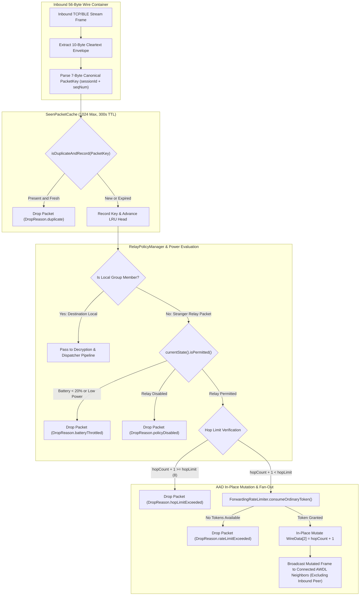
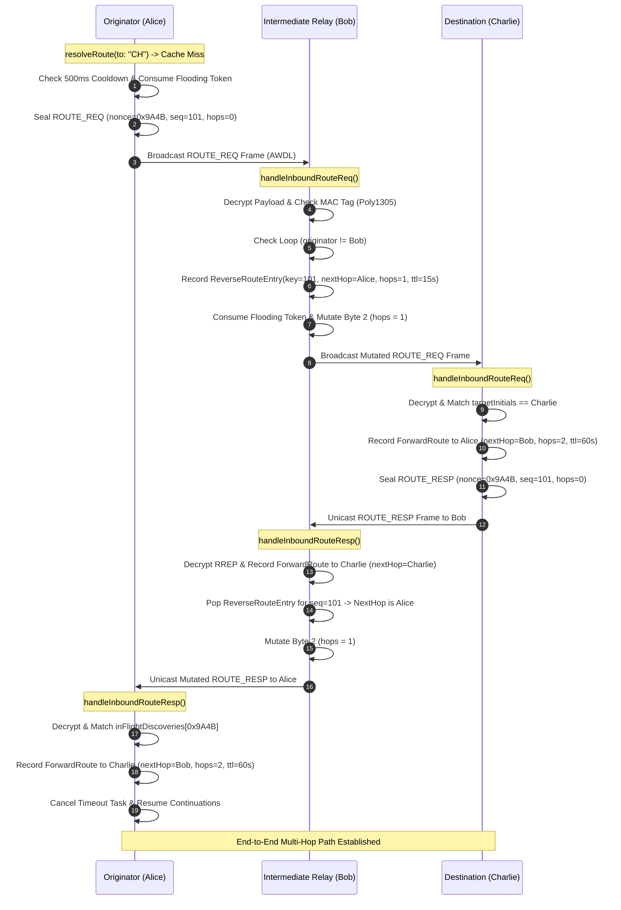

# Volume 04: Mesh Routing Engine, AODV & Relay Policy (Meepo)

## Executive Summary & Big-Picture Overview

Volume 04 explores the core multi-hop mesh forwarding engine, reactive routing discovery, physical neighbor management, and battery-aware relay policy enforcement of the Meepo system. When smartphones operate in severe off-grid disaster environments—such as earthquake rubble fields, flooded communities, or catastrophic hurricane aftermaths where municipal infrastructure has completely collapsed—direct peer-to-peer radio ranges (Apple Wireless Direct Link / AWDL and Bluetooth Low Energy / BLE) rarely exceed 30 to 100 meters due to physical obstructions and structural attenuation. To deliver life-safety SOS beacons, tactical micro-dispatches, and squad location telemetry across miles of disrupted terrain and multiple operational sectors, Meepo converts participating iOS devices into an autonomous, cooperative multi-hop relay network.

The mesh routing engine is engineered around three foundational architectural principles:
1. **Blind, Zero-Knowledge Forwarding:** Relaying nodes act as untrusted packet couriers. Because inner payloads are sealed using 256-bit ChaCha20-Poly1305 AEAD symmetric keys shared only within private group sessions, intermediate stranger nodes cannot inspect message contents, identify sender/receiver identities, or track location coordinates. Relays inspect only the 10-byte cleartext envelope, verify the 24-bit session ID and 8-hop limit, mutate Byte 2 (`hopCount`) in place, and forward the container. Authenticated Associated Data (AAD) hop masking guarantees that incrementing `hopCount` does not invalidate the original sender's cryptographic MAC tag.
2. **Deterministic Storm Suppression & Resource Budgeting:** Multi-hop flooding inherently risks broadcast storms and battery exhaustion. Meepo halts exponential packet replication through an actor-isolated, bounded Least Recently Used (LRU) duplicate cache (`SeenPacketCache`, holding 1,024 entries for 300 seconds) keyed by a canonical 7-byte `PacketKey` that omits mutating hop counts. In addition, `ForwardingRateLimiter` enforces dual-lane token buckets: routine mesh traffic is constrained to 2.0 packets/second steady-state with a dedicated telemetry reservation, while urgent SOS broadcasts run on an independent 4.0 packet/second bucket with an 8-token burst reserve.
3. **Reactive AODV Multi-Hop Discovery & Battery Preservation:** Rather than generating continuous, battery-draining proactive routing heartbeats, Meepo utilizes an on-demand Ad-hoc On-Demand Distance Vector (AODV) discovery protocol (`RouteDiscoveryService`). Routes are discovered only when a message must be sent to an unrouted destination. Inbound `ROUTE_REQ` frames establish ephemeral reverse routes (15-second TTL), allowing `ROUTE_RESP` packets to unicast directly back to the originator. Furthermore, `RelayPolicyManager` enforces strict opt-in consent and automatically engages disaster relief Survival Mode when device battery drops below 20% or Low Power Mode is activated, immediately severing stranger relaying and purging queued packets.

---

### ELI5 Overview: The Privacy-Preserving Bucket Brigade

Imagine an urban disaster zone following a major earthquake where cellular towers, power lines, and fiber backhauls are completely obliterated. Community Emergency Response Teams (CERT) and civilian volunteer rescue squads are spread across collapsed city blocks:

1. **The Locked Metal Canteen (Blind Forwarding):** Rescuer Alice at Sector 1 needs to transmit an urgent casualty update to Incident Commander Dave at the basecamp, but Alice's radio can only reach Bob stationed 40 meters away. Alice encases her dispatch in a 56-byte armored capsule locked with the squad's private 256-bit symmetric key that only Dave can open. Slipped into the outer transparent sleeve is a routing slip: *"For Session #42, Max Steps: 8, Current Step: 0"*. When Bob receives the capsule, he cannot decrypt the casualty details or squad coordinates. He simply increments "0" to "1" and relays it forward to Charlie.
2. **The Bouncer's Memory Pad (`SeenPacketCache`):** Every responder node in the disaster zone maintains a cryptographic memory ledger listing the signatures of the last 1,024 packets it has handled. If a neighboring relay attempts to hand Charlie a packet signature that Charlie already processed two minutes ago, Charlie's device drops it immediately. This prevents packets from cycling endlessly through the rubble in catastrophic broadcast storms.
3. **The Water Ration Spigots (`ForwardingRateLimiter`):** Each node enforces a steady rate limit (2 packets per second) for routine telemetry to avoid saturating limited radio bandwidth. However, if a life-critical SOS emergency beacon arrives, it bypasses the routine queue and enters an emergency priority lane so life-safety distress calls are never delayed by background location pings.
4. **The Scout's Breadcrumb Trail (Reactive AODV Discovery):** If Alice's device does not have an active route to Dave through the rubble, it dispatches an automated route request scout: *"Where is Dave?"* As the request travels from Bob to Charlie to Dave, each node records the reverse trail. When Dave's device receives the query, it sends an authenticated Route Response back along the exact reverse path, establishing a verified multi-hop route for the next hour.
5. **The Battery Lifeline (Emergency Survival Mode):** Forwarding mesh packets for neighboring rescue units is a vital humanitarian service, but no responder can afford a dead phone in a disaster zone. When a device's battery dips below 20%, the system automatically trips Survival Mode, shutting off third-party mesh relaying and purging non-essential transit packets to conserve remaining battery exclusively for the responder's own life-safety SOS beacon.

---

## Included Source Files

The following table itemizes every source code file assigned to Volume 04. Every file path is linked relative to this document, accompanied by its category, verified line count (`wc -l`), and singular architectural role:

| File Path | Category | Line Count (`wc -l`) | Architectural Purpose & Responsibility |
| :--- | :--- | :---: | :--- |
| [SeenPacketCache.swift](../../Teekum/Teekum/Core/Mesh/SeenPacketCache.swift) | Cache | 174 | Actor implementing thread-safe 1,024-entry bounded LRU duplicate packet suppression cache with 300s TTL. |
| [DropReason.swift](../../Teekum/Teekum/Core/Mesh/Relay/DropReason.swift) | Relay | 20 | Classification enumeration detailing exact reasons for packet drops across forwarding and routing pipelines. |
| [ForwardingBudgetManaging.swift](../../Teekum/Teekum/Core/Mesh/Relay/ForwardingBudgetManaging.swift) | Relay | 26 | Protocol contract declaring asynchronous forwarding quota and rate limit verification methods. |
| [ForwardingRateLimiter.swift](../../Teekum/Teekum/Core/Mesh/Relay/ForwardingRateLimiter.swift) | Relay | 131 | Actor enforcing dual token-bucket rate limits for routine relay, telemetry reservation, and urgent SOS bursts. |
| [RelayParticipationMode.swift](../../Teekum/Teekum/Core/Mesh/Relay/RelayParticipationMode.swift) | Relay | 14 | User relay mode enumeration (disabled, communalRelayActive, timed30Minutes) controlling mesh forwarding participation. |
| [RelayPolicyManager.swift](../../Teekum/Teekum/Core/Mesh/Relay/RelayPolicyManager.swift) | Relay | 327 | Actor enforcing battery thresholds, timed sessions, stranger relay rules, and anonymous telemetry aggregation. |
| [RelayPolicyState.swift](../../Teekum/Teekum/Core/Mesh/Relay/RelayPolicyState.swift) | Relay | 59 | Immutable state model driving user settings descriptions, mode toggles, and disaster relief Survival Mode evaluation. |
| [RelayStatus.swift](../../Teekum/Teekum/Core/Mesh/Relay/RelayStatus.swift) | Relay | 44 | High-level operational relay status enumeration (activeAlways, activeTimed, pausedSurvivalBattery, stoppedDisabled). |
| [InFlightDiscovery.swift](../../Teekum/Teekum/Core/Mesh/Routing/InFlightDiscovery.swift) | Routing | 18 | Internal state structure tracking in-flight AODV route discovery attempts with retry timers and continuations. |
| [NeighborEntry.swift](../../Teekum/Teekum/Core/Mesh/Routing/NeighborEntry.swift) | Routing | 22 | Internal routing structure representing a tracked 1-hop physical neighbor node with transmission loss ratios. |
| [NeighborEvent.swift](../../Teekum/Teekum/Core/Mesh/Routing/NeighborEvent.swift) | Routing | 16 | Lifecycle event enumeration emitted on neighbor discovery, connection state changes, or table eviction. |
| [NeighborInfo.swift](../../Teekum/Teekum/Core/Mesh/Routing/NeighborInfo.swift) | Routing | 39 | Public neighbor status model exposing smoothed RSSI, link quality score, and last-seen timestamp. |
| [NeighborManaging.swift](../../Teekum/Teekum/Core/Mesh/Routing/NeighborManaging.swift) | Routing | 28 | Protocol declaring neighbor registry, link quality evaluation, and pruning contracts. |
| [NeighborState.swift](../../Teekum/Teekum/Core/Mesh/Routing/NeighborState.swift) | Routing | 15 | Link health classification enumeration (connecting, connected, degraded, stale) governing neighbor routing priority. |
| [NeighborTable+Health.swift](../../Teekum/Teekum/Core/Mesh/Routing/NeighborTable+Health.swift) | Routing | 150 | Neighbor table extension executing transmission outcome evaluation, candidate ranking, and two-stage eviction. |
| [NeighborTable+Registry.swift](../../Teekum/Teekum/Core/Mesh/Routing/NeighborTable+Registry.swift) | Routing | 152 | Neighbor table extension recording direct connections, active neighbor filtering, and capacity bounds. |
| [NeighborTable.swift](../../Teekum/Teekum/Core/Mesh/Routing/NeighborTable.swift) | Routing | 96 | Actor managing the 64-entry bounded 1-hop physical neighbor table and event broadcast streams. |
| [ReverseRouteEntry.swift](../../Teekum/Teekum/Core/Mesh/Routing/ReverseRouteEntry.swift) | Routing | 27 | Ephemeral reverse routing structure stored during AODV route discovery to guide Route Response (RREP) delivery. |
| [RouteDiscoveryFailure.swift](../../Teekum/Teekum/Core/Mesh/Routing/RouteDiscoveryFailure.swift) | Routing | 40 | AODV route discovery error enumeration (timeout, destinationUnreachable, hopLimitExceeded, loopDetected). |
| [RouteDiscoveryService+Inbound.swift](../../Teekum/Teekum/Core/Mesh/Routing/RouteDiscoveryService+Inbound.swift) | Routing | 332 | AODV inbound extension processing incoming Route Requests (RREQ) and Route Responses (RREP) with AAD hop masking. |
| [RouteDiscoveryService+Initiation.swift](../../Teekum/Teekum/Core/Mesh/Routing/RouteDiscoveryService+Initiation.swift) | Routing | 161 | AODV initiation extension resolving cached routes, coalescing requests, and broadcasting RREQ datagrams. |
| [RouteDiscoveryService+Maintenance.swift](../../Teekum/Teekum/Core/Mesh/Routing/RouteDiscoveryService+Maintenance.swift) | Routing | 92 | Route maintenance extension invalidating broken links, executing session teardown, and exporting diagnostics. |
| [RouteDiscoveryService.swift](../../Teekum/Teekum/Core/Mesh/Routing/RouteDiscoveryService.swift) | Routing | 140 | Core actor coordinating reactive AODV multi-hop route discovery, sequence counters, and token bucket flooding. |
| [RouteEntry.swift](../../Teekum/Teekum/Core/Mesh/Routing/RouteEntry.swift) | Routing | 38 | Routing table entry binding destination member slot to next-hop peer ID, hop distance, cost, and expiration. |
| [RouteReqHandlingResult.swift](../../Teekum/Teekum/Core/Mesh/Routing/RouteReqHandlingResult.swift) | Routing | 18 | Result classification for processed RREQ packets (answeredWithRResp, forwarded, droppedDuplicate, droppedLoop). |
| [RouteRespHandlingResult.swift](../../Teekum/Teekum/Core/Mesh/Routing/RouteRespHandlingResult.swift) | Routing | 17 | Result classification for processed RREP packets (completedDiscovery, forwardedToReverseHop, droppedStale). |
| [RoutingTable.swift](../../Teekum/Teekum/Core/Mesh/Routing/RoutingTable.swift) | Routing | 313 | Actor managing dynamic AODV multi-hop routing paths, TTL expirations, sequence monotonicity, and next-hop lookups. |
| [RoutingTableManaging.swift](../../Teekum/Teekum/Core/Mesh/Routing/RoutingTableManaging.swift) | Routing | 43 | Protocol declaring multi-hop route query, registration, reverse path pop, and invalidation contracts. |
| [SeenRREQEntry.swift](../../Teekum/Teekum/Core/Mesh/Routing/SeenRREQEntry.swift) | Routing | 13 | Deduplication cache entry recording recent RREQ broadcasts to suppress broadcast loops. |
| **Total Volume 04 Artifacts** | **29 Files** | **2565** | **100% Volume 04 Codebase Accounting** |

---

## Mesh Forwarding & AODV Routing Architecture

The following diagrams illustrate the multi-hop forwarding pipeline, the dual-bucket rate limiter mechanics, the reactive AODV route discovery exchange, and the 1-hop physical neighbor health life cycle.

### 1. Multi-Hop Blind Forwarding & Deduplication Pipeline



### 2. Dual-Lane Token Bucket Rate Limiting Architecture

```
+===================================================================================+
|                       ForwardingRateLimiter Token Buckets                         |
+===================================================================================+
|                                                                                   |
|  [ ROUTINE RELAY BUCKET ]                                                         |
|  Refill Rate: 2.0 tokens/sec | Burst Capacity: Configured (e.g. 4.0 tokens)       |
|                                                                                   |
|  +-----------------------------------------------------------------------------+  |
|  | [ Token 1 ]  [ Token 2 ]  [ Token 3 ]  [ Token 4 ]                         |  |
|  +-----------------------------------------------------------------------------+  |
|         |                                        ^                                |
|         v                                        | (Leaves 1.0 burst reserve)     |
|   Ordinary Mesh Packets                  Telemetry Broadcasts                     |
|   (Chat, ACKs, Relays)                   (Location, Pings)                        |
|                                                                                   |
|  -------------------------------------------------------------------------------  |
|                                                                                   |
|  [ URGENT SOS PRIORITY BUCKET (ISOLATED) ]                                        |
|  Refill Rate: 4.0 tokens/sec | Burst Capacity: 8.0 tokens                         |
|                                                                                   |
|  +-----------------------------------------------------------------------------+  |
|  | [ SOS 1 ] [ SOS 2 ] [ SOS 3 ] [ SOS 4 ] [ SOS 5 ] [ SOS 6 ] [ SOS 7 ] [ SOS 8 ]|
|  +-----------------------------------------------------------------------------+  |
|         |                                                                         |
|         v                                                                         |
|   Urgent SOS Distress Beacons (Guaranteed Throughput, Zero Routine Cross-Block)   |
+===================================================================================+
```

### 3. Reactive AODV Route Discovery Sequence (RREQ Broadcast / RREP Unicast)



---

## Dedicated File-by-File Deep Dives

---

## 1. Teekum/Teekum/Core/Mesh/SeenPacketCache.swift

- **Repo-Relative Link:** [`../../Teekum/Teekum/Core/Mesh/SeenPacketCache.swift`](../../Teekum/Teekum/Core/Mesh/SeenPacketCache.swift)
- **Line Count:** 174 lines
- **Concurrency Domain:** Swift `actor` (`public actor SeenPacketCache`)
- **Type Semantics:** Reference type with actor isolation guaranteeing synchronized deduplication state across concurrent packet arrival streams.

### What This File Does
`SeenPacketCache.swift` implements an actor-isolated, bounded Least Recently Used (LRU) duplicate packet suppression cache. It records recently observed packets using their canonical 7-byte `PacketKey` (formed by combining the 24-bit session ID and 32-bit sequence number, while deliberately omitting the mutating 1-byte `hopCount` and `hopLimit`). By caching up to 1,024 entries with a 300-second (5-minute) sliding retention time-to-live (TTL), it guarantees that multi-path broadcast floods and circular relay paths do not cause broadcast storms or redundant CPU/radio work.

### ELI5 Analogy
Imagine a strict sentry guarding the radio frequencies of a disaster operational sector. Whenever a packet arrives across the mesh, the sentry checks an active log of the last 1,024 packet signatures received over the past five minutes. If that exact signature is already logged, the sentry immediately drops the packet before it consumes a single CPU cycle. If the signature is new, the sentry logs it into the cache. If the cache reaches its 1,024-entry ceiling, it evicts the oldest, least-recently-seen signature using an LRU policy to make room for fresh traffic.

### Technical Terms Defined
- **LRU (Least Recently Used) Eviction:** A cache replacement algorithm that discards the least recently accessed items first when the cache reaches maximum capacity.
- **PacketKey:** A canonical 7-byte hashable identifier (`sessionId` + `sequenceNumber`) that uniquely identifies an immutable packet transmission across its entire multi-hop lifespan, invariant under hop count increments.
- **Sliding Retention TTL:** A time-to-live policy where an entry remains valid for 300 seconds from arrival, and fresh duplicate arrivals touch the access timestamp to keep active stream records alive.
- **Broadcast Storm:** A failure mode in wireless ad-hoc networks where nodes endlessly rebroadcast identical packets to each other, consuming all available radio spectrum and crashing receiver buffers.
- **MeshClock:** An injected protocol abstraction for time measurement (`clock.now()`) enabling 100% deterministic, instant unit testing without relying on wall-clock system delays.

### Code-Block and Line-by-Line Walkthrough

#### Lines 1–45: Actor Declaration, `CacheEntry`, and Initializer
```swift
//
//  SeenPacketCache.swift
//  Teekum
//
//  Created by Nicho on 08/11/26.
//

import Foundation

/// Thread-safe in-memory Bounded LRU Duplicate Packet Suppression Cache.
///
/// Implements Architectural Decision 2 & 7:
/// - Max capacity: 1,024 entries (~7.1 KB RAM footprint)
/// - Sliding retention TTL: 300 seconds (5 minutes)
/// - Deterministic eviction: Oldest / least-recently-seen packet key evicted on overflow
/// - Injected `MeshClock` dependency for 100% deterministic unit testing
/// - Keyed by canonical 7-byte `PacketKey` (excluding mutating hop metadata)
public actor SeenPacketCache {
    
    public struct CacheEntry: Sendable {
        public let key: PacketKey
        public let arrivalTime: Date
        public var lastAccessed: Date
    }
    
    private let capacity: Int
    private let ttl: TimeInterval
    private let clock: MeshClock
    
    /// Map of canonical packet key -> entry
    private var entries: [PacketKey: CacheEntry] = [:]
    
    /// Ordered list of keys maintaining LRU order (most recently accessed at the end)
    private var lruOrder: [PacketKey] = []
    
    public init(
        capacity: Int = 1024,
        ttl: TimeInterval = 300.0,
        clock: MeshClock = SystemMeshClock()
    ) {
        self.capacity = max(1, capacity)
        self.ttl = max(1.0, ttl)
        self.clock = clock
    }
```
- **Lines 10–18:** Declares `SeenPacketCache` as an actor. Lines 12–17 explicitly document Architectural Decisions 2 and 7: maximum capacity of 1,024 entries requiring only ~7.1 KB of RAM, 300-second TTL, deterministic LRU eviction, `MeshClock` injection, and canonical 7-byte keys.
- **Lines 20–24:** Defines nested immutable/mutable value struct `CacheEntry` carrying the `key`, immutable `arrivalTime`, and mutable `lastAccessed` timestamp.
- **Lines 26–34:** Storage consists of dictionary `entries: [PacketKey: CacheEntry]` for O(1) key lookups and array `lruOrder: [PacketKey]` maintaining access chronology where the head represents the oldest entry and the tail represents the newest.
- **Lines 36–44:** The initializer enforces minimum safety bounds (`max(1, capacity)` and `max(1.0, ttl)`) and assigns the default `SystemMeshClock`.

#### Lines 46–66: Queries and Inspections (`count`, `contains`, `insert`)
```swift
    /// Current number of unexpired entries in the cache.
    public var count: Int {
        entries.count
    }
    
    /// Checks whether the packet key is present and unexpired.
    /// Does NOT mutate the cache or record the key.
    public func contains(_ key: PacketKey, now: Date? = nil) -> Bool {
        let currentTime = now ?? clock.now()
        guard let entry = entries[key] else { return false }
        if currentTime.timeIntervalSince(entry.arrivalTime) >= ttl {
            return false
        }
        return true
    }
    
    /// Inserts or touches a packet key in the cache.
    public func insert(_ key: PacketKey, now: Date? = nil) {
        let currentTime = now ?? clock.now()
        _ = recordKey(key, now: currentTime)
    }
```
- **Lines 47–49:** `count` exposes current dictionary size.
- **Lines 53–60:** `contains(_:now:)` performs a non-mutating check: returns `true` only if the key exists and its elapsed time since `arrivalTime` is strictly less than `ttl`. If expired, it returns `false` without modifying state.
- **Lines 63–66:** `insert(_:now:)` forces insertion or renewal by delegating to internal helper `recordKey`.

#### Lines 68–103: Atomic Deduplication (`isDuplicateAndRecord`)
```swift
    /// Atomically checks if a packet key is a duplicate, and if not, records it.
    ///
    /// - Returns: `true` if the packet was already present and fresh (duplicate to drop).
    ///            `false` if the packet was not seen before (fresh packet to process).
    public func isDuplicateAndRecord(_ key: PacketKey, now: Date? = nil) -> Bool {
        let currentTime = now ?? clock.now()
        
        // Fast lookup
        if let existing = entries[key] {
            if currentTime.timeIntervalSince(existing.arrivalTime) < ttl {
                // Fresh duplicate! Update LRU order
                touchLRU(key, now: currentTime)
                return true
            } else {
                // Expired entry found: treat as fresh arrival
                removeEntry(key)
            }
        }
        
        // Evict expired entries if approaching capacity
        if entries.count >= capacity {
            purgeExpiredEntries(currentTime: currentTime)
        }
        
        // If still at capacity, evict least recently accessed entry (head of lruOrder)
        while entries.count >= capacity, !lruOrder.isEmpty {
            let oldest = lruOrder.removeFirst()
            entries.removeValue(forKey: oldest)
        }
        
        // Insert new entry
        let newEntry = CacheEntry(key: key, arrivalTime: currentTime, lastAccessed: currentTime)
        entries[key] = newEntry
        lruOrder.append(key)
        return false
    }
```
- **Lines 72–74:** Core entry point executed on every inbound radio frame.
- **Lines 76–85:** Checks if `entries[key]` exists. If elapsed time is within `ttl`, calls `touchLRU(key, now: currentTime)` and returns `true` (packet must be dropped as duplicate). If the entry has expired, removes it so the incoming frame can be accepted as a fresh arrival.
- **Lines 88–90:** If count is at or above capacity, runs `purgeExpiredEntries` to clean stale entries before resorting to LRU eviction.
- **Lines 93–96:** If the cache remains at capacity after purging expired entries, pops from `lruOrder.removeFirst()` (the least-recently-accessed entry) and deletes it from `entries`.
- **Lines 99–102:** Inserts the fresh `CacheEntry`, appends the key to `lruOrder`, and returns `false` (informing the caller that this packet is new and should be processed/relayed).

#### Lines 104–173: Eviction, Purge, and LRU Maintenance Helpers
```swift
    /// Manually purges all expired entries beyond the 5-minute TTL window.
    public func purgeExpired(now: Date? = nil) {
        let currentTime = now ?? clock.now()
        purgeExpiredEntries(currentTime: currentTime)
    }
    
    /// Wipes all cached packet keys (e.g. on group teardown).
    public func removeAll() {
        entries.removeAll()
        lruOrder.removeAll()
    }
    
    // MARK: - Private Helpers
    
    private func recordKey(_ key: PacketKey, now: Date) -> Bool {
        if let existing = entries[key] {
            if now.timeIntervalSince(existing.arrivalTime) < ttl {
                touchLRU(key, now: now)
                return true
            } else {
                removeEntry(key)
            }
        }
        
        if entries.count >= capacity {
            purgeExpiredEntries(currentTime: now)
        }
        
        while entries.count >= capacity, !lruOrder.isEmpty {
            let oldest = lruOrder.removeFirst()
            entries.removeValue(forKey: oldest)
        }
        
        let newEntry = CacheEntry(key: key, arrivalTime: now, lastAccessed: now)
        entries[key] = newEntry
        lruOrder.append(key)
        return false
    }
    
    private func touchLRU(_ key: PacketKey, now: Date) {
        if var entry = entries[key] {
            entry.lastAccessed = now
            entries[key] = entry
        }
        if let idx = lruOrder.firstIndex(of: key) {
            lruOrder.remove(at: idx)
            lruOrder.append(key)
        }
    }
    
    private func removeEntry(_ key: PacketKey) {
        entries.removeValue(forKey: key)
        if let idx = lruOrder.firstIndex(of: key) {
            lruOrder.remove(at: idx)
        }
    }
    
    private func purgeExpiredEntries(currentTime: Date) {
        let cutoff = currentTime.addingTimeInterval(-ttl)
        var toRemove: Set<PacketKey> = []
        for (key, entry) in entries {
            if entry.arrivalTime < cutoff {
                toRemove.insert(key)
            }
        }
        for key in toRemove {
            removeEntry(key)
        }
    }
}
```
- **Lines 106–115:** `purgeExpired` and `removeAll` provide cleanup capabilities for idle timers and group teardown.
- **Lines 144–153:** `touchLRU` updates `lastAccessed` on the entry and relocates the key to the end of `lruOrder`.
- **Lines 155–160:** `removeEntry` synchronously cleans both dictionary and ordered array.
- **Lines 162–173:** `purgeExpiredEntries` computes a strict cutoff timestamp (`currentTime - ttl`) and purges all entries older than the threshold.

### Engineering Rationale and Edge Cases
- **Why Omit Hop Metadata from PacketKey:** When node A transmits a packet with `hopCount: 0`, and intermediate node B relays it with `hopCount: 1`, node C receives both frames if within radio range of both. If `hopCount` were in the key, node C would perceive them as different packets and re-forward both, creating exponential broadcast replication. Excluding `hopCount` and `hopLimit` ensures true idempotent deduplication.
- **Bounded RAM Footprint:** At 1,024 entries, each storing a 7-byte key and two 8-byte `Date` references, memory consumption is capped at under 8 KB, preventing memory pressure crashes on constrained background iOS runtimes.
- **Actor Concurrency Safety:** Multiple asynchronous radio reception tasks from AWDL TCP framing can invoke `isDuplicateAndRecord` concurrently. Actor isolation guarantees atomic check-and-insert semantics without race conditions.

---

## 2. Teekum/Teekum/Core/Mesh/Relay/DropReason.swift

- **Repo-Relative Link:** [`../../Teekum/Teekum/Core/Mesh/Relay/DropReason.swift`](../../Teekum/Teekum/Core/Mesh/Relay/DropReason.swift)
- **Line Count:** 20 lines
- **Concurrency Domain:** Swift `enum` (`public enum DropReason: Sendable, Equatable`)
- **Type Semantics:** Value type conforming to `Sendable` and `Equatable` for safe, zero-cost cross-actor event signaling.

### What This File Does
`DropReason.swift` defines the unified enumeration classifying why an inbound or relayed mesh packet was rejected or dropped by the forwarding engine. It enables fine-grained telemetry tracking without inspecting or logging sensitive payload contents, attributing packet losses to duplicate suppression, hop count exhaustion, rate limiting, battery preservation, user policy, queue saturation, packet malformation, cryptographic failure, or testbed simulated loss.

### ELI5 Analogy
Imagine a postal sorting facility that stamps a specific rejection code on any package returned without delivery: "Duplicate Stamp", "Excessive Hops", "Quota Full", or "Low Fuel Alert". The sorting facility does not read the letters inside; it simply tallies the rejection codes on an anonymous operational chart so managers know why throughput dropped.

### Technical Terms Defined
- **Drop Reason Taxonomy:** A standardized categorization of network degradation events allowing telemetry layers to distinguish between normal protocol behaviors (like duplicate suppression) and anomalous network conditions (like queue saturation).
- **Simulated Loss:** Deliberate, artificial packet dropping introduced by automated test harnesses to verify link-layer retries, route recovery, and degradation heuristics.

### Code-Block and Line-by-Line Walkthrough

#### Lines 1–20: Full File Walkthrough
```swift
//
//  DropReason.swift
//  Teekum
//
//  Created by Nicho on 06/11/26.
//

import Foundation

public enum DropReason: Sendable, Equatable {
    case duplicate
    case hopLimitExceeded
    case rateLimitExceeded
    case batteryThrottled
    case policyDisabled
    case queueSaturation
    case malformed
    case securityVerificationFailed
    case simulatedLoss
}
```
- **Lines 10–20:** Declares `DropReason` with 9 explicit failure cases:
  - `duplicate`: Packet was already recorded in `SeenPacketCache` within the 5-minute TTL.
  - `hopLimitExceeded`: Packet has reached or exceeded its designated maximum hop limit (e.g. 8 hops).
  - `rateLimitExceeded`: Inbound packet arrived when the forwarding token bucket was empty.
  - `batteryThrottled`: Hardware battery dropped below 20% or Low Power Mode became active.
  - `policyDisabled`: User has configured relay mode to `.disabled`.
  - `queueSaturation`: The outgoing priority outbox queue ring buffer was full.
  - `malformed`: Frame size or cleartext envelope headers violated wire specifications.
  - `securityVerificationFailed`: Poly1305 MAC tag failed or AAD mismatch occurred.
  - `simulatedLoss`: Drop injected by unit tests or chaos monkey simulator.

### Engineering Rationale and Edge Cases
- **Anonymous Telemetry:** By categorizing drops through an enum rather than string messages or data dumps, the app collects aggregate operational health metrics without violating user privacy or retaining tracking histories.
- **Zero Overhead:** Being a simple Swift enum with no payload values, it compiles to an 8-bit integer tag on the stack, ensuring zero allocation overhead during high-throughput packet processing.

---

## 3. Teekum/Teekum/Core/Mesh/Relay/ForwardingBudgetManaging.swift

- **Repo-Relative Link:** [`../../Teekum/Teekum/Core/Mesh/Relay/ForwardingBudgetManaging.swift`](../../Teekum/Teekum/Core/Mesh/Relay/ForwardingBudgetManaging.swift)
- **Line Count:** 26 lines
- **Concurrency Domain:** Swift `protocol` inheriting from `Actor` (`public protocol ForwardingBudgetManaging: Actor`)
- **Type Semantics:** Protocol abstraction defining the actor-isolated contract for forwarding rate limits and token bucket budgets.

### What This File Does
`ForwardingBudgetManaging.swift` declares the formal interface for token-bucket forwarding budget managers. It provides methods to consume tokens for routine background relay traffic (2 packets/second), telemetry broadcasts, and urgent emergency SOS bursts (up to 4 packets/second). Additionally, it specifies a default protocol extension for telemetry token consumption.

### ELI5 Analogy
Imagine an amusement park token booth with two separate token dispensers: a green dispenser for routine carousel rides that refills slowly, and a flashing red dispenser for emergency medical transport that refills instantly. Any ride operator must check in with this booth protocol before letting another rider through the turnstile.

### Technical Terms Defined
- **Actor-Constrained Protocol:** A Swift protocol declared with `: Actor`, requiring conforming types to be actors and ensuring that all method invocations are asynchronous and isolated to that actor's execution context.
- **Ordinary Traffic vs. SOS Priority:** Routine mesh messages (telemetry, location updates, chat) share a constrained forwarding quota, whereas life-safety SOS packets access an isolated, higher-throughput budget.

### Code-Block and Line-by-Line Walkthrough

#### Lines 1–26: Full Protocol Declaration and Default Extension
```swift
//
//  ForwardingBudgetManaging.swift
//  Teekum
//
//  Created by Nicho on 06/11/26.
//

import Foundation

public protocol ForwardingBudgetManaging: Actor {
    /// Attempts to consume tokens for forwarding ordinary traffic (2 pkts/sec).
    func consumeOrdinaryToken() async -> Bool

    /// Telemetry leaves one burst token available for reliable traffic.
    func consumeTelemetryToken() async -> Bool
    
    /// Attempts to consume tokens for urgent SOS forwarding (max 4 pkts/sec).
    func consumeSOSToken() async -> Bool
    
    /// Current available ordinary token reserve.
    func availableTokens() async -> Double
}

public extension ForwardingBudgetManaging {
    func consumeTelemetryToken() async -> Bool { await consumeOrdinaryToken() }
}
```
- **Lines 10–22:** Declares the four core requirements: `consumeOrdinaryToken()`, `consumeTelemetryToken()`, `consumeSOSToken()`, and `availableTokens()`. All methods are marked `async` due to actor isolation.
- **Lines 24–26:** Provides a fallback default implementation where `consumeTelemetryToken()` delegates directly to `consumeOrdinaryToken()` if the conforming actor does not implement custom telemetry burst reservation logic.

### Engineering Rationale and Edge Cases
- **Architectural Decoupling:** Decouples packet routing and mesh transport actors from the concrete rate limiter implementation, enabling unit tests to inject mock rate limiters that simulate budget exhaustion or instant refills.

---

## 4. Teekum/Teekum/Core/Mesh/Relay/ForwardingRateLimiter.swift

- **Repo-Relative Link:** [`../../Teekum/Teekum/Core/Mesh/Relay/ForwardingRateLimiter.swift`](../../Teekum/Teekum/Core/Mesh/Relay/ForwardingRateLimiter.swift)
- **Line Count:** 131 lines
- **Concurrency Domain:** Swift `actor` (`public actor ForwardingRateLimiter: ForwardingBudgetManaging`)
- **Type Semantics:** Reference type with actor isolation protecting mutable token reserves and refill timestamps.

### What This File Does
`ForwardingRateLimiter.swift` implements dual token-bucket rate limiting to protect device radio transceivers and battery reserves from exhaustion. It maintains two independent token reserves: an ordinary traffic bucket (configured for steady-state 2.0 packets/second with burst capacity) and an urgent SOS bucket (configured for 4.0 packets/second with an 8-token burst capacity). Furthermore, it implements a telemetry reservation policy that leaves at least one ordinary burst token reserved for reliable chat and acknowledgment packets.

### ELI5 Analogy
Imagine a water reservoir with two spigots. The lower spigot feeds the disaster relief's routine sprinkler system and refills at 2 drops per second up to a small glass. The upper emergency spigot feeds the fire extinguisher hose and has a dedicated backup tank that refills much faster. If the routine glass is running low, the sprinkler system pauses so there is always a drop saved for urgent walkie-talkie messages.

### Technical Terms Defined
- **Token Bucket Algorithm:** A rate limiting algorithm where tokens accumulate at a fixed refill rate up to a maximum burst capacity. Transmitting a packet consumes one token; if no tokens remain, the packet is rejected.
- **Burst Capacity:** The maximum number of tokens a bucket can hold, allowing short bursts of high-speed transmission after idle periods without violating long-term average rate limits.
- **Fractional Token Refill:** Calculating token addition based on elapsed time (`elapsed * refillRate`) using floating-point math, avoiding discrete second-boundary jitter.

### Code-Block and Line-by-Line Walkthrough

#### Lines 1–50: Actor Declaration, Properties, and Initializer
```swift
//
//  ForwardingRateLimiter.swift
//  TeeKum Prototype
//
//  Created by Nicho on 29/10/26.
//

import Foundation

/// Token bucket forwarding budgets, initialized from TeeKumConfiguration:
/// - Ordinary traffic shares a configured refill rate and burst capacity.
/// - Telemetry leaves one ordinary burst token for reliable chat/ACK traffic.
/// - SOS retains its independent urgent budget (8-token burst capacity).
///
/// Supports an injected `MeshClock` for deterministic automated unit testing.
public actor ForwardingRateLimiter: ForwardingBudgetManaging {
    private let clock: MeshClock
    
    // Ordinary traffic token bucket
    private let ordinaryCapacity: Double
    private let ordinaryRefillRate: Double // tokens per second
    private var ordinaryTokens: Double
    private var lastOrdinaryRefill: Date
    
    // SOS priority token bucket
    private let sosCapacity: Double
    private let sosRefillRate: Double // tokens per second
    private var sosTokens: Double
    private var lastSOSRefill: Date
    
    public init(
        clock: MeshClock = SystemMeshClock(),
        ordinaryCapacity: Double = MeepoConfiguration.Timing.ordinaryRelayBurstCapacity,
        ordinaryRefillRate: Double = MeepoConfiguration.Timing.ordinaryRelayRateLimit,
        sosCapacity: Double = 8.0,
        sosRefillRate: Double = MeepoConfiguration.Timing.urgentSOSRateLimit
    ) {
        self.clock = clock
        self.ordinaryCapacity = ordinaryCapacity
        self.ordinaryRefillRate = ordinaryRefillRate
        self.sosCapacity = sosCapacity
        self.sosRefillRate = sosRefillRate
        
        let now = clock.now()
        self.ordinaryTokens = ordinaryCapacity
        self.lastOrdinaryRefill = now
        self.sosTokens = sosCapacity
        self.lastSOSRefill = now
    }
```
- **Lines 16–30:** Declares actor state: `clock`, capacities (`ordinaryCapacity`, `sosCapacity`), refill rates in tokens/sec (`ordinaryRefillRate`, `sosRefillRate`), current token balances (`ordinaryTokens`, `sosTokens`), and last refill timestamps (`lastOrdinaryRefill`, `lastSOSRefill`).
- **Lines 31–49:** Initializer pulls defaults directly from `MeepoConfiguration.Timing` constants, initializes buckets to full capacity, and captures the baseline timestamp from `clock.now()`.

#### Lines 51–70: Refill Mathematics (`refillOrdinary`, `refillSOS`)
```swift
    /// Refills ordinary token bucket based on elapsed time.
    private func refillOrdinary(now: Date) {
        let elapsed = max(0.0, now.timeIntervalSince(lastOrdinaryRefill))
        if elapsed > 0 {
            let refilled = elapsed * ordinaryRefillRate
            ordinaryTokens = min(ordinaryCapacity, ordinaryTokens + refilled)
            lastOrdinaryRefill = now
        }
    }
    
    /// Refills SOS token bucket based on elapsed time.
    private func refillSOS(now: Date) {
        let elapsed = max(0.0, now.timeIntervalSince(lastSOSRefill))
        if elapsed > 0 {
            let refilled = elapsed * sosRefillRate
            sosTokens = min(sosCapacity, sosTokens + refilled)
            lastSOSRefill = now
        }
    }
```
- **Lines 52–59:** `refillOrdinary` calculates elapsed time since last refill, multiplies by `ordinaryRefillRate`, clamps tokens to `ordinaryCapacity` via `min()`, and updates `lastOrdinaryRefill`.
- **Lines 62–69:** `refillSOS` performs the identical calculation for the independent SOS bucket using `sosRefillRate` and `sosCapacity`.

#### Lines 71–107: Token Consumption (`consumeOrdinaryToken`, `consumeTelemetryToken`, `consumeSOSToken`)
```swift
    /// Attempts to consume 1 token for forwarding ordinary relay traffic.
    /// Returns true if permitted, false if rate limit exceeded.
    public func consumeOrdinaryToken() async -> Bool {
        let now = clock.now()
        refillOrdinary(now: now)
        
        if ordinaryTokens >= 1.0 {
            ordinaryTokens -= 1.0
            return true
        } else {
            return false
        }
    }
    
    /// Telemetry shares the ordinary budget but leaves one burst token for chat/ACK.
    /// This is a reservation inside the configured budget, not an additional allowance.
    public func consumeTelemetryToken() async -> Bool {
        refillOrdinary(now: clock.now())
        let reserve = min(1.0, max(0.0, ordinaryCapacity - 1.0))
        guard ordinaryTokens >= 1.0 + reserve else { return false }
        ordinaryTokens -= 1.0
        return true
    }

    /// Attempts to consume 1 token for forwarding urgent SOS priority traffic.
    /// Returns true if permitted, false if SOS limit exceeded.
    public func consumeSOSToken() async -> Bool {
        let now = clock.now()
        refillSOS(now: now)
        
        if sosTokens >= 1.0 {
            sosTokens -= 1.0
            return true
        } else {
            return false
        }
    }
```
- **Lines 73–83:** Checks if `ordinaryTokens >= 1.0`. If so, decrements by 1.0 and returns `true`; otherwise returns `false`.
- **Lines 87–93:** In `consumeTelemetryToken()`, computes `reserve = min(1.0, max(0.0, ordinaryCapacity - 1.0))`. It requires `ordinaryTokens >= 1.0 + reserve`. This guarantees that routine background telemetry will never drain the bucket completely, leaving at least 1.0 token immediately available for user chat messages or cryptographic acknowledgments.
- **Lines 97–107:** `consumeSOSToken()` checks the independent SOS bucket, ensuring life-safety traffic is completely insulated from ordinary traffic exhaustion.

#### Lines 109–131: Observability and Reset
```swift
    /// Current available ordinary token reserve.
    public func availableTokens() async -> Double {
        let now = clock.now()
        refillOrdinary(now: now)
        return ordinaryTokens
    }
    
    /// Current available SOS token reserve.
    public func availableSOSTokens() async -> Double {
        let now = clock.now()
        refillSOS(now: now)
        return sosTokens
    }
    
    /// Manually resets token reserves to full capacity.
    public func reset() {
        let now = clock.now()
        ordinaryTokens = ordinaryCapacity
        lastOrdinaryRefill = now
        sosTokens = sosCapacity
        lastSOSRefill = now
    }
}
```
- **Lines 110–121:** Refills and inspects current floating-point token balances for telemetry snapshots.
- **Lines 124–130:** `reset()` immediately replenishes both buckets to maximum capacity.

### Engineering Rationale and Edge Cases
- **Isolated SOS Budget:** If a malicious or buggy stranger node floods ordinary chat packets, the ordinary bucket will exhaust, dropping stranger frames. However, because SOS utilizes an isolated bucket with an 8-token burst limit, incoming emergency beacons are forwarded unimpeded.
- **Floating-Point Precision:** Using `Double` for tokens enables fractional accumulation over sub-second intervals (e.g., 100ms yields 0.2 tokens at 2.0 tokens/sec), ensuring smooth, jitter-free transmission without arbitrary 1-second quantizations.

---

## 5. Teekum/Teekum/Core/Mesh/Relay/RelayParticipationMode.swift

- **Repo-Relative Link:** [`../../Teekum/Teekum/Core/Mesh/Relay/RelayParticipationMode.swift`](../../Teekum/Teekum/Core/Mesh/Relay/RelayParticipationMode.swift)
- **Line Count:** 14 lines
- **Concurrency Domain:** Swift `enum` (`public enum RelayParticipationMode: String, Sendable, Codable, CaseIterable`)
- **Type Semantics:** Value type conforming to `String`, `Sendable`, `Codable`, and `CaseIterable` for direct serialization to `UserDefaults` and SwiftUI picker bindings.

### What This File Does
`RelayParticipationMode.swift` defines the user-selectable operational modes governing whether the device participates in communal mesh relaying. It encapsulates the three core user privacy and resource choices: completely disabled, always active while battery health permits, or active for a temporary 30-minute window.

### ELI5 Analogy
Imagine a personal Wi-Fi hotspot switch with three settings: "Off" (never share data with anyone), "Always On" (share with rescue workers and survivors as long as my battery is above 20%), or "Timer: 30 Minutes" (lend out my radio for half an hour, then turn it off automatically so I don't forget).

### Technical Terms Defined
- **Communal Relay:** The practice where participant nodes voluntarily spend a fraction of their radio bandwidth and battery power to forward encrypted packets on behalf of other mesh participants.
- **Timed Session:** A temporary opt-in state that automatically transitions back to disabled after 1,800 seconds (30 minutes) to prevent accidental long-term battery drain.

### Code-Block and Line-by-Line Walkthrough

#### Lines 1–14: Full Enum Declaration
```swift
//
//  RelayParticipationMode.swift
//  Teekum
//
//  Created by Nicho on 06/11/26.
//

import Foundation

public enum RelayParticipationMode: String, Sendable, Codable, CaseIterable {
    case disabled            // Relay OFF: never forwards stranger packets
    case communalRelayActive // Always relay while battery >= 20%
    case timed30Minutes      // Relay for 30 minutes, then automatically pause
}
```
- **Lines 10–14:** Declares `RelayParticipationMode` with raw value `String`. The three cases map to:
  - `disabled`: Absolute opt-out; device drops all stranger relay frames and tears down relay outbox queues.
  - `communalRelayActive`: Full participation enabled, subject to disaster relief Survival Mode battery checks.
  - `timed30Minutes`: Opt-in bounded by a 30-minute countdown timer.

### Engineering Rationale and Edge Cases
- **Privacy by Default:** By making `disabled` the initial default state until explicit user consent is given during group onboarding or settings configuration, the application adheres to Apple's strict privacy and battery preservation guidelines.
- **Codable Persistence:** String backing ensures human-readable, migration-safe storage in `UserDefaults`.

---
## 6. Teekum/Teekum/Core/Mesh/Relay/RelayPolicyManager.swift

- **Repo-Relative Link:** [`../../Teekum/Teekum/Core/Mesh/Relay/RelayPolicyManager.swift`](../../Teekum/Teekum/Core/Mesh/Relay/RelayPolicyManager.swift)
- **Line Count:** 327 lines
- **Concurrency Domain:** Swift `actor` (`public actor RelayPolicyManager`)
- **Type Semantics:** Reference type with actor isolation governing user relay policy, battery thresholds, and telemetry aggregation.

### What This File Does
`RelayPolicyManager.swift` serves as the central policy orchestrator for stranger mesh relaying and hardware power conservation. Conforming to actor isolation, it enforces explicit user opt-in, manages timed 30-minute sessions, and automatically activates disaster relief Survival Mode when device battery drops below 20% or iOS Low Power Mode is enabled. Upon relay suspension or termination, it immediately halts forwarding in `MeshTransport` and flushes all queued stranger frames from `PriorityOutboxQueue`, while maintaining strictly aggregated, anonymous resource telemetry without recording location coordinates.

### ELI5 Analogy
Imagine the energy manager of a solar-powered camper van. The manager allows neighboring campers to plug their phones into the van's external power sockets, but only if the owner clicked "Allow" on the dashboard. The manager watches the main battery gauge constantly. If the van's battery drops below 20%, or if a 30-minute timer expires, the manager instantly trips the circuit breaker to the outside sockets, clears out any pending charging requests, and preserves every remaining watt of power so the van's engine and emergency lights keep working.

### Technical Terms Defined
- **disaster relief Survival Mode:** A critical battery preservation state triggered automatically when battery level drops below 20% (`< 0.20`) or iOS Low Power Mode is activated. It shuts down all stranger relaying to preserve power for local safety features.
- **Relay Queue Drainage:** The immediate purging and deallocation of queued stranger packets from the priority outbox when relaying is suspended, preventing stale packets from congesting memory or transmitting upon wake-up.
- **Non-isolated AsyncStream:** A concurrency pattern exposing an `AsyncStream<RelayPolicyState>` property marked `nonisolated` so external UI components can observe state transitions without awaiting actor actor-hops.
- **Anonymous Telemetry:** The collection of coarse operational counts (packets forwarded, drops by category) without recording identifiers, timestamps, or geospatial coordinates, adhering to strict zero-knowledge telemetry standards.

### Code-Block and Line-by-Line Walkthrough

#### Lines 1–83: Dependencies, State Properties, Telemetry Counters, and Initializer
```swift
//
//  RelayPolicyManager.swift
//  TeeKum Prototype
//
//  Created by Nicho on 29/10/26.
//

import Foundation

/// Actor-isolated communal relay participation and battery policy manager.
///
/// - Enforces explicit user opt-in for stranger relaying.
/// - Persists user preference via `UserDefaults` with support for timed 30-minute sessions.
/// - Enforces disaster relief Survival Mode (<20% battery or Low Power Mode) with immediate shutdown of stranger forwarding.
/// - Drains and purges queued stranger packets promptly upon relay termination.
/// - Integrates with `MeshTransport` and `PriorityOutboxQueue` to enforce resource budgets at the service layer.
/// - Tracks strictly aggregated resource telemetry with ZERO sensitive location coordinates or tracking history.
/// - Fully testable via injected `MeshClock`.
public actor RelayPolicyManager {
    
    // MARK: - Dependencies
    
    private let clock: MeshClock
    private let userDefaults: UserDefaults
    private let storageKeyPrefix: String
    private weak var transport: MeshTransport?
    private let outbox: PriorityOutboxQueue?
    
    // MARK: - State Properties
    
    private var mode: RelayParticipationMode
    private var timedExpiryDate: Date?
    private var batteryLevel: Float
    private var isLowPowerModeActive: Bool
    
    // MARK: - Telemetry Counters (Anonymous, zero location retention)
    
    private var totalPacketsForwarded: Int = 0
    private var totalSOSForwarded: Int = 0
    private var packetsDroppedRateLimit: Int = 0
    private var packetsDroppedHopLimit: Int = 0
    private var duplicatePacketsSuppressed: Int = 0
    private var packetsDroppedPolicy: Int = 0
    private var packetsDroppedBattery: Int = 0
    private var packetsDroppedQueueSaturation: Int = 0
    private var packetsDroppedMalformed: Int = 0
    private var packetsDroppedSecurity: Int = 0
    private var packetsDroppedSimulatedLoss: Int = 0
    
    // MARK: - Reactive State Stream
    
    private var stateContinuation: AsyncStream<RelayPolicyState>.Continuation?
    public nonisolated let stateUpdates: AsyncStream<RelayPolicyState>
    
    // MARK: - Storage Keys
    
    private var modeStorageKey: String { "\(storageKeyPrefix).participationMode" }
    private var expiryStorageKey: String { "\(storageKeyPrefix).timedExpiryDate" }
    
    // MARK: - Initialization
    
    public init(
        clock: MeshClock = SystemMeshClock(),
        userDefaults: UserDefaults = .standard,
        storageKeyPrefix: String = "com.teekum.relay",
        transport: MeshTransport? = nil,
        outbox: PriorityOutboxQueue? = nil,
        initialBatteryLevel: Float = 1.0,
        initialLowPowerMode: Bool = false,
        defaultMode: RelayParticipationMode? = nil
    ) {
        self.clock = clock
        self.userDefaults = userDefaults
        self.storageKeyPrefix = storageKeyPrefix
        self.transport = transport
        self.outbox = outbox
        self.batteryLevel = initialBatteryLevel
        self.isLowPowerModeActive = initialLowPowerMode
        
        var continuation: AsyncStream<RelayPolicyState>.Continuation?
        self.stateUpdates = AsyncStream(bufferingPolicy: .bufferingNewest(1)) { continuation = $0 }
        self.stateContinuation = continuation
```
- **Lines 10–28:** Declares `RelayPolicyManager` as an actor. Dependencies include injected `MeshClock`, `UserDefaults` instance, key prefix, weak reference to `MeshTransport` (avoiding retain cycles), and `PriorityOutboxQueue`.
- **Lines 30–35:** Tracks internal mutable state: `mode`, `timedExpiryDate`, `batteryLevel` (0.0 to 1.0), and `isLowPowerModeActive`.
- **Lines 38–48:** Aggregates anonymous operational counters for forwarded packets and drops classified by `DropReason`.
- **Lines 52–54:** Creates a non-isolated `stateUpdates` stream backed by a single-element buffering continuation (`.bufferingNewest(1)`).
- **Lines 62–83:** In the initializer, sets up dependencies and streams.

#### Lines 84–140: Persistence Restoration and Synchronization
```swift
        // Restore persisted mode or use provided default / fallback to disabled
        if let defaultMode = defaultMode {
            self.mode = defaultMode
            self.timedExpiryDate = nil
        } else if let savedRaw = userDefaults.string(forKey: "\(storageKeyPrefix).participationMode"),
                  let savedMode = RelayParticipationMode(rawValue: savedRaw) {
            self.mode = savedMode
            if savedMode == .timed30Minutes {
                let expiryEpoch = userDefaults.double(forKey: "\(storageKeyPrefix).timedExpiryDate")
                if expiryEpoch > 0 {
                    let expiry = Date(timeIntervalSince1970: expiryEpoch)
                    if clock.now() < expiry {
                        self.timedExpiryDate = expiry
                    } else {
                        // Already expired while app was closed -> pause relaying
                        self.timedExpiryDate = expiry
                    }
                } else {
                    self.timedExpiryDate = nil
                }
            } else {
                self.timedExpiryDate = nil
            }
        } else {
            // Default at first launch: disabled until user explicitly opts in / accepts compact
            self.mode = .disabled
            self.timedExpiryDate = nil
        }
    }
    
    // MARK: - Subsystem 4: Policy Management
    
    /// Returns the current effective relay policy state.
    public func currentState() -> RelayPolicyState {
        RelayPolicyState(
            mode: mode,
            batteryLevel: batteryLevel,
            isLowPowerModeActive: isLowPowerModeActive,
            timedExpiryDate: timedExpiryDate
        )
    }
    
    /// Pairing persists consent separately; refresh it before starting session discovery.
    /// Preserve the original timed expiry instead of granting another 30 minutes.
    public func synchronizePersistedParticipation() async {
        if let raw = userDefaults.string(forKey: modeStorageKey),
           let savedMode = RelayParticipationMode(rawValue: raw) {
            mode = savedMode
            let expiry = userDefaults.double(forKey: expiryStorageKey)
            timedExpiryDate = savedMode == .timed30Minutes && expiry > 0
                ? Date(timeIntervalSince1970: expiry) : nil
        }
        let permitted = currentState().isPermitted(at: clock.now())
        if !permitted { outbox?.clearRelayQueue() }
        await transport?.setRelayParticipation(enabled: permitted)
        emitStateUpdate()
    }
```
- **Lines 85–112:** Handles initial restoration from `UserDefaults`. If no persisted preference exists, defaults strictly to `.disabled`. If `.timed30Minutes` was saved, reads `timedExpiryDate` epoch timestamp; if the app was backgrounded/closed and woke up past the deadline, the expired timestamp is retained so `status` evaluates to `.timedExpired`.
- **Lines 117–124:** `currentState()` synthesizes an immutable `RelayPolicyState` snapshot.
- **Lines 128–140:** `synchronizePersistedParticipation()` refreshes settings from disk, checks permissions via `currentState().isPermitted()`, clears the outbox queue if disabled, updates radio transport, and emits a reactive state update.

#### Lines 142–202: Mode Mutations (`setParticipationMode`, `setTimedParticipation`)
```swift
    /// Updates the user's chosen participation mode and persists to disk.
    public func setParticipationMode(_ newMode: RelayParticipationMode) async {
        let now = clock.now()
        self.mode = newMode
        
        switch newMode {
        case .communalRelayActive:
            self.timedExpiryDate = nil
            userDefaults.removeObject(forKey: expiryStorageKey)
            
            // Check if battery permits
            if batteryLevel >= 0.20 && !isLowPowerModeActive {
                await transport?.setRelayParticipation(enabled: true)
            } else {
                await transport?.setRelayParticipation(enabled: false)
                outbox?.clearRelayQueue()
            }
            
        case .timed30Minutes:
            let expiry = now.addingTimeInterval(1800) // 30 minutes
            self.timedExpiryDate = expiry
            userDefaults.set(expiry.timeIntervalSince1970, forKey: expiryStorageKey)
            
            if batteryLevel >= 0.20 && !isLowPowerModeActive {
                await transport?.setRelayParticipation(enabled: true)
            } else {
                await transport?.setRelayParticipation(enabled: false)
                outbox?.clearRelayQueue()
            }
            
        case .disabled:
            self.timedExpiryDate = nil
            userDefaults.removeObject(forKey: expiryStorageKey)
            
            // Stop relaying immediately and drain queue
            await stopRelayingInternal()
        }
        
        userDefaults.set(newMode.rawValue, forKey: modeStorageKey)
        emitStateUpdate()
    }
    
    /// Sets a timed relay session for an explicit duration (seconds).
    public func setTimedParticipation(durationSeconds: TimeInterval = 1800) async {
        let now = clock.now()
        self.mode = .timed30Minutes
        let expiry = now.addingTimeInterval(durationSeconds)
        self.timedExpiryDate = expiry
        
        userDefaults.set(RelayParticipationMode.timed30Minutes.rawValue, forKey: modeStorageKey)
        userDefaults.set(expiry.timeIntervalSince1970, forKey: expiryStorageKey)
        
        if batteryLevel >= 0.20 && !isLowPowerModeActive && durationSeconds > 0 {
            await transport?.setRelayParticipation(enabled: true)
        } else {
            await transport?.setRelayParticipation(enabled: false)
            outbox?.clearRelayQueue()
        }
        emitStateUpdate()
    }
```
- **Lines 143–182:** `setParticipationMode` handles the user switching modes. For `.communalRelayActive`, it clears any existing timer, verifies that `batteryLevel >= 0.20` and `!isLowPowerModeActive`, and signals `transport.setRelayParticipation(enabled: true)`. For `.timed30Minutes`, it sets a deadline 1,800 seconds (30m) into the future. For `.disabled`, it invokes `stopRelayingInternal()`.
- **Lines 185–202:** `setTimedParticipation` allows custom durations (e.g., during tests or special user flows), enforcing the same battery checks and persisting the epoch expiration timestamp.

#### Lines 204–249: Stopping Relay and Hardware Power Metrics Evaluation
```swift
    /// Promptly halts stranger relaying, sets mode to disabled, and purges all queued relay packets.
    public func stopRelaying() async {
        self.mode = .disabled
        self.timedExpiryDate = nil
        userDefaults.set(RelayParticipationMode.disabled.rawValue, forKey: modeStorageKey)
        userDefaults.removeObject(forKey: expiryStorageKey)
        
        await stopRelayingInternal()
        emitStateUpdate()
    }
    
    private func stopRelayingInternal() async {
        // 1. Clear outbox relay queue ring buffer
        outbox?.clearRelayQueue()
        
        // 2. Notify radio transport to drop relay forwarding
        await transport?.setRelayParticipation(enabled: false)
    }
    
    /// Updates hardware power metrics from UIDevice / ProcessInfo.
    public func updatePowerMetrics(batteryLevel: Float, isLowPowerMode: Bool) async {
        let clamped = min(1.0, max(0.0, batteryLevel))
        self.batteryLevel = clamped
        self.isLowPowerModeActive = isLowPowerMode
        
        let now = clock.now()
        let isPermitted = currentState().isPermitted(at: now)
        
        if !isPermitted {
            // Hard cutoff: purge queued stranger packets and disable transport relay
            outbox?.clearRelayQueue()
            await transport?.setRelayParticipation(enabled: false)
        } else if mode != .disabled {
            // Restore relaying if battery recovered above threshold and not expired
            await transport?.setRelayParticipation(enabled: true)
        }
        
        emitStateUpdate()
    }
    
    /// Evaluates whether forwarding a packet of the given type is currently permitted.
    public func canRelay(packetType: PacketType) async -> Bool {
        let now = clock.now()
        return currentState().isPermitted(at: now)
    }
```
- **Lines 205–221:** `stopRelaying()` and `stopRelayingInternal()` ensure immediate, atomic cessation: clears the relay ring buffer in `PriorityOutboxQueue` and instructs `MeshTransport` to reject incoming relay traffic.
- **Lines 224–242:** `updatePowerMetrics` receives battery level and Low Power Mode updates (typically fed by `UIDevice.batteryLevelDidChangeNotification` and `NSProcessInfoPowerStateDidChange`). If `!isPermitted`, it executes an immediate hard cutoff and queue purge. If the battery level later rises (e.g., device plugged into a portable charger) and mode is not disabled, relaying is cleanly restored.
- **Lines 245–248:** `canRelay(packetType:)` evaluates current permission at query time.

#### Lines 250–327: Relay Diagnostics, Resource Telemetry Snapshot, and Event Recording
```swift
    // MARK: - Subsystem 6: Relay Diagnostics & Resource Telemetry
    
    /// Records a successful packet forwarding event.
    public func recordForwardEvent(type: PacketType) {
        totalPacketsForwarded += 1
        if type == .sos {
            totalSOSForwarded += 1
        }
    }
    
    /// Records a dropped packet event with specific reason.
    public func recordDropEvent(reason: DropReason) {
        switch reason {
        case .rateLimitExceeded:
            packetsDroppedRateLimit += 1
        case .hopLimitExceeded:
            packetsDroppedHopLimit += 1
        case .duplicate:
            duplicatePacketsSuppressed += 1
        case .batteryThrottled:
            packetsDroppedBattery += 1
            packetsDroppedPolicy += 1
        case .policyDisabled:
            packetsDroppedPolicy += 1
        case .queueSaturation:
            packetsDroppedQueueSaturation += 1
        case .malformed:
            packetsDroppedMalformed += 1
        case .securityVerificationFailed:
            packetsDroppedSecurity += 1
        case .simulatedLoss:
            packetsDroppedSimulatedLoss += 1
        }
    }
    
    /// Captures a live snapshot of relay telemetry (zero location retention).
    public func snapshot() async -> RelayTelemetry {
        let state = currentState()
        let isSurvival = (state.batteryLevel < 0.20) || state.isLowPowerModeActive
        let activeNeighbors = await transport?.activeNeighbors().count ?? 0
        
        return RelayTelemetry(
            totalPacketsForwarded: totalPacketsForwarded,
            totalSOSForwarded: totalSOSForwarded,
            packetsDroppedRateLimit: packetsDroppedRateLimit,
            packetsDroppedHopLimit: packetsDroppedHopLimit,
            duplicatePacketsSuppressed: duplicatePacketsSuppressed,
            packetsDroppedPolicy: packetsDroppedPolicy,
            packetsDroppedBattery: packetsDroppedBattery,
            activeRoutesCount: 0,
            activeNeighborsCount: activeNeighbors,
            currentForwardingRatePerSec: 0.0,
            isdisaster reliefSurvivalActive: isSurvival
        )
    }
    
    /// Resets all diagnostic counters (for testing and session resets).
    public func resetCounters() {
        totalPacketsForwarded = 0
        totalSOSForwarded = 0
        packetsDroppedRateLimit = 0
        packetsDroppedHopLimit = 0
        duplicatePacketsSuppressed = 0
        packetsDroppedPolicy = 0
        packetsDroppedBattery = 0
        packetsDroppedQueueSaturation = 0
        packetsDroppedMalformed = 0
        packetsDroppedSecurity = 0
        packetsDroppedSimulatedLoss = 0
    }
    
    // MARK: - Private Helpers
    
    private func emitStateUpdate() {
        let state = currentState()
        stateContinuation?.yield(state)
    }
}
```
- **Lines 253–283:** Event recording functions update internal integers without logging any packet payload, sender identity, or coordinate data.
- **Lines 286–304:** `snapshot()` bundles current counts, active neighbor count, and `isdisaster reliefSurvivalActive` into an immutable `RelayTelemetry` struct.
- **Lines 307–319:** `resetCounters()` zeroes all counts for test isolation.
- **Lines 323–326:** Emits state updates onto the `stateContinuation` stream.

### Engineering Rationale and Edge Cases
- **Hard 20% Battery Cutoff:** During extended multi-day disaster operations where electrical power grids are destroyed and responders cannot recharge their handsets, battery is literally life-support. Permitting third-party background mesh relaying below 20% battery risks stranding a responder or victim with a completely dead phone, preventing them from broadcasting a life-saving SOS beacon when trapped. Meepo enforces this hard 20% survival cutoff at the actor level, automatically disabling background relaying to conserve the final 20% strictly for the user's own life-safety distress transmissions.
- **Immediate Outbox Queue Eviction:** Merely setting an internal flag is insufficient; if stranger packets were queued in the ring buffer before the battery dipped below 20%, leaving them in the queue would allow the transport layer to transmit them over AWDL, consuming scarce battery. Calling `outbox.clearRelayQueue()` immediately frees the memory and stops the radio.

---

## 7. Teekum/Teekum/Core/Mesh/Relay/RelayPolicyState.swift

- **Repo-Relative Link:** [`../../Teekum/Teekum/Core/Mesh/Relay/RelayPolicyState.swift`](../../Teekum/Teekum/Core/Mesh/Relay/RelayPolicyState.swift)
- **Line Count:** 59 lines
- **Concurrency Domain:** Swift `struct` (`nonisolated public struct RelayPolicyState: Sendable, Equatable`)
- **Type Semantics:** Value type conforming to `Sendable` and `Equatable` for safe, immutable transmission across actor boundaries and SwiftUI views.

### What This File Does
`RelayPolicyState.swift` represents the immutable snapshot of the relay policy engine at a specific point in time. It encapsulates the user's selected mode, battery level, Low Power Mode state, and optional expiration deadline. It provides business logic helpers (`isPermitted(at:)`, `status(at:)`, and `statusDescription(at:)`) to evaluate whether packet forwarding is permissible and to derive human-readable status strings for UI display.

### ELI5 Analogy
Imagine an electronic dashboard gauge on an emergency rescue vehicle: Mode: "Timed Duty Cycle", Battery: "85%", Low Power Conservation: "Off", Relay Window: "14 minutes remaining". Any field responder can glance at this status summary and immediately understand whether the node is currently forwarding mesh traffic or conserving power, without interrupting the internal actor.

### Technical Terms Defined
- **Pure Function State Evaluation:** Computing policy permissions via `isPermitted(at:)` where time is supplied as an explicit argument (`now`), enabling deterministic unit testing of temporal expiration without executing asynchronous delays.
- **State Projection:** Converting raw telemetry properties (`batteryLevel`, `isLowPowerModeActive`, `timedExpiryDate`) into discrete high-level operational states (`RelayStatus`).

### Code-Block and Line-by-Line Walkthrough

#### Lines 1–26: Struct Declaration, Properties, and Initializer
```swift
//
//  RelayPolicyState.swift
//  Teekum
//
//  Created by Nicho on 06/11/26.
//

import Foundation

nonisolated public struct RelayPolicyState: Sendable, Equatable {
    public let mode: RelayParticipationMode
    public let batteryLevel: Float           // 0.0 to 1.0
    public let isLowPowerModeActive: Bool
    public let timedExpiryDate: Date?
    
    public nonisolated init(
        mode: RelayParticipationMode = .communalRelayActive,
        batteryLevel: Float = 1.0,
        isLowPowerModeActive: Bool = false,
        timedExpiryDate: Date? = nil
    ) {
        self.mode = mode
        self.batteryLevel = batteryLevel
        self.isLowPowerModeActive = isLowPowerModeActive
        self.timedExpiryDate = timedExpiryDate
    }
```
- **Lines 10–26:** Declares immutable `RelayPolicyState` marked `nonisolated`. It contains four primitive properties: `mode`, `batteryLevel` (0.0 to 1.0), `isLowPowerModeActive`, and optional `timedExpiryDate`.

#### Lines 28–40: Forwarding Permission Evaluation (`isPermitted`, `isRelayPermitted`)
```swift
    public func isPermitted(at now: Date = Date()) -> Bool {
        guard mode != .disabled else { return false }
        guard batteryLevel >= 0.20 && !isLowPowerModeActive else { return false }
        if let expiry = timedExpiryDate {
            return now < expiry
        }
        return true
    }
    
    public var isRelayPermitted: Bool {
        isPermitted(at: Date())
    }
```
- **Lines 28–35:** `isPermitted(at:)` evaluates three sequential gates:
  1. `mode != .disabled`: If disabled, immediately returns `false`.
  2. `batteryLevel >= 0.20 && !isLowPowerModeActive`: If below 20% or in Low Power Mode, returns `false` (Emergency Survival Mode).
  3. `now < expiry`: If in timed mode, returns `true` only if `now` is strictly before `expiry`. If all conditions pass, returns `true`.
- **Lines 37–39:** `isRelayPermitted` provides a convenience property evaluating permission against the current wall-clock date.

#### Lines 41–59: High-Level Status Derivation (`status`, `statusDescription`)
```swift
    public func status(at now: Date = Date()) -> RelayStatus {
        guard mode != .disabled else { return .stoppedDisabled }
        if batteryLevel < 0.20 { return .pausedSurvivalBattery }
        if isLowPowerModeActive { return .pausedLowPowerMode }
        if let expiry = timedExpiryDate {
            if now >= expiry {
                return .timedExpired
            } else {
                let remaining = max(0, Int(expiry.timeIntervalSince(now)))
                return .activeTimed(remainingSeconds: remaining)
            }
        }
        return .activeAlways
    }
    
    public func statusDescription(at now: Date = Date()) -> String {
        status(at: now).displayTitle
    }
}
```
- **Lines 41–54:** `status(at:)` maps raw state properties into discrete `RelayStatus` cases: `.stoppedDisabled`, `.pausedSurvivalBattery`, `.pausedLowPowerMode`, `.timedExpired`, `.activeTimed(remainingSeconds:)`, or `.activeAlways`.
- **Lines 56–58:** `statusDescription(at:)` forwards to `displayTitle` for display in SwiftUI labels.

### Engineering Rationale and Edge Cases
- **Value Semantics for UI Observation:** Because `RelayPolicyState` is an immutable value struct, SwiftUI views observing the state stream receive distinct copies that trigger targeted redraws only when properties change, avoiding reference-sharing concurrency bugs.

---

## 8. Teekum/Teekum/Core/Mesh/Relay/RelayStatus.swift

- **Repo-Relative Link:** [`../../Teekum/Teekum/Core/Mesh/Relay/RelayStatus.swift`](../../Teekum/Teekum/Core/Mesh/Relay/RelayStatus.swift)
- **Line Count:** 44 lines
- **Concurrency Domain:** Swift `enum` (`public enum RelayStatus: Sendable, Equatable`)
- **Type Semantics:** Value type conforming to `Sendable` and `Equatable` for thread-safe UI status presentation.

### What This File Does
`RelayStatus.swift` defines the operational status enumeration representing the active forwarding condition of the device. It provides properties to verify whether packet forwarding is actively allowed (`isForwardingPermitted`) and to generate localized user-facing status titles (`displayTitle`), such as "Active (Timed: 15m left)", "Paused (<20% Battery)", or "Paused (Low Power Mode)".

### ELI5 Analogy
Imagine an indicator light on the dashboard of an electric scooter. Instead of displaying a confusing bunch of raw electrical voltages and millivolt readings, the light illuminates in clear text: "Running (Always)", "Running (15 min left)", "Low Battery Pause", or "Turned Off".

### Technical Terms Defined
- **Operational Status Classification:** Projecting complex underlying multi-variable hardware conditions into an actionable state machine state for user consumption.
- **Remaining Duration Formatting:** Formatting raw second intervals into human-readable minute counts (`remainingSeconds / 60`), rounding up to at least 1 minute to avoid confusing "0m left" displays before expiration.

### Code-Block and Line-by-Line Walkthrough

#### Lines 1–44: Full Enum Declaration
```swift
//
//  RelayStatus.swift
//  Teekum
//
//  Created by Nicho on 06/11/26.
//

import Foundation

public enum RelayStatus: Sendable, Equatable {
    case activeAlways
    case activeTimed(remainingSeconds: Int)
    case pausedSurvivalBattery
    case pausedLowPowerMode
    case stoppedDisabled
    case timedExpired
    
    public var isForwardingPermitted: Bool {
        switch self {
        case .activeAlways, .activeTimed:
            return true
        case .pausedSurvivalBattery, .pausedLowPowerMode, .stoppedDisabled, .timedExpired:
            return false
        }
    }
    
    public var displayTitle: String {
        switch self {
        case .activeAlways:
            return "Active (Always)"
        case .activeTimed(let remainingSeconds):
            let mins = max(1, remainingSeconds / 60)
            return "Active (Timed: \(mins)m left)"
        case .pausedSurvivalBattery:
            return "Paused (<20% Battery)"
        case .pausedLowPowerMode:
            return "Paused (Low Power Mode)"
        case .stoppedDisabled:
            return "Stopped (Disabled)"
        case .timedExpired:
            return "Paused (30m Expired)"
        }
    }
}
```
- **Lines 10–16:** Defines 6 cases: `activeAlways`, `activeTimed(remainingSeconds:)`, `pausedSurvivalBattery`, `pausedLowPowerMode`, `stoppedDisabled`, and `timedExpired`.
- **Lines 18–25:** `isForwardingPermitted` returns `true` only for `.activeAlways` and `.activeTimed`. All paused or stopped cases return `false`.
- **Lines 27–43:** `displayTitle` maps each status case to clear, professional strings for UI cards and settings toggles.

### Engineering Rationale and Edge Cases
- **Exhaustive UI Handling:** Using a closed enum guarantees compile-time completeness in SwiftUI `switch` statements across settings screens, diagnostic sheets, and banner notifications.

---
## 9. Teekum/Teekum/Core/Mesh/Routing/InFlightDiscovery.swift

- **Repo-Relative Link:** [`../../Teekum/Teekum/Core/Mesh/Routing/InFlightDiscovery.swift`](../../Teekum/Teekum/Core/Mesh/Routing/InFlightDiscovery.swift)
- **Line Count:** 18 lines
- **Concurrency Domain:** Swift `struct` (`struct InFlightDiscovery`)
- **Type Semantics:** Internal mutable state container managing asynchronous continuations for active AODV discovery transactions.

### What This File Does
`InFlightDiscovery.swift` defines the internal state model representing an active, unresolved Route Request (`ROUTE_REQ`) broadcast. It tracks the target member initials, session identifier, 32-bit discovery nonce, sequence number, start timestamp, timeout deadline, and an array of suspended Swift concurrency continuations (`CheckedContinuation<RouteEntry, Error>`). When concurrent callers request a route to the same destination, their continuations coalesce into this single in-flight structure.

### ELI5 Analogy
Imagine a radio dispatch operator who shouts into the woods looking for "Alice". Instead of shouting three separate times when three different friends ask for Alice, the operator writes all three friends' names on a single clipboard clip under "Search for Alice - Nonce #442". When Alice finally radios back, the operator hands the discovered directions to all three waiting friends at the exact same moment.

### Technical Terms Defined
- **CheckedContinuation:** Swift Concurrency's mechanism for bridging callback-based or asynchronous event-driven routines into `async/await` syntax, strictly checking at runtime that the continuation is resumed exactly once.
- **Request Coalescing:** Consolidating multiple concurrent requests for the same destination into a single broadcast transmission, preventing redundant radio traffic.
- **Discovery Nonce:** A 32-bit cryptographically random integer generated per route discovery attempt, uniquely identifying this specific query session across the mesh.

### Code-Block and Line-by-Line Walkthrough

#### Lines 1–18: Full Struct Declaration
```swift
//
//  InFlightDiscovery.swift
//  Teekum
//
//  Created by Nicho on 07/11/26.
//

import Foundation

struct InFlightDiscovery {
    let targetInitials: String
    let sessionId: UInt32
    let discoveryNonce: UInt32
    let sequenceNumber: UInt32
    let startedAt: Date
    let timeoutDeadline: Date
    var continuations: [CheckedContinuation<RouteEntry, Error>]
}
```
- **Lines 10–18:** Declares `InFlightDiscovery`:
  - `targetInitials`: Sanitized member initials sought (e.g. "AL").
  - `sessionId`: The 24-bit session identifier masking group scope.
  - `discoveryNonce`: Random 32-bit token matched in the returning `RouteRespPayload`.
  - `sequenceNumber`: Destination sequence number bound to this discovery frame.
  - `startedAt` and `timeoutDeadline`: Timestamps used to calculate latency and trigger timeouts.
  - `continuations`: Array of suspended continuations awaiting route resolution or timeout failure.

### Engineering Rationale and Edge Cases
- **Array of Continuations for Broadcast Coalescing:** In high-concurrency scenarios (e.g., app launches and UI views simultaneously attempt to send location updates and chat messages to the same contact), coalescing avoids broadcasting multiple duplicate RREQs across the airwaves.

---

## 10. Teekum/Teekum/Core/Mesh/Routing/NeighborEntry.swift

- **Repo-Relative Link:** [`../../Teekum/Teekum/Core/Mesh/Routing/NeighborEntry.swift`](../../Teekum/Teekum/Core/Mesh/Routing/NeighborEntry.swift)
- **Line Count:** 22 lines
- **Concurrency Domain:** Swift `struct` (`public struct NeighborEntry`)
- **Type Semantics:** Internal mutable record type storing 1-hop physical link telemetry and failure ratios inside `NeighborTable`.

### What This File Does
`NeighborEntry.swift` represents the internal state record for a tracked 1-hop physical neighbor node. Wrapping public `NeighborInfo`, it tracks transmission statistics including cumulative packets sent, packets failed, and timestamp of the last transmission. Furthermore, it computes the dynamic `packetLossRatio` used by link health algorithms to transition nodes into degraded states.

### ELI5 Analogy
Imagine a delivery driver's personal notebook. For every house on their street route, the driver notes the resident's contact details, tallying how many packages were successfully handed over versus how many times nobody answered the doorbell. If the homeowner misses too many deliveries in a row, the driver marks the house as "Difficult Delivery" and tries an alternate neighbor instead.

### Technical Terms Defined
- **Packet Loss Ratio:** The quotient of failed packet transmissions divided by total transmission attempts (`packetsFailed / (packetsSent + packetsFailed)`), serving as an empirical metric of link reliability.
- **Physical 1-Hop Neighbor:** A peer node within immediate radio propagation distance that can exchange frames directly without intermediate relaying.

### Code-Block and Line-by-Line Walkthrough

#### Lines 1–22: Full Struct Declaration and Loss Ratio Calculation
```swift
//
//  NeighborEntry.swift
//  Teekum
//
//  Created by Nicho on 08/11/26.
//

import Foundation

/// Internal mutable state record for a tracked 1-hop physical neighbor.
public struct NeighborEntry {
    var info: NeighborInfo
    var packetsSent: Int = 0
    var packetsFailed: Int = 0
    var lastPacketSentAt: Date? = nil
    
    var packetLossRatio: Double {
        let total = packetsSent + packetsFailed
        guard total > 0 else { return 0.0 }
        return Double(packetsFailed) / Double(total)
    }
}
```
- **Lines 11–16:** Storage includes public `info: NeighborInfo`, counters `packetsSent` and `packetsFailed`, and optional `lastPacketSentAt: Date?`.
- **Lines 17–21:** `packetLossRatio` returns 0.0 if no attempts have been made; otherwise computes the floating-point failure ratio (`packetsFailed / total`).

### Engineering Rationale and Edge Cases
- **Local Link Loss vs. Mesh Route Metric:** Unlike end-to-end multi-hop delivery metrics, `NeighborEntry` tracks link-layer transmission outcomes across immediate radio sockets, allowing immediate detection of RF fading before higher-level route timeouts fire.

---

## 11. Teekum/Teekum/Core/Mesh/Routing/NeighborEvent.swift

- **Repo-Relative Link:** [`../../Teekum/Teekum/Core/Mesh/Routing/NeighborEvent.swift`](../../Teekum/Teekum/Core/Mesh/Routing/NeighborEvent.swift)
- **Line Count:** 16 lines
- **Concurrency Domain:** Swift `enum` (`public enum NeighborEvent: Sendable, Equatable`)
- **Type Semantics:** Value type conforming to `Sendable` and `Equatable` for broadcasting lifecycle updates across asynchronous event streams.

### What This File Does
`NeighborEvent.swift` defines the domain events emitted by `NeighborTable` when physical 1-hop neighbors are discovered, establish connections, experience link degradation, disconnect, or are evicted due to timeout or capacity limits. These events drive routing table invalidation, mesh visualization canvases, and diagnostic logs.

### ELI5 Analogy
Imagine an event ticker on a sports screen announcing: "New Player Stepped Onto Field", "Player Connected to Team", "Player Signal Weakened", "Player Left the Field", or "Player Removed from Bench". Anyone watching the ticker can react immediately without having to walk over to the bench.

### Technical Terms Defined
- **Neighbor Lifecycle Event:** An asynchronous event notifying downstream consumers of state transitions in physical peer availability.
- **Eviction Event:** An event indicating a neighbor was discarded from the registry due to prolonged silence or table capacity exhaustion.

### Code-Block and Line-by-Line Walkthrough

#### Lines 1–16: Full Enum Declaration
```swift
//
//  NeighborEvent.swift
//  Teekum
//
//  Created by Nicho on 06/11/26.
//

import Foundation

public enum NeighborEvent: Sendable, Equatable {
    case discovered(NeighborInfo)
    case connected(NeighborInfo)
    case disconnected(peerId: String)
    case stateChanged(peerId: String, oldState: NeighborState, newState: NeighborState)
    case evicted(peerId: String)
}
```
- **Lines 10–16:** Defines five lifecycle cases:
  - `discovered(NeighborInfo)`: Emitted on initial discovery via Bonjour/AWDL or incoming frame.
  - `connected(NeighborInfo)`: Emitted when the radio connection is confirmed operational.
  - `disconnected(peerId:)`: Emitted when the peer socket closes.
  - `stateChanged(peerId:oldState:newState:)`: Emitted on health transitions (e.g., connected to degraded).
  - `evicted(peerId:)`: Emitted when an entry is discarded to respect capacity limits or inactivity timeouts.

### Engineering Rationale and Edge Cases
- **Decoupled Architecture:** Using an event stream rather than tight delegate callbacks allows multiple independent subsystems (such as `RouteDiscoveryService`, `SessionController`, and `OrbitCanvasView`) to subscribe concurrently to neighbor topology changes.

---

## 12. Teekum/Teekum/Core/Mesh/Routing/NeighborInfo.swift

- **Repo-Relative Link:** [`../../Teekum/Teekum/Core/Mesh/Routing/NeighborInfo.swift`](../../Teekum/Teekum/Core/Mesh/Routing/NeighborInfo.swift)
- **Line Count:** 39 lines
- **Concurrency Domain:** Swift `struct` (`public struct NeighborInfo: Sendable, Equatable, Identifiable`)
- **Type Semantics:** Immutable value type conforming to `Sendable`, `Equatable`, and `Identifiable` for safe sharing and SwiftUI list rendering.

### What This File Does
`NeighborInfo.swift` defines the public model describing a 1-hop direct radio neighbor. It encapsulates the remote peer identifier, optional Bonjour display name, link health state (`NeighborState`), received signal strength indicator (`rssi` in dBm), last seen date, estimated round-trip latency, session group membership flag, and transport radio capabilities.

### ELI5 Analogy
Imagine a tactical responder field card showing: Unit ID: "Medic-Alpha-AWDL", Callsign: "Dr. Sarah (SAR)", Signal: "-65 dBm (Strong direct radio)", Last Contact: "2 seconds ago", Squad Member: "Yes", Node Capability: "Active Multi-Hop Relay". It tells the routing engine everything it needs to know about neighboring radio links in the disaster rubble.

### Technical Terms Defined
- **RSSI (Received Signal Strength Indicator):** The received radio signal power measured in decibels relative to one milliwatt (dBm). Typical values range from -30 dBm (inches away) to -95 dBm (edge of radio range).
- **Round-Trip Time (RTT):** The elapsed time in milliseconds for a message to travel from local node to remote neighbor and back.
- **Group Isolation Flag (`isGroupMember`):** A boolean indicating whether the physical neighbor belongs to the local user's active cryptographic group session or is an unauthenticated stranger node.

### Code-Block and Line-by-Line Walkthrough

#### Lines 1–39: Full Struct Declaration and Initializer
```swift
//
//  NeighborInfo.swift
//  Teekum
//
//  Created by Nicho on 06/11/26.
//

import Foundation

public struct NeighborInfo: Sendable, Equatable, Identifiable {
    public let id: String                    // Remote peer identifier (e.g. initials or UUID)
    public let displayName: String?          // Optional display name from Bonjour TXT
    public let state: NeighborState          // Current link status
    public let rssi: Int8?                   // Signal strength in dBm (-30 dBm to -95 dBm)
    public let lastSeen: Date                // Last packet reception timestamp
    public let roundTripTimeMs: Double?      // Estimated latency over link
    public let isGroupMember: Bool           // True if matches local session ID
    public let capabilities: TransportCapabilities
    
    public init(
        id: String,
        displayName: String? = nil,
        state: NeighborState = .connected,
        rssi: Int8? = nil,
        lastSeen: Date = Date(),
        roundTripTimeMs: Double? = nil,
        isGroupMember: Bool = false,
        capabilities: TransportCapabilities = .standardMesh
    ) {
        self.id = id
        self.displayName = displayName
        self.state = state
        self.rssi = rssi
        self.lastSeen = lastSeen
        self.roundTripTimeMs = roundTripTimeMs
        self.isGroupMember = isGroupMember
        self.capabilities = capabilities
    }
}
```
- **Lines 10–19:** Declares properties: `id` conforming to `Identifiable`, optional `displayName`, `state` (`NeighborState`), optional signed 8-bit `rssi` (-30 to -95), `lastSeen`, optional `roundTripTimeMs`, `isGroupMember`, and `capabilities` (`TransportCapabilities`).
- **Lines 21–38:** Initializer provides safe default values: `.connected`, current timestamp for `lastSeen`, and `.standardMesh` capabilities.

### Engineering Rationale and Edge Cases
- **Compact 8-Bit RSSI (`Int8`):** Since dBm signal strength values never exceed +127 or fall below -128, an `Int8` minimizes memory footprint while maintaining exact radio precision.

---

## 13. Teekum/Teekum/Core/Mesh/Routing/NeighborManaging.swift

- **Repo-Relative Link:** [`../../Teekum/Teekum/Core/Mesh/Routing/NeighborManaging.swift`](../../Teekum/Teekum/Core/Mesh/Routing/NeighborManaging.swift)
- **Line Count:** 28 lines
- **Concurrency Domain:** Swift `protocol` inheriting from `Actor` (`public protocol NeighborManaging: Actor`)
- **Type Semantics:** Protocol abstraction defining the actor-isolated contract for physical neighbor registries and link health selectors.

### What This File Does
`NeighborManaging.swift` declares the formal protocol interface for 1-hop neighbor managers. It defines methods to query active non-stale neighbors, record activity upon packet arrival, transition link states, remove disconnected peers, evaluate link quality to select the optimal next-hop radio candidate, and evict stale nodes exceeding inactivity deadlines.

### ELI5 Analogy
Imagine the job description for the disaster relief's neighborhood watch supervisor. The supervisor must keep a fresh list of everyone standing nearby, update notes whenever someone waves or talks, cross off anyone who walks away, and pick the most reliable messenger when a note needs to be passed down the field.

### Technical Terms Defined
- **Candidate Set Selection:** Evaluating multiple candidate neighbor links according to link state, packet loss ratio, signal strength, and freshness to pick the single best physical transmitter.
- **Actor Protocol Conformance:** Guaranteeing that all registry operations execute asynchronously and sequentially inside an actor context, eliminating multithreaded dictionary mutation crashes.

### Code-Block and Line-by-Line Walkthrough

#### Lines 1–28: Full Protocol Declaration
```swift
//
//  NeighborManaging.swift
//  Teekum
//
//  Created by Nicho on 06/11/26.
//

import Foundation

public protocol NeighborManaging: Actor {
    /// Returns all currently discovered and connected 1-hop physical neighbors.
    func activeNeighbors() async -> [NeighborInfo]
    
    /// Updates neighbor telemetry upon packet arrival or keep-alive tick.
    func recordNeighborActivity(peerId: String, rssi: Int8?, isGroupMember: Bool) async
    
    /// Updates neighbor connection state.
    func setNeighborState(peerId: String, state: NeighborState) async
    
    /// Removes a neighbor upon socket disconnection or keep-alive expiry.
    func removeNeighbor(peerId: String) async
    
    /// Selects the healthiest neighbor link for a given candidate set.
    func selectBestNextHop(excluding: Set<String>) async -> String?
    
    /// Evicts neighbors whose keep-alive has lapsed beyond the timeout threshold.
    func evictStaleNeighbors(thresholdSeconds: TimeInterval) async
}
```
- **Lines 10–28:** Declares 6 core asynchronous requirements for neighbor management.

### Engineering Rationale and Edge Cases
- **Exclusion Set in Candidate Selection:** `selectBestNextHop(excluding:)` allows routing algorithms to exclude the node that just forwarded the packet, preventing immediate bounce-back transmissions.

---

## 14. Teekum/Teekum/Core/Mesh/Routing/NeighborState.swift

- **Repo-Relative Link:** [`../../Teekum/Teekum/Core/Mesh/Routing/NeighborState.swift`](../../Teekum/Teekum/Core/Mesh/Routing/NeighborState.swift)
- **Line Count:** 15 lines
- **Concurrency Domain:** Swift `enum` (`public enum NeighborState: Sendable, Equatable`)
- **Type Semantics:** Value type conforming to `Sendable` and `Equatable` capturing link quality stages.

### What This File Does
`NeighborState.swift` defines the link health classification enum for 1-hop neighbors. It classifies radio links into four distinct operational states: `connecting` (handshake underway), `connected` (healthy, bidirectional communication), `degraded` (carrying a quantified packet loss ratio), and `stale` (inactivity timeout passed, pending eviction).

### ELI5 Analogy
Imagine the signal bars on your walkie-talkie: "Connecting" (establishing channel), "Solid Green" (clear audio), "Yellow Static" (audio breaking up, 30% lost words), and "Gray" (radio went silent).

### Technical Terms Defined
- **Associated Value in Enum:** A Swift language feature where an enum case carries typed payload data (here, `degraded(packetLossRatio: Double)` stores the exact failure ratio).
- **Link Degradation Threshold:** The threshold (>=20% loss over >=3 attempts) where a link is deemed lossy but still usable if no healthy alternatives exist.

### Code-Block and Line-by-Line Walkthrough

#### Lines 1–15: Full Enum Declaration
```swift
//
//  NeighborState.swift
//  Teekum
//
//  Created by Nicho on 06/11/26.
//

import Foundation

public enum NeighborState: Sendable, Equatable {
    case connecting
    case connected
    case degraded(packetLossRatio: Double)
    case stale
}
```
- **Lines 10–15:** Declares four states. `degraded` carries `packetLossRatio: Double`.

### Engineering Rationale and Edge Cases
- **Degraded vs. Stale:** A link can be active but lossy (`degraded`), in which case it is still eligible for packet forwarding if no other path exists. A `stale` link has ceased transmitting entirely and is disqualified from routing.

---

## 15. Teekum/Teekum/Core/Mesh/Routing/NeighborTable+Health.swift

- **Repo-Relative Link:** [`../../Teekum/Teekum/Core/Mesh/Routing/NeighborTable+Health.swift`](../../Teekum/Teekum/Core/Mesh/Routing/NeighborTable+Health.swift)
- **Line Count:** 150 lines
- **Concurrency Domain:** Swift extension on `actor NeighborTable`
- **Type Semantics:** Actor-isolated extension implementing link quality heuristics, transmission outcome evaluation, and two-stage stale eviction.

### What This File Does
`NeighborTable+Health.swift` extends `NeighborTable` with link health tracking, transmission feedback processing, and candidate neighbor ranking. It implements `selectBestNextHop(excluding:)` to sort candidate peers based on connection state, packet loss ratio, RSSI signal strength, and last-seen freshness. It evaluates transmission outcomes via `recordTransmissionOutcome`, transitioning links into `degraded` if loss exceeds 20% over 3 attempts and recovering them to `connected` when loss drops below 10%. Finally, it enforces two-stage inactivity eviction: transitioning nodes past `thresholdSeconds` to `.stale` and removing nodes past `thresholdSeconds * 2.0`.

### ELI5 Analogy
Imagine the disaster relief team's doctor evaluating relay runners. When a message must go out, the doctor lines up the available runners and picks the healthiest one: first preference to uninjured runners, second preference to runners with minor sprains over severe limps, third preference to the runner with the strongest radio, and fourth preference to whoever ran a lap most recently. If a runner has not checked in for 10 minutes, the doctor marks them "Missing"; after 20 minutes, their name is erased from the clipboard.

### Technical Terms Defined
- **Multi-Metric Link Scoring:** A deterministic sorting hierarchy that ranks candidate next-hops by: 1) `.connected` over `.degraded`, 2) lowest packet loss ratio (if difference > 5%), 3) highest RSSI dBm, 4) freshest `lastSeen` timestamp.
- **Two-Stage Stale Eviction:** A staged eviction strategy where inactive nodes first enter a quarantine state (`.stale`), disqualifying them from new route lookups, before being permanently deleted if silence continues for double the threshold period.

### Code-Block and Line-by-Line Walkthrough

#### Lines 1–56: Candidate Ranking and Selection (`selectBestNextHop`)
```swift
//
//  NeighborTable+Health.swift
//  Teekum
//
//  Created by Nicho on 08/11/26.
//

import Foundation

// MARK: - Link Health, Candidate Selection & Eviction

extension NeighborTable {
    
    /// Selects the healthiest neighbor link for a given candidate set, excluding specified peers.
    public func selectBestNextHop(excluding: Set<String>) async -> String? {
        let candidates = entries.values.filter { entry in
            guard !excluding.contains(entry.info.id) else { return false }
            switch entry.info.state {
            case .connected, .degraded:
                return true
            case .connecting, .stale:
                return false
            }
        }
        
        guard !candidates.isEmpty else { return nil }
        
        // Sorting metric:
        // 1. .connected ranked higher than .degraded
        // 2. Degraded ranked by lower packetLossRatio
        // 3. Stronger RSSI (higher dBm, e.g. -45 dBm > -85 dBm)
        // 4. Fresher lastSeen date
        let sorted = candidates.sorted { (lhs: NeighborEntry, rhs: NeighborEntry) in
            let lhsConnected = lhs.info.state == .connected
            let rhsConnected = rhs.info.state == .connected
            if lhsConnected != rhsConnected {
                return lhsConnected
            }
            
            // If both degraded, compare loss ratio
            if case .degraded(let lLoss) = lhs.info.state, case .degraded(let rLoss) = rhs.info.state {
                if abs(lLoss - rLoss) > 0.05 {
                    return lLoss < rLoss
                }
            }
            
            // Compare RSSI if available
            if let lRssi = lhs.info.rssi, let rRssi = rhs.info.rssi, lRssi != rRssi {
                return lRssi > rRssi
            }
            
            return lhs.info.lastSeen > rhs.info.lastSeen
        }
        
        return sorted.first?.info.id
    }
```
- **Lines 15–26:** Filters `entries.values`: excludes peers in the `excluding` set, and accepts only `.connected` and `.degraded` states (filtering out `.connecting` and `.stale`).
- **Lines 33–54:** Sorts remaining candidates:
  - Step 1: Fully connected nodes win over degraded nodes (`lhsConnected != rhsConnected`).
  - Step 2: If both are degraded, compares `packetLossRatio`. If the difference is greater than 5% (`abs(lLoss - rLoss) > 0.05`), the lower loss ratio wins.
  - Step 3: Compares `rssi` if available (`lRssi > rRssi`).
  - Step 4: Falls back to fresher `lastSeen` timestamp (`lhs.info.lastSeen > rhs.info.lastSeen`).
- **Line 55:** Returns the identifier of the top-ranked candidate, or `nil` if no candidates match.

#### Lines 58–112: Transmission Feedback and State Recovery (`recordTransmissionOutcome`)
```swift
    /// Updates packet transmission outcome to evaluate link degradation.
    public func recordTransmissionOutcome(peerId: String, success: Bool) async {
        guard var entry = entries[peerId] else { return }
        let now = clock.now()
        entry.lastPacketSentAt = now
        
        if success {
            entry.packetsSent += 1
            // If degraded, recover to connected if loss ratio drops below 10%
            if case .degraded = entry.info.state, entry.packetLossRatio < 0.10 {
                let oldState = entry.info.state
                let updatedInfo = NeighborInfo(
                    id: peerId,
                    displayName: entry.info.displayName,
                    state: .connected,
                    rssi: entry.info.rssi,
                    lastSeen: now,
                    roundTripTimeMs: entry.info.roundTripTimeMs,
                    isGroupMember: entry.info.isGroupMember,
                    capabilities: entry.info.capabilities
                )
                entry.info = updatedInfo
                entries[peerId] = entry
                emitEvent(.stateChanged(peerId: peerId, oldState: oldState, newState: .connected))
                return
            }
        } else {
            entry.packetsFailed += 1
            let lossRatio = entry.packetLossRatio
            // If loss ratio >= 20% over at least 3 attempts, mark degraded
            let totalAttempts = entry.packetsSent + entry.packetsFailed
            if totalAttempts >= 3 && lossRatio >= 0.20 {
                let oldState = entry.info.state
                let newState = NeighborState.degraded(packetLossRatio: lossRatio)
                if oldState != newState {
                    let updatedInfo = NeighborInfo(
                        id: peerId,
                        displayName: entry.info.displayName,
                        state: newState,
                        rssi: entry.info.rssi,
                        lastSeen: now,
                        roundTripTimeMs: entry.info.roundTripTimeMs,
                        isGroupMember: entry.info.isGroupMember,
                        capabilities: entry.info.capabilities
                    )
                    entry.info = updatedInfo
                    entries[peerId] = entry
                    emitEvent(.stateChanged(peerId: peerId, oldState: oldState, newState: newState))
                    return
                }
            }
        }
        
        entries[peerId] = entry
    }
```
- **Lines 60–63:** Looks up mutable `entry` by `peerId` and updates `lastPacketSentAt`.
- **Lines 64–83:** On `success`, increments `packetsSent`. If the link was `.degraded` and the new loss ratio drops below 10% (`< 0.10`), recovers link state back to `.connected` and emits `.stateChanged`.
- **Lines 84–109:** On failure, increments `packetsFailed`. If total attempts `>= 3` and `packetLossRatio >= 0.20` (20%), transitions link to `.degraded(packetLossRatio: lossRatio)` and emits `.stateChanged`.

#### Lines 114–150: Two-Stage Stale Eviction (`evictStaleNeighbors`)
```swift
    /// Evicts neighbors whose keep-alive has lapsed beyond the timeout threshold.
    /// - Stage 1 (> threshold): Transition to .stale
    /// - Stage 2 (> 2 * threshold): Removed entirely
    public func evictStaleNeighbors(thresholdSeconds: TimeInterval) async {
        let now = clock.now()
        var peersToRemove: [String] = []
        
        for (peerId, var entry) in entries {
            let elapsed = now.timeIntervalSince(entry.info.lastSeen)
            if elapsed > thresholdSeconds * 2.0 {
                peersToRemove.append(peerId)
            } else if elapsed > thresholdSeconds {
                if entry.info.state != .stale {
                    let oldState = entry.info.state
                    let updatedInfo = NeighborInfo(
                        id: peerId,
                        displayName: entry.info.displayName,
                        state: .stale,
                        rssi: entry.info.rssi,
                        lastSeen: entry.info.lastSeen,
                        roundTripTimeMs: entry.info.roundTripTimeMs,
                        isGroupMember: entry.info.isGroupMember,
                        capabilities: entry.info.capabilities
                    )
                    entry.info = updatedInfo
                    entries[peerId] = entry
                    emitEvent(.stateChanged(peerId: peerId, oldState: oldState, newState: .stale))
                }
            }
        }
        
        for peerId in peersToRemove {
            entries.removeValue(forKey: peerId)
            emitEvent(.evicted(peerId: peerId))
        }
    }
}
```
- **Lines 117–144:** Scans all entries against `now`. If elapsed time exceeds `thresholdSeconds * 2.0`, queues peer for immediate removal. If elapsed time exceeds `thresholdSeconds` but is within 2x, transitions to `.stale` and emits `.stateChanged`.
- **Lines 145–149:** Removes expired peers from dictionary and emits `.evicted(peerId:)`.

### Engineering Rationale and Edge Cases
- **Hysteresis in Link Recovery:** The algorithm requires loss ratio to reach 20% before degrading, but requires it to fall below 10% before recovering. This 10% hysteresis band prevents rapid link-flapping when borderline transmissions alternate between success and failure.
- **Minimum Attempt Filter:** Requiring at least 3 attempts (`totalAttempts >= 3`) prevents a single initial dropped frame from prematurely flagging a healthy link as degraded.

---

## 16. Teekum/Teekum/Core/Mesh/Routing/NeighborTable+Registry.swift

- **Repo-Relative Link:** [`../../Teekum/Teekum/Core/Mesh/Routing/NeighborTable+Registry.swift`](../../Teekum/Teekum/Core/Mesh/Routing/NeighborTable+Registry.swift)
- **Line Count:** 152 lines
- **Concurrency Domain:** Swift extension on `actor NeighborTable`
- **Type Semantics:** Actor-isolated extension providing registration, activity recording, query filtering, and teardown cleanup.

### What This File Does
`NeighborTable+Registry.swift` extends `NeighborTable` with the core registry management methods. It exposes `activeNeighbors()` (returning all tracked, non-stale neighbors sorted with connected nodes first), handles periodic packet activity ticks via `recordNeighborActivity`, allows explicit connection state overrides via `setNeighborState`, registers full peer metadata via `registerOrUpdateNeighbor`, and removes disconnected sockets via `removeNeighbor`.

### ELI5 Analogy
Imagine the receptionist's computer at the front desk of the disaster relief production office. When someone walks into the office or speaks over the intercom, the receptionist logs their name and checks their credentials. If the person has been here before, the computer updates their arrival time. When they leave through the front gate, the receptionist clicks "Check Out", notifying the security guards.

### Technical Terms Defined
- **Registry Ingestion:** Adding new peer entries or updating existing records upon frame arrival without creating duplicate entries.
- **Capacity Guard:** Checking and enforcing table capacity bounds before inserting a newly discovered peer to avoid unbounded memory growth.

### Code-Block and Line-by-Line Walkthrough

#### Lines 1–26: Active Neighbor Querying (`activeNeighbors`)
```swift
//
//  NeighborTable+Registry.swift
//  Teekum
//
//  Created by Nicho on 08/11/26.
//

import Foundation

// MARK: - Neighbor Discovery, Registration & State Transitions

extension NeighborTable {
    
    /// Returns all currently tracked neighbors that are not stale.
    public func activeNeighbors() async -> [NeighborInfo] {
        entries.values
            .map { $0.info }
            .filter { $0.state != .stale }
            .sorted { (lhs: NeighborInfo, rhs: NeighborInfo) in
                // Sort connected before degraded, then fresher lastSeen
                if lhs.state == .connected && rhs.state != .connected { return true }
                if lhs.state != .connected && rhs.state == .connected { return false }
                return lhs.lastSeen > rhs.lastSeen
            }
    }
```
- **Lines 15–25:** Maps `entries.values` to `NeighborInfo`, filters out any entries in `.stale` state, and sorts the result so that `.connected` peers precede `.degraded` peers, breaking ties by preferring fresher `lastSeen` timestamps.

#### Lines 27–74: Activity Recording (`recordNeighborActivity`)
```swift
    /// Updates neighbor telemetry upon packet arrival, ping, or keep-alive tick.
    public func recordNeighborActivity(peerId: String, rssi: Int8?, isGroupMember: Bool) async {
        let now = clock.now()
        
        if var existing = entries[peerId] {
            let previousState = existing.info.state
            let newState: NeighborState
            if case .degraded(let loss) = previousState {
                newState = .degraded(packetLossRatio: loss)
            } else {
                newState = .connected
            }
            
            let updatedInfo = NeighborInfo(
                id: peerId,
                displayName: existing.info.displayName,
                state: newState,
                rssi: rssi ?? existing.info.rssi,
                lastSeen: now,
                roundTripTimeMs: existing.info.roundTripTimeMs,
                isGroupMember: isGroupMember,
                capabilities: existing.info.capabilities
            )
            existing.info = updatedInfo
            entries[peerId] = existing
            
            if previousState != newState {
                emitEvent(.stateChanged(peerId: peerId, oldState: previousState, newState: newState))
            }
        } else {
            // New neighbor discovered
            enforceCapacityLimit()
            
            let newInfo = NeighborInfo(
                id: peerId,
                displayName: nil,
                state: .connected,
                rssi: rssi,
                lastSeen: now,
                roundTripTimeMs: nil,
                isGroupMember: isGroupMember,
                capabilities: .standardMesh
            )
            entries[peerId] = NeighborEntry(info: newInfo)
            emitEvent(.discovered(newInfo))
            emitEvent(.connected(newInfo))
        }
    }
```
- **Lines 28–55:** If `entries[peerId]` already exists, refreshes `lastSeen` with `now`, updates `rssi` if a new reading was provided, preserves degraded loss ratios, and emits `.stateChanged` if the state transitioned.
- **Lines 56–73:** If `peerId` is brand new, calls `enforceCapacityLimit()`, instantiates a new `NeighborInfo` and `NeighborEntry`, inserts into `entries`, and emits `.discovered` followed by `.connected`.

#### Lines 76–152: State Mutators, Full Registration, and Removal
```swift
    /// Explicitly updates neighbor connection state.
    public func setNeighborState(peerId: String, state: NeighborState) async {
        guard var entry = entries[peerId] else { return }
        let oldState = entry.info.state
        guard oldState != state else { return }
        
        let updatedInfo = NeighborInfo(
            id: peerId,
            displayName: entry.info.displayName,
            state: state,
            rssi: entry.info.rssi,
            lastSeen: entry.info.lastSeen,
            roundTripTimeMs: entry.info.roundTripTimeMs,
            isGroupMember: entry.info.isGroupMember,
            capabilities: entry.info.capabilities
        )
        entry.info = updatedInfo
        entries[peerId] = entry
        
        emitEvent(.stateChanged(peerId: peerId, oldState: oldState, newState: state))
    }
    
    /// Registers or updates full neighbor metadata including display name and capabilities.
    public func registerOrUpdateNeighbor(
        id: String,
        displayName: String?,
        state: NeighborState = .connected,
        rssi: Int8? = nil,
        isGroupMember: Bool,
        capabilities: TransportCapabilities = .standardMesh
    ) async {
        let now = clock.now()
        
        if var existing = entries[id] {
            let oldState = existing.info.state
            let updated = NeighborInfo(
                id: id,
                displayName: displayName ?? existing.info.displayName,
                state: state,
                rssi: rssi ?? existing.info.rssi,
                lastSeen: now,
                roundTripTimeMs: existing.info.roundTripTimeMs,
                isGroupMember: isGroupMember,
                capabilities: capabilities
            )
            existing.info = updated
            entries[id] = existing
            
            if oldState != state {
                emitEvent(.stateChanged(peerId: id, oldState: oldState, newState: state))
            }
        } else {
            enforceCapacityLimit()
            let newInfo = NeighborInfo(
                id: id,
                displayName: displayName,
                state: state,
                rssi: rssi,
                lastSeen: now,
                roundTripTimeMs: nil,
                isGroupMember: isGroupMember,
                capabilities: capabilities
            )
            entries[id] = NeighborEntry(info: newInfo)
            emitEvent(.discovered(newInfo))
            if state == .connected {
                emitEvent(.connected(newInfo))
            }
        }
    }
    
    /// Removes a neighbor upon socket disconnection or keep-alive expiry.
    public func removeNeighbor(peerId: String) async {
        guard entries.removeValue(forKey: peerId) != nil else { return }
        emitEvent(.disconnected(peerId: peerId))
    }
}
```
- **Lines 77–96:** `setNeighborState` updates connection status and dispatches events.
- **Lines 99–145:** `registerOrUpdateNeighbor` provides a comprehensive entry point when Bonjour discovery TXT records resolve display names and transport capabilities.
- **Lines 148–151:** `removeNeighbor` deletes the entry and emits `.disconnected(peerId:)`.

### Engineering Rationale and Edge Cases
- **Explicit Stranger vs. Member Tracking:** Direct radio neighbors are not guaranteed to be friends or group members. By tracking `isGroupMember` explicitly on every record, Meepo allows stranger nodes to be used as blind relay hops while preventing stranger data from leaking into local friend roster displays.

---

## 17. Teekum/Teekum/Core/Mesh/Routing/NeighborTable.swift

- **Repo-Relative Link:** [`../../Teekum/Teekum/Core/Mesh/Routing/NeighborTable.swift`](../../Teekum/Teekum/Core/Mesh/Routing/NeighborTable.swift)
- **Line Count:** 96 lines
- **Concurrency Domain:** Swift `actor` (`public actor NeighborTable: NeighborManaging`)
- **Type Semantics:** Core reference type actor maintaining 1-hop physical neighbor records and broadcasting lifecycle events.

### What This File Does
`NeighborTable.swift` defines the core `NeighborTable` actor. Conforming to `NeighborManaging`, it holds the physical dictionary of neighbor entries (`[String: NeighborEntry]`), capped at a maximum bounded capacity of 64 entries (Architectural Decision 7). It manages primary and secondary asynchronous event streams (`AsyncStream<NeighborEvent>`), dispatches events to all subscribers, and implements bounded LRU capacity eviction by removing the least-recently-seen peer when the 64-entry limit is reached.

### ELI5 Analogy
Imagine the master ledger book kept inside the disaster relief control tower. The book has exactly 64 lines on the page. When the ledger fills up and a 65th visitor arrives at the gate, the gatekeeper looks for whoever has not checked in for the longest time, erases their line from the page, and hands their spot to the new visitor. Whenever a line changes, the gatekeeper announces the update over the loudspeaker to everyone listening.

### Technical Terms Defined
- **Bounded Table Invariant:** A strict memory guarantee that the internal dictionary will never exceed 64 entries, preventing memory exhaustion under dense mesh operating conditions in heavily populated disaster sectors.
- **Multi-Subscriber Event Dispatch:** Managing a dictionary of `[UUID: AsyncStream<NeighborEvent>.Continuation]` alongside a primary continuation, allowing multiple independent tasks to observe events without interfering with each other.

### Code-Block and Line-by-Line Walkthrough

#### Lines 1–46: Actor Declaration, Properties, and Initializer
```swift
//
//  NeighborTable.swift
//  Teekum
//
//  Created by Nicho on 08/11/26.
//

import Foundation

/// Actor managing the 1-hop direct radio neighbor registry, link health tracking,
/// capability discovery, and health-based candidate selection for Phase 2 mesh transport.
///
/// Invariants:
/// - Maximum bounded capacity: 64 entries (Decision 7).
/// - Thread-safe actor isolation with injected `MeshClock` for deterministic tests.
/// - Emits real-time connection and disconnection events via `events` stream.
/// - Does not assume direct peers belong to the same group (`isGroupMember` is tracked explicitly).
/// - Neighbor discovery, registration, and status transitions: `NeighborTable+Registry.swift`.
/// - Link health tracking, best next-hop candidate selection, and stale eviction: `NeighborTable+Health.swift`.
public actor NeighborTable: NeighborManaging {
    
    // MARK: - Configuration & State
    
    let clock: MeshClock
    public let maxCapacity: Int
    
    var entries: [String: NeighborEntry] = [:]
    
    // Stream of neighbor events
    var eventContinuations: [UUID: AsyncStream<NeighborEvent>.Continuation] = [:]
    public private(set) var events: AsyncStream<NeighborEvent>
    var primaryContinuation: AsyncStream<NeighborEvent>.Continuation?
    
    // MARK: - Initialization
    
    public init(clock: MeshClock = SystemMeshClock(), maxCapacity: Int = 64) {
        self.clock = clock
        self.maxCapacity = maxCapacity
        
        var localContinuation: AsyncStream<NeighborEvent>.Continuation?
        self.events = AsyncStream { continuation in
            localContinuation = continuation
        }
        self.primaryContinuation = localContinuation
    }
```
- **Lines 10–20:** Header documents Architectural Decision 7 (64-entry max capacity), injected `MeshClock`, event streaming, and file modularization.
- **Lines 22–33:** Actor properties: `clock`, `maxCapacity` (default 64), `entries: [String: NeighborEntry]`, secondary subscriber dictionary `eventContinuations: [UUID: Continuation]`, public `events` stream, and `primaryContinuation`.
- **Lines 36–45:** Initializer binds clock and max capacity and sets up the primary event stream.

#### Lines 47–72: Event Dispatch and Secondary Stream Generation
```swift
    // MARK: - Event Dispatch
    
    func emitEvent(_ event: NeighborEvent) {
        primaryContinuation?.yield(event)
        for continuation in eventContinuations.values {
            continuation.yield(event)
        }
    }
    
    /// Spawns a secondary subscribed event stream.
    public func makeEventStream() -> AsyncStream<NeighborEvent> {
        let id = UUID()
        return AsyncStream { continuation in
            self.eventContinuations[id] = continuation
            continuation.onTermination = { [weak self] _ in
                Task { [weak self] in
                    await self?.removeEventContinuation(id: id)
                }
            }
        }
    }
    
    func removeEventContinuation(id: UUID) {
        eventContinuations.removeValue(forKey: id)
    }
```
- **Lines 49–54:** `emitEvent` yields the event to `primaryContinuation` and broadcasts across all active secondary continuations.
- **Lines 57–67:** `makeEventStream()` generates a new isolated `AsyncStream` keyed by a unique `UUID`. When the consumer terminates the stream, `onTermination` automatically removes the continuation, preventing memory leaks.

#### Lines 73–96: Queries and Capacity Limit Enforcement
```swift
    // MARK: - Direct Querying & Bounds
    
    /// Returns neighbor information by identifier.
    public func neighbor(id: String) async -> NeighborInfo? {
        entries[id]?.info
    }
    
    /// Total count of tracked entries.
    public func count() async -> Int {
        entries.count
    }
    
    // MARK: - Capacity Management
    
    func enforceCapacityLimit() {
        guard entries.count >= maxCapacity else { return }
        
        // Evict least-recently-seen neighbor
        if let oldestKey = entries.min(by: { $0.value.info.lastSeen < $1.value.info.lastSeen })?.key {
            entries.removeValue(forKey: oldestKey)
            emitEvent(.evicted(peerId: oldestKey))
        }
    }
}
```
- **Lines 76–83:** `neighbor(id:)` and `count()` provide fast O(1) queries.
- **Lines 87–95:** `enforceCapacityLimit()` checks `entries.count >= maxCapacity`. If full, it finds the entry with the oldest `lastSeen` timestamp via `.min(by:)`, removes it, and emits `.evicted(peerId: oldestKey)`.

### Engineering Rationale and Edge Cases
- **Bounded Memory Invariant:** At 64 entries, even in an extreme radio environment with hundreds of rescue workers and survivors broadcasting Bonjour TXT records, `NeighborTable` consumes less than 8 KB of RAM.
- **Dynamic Subscriber Teardown:** Handling stream termination via `onTermination` ensures that if a SwiftUI view presenting the neighbor radar sheet is dismissed, its event stream continuation is deregistered immediately.

---
## 18. Teekum/Teekum/Core/Mesh/Routing/ReverseRouteEntry.swift

- **Repo-Relative Link:** [`../../Teekum/Teekum/Core/Mesh/Routing/ReverseRouteEntry.swift`](../../Teekum/Teekum/Core/Mesh/Routing/ReverseRouteEntry.swift)
- **Line Count:** 27 lines
- **Concurrency Domain:** Swift `struct` (`nonisolated public struct ReverseRouteEntry: Sendable, Equatable`)
- **Type Semantics:** Ephemeral value type conforming to `Sendable` and `Equatable` for reverse path tracking during AODV route discovery.

### What This File Does
`ReverseRouteEntry.swift` defines the temporary routing model recorded by intermediate relay nodes during the outbound flood of a Route Request (`ROUTE_REQ`). Keyed by the discovery sequence key, it binds the incoming physical peer ID that delivered the RREQ, the accumulated hop count, and an ephemeral expiration deadline (typically 15 seconds). When the corresponding Route Response (`ROUTE_RESP`) returns, intermediate nodes use this entry to unicast the response back along the exact reverse path to the originator.

### ELI5 Analogy
Imagine search-and-rescue teams advancing into a smoke-filled collapsed tunnel. As Squad Alpha advances, they mark the tunnel walls with reflective chalk arrows pointing back to the team who just relayed them: "If an emergency return dispatch for Commander Sarah arrives within 15 seconds, hand it back to Unit Bravo on Sector 3." Once the return confirmation is relayed, the marker is retired so outdated paths do not clutter the tunnel.

### Technical Terms Defined
- **Reverse-Path Learning:** A routing technique in reactive ad-hoc networks (like AODV) where nodes observe incoming broadcast requests to build a temporary backward path to the originator without requiring a separate discovery flood.
- **Ephemeral TTL (15s):** A short-lived validity window designed to outlive the round-trip discovery transaction (typically 0.5s–3.0s) while clearing quickly if the request fails or is dropped elsewhere.

### Code-Block and Line-by-Line Walkthrough

#### Lines 1–27: Full Struct Declaration
```swift
//
//  ReverseRouteEntry.swift
//  Teekum
//
//  Created by Nicho on 06/11/26.
//

import Foundation

nonisolated public struct ReverseRouteEntry: Sendable, Equatable {
    public let discoveryKey: UInt32          // Discovery nonce or sequenceNumber
    public let incomingPeerId: String        // Node that forwarded the RREQ
    public let hopCount: UInt8               // Traversal hops observed
    public let expiresAt: Date               // Ephemeral TTL (typically 15s)
    
    public nonisolated init(
        discoveryKey: UInt32,
        incomingPeerId: String,
        hopCount: UInt8,
        expiresAt: Date
    ) {
        self.discoveryKey = discoveryKey
        self.incomingPeerId = incomingPeerId
        self.hopCount = hopCount
        self.expiresAt = expiresAt
    }
}
```
- **Lines 10–26:** Declares `ReverseRouteEntry` marked `nonisolated`. It contains:
  - `discoveryKey`: 32-bit sequence number from the RREQ envelope, echoed in the returning RREP.
  - `incomingPeerId`: Immediate physical 1-hop neighbor that forwarded the RREQ.
  - `hopCount`: Number of hops traversed so far.
  - `expiresAt`: Absolute expiration deadline for reverse route validity.

### Engineering Rationale and Edge Cases
- **One-Time Consumption via Pop:** In `RoutingTable`, reverse routes are consumed using `popReverseRoute()`. Removing the entry immediately upon RREP transmission prevents replay attacks or routing loops from echoing multiple identical RREPs.

---

## 19. Teekum/Teekum/Core/Mesh/Routing/RouteDiscoveryFailure.swift

- **Repo-Relative Link:** [`../../Teekum/Teekum/Core/Mesh/Routing/RouteDiscoveryFailure.swift`](../../Teekum/Teekum/Core/Mesh/Routing/RouteDiscoveryFailure.swift)
- **Line Count:** 40 lines
- **Concurrency Domain:** Swift `enum` (`public enum RouteDiscoveryFailure: Error, Sendable, Equatable, LocalizedError`)
- **Type Semantics:** Value type conforming to `Error`, `Sendable`, `Equatable`, and `LocalizedError` providing typed error signaling for AODV route discovery.

### What This File Does
`RouteDiscoveryFailure.swift` defines the domain errors that can cause an AODV route discovery operation to fail. It covers all protocol edge cases: discovery timeout, unreachable destination, hop limit exhaustion (>8 hops), flooding rate limit exhaustion, duplicate in-flight requests, session termination during active discovery, routing loops, and unready radio transports.

### ELI5 Analogy
Imagine dispatching a field runner to locate an isolated search team in an earthquake sector. When the runner returns unable to find the team, they report the exact operational reason: "Timed out searching in collapsed sector", "All radio paths unreachable", "Exceeded 8-hop mesh perimeter limit", "Flooding rate limit throttled", "Another runner is already searching for that unit", or "Radio transceiver was powered down".

### Technical Terms Defined
- **LocalizedError:** A Foundation protocol allowing custom error types to provide user-facing localized failure descriptions (`errorDescription`).
- **Flooding Budget Exhausted:** A failure condition triggered when a node attempts to broadcast a new RREQ before the token bucket has accumulated sufficient tokens (2 pkts/sec rate limit) or within the 500ms per-target cooldown window.

### Code-Block and Line-by-Line Walkthrough

#### Lines 1–40: Full Enum Declaration and Error Descriptions
```swift
//
//  RouteDiscoveryFailure.swift
//  Teekum
//
//  Created by Nicho on 06/11/26.
//

import Foundation

public enum RouteDiscoveryFailure: Error, Sendable, Equatable, LocalizedError {
    case timeout
    case destinationUnreachable
    case hopLimitExceeded
    case floodingBudgetExhausted
    case alreadyInProgress
    case sessionTerminated
    case loopDetected
    case transportNotReady
    
    public var errorDescription: String? {
        switch self {
        case .timeout:
            return "Route discovery timed out without response."
        case .destinationUnreachable:
            return "Target destination is unreachable across the mesh."
        case .hopLimitExceeded:
            return "Route exceeds the maximum allowed 8 hops."
        case .floodingBudgetExhausted:
            return "Route discovery flooding budget exhausted (rate limited)."
        case .alreadyInProgress:
            return "A route discovery for this destination is already in progress."
        case .sessionTerminated:
            return "Active session was terminated during route discovery."
        case .loopDetected:
            return "Routing loop detected; route advertisement rejected."
        case .transportNotReady:
            return "Mesh transport is stopped or has no active radio connections."
        }
    }
}
```
- **Lines 10–19:** Declares eight distinct failure cases.
- **Lines 21–39:** Implements `errorDescription` providing clear engineering explanations for each failure condition.

### Engineering Rationale and Edge Cases
- **Typed Error Handling in Continuations:** Resuming continuations with specific `RouteDiscoveryFailure` cases (rather than generic NSError) allows calling layers (e.g., chat outbox) to decide whether to buffer the message for later store-and-forward retry or display an immediate unreachable notification.

---

## 20. Teekum/Teekum/Core/Mesh/Routing/RouteDiscoveryService+Inbound.swift

- **Repo-Relative Link:** [`../../Teekum/Teekum/Core/Mesh/Routing/RouteDiscoveryService+Inbound.swift`](../../Teekum/Teekum/Core/Mesh/Routing/RouteDiscoveryService+Inbound.swift)
- **Line Count:** 332 lines
- **Concurrency Domain:** Swift extension on `actor RouteDiscoveryService`
- **Type Semantics:** Actor-isolated extension processing inbound AODV Route Request (`ROUTE_REQ`) and Route Response (`ROUTE_RESP`) wire datagrams.

### What This File Does
`RouteDiscoveryService+Inbound.swift` implements the cryptographic verification, loop detection, deduplication, and forwarding logic for incoming route discovery frames. For inbound `ROUTE_REQ` packets, it verifies frame bounds, enforces the 8-hop limit, verifies the Poly1305 MAC tag, drops circular broadcasts, updates reverse routes, and either replies with an authenticated `ROUTE_RESP` (if the local device is the sought destination) or relays the RREQ to neighboring peers with an incremented hop count. For inbound `ROUTE_RESP` packets, it authenticates the response, registers the forward path in `RoutingTable`, and either completes the local in-flight discovery or forwards the RREP along the learned reverse path.

### ELI5 Analogy
Imagine a checkpoint sentry at an emergency evacuation corridor. When a volunteer runner arrives carrying a tactical inquiry dispatch ("Locating Medic Charlie"), the sentry validates the cryptographic seal:
1. If the Poly1305 MAC seal is broken or tampered, the dispatch is burned immediately.
2. If the dispatch originated from the sentry's own squad leader, it is a circular routing loop and is dropped.
3. If the dispatch has already traversed 8 relay hops, it has reached maximum perimeter and is retired.
4. If this checkpoint IS Medic Charlie, the sentry writes an authenticated confirmation response ("Medic Charlie Located"), seals it with the squad key, and transmits it directly back along the reverse path.
5. If Charlie is further ahead in the sector, the sentry records the reverse path back to the runner and forwards the inquiry across neighboring radio links.

### Technical Terms Defined
- **Loop Detection via Originator Initials:** Checking whether the incoming RREQ payload's `originatorInitials` matches `session.localInitials`. If true, the packet has looped back to its origin and must be immediately dropped.
- **Deduplication via `(originatorInitials, discoveryNonce)`:** Combining the sender initials with the 32-bit query nonce to uniquely identify an RREQ instance, dropping subsequent arrivals unless they arrive via a strictly shorter hop path.
- **AAD Masking on Hop Incrementation:** When intermediate relays increment Byte 2 (`hopCount`), the Poly1305 MAC tag remains completely valid because the AEAD cipher engine strictly masks Byte 2 to `0x00` during both encryption and decryption.

### Code-Block and Line-by-Line Walkthrough

#### Lines 1–64: Inbound RREQ Verification and Decryption
```swift
//
//  RouteDiscoveryService+Inbound.swift
//  Teekum
//
//  Created by Nicho on 07/11/26.
//

import Foundation
import CryptoKit

// MARK: - Inbound Packet Ingestion Pipeline (RREQ / RRESP)

extension RouteDiscoveryService {
    
    /// Ingests and processes an inbound Route Request packet.
    public func handleInboundRouteReq(
        wireData: Data,
        fromPeerId: String,
        session: GroupSession
    ) async throws -> RouteReqHandlingResult {
        let generation = sessionGeneration
        totalRReqReceivedCount += 1
        
        // 1. Packet structure verification
        guard wireData.count == PacketConstants.wirePacketSize else {
            return .droppedSecurityFailed
        }
        guard let rawPacket = try? RawWirePacket.fromWireData(wireData) else {
            return .droppedSecurityFailed
        }
        
        let envelope = rawPacket.envelope
        guard envelope.type == .routeReq else {
            return .droppedSecurityFailed
        }
        guard envelope.sessionId == session.sessionId else {
            // Addressed to different session (stranger traffic)
            return .droppedSecurityFailed
        }
        
        // 2. Hop limit bounds enforcement (capped at 8 hops)
        guard envelope.hopCount < envelope.hopLimit && envelope.hopCount < maxHops else {
            return .droppedHopLimitExceeded
        }
        
        // 3. Cryptographic authentication: Poly1305 MAC verification
        let decrypted: Data
        do {
            let key = SymmetricKey(data: session.symmetricKeyData)
            decrypted = try await cryptoService.open(
                ciphertext: rawPacket.ciphertext,
                envelope: rawPacket.envelope,
                authTag: rawPacket.authTag,
                using: key
            )
        } catch {
            return .droppedSecurityFailed
        }
        
        guard generation == sessionGeneration else { return .droppedSecurityFailed }
        guard let payload = try? RouteReqPayload.deserialize(from: decrypted) else {
            return .droppedSecurityFailed
        }
```
- **Lines 16–22:** Captures `sessionGeneration` to detect teardowns across asynchronous hops and increments `totalRReqReceivedCount`.
- **Lines 24–40:** Validates 56-byte wire length, parses `RawWirePacket`, verifies envelope opcode is `.routeReq`, and ensures `envelope.sessionId` matches the group session.
- **Lines 42–44:** Enforces hop limit bounds: `hopCount < hopLimit` and `hopCount < maxHops` (capped at 8).
- **Lines 47–63:** Executes AEAD decryption using `cryptoService.open()`. If Poly1305 MAC verification fails, returns `.droppedSecurityFailed`. Deserializes the 30-byte decrypted buffer into `RouteReqPayload`.

#### Lines 65–103: Loop Detection, Deduplication, and Reverse Route Learning
```swift
        // 4. Routing loop detection: check if originator is self
        if payload.originatorInitials == session.localInitials {
            return .droppedLoopDetected
        }
        
        // 5. Deduplication using originator initials + discoveryNonce
        let rreqKey = "\(payload.originatorInitials):\(payload.discoveryNonce)"
        let now = clock.now()
        pruneExpiredSeenRREQs(now: now)
        
        if let existing = seenRREQs[rreqKey] {
            if envelope.hopCount >= existing.hopCount {
                // Duplicate request arrived via equal or longer path: drop
                return .droppedDuplicate
            }
            // Better / shorter path discovered: update reverse route
            await routingTable.recordReverseRoute(
                discoveryKey: envelope.sequenceNumber,
                incomingPeerId: fromPeerId,
                hopCount: envelope.hopCount + 1,
                ttl: 15.0
            )
            seenRREQs[rreqKey] = SeenRREQEntry(hopCount: envelope.hopCount, recordedAt: now)
        } else {
            // First time seeing this RREQ: record in seen cache and reverse table
            if seenRREQs.count >= maxSeenRREQCapacity {
                if let oldest = seenRREQs.min(by: { $0.value.recordedAt < $1.value.recordedAt })?.key {
                    seenRREQs.removeValue(forKey: oldest)
                }
            }
            seenRREQs[rreqKey] = SeenRREQEntry(hopCount: envelope.hopCount, recordedAt: now)
            await routingTable.recordReverseRoute(
                discoveryKey: envelope.sequenceNumber,
                incomingPeerId: fromPeerId,
                hopCount: envelope.hopCount + 1,
                ttl: 15.0
            )
        }
```
- **Lines 66–69:** Loop detection: if `payload.originatorInitials == session.localInitials`, the broadcast originated from this device and has looped back; drops with `.droppedLoopDetected`.
- **Lines 71–88:** Deduplication check: forms `rreqKey` as `"originator:nonce"`. If already seen and the incoming `hopCount >= existing.hopCount`, drops as duplicate. If the new arrival represents a shorter path (`hopCount < existing.hopCount`), updates the reverse route and seen entry.
- **Lines 89–102:** On first arrival, evicts the oldest entry if at capacity (128 max), stores `SeenRREQEntry`, and registers an ephemeral 15-second reverse route in `RoutingTable`.

#### Lines 104–180: Destination Arrival and RREQ Forwarding Relay
```swift
        // 6. Check if local node is the target destination
        if payload.targetInitials == session.localInitials {
            // Target member reached!
            // Record forward route back to the originator
            let forwardHopCount = envelope.hopCount + 1
            if let rt = routingTable as? RoutingTable {
                await rt.recordForwardRoute(
                    destinationId: payload.originatorInitials,
                    nextHop: fromPeerId,
                    hopCount: forwardHopCount,
                    cost: payload.routeCost + 1,
                    sequenceNumber: envelope.sequenceNumber,
                    ttl: 60.0,
                    sessionId: envelope.sessionId
                )
            } else {
                await routingTable.recordForwardRoute(
                    destinationId: payload.originatorInitials,
                    nextHop: fromPeerId,
                    hopCount: forwardHopCount,
                    cost: payload.routeCost + 1,
                    sequenceNumber: envelope.sequenceNumber,
                    ttl: 60.0
                )
            }
            
            // Craft authenticated Route Response
            let respPayload = RouteRespPayload(
                originatorInitials: payload.originatorInitials,
                targetInitials: session.localInitials,
                discoveryNonce: payload.discoveryNonce,
                routeCost: 0
            )
            let respEnvelope = CleartextEnvelope(
                type: .routeResp,
                hopLimit: maxHops,
                hopCount: 0,
                sessionId: envelope.sessionId,
                sequenceNumber: envelope.sequenceNumber // Echo sequenceNumber so relays match reverse route
            )
            let respWire = try await cryptoService.sealToWireBytes(
                payload: respPayload.serialize(),
                envelope: respEnvelope,
                using: SymmetricKey(data: session.symmetricKeyData)
            )
            
            guard generation == sessionGeneration else { return .droppedSecurityFailed }
            totalRRespSentCount += 1
            _ = try await transport.sendFrame(respWire, to: fromPeerId)
            onTargetReached?(payload.originatorInitials)
            return .answeredWithRResp(targetInitials: payload.targetInitials, nextHop: fromPeerId)
        }
        
        // 7. Intermediate Group Member: Relay RREQ forward
        let nextHopCount = envelope.hopCount + 1
        guard nextHopCount < maxHops else {
            return .droppedHopLimitExceeded
        }
        
        // Rate limit RREQ propagation
        guard consumeToken() else {
            return .droppedFloodingThrottled
        }
        
        // Mutate only hopCount (Byte 2) to preserve Poly1305 MAC under AAD hop masking
        var mutatedWire = wireData
        mutatedWire[mutatedWire.startIndex + 2] = nextHopCount
        
        let neighbors = await neighborTable.activeNeighbors()
        let targetPeers = neighbors.map(\.id).filter { $0 != fromPeerId }
        
        for peerId in targetPeers {
            _ = try? await transport.sendFrame(mutatedWire, to: peerId)
        }
        
        return .forwarded(nextHops: targetPeers, hopCount: nextHopCount)
    }
```
- **Lines 105–155:** If `payload.targetInitials == session.localInitials`, the destination has been reached:
  - Registers a forward route back to the originator in `RoutingTable` with a 60-second TTL.
  - Constructs `RouteRespPayload` echoing the `discoveryNonce` and `sequenceNumber`.
  - Seals the response using the group's symmetric key and transmits directly to `fromPeerId`.
  - Invokes `onTargetReached` callback and returns `.answeredWithRResp`.
- **Lines 158–179:** If intermediate node, checks `nextHopCount < maxHops`, verifies token bucket via `consumeToken()`, increments Byte 2 in place (`mutatedWire[startIndex + 2] = nextHopCount`), broadcasts to all neighbors except `fromPeerId`, and returns `.forwarded`.

#### Lines 182–332: Inbound RRESP Processing and Reverse Unicast Relay
```swift
    /// Ingests and processes an inbound Route Response packet.
    public func handleInboundRouteResp(
        wireData: Data,
        fromPeerId: String,
        session: GroupSession
    ) async throws -> RouteRespHandlingResult {
        let generation = sessionGeneration
        totalRRespReceivedCount += 1
        
        // 1. Packet structure verification
        guard wireData.count == PacketConstants.wirePacketSize else {
            return .droppedSecurityFailed
        }
        guard let rawPacket = try? RawWirePacket.fromWireData(wireData) else {
            return .droppedSecurityFailed
        }
        
        let envelope = rawPacket.envelope
        guard envelope.type == .routeResp else {
            return .droppedSecurityFailed
        }
        guard envelope.sessionId == session.sessionId else {
            return .droppedSecurityFailed
        }
        
        // 2. Hop limit bounds check
        guard envelope.hopCount < maxHops else {
            return .droppedHopLimitExceeded
        }
        
        // 3. Cryptographic authentication: Poly1305 MAC verification
        let decrypted: Data
        do {
            let key = SymmetricKey(data: session.symmetricKeyData)
            decrypted = try await cryptoService.open(
                ciphertext: rawPacket.ciphertext,
                envelope: rawPacket.envelope,
                authTag: rawPacket.authTag,
                using: key
            )
        } catch {
            return .droppedSecurityFailed
        }
        
        guard generation == sessionGeneration else { return .droppedSecurityFailed }
        guard let payload = try? RouteRespPayload.deserialize(from: decrypted) else {
            return .droppedSecurityFailed
        }
        
        // 4. Originator Check: Are we the original requester?
        if payload.originatorInitials == session.localInitials {
            // Originator member reached!
            guard let inFlight = inFlightDiscoveries.removeValue(forKey: payload.discoveryNonce),
                  inFlight.targetInitials == payload.targetInitials else {
                // Stale, timed-out, or unsolicited RREP
                return .droppedStaleOrUnsolicited
            }
            
            let targetKey = "\(PacketConstants.formatSessionId(session.sessionId)):\(payload.targetInitials)"
            inFlightByTarget.removeValue(forKey: targetKey)
            
            // Loop check
            if fromPeerId == session.localInitials {
                return .droppedLoopDetected
            }
            
            let routeHopCount = envelope.hopCount + 1
            guard routeHopCount <= maxHops else {
                return .droppedHopLimitExceeded
            }
            
            let entry = RouteEntry(
                destinationId: payload.targetInitials,
                nextHopPeerId: fromPeerId,
                hopCount: routeHopCount,
                routeCost: payload.routeCost + 1,
                sequenceNumber: envelope.sequenceNumber,
                expiresAt: clock.now().addingTimeInterval(60.0),
                sessionId: envelope.sessionId
            )
            
            if let rt = routingTable as? RoutingTable {
                await rt.recordForwardRoute(
                    destinationId: payload.targetInitials,
                    nextHop: fromPeerId,
                    hopCount: routeHopCount,
                    cost: payload.routeCost + 1,
                    sequenceNumber: envelope.sequenceNumber,
                    ttl: 60.0,
                    sessionId: envelope.sessionId
                )
            } else {
                await routingTable.recordForwardRoute(
                    destinationId: payload.targetInitials,
                    nextHop: fromPeerId,
                    hopCount: routeHopCount,
                    cost: payload.routeCost + 1,
                    sequenceNumber: envelope.sequenceNumber,
                    ttl: 60.0
                )
            }
            
            totalDiscoveriesSucceededCount += 1
            discoveryTimeoutTasks.removeValue(forKey: payload.discoveryNonce)?.cancel()
            for cont in inFlight.continuations {
                cont.resume(returning: entry)
            }
            
            return .completedDiscovery(destination: payload.targetInitials, nextHop: fromPeerId, hopCount: routeHopCount)
        }
        
        // 5. Intermediate Group Member: Relay RREP along reverse path
        let intermediateHopCount = envelope.hopCount + 1
        guard intermediateHopCount <= maxHops else {
            return .droppedHopLimitExceeded
        }
        
        // Record forward route towards the responder
        if let rt = routingTable as? RoutingTable {
            await rt.recordForwardRoute(
                destinationId: payload.targetInitials,
                nextHop: fromPeerId,
                hopCount: intermediateHopCount,
                cost: payload.routeCost + 1,
                sequenceNumber: envelope.sequenceNumber,
                ttl: 60.0,
                sessionId: envelope.sessionId
            )
        } else {
            await routingTable.recordForwardRoute(
                destinationId: payload.targetInitials,
                nextHop: fromPeerId,
                hopCount: intermediateHopCount,
                cost: payload.routeCost + 1,
                sequenceNumber: envelope.sequenceNumber,
                ttl: 60.0
            )
        }
        
        // Pop reverse route for envelope.sequenceNumber
        guard let reverseRoute = await routingTable.popReverseRoute(for: envelope.sequenceNumber) else {
            return .droppedStaleOrUnsolicited
        }
        
        var mutatedWire = wireData
        mutatedWire[mutatedWire.startIndex + 2] = intermediateHopCount
        
        _ = try await transport.sendFrame(mutatedWire, to: reverseRoute.incomingPeerId)
        return .forwardedToReverseHop(nextHop: reverseRoute.incomingPeerId, hopCount: intermediateHopCount)
    }
}
```
- **Lines 188–230:** Validates envelope structure and decrypts the RREP using ChaCha20-Poly1305.
- **Lines 232–291:** If the local device is the originator:
  - Looks up and removes `inFlightDiscoveries[payload.discoveryNonce]`. If missing, drops as unsolicited/stale.
  - Instantiates `RouteEntry` and commits forward route to `RoutingTable`.
  - Cancels scheduled timeout tasks, increments success counter, and resumes all waiting continuations with the resolved `RouteEntry`.
- **Lines 293–331:** If intermediate relay:
  - Learns the forward route towards the responder.
  - Pops the reverse route matching `envelope.sequenceNumber` via `routingTable.popReverseRoute()`.
  - Increments Byte 2 (`hopCount`) in place and unicasts the frame directly to `reverseRoute.incomingPeerId`.

### Engineering Rationale and Edge Cases
- **Strict Byte-2 Mutation:** Relaying nodes never re-encrypt or re-sign discovery frames; they simply mutate Byte 2 (`hopCount`). Because Meepo's AEAD scheme masks Byte 2 to `0x00` when calculating Poly1305 MAC tags, the cryptographic signature remains 100% valid across every relay hop without intermediate nodes needing encryption keys.
- **Session Generation Guard:** If the user terminates a group session while an asynchronous decryption or network call is in progress (`generation != sessionGeneration`), the packet is discarded immediately, preventing stale route callbacks from corrupting new sessions.

---

## 21. Teekum/Teekum/Core/Mesh/Routing/RouteDiscoveryService+Initiation.swift

- **Repo-Relative Link:** [`../../Teekum/Teekum/Core/Mesh/Routing/RouteDiscoveryService+Initiation.swift`](../../Teekum/Teekum/Core/Mesh/Routing/RouteDiscoveryService+Initiation.swift)
- **Line Count:** 161 lines
- **Concurrency Domain:** Swift extension on `actor RouteDiscoveryService`
- **Type Semantics:** Actor-isolated extension initiating reactive route discovery and tracking asynchronous timeouts.

### What This File Does
`RouteDiscoveryService+Initiation.swift` implements the route resolution API. Given target initials, `resolveRoute` first checks `RoutingTable` for an unexpired, fresh route. If missing, it initiates an AODV discovery broadcast via `initiateDiscovery`. It coalesces concurrent queries for the same target, enforces a 500ms per-target cooldown, checks the 2.0 pkts/sec token bucket, seals a 56-byte `ROUTE_REQ` datagram, broadcasts it over radio transport, and schedules an asynchronous timeout task that aborts the discovery if no response arrives within the specified deadline.

### ELI5 Analogy
Imagine a field medic needing to transmit urgent casualty vitals to a surgical post across an obstacle. First, the medic's device checks the local routing table. If an active, verified multi-hop route was recorded recently, it dispatches immediately. If not, the system activates AODV discovery. If a search for that surgical post is already in progress, it awaits the result. If not, it verifies the 2 pkts/sec token-bucket rate limiter, seals a 56-byte Route Request datagram, broadcasts it across local peer links, and starts a 3-second response timer.

### Technical Terms Defined
- **Reactive Route Resolution:** Querying or discovering paths strictly when an application message is ready to be sent (on-demand), rather than continuously flooding the network with proactive routing heartbeats.
- **Per-Target Discovery Cooldown (500ms):** A rate-limiting guard that prevents repetitive rapid-fire discovery broadcasts for the same missing recipient within half a second.
- **Checked Throwing Continuation:** A Swift concurrency construct (`withCheckedThrowingContinuation`) used to suspend an asynchronous function until a network response arrives or a timeout fires, returning a value or throwing an error.

### Code-Block and Line-by-Line Walkthrough

#### Lines 1–36: Fast Path Resolution (`resolveRoute`)
```swift
//
//  RouteDiscoveryService+Initiation.swift
//  Teekum
//
//  Created by Nicho on 07/11/26.
//

import Foundation
import CryptoKit

// MARK: - Route Resolution & Discovery Initiation

extension RouteDiscoveryService {
    
    /// Resolves an on-demand route towards target initials in the given session.
    /// Returns immediately if an unexpired, active route already exists.
    public func resolveRoute(
        to targetInitials: String,
        session: GroupSession,
        timeout: TimeInterval = 3.0
    ) async throws -> RouteEntry {
        let sanitizedTarget = InitialsCodec.sanitize(targetInitials)
        
        // 1. Check existing unexpired route in routing table
        if let routingTable = routingTable as? RoutingTable {
            if let cached = await routingTable.findRoute(to: sanitizedTarget, inSession: session.sessionId), cached.isFresh {
                return cached
            }
        } else if let cached = await routingTable.findRoute(to: sanitizedTarget), cached.isFresh {
            return cached
        }
        
        // 2. Fall back to on-demand AODV discovery
        return try await initiateDiscovery(to: sanitizedTarget, session: session, timeout: timeout)
    }
```
- **Lines 17–35:** First sanitizes initials via `InitialsCodec.sanitize`. Queries `routingTable.findRoute` scoped to `session.sessionId`. If an entry exists and `cached.isFresh` evaluates to `true` (`Date() < expiresAt`), returns immediately without touching radio transmitters. Otherwise, falls back to `initiateDiscovery`.

#### Lines 37–134: Discovery Initiation and Coalescing (`initiateDiscovery`)
```swift
    /// Forces initiation of route discovery regardless of existing cached routes.
    public func initiateDiscovery(
        to targetInitials: String,
        session: GroupSession,
        timeout: TimeInterval = 3.0
    ) async throws -> RouteEntry {
        let generation = sessionGeneration
        let sanitizedTarget = InitialsCodec.sanitize(targetInitials)
        
        // Loop prevention: cannot discover route to self
        guard sanitizedTarget != session.localInitials else {
            throw RouteDiscoveryFailure.loopDetected
        }
        
        let targetKey = "\(PacketConstants.formatSessionId(session.sessionId)):\(sanitizedTarget)"
        
        // 1. Coalesce with existing in-flight discovery to avoid duplicate floods
        if let existingNonce = inFlightByTarget[targetKey],
           var existing = inFlightDiscoveries[existingNonce] {
            return try await withCheckedThrowingContinuation { cont in
                existing.continuations.append(cont)
                inFlightDiscoveries[existingNonce] = existing
            }
        }
        
        // 2. Check per-target cooldown (500ms minimum between new discoveries for same target)
        let now = clock.now()
        if let lastSent = targetCooldowns[targetKey], now.timeIntervalSince(lastSent) < 0.5 {
            throw RouteDiscoveryFailure.floodingBudgetExhausted
        }
        
        // 3. Enforce token bucket rate limiting (2 pkts/sec)
        guard consumeToken() else {
            throw RouteDiscoveryFailure.floodingBudgetExhausted
        }
        targetCooldowns[targetKey] = now
        
        // 4. Enforce in-flight queue bounds
        guard inFlightDiscoveries.count < maxInFlightCapacity else {
            throw RouteDiscoveryFailure.alreadyInProgress
        }
        
        // 5. Construct authenticated Route Request datagram
        let nonce = UInt32.random(in: 1...UInt32.max)
        let seq = try await nextSequenceNumber(for: session)
        guard generation == sessionGeneration, !Task.isCancelled else { throw RouteDiscoveryFailure.sessionTerminated }
        
        let reqPayload = RouteReqPayload(
            originatorInitials: session.localInitials,
            targetInitials: sanitizedTarget,
            discoveryNonce: nonce,
            routeCost: 0
        )
        let envelope = CleartextEnvelope(
            type: .routeReq,
            hopLimit: maxHops,
            hopCount: 0,
            sessionId: session.sessionId,
            sequenceNumber: seq
        )
        let wireData = try await cryptoService.sealToWireBytes(
            payload: reqPayload.serialize(),
            envelope: envelope,
            using: SymmetricKey(data: session.symmetricKeyData)
        )
        
        guard generation == sessionGeneration, !Task.isCancelled else { throw RouteDiscoveryFailure.sessionTerminated }
        totalDiscoveriesInitiatedCount += 1
        totalRReqSentCount += 1
        
        // 6. Broadcast across all active connected radio links
        try await transport.broadcastFrame(wireData)
        
        guard generation == sessionGeneration, !Task.isCancelled else { throw RouteDiscoveryFailure.sessionTerminated }
        // 7. Track in-flight state and set timeout deadline
        let deadline = now.addingTimeInterval(max(0.5, timeout))
        
        // Schedule background timeout task
        discoveryTimeoutTasks[nonce] = Task { [weak self] in
            do { try await Task.sleep(for: .seconds(max(0.5, timeout))) } catch { return }
            await self?.handleDiscoveryTimeout(nonce: nonce)
        }
        
        return try await withCheckedThrowingContinuation { cont in
            let inFlight = InFlightDiscovery(
                targetInitials: sanitizedTarget,
                sessionId: session.sessionId & PacketConstants.sessionIdMask,
                discoveryNonce: nonce,
                sequenceNumber: seq,
                startedAt: now,
                timeoutDeadline: deadline,
                continuations: [cont]
            )
            inFlightDiscoveries[nonce] = inFlight
            inFlightByTarget[targetKey] = nonce
        }
    }
```
- **Lines 44–50:** Guards against self-discovery (`sanitizedTarget != session.localInitials`).
- **Lines 54–60:** Coalesces with existing in-flight queries by appending the caller's continuation to `existing.continuations`.
- **Lines 63–66:** Enforces 500ms cooldown per target (`timeIntervalSince(lastSent) < 0.5`).
- **Lines 69–77:** Consumes a token from the rate limiter and bounds in-flight capacity to 16.
- **Lines 80–108:** Allocates sequence number, seals 56-byte wire datagram, and broadcasts over radio links via `transport.broadcastFrame(wireData)`.
- **Lines 111–133:** Spawns a background timeout `Task`, binds an `InFlightDiscovery` record, and suspends the caller.

#### Lines 135–161: Timeout Handling (`checkTimeouts`, `handleDiscoveryTimeout`)
```swift
    // MARK: - Timeout Management
    
    /// Manually or deterministically checks and expires timed-out in-flight discoveries.
    public func checkTimeouts(now: Date? = nil) {
        let currentTime = now ?? clock.now()
        var expiredNonces: [UInt32] = []
        for (nonce, inFlight) in inFlightDiscoveries {
            if currentTime >= inFlight.timeoutDeadline {
                expiredNonces.append(nonce)
            }
        }
        for nonce in expiredNonces {
            handleDiscoveryTimeout(nonce: nonce)
        }
    }
    
    public func handleDiscoveryTimeout(nonce: UInt32) {
        discoveryTimeoutTasks.removeValue(forKey: nonce)?.cancel()
        guard let inFlight = inFlightDiscoveries.removeValue(forKey: nonce) else { return }
        let targetKey = "\(PacketConstants.formatSessionId(inFlight.sessionId)):\(inFlight.targetInitials)"
        inFlightByTarget.removeValue(forKey: targetKey)
        totalDiscoveriesFailedCount += 1
        for cont in inFlight.continuations {
            cont.resume(throwing: RouteDiscoveryFailure.timeout)
        }
    }
}
```
- **Lines 138–149:** `checkTimeouts(now:)` allows tests to fast-forward deterministic clocks and trigger timeouts.
- **Lines 151–160:** `handleDiscoveryTimeout(nonce:)` cleans in-flight dictionaries, increments failure counter, and resumes all waiting continuations with `RouteDiscoveryFailure.timeout`.

### Engineering Rationale and Edge Cases
- **Task Cancellation Checks:** Checking `!Task.isCancelled` before and after network operations prevents race conditions if a calling SwiftUI view or background queue task is cancelled mid-discovery.
- **Bounded In-Flight Capacity:** Restricting concurrent discoveries to 16 prevents malicious or malfunctioning applications from exhausting system heap allocations with thousands of unresolved tasks.

---

## 22. Teekum/Teekum/Core/Mesh/Routing/RouteDiscoveryService+Maintenance.swift

- **Repo-Relative Link:** [`../../Teekum/Teekum/Core/Mesh/Routing/RouteDiscoveryService+Maintenance.swift`](../../Teekum/Teekum/Core/Mesh/Routing/RouteDiscoveryService+Maintenance.swift)
- **Line Count:** 92 lines
- **Concurrency Domain:** Swift extension on `actor RouteDiscoveryService`
- **Type Semantics:** Actor-isolated extension providing route invalidation, session teardown, and diagnostic snapshot generation.

### What This File Does
`RouteDiscoveryService+Maintenance.swift` extends `RouteDiscoveryService` with maintenance and lifecycle recovery operations. It invalidates affected routes when an intermediate physical neighbor disconnects (`handleNeighborDisconnected`), clears destination routes (`invalidateRoute`), executes complete session teardown (`teardown`) by cancelling pending timeout tasks and resuming in-flight continuations with errors, and captures comprehensive routing diagnostics via `diagnosticsSnapshot()`.

### ELI5 Analogy
Imagine an emergency route clearance crew monitoring road accessibility in a flood zone. If a scout reports that the bridge connecting Sector Charlie to Sector Delta has washed away, the clearance crew immediately purges all evacuation routes relying on that bridge from the master dispatch board, preventing ambulances and relief couriers from heading down blocked roads.

### Technical Terms Defined
- **Cascading Route Invalidation:** Removing all multi-hop route entries that depend on a specific 1-hop physical neighbor as their `nextHopPeerId` when that neighbor's link disconnects.
- **Session Teardown Invalidation:** Cancelling all in-flight asynchronous operations and purging all session-scoped routing entries when a user leaves or resets a group session.

### Code-Block and Line-by-Line Walkthrough

#### Lines 1–34: Link Invalidation Handlers (`handleNeighborDisconnected`, `invalidateRoute`)
```swift
//
//  RouteDiscoveryService+Maintenance.swift
//  Teekum
//
//  Created by Nicho on 07/11/26.
//

import Foundation

// MARK: - Link Invalidation, Topology Maintenance & Diagnostics

extension RouteDiscoveryService {
    
    /// Handles neighbor disconnection: invalidates all routes using this neighbor as next-hop.
    public func handleNeighborDisconnected(peerId: String) async {
        if let rt = routingTable as? RoutingTable {
            await rt.invalidateRoutesUsingNextHop(peerId)
        } else {
            await routingTable.invalidateRoute(towards: peerId)
        }
        totalRoutesInvalidatedCount += 1
    }
    
    /// Invalidates a route towards a specific destination.
    public func invalidateRoute(towards targetInitials: String, session: GroupSession?) async {
        let sid = session.map { $0.sessionId & PacketConstants.sessionIdMask }
        if let rt = routingTable as? RoutingTable {
            await rt.invalidateRoute(towards: targetInitials, inSession: sid)
        } else {
            await routingTable.invalidateRoute(towards: targetInitials)
        }
        totalRoutesInvalidatedCount += 1
    }
```
- **Lines 15–22:** `handleNeighborDisconnected(peerId:)` delegates to `routingTable.invalidateRoutesUsingNextHop(peerId)`, deleting all paths that relied on the broken link.
- **Lines 25–33:** `invalidateRoute(towards:session:)` purges specific destination routes and increments `totalRoutesInvalidatedCount`.

#### Lines 35–71: Session Teardown (`teardown`)
```swift
    /// Teardown: cancels in-flight discoveries and purges session routes.
    public func teardown(sessionId: UInt32? = nil) async {
        sessionGeneration = UUID()
        let maskedSid = sessionId.map { $0 & PacketConstants.sessionIdMask }
        let noncesToCancel: [UInt32]
        if let sid = maskedSid {
            noncesToCancel = inFlightDiscoveries.values.filter { $0.sessionId == sid }.map(\.discoveryNonce)
            if let rt = routingTable as? RoutingTable {
                await rt.invalidateRoutes(forSessionId: sid)
            }
        } else {
            noncesToCancel = Array(inFlightDiscoveries.keys)
            await routingTable.removeAll()
        }
        
        for nonce in noncesToCancel {
            discoveryTimeoutTasks.removeValue(forKey: nonce)?.cancel()
            if let inFlight = inFlightDiscoveries.removeValue(forKey: nonce) {
                let targetKey = "\(PacketConstants.formatSessionId(inFlight.sessionId)):\(inFlight.targetInitials)"
                inFlightByTarget.removeValue(forKey: targetKey)
                totalDiscoveriesFailedCount += 1
                for cont in inFlight.continuations {
                    cont.resume(throwing: RouteDiscoveryFailure.sessionTerminated)
                }
            }
        }
        if let sid = maskedSid {
            sequenceCounters.removeValue(forKey: sid)
            let prefix = "\(PacketConstants.formatSessionId(sid)):"
            targetCooldowns = targetCooldowns.filter { !$0.key.hasPrefix(prefix) }
        } else {
            sequenceCounters.removeAll()
            targetCooldowns.removeAll()
            seenRREQs.removeAll()
        }
    }
```
- **Lines 36–70:** Increments `sessionGeneration = UUID()`. Selects nonces to cancel based on `sessionId`. Cancels background timeout tasks, removes in-flight state, and resumes continuations with `RouteDiscoveryFailure.sessionTerminated`. Cleans sequence counters, target cooldowns, and deduplication caches.

#### Lines 72–92: Diagnostics Snapshot (`diagnosticsSnapshot`)
```swift
    // MARK: - Diagnostics & Telemetry
    
    public func diagnosticsSnapshot() async -> RouteDiscoveryDiagnostics {
        var activeRoutes = 0
        if let rt = routingTable as? RoutingTable {
            activeRoutes = await rt.activeForwardRoutesCount
        }
        return RouteDiscoveryDiagnostics(
            activeInFlightDiscoveries: inFlightDiscoveries.count,
            totalDiscoveriesInitiated: totalDiscoveriesInitiatedCount,
            totalDiscoveriesSucceeded: totalDiscoveriesSucceededCount,
            totalDiscoveriesFailed: totalDiscoveriesFailedCount,
            totalRReqSent: totalRReqSentCount,
            totalRReqReceived: totalRReqReceivedCount,
            totalRRespSent: totalRRespSentCount,
            totalRRespReceived: totalRRespReceivedCount,
            totalRoutesInvalidated: totalRoutesInvalidatedCount,
            activeRoutesCount: activeRoutes
        )
    }
}
```
- **Lines 74–91:** Synthesizes `RouteDiscoveryDiagnostics` reporting active in-flight counts, cumulative transmission statistics, and forward route totals.

### Engineering Rationale and Edge Cases
- **Fast Session Teardown:** When a user leaves a group or switches sessions, leaving in-flight continuations hanging could cause them to time out seconds later, triggering irrelevant UI alert errors. Immediately resuming with `.sessionTerminated` ensures clean teardown without orphan tasks.

---

## 23. Teekum/Teekum/Core/Mesh/Routing/RouteDiscoveryService.swift

- **Repo-Relative Link:** [`../../Teekum/Teekum/Core/Mesh/Routing/RouteDiscoveryService.swift`](../../Teekum/Teekum/Core/Mesh/Routing/RouteDiscoveryService.swift)
- **Line Count:** 140 lines
- **Concurrency Domain:** Swift `actor` (`public actor RouteDiscoveryService`)
- **Type Semantics:** Core actor coordinating multi-hop reactive AODV route discovery and broadcast storm suppression.

### What This File Does
`RouteDiscoveryService.swift` defines the core actor driving reactive multi-hop route discovery across the mesh. It injects dependencies for the routing table, neighbor table, radio transport, cryptographic service, packet sequence allocator, and mesh clock. It enforces token-bucket flooding rate limits (4.0 token burst capacity, 2.0 tokens/sec refill rate), manages sequence numbers, tracks in-flight discovery states, and maintains a bounded LRU deduplication cache for seen route requests.

### ELI5 Analogy
Imagine the tactical radio dispatcher stationed at an Incident Command Post. Whenever any field team needs to communicate with a distant unit beyond direct radio range, they pass the request to the dispatcher. The dispatcher checks the token-bucket rate limiter to prevent flooding the disaster sector's radio spectrum, logs the request in the active discovery registry, assigns a monotonic sequence number, and manages the multi-hop search until the destination is resolved.

### Technical Terms Defined
- **Reactive AODV Engine:** An implementation of the Ad-hoc On-Demand Distance Vector protocol that establishes routes only when needed, minimizing idle radio transmissions.
- **Broadcast Storm Suppression:** Preventing network collapse by combining token-bucket rate limiting (2 pkts/sec), per-target cooldowns (500ms), hop limits (8 hops), and LRU request deduplication.

### Code-Block and Line-by-Line Walkthrough

#### Lines 1–43: Actor Declaration, Dependencies, and Rate Limiter State
```swift
//
//  RouteDiscoveryService.swift
//  Teekum
//
//  Created by Nicho on 07/11/26.
//

import Foundation
import CryptoKit

/// Thread-safe Ad-hoc On-Demand Distance Vector (AODV) Route Discovery Engine.
///
/// Implements Subsystem 2 Route Discovery for Phase 2 Multi-Hop Mesh Architecture:
/// - On-demand discovery of multi-hop paths between group members (`ROUTE_REQ` / `ROUTE_RESP`).
/// - Deduplicates route requests using `(originatorInitials, discoveryNonce)` and sequence identifiers.
/// - Rejects stale route responses, detects routing loops, and caps maximum hop count at 8.
/// - Bounded flooding with token bucket rate limiter (2 pkts/sec) and per-target cooldown to prevent broadcast storms.
/// - Re-discovers routes when intermediate next hops disconnect (`RouteDiscoveryService+Maintenance.swift`).
/// - Multi-group isolation: destinations and reverse routes are scoped to group sessions.
/// - Inbound packet validation and cryptographic verification (`RouteDiscoveryService+Inbound.swift`).
/// - On-demand route resolution and timeout handling (`RouteDiscoveryService+Initiation.swift`).
/// - 100% testable with injected `MeshClock` and actors.
public actor RouteDiscoveryService {
    
    // MARK: - Dependencies & Configuration
    
    let routingTable: RoutingTableManaging
    let neighborTable: NeighborManaging
    let transport: MeshTransport
    let cryptoService: CryptoServiceProtocol
    let sequenceAllocator: PacketSequenceAllocator?
    let clock: MeshClock
    let maxHops: UInt8
    let maxInFlightCapacity: Int
    
    // MARK: - Token Bucket Rate Limiter
    
    let tokenCapacity: Double = 4.0
    let refillRatePerSec: Double = 2.0
    var tokens: Double = 4.0
    var lastRefillTime: Date
```
- **Lines 10–23:** Documentation outlines Subsystem 2 requirements: on-demand discovery, loop detection, rate-limited flooding, multi-group isolation, and deterministic testing.
- **Lines 27–35:** Injected dependencies: `routingTable`, `neighborTable`, `transport`, `cryptoService`, `sequenceAllocator`, `clock`, `maxHops`, and `maxInFlightCapacity`.
- **Lines 38–42:** Token bucket state: capacity 4.0, refill rate 2.0 tokens/sec, current token reserve, and `lastRefillTime`.

#### Lines 44–78: Discovery State, Seen Cache, and Telemetry Counters
```swift
    // MARK: - Discovery State
    
    /// Map of discoveryNonce -> in-flight discovery
    var inFlightDiscoveries: [UInt32: InFlightDiscovery] = [:]
    
    /// Index of "sessionId:targetInitials" -> discoveryNonce for coalescing
    var inFlightByTarget: [String: UInt32] = [:]
    
    /// Last RREQ sent timestamp per "sessionId:targetInitials" for cooldown
    var targetCooldowns: [String: Date] = [:]
    
    /// Bounded LRU cache of seen (originatorInitials, discoveryNonce) -> SeenRREQEntry
    var seenRREQs: [String: SeenRREQEntry] = [:]
    let maxSeenRREQCapacity: Int = 128
    let seenRREQTtl: TimeInterval = 30.0
    
    /// Monotonic sequence counter per session
    var sequenceCounters: [UInt32: UInt32] = [:]
    var discoveryTimeoutTasks: [UInt32: Task<Void, Never>] = [:]
    var sessionGeneration = UUID()
    
    // MARK: - Telemetry & Diagnostics Counters
    
    var totalDiscoveriesInitiatedCount: Int = 0
    var totalDiscoveriesSucceededCount: Int = 0
    var totalDiscoveriesFailedCount: Int = 0
    var totalRReqSentCount: Int = 0
    var totalRReqReceivedCount: Int = 0
    var totalRRespSentCount: Int = 0
    var totalRRespReceivedCount: Int = 0
    var totalRoutesInvalidatedCount: Int = 0
    
    /// Callback invoked when an inbound route request reaches the local device as destination.
    /// Used to trigger an immediate location response burst in one-to-many topologies.
    public var onTargetReached: (@Sendable (String) -> Void)?
```
- **Lines 46–58:** Tracks `inFlightDiscoveries`, `inFlightByTarget` index for coalescing, `targetCooldowns` dictionary, and `seenRREQs` bounded LRU cache (128 max capacity, 30s TTL).
- **Lines 60–63:** Manages `sequenceCounters`, `discoveryTimeoutTasks`, and `sessionGeneration`.
- **Lines 66–77:** Diagnostic counters and `onTargetReached` closure.

#### Lines 79–140: Initializer and Rate Limiting Helpers
```swift
    // MARK: - Initialization
    
    public init(
        routingTable: RoutingTableManaging,
        neighborTable: NeighborManaging,
        transport: MeshTransport,
        cryptoService: CryptoServiceProtocol,
        clock: MeshClock = SystemMeshClock(),
        maxHops: UInt8 = PacketConstants.defaultHopLimit,
        maxInFlightCapacity: Int = 16,
        onTargetReached: (@Sendable (String) -> Void)? = nil,
        sequenceAllocator: PacketSequenceAllocator? = nil
    ) {
        self.routingTable = routingTable
        self.neighborTable = neighborTable
        self.transport = transport
        self.cryptoService = cryptoService
        self.sequenceAllocator = sequenceAllocator
        self.clock = clock
        self.maxHops = min(maxHops, PacketConstants.defaultHopLimit)
        self.maxInFlightCapacity = max(1, maxInFlightCapacity)
        self.lastRefillTime = clock.now()
        self.onTargetReached = onTargetReached
    }
    
    public func setOnTargetReached(_ handler: (@Sendable (String) -> Void)?) {
        self.onTargetReached = handler
    }
    
    // MARK: - Helpers & Rate Limiting
    
    /// Public helper for testing token bucket rate limiter deterministically.
    @discardableResult
    public func consumeFloodingToken() -> Bool {
        consumeToken()
    }
    
    func nextSequenceNumber(for session: GroupSession) async throws -> UInt32 {
        if let sequenceAllocator { return try await sequenceAllocator.next(for: session) }
        let sid = session.sessionId & PacketConstants.sessionIdMask
        let counter = (sequenceCounters[sid] ?? 0) &+ 1
        sequenceCounters[sid] = counter
        return CleartextEnvelope.makeSequenceNumber(memberSlot: session.memberSlot, counter: counter)
    }
    
    func consumeToken() -> Bool {
        let now = clock.now()
        let elapsed = max(0.0, now.timeIntervalSince(lastRefillTime))
        tokens = min(tokenCapacity, tokens + (elapsed * refillRatePerSec))
        lastRefillTime = now
        
        if tokens >= 1.0 {
            tokens -= 1.0
            return true
        }
        return false
    }
    
    func pruneExpiredSeenRREQs(now: Date) {
        seenRREQs = seenRREQs.filter { now.timeIntervalSince($0.value.recordedAt) < seenRREQTtl }
    }
}
```
- **Lines 81–102:** Initializer binds dependencies and clamps `maxHops` to `PacketConstants.defaultHopLimit` (8).
- **Lines 116–122:** `nextSequenceNumber` delegates to `PacketSequenceAllocator` if provided, or increments an internal counter and encodes `(memberSlot << 28) | counter`.
- **Lines 124–135:** `consumeToken()` refills tokens based on elapsed time and consumes 1.0 token if available.
- **Lines 137–139:** `pruneExpiredSeenRREQs` purges entries older than 30 seconds.

### Engineering Rationale and Edge Cases
- **Injected Dependency Architecture:** Full actor isolation combined with injected protocol abstractions (`RoutingTableManaging`, `NeighborManaging`, `MeshTransport`, `CryptoServiceProtocol`, `MeshClock`) enables multi-node virtual mesh simulations where dozens of `RouteDiscoveryService` actors communicate across in-memory transport pipes without radio hardware.

---
## 24. Teekum/Teekum/Core/Mesh/Routing/RouteEntry.swift

- **Repo-Relative Link:** [`../../Teekum/Teekum/Core/Mesh/Routing/RouteEntry.swift`](../../Teekum/Teekum/Core/Mesh/Routing/RouteEntry.swift)
- **Line Count:** 38 lines
- **Concurrency Domain:** Swift `struct` (`nonisolated public struct RouteEntry: Sendable, Equatable`)
- **Type Semantics:** Immutable value type conforming to `Sendable` and `Equatable` representing an established forward routing path.

### What This File Does
`RouteEntry.swift` defines the domain model for an active multi-hop routing table entry. It binds a target member destination (`destinationId`) to an immediate 1-hop physical neighbor (`nextHopPeerId`), recording the hop count (1 to 8), cumulative route cost metric, destination sequence number, expiration timestamp (`expiresAt`), and optional 24-bit session ID for cross-group isolation. It provides a computed `isFresh` property verifying whether the entry is currently valid.

### ELI5 Analogy
Imagine a tactical signpost staked at a rubble intersection: "To Forward Triage Post Alpha -> Transmit to Relay Unit Bravo. Route Cost: 2 hops. Verified: 14:00. Valid until: 14:30." If the time passes 14:30 without a fresh packet, the signpost is marked stale, prompting the routing engine to verify or rediscover the path before routing critical traffic.

### Technical Terms Defined
- **Next-Hop Routing:** A routing paradigm where intermediate nodes only need to know the immediate physical neighbor to transmit to, rather than storing the complete end-to-end topological path.
- **Route Cost Metric:** A composite metric combining hop count with radio link penalties (e.g., packet loss or degraded RSSI) to select the highest-quality path rather than simply the fewest hops.
- **Session Scoping (`sessionId`):** Binding routes to a 24-bit session ID to ensure that routes discovered in one group session cannot be leaked or misused across unrelated sessions.

### Code-Block and Line-by-Line Walkthrough

#### Lines 1–38: Full Struct Declaration
```swift
//
//  RouteEntry.swift
//  Teekum
//
//  Created by Nicho on 06/11/26.
//

import Foundation

nonisolated public struct RouteEntry: Sendable, Equatable {
    public let destinationId: String          // Destination member initials or session target
    public let nextHopPeerId: String         // Immediate 1-hop neighbor to transmit to
    public let hopCount: UInt8               // Path metric (1..8)
    public let routeCost: UInt8              // Cumulative cost (hops + link quality penalty)
    public let sequenceNumber: UInt32        // Destination sequence counter
    public let expiresAt: Date               // Eviction deadline
    public let sessionId: UInt32?            // Group session identifier for cross-group isolation
    
    public var isFresh: Bool { Date() < expiresAt }
    
    public nonisolated init(
        destinationId: String,
        nextHopPeerId: String,
        hopCount: UInt8,
        routeCost: UInt8,
        sequenceNumber: UInt32,
        expiresAt: Date,
        sessionId: UInt32? = nil
    ) {
        self.destinationId = destinationId
        self.nextHopPeerId = nextHopPeerId
        self.hopCount = hopCount
        self.routeCost = routeCost
        self.sequenceNumber = sequenceNumber
        self.expiresAt = expiresAt
        self.sessionId = sessionId.map { $0 & PacketConstants.sessionIdMask }
    }
}
```
- **Lines 10–18:** Declares `RouteEntry` marked `nonisolated`. It contains:
  - `destinationId`: Target member initials (e.g. "AL") or session target.
  - `nextHopPeerId`: Radio identifier of the immediate physical neighbor.
  - `hopCount`: Hop distance (1 to 8).
  - `routeCost`: Cumulative metric.
  - `sequenceNumber`: Monotonic destination sequence number.
  - `expiresAt`: Eviction timestamp.
  - `sessionId`: Optional masked 24-bit session ID.
- **Line 19:** `isFresh` evaluates `Date() < expiresAt`.
- **Lines 21–37:** Initializer masks `sessionId` using `PacketConstants.sessionIdMask` (`0x00FFFFFF`).

### Engineering Rationale and Edge Cases
- **Masking Session Identifier:** Applying `0x00FFFFFF` masking ensures that stray high-order bits do not cause cross-group key mismatches during dictionary lookups.

---

## 25. Teekum/Teekum/Core/Mesh/Routing/RouteReqHandlingResult.swift

- **Repo-Relative Link:** [`../../Teekum/Teekum/Core/Mesh/Routing/RouteReqHandlingResult.swift`](../../Teekum/Teekum/Core/Mesh/Routing/RouteReqHandlingResult.swift)
- **Line Count:** 18 lines
- **Concurrency Domain:** Swift `enum` (`public enum RouteReqHandlingResult: Sendable, Equatable`)
- **Type Semantics:** Value type conforming to `Sendable` and `Equatable` classifying RREQ packet processing outcomes.

### What This File Does
`RouteReqHandlingResult.swift` defines the enumeration returned by `RouteDiscoveryService.handleInboundRouteReq()`. It classifies the exact operational outcome of processing an incoming Route Request: answered with an authenticated Route Response, forwarded to neighbor peers with an incremented hop count, or dropped due to loop detection, duplicate suppression, hop limit exhaustion, cryptographic verification failure, or rate limiting.

### ELI5 Analogy
Imagine the triage dispatch receipt printed when a field router evaluates an incoming route inquiry: "Replied Directly to Sender", "Relayed to 3 Forward Nodes", "Dropped - Circular Loop", "Dropped - Already Received", "Dropped - Hop Limit Reached", or "Dropped - Invalid Seal".

### Technical Terms Defined
- **Result Classification Enum:** A closed set of return values capturing asynchronous pipeline outcomes, allowing caller tests and router engines to branch cleanly without error-prone boolean flags.

### Code-Block and Line-by-Line Walkthrough

#### Lines 1–18: Full Enum Declaration
```swift
//
//  RouteReqHandlingResult.swift
//  Teekum
//
//  Created by Nicho on 06/11/26.
//

import Foundation

public enum RouteReqHandlingResult: Sendable, Equatable {
    case answeredWithRResp(targetInitials: String, nextHop: String)
    case forwarded(nextHops: [String], hopCount: UInt8)
    case droppedLoopDetected
    case droppedDuplicate
    case droppedHopLimitExceeded
    case droppedSecurityFailed
    case droppedFloodingThrottled
}
```
- **Lines 10–18:** Declares seven distinct outcomes:
  - `answeredWithRResp`: Local device is target; RREP transmitted back to `nextHop`.
  - `forwarded`: Broadcast to `nextHops` with updated `hopCount`.
  - `droppedLoopDetected`: Originator was self.
  - `droppedDuplicate`: Already seen via equal or shorter path.
  - `droppedHopLimitExceeded`: Hop count reached maximum limit.
  - `droppedSecurityFailed`: Wire corrupt or MAC tag invalid.
  - `droppedFloodingThrottled`: Rate limiter token bucket was empty.

### Engineering Rationale and Edge Cases
- **Exhaustive Testing:** Having discrete cases for every drop reason allows unit tests to assert that malicious or looped packets fail for the exact anticipated reason.

---

## 26. Teekum/Teekum/Core/Mesh/Routing/RouteRespHandlingResult.swift

- **Repo-Relative Link:** [`../../Teekum/Teekum/Core/Mesh/Routing/RouteRespHandlingResult.swift`](../../Teekum/Teekum/Core/Mesh/Routing/RouteRespHandlingResult.swift)
- **Line Count:** 17 lines
- **Concurrency Domain:** Swift `enum` (`public enum RouteRespHandlingResult: Sendable, Equatable`)
- **Type Semantics:** Value type conforming to `Sendable` and `Equatable` classifying RREP packet processing outcomes.

### What This File Does
`RouteRespHandlingResult.swift` defines the enumeration returned by `RouteDiscoveryService.handleInboundRouteResp()`. It classifies the outcome of processing an incoming Route Response: completed local discovery (resolving suspended continuations), forwarded along learned reverse path to the upstream neighbor, or dropped due to stale/unsolicited status, circular routing loop, hop limit exhaustion, or cryptographic authentication failure.

### ELI5 Analogy
Imagine the tactical receipt printed when an incoming route confirmation arrives: "Route Established (Destination Found)", "Forwarded Along Reverse Path", "Dropped - Unsolicited/Stale", "Dropped - Routing Loop", or "Dropped - Authentication Failed".

### Technical Terms Defined
- **Unsolicited RREP:** A Route Response received without a matching in-flight discovery or valid reverse route entry, dropped as an attack or stale delayed packet.

### Code-Block and Line-by-Line Walkthrough

#### Lines 1–17: Full Enum Declaration
```swift
//
//  RouteRespHandlingResult.swift
//  Teekum
//
//  Created by Nicho on 06/11/26.
//

import Foundation

public enum RouteRespHandlingResult: Sendable, Equatable {
    case completedDiscovery(destination: String, nextHop: String, hopCount: UInt8)
    case forwardedToReverseHop(nextHop: String, hopCount: UInt8)
    case droppedStaleOrUnsolicited
    case droppedLoopDetected
    case droppedHopLimitExceeded
    case droppedSecurityFailed
}
```
- **Lines 10–17:** Declares six cases representing completion, unicast reverse relay, or specific drop classifications.

### Engineering Rationale and Edge Cases
- **Zero-Allocation Result Type:** Compiles to a small tagged union with no heap allocations, enabling fast processing on high-volume mesh relays.

---

## 27. Teekum/Teekum/Core/Mesh/Routing/RoutingTable.swift

- **Repo-Relative Link:** [`../../Teekum/Teekum/Core/Mesh/Routing/RoutingTable.swift`](../../Teekum/Teekum/Core/Mesh/Routing/RoutingTable.swift)
- **Line Count:** 313 lines
- **Concurrency Domain:** Swift `actor` (`public actor RoutingTable: RoutingTableManaging`)
- **Type Semantics:** Reference type actor maintaining active multi-hop forward and ephemeral reverse routes.

### What This File Does
`RoutingTable.swift` implements the central AODV routing and reverse path engine (Subsystem 2 of Phase 2 Multi-Hop Mesh Architecture). Conforming to `RoutingTableManaging`, it manages up to 64 forward routes (`RouteEntry`, with 30s–60s TTL) and 128 ephemeral reverse routes (`ReverseRouteEntry`, with 15s TTL). It enforces AODV sequence number monotonicity (fresher sequence numbers overwrite older ones; equal sequence numbers break ties via lower cost/hop count), strict 8-hop limits, cross-group session isolation, and deterministic oldest-expiry eviction when capacity bounds are reached.

### ELI5 Analogy
Imagine the master operational road atlas inside a disaster response command center. It maintains two distinct sections:
1. The **Active Route Registry** (up to 64 verified routes) records how to route dispatches to different operational sectors ("To Reach Triage LZ Alpha: Transmit via Relay Unit Bravo; Hop Count: 2; Valid for 60 seconds"). If a newer routing update arrives with a fresher sequence number, the table updates the entry.
2. The **Reverse Route Register** (up to 128 entries) records ephemeral 15-second return breadcrumbs showing where search inquiries originated, allowing returning route responses to retrace their exact path. Once the return confirmation is forwarded, the breadcrumb is cleared immediately.

### Technical Terms Defined
- **AODV Sequence Monotonicity:** A routing rule where a route with a higher destination sequence number is always accepted because it is strictly fresher. If sequence numbers are equal, the route with lower cost or lower hop count is preferred.
- **Cross-Group Route Key Scoping:** Prefixing routing table keys with the 24-bit session ID (`"sessionId:destinationId"`) to prevent routes discovered in one group from leaking into another.
- **Oldest-Expiry Eviction:** Evicting the entry with the earliest `expiresAt` timestamp when the table reaches maximum capacity, preserving long-lived, active paths.

### Code-Block and Line-by-Line Walkthrough

#### Lines 1–49: Actor Declaration, Properties, and Route Key Helper
```swift
//
//  RoutingTable.swift
//  Teekum
//
//  Created by Nicho on 07/11/26.
//

import Foundation

/// Thread-safe Ad-hoc On-Demand Distance Vector (AODV) Routing & Reverse Path Engine.
///
/// Implements Subsystem 2 of Phase 2 Multi-Hop Mesh Architecture:
/// - Maintains active forward routes (`RouteEntry`) with 30s-60s TTL and sequence monotonicity.
/// - Maintains ephemeral reverse routes (`ReverseRouteEntry`) with 15s TTL for RREP and ACK return paths.
/// - Strictly bounds memory: 64 forward routes, 128 reverse routes (LRU / oldest-expiry eviction).
/// - Enforces hop limits: routes claiming hopCount > 8 are strictly rejected.
/// - Operates blindly for stranger relays: routes are indexed by destination ID or discovery sequence key.
/// - Uses injected `MeshClock` for 100% deterministic unit and multi-hop testing.
public actor RoutingTable: RoutingTableManaging {
    
    private let maxForwardRoutes: Int
    private let maxReverseRoutes: Int
    private let clock: MeshClock
    
    /// Map of destination member or session identifier -> forward route
    private var forwardRoutes: [String: RouteEntry] = [:]
    
    /// Map of discovery sequence or nonce key -> ephemeral reverse route
    private var reverseRoutes: [UInt32: ReverseRouteEntry] = [:]
    
    public init(
        maxForwardRoutes: Int = 64,
        maxReverseRoutes: Int = 128,
        clock: MeshClock = SystemMeshClock()
    ) {
        self.maxForwardRoutes = max(1, maxForwardRoutes)
        self.maxReverseRoutes = max(1, maxReverseRoutes)
        self.clock = clock
    }
    
    // MARK: - Key Generation Helper
    
    public static func routeKey(destinationId: String, sessionId: UInt32? = nil) -> String {
        if let sid = sessionId {
            return "\(PacketConstants.formatSessionId(sid)):\(destinationId)"
        }
        return destinationId
    }
```
- **Lines 10–19:** Documents architecture: forward routes (30s–60s TTL), reverse routes (15s TTL), memory bounds (64 forward, 128 reverse), hop limit enforcement (<= 8), blind stranger relay, and `MeshClock`.
- **Lines 21–39:** Storage dictionaries `forwardRoutes: [String: RouteEntry]` and `reverseRoutes: [UInt32: ReverseRouteEntry]`, with configurable bounds and injected clock.
- **Lines 43–48:** `routeKey(destinationId:sessionId:)` synthesizes the composite scoped key `"sessionId:destinationId"`.

#### Lines 50–154: Forward Route Queries and Ingestion (`findRoute`, `recordForwardRoute`)
```swift
    // MARK: - Forward Route Queries & Ingestion
    
    /// Looks up an active, unexpired route towards the given destination identifier,
    /// optionally scoped to a specific group session to prevent cross-group route leakage.
    public func findRoute(to destinationId: String, inSession sessionId: UInt32? = nil) async -> RouteEntry? {
        let key = RoutingTable.routeKey(destinationId: destinationId, sessionId: sessionId)
        let now = clock.now()
        
        if let entry = forwardRoutes[key] {
            if now >= entry.expiresAt {
                forwardRoutes.removeValue(forKey: key)
                return nil
            }
            return entry
        }
        
        // Fallback: if sessionId was specified but no session-scoped route was recorded,
        // check if a raw unscoped route exists (backward compatibility).
        if sessionId != nil, let entry = forwardRoutes[destinationId] {
            if now >= entry.expiresAt {
                forwardRoutes.removeValue(forKey: destinationId)
                return nil
            }
            return entry
        }
        
        return nil
    }
    
    /// Looks up an active, unexpired route towards the given destination identifier.
    public func findRoute(to destinationId: String) async -> RouteEntry? {
        await findRoute(to: destinationId, inSession: nil)
    }
    
    /// Inserts or updates a forward route entry, enforcing AODV sequence number monotonicity,
    /// cross-group scoping, and maximum hop limit bounds (capped at 8 hops).
    public func recordForwardRoute(
        destinationId: String,
        nextHop: String,
        hopCount: UInt8,
        cost: UInt8,
        sequenceNumber: UInt32,
        ttl: TimeInterval,
        sessionId: UInt32? = nil
    ) async {
        // Security constraint: enforce maximum hop limit (8 hops)
        guard hopCount <= PacketConstants.defaultHopLimit else {
            return
        }
        
        let now = clock.now()
        let expiresAt = now.addingTimeInterval(max(1.0, ttl))
        let key = RoutingTable.routeKey(destinationId: destinationId, sessionId: sessionId)
        
        // AODV Route Selection Rule:
        // 1. Prefer higher destination sequence number (fresher route)
        // 2. If sequence numbers are equal, prefer lower cost or lower hop count
        if let existing = forwardRoutes[key], existing.expiresAt > now {
            if sequenceNumber < existing.sequenceNumber {
                // Reject stale sequence number
                return
            } else if sequenceNumber == existing.sequenceNumber {
                if cost >= existing.routeCost && hopCount >= existing.hopCount {
                    // Equal or worse path metric: reject
                    return
                }
            }
        }
        
        // Bounded capacity eviction
        if forwardRoutes.count >= maxForwardRoutes && forwardRoutes[key] == nil {
            evictEarliestExpiringForwardRoute(now: now)
        }
        
        let entry = RouteEntry(
            destinationId: destinationId,
            nextHopPeerId: nextHop,
            hopCount: hopCount,
            routeCost: cost,
            sequenceNumber: sequenceNumber,
            expiresAt: expiresAt,
            sessionId: sessionId
        )
        forwardRoutes[key] = entry
    }
```
- **Lines 54–77:** Looks up route by composite key. If expired (`now >= entry.expiresAt`), cleans up and returns `nil`. Provides unscoped fallback for backwards compatibility.
- **Lines 86–134:** `recordForwardRoute` implements the AODV routing rules:
  - Line 96: Rejects any route where `hopCount > 8`.
  - Lines 107–117: Compares with existing unexpired route: if incoming `sequenceNumber < existing.sequenceNumber`, rejects as stale; if equal, rejects if incoming cost and hopCount are equal or worse.
  - Lines 120–122: If full and inserting a new key, triggers `evictEarliestExpiringForwardRoute`.
  - Lines 124–133: Commits the new `RouteEntry`.

#### Lines 155–204: Reverse Route Ingestion and Consumption (`recordReverseRoute`, `popReverseRoute`)
```swift
    // MARK: - Reverse Route Ingestion & Consumption
    
    /// Records a reverse route entry during RREQ traversal.
    /// If an entry already exists for discoveryKey, updates only if new hopCount is lower (shorter path).
    public func recordReverseRoute(
        discoveryKey: UInt32,
        incomingPeerId: String,
        hopCount: UInt8,
        ttl: TimeInterval
    ) async {
        guard hopCount <= PacketConstants.defaultHopLimit else {
            return
        }
        
        let now = clock.now()
        let expiresAt = now.addingTimeInterval(max(1.0, ttl))
        
        if let existing = reverseRoutes[discoveryKey], existing.expiresAt > now {
            if hopCount >= existing.hopCount {
                // Already recorded a shorter or equal reverse path
                return
            }
        }
        
        // Bounded capacity eviction
        if reverseRoutes.count >= maxReverseRoutes && reverseRoutes[discoveryKey] == nil {
            evictEarliestExpiringReverseRoute(now: now)
        }
        
        let entry = ReverseRouteEntry(
            discoveryKey: discoveryKey,
            incomingPeerId: incomingPeerId,
            hopCount: hopCount,
            expiresAt: expiresAt
        )
        reverseRoutes[discoveryKey] = entry
    }
    
    /// Retrieves and consumes a reverse route for RREP / ACK forwarding.
    /// Once popped, the ephemeral association is removed to prevent stale replay.
    public func popReverseRoute(for discoveryKey: UInt32) async -> ReverseRouteEntry? {
        guard let entry = reverseRoutes[discoveryKey] else { return nil }
        reverseRoutes.removeValue(forKey: discoveryKey)
        let now = clock.now()
        guard entry.expiresAt > now else {
            return nil
        }
        return entry
    }
```
- **Lines 159–191:** Records reverse route keyed by `discoveryKey` (sequence number). Rejects `hopCount > 8`. If already present and new `hopCount >= existing.hopCount`, rejects. Evicts earliest expiring entry if at 128 capacity.
- **Lines 195–203:** `popReverseRoute` removes the entry atomically upon retrieval. Returns `nil` if missing or expired.

#### Lines 205–313: Invalidation, Purging, and Eviction Helpers
```swift
    // MARK: - Invalidation & Maintenance
    
    /// Invalidates all routes towards destinationId, or using destinationId as a next hop.
    public func invalidateRoute(towards destinationId: String, inSession sessionId: UInt32? = nil) async {
        let key = RoutingTable.routeKey(destinationId: destinationId, sessionId: sessionId)
        forwardRoutes.removeValue(forKey: key)
        forwardRoutes.removeValue(forKey: destinationId)
        
        // Also invalidate any routes whose next-hop is the disconnected neighbor
        var keysToInvalidate: [String] = []
        for (k, route) in forwardRoutes {
            if route.nextHopPeerId == destinationId {
                keysToInvalidate.append(k)
            }
        }
        for k in keysToInvalidate {
            forwardRoutes.removeValue(forKey: k)
        }
    }
    
    public func invalidateRoute(towards destinationId: String) async {
        await invalidateRoute(towards: destinationId, inSession: nil)
    }
    
    /// Invalidates all routes whose next-hop is the disconnected neighbor.
    public func invalidateRoutesUsingNextHop(_ nextHopPeerId: String) async {
        var keysToInvalidate: [String] = []
        for (key, route) in forwardRoutes {
            if route.nextHopPeerId == nextHopPeerId {
                keysToInvalidate.append(key)
            }
        }
        for key in keysToInvalidate {
            forwardRoutes.removeValue(forKey: key)
        }
    }
    
    /// Invalidates all forward routes belonging to a specific group session (e.g. on teardown or leave).
    public func invalidateRoutes(forSessionId sessionId: UInt32) async {
        let masked = sessionId & PacketConstants.sessionIdMask
        let prefix = "\(PacketConstants.formatSessionId(masked)):"
        forwardRoutes = forwardRoutes.filter { key, route in
            if route.sessionId == masked { return false }
            if key.hasPrefix(prefix) { return false }
            return true
        }
    }
    
    /// Evicts expired route records from both forward and reverse tables.
    public func purgeExpiredRoutes() async {
        let now = clock.now()
        forwardRoutes = forwardRoutes.filter { $0.value.expiresAt > now }
        reverseRoutes = reverseRoutes.filter { $0.value.expiresAt > now }
    }
    
    // MARK: - Observability & Telemetry Queries
    
    /// Returns a snapshot of all active, unexpired forward routes.
    public func allForwardRoutes() async -> [RouteEntry] {
        let now = clock.now()
        return forwardRoutes.values.filter { $0.expiresAt > now }
    }
    
    /// Returns a snapshot of all active, unexpired reverse routes.
    public func allReverseRoutes() async -> [ReverseRouteEntry] {
        let now = clock.now()
        return reverseRoutes.values.filter { $0.expiresAt > now }
    }
    
    /// Current count of active forward routes.
    public var activeForwardRoutesCount: Int {
        let now = clock.now()
        return forwardRoutes.values.filter { $0.expiresAt > now }.count
    }
    
    /// Current count of active reverse routes.
    public var activeReverseRoutesCount: Int {
        let now = clock.now()
        return reverseRoutes.values.filter { $0.expiresAt > now }.count
    }
    
    /// Clears all routes for session reset.
    public func removeAll() async {
        forwardRoutes.removeAll()
        reverseRoutes.removeAll()
    }
    
    // MARK: - Private Eviction Helpers
    
    private func evictEarliestExpiringForwardRoute(now: Date) {
        // First purge expired
        forwardRoutes = forwardRoutes.filter { $0.value.expiresAt > now }
        if forwardRoutes.count < maxForwardRoutes { return }
        
        // If still full, evict earliest expiring entry
        if let earliestKey = forwardRoutes.min(by: { $0.value.expiresAt < $1.value.expiresAt })?.key {
            forwardRoutes.removeValue(forKey: earliestKey)
        }
    }
    
    private func evictEarliestExpiringReverseRoute(now: Date) {
        reverseRoutes = reverseRoutes.filter { $0.value.expiresAt > now }
        if reverseRoutes.count < maxReverseRoutes { return }
        
        if let earliestKey = reverseRoutes.min(by: { $0.value.expiresAt < $1.value.expiresAt })?.key {
            reverseRoutes.removeValue(forKey: earliestKey)
        }
    }
}
```
- **Lines 208–251:** Provides comprehensive invalidation by destination, next-hop peer, or session ID.
- **Lines 254–290:** Purges expired records and provides telemetry snapshots.
- **Lines 294–312:** Private eviction helpers filter expired entries first before evicting the entry with the minimum `expiresAt` timestamp.

### Engineering Rationale and Edge Cases
- **Cascading Invalidation on Disconnect:** In dynamic ad-hoc networks, nodes frequently move out of radio range. When a neighbor connection drops, multiple multi-hop destinations may become instantly unreachable. By immediately iterating and purging all routes where `nextHopPeerId == disconnectedPeer`, `RoutingTable` prevents black-hole packet forwarding.

---

## 28. Teekum/Teekum/Core/Mesh/Routing/RoutingTableManaging.swift

- **Repo-Relative Link:** [`../../Teekum/Teekum/Core/Mesh/Routing/RoutingTableManaging.swift`](../../Teekum/Teekum/Core/Mesh/Routing/RoutingTableManaging.swift)
- **Line Count:** 43 lines
- **Concurrency Domain:** Swift `protocol` inheriting from `Actor` (`public protocol RoutingTableManaging: Actor`)
- **Type Semantics:** Protocol abstraction defining the actor-isolated contract for multi-hop routing table management.

### What This File Does
`RoutingTableManaging.swift` declares the formal protocol interface for routing tables. It defines requirements for finding forward routes, recording forward paths, storing and popping reverse routes during AODV discovery, invalidating broken links, purging expired entries, and tearing down all records upon session completion.

### ELI5 Analogy
Imagine the official specification document for building a road navigation database. Any software engineer building a GPS system must implement this exact list of buttons: "Find Route", "Save Route", "Record Return Path", "Pop Return Path", "Erase Road", and "Clear All".

### Technical Terms Defined
- **Actor Protocol:** An abstraction requiring any conforming type to be an `actor`, guaranteeing thread-safe data access across the entire routing architecture.

### Code-Block and Line-by-Line Walkthrough

#### Lines 1–43: Full Protocol Declaration
```swift
//
//  RoutingTableManaging.swift
//  Teekum
//
//  Created by Nicho on 06/11/26.
//

import Foundation

public protocol RoutingTableManaging: Actor {
    /// Looks up an active, unexpired route towards the given destination.
    func findRoute(to destinationId: String) async -> RouteEntry?
    
    /// Inserts or updates a forward route entry.
    func recordForwardRoute(
        destinationId: String,
        nextHop: String,
        hopCount: UInt8,
        cost: UInt8,
        sequenceNumber: UInt32,
        ttl: TimeInterval
    ) async
    
    /// Records a reverse route entry during RREQ forwarding.
    func recordReverseRoute(
        discoveryKey: UInt32,
        incomingPeerId: String,
        hopCount: UInt8,
        ttl: TimeInterval
    ) async
    
    /// Retrieves and consumes a reverse route for RREP forwarding.
    func popReverseRoute(for discoveryKey: UInt32) async -> ReverseRouteEntry?
    
    /// Invalidates a route when a neighbor link breaks.
    func invalidateRoute(towards destinationId: String) async
    
    /// Evicts expired route records from memory.
    func purgeExpiredRoutes() async
    
    /// Clears all routes for session reset or teardown.
    func removeAll() async
}
```
- **Lines 10–43:** Declares the 7 core asynchronous methods of the routing table interface.

### Engineering Rationale and Edge Cases
- **Dependency Inversion:** Allows `RouteDiscoveryService` and outbound routers to depend on `RoutingTableManaging` rather than the concrete `RoutingTable` class, simplifying unit testing and mock injection.

---

## 29. Teekum/Teekum/Core/Mesh/Routing/SeenRREQEntry.swift

- **Repo-Relative Link:** [`../../Teekum/Teekum/Core/Mesh/Routing/SeenRREQEntry.swift`](../../Teekum/Teekum/Core/Mesh/Routing/SeenRREQEntry.swift)
- **Line Count:** 13 lines
- **Concurrency Domain:** Swift `struct` (`struct SeenRREQEntry`)
- **Type Semantics:** Internal lightweight value type stored in `RouteDiscoveryService`'s bounded seen-RREQ cache.

### What This File Does
`SeenRREQEntry.swift` defines the compact deduplication record stored in `RouteDiscoveryService.seenRREQs`. Keyed by `"originatorInitials:discoveryNonce"`, it records the observed `hopCount` and reception timestamp `recordedAt`. If a duplicate RREQ arrives with an equal or higher hop count, it is dropped; if it arrives with a strictly lower hop count, the reverse route is updated and this entry is refreshed.

### ELI5 Analogy
Imagine a note pinned to a scout tower bulletin board: "Search #88: Hop Count = 2, Seen at 1:15 PM." If another messenger arrives carrying Search #88 but took 3 hops, the guard ignores it. If a messenger arrives who took only 1 hop, the guard updates the note.

### Technical Terms Defined
- **Path Optimization via RREQ Re-evaluation:** Updating an existing reverse route when an identical RREQ arrives over a shorter hop path, ensuring that the responding RREP takes the most efficient return route.

### Code-Block and Line-by-Line Walkthrough

#### Lines 1–13: Full Struct Declaration
```swift
//
//  SeenRREQEntry.swift
//  Teekum
//
//  Created by Nicho on 07/11/26.
//

import Foundation

struct SeenRREQEntry {
    let hopCount: UInt8
    let recordedAt: Date
}
```
- **Lines 10–13:** Declares `SeenRREQEntry` containing 1-byte `hopCount` and 8-byte `recordedAt: Date`. Total memory footprint is only 9 bytes plus alignment padding.

### Engineering Rationale and Edge Cases
- **Ultra-Compact In-Memory Footprint:** With 128 entries maximum, the entire seen-RREQ cache occupies less than 2 KB of RAM, preventing memory pressure in long-running background sessions.

---

## Footer Navigation

| Navigation Target | Path |
| :--- | :--- |
| **Previous Volume** | [Volume 03: Transport Layer, Stream Framing & Security](03_transport_and_security.md) |
| **Master Index** | [Volume 00: Index and System Architecture](00_index_and_architecture.md) |
| **Next Volume** | [Volume 05: Messaging Dispatch, Priority Outbox & Initials Codec](05_messaging_and_codecs.md) |

---
