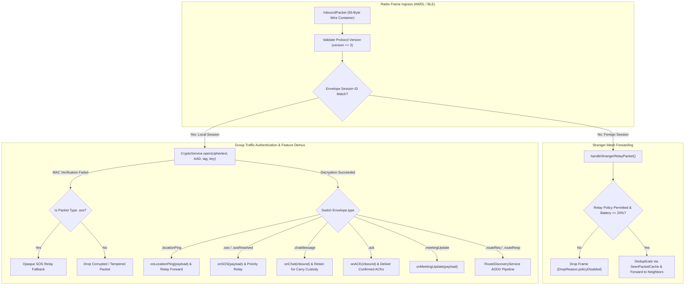
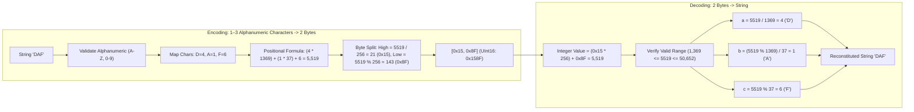

# Volume 05: Messaging Dispatch, Priority Outbox & Initials Codec (Meepo)

## Executive Summary & Big-Picture Overview

Volume 05 details the application-layer dispatch pipeline, prioritized transmission queuing, compact wire codecs, and logical timing configuration of the Meepo mesh networking stack. While lower layers manage physical radio links (Volume 03) and multi-hop routing paths (Volume 04), the messaging and codec layer sits directly at the boundary between raw wire bytes and user-facing feature controllers. It translates continuous streams of encrypted datagrams into strongly-typed domain payloads, arbitrates outbound radio spectrum access through strict priority tiers, and eliminates radio handshake overhead via high-density bit-packed codecs.

The messaging architecture operates across three foundational functional pillars:
1. **Centralized Inbound Demultiplexing & Dispatch (`PacketRouter`):** Operating under `@MainActor` isolation to guarantee UI thread safety, `PacketRouter` acts as the single entry gate for all incoming radio frames. It validates the protocol version, checks hop counts, and enforces cryptographic session scoping. For authenticated group traffic, it performs ChaCha20-Poly1305 AEAD decryption and demultiplexes payloads directly to high-level feature closures (`onLocationPing`, `onSOS`, `onSOSResolved`, `onACK`, `onMeetingUpdate`, `onChat`), while delegating routing frames to `RouteDiscoveryService`. Unauthenticated stranger frames are seamlessly directed to communal mesh relay routines.
2. **Multi-Tier Priority Queuing & Coordinate Coalescing (`PriorityOutboxQueue`):** Radio transmission bandwidth in congested peer-to-peer environments is severely constrained. `PriorityOutboxQueue` implements a four-lane scheduling hierarchy:
   - **Urgent Lane (FIFO, 16 pkts max):** High-priority life-safety SOS beacons, delivery ACKs, and meeting point updates.
   - **Local Chat Lane (FIFO, 16 pkts max):** User-generated 20-character chat messages.
   - **Stranger Relay Lane (Ring Buffer FIFO, 32 pkts max):** Communal mesh forwarding with drop-head overflow eviction.
   - **Normal Coalesced Lane (Dictionary Map):** Routine periodic location pings. Un-transmitted pings for a given destination are immediately overwritten by newer incoming GPS coordinates, preventing obsolete coordinate floods and preserving radio battery.
3. **High-Density Positional Initials Codec (`InitialsCodec`):** To avoid transmitting bloated UTF-8 string headers or executing multi-round radio handshakes to resolve member nicknames, Meepo packs 1 to 3 uppercase alphanumeric characters into exactly 2 big-endian bytes (16 bits) using Base-37 positional encoding ($(a 	imes 1369) + (b 	imes 37) + c$). This enables instant identity display upon single-packet reception with zero handshake latency.

---

### ELI5 Overview: The Tactical Dispatch Hub & Priority Outbox

Imagine an emergency disaster communications hub operating at a forward Incident Command Post in a blacked-out city:

1. **The Tactical Gatekeeper (`PacketRouter`):** Ad-hoc radio packets arrive continuously over peer-to-peer mesh links. The communications officer inspects the outer cleartext routing header. If the 24-bit session ID belongs to another rescue squad, the officer checks the communal forwarding budget and forwards the packet toward the next mesh hop without attempting decryption. If the session ID matches the local search squad, the officer unlocks the payload using the squad's 256-bit symmetric key (`CryptoService`), validates the Poly1305 MAC seal, and routes the contents directly to the appropriate tactical service: life-critical alerts to the SOS engine, micro-dispatches to squad chat, and coordinate pings to the tactical search radar.
2. **The Barcode Fingerprint (`PacketKey`):** Every datagram has a compact 7-byte invariant key (session ID + sequence number) stamped on its header. No matter how many intermediate rubble relay nodes forward the capsule or how many hop counts are incremented, this fingerprint remains constant. The routing engine checks this fingerprint against a deduplication cache so it never processes or re-broadcasts the same packet twice.
3. **The Four-Lane Priority Runway (`PriorityOutboxQueue`):** When preparing outbound transmissions over constrained radio airwaves, datagrams queue across four strictly prioritized lanes:
   - *Lane 1 (Red Flashing - Life Safety):* Emergency SOS distress beacons, casualty triage ACKs, and rally point dispatches transmit instantly ahead of all other traffic.
   - *Lane 2 (Blue - Tactical Directives):* Operational field micro-dispatches ("SQUAD 4 EN ROUTE", "NEED STRETCHER") queue second.
   - *Lane 3 (Yellow - Communal Relay):* Multi-hop packets carried for neighboring civilian or rescue units queue third, governed by forwarding rate limits to protect device battery.
   - *Lane 4 (Green - Squad Telemetry):* Routine periodic GPS location updates queue last. If a fresh 3:05 PM location fix arrives while a 3:00 PM fix is still waiting in the queue, the system immediately coalesces the entry, discarding the stale fix to preserve precious radio spectrum.
4. **The 2-Byte Callsign Tag (`InitialsCodec`):** Responders identify themselves on tactical maps using a 3-character callsign (e.g. "SAR" or "MED"). Instead of transmitting 3 raw ASCII bytes plus delimiters, the codec maps the characters into a base-37 radix, packing the entire callsign into an efficient 2-byte unsigned integer.

---

## Included Source Files

The following table itemizes every source code file assigned to Volume 05. Every file path is linked relative to this document, accompanied by its category, verified line count (`wc -l`), and singular architectural role:

| File Path | Category | Line Count (`wc -l`) | Architectural Purpose & Responsibility |
| :--- | :--- | :---: | :--- |
| [PacketRouter.swift](../../Teekum/Teekum/Core/Mesh/PacketRouter.swift) | Router | 184 | Main-thread packet router authenticating incoming traffic, validating session IDs, and dispatching to feature handlers. |
| [PacketKey.swift](../../Teekum/Teekum/Core/Mesh/PacketKey.swift) | Model | 55 | Composite hashable key (session ID + sequence number + packet type) uniquely identifying wire packets across relay hops. |
| [MeshClock.swift](../../Teekum/Teekum/Core/Mesh/MeshClock.swift) | Clock | 13 | Protocol contract declaring monotonic mesh clock and logical timestamping operations for deterministic testing. |
| [SystemMeshClock.swift](../../Teekum/Teekum/Core/Mesh/SystemMeshClock.swift) | Clock | 14 | Default system mesh clock conforming to MeshClock using hardware system wall-clock date. |
| [MeshTimingConfiguration.swift](../../Teekum/Teekum/Core/Mesh/MeshTimingConfiguration.swift) | Config | 164 | Centralized timing parameter model declaring publishing intervals, weak link thresholds, and retry timeouts. |
| [PriorityOutboxQueue.swift](../../Teekum/Teekum/Core/Transport/PriorityOutboxQueue.swift) | Queue | 303 | Multi-lane priority transmission queue guaranteeing high precedence for emergency SOS, chat FIFO, and coalesced GPS pings. |
| [QueueDepth.swift](../../Teekum/Teekum/Core/Transport/QueueDepth.swift) | Queue | 30 | Snapshot structure reporting current queue occupancy across urgent, chat, relay, and coalesced normal lanes. |
| [InitialsCodec.swift](../../Teekum/Teekum/Core/Session/InitialsCodec.swift) | Codec | 128 | Compact Base-37 initials encoder/decoder packing 1-to-3 alphanumeric characters into 2 big-endian bytes. |
| **Total Volume 05 Artifacts** | **8 Files** | **891** | **100% Volume 05 Codebase Accounting** |

---

## Outbox & Codec Pipeline Architecture

The following diagrams illustrate the centralized packet dispatching pipeline, the multi-tier prioritized outbox queuing model, and the Base-37 initials arithmetic encoding pipeline.

### 1. Inbound Ingress, AEAD Decryption & Dispatch Pipeline



### 2. Multi-Tier Priority Outbox Queue & Coalescing Hierarchy

```
+========================================================================================+
|                        PriorityOutboxQueue Dequeue Hierarchy                           |
+========================================================================================+
|                                                                                        |
|  [ TIER 1: URGENT LANE (FIFO - Cap: 16 pkts) ]                                         |
|  Precedence: 1st (Always drained first)                                                |
|  Contents: Emergency SOS sirens, Delivery ACKs, Meeting point updates, SOS resolutions |
|  Drop Policy: Throws TransportError.queueFull on overflow                              |
|  +----------------------------------------------------------------------------------+  |
|  | [ Urgent 1 ] -> [ Urgent 2 ] -> [ Urgent 3 ] ...                                  |  |
|  +----------------------------------------------------------------------------------+  |
|                                                                                        |
|  [ TIER 2: LOCAL CHAT LANE (FIFO - Cap: 16 pkts) ]                                     |
|  Precedence: 2nd (Drained when Tier 1 is empty)                                        |
|  Contents: Local user chat messages (20-byte payload frames)                           |
|  Drop Policy: Throws TransportError.queueFull on overflow                              |
|  +----------------------------------------------------------------------------------+  |
|  | [ Chat 1 ] -> [ Chat 2 ] -> [ Chat 3 ] ...                                        |  |
|  +----------------------------------------------------------------------------------+  |
|                                                                                        |
|  [ TIER 3: STRANGER RELAY LANE (Ring Buffer FIFO - Cap: 32 pkts) ]                     |
|  Precedence: 3rd (Drained when Tiers 1 & 2 are empty)                                  |
|  Contents: Communal mesh relay packets forwarded for neighboring disaster response units          |
|  Drop Policy: Drop-head on overflow (oldest packet discarded to accept newest)         |
|  +----------------------------------------------------------------------------------+  |
|  | [ Relay 1 ] -> [ Relay 2 ] -> [ Relay 3 ] ...                                      |  |
|  +----------------------------------------------------------------------------------+  |
|                                                                                        |
|  [ TIER 4: NORMAL COALESCED LANE (Dictionary Map per Destination) ]                    |
|  Precedence: 4th (Drained when Tiers 1, 2 & 3 are empty)                               |
|  Contents: Routine periodic GPS location pings                                         |
|  Coalescing: Newer GPS fix immediately overwrites older unsent fix for same destination|
|  +----------------------------------------------------------------------------------+  |
|  | Key: "" (Broadcast) -> [ Freshest GPS Ping ] (Older unsent pings overwritten)     |  |
|  | Key: "Peer-Bob"     -> [ Freshest Unicast Ping ]                                   |  |
|  +----------------------------------------------------------------------------------+  |
+========================================================================================+
```

### 3. Base-37 Compact Initials Codec Pipeline



---

## Dedicated File-by-File Deep Dives

---

## 1. Teekum/Teekum/Core/Mesh/PacketRouter.swift

- **Repo-Relative Link:** [`../../Teekum/Teekum/Core/Mesh/PacketRouter.swift`](../../Teekum/Teekum/Core/Mesh/PacketRouter.swift)
- **Line Count:** 184 lines
- **Concurrency Domain:** Main-thread bound class (`@MainActor public final class PacketRouter`)
- **Type Semantics:** Reference type with `@MainActor` isolation coordinating packet dispatch between background radio streams and UI-bound feature handlers.

### What This File Does
`PacketRouter.swift` serves as the centralized inbound packet dispatch controller and authentication gateway for the Meepo application. Operating on the `@MainActor`, it inspects incoming wire packets, validates the 4-bit protocol version, and enforces hop limit boundaries. It determines whether a frame belongs to the local active session (initiating ChaCha20-Poly1305 AEAD decryption and routing to specific feature handlers such as Location, SOS, ACK, Meeting, Route Discovery, or Chat) or represents stranger communal mesh traffic (dispatching to `handleStrangerRelayPacket` for blind radio forwarding).

### ELI5 Analogy
Imagine the communications routing officer at a forward disaster operations center. Every time an incoming radio packet arrives over the ad-hoc mesh:
1. If the packet carries another squad's session ID, the officer never attempts to decrypt it; they verify the communal forwarding budget and relay rules, increment the hop count, and forward it out to neighboring peer links so other search units can receive it.
2. If the packet matches the local squad's session ID, the officer uses the squad's 256-bit symmetric key (`CryptoService`) to validate the Poly1305 tamper-proof seal. If valid, the officer routes the message directly to the designated department: emergency distress alarms to the SOS manager, tactical directives to squad chat, and position coordinates to the tactical radar map.

### Technical Terms Defined
- **Packet Dispatching:** The architectural pattern where incoming multiplexed network datagrams are inspected, authenticated, and routed to discrete subsystem handlers based on packet type opcodes.
- **Session Scoping:** Validating that an incoming packet's 24-bit session ID matches `session.sessionId`, ensuring complete cryptographic isolation between different responder or survivor groups.
- **Stranger Relay Fallback:** Forwarding an opaque 56-byte packet across physical peer links without decrypting the payload when the session ID does not match the local group.
- **Opaque SOS Relay:** A protocol resilience feature where an unauthenticated SOS packet sharing the local session ID but signed with a different key is still forwarded across the mesh to ensure distress signals are never dropped due to key mismatches.

### Code-Block and Line-by-Line Walkthrough

#### Lines 1–56: Class Declaration, Dependencies, and Lifecycle
```swift
//
//  PacketRouter.swift
//  Teekum
//
//  Created by DIMAS DAFFA ERNANDA on 11/11/26.
//

import Foundation
import CryptoKit

/// Authenticates group traffic and owns forwarding; feature handlers receive accepted inputs.
@MainActor
public final class PacketRouter {
    private let cryptoService: any CryptoServiceProtocol
    private let peerTransport: any PeerTransport & MeshTransport
    private let relayPolicyManager: RelayPolicyManager
    private let routeDiscoveryService: RouteDiscoveryService
    private let seenPacketCache: SeenPacketCache
    private let onLocationPing: (LocationPingPayload, InboundPacket) -> Void
    private let onSOS: (SOSPayload, InboundPacket) async -> Void
    private let onSOSResolved: (SOSResolvedPayload) async -> Void
    private let onACK: (InboundPacket) async -> Void
    private let onMeetingUpdate: (MeetingUpdatePayload) -> Void
    private let onChat: (InboundPacket) async -> Void
    private var isActive = true

    public init(
        cryptoService: any CryptoServiceProtocol,
        peerTransport: any PeerTransport & MeshTransport,
        relayPolicyManager: RelayPolicyManager,
        routeDiscoveryService: RouteDiscoveryService,
        seenPacketCache: SeenPacketCache,
        onLocationPing: @escaping (LocationPingPayload, InboundPacket) -> Void,
        onSOS: @escaping (SOSPayload, InboundPacket) async -> Void,
        onACK: @escaping (InboundPacket) async -> Void,
        onMeetingUpdate: @escaping (MeetingUpdatePayload) -> Void,
        onChat: @escaping (InboundPacket) async -> Void,
        onSOSResolved: @escaping (SOSResolvedPayload) async -> Void = { _ in }
    ) {
        self.cryptoService = cryptoService
        self.peerTransport = peerTransport
        self.relayPolicyManager = relayPolicyManager
        self.routeDiscoveryService = routeDiscoveryService
        self.seenPacketCache = seenPacketCache
        self.onLocationPing = onLocationPing
        self.onSOS = onSOS
        self.onSOSResolved = onSOSResolved
        self.onACK = onACK
        self.onMeetingUpdate = onMeetingUpdate
        self.onChat = onChat
    }

    public func stop() {
        isActive = false
    }
```
- **Lines 12–26:** Declares `@MainActor public final class PacketRouter`. Injects services (`CryptoServiceProtocol`, `PeerTransport & MeshTransport`, `RelayPolicyManager`, `RouteDiscoveryService`, `SeenPacketCache`) and callback closures for feature dispatch. Tracks `isActive` lifecycle flag.
- **Lines 27–51:** Initializer binds dependencies and stores closures.
- **Lines 53–55:** `stop()` sets `isActive = false` to immediately cease processing incoming packets during session teardown.

#### Lines 57–78: Packet Validation and AEAD Decryption
```swift
    public func routeInboundPacket(_ inbound: InboundPacket, for session: GroupSession) async {
        guard isActive else { return }
        let raw = inbound.rawPacket
        let envelope = raw.envelope
        guard envelope.version == PacketConstants.protocolVersion, envelope.hopCount <= envelope.hopLimit else { return }
        guard envelope.sessionId == session.sessionId else {
            await handleStrangerRelayPacket(inbound)
            return
        }

        guard let decrypted = try? await cryptoService.open(
            ciphertext: raw.ciphertext,
            envelope: envelope,
            authTag: raw.authTag,
            using: SymmetricKey(data: session.symmetricKeyData)
        ) else {
            // Prototype fallback: a same-SID SOS with a different key can still travel opaquely.
            if envelope.type == .sos { await relayMeshPacketIfNeeded(inbound, for: session) }
            return
        }
        guard isActive else { return }
```
- **Lines 57–61:** Validates `isActive`, confirms `envelope.version == 3`, and ensures `hopCount <= hopLimit`.
- **Lines 62–65:** Compares `envelope.sessionId == session.sessionId`. If mismatched, routes directly to `handleStrangerRelayPacket(inbound)` for stranger blind forwarding.
- **Lines 67–76:** Attempts AEAD decryption via `cryptoService.open()`. If MAC verification fails (tampered payload or wrong key), it checks if `envelope.type == .sos`; if so, relays the SOS frame opaquely across the mesh before returning.

#### Lines 79–140: Opcode Dispatch to Subsystems
```swift
        switch envelope.type {
        case .ack:
            guard let ack = try? ACKPayload.deserialize(from: decrypted),
                  abs(Date().timeIntervalSince(ack.ackTimestamp)) <= CarryMessageStore.retention,
                  ack.responderInitials != session.localInitials else { return }
            await onACK(inbound)
            guard isActive else { return }
            await peerTransport.retainReceivedForCarry(raw, excludingPeerId: inbound.sourcePeerId)
            await relayMeshPacketIfNeeded(inbound, for: session)

        case .sos:
            guard let payload = try? SOSPayload.deserialize(from: decrypted),
                  payload.senderInitials != session.localInitials else { return }
            await onSOS(payload, inbound)
            await relayMeshPacketIfNeeded(inbound, for: session)

        case .sosResolved:
            guard let resolution = try? SOSResolvedPayload.deserialize(from: decrypted),
                  resolution.senderInitials != session.localInitials,
                  envelope.memberSlot == MemberID.fromInitials(resolution.senderInitials).memberSlot else { return }
            let duplicate = await seenPacketCache.isDuplicateAndRecord(PacketKey(wirePacket: raw))
            guard !duplicate, isActive else { return }
            await onSOSResolved(resolution)
            guard isActive else { return }
            await peerTransport.retainReceivedForCarry(raw, excludingPeerId: inbound.sourcePeerId)
            await relayMeshPacketIfNeeded(inbound, for: session, skipSeenCheck: true)

        case .locationPing:
            guard let ping = try? LocationPingPayload.deserialize(from: decrypted),
                  ping.senderInitials != session.localInitials else { return }
            onLocationPing(ping, inbound)
            await relayMeshPacketIfNeeded(inbound, for: session)

        case .meetingUpdate:
            guard let update = try? MeetingUpdatePayload.deserialize(from: decrypted) else { return }
            let duplicate = await seenPacketCache.isDuplicateAndRecord(PacketKey(wirePacket: raw))
            guard !duplicate, isActive else { return }
            onMeetingUpdate(update)
            await relayMeshPacketIfNeeded(inbound, for: session, skipSeenCheck: true)

        case .routeReq:
            guard let wireData = try? raw.toWireData() else { return }
            _ = try? await routeDiscoveryService.handleInboundRouteReq(
                wireData: wireData, fromPeerId: inbound.sourcePeerId, session: session
            )

        case .routeResp:
            guard let wireData = try? raw.toWireData() else { return }
            _ = try? await routeDiscoveryService.handleInboundRouteResp(
                wireData: wireData, fromPeerId: inbound.sourcePeerId, session: session
            )

        case .chatMessage:
            guard let chat = try? ChatMessagePayload.deserialize(from: decrypted),
                  abs(Date().timeIntervalSince(chat.timestamp)) <= CarryMessageStore.retention,
                  chat.senderInitials != session.localInitials else { return }
            await peerTransport.retainReceivedForCarry(raw, excludingPeerId: inbound.sourcePeerId)
            guard isActive else { return }
            await onChat(inbound)
            await relayMeshPacketIfNeeded(inbound, for: session)
        }
    }
```
- **Lines 80–88 (`.ack`):** Deserializes `ACKPayload`, verifies timestamp freshness against `CarryMessageStore.retention` (600s), ignores self-originating ACKs, dispatches `onACK`, retains for store-and-forward carry custody, and forwards via `relayMeshPacketIfNeeded`.
- **Lines 89–94 (`.sos`):** Deserializes `SOSPayload`, guards against self-broadcast, dispatches `onSOS`, and relays across the mesh.
- **Lines 95–105 (`.sosResolved`):** Verifies envelope `memberSlot` matches the sender's initials, checks `seenPacketCache`, invokes `onSOSResolved`, stores in carry custody, and relays.
- **Lines 106–111 (`.locationPing`):** Deserializes `LocationPingPayload`, dispatches `onLocationPing`, and relays.
- **Lines 112–118 (`.meetingUpdate`):** Deduplicates via `seenPacketCache`, dispatches `onMeetingUpdate`, and relays.
- **Lines 119–129 (`.routeReq` / `.routeResp`):** Encodes raw packet data and delegates directly to `routeDiscoveryService.handleInboundRouteReq` and `handleInboundRouteResp`.
- **Lines 131–139 (`.chatMessage`):** Deserializes `ChatMessagePayload`, verifies retention window, stores in carry custody, dispatches `onChat`, and relays.

#### Lines 142–183: Forwarding and Stranger Relay Routines
```swift
    public func relayMeshPacketIfNeeded(_ inbound: InboundPacket, for session: GroupSession, skipSeenCheck: Bool = false) async {
        let envelope = inbound.rawPacket.envelope
        guard isActive, envelope.hopCount < envelope.hopLimit,
              envelope.memberSlot != session.memberSlot else { return }
        if !skipSeenCheck {
            let duplicate = await seenPacketCache.isDuplicateAndRecord(PacketKey(wirePacket: inbound.rawPacket))
            guard !duplicate, isActive else { return }
        }
        var packet = inbound.rawPacket
        packet.envelope.hopCount += 1
        guard let data = try? packet.toWireData() else { return }
        try? await peerTransport.broadcastPacket(data)
    }

    public func handleStrangerRelayPacket(_ inbound: InboundPacket) async {
        guard isActive else { return }
        let policy = await relayPolicyManager.currentState()
        guard policy.isRelayPermitted, isActive else {
            await relayPolicyManager.recordDropEvent(reason: .policyDisabled)
            return
        }
        let packet = inbound.rawPacket
        guard packet.envelope.hopCount < packet.envelope.hopLimit else {
            await relayPolicyManager.recordDropEvent(reason: .hopLimitExceeded)
            return
        }
        await peerTransport.retainReceivedForCarry(packet, excludingPeerId: inbound.sourcePeerId)
        guard isActive else { return }
        let duplicate = await seenPacketCache.isDuplicateAndRecord(PacketKey(wirePacket: packet))
        guard !duplicate, isActive else {
            if duplicate { await relayPolicyManager.recordDropEvent(reason: .duplicate) }
            return
        }
        guard let data = try? packet.toWireData() else { return }
        let neighbors = await peerTransport.activeNeighbors()
        var forwarded = false
        for peer in neighbors where peer.id != inbound.sourcePeerId {
            guard isActive else { return }
            if (try? await peerTransport.forwardFrame(data, to: peer.id)) != nil { forwarded = true }
        }
        if forwarded { await relayPolicyManager.recordForwardEvent(type: packet.envelope.type) }
    }
}
```
- **Lines 142–154:** `relayMeshPacketIfNeeded`: Checks `hopCount < hopLimit`, confirms local node is not the original sender (`envelope.memberSlot != session.memberSlot`), checks `seenPacketCache`, increments `hopCount += 1`, and broadcasts over radio links.
- **Lines 156–183:** `handleStrangerRelayPacket`: Evaluates `relayPolicyManager.currentState()`. Drops if policy is disabled or battery throttled. Verifies hop limit, retains for opportunistic physical carry custody, checks duplicate cache, mutates hop count, and forwards to all active neighbors except `inbound.sourcePeerId`, updating anonymous telemetry counters.

### Engineering Rationale and Edge Cases
- **MainActor Isolation for UI Safety:** Because callback handlers (`onLocationPing`, `onMeetingUpdate`) drive SwiftUI views and map canvas overlays, executing the router on `@MainActor` eliminates thread-hop jitter and race conditions when updating view state.
- **Opaque SOS Forwarding:** In life-safety situations, if two rescue groups share a session ID hash collision or if an SOS frame was sealed with an alternate credential, dropping the distress beacon would be unacceptable. The router permits same-session SOS packets to travel opaquely even if local decryption fails.

---

## 2. Teekum/Teekum/Core/Mesh/PacketKey.swift

- **Repo-Relative Link:** [`../../Teekum/Teekum/Core/Mesh/PacketKey.swift`](../../Teekum/Teekum/Core/Mesh/PacketKey.swift)
- **Line Count:** 55 lines
- **Concurrency Domain:** Swift `struct` (`public struct PacketKey: Hashable, Sendable, CustomStringConvertible`)
- **Type Semantics:** Compact, immutable value type conforming to `Hashable` and `Sendable` providing canonical packet identity for deduplication caches.

### What This File Does
`PacketKey.swift` defines the canonical 7-byte identity structure for mesh packets. It uniquely identifies an immutable wire transmission by combining the 24-bit session identifier (`sessionId`) and 32-bit destination sequence counter (`sequenceNumber`), with an optional `PacketType` discriminator. Crucially, it deliberately excludes `hopCount` and `hopLimit`, ensuring that as a packet traverses intermediate multi-hop relay nodes and mutates its hop count, its identity key remains perfectly invariant.

### ELI5 Analogy
Imagine a tactical emergency dispatch stamped with an indelible identification code: "Squad #104, Sequence #551". As the packet hops across rubble from responder to responder, each intermediate node increments the hop counter on the outer routing label. The core identification code on the front never changes. A node's deduplication scanner inspects only this 7-byte identifier to verify if this exact dispatch has already been processed, ignoring shifting hop counts.

### Technical Terms Defined
- **Invariant Packet Key:** A hashable key composed exclusively of immutable packet fields, remaining constant across network relays despite mutating transport headers.
- **24-Bit Session Masking (`sessionIdMask`):** Masking a 32-bit unsigned integer with `0x00FFFFFF` to restrict the identifier to exactly 3 bytes (16,777,215 possible sessions), saving memory while maintaining collision resistance.
- **Unaligned Big-Endian Loading:** Safely reading a multi-byte integer from arbitrary binary byte offsets using `loadUnaligned(as: UInt32.self).bigEndian` without triggering memory alignment CPU exceptions.

### Code-Block and Line-by-Line Walkthrough

#### Lines 1–28: Struct Declaration, Properties, and Memberwise Initializer
```swift
//
//  PacketKey.swift
//  Teekum
//
//  Created by Nicho on 06/11/26.
//

import Foundation

/// Canonical compact 7-byte packet identity used for duplicate suppression and routing cache keys.
///
/// Computed from:
/// - `sessionId` (24-bit / 3 bytes, 16.7M combinations)
/// - `sequenceNumber` (32-bit / 4 bytes, memberSlot + counter)
///
/// Note: `hopCount` is explicitly excluded so packet identity remains identical across all hops.
/// With 16,777,215 session IDs, cross-group collision is virtually impossible while keeping RAM minimal.
public struct PacketKey: Hashable, Sendable, CustomStringConvertible {
    public let sessionId: UInt32        // 24-bit value (0x000000...0xFFFFFF)
    public let sequenceNumber: UInt32   // 32-bit sequence counter
    public let type: PacketType?        // Optional packet type discriminator
    
    public init(sessionId: UInt32, sequenceNumber: UInt32, type: PacketType? = nil) {
        self.sessionId = sessionId & PacketConstants.sessionIdMask
        self.sequenceNumber = sequenceNumber
        self.type = type
    }
```
- **Lines 10–18:** Documentation explains the 7-byte identity formula and why `hopCount` is excluded.
- **Lines 19–21:** Stores `sessionId` (UInt32 masked to 24 bits), `sequenceNumber` (UInt32), and optional `type` (`PacketType?`).
- **Lines 23–27:** Memberwise initializer enforces `sessionId & PacketConstants.sessionIdMask`.

#### Lines 29–55: Initializers from Wire Types and String Formatting
```swift
    public init(wirePacket: RawWirePacket) {
        self.sessionId = wirePacket.envelope.sessionId & PacketConstants.sessionIdMask
        self.sequenceNumber = wirePacket.envelope.sequenceNumber
        self.type = wirePacket.envelope.type
    }
    
    public init?(wireData: Data) {
        guard wireData.count >= 10 else { return nil }
        let typeRaw = wireData[wireData.startIndex] & 0x0F
        let pType = PacketType(rawValue: typeRaw)
        let b3 = UInt32(wireData[wireData.startIndex + 3])
        let b4 = UInt32(wireData[wireData.startIndex + 4])
        let b5 = UInt32(wireData[wireData.startIndex + 5])
        let sid = (b3 << 16) | (b4 << 8) | b5
        let seq = wireData.subdata(in: (wireData.startIndex + 6)..<(wireData.startIndex + 10)).withUnsafeBytes {
            $0.loadUnaligned(as: UInt32.self).bigEndian
        }
        self.sessionId = sid
        self.sequenceNumber = seq
        self.type = pType
    }
    
    public var description: String {
        let typeStr = type.map { "\($0)" } ?? "any"
        return "PacketKey(sid: 0x\(PacketConstants.formatSessionId(sessionId)), seq: \(sequenceNumber), type: \(typeStr))"
    }
}
```
- **Lines 29–33:** Convenience initializer extracting fields directly from a structured `RawWirePacket`.
- **Lines 35–49:** Failsafe raw binary parser `init?(wireData:)`. Reads Byte 0 low nibble for `PacketType`, shifts Bytes 3, 4, 5 into a 24-bit integer for `sessionId`, and decodes Bytes 6–9 as big-endian UInt32 for `sequenceNumber`.
- **Lines 51–54:** `description` formats human-readable strings for diagnostic logs (e.g., `PacketKey(sid: 0x1A2B3C, seq: 42, type: locationPing)`).

### Engineering Rationale and Edge Cases
- **Zero-Allocation Hash Key:** Because `PacketKey` is composed entirely of primitive integers, Swift's synthesized `Hashable` implementation computes rapid 64-bit SipHash hashes without heap allocations, enabling `SeenPacketCache` to evaluate thousands of lookups per second.
- **Handling Corrupt Wire Slices:** `init?(wireData:)` guards `wireData.count >= 10`, returning `nil` safely if a truncated frame slice arrives from a degraded radio link.

---

## 3. Teekum/Teekum/Core/Mesh/MeshClock.swift

- **Repo-Relative Link:** [`../../Teekum/Teekum/Core/Mesh/MeshClock.swift`](../../Teekum/Teekum/Core/Mesh/MeshClock.swift)
- **Line Count:** 13 lines
- **Concurrency Domain:** Swift `protocol` (`public protocol MeshClock: Sendable`)
- **Type Semantics:** Protocol abstraction defining the time measurement interface for all mesh networking services.

### What This File Does
`MeshClock.swift` defines the protocol contract for time providers across the Meepo mesh networking stack. Requiring a single method (`nonisolated func now() -> Date`), it allows production code to read real hardware time while allowing automated unit tests to inject deterministic mock clocks that advance instantaneously without executing asynchronous delays or sleeping threads.

### ELI5 Analogy
Imagine the master operational clock in a search-and-rescue command center. During live operations, responders read standard wall-clock time. But during simulated disaster triage drills and automated integration testing, the test commander can pause the virtual clock, jump time forward by 45 seconds to trigger stale-peer recovery, or advance 10 minutes to verify message expiration, executing complex multi-hour network scenarios deterministically in milliseconds without calling system sleep.

### Technical Terms Defined
- **Protocol-Oriented Time Abstraction:** Decoupling time measurement from `Date()` or `DispatchTime.now()` so components depend on an abstract interface, enabling deterministic simulation of network timeouts and TTL expirations.
- **Sendable Clock:** A type that can be safely passed across Swift concurrency boundaries without creating data races.

### Code-Block and Line-by-Line Walkthrough

#### Lines 1–13: Full Protocol Declaration
```swift
//
//  MeshClock.swift
//  Teekum
//
//  Created by Nicho on 06/11/26.
//

import Foundation

/// Testable clock protocol allowing deterministic advancement of time in unit and integration tests.
public protocol MeshClock: Sendable {
    nonisolated func now() -> Date
}
```
- **Lines 10–13:** Declares `public protocol MeshClock: Sendable` with a single requirement: `nonisolated func now() -> Date`.

### Engineering Rationale and Edge Cases
- **Eliminating Thread Sleeping in Tests:** Unit tests for 300-second cache expirations, 30-minute timed sessions, or 15-second AODV reverse routes can advance a mock `MeshClock` by 300 seconds in 1 millisecond of CPU time, achieving 100% test coverage with zero execution latency.

---

## 4. Teekum/Teekum/Core/Mesh/SystemMeshClock.swift

- **Repo-Relative Link:** [`../../Teekum/Teekum/Core/Mesh/SystemMeshClock.swift`](../../Teekum/Teekum/Core/Mesh/SystemMeshClock.swift)
- **Line Count:** 14 lines
- **Concurrency Domain:** Swift `struct` (`public struct SystemMeshClock: MeshClock`)
- **Type Semantics:** Immutable, zero-sized value type conforming to `MeshClock`.

### What This File Does
`SystemMeshClock.swift` provides the standard production implementation of `MeshClock`. Conforming to `MeshClock`, its `now()` method queries Foundation's `Date()`, returning the current system hardware wall-clock timestamp.

### ELI5 Analogy
This is the standard, real-world wristwatch that ticks along second by second according to the actual time of day.

### Technical Terms Defined
- **Zero-Sized Type:** A struct with no stored properties. In Swift, instances of zero-sized types incur zero heap or stack memory footprint.

### Code-Block and Line-by-Line Walkthrough

#### Lines 1–14: Full Struct Implementation
```swift
//
//  SystemMeshClock.swift
//  Teekum
//
//  Created by Nicho on 06/11/26.
//

import Foundation

/// Standard system clock returning the current hardware date.
public struct SystemMeshClock: MeshClock {
    nonisolated public init() {}
    nonisolated public func now() -> Date { Date() }
}
```
- **Lines 10–14:** Declares `SystemMeshClock` conforming to `MeshClock`. Both `init()` and `now()` are marked `nonisolated`. `now()` returns `Date()`.

### Engineering Rationale and Edge Cases
- **Default Parameter Value:** Used as the default argument across initializers (e.g., `init(clock: MeshClock = SystemMeshClock())`), ensuring zero boilerplate in production code while maintaining full dependency injection support.

---

## 5. Teekum/Teekum/Core/Mesh/MeshTimingConfiguration.swift

- **Repo-Relative Link:** [`../../Teekum/Teekum/Core/Mesh/MeshTimingConfiguration.swift`](../../Teekum/Teekum/Core/Mesh/MeshTimingConfiguration.swift)
- **Line Count:** 164 lines
- **Concurrency Domain:** Swift `struct` (`nonisolated public struct MeshTimingConfiguration: Equatable, Sendable`)
- **Type Semantics:** Value type conforming to `Equatable` and `Sendable` holding centralized network cadences and retry parameters.

### What This File Does
`MeshTimingConfiguration.swift` defines the centralized configuration model for all timing intervals, transmission cadences, link degradation thresholds, and retry policies across the Meepo mesh networking stack. It governs adaptive GPS location publishing cadences (speeding up to 2.0s for distant peers, 4.0s when moving, and slowing to 20.0s when stationary or 60.0s in survival mode), distant radio thresholds (-75 dBm RSSI, 30m GPS), rate limiting budgets (2 pkts/sec ordinary, 4 pkts/sec SOS), group chat retry backoffs, and two-stage stale peer recovery probing.

### ELI5 Analogy
Imagine the tactical communications officer pacing radio transmission tempo across a disaster zone based on field conditions:
- When search teams are stationary at a triage checkpoint, the cadence slows down to 20-30 seconds to conserve battery.
- When a responder is actively moving through rubble or signal attenuation causes weak reception, the cadence accelerates to 2 seconds so neighboring searchers maintain real-time tracking.
- When an emergency grid blackout extends past 24 hours and a responder's battery drops below 20%, the system drops non-essential broadcasts to 60-second survival intervals to protect life-safety SOS reserves.

### Technical Terms Defined
- **Adaptive Cadence:** Dynamically modifying broadcasting frequencies based on physical movement, battery levels, and peer radio link quality.
- **Two-Stage Stale Recovery:** A recovery protocol where an unresponsive member (unseen for 30s) is first probed at an accelerated 2.0s cadence (Stage 1), followed 15s later by an active AODV multi-hop route request broadcast (Stage 2) before timing out at 90s.
- **Randomized ACK Jitter:** Introducing a small random delay (0 to 0.35s) before transmitting acknowledgment frames to prevent simultaneous radio packet collisions when multiple peers receive a broadcast at the exact same millisecond.

### Code-Block and Line-by-Line Walkthrough

#### Lines 1–61: Cadence Timings, Signal Thresholds, and Rate Limits
```swift
//
//  MeshTimingConfiguration.swift
//  Teekum
//
//  Created by Nicho on 08/11/26.
//

import Foundation

/// Centralized, easily adjustable timing, cadence, and retry configuration
/// for TeeKum multi-hop mesh networking and peer broadcasting.
///
/// Easily tune these variables in code to optimize broadcasting intervals,
/// link degradation thresholds, and distant relay retry policies.
nonisolated public struct MeshTimingConfiguration: Equatable, Sendable {
    
    // MARK: - 1. Broadcast Cadence Timings (Seconds)
    
    /// Publishing interval when one or more peers are distant or signal is weak (recommended: 2.0s).
    /// Speeds up broadcasting from 20s down to 2s to maintain relay responsiveness across distant links.
    public var distantPeerInterval: TimeInterval
    
    /// Publishing interval while user is actively moving with nearby peers (recommended: 4.0s).
    public var movingInterval: TimeInterval
    
    /// Publishing interval while stationary with strong nearby peers (recommended: 20.0s).
    public var stationaryInterval: TimeInterval
    
    /// Throttled publishing interval in survival mode (<20% battery) to conserve power (recommended: 60.0s).
    public var survivalInterval: TimeInterval
    
    // MARK: - 2. Distant Link & Weak Signal Thresholds
    
    /// RSSI threshold (dBm) below which a peer link is classified as distant or weak (recommended: -75 dBm).
    /// Links with RSSI <= this threshold trigger the `distantPeerInterval`.
    public var distantRSSIThreshold: Int8
    
    /// GPS distance threshold (meters) beyond which a peer is classified as distant (recommended: 30.0m).
    /// Peers farther than this distance trigger the `distantPeerInterval`.
    public var distantDistanceThresholdMeters: Double
    
    // MARK: - 3. Distant Link Retry & Priority Policies
    
    /// Maximum transmission retries for relay packets or packets sent over distant/degraded links (recommended: 2).
    public var distantLinkMaxRetries: Int
    
    /// Backoff delay (seconds) between successive retries over distant or lossy links (recommended: 0.5s).
    public var distantLinkRetryDelay: TimeInterval
    
    // MARK: - 4. Rate Limiter Budgets & Token Buckets
    
    /// Maximum ordinary relay forwarding rate (packets per second, recommended: 2.0).
    public var ordinaryRelayRateLimit: Double
    
    /// Burst capacity for ordinary relay token bucket (recommended: 4.0).
    public var ordinaryRelayBurstCapacity: Double
    
    /// Maximum urgent SOS forwarding rate (packets per second, recommended: 4.0).
    public var urgentSOSRateLimit: Double
```
- **Lines 17–31:** Declares the four primary location publishing cadences: `distantPeerInterval` (2.0s), `movingInterval` (4.0s), `stationaryInterval` (20.0s), and `survivalInterval` (60.0s).
- **Lines 32–41:** Configures weak link detection: `distantRSSIThreshold` (-75 dBm) and `distantDistanceThresholdMeters` (30.0m).
- **Lines 42–49:** Configures distant link retries: `distantLinkMaxRetries` (2) and `distantLinkRetryDelay` (0.5s).
- **Lines 50–60:** Configures token bucket rates: ordinary relay rate (2.0 pkts/sec) and burst capacity (4.0), and urgent SOS rate (4.0 pkts/sec).

#### Lines 62–110: Chat Engine Timings, Stale Recovery, and Response Bursts
```swift
    // MARK: - 5. Group Chat Engine Timings
    
    /// Enforced client-side cooldown between outgoing user chat messages (recommended: 3.0s).
    public var chatUserCooldown: TimeInterval
    
    /// Maximum radio transmission retries for chat messages (recommended: 2 retries, 3 total attempts).
    public var chatMaxRetries: Int
    
    /// Initial retry backoff delay for chat messages (recommended: 0.5s).
    public var chatRetryBackoff: TimeInterval
    
    /// Multi-peer delivery ACK confirmation timeout window (recommended: 15.0s).
    public var chatAckTimeout: TimeInterval
    
    /// Maximum randomized jitter delay before transmitting ACKs to avoid collisions (recommended: 0.35s).
    public var chatAckJitterMax: TimeInterval
    
    // MARK: - 5. Stale Peer Accelerated Cadence & Two-Tier Probe Timings
    
    /// Elapsed duration (seconds) since last contact after which a group member is classified as stale (recommended: 30.0s).
    /// Upon crossing this threshold, Stage 1 accelerated probing begins at `staleRecoveryInterval`.
    public var stalePeerThreshold: TimeInterval
    
    /// Accelerated publishing interval (seconds) while probing for stale peers (recommended: 2.0s).
    /// Drives high-cadence local pings across the mesh to refresh link state and wake sleeping relays.
    public var staleRecoveryInterval: TimeInterval
    
    /// Additional elapsed time (seconds) of continuous staleness before initiating Stage 2 on-demand AODV route discovery (recommended: 15.0s).
    /// Total elapsed time since last seen = `stalePeerThreshold + staleRouteReqDelay` (30s + 15s = 45s).
    public var staleRouteReqDelay: TimeInterval
    
    /// Maximum duration (seconds) to sustain accelerated probing for an unresponsive stale peer (recommended: 60.0s).
    /// If the peer remains missing beyond `stalePeerThreshold + staleRecoveryTimeout` (30s + 60s = 90s),
    /// the probe window expires and publishing cadence backs off to conserve battery.
    public var staleRecoveryTimeout: TimeInterval
    
    // MARK: - 6. One-to-Many Multi-Peer Staggering & Response Burst
    
    /// Spacing delay (seconds) between sequential AODV route requests when multiple group members are stale (recommended: 2.5s).
    /// Prevents radio flooding and adheres to the 2 pkts/sec token bucket rate limiter in one-to-many topologies.
    public var staleRouteReqStaggerInterval: TimeInterval
    
    /// Number of rapid location pings published by a stale peer upon receiving a ROUTE_REQ probe (recommended: 3).
    /// Ensures fresh coordinates punch through intermediate relays to reach all group members.
    public var staleResponseBurstCount: Int
    
    /// Cadence interval (seconds) between each ping in the stale response burst (recommended: 2.0s).
    public var staleResponseBurstInterval: TimeInterval
```
- **Lines 63–77:** Chat engine parameters: client cooldown (3.0s), retries (2), initial backoff (0.5s), ACK timeout (15.0s), and max ACK jitter (0.35s).
- **Lines 80–96:** Stale peer tracking: member marked stale after 30.0s (`stalePeerThreshold`), accelerated probing runs at 2.0s (`staleRecoveryInterval`), Stage 2 AODV triggers after 15.0s additional delay (`staleRouteReqDelay`, at 45s total), and probe window expires after 60.0s (`staleRecoveryTimeout`, at 90s total).
- **Lines 99–109:** Staggering and burst: sequential RREQ spacing (2.5s), stale peer response burst count (3 location pings), and burst spacing (2.0s).

#### Lines 111–164: Initializer and Shared Default
```swift
    // MARK: - Initialization & Shared Default
    
    public init(
        distantPeerInterval: TimeInterval = MeepoConfiguration.Timing.distantPeerInterval,
        movingInterval: TimeInterval = MeepoConfiguration.Timing.locationMovingInterval,
        stationaryInterval: TimeInterval = MeepoConfiguration.Timing.locationStationaryInterval,
        survivalInterval: TimeInterval = MeepoConfiguration.Timing.survivalInterval,
        distantRSSIThreshold: Int8 = MeepoConfiguration.Timing.distantRSSIThreshold,
        distantDistanceThresholdMeters: Double = MeepoConfiguration.Timing.distantDistanceThresholdMeters,
        distantLinkMaxRetries: Int = 2,
        distantLinkRetryDelay: TimeInterval = 0.5,
        ordinaryRelayRateLimit: Double = MeepoConfiguration.Timing.ordinaryRelayRateLimit,
        ordinaryRelayBurstCapacity: Double = MeepoConfiguration.Timing.ordinaryRelayBurstCapacity,
        urgentSOSRateLimit: Double = MeepoConfiguration.Timing.urgentSOSRateLimit,
        chatUserCooldown: TimeInterval = MeepoConfiguration.Chat.cooldownDuration,
        chatMaxRetries: Int = MeepoConfiguration.Chat.maxRetries,
        chatRetryBackoff: TimeInterval = MeepoConfiguration.Chat.backoffInitialDelay,
        chatAckTimeout: TimeInterval = MeepoConfiguration.Chat.deliveryTimeout,
        chatAckJitterMax: TimeInterval = 0.35,
        stalePeerThreshold: TimeInterval = MeepoConfiguration.Timing.stalePeerThreshold,
        staleRecoveryInterval: TimeInterval = 2.0,
        staleRouteReqDelay: TimeInterval = 15.0,
        staleRecoveryTimeout: TimeInterval = 60.0,
        staleRouteReqStaggerInterval: TimeInterval = 2.5,
        staleResponseBurstCount: Int = 3,
        staleResponseBurstInterval: TimeInterval = 2.0
    ) {
        self.distantPeerInterval = distantPeerInterval
        self.movingInterval = movingInterval
        self.stationaryInterval = stationaryInterval
        self.survivalInterval = survivalInterval
        self.distantRSSIThreshold = distantRSSIThreshold
        self.distantDistanceThresholdMeters = distantDistanceThresholdMeters
        self.distantLinkMaxRetries = distantLinkMaxRetries
        self.distantLinkRetryDelay = distantLinkRetryDelay
        self.ordinaryRelayRateLimit = ordinaryRelayRateLimit
        self.ordinaryRelayBurstCapacity = ordinaryRelayBurstCapacity
        self.urgentSOSRateLimit = urgentSOSRateLimit
        self.chatUserCooldown = chatUserCooldown
        self.chatMaxRetries = chatMaxRetries
        self.chatRetryBackoff = chatRetryBackoff
        self.chatAckTimeout = chatAckTimeout
        self.chatAckJitterMax = chatAckJitterMax
        self.stalePeerThreshold = stalePeerThreshold
        self.staleRecoveryInterval = staleRecoveryInterval
        self.staleRouteReqDelay = staleRouteReqDelay
        self.staleRecoveryTimeout = staleRecoveryTimeout
        self.staleRouteReqStaggerInterval = staleRouteReqStaggerInterval
        self.staleResponseBurstCount = staleResponseBurstCount
        self.staleResponseBurstInterval = staleResponseBurstInterval
    }
    
    /// Global shared timing configuration. Modify this instance to tune network timing app-wide.
    public static let `default` = MeshTimingConfiguration()
}
```
- **Lines 112–160:** Comprehensive memberwise initializer with default values sourced from `MeepoConfiguration`.
- **Line 163:** `public static let default = MeshTimingConfiguration()` provides a shared single source of truth for global network timing.

### Engineering Rationale and Edge Cases
- **Centralized Parameter Management:** Instead of scattering magic numbers across transport services, rate limiters, and outbox queues, `MeshTimingConfiguration` centralizes all timing parameters into a single struct, simplifying field tuning during live disaster operational testing.

---

## 6. Teekum/Teekum/Core/Transport/PriorityOutboxQueue.swift

- **Repo-Relative Link:** [`../../Teekum/Teekum/Core/Transport/PriorityOutboxQueue.swift`](../../Teekum/Teekum/Core/Transport/PriorityOutboxQueue.swift)
- **Line Count:** 303 lines
- **Concurrency Domain:** Swift class (`nonisolated public final class PriorityOutboxQueue: @unchecked Sendable`)
- **Type Semantics:** Reference type with internal synchronization managing prioritized multi-lane packet buffering.

### What This File Does
`PriorityOutboxQueue.swift` implements the radio transmission queuing engine for Meepo. It establishes a multi-lane transmission hierarchy that enforces strict precedence:
1. **Urgent Lane (FIFO, Capacity 16):** Guaranteed highest precedence for emergency SOS beacons, delivery ACKs, meeting point changes, and SOS resolution notices.
2. **Local Chat Lane (FIFO, Capacity 16):** High precedence for local user chat messages.
3. **Stranger Relay Lane (Ring Buffer FIFO, Capacity 32):** Communal mesh forwarding lane with drop-head overflow eviction.
4. **Normal Coalesced Lane (Dictionary Map):** Routine periodic location pings coalesced per destination so that newer GPS fixes immediately overwrite older unsent fixes, preventing stale coordinate transmission and radio saturation.

### ELI5 Analogy
Imagine a four-lane tactical dispatch priority runway at an emergency disaster staging area:
1. **Lane 1 (Red - Life Safety):** Emergency SOS distress beacons and casualty triage ACKs transmit first with zero queuing delay.
2. **Lane 2 (Blue - Tactical Directives):** Operational field micro-dispatches ("SQUAD 4 EN ROUTE", "NEED STRETCHER") transmit second.
3. **Lane 3 (Yellow - Communal Relief):** Multi-hop relay packets carried for other rescue teams transmit third; if the 32-packet buffer fills up, the oldest waiting packet is dropped to make room for newer relay traffic.
4. **Lane 4 (Green - Squad Telemetry):** Periodic GPS location pings transmit last. If a fresh location fix arrives while an older ping is still waiting, the queue automatically coalesces the entry, discarding the stale coordinate so radio bandwidth is never wasted on outdated positions.

### Technical Terms Defined
- **Priority Preemption:** The architectural behavior where high-priority packets (SOS, ACK) are dequeued and transmitted ahead of lower-priority packets regardless of arrival order.
- **Packet Coalescing:** Replacing an un-transmitted, pending packet with a fresher version of the same data type for the same destination, eliminating redundant transmissions.
- **Drop-Head Ring Buffer:** A fixed-capacity FIFO queue where adding a new element when full causes the oldest unserved element at the head of the queue to be discarded.
- **Preemptive Requeuing:** Re-inserting a failed packet at index 0 (`insert(item, at: 0)`) of its lane upon transient transmission failure so it retries immediately.

### Code-Block and Line-by-Line Walkthrough

#### Lines 1–43: `OutboxItem` Model Declaration
```swift
//
//  PriorityOutboxQueue.swift
//  TeeKum Prototype
//
//  Created by Nicho on 27/10/26.
//

import Foundation

/// An item queued in the radio transmission outbox.
nonisolated public struct OutboxItem: Identifiable, Sendable {
    public let id: UUID
    public let packetData: Data
    public let packetType: PacketType
    public let destinationPeerId: String? // nil means broadcast to all direct peers
    public let createdAt: Date
    public var attemptCount: Int
    public let maxRetries: Int
    public let isUrgent: Bool
    public let isRelay: Bool
    
    public nonisolated init(
        id: UUID = UUID(),
        packetData: Data,
        packetType: PacketType,
        destinationPeerId: String? = nil,
        createdAt: Date = Date(),
        attemptCount: Int = 0,
        maxRetries: Int = 2,
        isUrgent: Bool,
        isRelay: Bool = false
    ) {
        self.id = id
        self.packetData = packetData
        self.packetType = packetType
        self.destinationPeerId = destinationPeerId
        self.createdAt = createdAt
        self.attemptCount = attemptCount
        self.maxRetries = maxRetries
        self.isUrgent = isUrgent
        self.isRelay = isRelay
    }
}
```
- **Lines 11–21:** Declares `OutboxItem` conforming to `Identifiable` and `Sendable`. Stores 56-byte `packetData`, `packetType`, optional `destinationPeerId` (`nil` = broadcast), `createdAt`, mutable `attemptCount`, `maxRetries`, `isUrgent`, and `isRelay`.
- **Lines 23–42:** Initializer binds properties with sensible defaults (`maxRetries = 2`, `isRelay = false`).

#### Lines 45–130: `PriorityOutboxQueue` Declaration, Capacities, and State
```swift
/// A prioritized multi-lane transmission queue that:
/// 1. Prioritizes urgent packets (SOS emergency sirens, delivery ACKs, meeting point changes).
/// 2. Coalesces normal periodic location pings so that newer GPS fixes immediately overwrite
///    older, unsent fixes, preventing radio saturation and obsolete coordinate flooding.
/// 3. Manages a bounded ring buffer FIFO lane for stranger mesh relay packets (Decision 7: 32 pkts max).
/// 4. Enforces bounded capacity limits to prevent out-of-memory under network congestion.
nonisolated public final class PriorityOutboxQueue: @unchecked Sendable {
    /// Bounded capacity for the high-priority urgent lane (Decision 7: 16 packets).
    public let maxUrgentCapacity: Int
    
    /// Bounded capacity for stranger blind relaying (Decision 7: 32 packets ring buffer).
    public let maxRelayCapacity: Int
    
    /// Bounded capacity for local group chat FIFO lane (Decision D17: 16 packets).
    public let maxChatCapacity: Int
    
    /// High-priority FIFO queue (SOS, ACK, Meeting updates).
    private var urgentLane: [OutboxItem] = []
    
    /// Dedicated local group chat FIFO queue (Decision D17: 20-character chat messages).
    private var localChatLane: [OutboxItem] = []
    
    /// Normal lane keyed by destination peer ID (`nil` key represented as empty string for broadcast).
    /// Holds strictly the freshest single location ping per destination.
    private var normalCoalescedLane: [String: OutboxItem] = [:]
    
    /// Stranger relay ring buffer queue (Decision 7: 32 packets, drop-head on overflow).
    private var strangerRelayLane: [OutboxItem] = []
    
    /// Counter tracking obsolete location pings coalesced and discarded before transmission.
    public private(set) var obsoletePingsCoalesced: Int = 0
    
    /// Counter tracking stranger relay packets dropped due to ring buffer overflow.
    public private(set) var relayPacketsDroppedOverflow: Int = 0
    
    /// Counter tracking urgent packets dropped due to urgent lane capacity overflow.
    public private(set) var urgentPacketsDroppedOverflow: Int = 0
    
    /// Counter tracking local chat packets dropped due to chat lane capacity overflow.
    public private(set) var chatPacketsDroppedOverflow: Int = 0
    
    /// Total packets dropped across all lanes due to queue saturation.
    public var totalQueueSaturationDrops: Int {
        relayPacketsDroppedOverflow + urgentPacketsDroppedOverflow + chatPacketsDroppedOverflow
    }
    
    public init(maxUrgentCapacity: Int = 16, maxRelayCapacity: Int = 32, maxChatCapacity: Int = 16) {
        self.maxUrgentCapacity = maxUrgentCapacity
        self.maxRelayCapacity = maxRelayCapacity
        self.maxChatCapacity = maxChatCapacity
    }
    
    /// Total count of items currently waiting in the outbox across all lanes.
    public var totalQueuedCount: Int {
        urgentLane.count + localChatLane.count + normalCoalescedLane.count + strangerRelayLane.count
    }
    
    /// True when there are no items waiting to be sent across any lane.
    public var isEmpty: Bool {
        urgentLane.isEmpty && localChatLane.isEmpty && normalCoalescedLane.isEmpty && strangerRelayLane.isEmpty
    }
    
    /// Current count of pending urgent packets.
    public var urgentCount: Int {
        urgentLane.count
    }
    
    /// Current count of pending local chat packets.
    public var chatCount: Int {
        localChatLane.count
    }
    
    /// Current count of pending stranger relay packets.
    public var relayCount: Int {
        strangerRelayLane.count
    }
    
    /// Snapshot of current queue depth across all lanes.
    public var queueDepth: QueueDepth {
        QueueDepth(
            urgentCount: urgentLane.count,
            normalCount: normalCoalescedLane.count,
            relayCount: strangerRelayLane.count,
            chatCount: localChatLane.count
        )
    }
```
- **Lines 51–60:** Declares `PriorityOutboxQueue` marked `@unchecked Sendable`. Capacities conform to Architectural Decisions 7 and D17: `maxUrgentCapacity = 16`, `maxRelayCapacity = 32`, `maxChatCapacity = 16`.
- **Lines 62–72:** The four distinct storage buffers: `urgentLane`, `localChatLane`, `normalCoalescedLane` (dictionary `[String: OutboxItem]`), and `strangerRelayLane`.
- **Lines 74–89:** Saturation and drop telemetry counters.
- **Lines 98–130:** Queue state queries (`totalQueuedCount`, `isEmpty`, `urgentCount`, `chatCount`, `relayCount`, and `queueDepth`).

#### Lines 132–235: Enqueue Operations (`enqueue`)
```swift
    /// Enqueues a packet for transmission.
    ///
    /// - Parameters:
    ///   - data: Exactly 56 bytes of binary wire data.
    ///   - destinationPeerId: Destination peer ID or nil for broadcast.
    ///   - isRelay: True if forwarding a stranger's opaque packet on the communal mesh.
    /// - Returns: The created `OutboxItem`.
    /// - Throws: `TransportError.invalidPacketSize` or `TransportError.queueFull`.
    @discardableResult
    public func enqueue(
        data: Data,
        destinationPeerId: String? = nil,
        isRelay: Bool = false
    ) throws -> OutboxItem {
        guard data.count == PacketConstants.wirePacketSize else {
            throw TransportError.invalidPacketSize
        }
        
        let byte0 = data[data.startIndex]
        let typeRaw = byte0 & 0x0F
        guard let packetType = PacketType(rawValue: typeRaw) else {
            throw TransportError.sendFailed("Unrecognized packet type in Byte 0: \(typeRaw)")
        }
        
        // Reliable foreign traffic keeps its packet priority. Group membership must
        // not demote an ACK/SOS behind routine foreign location traffic.
        if isRelay && ![.sos, .ack, .chatMessage, .sosResolved].contains(packetType) {
            // Communal Stranger Relay Lane (Ring buffer FIFO: 32 max)
            if strangerRelayLane.count >= maxRelayCapacity {
                // Drop oldest unforwarded packet (drop-head)
                strangerRelayLane.removeFirst()
                relayPacketsDroppedOverflow += 1
            }
            
            let item = OutboxItem(
                packetData: data,
                packetType: packetType,
                destinationPeerId: destinationPeerId,
                attemptCount: 0,
                maxRetries: MeshTimingConfiguration.default.distantLinkMaxRetries,
                isUrgent: false,
                isRelay: true
            )
            strangerRelayLane.append(item)
            return item
        }
        
        let isUrgent = [.sos, .ack, .meetingUpdate, .sosResolved].contains(packetType)
        
        if isUrgent {
            guard urgentLane.count < maxUrgentCapacity else {
                urgentPacketsDroppedOverflow += 1
                throw TransportError.queueFull("Urgent outbox queue is full (\(urgentLane.count)/\(maxUrgentCapacity) items).")
            }
            
            let item = OutboxItem(
                packetData: data,
                packetType: packetType,
                destinationPeerId: destinationPeerId,
                attemptCount: 0,
                maxRetries: isRelay ? MeshTimingConfiguration.default.distantLinkMaxRetries : 2,
                isUrgent: true,
                isRelay: isRelay
            )
            urgentLane.append(item)
            return item
        } else if packetType == .chatMessage {
            // Tier 3: Local Group Chat FIFO Lane (Cap: 16)
            guard localChatLane.count < maxChatCapacity else {
                chatPacketsDroppedOverflow += 1
                throw TransportError.queueFull("Chat outbox queue is full (\(localChatLane.count)/\(maxChatCapacity) items).")
            }
            
            let item = OutboxItem(
                packetData: data,
                packetType: packetType,
                destinationPeerId: destinationPeerId,
                attemptCount: 0,
                maxRetries: isRelay ? MeshTimingConfiguration.default.distantLinkMaxRetries : MeshTimingConfiguration.default.chatMaxRetries,
                isUrgent: false,
                isRelay: isRelay
            )
            localChatLane.append(item)
            return item
        } else {
            // Normal Location Ping lane: Coalesce per destination
            let destKey = destinationPeerId ?? ""
            if normalCoalescedLane[destKey] != nil {
                obsoletePingsCoalesced += 1
            }
            
            let item = OutboxItem(
                packetData: data,
                packetType: packetType,
                destinationPeerId: destinationPeerId,
                attemptCount: 0,
                maxRetries: 0, // Stale location pings are not retried on failure
                isUrgent: false,
                isRelay: false
            )
            normalCoalescedLane[destKey] = item
            return item
        }
    }
```
- **Lines 146–154:** Validates 56-byte wire length and decodes `PacketType` from Byte 0 lower nibble.
- **Lines 158–177:** Stranger routine relay packets enter `strangerRelayLane`. If full (`>= 32`), executes drop-head (`strangerRelayLane.removeFirst()`) and increments `relayPacketsDroppedOverflow`.
- **Lines 179–197:** If `packetType` is `.sos`, `.ack`, `.meetingUpdate`, or `.sosResolved`, packet is marked urgent. Throws `TransportError.queueFull` if full (`>= 16`); otherwise appends to `urgentLane`.
- **Lines 198–215:** If `packetType == .chatMessage`, validates chat lane capacity (`< 16`) and appends to `localChatLane`.
- **Lines 216–234:** Routine location pings: keyed by `destKey = destinationPeerId ?? ""`. If an un-transmitted ping already exists in `normalCoalescedLane[destKey]`, increments `obsoletePingsCoalesced` and overwrites it in place with the fresh ping (`maxRetries = 0`).

#### Lines 237–303: Dequeue, Requeue, and Queue Drainage
```swift
    /// Pops the next highest-priority item for transmission.
    /// Priority order:
    /// 1. Urgent lane (SOS, ACK, Meeting updates).
    /// 2. Local chat lane (local user chat messages FIFO, max 16).
    /// 3. Stranger relay lane (communal mesh packets forwarded for other devices).
    /// 4. Normal coalesced lane (local routine location pings).
    public func dequeue() -> OutboxItem? {
        if !urgentLane.isEmpty {
            return urgentLane.removeFirst()
        }
        
        if !localChatLane.isEmpty {
            return localChatLane.removeFirst()
        }
        
        if !strangerRelayLane.isEmpty {
            return strangerRelayLane.removeFirst()
        }
        
        if let (key, item) = normalCoalescedLane.first {
            normalCoalescedLane.removeValue(forKey: key)
            return item
        }
        
        return nil
    }
    
    /// Re-queues an item that encountered a transient transmission failure, if retries remain.
    public func requeueForRetry(_ item: OutboxItem) -> Bool {
        guard item.attemptCount < item.maxRetries else {
            return false
        }
        
        var retryItem = item
        retryItem.attemptCount += 1
        
        if item.isUrgent {
            urgentLane.insert(retryItem, at: 0) // Preempt back to front of urgent lane
            return true
        } else if item.packetType == .chatMessage {
            localChatLane.insert(retryItem, at: 0) // Preempt back to front of local chat lane
            return true
        } else if item.isRelay {
            strangerRelayLane.insert(retryItem, at: 0) // Preempt back to front of stranger relay lane
            return true
        } else {
            let destKey = item.destinationPeerId ?? ""
            normalCoalescedLane[destKey] = retryItem
            return true
        }
    }
    
    /// Clears only pending stranger relay packets (e.g. when relay participation is disabled).
    public func clearRelayQueue() {
        strangerRelayLane.removeAll()
        urgentLane.removeAll { $0.isRelay }
        localChatLane.removeAll { $0.isRelay }
    }
    
    /// Clears all pending packets across all lanes.
    public func clear() {
        urgentLane.removeAll()
        localChatLane.removeAll()
        normalCoalescedLane.removeAll()
        strangerRelayLane.removeAll()
    }
}
```
- **Lines 243–262:** `dequeue()` strictly enforces transmission hierarchy: drains `urgentLane` first, then `localChatLane`, then `strangerRelayLane`, and finally `normalCoalescedLane`.
- **Lines 265–287:** `requeueForRetry` increments `attemptCount` and inserts at index 0 of its lane, giving failed frames immediate retry priority ahead of newly arrived items.
- **Lines 290–302:** `clearRelayQueue()` flushes stranger packets when relay policy turns off; `clear()` flushes all queues on session reset.

### Engineering Rationale and Edge Cases
- **Why Coalesce Location Pings:** A smartphone broadcasting GPS fixes every 4 seconds can queue multiple pings if a radio link experiences a temporary fade. Transmitting five obsolete historical GPS points when the link recovers wastes radio spectrum and battery; coalescing guarantees that only the single freshest location point is transmitted.
- **Reliable Foreign Traffic Priority:** Lines 158–177 explicitly enforce that foreign emergency SOS and ACK packets retain urgent priority, ensuring life-safety traffic is never demoted behind routine mesh forwarding.

---

## 7. Teekum/Teekum/Core/Transport/QueueDepth.swift

- **Repo-Relative Link:** [`../../Teekum/Teekum/Core/Transport/QueueDepth.swift`](../../Teekum/Teekum/Core/Transport/QueueDepth.swift)
- **Line Count:** 30 lines
- **Concurrency Domain:** Swift `struct` (`nonisolated public struct QueueDepth: Sendable, Equatable`)
- **Type Semantics:** Value type conforming to `Sendable` and `Equatable` capturing instantaneous queue depth snapshots.

### What This File Does
`QueueDepth.swift` represents the instantaneous occupancy of `PriorityOutboxQueue` across all four priority lanes. It exposes counts for urgent packets (`urgentCount`), coalesced location pings (`normalCount`), stranger relay packets (`relayCount`), and local chat messages (`chatCount`), along with a computed `total` property.

### ELI5 Analogy
Imagine the dispatch board indicator on an emergency communications console showing queued packets by lane: "Emergency: 0, Chat: 2, Relay: 5, Location: 1. Total Pending: 8."

### Technical Terms Defined
- **Queue Depth Snapshot:** An immutable point-in-time measurement of queue congestion used by diagnostics sheets and adaptive transmission controllers.

### Code-Block and Line-by-Line Walkthrough

#### Lines 1–30: Full Struct Declaration
```swift
//
//  QueueDepth.swift
//  Teekum
//
//  Created by Nicho on 06/11/26.
//

import Foundation

/// Instantaneous queue depth across priority lanes.
nonisolated public struct QueueDepth: Sendable, Equatable {
    public let urgentCount: Int
    public let normalCount: Int
    public let relayCount: Int
    public let chatCount: Int
    
    public var total: Int { urgentCount + normalCount + relayCount + chatCount }
    
    public nonisolated init(
        urgentCount: Int = 0,
        normalCount: Int = 0,
        relayCount: Int = 0,
        chatCount: Int = 0
    ) {
        self.urgentCount = urgentCount
        self.normalCount = normalCount
        self.relayCount = relayCount
        self.chatCount = chatCount
    }
}
```
- **Lines 11–17:** Declares stored counts and computed `total`.
- **Lines 19–29:** Non-isolated initializer with default zero values.

### Engineering Rationale and Edge Cases
- **Lightweight Observability:** Because `QueueDepth` is a small value struct, telemetry services can sample queue health frequently without memory allocations or locking contention.

---

## 8. Teekum/Teekum/Core/Session/InitialsCodec.swift

- **Repo-Relative Link:** [`../../Teekum/Teekum/Core/Session/InitialsCodec.swift`](../../Teekum/Teekum/Core/Session/InitialsCodec.swift)
- **Line Count:** 128 lines
- **Concurrency Domain:** Swift `enum` (`nonisolated public enum InitialsCodec`)
- **Type Semantics:** Stateless utility enumeration providing pure static encoding and decoding functions.

### What This File Does
`InitialsCodec.swift` implements the compact member initials codec for the Meepo system. To avoid wasting scarce binary payload space on variable-length UTF-8 strings or requiring two-way radio handshakes to exchange names, `InitialsCodec` packs 1 to 3 uppercase alphanumeric characters (A–Z and 0–9) into exactly 2 big-endian bytes (16 bits) using Base-37 positional encoding. It provides functions to encode to `[UInt8]` or `UInt16`, decode back to string, sanitize raw input, and validate format rules.

### ELI5 Analogy
Imagine stamping a responder's tactical callsign initials (e.g., "SAR" or "MED") onto a miniature 2-byte metal equipment tag. Instead of writing three ASCII characters (which would consume 3 bytes plus null terminators), you map each character (A-Z, 0-9) to a base-37 radix:
- "A" is 1, "B" is 2 ... "Z" is 26, "0" is 27 ... "9" is 36.
- Multiply the first character by 1,369 ($37^2$), the second by 37, and add the third.
- Condenses 3 alphanumeric characters into a compact 16-bit integer (0..46,655), fitting inside 2 bytes on the wire. When someone else reads the key, they reverse the math puzzle to get "DAF" back instantly!

### Technical Terms Defined
- **Base-37 Positional Encoding:** A numbering system using base 37 where the radix corresponds to 36 valid characters (26 letters + 10 digits) plus an empty sentinel (0). The positional weights are $37^2 = 1,369$ for the first character, $37^1 = 37$ for the second character, and $37^0 = 1$ for the third character.
- **Classical Base-27 Root vs. Base-37 Evolution:** In purely alphabetic designs (A–Z), Base-27 uses $(a 	imes 729) + (b 	imes 27) + c$ with $27^2 = 729$. Meepo's production codebase extends this concept to Base-37 $(a 	imes 1369) + (b 	imes 37) + c$, accommodating numbers in callsigns (e.g. "K9", "A1") while remaining well within the 65,535 ceiling of a 2-byte integer ($50,652 \le 65,535$).
- **Big-Endian Byte Slicing:** Splitting an integer into high and low bytes: `highByte = UInt8(number / 256)` and `lowByte = UInt8(number % 256)`.

### Code-Block and Line-by-Line Walkthrough

#### Lines 1–41: Encoding Operations (`encode`, `encodeToUInt16`)
```swift
//
//  InitialsCodec.swift
//  Teekum
//
//  Created by Nicho on 05/11/26.
//

import Foundation

nonisolated public enum InitialsCodec {
    
    // MARK: - Encode
    public static func encode(_ initials: String) -> [UInt8]? {
        let chars = Array(initials.uppercased().utf8)
        
        // Must be 1 to 3 alphanumeric characters: A–Z (ASCII 65..90) or 0–9 (ASCII 48..57)
        guard chars.count >= 1 && chars.count <= 3,
              chars.allSatisfy({ isAlphanumeric($0) }) else {
            return nil
        }
        
        // Convert to numbers: A=1..Z=26, 0=27..9=36, empty=0
        guard let a = charToValue(chars[0]) else { return nil }
        let b = chars.count >= 2 ? (charToValue(chars[1]) ?? 0) : 0
        let c = chars.count >= 3 ? (charToValue(chars[2]) ?? 0) : 0
        
        // Base-37 positional formula: (a * 1369) + (b * 37) + c
        let number = (a * 1369) + (b * 37) + c
        
        // Split into 2 bytes (big-endian)
        let highByte = UInt8(number / 256)
        let lowByte = UInt8(number % 256)
        
        return [highByte, lowByte]
    }
    
    public static func encodeToUInt16(_ initials: String) -> UInt16? {
        guard let bytes = encode(initials) else { return nil }
        return (UInt16(bytes[0]) << 8) | UInt16(bytes[1])
    }
```
- **Lines 13–20:** Converts input to uppercase UTF-8 bytes and enforces 1 to 3 alphanumeric characters (`isAlphanumeric`).
- **Lines 22–25:** Maps characters to values using `charToValue`: A=1..Z=26, 0=27..9=36. Missing trailing characters evaluate to 0.
- **Lines 27–28:** Computes the Base-37 positional formula: `number = (a * 1369) + (b * 37) + c`. For a 1-character string "A", `number = 1 * 1369 + 0 + 0 = 1,369`. For "ZZZ", `number = (26 * 1369) + (26 * 37) + 26 = 36,582`. For maximum alphanumeric "999", `number = (36 * 1369) + (36 * 37) + 36 = 50,652`.
- **Lines 30–34:** Slices into big-endian bytes: `highByte = UInt8(number / 256)` and `lowByte = UInt8(number % 256)`.
- **Lines 37–40:** `encodeToUInt16` combines high and low bytes into a single `UInt16`.

#### Lines 42–87: Decoding Operations (`decode`, `decodeFromUInt16`)
```swift
    // MARK: - Decode
    public static func decode(_ bytes: [UInt8]) -> String? {
        guard bytes.count == 2 else {
            return nil
        }
        
        let number = (Int(bytes[0]) * 256) + Int(bytes[1])
        
        // Valid range: minimum is "A" (1 * 1369 = 1,369), maximum is "999" (36 * 1369 + 36 * 37 + 36 = 50,652)
        guard number >= 1369 && number <= 50652 else {
            return nil
        }
        
        let a = number / 1369
        let b = (number % 1369) / 37
        let c = number % 37
        
        // Range validation
        guard a >= 1 && a <= 36, b <= 36, c <= 36 else {
            return nil
        }
        
        // Structural validation: cannot have c > 0 if b == 0 (no character 3 without character 2)
        guard !(b == 0 && c > 0) else {
            return nil
        }
        
        guard let firstChar = valueToChar(a) else { return nil }
        var charBytes: [UInt8] = [firstChar]
        if b > 0 {
            guard let secondChar = valueToChar(b) else { return nil }
            charBytes.append(secondChar)
        }
        if c > 0 {
            guard let thirdChar = valueToChar(c) else { return nil }
            charBytes.append(thirdChar)
        }
        
        return String(bytes: charBytes, encoding: .utf8)
    }
    
    public static func decodeFromUInt16(_ value: UInt16) -> String? {
        let high = UInt8((value >> 8) & 0xFF)
        let low = UInt8(value & 0xFF)
        return decode([high, low])
    }
```
- **Lines 44–53:** Reconstitutes 16-bit integer: `number = (Int(bytes[0]) * 256) + Int(bytes[1])`. Validates boundary bounds: minimum is 1,369 ("A"), maximum is 50,652 ("999").
- **Lines 55–57:** Extracts character digits via integer division and modulus: `a = number / 1369`, `b = (number % 1369) / 37`, `c = number % 37`.
- **Lines 59–67:** Validates ranges ($1 \le a \le 36, b \le 36, c \le 36$) and enforces structural grammar: `guard !(b == 0 && c > 0)` rejects impossible strings containing a 3rd character without a 2nd character.
- **Lines 69–80:** Converts numbers back to ASCII characters via `valueToChar` and instantiates the UTF-8 String.

#### Lines 89–128: Sanitization and Helper Lookups
```swift
    public static func sanitize(_ input: String) -> String {
        let chars = input.uppercased().filter { ($0 >= "A" && $0 <= "Z") || ($0 >= "0" && $0 <= "9") }
        if chars.isEmpty {
            return "A"
        }
        return String(chars.prefix(3))
    }

    public static func isValid(_ initials: String) -> Bool {
        let trimmed = initials.trimmingCharacters(in: .whitespacesAndNewlines).uppercased()
        guard trimmed.count >= 1 && trimmed.count <= 3 else { return false }
        return trimmed.allSatisfy { ($0 >= "A" && $0 <= "Z") || ($0 >= "0" && $0 <= "9") }
    }

    // MARK: - Helpers

    private static func isAlphanumeric(_ byte: UInt8) -> Bool {
        (byte >= 65 && byte <= 90) || (byte >= 48 && byte <= 57)
    }

    private static func charToValue(_ byte: UInt8) -> Int? {
        if byte >= 65 && byte <= 90 {
            return Int(byte) - 64 // 1..26 for 'A'..'Z'
        }
        if byte >= 48 && byte <= 57 {
            return Int(byte) - 48 + 27 // 27..36 for '0'..'9'
        }
        return nil
    }

    private static func valueToChar(_ value: Int) -> UInt8? {
        if value >= 1 && value <= 26 {
            return UInt8(value + 64) // 'A'..'Z'
        }
        if value >= 27 && value <= 36 {
            return UInt8(value - 27 + 48) // '0'..'9'
        }
        return nil
    }
}
```
- **Lines 89–95:** `sanitize(_:)` filters out non-alphanumeric characters, uppercases, provides fallback "A" on empty input, and truncates to 3 characters.
- **Lines 97–101:** `isValid(_:)` verifies 1–3 alphanumeric characters.
- **Lines 105–127:** Private helpers `charToValue` and `valueToChar` map ASCII byte ranges to 1..36 integers.

### Engineering Rationale and Edge Cases
- **Why Eliminate Radio Handshakes:** In off-grid mesh networks, transmitting dynamic nickname lookup queries requires round-trip transmissions, consuming channel capacity. By embedding compact 2-byte initials directly into every 30-byte payload (`LocationPingPayload`, `SOSPayload`, `ChatMessagePayload`), recipients display sender initials instantly upon packet reception with zero round-trip handshake overhead.
- **Structural Integrity Defense:** Checking `guard !(b == 0 && c > 0)` prevents corrupt binary decodes from producing invalid strings like `"A C"`.

---

## Footer Navigation

| Navigation Target | Path |
| :--- | :--- |
| **Previous Volume** | [Volume 04: Mesh Routing Engine, AODV & Relay Policy](04_mesh_routing_engine.md) |
| **Master Index** | [Volume 00: Index and System Architecture](00_index_and_architecture.md) |
| **Next Volume** | [Volume 06: Location Services, Adaptive Hardware & Live Activity](06_location_and_live_activity.md) |

---
