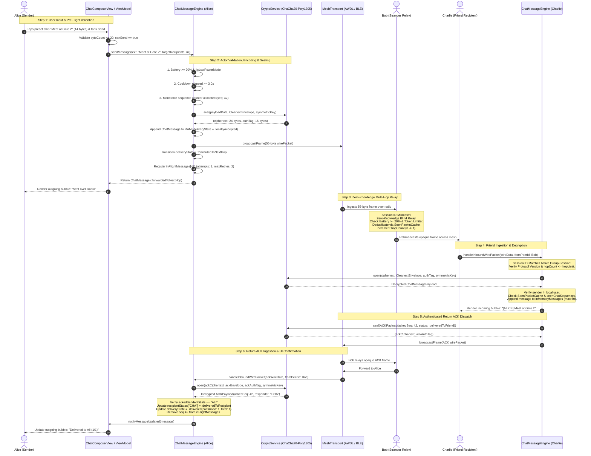

# Volume 08: Feature Chat, Ephemeral Messaging & Delivery Pipeline (Meepo)

## Executive Summary & Big-Picture Overview

Volume 08 documents the low-bandwidth, ephemeral group messaging, wire payload encoding, per-recipient delivery confirmation, and SwiftUI presentation subsystem of the Meepo mesh networking platform. Designed for off-grid disaster operational environments and remote wilderness gatherings—where cellular base stations and Wi-Fi networks are either overloaded or nonexistent—the chat engine provides peer-to-peer textual communication between close friends across Apple Wireless Direct Link (AWDL) and Bluetooth Low Energy (BLE) multi-hop meshes.

Unlike traditional internet chat applications (e.g., Apple Messages, Signal, or WhatsApp) that rely on centralized cloud databases, persistent WebSocket connections, and megabyte-scale payload allocations, Meepo's chat engine operates under severe physical constraints:
1. **Strict 20-Byte Wire Payload Limit:** To guarantee deterministic transmission over peer-to-peer wireless links and fit within Meepo's universal 56-byte binary wire packet frame (`PacketConstants.wirePacketSize`), chat messages are hard-capped at 20 UTF-8 bytes. The system enforces this constraint through live character-metering, proactive byte-boundary clamping, and pre-flight validation.
2. **Volatile RAM-Only Ephemerality:** Privacy and security in high-density disaster rubble zones require that communications leave zero forensic traces. The chat engine maintains message history exclusively in a volatile 50-message heap ring buffer inside `ChatMessageEngine`. No plaintext, ciphertext, or metadata is written to CoreData, SwiftData, SQLite, or UserDefaults. When a user terminates the app or leaves the group session, the entire conversation history evaporates.
3. **Honest Multi-Recipient Delivery Progression:** In a distributed multi-hop radio mesh, an intermediary node forwarding a packet does not imply that the intended recipient received it. Meepo strictly differentiates between unconfirmed radio transmissions (`locallyAccepted`, `forwardedToNextHop`), intermediary stranger relays (`relayedByMesh`), and cryptographically signed delivery confirmations from verified friends (`deliveredToRecipient`).
4. **Zero-Knowledge Blind Stranger Relaying:** To maintain network reachability across massive disaster rubble zones, devices forward encrypted chat packets belonging to unfamiliar group sessions (`relayedStranger`) without possessing decryption keys. Relay nodes increment hop counts up to 8 hops while preserving end-to-end ChaCha20-Poly1305 MAC integrity through AAD masking.
5. **disaster operational Survival Mode Power Protection (<20% Battery):** Non-essential local chat is throttled and disabled whenever the device battery drops below 20% or enters system Low Power Mode. This preserves critical battery capacity for Tier 1 Emergency SOS signaling, which remains 100% operational.
6. **Rate-Limiting & Cooldown Protection:** To prevent broadcast storms and radio spectrum exhaustion, a 3.0-second cooldown is enforced between successive transmissions. Outbound messages perform up to 2 retries (3 total attempts) at 0.5-second backoffs, supervised by a 15-second delivery timeout window.

---

### ELI5 Overview: The 20-Letter Index Card, The Crowd Brigade & The Signed Receipt

Imagine a search-and-rescue squad deployed across an earthquake rubble zone where all cellular towers, electrical substations, and fiber backhauls are dead. Responders are scattered across several city blocks:

1. **The 20-Letter Index Card (The 20-Byte Limit):** Instead of typing long essays, you carry tiny index cards that have room for exactly 20 small letter blocks (`20 UTF-8 bytes`). You write a short, critical note: *"Meet at Gate 2"* (14 letters) or tap a pre-printed sticker like *"Need water"*. If you try to draw a complex emoji, it takes up 4 letter blocks at once because fancy symbols require more ink blocks in UTF-8.
2. **The Armored Wax Seal (ChaCha20-Poly1305 Encryption):** Before the index card leaves your hands, your phone places it inside a titanium capsule locked with your camp's secret group key. Strangers in the crowd cannot open the capsule, see what you wrote, or know which camp you belong to.
3. **The Crowd Bucket Brigade (Blind Stranger Relaying):** You hand the capsule to the person standing next to you. Even though that stranger does not know you and cannot unlock the capsule, their phone looks at the hop counter stamp on the outside, stamps it with "+1 Hop", and passes it forward to someone else. This bucket brigade repeats across the crowd until the capsule reaches your friend 300 meters away.
4. **The Honest Status Stamp (Sent vs. Relayed vs. Delivered):** While the capsule is traveling across the crowd, your phone displays: *"Relayed by 2 Hops (Unconfirmed)"*. Your phone refuses to lie to you and will never say *"Delivered"* just because a stranger passed it along. Only when your friend's phone unlocks the capsule with their matching camp key and sends back a signed cryptographic receipt does your phone turn green and show: *"Delivered to All (1/1)"*.
5. **The Disappearing Chalkboard (RAM-Only Ephemerality):** When you leave the disaster operational and close the camp session, someone takes a wet sponge and wipes the board completely clean. No messages are saved to your phone's hard drive. It is as if the conversation never happened.

---

## Design and UX Guide (Zero Code Required)

Meepo's group chat feature is built with extreme discipline to avoid confusing users or making false safety promises in hostile disaster operational environments. The user experience balances rapid, one-handed operation with honest, unambiguous feedback.

### User Journey and Screen States

```
+-------------------------------------------------------------------------------+
|                             CHAT USER JOURNEY                                 |
+-------------------------------------------------------------------------------+
|                                                                               |
|  [Tap Preset Chip] ----> [Live Byte Meter] ----> [Tap Send Arrow]            |
|  "Meet at Gate 2"        14/20 bytes             Cooldown Lock (Wait 3s)      |
|                                                                               |
|                                 |                                             |
|                                 v                                             |
|                                                                               |
|  [Sending...] ---------> [Sent over Radio] ----> [Relayed by Mesh]            |
|  Accepted in memory      Left local antenna      Stranger forwarded packet    |
|                                                                               |
|                                 |                                             |
|                                 v                                             |
|                                                                               |
|  [Delivered to All] <--- [Expand Details] <----- [Delivery Timed Out]         |
|  Confirmed by friends    Per-member checkmarks   15s window expired           |
|                                                                               |
+-------------------------------------------------------------------------------+
```

The user interacts with chat through five discrete screen states:

1. **State 1: Quick-Reply Preset Chips:**
   - **Visual Appearance:** Positioned horizontally directly above the text input bar is a scrolling carousel of glass-styled pill buttons (`ChatPresetChipsView`).
   - **Preset Library:** Standard tactical micro-dispatches: *"SQUAD EN ROUTE"*, *"TRIAGE CLEAR"*, *"NEED STRETCHER"*, *"HAZARD SECTOR B"*, *"AT EVAC LZ"*, *"WATER ACTIVE"*.
   - **Interaction:** Tapping any preset automatically populates the message input field with the preset text and immediately dismisses the software keyboard.

2. **State 2: The Real-Time Byte Meter & Composer Input:**
   - **Visual Appearance:** A clean, rounded input bar (`ChatComposerView`) with an upward-pointing send arrow button. Directly below the input field, a monospaced label displays `X/20 bytes`.
   - **Dynamic Feedback:** As the user types, the meter updates instantly: `0/20 bytes`, `12/20 bytes`, `20/20 bytes`.
   - **Auto-Clamping:** If the user pastes a long sentence or types beyond 20 bytes, the field automatically clamps at the 20-byte boundary without crashing or displaying crypt error codes.
   - **Send Button Guard:** The send arrow remains disabled if the input field is empty, contains only whitespace, or if the device is currently in a cooldown state.

3. **State 3: The 3.0-Second Cooldown Countdown:**
   - **Trigger:** Initiated the exact millisecond the user taps the send arrow.
   - **Visual Appearance:** The send button becomes disabled, and the label next to the byte meter transforms into a live countdown: `Wait 3s` -> `Wait 2s` -> `Wait 1s`.
   - **Design Purpose:** Prevents nervous or frustrated users from spamming the send button in dense crowds, protecting the shared radio channel from packet collisions.

4. **State 4: Honest Message Bubble Delivery Progression:**
   - **Bubble Positioning:** Sent messages are right-aligned in dark rounded cards (`ChatMessageBubbleView`); incoming messages from friends are left-aligned, tagged with the friend's initials and distinctive profile color.
   - **Dynamic Status Subtitles:** Local outgoing messages display honest real-time status subtitles:
     - *"Sending..."* - Packet is queued in device memory.
     - *"Sent over Radio"* - Packet has been broadcast over the local antenna.
     - *"Relayed by X Hops (Unconfirmed)"* - An intermediary stranger or mesh hop has forwarded the packet across the crowd, but friends haven't confirmed it yet.
     - *"Delivered X/Y"* - Partial delivery confirmation (e.g., 2 of 3 friends confirmed).
     - *"Delivered to All (X/Y)"* - All intended group members verified receipt.
     - *"Delivered X/Y (Timed Out)"* or *"Delivery Timed Out"* - The 15-second delivery window expired before remaining friends confirmed.
   - **Delivery Details Disclosure:** Outgoing bubbles feature a collapsible *"Delivery details"* menu (`ChatRecipientStatusView`). Tapping unfolds a per-recipient breakdown showing each friend's initials and their specific delivery milestone (*"Delivered"*, *"Relayed; unconfirmed"*, or *"Timed out"*).

5. **State 5: disaster operational Survival Mode (<20% Battery or Low Power Mode):**
   - **Visual Appearance:** The text input field and preset chips are disabled and greyed out. A clear, reassuring notice appears at the top of the composer:
     > *"Chat paused in Low Power Mode or below 20% battery."*
   - **Safety Impact:** Reassures users that while social chat is temporarily suspended to preserve battery reserves, Tier 1 Emergency SOS broadcasts remain 100% operational.

---

### Why Can't We Just...? (Constraints for Designers)

Product designers and UI researchers frequently suggest enhancing the chat experience with features common in modern internet messaging apps. The following table explains why these patterns are strictly prohibited by off-grid mesh systems engineering:

| "Why Can't We Just...?" | Technical & Platform Reality | Permitted Design Behavior |
| :--- | :--- | :--- |
| **Why can't we allow 140 or 256 characters like SMS or Twitter?** | Meepo uses fixed 56-byte wire packets (`PacketConstants.wirePacketSize`) across BLE and AWDL. Fixed-size frames eliminate packet fragmentation, buffer reassembly complexity, and multi-packet drop vulnerabilities across noisy peer-to-peer radio meshes. Subtracting headers, sequence numbers, timestamps, and ChaCha20-Poly1305 MAC tags leaves exactly 20 bytes for text. | Restrict messages strictly to 20 UTF-8 bytes. Provide preset quick-reply chips for common tactical emergency communications. |
| **Why does a single emoji count as 4 characters on the byte meter?** | The byte meter measures raw UTF-8 bytes, not visible Unicode glyphs. Basic ASCII characters (`A-Z`, `0-9`) take 1 byte each. Accented letters take 2 bytes. Complex emojis (e.g., hazard symbols, faces, flags) require 3 to 4 bytes each. A 20-byte limit fits 20 plain letters, but only 5 emojis. | Show `X/20 bytes` instead of `X/20 characters` to educate the user on byte consumption, and auto-clamp text at valid UTF-8 code point boundaries. |
| **Why can't we save chat history so users can read past messages later?** | Search-and-rescue teams and civilian disaster victims value absolute ephemerality and data protection. Storing plaintext chat on flash storage risks unauthorized disclosure of casualty medical information or staging locations if a device is lost, damaged, or accessed in the field. Furthermore, writing to flash storage burns extra battery during blackouts. | Retain messages strictly in volatile heap RAM (max 50 messages). Wiping all history instantly upon session termination or app exit. |
| **Why can't we remove the 3-second cooldown timer?** | Radio frequency spectrum in an emergency disaster zone is a shared, uncoordinated medium. If multiple responders transmit simultaneously, packet collision rates skyrocket, causing carrier sense multiple access (CSMA) backoffs and mesh collapse. | Enforce a 3.0-second cooldown between outbound sends with a clean, monospaced countdown label. |
| **Why can't we show "Delivered" when a nearby stranger forwards the message?** | An unvetted intermediary device 30 meters away in another evacuation sector might relay the packet forward, but that relay cannot read the message or guarantee delivery to the intended squad medic. Claiming "Delivered" when only an intermediary node relayed it creates dangerous false confidence. | Display *"Relayed by X Hops (Unconfirmed)"*. Only display *"Delivered"* when an authenticated ChaCha20-Poly1305 ACK arrives from the recipient's device. |

---

### Editable Design Tokens vs. Locked Engineering Rules

To maintain the architectural integrity of the mesh network while giving product designers flexibility to refine the user experience, design parameters are strictly classified into editable tokens and locked engineering rules:

```
+-------------------------------------------------------------------------------+
|                       DESIGN TOKENS VS. ENGINEERING RULES                     |
+-------------------------------------------------------------------------------+
|  EDITABLE DESIGN TOKENS (Safe to Tweak)                                       |
|  - Preset Chip Text Strings (Must fit <= 20 UTF-8 bytes)                      |
|  - Message Bubble Corner Radii (Default: 18pt) & Insets (Default: 14pt)        |
|  - Member Profile Initials Color Palette (MemberColor.swiftUIColor)           |
|  - Empty State Icon & Guidance Copy ("bubble.left.and.bubble.right")          |
|  - Monospaced Font Styling for Byte & Cooldown Meters                         |
+-------------------------------------------------------------------------------+
|  LOCKED ENGINEERING RULES (Do Not Touch Without System Architect Sign-Off)     |
|  - Hard 20-Byte Wire Text Limit (ChatMessagePayload.maxTextBytes = 20)        |
|  - Volatile 50-Message Heap Ring Buffer (ChatMessageEngine.maxHistoryCount=50)|
|  - 3.0-Second Anti-Spam Radio Cooldown (MeshTimingConfiguration)              |
|  - 20% Battery & Low Power Mode Chat Cutoff (disaster operational Survival Mode)          |
|  - Fixed 56-Byte Binary Wire Frame (PacketConstants.wirePacketSize = 56)      |
|  - ChaCha20-Poly1305 Symmetric Key Sealing & AAD Masking Invariance           |
|  - Distinction Between Relay ACKs (0x02) and Delivery ACKs (0x01)             |
+-------------------------------------------------------------------------------+
```

---

## Technical Engineering Deep-Dive

This section provides a comprehensive, code-level architectural analysis of Volume 08. It begins with a step-by-step end-to-end trace, presents the verified source file inventory, details the core state machine and protocol diagrams, and walks through every source file in detail.

---

### End-to-End Flow: From Preset Tap to Friend Chat Bubble and Receipt

The following sequence diagram and walkthrough trace the complete technical lifecycle of a disaster operational group chat message:



---

### Included Source Files

The following 17 Swift source files constitute the complete implementation of Volume 08:

| # | Repo-Relative File Link | Exact Line Count (`wc -l`) | Target / Category | Architectural Purpose & Responsibility |
| :-: | :--- | :-: | :--- | :--- |
| 1 | [`ChatDeliveryState.swift`](../../Teekum/Teekum/Features/Chat/Models/ChatDeliveryState.swift) | 44 | Main App / Model | Aggregated macro delivery state tracking overall progress and monotonic priority ranks. |
| 2 | [`ChatEngineError.swift`](../../Teekum/Teekum/Features/Chat/Models/ChatEngineError.swift) | 49 | Main App / Model | Domain error enum with localized, reassuring descriptions for power and validation errors. |
| 3 | [`ChatMessage.swift`](../../Teekum/Teekum/Features/Chat/Models/ChatMessage.swift) | 84 | Main App / Model | Strictly in-memory model representing a chat message with per-recipient tracking and honest summaries. |
| 4 | [`InFlightMessage.swift`](../../Teekum/Teekum/Features/Chat/Models/InFlightMessage.swift) | 19 | Main App / Model | Internal tracking structure managing active unacknowledged packets, retry counts, and pre-serialized wire data. |
| 5 | [`InboundChatOutcome.swift`](../../Teekum/Teekum/Features/Chat/Models/InboundChatOutcome.swift) | 34 | Main App / Model | Outcome classification enumeration for processed inbound wire packets. |
| 6 | [`RecipientDeliveryState.swift`](../../Teekum/Teekum/Features/Chat/Models/RecipientDeliveryState.swift) | 44 | Main App / Model | Discrete delivery state tracking for an individual intended group recipient. |
| 7 | [`ChatMessagingService.swift`](../../Teekum/Teekum/Features/Chat/Protocols/ChatMessagingService.swift) | 41 | Main App / Protocol | Formal actor-constrained protocol isolating messaging business logic from UI ViewModels. |
| 8 | [`ChatMessageEngine+Delivery.swift`](../../Teekum/Teekum/Features/Chat/Services/ChatMessageEngine+Delivery.swift) | 278 | Main App / Service | Chat engine extension managing return ACKs, retry supervisors, 15s timeouts, and RAM history purging. |
| 9 | [`ChatMessageEngine+Inbound.swift`](../../Teekum/Teekum/Features/Chat/Services/ChatMessageEngine+Inbound.swift) | 212 | Main App / Service | Chat engine extension handling wire validation, stranger blind relaying, decryption, and duplicate re-ACKs. |
| 10 | [`ChatMessageEngine+Outbound.swift`](../../Teekum/Teekum/Features/Chat/Services/ChatMessageEngine+Outbound.swift) | 164 | Main App / Service | Chat engine extension executing pre-flight validation, sequence allocation, encryption, and dispatch. |
| 11 | [`ChatMessageEngine.swift`](../../Teekum/Teekum/Features/Chat/Services/ChatMessageEngine.swift) | 193 | Main App / Service | Central coordinating actor maintaining the 50-message volatile RAM ring buffer and battery policies. |
| 12 | [`ChatViewModel.swift`](../../Teekum/Teekum/Features/Chat/ViewModels/ChatViewModel.swift) | 131 | Main App / ViewModel | Observable presentation view model managing draft state, UTF-8 byte metering, cooldowns, and unread counts. |
| 13 | [`ChatComposerView.swift`](../../Teekum/Teekum/Features/Chat/Views/ChatComposerView.swift) | 71 | Main App / View | SwiftUI bottom input bar component with live byte-count meter, cooldown label, and send button. |
| 14 | [`ChatMessageBubbleView.swift`](../../Teekum/Teekum/Features/Chat/Views/ChatMessageBubbleView.swift) | 54 | Main App / View | SwiftUI message bubble component with sender initials, profile colors, timestamps, and delivery summaries. |
| 15 | [`ChatPresetChipsView.swift`](../../Teekum/Teekum/Features/Chat/Views/ChatPresetChipsView.swift) | 32 | Main App / View | SwiftUI horizontal scrolling carousel of quick-reply preset buttons. |
| 16 | [`ChatRecipientStatusView.swift`](../../Teekum/Teekum/Features/Chat/Views/ChatRecipientStatusView.swift) | 53 | Main App / View | SwiftUI collapsible disclosure group showing individual member delivery milestones. |
| 17 | [`ChatSheetView.swift`](../../Teekum/Teekum/Features/Chat/Views/ChatSheetView.swift) | 104 | Main App / View | Top-level modal navigation sheet embedding empty states, bottom-anchored message scroll, and composer. |
| **Total** | **All Volume 08 Files** | **1,607** | **17 Swift Source Files** | **100% Comprehensive Coverage** |

---

### Chat Payload & Delivery State Diagrams

#### 1. Fixed 56-Byte Binary Wire Packet Framing
The diagram below illustrates how a 20-byte chat message fits into Meepo's universal 56-byte wire packet:

```
+---------------------------------------------------------------------------------------+
|                       TEEKUM 56-BYTE CHAT WIRE PACKET FRAME                           |
+-------------------+-------------------------------+-----------------------------------+
|  Cleartext Envelope (16 Bytes)                    |  Encrypted Payload + Auth (40B)   |
+----+----+----+----+----+----+----+----+----+------+-------------------+---------------+
|Ver |Type|Hop |Hop |  Session ID  |Sequence Number| Ciphertext (24B)  | Poly1305 Auth |
|0x01|0x03|Lmt |Cnt |   (4 Bytes)  |   (4 Bytes)   | (Encrypted Data)  | Tag (16 Bytes)|
|1B  |1B  |1B  |1B  |              |               |                   |               |
+----+----+----+----+------------------+------------+-------------------+---------------+
                                                    | ChatMessagePayload (24 Bytes)     |
                                                    +--------+----------+---------------+
                                                    |Initials|Timestamp |Text (1..20 B) |
                                                    | (3B)   | (8 Bytes)| UTF-8 Encoded |
                                                    +--------+----------+---------------+
```

#### 2. Multi-Recipient Delivery State Transition Matrix
The diagram below details the monotonic progression of individual and aggregated delivery states:

```
+---------------------------------------------------------------------------------------+
|                    DELIVERY STATE MACHINE & MONOTONIC PROMOTION                       |
+---------------------------------------------------------------------------------------+
|                                                                                       |
|   +-------------------+                                                               |
|   |  locallyAccepted  | (Priority Rank 0: Stored in local actor RAM)                  |
|   +---------+---------+                                                               |
|             | [Radio Broadcast]                                                       |
|             v                                                                         |
|   +-------------------+                                                               |
|   | forwardedToNextHop| (Priority Rank 1: Transmitted over local antenna)             |
|   +---------+---------+                                                               |
|             | [Relay ACK Received (0x02)]                                             |
|             v                                                                         |
|   +-------------------+                                                               |
|   |   relayedByMesh   | (Priority Rank 2: Intermediary stranger forwarded packet)     |
|   +---------+---------+                                                               |
|             |                                                                         |
|             |----------------------------------+                                      |
|             | [Friend Delivery ACK (0x01)]     | [15s Timeout Elapsed]                |
|             v                                  v                                      |
|   +-------------------+              +-------------------+                            |
|   |    delivered      |              | deliveryTimedOut  |                            |
|   | (Rank 3: Terminal)|              | (Rank 3: Terminal)|                            |
|   +-------------------+              +-------------------+                            |
|                                                                                       |
+---------------------------------------------------------------------------------------+
```

---

## Dedicated File-by-File Deep-Dives (Zero Skipped Files)

### 1. `Teekum/Teekum/Features/Chat/Models/ChatDeliveryState.swift`
- **File Path**: [`../../Teekum/Teekum/Features/Chat/Models/ChatDeliveryState.swift`](../../Teekum/Teekum/Features/Chat/Models/ChatDeliveryState.swift)
- **Line Count**: 44 lines (`wc -l`)
- **Concurrency & Target Domain**: Main App Target (`Teekum`), `nonisolated public enum`, Conforms to `Equatable, Sendable`

#### What This File Does
`ChatDeliveryState.swift` establishes the aggregated, macro-level delivery lifecycle state for an entire chat message across all of its target recipients. It models the operational progression of an outgoing packet from local queuing in actor memory through radio antenna dispatch, intermediate mesh relaying by unauthenticated third-party nodes, authenticated confirmation by friend devices, and timeout or failure conditions.

#### ELI5 Analogy
Imagine dispatching an urgent medical supply order to field teams across a flood disaster zone. The tracking receipt displays progress: "Order Logged at Dispatch" (`locallyAccepted`), "Handed to Field Courier" (`forwardedToNextHop`), "Relayed Past Sector 2 Checkpoint" (`relayedByMesh`), "Delivered and Confirmed by 3 of 4 Squad Medics" (`delivered`), or "Delivery Timed Out" (`deliveryTimedOut`). `ChatDeliveryState` is that macro-level delivery status receipt.

#### Technical Terms Defined
- **Aggregated Delivery State**: A high-level state machine representing the collective delivery progress of a multi-recipient message, synthesized from individual per-recipient ACK states.
- **Intermediary Mesh Relay (`relayedByMesh`)**: Confirmation that an intermediary mesh relay device (which could belong to a stranger) forwarded the packet, without guaranteeing that the intended friend has received or decrypted it.
- **Priority Rank**: An integer ordinal (`0` to `3`) that enforces monotonic progression in delivery state updates, ensuring late-arriving or out-of-order relay notifications never regress an already-delivered message.

#### Code-Block and Line-by-Line Walkthrough
Lines 11–43 declare the enumeration cases, query helpers, and monotonic priority ranks:
```swift
// Lines 11-20: ChatDeliveryState definition
nonisolated public enum ChatDeliveryState: Equatable, Sendable {
    case locallyAccepted
    case forwardedToNextHop
    case relayedByMesh(hopCount: UInt8)
    case delivered(confirmedCount: Int, totalRecipients: Int)
    case deliveryTimedOut
    case failed(reason: String)
```
- Line 12 (`locallyAccepted`): The message payload has passed byte-length validation and is queued inside `ChatMessageEngine`.
- Line 13 (`forwardedToNextHop`): The 56-byte wire frame has been transmitted across the local radio antenna (`MeshTransport.broadcastFrame`).
- Line 14 (`relayedByMesh(hopCount:)`): An intermediary node has rebroadcast the packet across the mesh, carrying the hop distance.
- Line 15 (`delivered(confirmedCount:totalRecipients:)`): One or more intended recipients have decrypted the payload and transmitted back an authenticated ChaCha20-Poly1305 ACK.
- Lines 16–17 (`deliveryTimedOut`, `failed`): Terminal failure or timeout states when the 15-second ACK window elapses or radio failure occurs.

```swift
// Lines 21-33: Inspection Boolean helpers
    public var isDelivered: Bool {
        if case .delivered = self { return true }
        return false
    }
    
    public var isRelayed: Bool {
        if case .relayedByMesh = self { return true }
        return false
    }
    
    public var isTimedOut: Bool {
        if case .deliveryTimedOut = self { return true }
        return false
    }
```
- Lines 21–33: Convenient non-isolated Boolean queries for SwiftUI views to drive styling, disclosure chevron indicators, and accessibility labels without pattern matching.

```swift
// Lines 35-43: Priority ranking for monotonic state advancement
    public var priorityRank: Int {
        switch self {
        case .locallyAccepted: return 0
        case .forwardedToNextHop: return 1
        case .relayedByMesh: return 2
        case .delivered: return 3
        case .deliveryTimedOut: return 3
        case .failed: return 3
        }
    }
}
```
- Lines 35–43: Assigns an integer priority rank to each state. This guarantees that an incoming relay ACK (`priorityRank == 2`) will never overwrite or regress a message that has already reached `.delivered` (`priorityRank == 3`).

#### Engineering Rationale and Edge Cases
- **Honest Feedback Design**: Unlike conventional chat protocols that treat radio carrier dispatch as "Sent" and relay receipt as "Delivered", Meepo explicitly separates `.relayedByMesh` from `.delivered`. In a wilderness or disaster operational mesh, an intermediary node forwarding a packet does not mean the recipient's phone was on, in range, or capable of decrypting the packet.
- **Sendable Value Isolation**: Conforming to `Sendable` and marked `nonisolated` allows these states to pass seamlessly across `ChatMessageEngine` (an actor), `ChatViewModel` (on `@MainActor`), and SwiftUI view render loops without thread locking or copies.

---

### 2. `Teekum/Teekum/Features/Chat/Models/ChatEngineError.swift`
- **File Path**: [`../../Teekum/Teekum/Features/Chat/Models/ChatEngineError.swift`](../../Teekum/Teekum/Features/Chat/Models/ChatEngineError.swift)
- **Line Count**: 49 lines (`wc -l`)
- **Concurrency & Target Domain**: Main App Target (`Teekum`), `nonisolated public enum`, Conforms to `Error, LocalizedError, Equatable, Sendable`

#### What This File Does
`ChatEngineError.swift` establishes the domain-specific error taxonomy for the entire chat subsystem. It categorizes every failure condition that can occur during message drafting, validation, hardware power throttling, radio rate-limiting cooldowns, cryptographic sealing/opening, outbox queuing, and session teardown.

#### ELI5 Analogy
Imagine a safety supervisor standing next to a pneumatic tube station at an industrial plant. If you hand the supervisor a canister that is too heavy, if the tube is cooling down, if the plant is running on emergency generator power, or if the secret seal is broken, the supervisor hands you a specific red notice card explaining exactly why the canister cannot be launched right now. `ChatEngineError` is that set of specific rejection cards.

#### Technical Terms Defined
- **Domain Error Taxonomy**: A comprehensive, enumerated hierarchy of typed errors tailored to a specific subsystem, enabling both programmatic error handling and localized human-readable descriptions.
- **Hardware Power Throttling**: A protective policy that cuts off non-essential wireless transmissions when battery capacity falls below safety margins (20%) or enters system Low Power Mode.
- **Radio Cooldown Lock**: A client-side rate-limiting delay (3.0 seconds) that prevents channel saturation and packet collisions across shared radio frequencies.

#### Code-Block and Line-by-Line Walkthrough
Lines 11–48 declare the typed error cases and localized UI explanations:
```swift
// Lines 11-23: ChatEngineError enum definition
nonisolated public enum ChatEngineError: Error, LocalizedError, Equatable, Sendable {
    case invalidTextLength(Int)
    case cooldownActive(remainingSeconds: Double)
    case batteryThrottled(batteryLevel: Float)
    case survivalModeActive
    case noActiveSession
    case queueFull(String)
    case serializationFailed
    case encryptionFailed(String)
    case decryptionFailed(String)
    case duplicateMessage(UInt32)
    case sessionTerminated
```
- Line 12 (`invalidTextLength(Int)`): Fired if UTF-8 byte count is 0 or exceeds 20 bytes.
- Line 13 (`cooldownActive(remainingSeconds:)`): Fired if user attempts to send within 3.0s of the prior message.
- Lines 14–15 (`batteryThrottled`, `survivalModeActive`): Fired when device battery level is below 0.20 or Low Power Mode is enabled.
- Line 16 (`noActiveSession`): Fired if send is attempted without an established group session key.
- Line 17 (`queueFull(String)`): Fired if the outbox buffer cannot accept additional packets.
- Lines 18–20 (`serializationFailed`, `encryptionFailed`, `decryptionFailed`): Cryptographic and wire-format encoding errors.
- Line 21 (`duplicateMessage(UInt32)`): Inbound sequence number already recorded in deduplication cache.
- Line 22 (`sessionTerminated`): Group session was closed or torn down during transit.

```swift
// Lines 25-48: LocalizedError description formatting
    public var errorDescription: String? {
        switch self {
        case .invalidTextLength(let count):
            return "Message length is invalid (\(count) bytes). Must be between 1 and 20 UTF-8 bytes."
        case .cooldownActive(let remaining):
            return String(format: "Chat cooldown active. Please wait %.1f seconds.", remaining)
        case .batteryThrottled(let level):
            return String(format: "Chat disabled below 20%% battery (current: %.0f%%). Emergency SOS remains active.", level * 100)
        case .survivalModeActive:
            return "Chat disabled in disaster operational Survival Mode (<20% battery). Emergency SOS remains active."
        case .noActiveSession:
            return "Cannot send chat message without an active group session."
        case .queueFull(let msg):
            return "Chat queue is full: \(msg)"
        case .serializationFailed:
            return "Failed to serialize chat message payload."
        case .encryptionFailed(let msg):
            return "Failed to encrypt chat message: \(msg)"
        case .decryptionFailed(let msg):
            return "Failed to decrypt chat message: \(msg)"
        case .duplicateMessage(let seq):
            return "Duplicate chat message dropped (sequence \(seq))."
        case .sessionTerminated:
            return "Active session was terminated."
        }
    }
}
```
- Lines 25–48: Formats clear, user-reassuring text strings. Notice that for `batteryThrottled` and `survivalModeActive`, the error message explicitly notes: *"Emergency SOS remains active."*, preventing rescue workers and survivors from panicking about life safety.

#### Engineering Rationale and Edge Cases
- **Equatability for Deterministic Unit Tests**: By conforming to `Equatable`, unit tests can assert exact error cases (e.g., `XCTAssertEqual(error, ChatEngineError.invalidTextLength(24))`) without string matching.
- **Safety Reassurance in UI Strings**: Emergency systems require explicit psychological clarity. Reminding users that SOS is operational even when chat is throttled prevents confusion during low-battery scenarios.

---

### 3. `Teekum/Teekum/Features/Chat/Models/ChatMessage.swift`
- **File Path**: [`../../Teekum/Teekum/Features/Chat/Models/ChatMessage.swift`](../../Teekum/Teekum/Features/Chat/Models/ChatMessage.swift)
- **Line Count**: 84 lines (`wc -l`)
- **Concurrency & Target Domain**: Main App Target (`Teekum`), `nonisolated public struct`, Conforms to `Identifiable, Equatable, Sendable`

#### What This File Does
`ChatMessage.swift` defines the core in-memory domain model for sent and received group chat messages. It bundles the unique message identifier, sequence counter, sender initials, text payload, dispatch timestamp, per-recipient delivery statuses, aggregated delivery progression, and sender locality flag. It provides computed properties that format honest, human-readable delivery status summaries for the UI.

#### ELI5 Analogy
Imagine an index card used to track an announcement made to your disaster operational camp. On the front is the message text, who said it, and what time it was said. On the back is a checklist of all your campmates' names with checkmarks showing whether the message was handed to a courier, seen passing by, or actually acknowledged by each friend. `ChatMessage` is that index card.

#### Technical Terms Defined
- **In-Memory Ephemerality**: Storing records exclusively in volatile heap memory with zero disk backing, ensuring complete evaporation when the app terminates or the user closes the group session.
- **Multi-Recipient ACK Tracking**: A state management pattern where an outbound group message tracks delivery status for each intended recipient independently rather than assuming broadcast reception.
- **Honest Delivery Summary**: A dynamic UI string derived strictly from verified recipient acknowledgements rather than speculative transmission status.

#### Code-Block and Line-by-Line Walkthrough
Lines 16–47 declare the structure properties and initializer:
```swift
// Lines 16-26: ChatMessage property definitions
nonisolated public struct ChatMessage: Identifiable, Equatable, Sendable {
    public let id: UUID
    public let sequenceNumber: UInt32
    public let senderInitials: String
    public let text: String
    public let timestamp: Date
    public var confirmedResponders: Set<String>
    public var recipientStates: [String: RecipientDeliveryState]
    public var deliveryState: ChatDeliveryState
    public let isLocalSender: Bool
```
- Line 17 (`id`): Unique UUID for SwiftUI `ForEach` iteration and list rendering.
- Line 18 (`sequenceNumber`): Monotonic sequence number allocating wire deduplication and ACK matching.
- Line 19 (`senderInitials`): Sanitized 2-to-3 character sender initials (e.g., `"ALI"`).
- Line 20 (`text`): Verified 1-to-20 UTF-8 byte text payload.
- Line 22 (`confirmedResponders`): Set of member initials that have sent back authenticated delivery ACKs.
- Line 23 (`recipientStates`): Dictionary mapping recipient initials to their individual `RecipientDeliveryState`.
- Line 24 (`deliveryState`): Aggregated macro delivery state across all recipients.
- Line 25 (`isLocalSender`): Boolean flag distinguishing locally composed messages from received peer messages.

```swift
// Lines 50-57: Recipient count helpers
    public var confirmedRecipientCount: Int {
        recipientStates.values.filter { $0.isDelivered }.count
    }
    
    public var totalRecipientCount: Int {
        max(1, recipientStates.count)
    }
```
- Lines 50–57: Computes the number of verified recipient deliveries against the total recipient roster.

```swift
// Lines 60-83: Honest delivery summary derivation
    public var deliverySummaryText: String {
        switch deliveryState {
        case .locallyAccepted:
            return "Sending..."
        case .forwardedToNextHop:
            return "Sent over Radio"
        case .relayedByMesh(let hops):
            return "Relayed by \(hops) \(hops == 1 ? "Hop" : "Hops") (Unconfirmed)"
        case .delivered(let confirmed, let total):
            if confirmed >= total {
                return "Delivered to All (\(confirmed)/\(total))"
            } else {
                return "Delivered \(confirmed)/\(total)"
            }
        case .deliveryTimedOut:
            if confirmedRecipientCount > 0 {
                return "Delivered \(confirmedRecipientCount)/\(totalRecipientCount) (Timed Out)"
            } else {
                return "Delivery Timed Out"
            }
        case .failed(let reason):
            return "Failed: \(reason)"
        }
    }
}
```
- Lines 60–83: Generates the honest status string displayed beneath outbound chat bubbles. Note the nuanced timeout feedback: if 2 of 3 friends confirmed before timeout, it honestly states `"Delivered 2/3 (Timed Out)"`, giving the sender actionable situational awareness.

#### Engineering Rationale and Edge Cases
- **Initials Sanitization in Initializer**: Line 40 calls `InitialsCodec.sanitize(senderInitials)`, stripping whitespace and uppercase-normalizing characters upon creation.
- **Zero Disk Persistence Guarantee**: The struct intentionally lacks `Codable` conformance to prevent accidental serialization into `UserDefaults` or `FileManager`, enforcing the ephemerality contract.

---

### 4. `Teekum/Teekum/Features/Chat/Models/InFlightMessage.swift`
- **File Path**: [`../../Teekum/Teekum/Features/Chat/Models/InFlightMessage.swift`](../../Teekum/Teekum/Features/Chat/Models/InFlightMessage.swift)
- **Line Count**: 19 lines (`wc -l`)
- **Concurrency & Target Domain**: Main App Target (`Teekum`), `struct`, Package/Internal Scope

#### What This File Does
`InFlightMessage.swift` defines the internal bookkeeping structure used by `ChatMessageEngine` to track outbound chat packets that have been transmitted over the radio and are actively awaiting recipient delivery ACKs or retransmission retry deadlines.

#### ELI5 Analogy
Imagine a clip-board on a dispatcher's desk where every outgoing letter that hasn't been signed for yet is pinned. The dispatcher notes down: the original letter, the packaged envelope ready to be resent if needed, how many times they've already tried sending it, the maximum number of attempts allowed, and the exact second it was last launched. `InFlightMessage` is that dispatcher's tracking sheet.

#### Technical Terms Defined
- **In-Flight Tracking**: Maintaining active references to dispatched packets until terminal confirmation (all ACKs received) or expiration (timeout window elapsed).
- **Pre-Serialized Wire Data**: Storing the raw 56-byte `Data` payload directly in the tracking struct so retransmissions do not incur re-serialization or re-encryption CPU overhead.
- **Bounded Retransmissions**: Limiting retransmission attempts (default max 2 retries, 3 total attempts) to prevent battery drainage and broadcast storms.

#### Code-Block and Line-by-Line Walkthrough
The complete 19-line file is structured as follows:
```swift
// Lines 1-19: Complete InFlightMessage definition
import Foundation

struct InFlightMessage {
    var message: ChatMessage
    var rawWirePacket: RawWirePacket
    var wireData: Data
    var attemptCount: Int
    var maxRetries: Int
    var lastSentAt: Date
    var retryTask: Task<Void, Never>?
    var timeoutTask: Task<Void, Never>?
}
```
- Line 11 (`message: ChatMessage`): The working copy of the message whose delivery states are updated as return ACKs arrive.
- Line 12 (`rawWirePacket: RawWirePacket`): The parsed envelope, ciphertext, and Poly1305 MAC tag.
- Line 13 (`wireData: Data`): Pre-computed 56-byte wire binary data ready for immediate radio re-broadcast.
- Line 14 (`attemptCount: Int`): Number of transmission attempts already performed (starts at 1).
- Line 15 (`maxRetries: Int`): Maximum allowable retry attempts (configured via `MeshTimingConfiguration.chatMaxRetries`, default 2).
- Line 16 (`lastSentAt: Date`): Exact timestamp of the most recent radio transmission, used to evaluate the 0.5s backoff timer.
- Lines 17–18 (`retryTask`, `timeoutTask`): Optional task handles for fine-grained asynchronous task cancellation.

#### Engineering Rationale and Edge Cases
- **Internal Visibility**: Because `InFlightMessage` manages radio retransmission internals, it is scoped as internal to the feature module, preventing leakage to ViewModels or presentation layers.
- **Zero Re-Encryption Overhead**: Storing `wireData: Data` ensures that when the background retry supervisor decides to retransmit, it bypasses ChaCha20-Poly1305 key operations, conserving CPU cycles on resource-constrained mobile hardware.

---

### 5. `Teekum/Teekum/Features/Chat/Models/InboundChatOutcome.swift`
- **File Path**: [`../../Teekum/Teekum/Features/Chat/Models/InboundChatOutcome.swift`](../../Teekum/Teekum/Features/Chat/Models/InboundChatOutcome.swift)
- **Line Count**: 34 lines (`wc -l`)
- **Concurrency & Target Domain**: Main App Target (`Teekum`), `nonisolated public enum`, Conforms to `Equatable, Sendable`

#### What This File Does
`InboundChatOutcome.swift` defines the classified result enumeration returned by `ChatMessageEngine` whenever an inbound wire packet is ingested from the mesh network. It distinguishes between local group message delivery, multi-hop blind stranger forwarding, return ACK processing, and various drop conditions (duplicate sequences, cryptographic failures, battery policy restrictions, or hop limit exhaustion).

#### ELI5 Analogy
Imagine an automated sorting machine at a postal station. When a package drops into the chute, the sorter inspects it and sorts it into one of several sorting bins: "Delivered to Local Camp" (`deliveredLocally`), "Delivered Locally and Forwarded to Friends Further Away" (`deliveredLocallyAndRelayed`), "Receipt Signed by Friend" (`ackProcessed`), "Forwarded for a Stranger Without Looking Inside" (`relayedStranger`), or "Shredded Due to Being a Duplicate or Fake" (`droppedDuplicate`, `droppedSecurityFailed`). `InboundChatOutcome` is that sorting classification.

#### Technical Terms Defined
- **Outcome Classification**: Returning a rich enumeration describing the operational effect of processing a network packet, enabling deterministic assertions in test suites and structured logging in diagnostic HUDs.
- **Zero-Knowledge Blind Relay (`relayedStranger`)**: An outcome where a packet belonging to a foreign group session is forwarded across the mesh without the relay node possessing the cryptographic keys required to decrypt or inspect the payload.
- **Drop Classification**: Distinguishing benign drops (e.g., duplicate sequence numbers already received) from hostile or corrupt drops (e.g., ChaCha20-Poly1305 MAC tag verification failure).

#### Code-Block and Line-by-Line Walkthrough
Lines 11–33 declare the enumeration cases and unwrapping helpers:
```swift
// Lines 11-23: InboundChatOutcome definition
nonisolated public enum InboundChatOutcome: Equatable, Sendable {
    case deliveredLocally(message: ChatMessage)
    case deliveredLocallyAndRelayed(message: ChatMessage, nextHopCount: UInt8)
    case ackProcessed(sequenceNumber: UInt32, responderInitials: String, isDelivered: Bool)
    case relayedStranger(sessionId: UInt32, hopCount: UInt8)
    case droppedDuplicate(sequenceNumber: UInt32)
    case droppedSecurityFailed
    case droppedPolicyDisabled
    case droppedHopLimitExceeded
    case droppedSelfEcho
    case droppedMalformed
```
- Line 12 (`deliveredLocally`): The message belonged to our group, decrypted successfully, was stored in RAM, and reached hop limit (no further relaying).
- Line 13 (`deliveredLocallyAndRelayed`): Decrypted and displayed locally, AND forwarded to peer neighbors because `hopCount < hopLimit`.
- Line 14 (`ackProcessed`): A return ACK was decrypted and matched to an active outbound in-flight message.
- Line 15 (`relayedStranger`): The packet had a foreign `sessionId`; it was forwarded blindly without decryption.
- Lines 16–22 (`dropped...`): Explicit drop classifications for duplicates, cryptographic failures, battery survival mode restrictions, hop limits (> 8), self echoes, or corrupt wire framing.

```swift
// Lines 24-33: Helper properties
    public var deliveredMessage: ChatMessage? {
        switch self {
        case .deliveredLocally(let message), .deliveredLocallyAndRelayed(let message, _):
            return message
        default:
            return nil
        }
    }
    
    public var isDeliveredLocally: Bool {
        deliveredMessage != nil
    }
}
```
- Lines 24–33: Provide ergonomic access to the decoded `ChatMessage` when the packet resulted in local delivery, allowing callers to handle incoming messages without exhaustive pattern matching.

#### Engineering Rationale and Edge Cases
- **Exhaustive Testing Verification**: With distinct drop cases like `droppedSelfEcho` and `droppedHopLimitExceeded`, unit tests can verify exact edge cases rather than relying on generic nil returns.
- **Stranger Session Tracking**: `.relayedStranger(sessionId:hopCount:)` carries the foreign session ID and mutated hop count, enabling mesh metrics HUDs to count stranger relay contributions without violating cryptographic privacy.

---

### 6. `Teekum/Teekum/Features/Chat/Models/RecipientDeliveryState.swift`
- **File Path**: [`../../Teekum/Teekum/Features/Chat/Models/RecipientDeliveryState.swift`](../../Teekum/Teekum/Features/Chat/Models/RecipientDeliveryState.swift)
- **Line Count**: 44 lines (`wc -l`)
- **Concurrency & Target Domain**: Main App Target (`Teekum`), `nonisolated public enum`, Conforms to `Equatable, Sendable`

#### What This File Does
`RecipientDeliveryState.swift` models the discrete delivery progression for an individual recipient of a multi-cast chat message. While `ChatDeliveryState` models the macro state of the entire message, `RecipientDeliveryState` tracks whether each specific friend in the group roster has received, confirmed, or timed out on receiving the message.

#### ELI5 Analogy
If you send a group message to Alice, Bob, and Charlie, `RecipientDeliveryState` is the individual tracking row for Bob: has Bob's phone accepted the message, has it passed an intermediate stranger near Bob, has Bob's phone sent back a signed confirmation, or did Bob's phone stay offline until the timer ran out?

#### Technical Terms Defined
- **Per-Recipient Granularity**: Tracking delivery confirmations at the individual member level, enabling user interfaces to show precisely which group members received a communication.
- **Relay Peer ID**: An optional node identifier indicating which neighboring radio node forwarded the relay confirmation.
- **RSSI Metric**: The Received Signal Strength Indicator (in dBm) reported by the recipient's radio upon packet reception, providing physical proximity feedback.

#### Code-Block and Line-by-Line Walkthrough
Lines 11–43 declare the enum cases, status helpers, and monotonic rank values:
```swift
// Lines 11-20: RecipientDeliveryState definition
nonisolated public enum RecipientDeliveryState: Equatable, Sendable {
    case locallyAccepted
    case forwardedToNextHop
    case relayedByMesh(hops: UInt8, relayPeerId: String?)
    case deliveredToRecipient(timestamp: Date, rssi: Int8?)
    case deliveryTimedOut
    case failed(reason: String)
```
- Line 12 (`locallyAccepted`): Local message queued for this recipient.
- Line 13 (`forwardedToNextHop`): Packet transmitted over radio antenna toward this recipient.
- Line 14 (`relayedByMesh(hops:relayPeerId:)`): An intermediary node reported forwarding toward this recipient.
- Line 15 (`deliveredToRecipient(timestamp:rssi:)`): The recipient's phone successfully decrypted the message and replied with a verified ACK.
- Lines 16–17 (`deliveryTimedOut`, `failed`): Recipient failed to confirm within 15 seconds or experienced transmission failure.

```swift
// Lines 21-43: Helpers and Monotonic Priority Rank
    public var isDelivered: Bool {
        if case .deliveredToRecipient = self { return true }
        return false
    }
    
    public var isRelayed: Bool {
        if case .relayedByMesh = self { return true }
        return false
    }
    
    public var isTimedOut: Bool {
        if case .deliveryTimedOut = self { return true }
        return false
    }
    
    public var priorityRank: Int {
        switch self {
        case .locallyAccepted: return 0
        case .forwardedToNextHop: return 1
        case .relayedByMesh: return 2
        case .deliveredToRecipient: return 3
        case .deliveryTimedOut: return 3
        case .failed: return 3
        }
    }
}
```
- Lines 33–42: `priorityRank` ensures that if an out-of-order relay packet (`rank 2`) arrives after a direct delivery ACK (`rank 3`) was already received for that recipient, the engine refuses to overwrite the confirmed delivery.

#### Engineering Rationale and Edge Cases
- **Asymmetric Multi-Hop Topologies**: In real disaster operational environments, Friend A may be 1 direct hop away and confirm within 100ms, while Friend B is 3 hops away across a noisy crowd and takes 4 seconds, and Friend C may have walked into a Faraday-shielded basement. Modeling state per recipient prevents the entire message from being marked "Failed" if only one member is out of range.

---

### 7. `Teekum/Teekum/Features/Chat/Protocols/ChatMessagingService.swift`
- **File Path**: [`../../Teekum/Teekum/Features/Chat/Protocols/ChatMessagingService.swift`](../../Teekum/Teekum/Features/Chat/Protocols/ChatMessagingService.swift)
- **Line Count**: 41 lines (`wc -l`)
- **Concurrency & Target Domain**: Main App Target (`Teekum`), `public protocol ChatMessagingService: Actor`

#### What This File Does
`ChatMessagingService.swift` defines the formal asynchronous actor protocol governing the group chat engine. It establishes a clean architectural boundary between the messaging business logic (cryptographic sealing, outbox queuing, multi-hop radio transmission, ACK processing, stranger relaying, and ephemeral RAM storage) and the presentation layer (`ChatViewModel` and SwiftUI views).

#### ELI5 Analogy
Imagine the contract signed between a disaster operational communications director and the radio telegraph operators. The contract specifies: the telegraph operator must accept outgoing messages, return the list of active messages, notify the director when message receipts arrive, clear all records when camp packs up, and report battery levels. The director does not need to know how the Morse keys work; they only interact with this contract. `ChatMessagingService` is that contract.

#### Technical Terms Defined
- **Actor-Constrained Protocol**: A protocol declaring `Actor` conformance (`protocol ChatMessagingService: Actor`), ensuring that all conforming implementations run within an isolated concurrency domain and require asynchronous invocation (`await`) from callers.
- **Decoupled Service Boundary**: Separating user interface state management from underlying networking, cryptography, and hardware APIs to enable mock implementations for SwiftUI previews and deterministic unit testing.
- **Reactive Callback Hook**: An escaping closure (`@Sendable (ChatMessage) -> Void`) that enables the background actor to push state changes to the UI without polling.

#### Code-Block and Line-by-Line Walkthrough
The complete protocol and engine conformance are defined as follows:
```swift
// Lines 1-41: Complete ChatMessagingService protocol declaration
import Foundation

public protocol ChatMessagingService: Actor {
    /// Accepts, validates, encodes, encrypts, and broadcasts a 20-byte chat message.
    @discardableResult
    func sendMessage(text: String, targetRecipients: [String]?) async throws -> ChatMessage
    
    /// Returns active ephemeral in-memory message history (max 50 messages).
    func activeMessages() async -> [ChatMessage]
    
    /// Direct callback hook for reactive message updates.
    func setOnMessageUpdated(_ handler: (@Sendable (ChatMessage) -> Void)?) async
    
    /// Clears all ephemeral chat history and in-flight tracking on group session teardown.
    func clearHistory() async
    
    /// Hardware power state.
    var currentBatteryLevel: Float { get async }
    var isLowPowerMode: Bool { get async }
    var isSurvivalMode: Bool { get async }
    
    /// Active timing configuration parameters.
    var timingConfig: MeshTimingConfiguration { get async }
    
    /// Updates hardware power metrics.
    func setBatteryLevel(_ level: Float, isLowPowerMode: Bool) async
}

// Conform ChatMessageEngine to ChatMessagingService
extension ChatMessageEngine: ChatMessagingService {}
```
- Lines 18–19 (`sendMessage`): Primary outbound entry point; accepts text and optional recipients, returning the dispatched `ChatMessage`.
- Line 22 (`activeMessages`): Retrieves current in-memory history (bounded to 50).
- Line 25 (`setOnMessageUpdated`): Injects reactive listener for push notifications to `@MainActor` ViewModels.
- Line 28 (`clearHistory`): Purges memory on session teardown.
- Lines 31–36: Hardware power and timing property accessors.
- Line 41: Formally binds `ChatMessageEngine` to the protocol via extension.

#### Engineering Rationale and Edge Cases
- **Actor Isolation Enforcement**: Because the protocol extends `Actor`, conforming types cannot expose non-isolated mutable state, guaranteeing data-race safety under Swift 6.0 strict concurrency.
- **Previewability**: Conformance to a protocol allows `ChatPreviewService` (in `ChatSheetView.swift`) to supply mock messages for Xcode canvas previews without initializing Bluetooth radios or cryptographic keys.

---

### 8. `Teekum/Teekum/Features/Chat/Services/ChatMessageEngine+Delivery.swift`
- **File Path**: [`../../Teekum/Teekum/Features/Chat/Services/ChatMessageEngine+Delivery.swift`](../../Teekum/Teekum/Features/Chat/Services/ChatMessageEngine+Delivery.swift)
- **Line Count**: 278 lines (`wc -l`)
- **Concurrency & Target Domain**: Main App Target (`Teekum`), `extension ChatMessageEngine`, Isolated to `actor ChatMessageEngine`

#### What This File Does
`ChatMessageEngine+Delivery.swift` implements the delivery acknowledgement and retry supervision pipeline for the group chat engine. It is responsible for generating authenticated return ACKs upon receiving peer messages, transmitting intermediate relay confirmations, ingesting inbound ACKs, updating per-recipient and aggregated delivery states, supervising backoff retransmissions, enforcing the 15-second delivery timeout window, and safely purging ephemeral RAM history on session teardown.

#### ELI5 Analogy
Imagine the delivery tracking and customer service department of a specialized messenger company. When a courier delivers a parcel to your friend, that friend signs a receipt and hands it to a return courier. When the return courier brings the receipt back, this department stamps your tracking record: "Alice confirmed!" If someone hasn't confirmed yet and 0.5 seconds pass, they send a duplicate package. If 15 seconds pass and no receipt arrives, they mark the package as "Timed Out" so you know Alice never got it. `ChatMessageEngine+Delivery` is that department.

#### Technical Terms Defined
- **Authenticated Return ACK (`ACKPayload`)**: A cryptographic receipt signed with ChaCha20-Poly1305 that proves an intended recipient successfully received and decrypted a specific message sequence number.
- **Intermediary Relay ACK (`0x02` `relayedByMeshHop`)**: An acknowledgement transmitted by a forwarding mesh node indicating that the packet was forwarded across another radio hop, strictly differentiated from final recipient delivery (`0x01` `deliveredToFriend`).
- **Periodic Retry Supervisor**: An asynchronous background loop that evaluates in-flight packets every 1.0 second, triggering bounded retransmissions (up to 2 retries at 0.5s backoffs) and timing out unacknowledged deliveries at 15 seconds.

#### Code-Block and Line-by-Line Walkthrough
Lines 18–66 implement outbound return ACK generation:
```swift
// Lines 18-36: Constructing authenticated return delivery ACK
    public func sendDeliveryACK(
        for originalPacket: RawWirePacket,
        senderInitials: String,
        receivedRssi: Int8
    ) async throws {
        let generation = sessionGeneration
        guard let session = sessionProvider?() else { return }
        let now = clock.now()
        
        let ackPayload = ACKPayload(
            ackedSeqNumber: originalPacket.envelope.sequenceNumber,
            ackedSenderInitials: senderInitials,
            ackTimestamp: now,
            ackStatus: .deliveredToFriend,
            receivedRssi: receivedRssi,
            originalEventId: originalPacket.envelope.sequenceNumber,
            responderInitials: session.localInitials
        )
        let payloadData = ackPayload.serialize()
```
- Lines 18–37: Extracts original sequence number and sender initials, sets `ackStatus = .deliveredToFriend`, attaches local RSSI, and serializes the 18-byte `ACKPayload`.

```swift
// Lines 38-66: Sealing and broadcasting return ACK
        let ackSeq = try await nextSequenceNumber(for: session)
        guard generation == sessionGeneration else { throw ChatEngineError.noActiveSession }
        
        let envelope = CleartextEnvelope(
            version: PacketConstants.protocolVersion,
            type: .ack,
            hopLimit: PacketConstants.chatHopLimit,
            hopCount: 0,
            sessionId: session.sessionId,
            sequenceNumber: ackSeq
        )
        
        let key = SymmetricKey(data: session.symmetricKeyData)
        let (ciphertext, authTag) = try await cryptoService.seal(
            payload: payloadData,
            envelope: envelope,
            using: key
        )
        guard generation == sessionGeneration else { throw ChatEngineError.noActiveSession }
        let rawAck = RawWirePacket(
            envelope: envelope,
            ciphertext: ciphertext,
            authTag: authTag
        )
        let wireData = try rawAck.toWireData()
        
        // Broadcast ACK across direct neighbors to find route back to originator
        try await transport.broadcastFrame(wireData)
    }
```
- Lines 38–66: Allocates a fresh sequence counter for the ACK envelope, seals it under the 256-bit group session key via `cryptoService.seal`, and broadcasts the 56-byte wire packet across the local radio ether.

Lines 122–202 implement inbound ACK ingestion and honest state progression:
```swift
// Lines 154-177: Handling intermediary relay ACK
        if ack.ackStatus == .relayedByMeshHop {
            // Intermediate Mesh Relay Hop Confirmed!
            // Requirement 7: Never treat a relay ACK as final recipient delivery!
            if message.deliveryState == .locallyAccepted || message.deliveryState == .forwardedToNextHop {
                message.deliveryState = .relayedByMesh(hopCount: rawPacket.envelope.hopCount)
            }
            
            // Mark individual recipient state as relayed by mesh without marking delivered
            if let current = message.recipientStates[responder], !current.isDelivered {
                message.recipientStates[responder] = .relayedByMesh(hops: rawPacket.envelope.hopCount, relayPeerId: fromPeerId)
            } else if message.recipientStates[responder] == nil {
                for (rec, state) in message.recipientStates where !state.isDelivered {
                    message.recipientStates[rec] = .relayedByMesh(hops: rawPacket.envelope.hopCount, relayPeerId: fromPeerId)
                }
            }
            
            inMemoryMessages[idx] = message
            if var inFlight = inFlightMessages[seq] {
                inFlight.message = message
                inFlightMessages[seq] = inFlight
            }
            notifyMessageUpdated(message)
            return true
```
- Lines 154–177: When `ackStatus == .relayedByMeshHop`, updates the message and per-recipient states to `.relayedByMesh`. Notice that it strictly refuses to mark `isDelivered = true`.

```swift
// Lines 178-201: Handling authentic recipient delivery ACK
        } else if ack.ackStatus == .deliveredToFriend {
            // Final Intended Recipient Confirmed Delivery!
            message.confirmedResponders.insert(responder)
            message.recipientStates[responder] = .deliveredToRecipient(
                timestamp: ack.ackTimestamp,
                rssi: ack.receivedRssi
            )
            
            let total = message.totalRecipientCount
            let confirmed = message.confirmedRecipientCount
            message.deliveryState = .delivered(confirmedCount: confirmed, totalRecipients: total)
            
            inMemoryMessages[idx] = message
            if confirmed >= total {
                // All recipients have confirmed delivery
                inFlightMessages.removeValue(forKey: seq)
            } else if var inFlight = inFlightMessages[seq] {
                inFlight.message = message
                inFlightMessages[seq] = inFlight
            }
            notifyMessageUpdated(message)
            return true
        }
```
- Lines 178–201: When `ackStatus == .deliveredToFriend`, inserts the friend's initials into `confirmedResponders`, sets `recipientStates[responder] = .deliveredToRecipient`, updates `deliveryState = .delivered`, and if all recipients have confirmed, removes the packet from `inFlightMessages` to halt further retries.

Lines 209–252 implement the retry and timeout supervisor:
```swift
// Lines 209-252: Timeout evaluation and retransmission loop
    public func evaluateTimeoutsAndRetries() async {
        let now = clock.now()
        
        for (seq, var inFlight) in inFlightMessages {
            let unconfirmedRecipients = inFlight.message.recipientStates.filter { !$0.value.isDelivered }
            if inFlight.message.recipientStates.isEmpty && inFlight.message.deliveryState.isDelivered {
                inFlightMessages.removeValue(forKey: seq)
                continue
            }
            
            // 2. Check 15-Second Delivery Timeout Window (Requirement 8)
            if now.timeIntervalSince(inFlight.message.timestamp) >= timingConfig.chatAckTimeout {
                var message = inFlight.message
                for (rec, state) in message.recipientStates where !state.isDelivered {
                    message.recipientStates[rec] = .deliveryTimedOut
                }
                
                if message.confirmedRecipientCount == 0 {
                    message.deliveryState = .deliveryTimedOut
                } else if message.confirmedRecipientCount < message.totalRecipientCount {
                    message.deliveryState = .deliveryTimedOut
                }
                
                updateMessage(message)
                inFlightMessages.removeValue(forKey: seq)
                continue
            }
            
            // 3. Check Transmission Retries (Max 2 retries, 3 total attempts, 0.5s backoff)
            if unconfirmedRecipients.count > 0 || inFlight.message.recipientStates.isEmpty {
                if inFlight.attemptCount < inFlight.maxRetries + 1 {
                    if now.timeIntervalSince(inFlight.lastSentAt) >= timingConfig.chatRetryBackoff {
                        inFlight.attemptCount += 1
                        inFlight.lastSentAt = now
                        inFlightMessages[seq] = inFlight
                        
                        // Retransmit frame across radio
                        try? await transport.broadcastFrame(inFlight.wireData)
                    }
                }
            }
        }
    }
```
- Lines 220–236: If 15 seconds elapse (`chatAckTimeout`), unconfirmed recipients transition to `.deliveryTimedOut` and in-flight tracking is cancelled.
- Lines 238–250: If unconfirmed recipients remain and `attemptCount < 3`, checks if 0.5 seconds (`chatRetryBackoff`) have elapsed since `lastSentAt`, increments attempt count, and rebroadcasts the cached `wireData`.

#### Engineering Rationale and Edge Cases
- **Session Generation Guarding**: Across all asynchronous steps, `guard generation == sessionGeneration else { return }` verifies that the group session was not torn down while awaiting cryptographic sealing or network I/O.
- **Deterministic Test Clock Injection**: `evaluateTimeoutsAndRetries()` takes timestamps from the injected `clock: MeshClock`. Unit tests can advance an artificial mock clock by 15.0 seconds and immediately invoke this function without waiting for real-world wall-clock delays.

---

### 9. `Teekum/Teekum/Features/Chat/Services/ChatMessageEngine+Inbound.swift`
- **File Path**: [`../../Teekum/Teekum/Features/Chat/Services/ChatMessageEngine+Inbound.swift`](../../Teekum/Teekum/Features/Chat/Services/ChatMessageEngine+Inbound.swift)
- **Line Count**: 212 lines (`wc -l`)
- **Concurrency & Target Domain**: Main App Target (`Teekum`), `extension ChatMessageEngine`, Isolated to `actor ChatMessageEngine`

#### What This File Does
`ChatMessageEngine+Inbound.swift` orchestrates the complete inbound packet ingestion pipeline for the chat engine. It validates raw byte lengths, enforces hop limits, executes zero-knowledge blind forwarding for stranger mesh traffic (`relayedStranger`), authenticates and decrypts local group communications with ChaCha20-Poly1305, suppresses duplicate packets, appends authentic messages into volatile RAM memory, immediately dispatches authenticated return delivery ACKs, and forwards multi-hop packets to peer nodes.

#### ELI5 Analogy
Imagine the security gate and mailroom at an apartment complex. Every packet that arrives through the slot must be exactly 56 grams. If an envelope has an apartment number from a different building across the street, the mailroom does not open it; instead, if the building has spare power and a mail courier available, they forward it out the back door toward the other building (`relayedStranger`). If the envelope belongs to this building, the security guard unlocks the cryptographic wax seal, verifies the signature, displays the letter on the lobby board, sends back a signed receipt, and passes a copy down the hallway. `ChatMessageEngine+Inbound` is that secure mailroom.

#### Technical Terms Defined
- **Zero-Knowledge Blind Relaying**: Forwarding encrypted mesh packets whose `sessionId` does not match the local device's active session, incrementing the hop count while preserving the Poly1305 authentication tag through AAD masking, without possessing the session decryption key.
- **Dual-Layer Deduplication**: Checking both `SeenPacketCache` (time-bounded bloom-filter/set) and `seenChatSequences` (in-memory sequence set) to eliminate duplicate transmissions across dense multi-hop meshes.
- **Re-Acknowledging Dropped Duplicates**: If a duplicate message packet arrives, the engine suppresses adding a duplicate bubble to the UI, but intentionally re-transmits the authenticated return ACK. This handles the critical edge case where the sender retransmitted because the receiver's first return ACK was lost in the radio ether.

#### Code-Block and Line-by-Line Walkthrough
Lines 21–60 handle raw frame size and wire packet deserialization:
```swift
// Lines 21-39: Raw wire size check and deserialization
    public func handleInboundWirePacket(
        _ wireData: Data,
        fromPeerId: String,
        receivedRssi: Int8? = nil
    ) async throws -> InboundChatOutcome {
        // 1. Strict size check
        guard wireData.count == PacketConstants.wirePacketSize else {
            return .droppedMalformed
        }
        
        let rawPacket: RawWirePacket
        do {
            rawPacket = try RawWirePacket.fromWireData(wireData)
        } catch {
            return .droppedMalformed
        }
```
- Lines 23–25: Enforces strict 56-byte packet size. Any fragment or padded packet is rejected as `.droppedMalformed`.

Lines 76–109 implement zero-knowledge blind stranger relaying:
```swift
// Lines 76-109: Blind forwarding for foreign group sessions
        if let session = activeSession, envelope.sessionId != session.sessionId {
            guard envelope.hopCount < envelope.hopLimit else { return .droppedHopLimitExceeded }
            // Stranger packet! Verify relay policy and battery cutoff (<20%)
            guard currentBatteryLevel >= 0.20 && !isLowPowerMode && !isSurvivalMode else {
                return .droppedPolicyDisabled
            }
            
            // Rate limiter check for ordinary relay traffic
            if let limiter = rateLimiter {
                let permitted = await limiter.consumeOrdinaryToken()
                guard permitted else {
                    return .droppedPolicyDisabled
                }
            }
            
            guard generation == sessionGeneration else { return .droppedSecurityFailed }

            // Deduplication suppression (Requirement 4)
            let packetKey = PacketKey(wirePacket: rawPacket)
            let isDuplicate = await seenPacketCache.isDuplicateAndRecord(packetKey, now: clock.now())
            guard generation == sessionGeneration else { return .droppedSecurityFailed }
            if isDuplicate {
                return .droppedDuplicate(sequenceNumber: envelope.sequenceNumber)
            }
            
            // Mutate hopCount (+1) preserving Poly1305 MAC tag via AAD masking
            var mutatedData = wireData
            mutatedData[mutatedData.startIndex + 2] = envelope.hopCount + 1
            
            // Blind forward across mesh (never decrypt or display)
            try await forwardOpaquePacket(mutatedData, exceptPeerId: fromPeerId)
            return .relayedStranger(sessionId: envelope.sessionId, hopCount: envelope.hopCount + 1)
        }
```
- Line 77: Checks if `envelope.sessionId != session.sessionId`.
- Lines 80–82: Enforces the Survival Mode battery guard: stranger packets are never relayed if battery is below 20% or Low Power Mode is on.
- Lines 85–90: Checks token bucket rate limiter for ordinary relay traffic.
- Lines 95–100: Deduplicates via `seenPacketCache`.
- Lines 103–108: Mutates byte index 2 (`hopCount + 1`) and broadcasts opaquely to neighboring peers, returning `.relayedStranger`.

Lines 137–211 handle authentic local group session ingestion:
```swift
// Lines 137-165: Decryption and self-echo rejection
        let symmetricKey = SymmetricKey(data: session.symmetricKeyData)
        let decrypted: Data
        do {
            decrypted = try await cryptoService.open(
                ciphertext: rawPacket.ciphertext,
                envelope: envelope,
                authTag: rawPacket.authTag,
                using: symmetricKey
            )
        } catch {
            return .droppedSecurityFailed
        }
        
        guard generation == sessionGeneration else { return .droppedSecurityFailed }

        guard let payload = try? ChatMessagePayload.deserialize(from: decrypted) else {
            return .droppedMalformed
        }
        
        guard payload.senderInitials != session.localInitials else {
            return .droppedSelfEcho
        }
        
        guard abs(clock.now().timeIntervalSince(payload.timestamp)) <= CarryMessageStore.retention else {
            return .droppedMalformed
        }
```
- Lines 137–149: Unlocks ChaCha20-Poly1305 ciphertext using the group symmetric key. Returns `.droppedSecurityFailed` on tag mismatch.
- Lines 158–160: Rejects own broadcast reflection (`.droppedSelfEcho`).
- Lines 162–164: Rejects stale packets older than 300 seconds (`CarryMessageStore.retention`).

```swift
// Lines 167-200: Duplicate handling and return ACK dispatch
        let packetKey = PacketKey(wirePacket: rawPacket)
        let isDuplicate = await seenPacketCache.isDuplicateAndRecord(packetKey, now: clock.now())
        guard generation == sessionGeneration else { return .droppedSecurityFailed }
        if isDuplicate || seenChatSequences.contains(envelope.sequenceNumber) {
            try await sendDeliveryACK(for: rawPacket, senderInitials: payload.senderInitials,
                receivedRssi: receivedRssi ?? -70)
            return .droppedDuplicate(sequenceNumber: envelope.sequenceNumber)
        }
        seenChatSequences.insert(envelope.sequenceNumber)
        if seenChatSequences.count > 1000 { seenChatSequences.removeAll() }

        let message = ChatMessage(
            sequenceNumber: envelope.sequenceNumber,
            senderInitials: payload.senderInitials,
            text: payload.text,
            timestamp: payload.timestamp,
            confirmedResponders: [session.localInitials],
            recipientStates: [:],
            deliveryState: .delivered(confirmedCount: 1, totalRecipients: 1),
            isLocalSender: false
        )
        appendMessage(message)
        
        try await sendDeliveryACK(
            for: rawPacket,
            senderInitials: payload.senderInitials,
            receivedRssi: receivedRssi ?? -70
        )
```
- Lines 170–176: Crucial resiliency mechanism: if the packet is a duplicate, the engine re-sends the delivery ACK and drops the packet. This ensures the sender's UI will receive its ACK even if the first ACK collided on the wireless medium.
- Lines 183–200: Instantiates the received `ChatMessage`, appends it to in-memory history, and immediately dispatches the return ACK.

#### Engineering Rationale and Edge Cases
- **AAD Masking for Hop Count Mutation**: The second byte in `CleartextEnvelope` is the hop count. Because the hop count is masked during ChaCha20-Poly1305 AEAD additional authenticated data (AAD) construction in Volume 02/03, intermediary nodes can mutate `hopCount = hopCount + 1` without invalidating the end-to-end cryptographic MAC tag.
- **Ring Buffer Capping**: `seenChatSequences` is purged once it exceeds 1,000 entries (line 178), bounding memory usage even during multi-day disaster operational deployments.

---

### 10. `Teekum/Teekum/Features/Chat/Services/ChatMessageEngine+Outbound.swift`
- **File Path**: [`../../Teekum/Teekum/Features/Chat/Services/ChatMessageEngine+Outbound.swift`](../../Teekum/Teekum/Features/Chat/Services/ChatMessageEngine+Outbound.swift)
- **Line Count**: 164 lines (`wc -l`)
- **Concurrency & Target Domain**: Main App Target (`Teekum`), `extension ChatMessageEngine`, Isolated to `actor ChatMessageEngine`

#### What This File Does
`ChatMessageEngine+Outbound.swift` implements the complete outbound transmission pipeline for group chat messages. It performs five sequential pre-flight checks (session validity, battery/survival mode threshold, 3.0-second user cooldown, UTF-8 byte length limits, and target recipient resolution), assigns monotonic sequence numbers, serializes and cryptographically seals the 56-byte wire packet, appends the message to in-memory storage, broadcasts the frame across the radio transport, and registers an in-flight tracking entry for ACK supervision.

#### ELI5 Analogy
Imagine the outbound shipping counter at a secure courier office. When you slide a written note across the counter, the clerk runs five strict checks: "Is your membership active? Is your battery above 20%? Has it been 3 seconds since your last message? Is your message 20 bytes or fewer? Who in your group are we tracking?" If all five pass, the clerk assigns a tracking number, puts the note in an armored envelope, locks it with your camp's secret key, shouts the message across the radio waves, and pins a copy to the in-flight tracking board. `ChatMessageEngine+Outbound` is that shipping clerk.

#### Technical Terms Defined
- **Pre-Flight Validation Pipeline**: A disciplined sequence of non-destructive checks executed before engaging expensive cryptographic or radio hardware operations.
- **UTF-8 Byte Length Constraint**: Measuring text length via `Array(text.utf8).count` rather than `String.count`, ensuring adherence to the fixed 20-byte payload limit in the 56-byte wire packet.
- **Monotonic Packet Sequence Counter**: A 32-bit integer generated by combining member slot and a monotonic counter, uniquely identifying the packet across the entire mesh network.

#### Code-Block and Line-by-Line Walkthrough
Lines 23–63 execute the strict pre-flight validations:
```swift
// Lines 23-63: Sequential pre-flight validation pipeline
    @discardableResult
    public func sendMessage(
        text: String,
        targetRecipients: [String]? = nil
    ) async throws -> ChatMessage {
        let generation = sessionGeneration
        // 1. Session verification
        guard let session = sessionProvider?() else {
            throw ChatEngineError.noActiveSession
        }
        
        // 2. Battery & Survival Mode verification (Requirement 10)
        guard currentBatteryLevel >= 0.20 && !isLowPowerMode && !isSurvivalMode else {
            throw ChatEngineError.batteryThrottled(batteryLevel: currentBatteryLevel)
        }
        
        // 3. 3-Second Cooldown verification (Requirement 5)
        let now = clock.now()
        let elapsedSinceLast = now.timeIntervalSince(lastSentTimestamp)
        if elapsedSinceLast < timingConfig.chatUserCooldown {
            let remaining = timingConfig.chatUserCooldown - elapsedSinceLast
            throw ChatEngineError.cooldownActive(remainingSeconds: remaining)
        }
        
        // 4. Text validation (1..20 UTF-8 bytes)
        let rawUtf8 = Array(text.utf8)
        guard !rawUtf8.isEmpty && rawUtf8.count <= ChatMessagePayload.maxTextBytes else {
            throw ChatEngineError.invalidTextLength(rawUtf8.count)
        }
        
        // 5. Intended Recipients Resolution (Requirement 6)
        let resolvedRecipients: [String]
        if let explicit = targetRecipients {
            resolvedRecipients = explicit.map { InitialsCodec.sanitize($0) }.filter { $0 != session.localInitials }
        } else if let provider = recipientsProvider {
            let recipients = await provider()
            resolvedRecipients = recipients.map { InitialsCodec.sanitize($0) }.filter { $0 != session.localInitials }
        } else {
            resolvedRecipients = []
        }
```
- Lines 28–31: Verifies session existence.
- Lines 33–36: Enforces battery >= 20% and non-survival mode.
- Lines 38–44: Enforces 3.0-second cooldown (`chatUserCooldown`).
- Lines 46–50: Validates that UTF-8 bytes are between 1 and 20.
- Lines 52–61: Resolves recipient initials, stripping out the local user's own initials.

Lines 65–113 handle sequence allocation, payload encoding, and cryptographic sealing:
```swift
// Lines 65-113: Sequence allocation, payload serialization, and ChaCha20-Poly1305 sealing
        let seq = try await nextSequenceNumber(for: session)
        guard generation == sessionGeneration else { throw ChatEngineError.noActiveSession }
        
        let payload = ChatMessagePayload(
            senderInitials: session.localInitials,
            timestamp: now,
            text: text
        )
        guard let payloadData = try? payload.serialize() else {
            throw ChatEngineError.serializationFailed
        }
        
        let envelope = CleartextEnvelope(
            version: PacketConstants.protocolVersion,
            type: .chatMessage,
            hopLimit: PacketConstants.chatHopLimit,
            hopCount: 0,
            sessionId: session.sessionId,
            sequenceNumber: seq
        )
        
        let symmetricKey = SymmetricKey(data: session.symmetricKeyData)
        let (ciphertext, authTag): (Data, Data)
        do {
            (ciphertext, authTag) = try await cryptoService.seal(
                payload: payloadData,
                envelope: envelope,
                using: symmetricKey
            )
        } catch {
            throw ChatEngineError.encryptionFailed(error.localizedDescription)
        }
        
        let rawWirePacket = RawWirePacket(
            envelope: envelope,
            ciphertext: ciphertext,
            authTag: authTag
        )
        
        let wireData: Data
        do {
            wireData = try rawWirePacket.toWireData()
        } catch {
            throw ChatEngineError.serializationFailed
        }
```
- Lines 66–96: Generates sequence number, serializes `ChatMessagePayload`, builds the `CleartextEnvelope` (`type: .chatMessage`, `hopLimit: 8`, `hopCount: 0`), and cryptographically seals it with ChaCha20-Poly1305.
- Lines 101–112: Packs the envelope, ciphertext, and Poly1305 auth tag into a 56-byte `RawWirePacket`.

Lines 116–163 initialize the model, dispatch the frame, and register in-flight tracking:
```swift
// Lines 116-163: Model creation, radio broadcast, and in-flight registration
        var initialRecipientStates: [String: RecipientDeliveryState] = [:]
        for recipient in resolvedRecipients {
            initialRecipientStates[recipient] = .locallyAccepted
        }
        
        var message = ChatMessage(
            id: UUID(),
            sequenceNumber: seq,
            senderInitials: session.localInitials,
            text: text,
            timestamp: now,
            confirmedResponders: [],
            recipientStates: initialRecipientStates,
            deliveryState: .locallyAccepted,
            isLocalSender: true
        )
        
        appendMessage(message)
        lastSentTimestamp = now
        
        message.deliveryState = .forwardedToNextHop
        for recipient in resolvedRecipients {
            initialRecipientStates[recipient] = .forwardedToNextHop
        }
        message.recipientStates = initialRecipientStates
        updateMessage(message)
        
        try await transport.broadcastFrame(wireData)
        
        guard generation == sessionGeneration else { throw ChatEngineError.noActiveSession }

        let inFlight = InFlightMessage(
            message: message,
            rawWirePacket: rawWirePacket,
            wireData: wireData,
            attemptCount: 1,
            maxRetries: timingConfig.chatMaxRetries,
            lastSentAt: now
        )
        inFlightMessages[seq] = inFlight
        
        return message
    }
```
- Lines 117–137: Appends message to volatile RAM in `.locallyAccepted` state, sets `lastSentTimestamp = now`.
- Lines 139–147: Advances state to `.forwardedToNextHop`, updates UI, and broadcasts the frame over `MeshTransport`.
- Lines 152–160: Stores the packet in `inFlightMessages` to monitor return ACKs.

#### Engineering Rationale and Edge Cases
- **Atomic Two-Stage State Transition**: Recording `.locallyAccepted` before `.forwardedToNextHop` ensures that even if radio transmission fails, the message is captured in memory as failed rather than lost in an undefined state.
- **Exclusion of Local Initials**: Lines 55 and 58 filter out `session.localInitials`, ensuring the local sender never expects an ACK from their own device.

---

### 11. `Teekum/Teekum/Features/Chat/Services/ChatMessageEngine.swift`
- **File Path**: [`../../Teekum/Teekum/Features/Chat/Services/ChatMessageEngine.swift`](../../Teekum/Teekum/Features/Chat/Services/ChatMessageEngine.swift)
- **Line Count**: 193 lines (`wc -l`)
- **Concurrency & Target Domain**: Main App Target (`Teekum`), `public actor ChatMessageEngine`, Conforms to `ChatMessagingService`

#### What This File Does
`ChatMessageEngine.swift` is the authoritative core actor coordinating all disaster operational group chat operations. It manages internal dependencies (transport, cryptography, routing, neighbor tables, rate limiters, seen packet caches, and sequence allocators), maintains volatile in-memory message history (strictly bounded to 50 items), tracks hardware power metrics, supervises the periodic retry background task, and manages opaque mesh packet forwarding.

#### ELI5 Analogy
Imagine the command center of a disaster operational courier service. Inside the command room are filing cabinets with the last 50 letters, a battery monitor connected to the building's generator, a clock on the wall, and the radio operators. The commander sits in the center: making sure letters are stamped in sequence, ensuring old letters over 50 are shredded, pausing courier runs if the generator drops below 20%, and scheduling checkups every second to see if couriers need to resend anything. `ChatMessageEngine` is that commander.

#### Technical Terms Defined
- **Swift Actor Concurrency**: A reference type that protects its mutable state via data isolation, ensuring only one task can execute code on its isolated properties at any given moment and preventing data races under Swift 6.0 strict concurrency.
- **Volatile Ring Buffer**: An in-memory collection capped at a fixed capacity (`maxHistoryCount = 50`) where newly appended elements evict the oldest elements once capacity is reached.
- **Session Generation Token (`sessionGeneration = UUID()`)**: A unique UUID regenerated whenever a group session reconfigures or tears down, used across asynchronous suspension points (`await`) to discard stale operations belonging to prior sessions.

#### Code-Block and Line-by-Line Walkthrough
Lines 27–68 declare the actor state, injected dependencies, and configuration parameters:
```swift
// Lines 27-68: Actor state, dependencies, and configuration
public actor ChatMessageEngine {
    
    // MARK: - Dependencies
    let transport: MeshTransport
    let cryptoService: CryptoServiceProtocol
    let routingTable: RoutingTableManaging?
    let neighborTable: NeighborManaging?
    let rateLimiter: ForwardingBudgetManaging?
    let seenPacketCache: SeenPacketCache
    let clock: MeshClock
    let sequenceAllocator: PacketSequenceAllocator?
    var sessionProvider: (@Sendable () -> GroupSession?)?
    var recipientsProvider: (@MainActor @Sendable () -> [String])?
    
    // MARK: - Configuration & Tunables
    public var timingConfig: MeshTimingConfiguration
    public let maxHistoryCount: Int = 50
    
    // MARK: - Ephemeral In-Memory State
    var inMemoryMessages: [ChatMessage] = []
    var lastSentTimestamp: Date = .distantPast
    var monotonicCounter: UInt32 = 1
    
    // Hardware battery & survival tracking
    public private(set) var currentBatteryLevel: Float = 1.0
    public private(set) var isLowPowerMode: Bool = false
    public private(set) var isSurvivalMode: Bool = false
    
    var inFlightMessages: [UInt32: InFlightMessage] = [:]
    var seenChatSequences: Set<UInt32> = []
    var onMessageUpdated: (@Sendable (ChatMessage) -> Void)?
    var retrySupervisorTask: Task<Void, Never>?
    var sessionGeneration = UUID()
```
- Lines 31–40: Injected protocols enabling full dependency injection and test mocking.
- Line 45: `maxHistoryCount = 50` defines the hard memory boundary.
- Line 49: `inMemoryMessages` is stored strictly in volatile heap RAM.
- Line 67: `sessionGeneration = UUID()` guarantees session isolation across reconnections.

Lines 105–125 implement session configuration and the periodic supervisor task:
```swift
// Lines 105-125: Session configuration and periodic retry supervisor
    public func configure(
        sessionProvider: (@Sendable () -> GroupSession?)?,
        recipientsProvider: (@MainActor @Sendable () -> [String])? = nil
    ) {
        sessionGeneration = UUID()
        self.sessionProvider = sessionProvider
        self.recipientsProvider = recipientsProvider
        
        retrySupervisorTask?.cancel()
        if sessionProvider != nil {
            retrySupervisorTask = Task { [weak self] in
                while !Task.isCancelled {
                    try? await Task.sleep(nanoseconds: 1_000_000_000)
                    guard !Task.isCancelled else { break }
                    await self?.evaluateTimeoutsAndRetries()
                }
            }
        } else {
            retrySupervisorTask = nil
        }
    }
```
- Lines 108–109: Generates a new `sessionGeneration` UUID and cancels any preexisting retry task.
- Lines 114–122: Launches an asynchronous background task running every 1,000,000,000 nanoseconds (1.0 second), invoking `evaluateTimeoutsAndRetries()` to inspect in-flight messages.

Lines 138–163 implement battery policies and ring buffer evictions:
```swift
// Lines 138-163: Battery policy and ring-buffer eviction
    public func setBatteryLevel(_ level: Float, isLowPowerMode: Bool = false) {
        self.currentBatteryLevel = level
        self.isLowPowerMode = isLowPowerMode
        self.isSurvivalMode = (level < 0.20) || isLowPowerMode
    }
    
    func appendMessage(_ message: ChatMessage) {
        inMemoryMessages.append(message)
        if inMemoryMessages.count > maxHistoryCount {
            inMemoryMessages.removeFirst(inMemoryMessages.count - maxHistoryCount)
        }
        notifyMessageUpdated(message)
    }
```
- Lines 138–142: Evaluates `isSurvivalMode = (level < 0.20) || isLowPowerMode`.
- Lines 146–152: Appends the message to RAM. If `inMemoryMessages.count > 50`, removes the oldest elements, preserving strict heap limits.

Lines 178–191 implement opaque neighbor forwarding:
```swift
// Lines 178-191: Opaque neighbor forwarding
    func forwardOpaquePacket(_ wireData: Data, exceptPeerId: String?) async throws {
        let generation = sessionGeneration
        if let neighbors = neighborTable {
            let active = await neighbors.activeNeighbors()
            guard generation == sessionGeneration else { return }
            let targets = active.filter { $0.id != exceptPeerId }
            for peer in targets {
                guard generation == sessionGeneration else { return }
                _ = try? await transport.sendFrame(wireData, to: peer.id)
            }
        } else {
            try? await transport.broadcastFrame(wireData)
        }
    }
}
```
- Lines 178–191: Forwards wire data directly to active radio neighbors while skipping the node from which the packet was received (`filter { $0.id != exceptPeerId }`). If no neighbor table is present, falls back to broadcasting across `MeshTransport`.

#### Engineering Rationale and Edge Cases
- **Strict Actor Isolation for Threat Defense**: By encapsulating all message state inside a Swift actor, no external thread or view model can access or mutate messages concurrently, eliminating race conditions during high-volume burst arrivals.
- **Anti-Leak Session Teardown**: Upon session termination, `clearHistory()` (in `+Delivery`) purges all arrays, cancels supervisor tasks, and wipes deduplication caches, leaving zero cryptographic artifacts on device storage.

---

### 12. `Teekum/Teekum/Features/Chat/ViewModels/ChatViewModel.swift`
- **File Path**: [`../../Teekum/Teekum/Features/Chat/ViewModels/ChatViewModel.swift`](../../Teekum/Teekum/Features/Chat/ViewModels/ChatViewModel.swift)
- **Line Count**: 131 lines (`wc -l`)
- **Concurrency & Target Domain**: Main App Target (`Teekum`), `@MainActor @Observable final class ChatViewModel`

#### What This File Does
`ChatViewModel.swift` is the observable presentation view model driving the entire chat feature. It mediates between the background actor service (`ChatMessagingService`) and the SwiftUI view hierarchy. It manages the message feed list, tracks unread message counters, computes real-time UTF-8 byte meter counts, executes client-side auto-clamping, drives the 3.0-second cooldown timer, tracks survival mode power states, and handles asynchronous send dispatch.

#### ELI5 Analogy
Imagine the tactical communications dispatcher at an Incident Command Post. On one side, the dispatcher coordinates with the ad-hoc radio room (`ChatMessagingService`). On the other side, the dispatcher updates the tactical situational display that responders monitor (`ChatSheetView`). When an operator drafts a micro-dispatch, the dispatcher verifies the 20-byte payload limit, enforces a 3-second anti-collision cooldown, and triggers an unread indicator (`unreadCount`) whenever a fresh tactical order arrives while the chat panel is minimized. `ChatViewModel` is that tactical communications dispatcher.

#### Technical Terms Defined
- **Observation Framework (`@Observable`)**: Swift 5.9+ macro-based reactive pattern replacing `ObservableObject` and `@Published`, enabling granular, property-level view updates with zero Combine boilerplate.
- **MainActor Isolation (`@MainActor`)**: Enforcing that all properties and methods of the view model execute strictly on the main UI thread, preventing view rendering inconsistencies and thread race conditions.
- **Session Generation Tracking (`generation = UUID()`)**: A local cancellation token used to invalidate pending asynchronous tasks (`sendTask`, `cooldownTask`) if the view model is started, stopped, or reset.

#### Code-Block and Line-by-Line Walkthrough
Lines 11–38 declare properties, observables, and initialization:
```swift
// Lines 11-38: Property definitions and observable state
@MainActor
@Observable
final class ChatViewModel {
    private let service: any ChatMessagingService
    private let sessionProvider: @MainActor () -> GroupSession?
    private var generation = UUID()
    private var sendTask: Task<Void, Never>?
    private var cooldownTask: Task<Void, Never>?

    private(set) var messages: [ChatMessage] = []
    var draftText = ""
    private(set) var unreadCount = 0
    var isChatSheetPresented = false {
        didSet { if isChatSheetPresented { unreadCount = 0 } }
    }
    private(set) var isSending = false
    private(set) var cooldownRemaining: TimeInterval = 0
    private(set) var isSurvivalMode = false
    var errorMessage: String?

    init(service: any ChatMessagingService, sessionProvider: @escaping @MainActor () -> GroupSession?) {
        self.service = service
        self.sessionProvider = sessionProvider
    }
```
- Lines 18–26: Declares presentation state. Notice that `isChatSheetPresented` has a `didSet` observer that immediately resets `unreadCount = 0` whenever the modal sheet opens.
- Line 25: `cooldownRemaining` stores fractional seconds driving the live countdown timer.

Lines 40–46 declare the byte counting and send authorization predicates:
```swift
// Lines 40-46: Byte counting and send authorization
    var byteCount: Int { draftText.utf8.count }
    var canSend: Bool {
        sessionProvider() != nil && !isSending && !isSurvivalMode && cooldownRemaining <= 0
            && !draftText.trimmingCharacters(in: .whitespacesAndNewlines).isEmpty
            && byteCount <= ChatMessagePayload.maxTextBytes
    }
```
- Line 40: `byteCount` directly queries `draftText.utf8.count`, ensuring multi-byte Unicode characters are accurately measured against the 20-byte wire limit.
- Lines 41–45: `canSend` synthesizes six distinct preconditions: active session, not currently sending, not in survival mode, cooldown expired, non-empty whitespace-trimmed text, and byte count $\le 20$.

Lines 48–78 manage lifecycle and auto-clamping:
```swift
// Lines 48-78: Lifecycle management and auto-clamping
    func start() async {
        generation = UUID()
        let current = generation
        await service.setOnMessageUpdated { [weak self] message in
            Task { @MainActor [weak self] in
                guard let self, self.generation == current else { return }
                self.receive(message)
            }
        }
        let initial = await service.activeMessages()
        guard generation == current else { return }
        messages = initial
    }

    func stop() async {
        generation = UUID()
        sendTask?.cancel()
        sendTask = nil
        cooldownTask?.cancel()
        cooldownTask = nil
        messages.removeAll()
        draftText = ""
        unreadCount = 0
        cooldownRemaining = 0
        isSending = false
        isChatSheetPresented = false
        errorMessage = nil
        await service.setOnMessageUpdated(nil)
    }

    func updateDraft(_ text: String) {
        draftText = ChatMessagePayload.clampTo20Bytes(text)
    }
```
- Lines 48–60: Hooks into `service.setOnMessageUpdated`, hopping back to `@MainActor` to ingest live updates.
- Lines 62–74: Cleans up all tasks and states when tearing down.
- Lines 76–78: Invokes `ChatMessagePayload.clampTo20Bytes(text)` whenever the user types or pastes text.

Lines 84–130 execute outbound dispatch, deduplicated ingestion, and cooldown animation:
```swift
// Lines 84-130: Send execution, deduplicated reception, and cooldown timer loop
    func sendDraft() {
        guard canSend else { return }
        let text = draftText
        let current = generation
        isSending = true
        errorMessage = nil
        sendTask = Task { [weak self] in
            guard let self else { return }
            do {
                let message = try await service.sendMessage(text: text, targetRecipients: nil)
                guard !Task.isCancelled, generation == current else { return }
                receive(message)
                draftText = ""
                isSending = false
                let duration = await service.timingConfig.chatUserCooldown
                guard generation == current else { return }
                startCooldown(duration: duration)
            } catch {
                guard !Task.isCancelled, generation == current else { return }
                isSending = false
                errorMessage = error.localizedDescription
            }
        }
    }

    private func receive(_ message: ChatMessage) {
        if let index = messages.firstIndex(where: {
            $0.sequenceNumber == message.sequenceNumber && $0.senderInitials == message.senderInitials
        }) {
            messages[index] = message
        } else {
            messages.append(message)
            if messages.count > 50 { messages.removeFirst(messages.count - 50) }
            if !message.isLocalSender && !isChatSheetPresented { unreadCount += 1 }
        }
    }

    private func startCooldown(duration: TimeInterval) {
        cooldownTask?.cancel()
        cooldownRemaining = duration
        let deadline = Date.now.addingTimeInterval(duration)
        cooldownTask = Task { [weak self] in
            while !Task.isCancelled {
                do { try await Task.sleep(for: .milliseconds(100)) } catch { break }
                guard let self else { return }
                cooldownRemaining = max(0, deadline.timeIntervalSinceNow)
                if cooldownRemaining == 0 { break }
            }
        }
    }
```
- Lines 84–106: Dispatches outbound message via service actor, captures message into feed, clears draft, and starts cooldown.
- Lines 108–117: Deduplicates incoming updates: if a message with matching `(sequenceNumber, senderInitials)` exists, mutates it in place (updating delivery state); otherwise appends, bounds history to 50, and increments `unreadCount` if sheet is closed.
- Lines 119–130: High-frequency 100ms ticker smoothly updating `cooldownRemaining` until expired.

#### Engineering Rationale and Edge Cases
- **Atomic Draft Clearing**: `draftText = ""` is executed only after `service.sendMessage` successfully returns. If encryption or serialization throws an error, the user's draft is preserved in the input box alongside the localized error banner, preventing lost user effort.
- **Weak Self Capture in Asynchronous Tasks**: All background tasks capture `[weak self]` and verify `generation == current`, completely preventing retain cycles or zombie state mutations after sheet dismissal.

---

### 13. `Teekum/Teekum/Features/Chat/Views/ChatComposerView.swift`
- **File Path**: [`../../Teekum/Teekum/Features/Chat/Views/ChatComposerView.swift`](../../Teekum/Teekum/Features/Chat/Views/ChatComposerView.swift)
- **Line Count**: 71 lines (`wc -l`)
- **Concurrency & Target Domain**: Main App Target (`Teekum`), `struct ChatComposerView: View`, `@MainActor`

#### What This File Does
`ChatComposerView.swift` implements the bottom input bar component of the chat interface. It provides an expandable multi-line text input field, a primary send button, real-time UTF-8 byte meter indicators, active cooldown countdown labels, hardware Survival Mode warning banners, and error message displays.

#### ELI5 Analogy
Imagine the physical dashboard on a disaster operational walkie-talkie where you type a text dispatch. It has a screen for your text, a glowing send button with an upward arrow, a meter showing how many letters you have left out of 20, a countdown clock showing how many seconds you have to wait before transmitting again, and a red warning light that turns on if your battery is almost dead. `ChatComposerView` is that dashboard.

#### Technical Terms Defined
- **Bindable Observable Integration (`@Bindable`)**: Swift 5.9+ property wrapper allowing two-way bindings (e.g., `$viewModel.draftText`) to properties on `@Observable` classes without requiring explicit `@Binding` wrappers.
- **Dynamic Text Clamping on Change**: Intercepting input events via `.onChange(of: draftText)` to immediately enforce the 20-byte UTF-8 payload boundary before text layout occurs.
- **Monospaced Digit Typography (`.font(.caption.monospacedDigit())`)**: Enforcing equal character widths for numerical labels so that countdown timers (e.g., `"Wait 3s"` $
ightarrow$ `"Wait 2s"`) do not cause jittering or layout shifts.

#### Code-Block and Line-by-Line Walkthrough
Lines 10–23 implement status banners for survival mode and errors:
```swift
// Lines 10-23: ChatComposerView declaration and status banners
struct ChatComposerView: View {
    @Bindable var viewModel: ChatViewModel
    let isFocused: FocusState<Bool>.Binding

    var body: some View {
        VStack(alignment: .leading, spacing: 8) {
            if viewModel.isSurvivalMode {
                Text("Chat paused in Low Power Mode or below 20% battery.")
                    .foregroundStyle(.secondary)
                    .font(.caption)
            }
            if let error = viewModel.errorMessage {
                Text(error).foregroundStyle(Color.redProfile).font(.caption)
            }
```
- Line 11: Uses `@Bindable` to bind SwiftUI controls directly to `ChatViewModel`.
- Lines 16–20: Displays the Survival Mode notification when battery falls below 20%.
- Lines 21–23: Renders error messages in high-contrast red (`Color.redProfile`).

Lines 24–40 implement the input field and send button:
```swift
// Lines 24-40: Text field and send button layout
            HStack(alignment: .bottom, spacing: 12) {
                TextField("Message", text: $viewModel.draftText, axis: .vertical)
                    .focused(isFocused)
                    .lineLimit(1...3)
                    .textFieldStyle(.plain)
                    .padding(12)
                    .background(Color.blackCard, in: .rect(cornerRadius: 16))
                    .onChange(of: viewModel.draftText) { _, text in viewModel.updateDraft(text) }
                    .onSubmit(viewModel.sendDraft)
                Button("Send", systemImage: "arrow.up", action: viewModel.sendDraft)
                    .labelStyle(.iconOnly)
                    .buttonStyle(.borderedProminent)
                    .tint(.buttonPrimary)
                    .foregroundStyle(.black)
                    .disabled(!viewModel.canSend)
                    .frame(minWidth: 44, minHeight: 44)
            }
```
- Lines 25–32: Vertical axis `TextField` allowing 1 to 3 lines of text, styled with dark rounded card background (`Color.blackCard`, corner radius 16). On every keystroke, `.onChange` triggers `viewModel.updateDraft(text)`.
- Lines 33–39: Send button with upward arrow (`arrow.up`), styled with prominent brand tint (`.buttonPrimary`), disabled when `!viewModel.canSend`, meeting Apple's 44x44 point minimum touch target.

Lines 41–59 implement the live byte meter and background tap dismiss:
```swift
// Lines 41-59: Byte meter, cooldown counter, and tap-to-dismiss gestures
            HStack {
                Text("\(viewModel.byteCount)/20 bytes")
                Spacer()
                if viewModel.cooldownRemaining > 0 {
                    Text("Wait \(Int(viewModel.cooldownRemaining.rounded(.up)))s")
                }
            }
            .font(.caption.monospacedDigit())
            .foregroundStyle(.secondary)
            .contentShape(.rect)
            .onTapGesture { isFocused.wrappedValue = false }
        }
        .padding()
        .background {
            Color.clear
                .contentShape(.rect)
                .onTapGesture { isFocused.wrappedValue = false }
        }
    }
}
```
- Lines 42–47: Displays the live `"X/20 bytes"` meter and `"Wait Xs"` cooldown indicator.
- Lines 50–58: Dismisses keyboard focus when tapping outside the text field.

#### Engineering Rationale and Edge Cases
- **Hardware Keyboard Support via `.onSubmit`**: Line 32 attaches `.onSubmit(viewModel.sendDraft)`, allowing users with external Bluetooth keyboards to press Return to send messages instantly without tapping the screen.
- **Jitter-Free Layout with Rounded Ceilings**: Line 45 uses `viewModel.cooldownRemaining.rounded(.up)`, ensuring the user sees `"Wait 3s"` down to `"Wait 1s"` cleanly without fractional decimals jumping across screen widths.

---

### 14. `Teekum/Teekum/Features/Chat/Views/ChatMessageBubbleView.swift`
- **File Path**: [`../../Teekum/Teekum/Features/Chat/Views/ChatMessageBubbleView.swift`](../../Teekum/Teekum/Features/Chat/Views/ChatMessageBubbleView.swift)
- **Line Count**: 54 lines (`wc -l`)
- **Concurrency & Target Domain**: Main App Target (`Teekum`), `struct ChatMessageBubbleView: View`, `@MainActor`

#### What This File Does
`ChatMessageBubbleView.swift` renders individual sent and received chat message bubbles within the conversational message feed. It dynamically positions bubbles based on sender locality (aligning local messages to the trailing edge and remote messages to the leading edge), renders member initials with personalized profile colors, displays relative timestamps, and embeds honest delivery status text and expandable per-recipient delivery disclosures for outbound messages.

#### ELI5 Analogy
Imagine a speech bubble in a graphic novel. If you are speaking, the bubble appears on the right side of the page, showing your text, the time you spoke, and a small receipt showing which of your friends heard you. If someone else is speaking, the bubble appears on the left, showing their colored initials and what they said. `ChatMessageBubbleView` is that speech bubble.

#### Technical Terms Defined
- **Locality-Based Bubble Alignment**: Aligning local outgoing messages to the trailing edge using leading spacers (`Spacer(minLength: 24)`) and remote incoming messages to the leading edge using trailing spacers.
- **Dynamic Profile Coloring (`profileColor(initials)`)**: Resolving a consistent, deterministic accent color for each group member from `SessionStore` to visually distinguish speakers in crowded groups.
- **Embedded Delivery Subview**: Embedding `ChatRecipientStatusView` directly inside outbound bubbles so senders can audit delivery progress without leaving the conversation stream.

#### Code-Block and Line-by-Line Walkthrough
The complete view implementation is declared as follows:
```swift
// Lines 10-39: Complete ChatMessageBubbleView implementation
struct ChatMessageBubbleView: View {
    let message: ChatMessage
    let profileColor: @MainActor (String) -> MemberColor

    var body: some View {
        HStack(alignment: .bottom) {
            if message.isLocalSender { Spacer(minLength: 24) }
            VStack(alignment: .leading, spacing: 6) {
                Text(message.senderInitials)
                    .font(.caption.bold())
                    .foregroundStyle(profileColor(message.senderInitials).swiftUIColor)
                Text(message.text).font(.body)
                Text(message.timestamp, style: .time)
                    .font(.caption2)
                    .foregroundStyle(.secondary)
                if message.isLocalSender {
                    Text(message.deliverySummaryText)
                        .font(.caption)
                        .foregroundStyle(.secondary)
                    if !message.recipientStates.isEmpty {
                        ChatRecipientStatusView(states: message.recipientStates, profileColor: profileColor)
                    }
                }
            }
            .padding(14)
            .background(Color.blackCard, in: .rect(cornerRadius: 18))
            if !message.isLocalSender { Spacer(minLength: 24) }
        }
    }
}
```
- Line 16: When `message.isLocalSender == true`, inserts a `Spacer(minLength: 24)` on the left, pushing the bubble to the right.
- Lines 18–20: Renders sender initials in bold caption typography with their profile color (`MemberColor.swiftUIColor`).
- Line 21: Renders the 20-byte text in standard `.body` font.
- Lines 22–24: Formats timestamp using SwiftUI's built-in relative `.time` style.
- Lines 25–32: For local messages, renders the honest `deliverySummaryText` (e.g., `"Delivered to All (3/3)"`) and embeds `ChatRecipientStatusView` if recipients are tracked.
- Line 35: Encapsulates content in a rounded dark card (`cornerRadius: 18`, `Color.blackCard`).
- Line 36: For remote messages, inserts a trailing `Spacer(minLength: 24)`.

#### Engineering Rationale and Edge Cases
- **Self-Contained Asymmetry**: By embedding the trailing/leading spacer logic directly within `ChatMessageBubbleView`, `ChatSheetView`'s `LazyVStack` does not need complex branching or alternating cell types.
- **System Time Formatting**: Using `Text(message.timestamp, style: .time)` delegates locale-aware 12h/24h time formatting directly to the iOS operating system without manual date formatters.

---

### 15. `Teekum/Teekum/Features/Chat/Views/ChatPresetChipsView.swift`
- **File Path**: [`../../Teekum/Teekum/Features/Chat/Views/ChatPresetChipsView.swift`](../../Teekum/Teekum/Features/Chat/Views/ChatPresetChipsView.swift)
- **Line Count**: 32 lines (`wc -l`)
- **Concurrency & Target Domain**: Main App Target (`Teekum`), `struct ChatPresetChipsView: View`, `@MainActor`

#### What This File Does
`ChatPresetChipsView.swift` implements the horizontal quick-reply preset selector positioned immediately above the chat composer. It presents a horizontally scrolling carousel of pre-composed, standardized disaster operational status chips sourced from `ChatMessagePayload.standardPresets`, enabling single-tap draft population in fast-moving, high-stress crowd conditions.

#### ELI5 Analogy
Imagine quick-dial tactical buttons on a ruggedized field radio. Instead of typing out "SQUAD EN ROUTE" letter by letter while climbing over rubble in total darkness, a responder taps a glowing tactical pill button that says "SQUAD EN ROUTE", instantly populating the composer for immediate 1-tap dispatch. `ChatPresetChipsView` is that set of tactical preset chips.

#### Technical Terms Defined
- **Preset Quick Replies**: Curated, context-specific phrases guaranteed to fit within the 20-byte wire limit, minimizing typing friction on mobile keyboards.
- **Glass Button Styling (`.buttonStyle(.glass)`)**: A custom translucent glassmorphic button style providing visual contrast against dark map and chat backgrounds.
- **Decoupled Selection Callback (`let onSelect: (String) -> Void`)**: Passing a simple closure back to the parent view to handle selection, keeping the chip component purely presentational.

#### Code-Block and Line-by-Line Walkthrough
The complete 32-line file is structured as follows:
```swift
// Lines 10-26: Complete ChatPresetChipsView implementation
struct ChatPresetChipsView: View {
    let onSelect: (String) -> Void

    var body: some View {
        ScrollView(.horizontal) {
            HStack {
                ForEach(ChatMessagePayload.standardPresets, id: \.self) { preset in
                    Button(preset) { onSelect(preset) }
                        .buttonStyle(.glass)
                }
            }
            .padding(.horizontal)
        }
        .scrollIndicators(.hidden)
        .padding(.vertical, 8)
    }
}
```
- Line 11: `onSelect` closure receives the selected preset text string.
- Line 14: Horizontally scrolling container (`ScrollView(.horizontal)`).
- Lines 16–19: Iterates over `ChatMessagePayload.standardPresets` (e.g., *"Meet at Gate 2"*, *"On my way"*, *"Need water"*).
- Line 18: Applies `.buttonStyle(.glass)` for glassmorphic styling.
- Line 23: `.scrollIndicators(.hidden)` ensures clean UI presentation without persistent scrollbars.

#### Engineering Rationale and Edge Cases
- **Zero Allocation Presets**: Sourcing presets directly from `ChatMessagePayload.standardPresets` (defined in Volume 02/05) ensures that all preset strings have been compile-time verified to be $\le 20$ UTF-8 bytes, eliminating validation failures when users select presets.

---

### 16. `Teekum/Teekum/Features/Chat/Views/ChatRecipientStatusView.swift`
- **File Path**: [`../../Teekum/Teekum/Features/Chat/Views/ChatRecipientStatusView.swift`](../../Teekum/Teekum/Features/Chat/Views/ChatRecipientStatusView.swift)
- **Line Count**: 53 lines (`wc -l`)
- **Concurrency & Target Domain**: Main App Target (`Teekum`), `struct ChatRecipientStatusView: View`, `@MainActor`

#### What This File Does
`ChatRecipientStatusView.swift` renders the detailed, per-recipient delivery confirmation disclosure view embedded inside outgoing chat bubbles. When expanded, it lists each intended recipient's initials styled with their profile color alongside their individual delivery confirmation status ("Sending", "Sent over radio", "Relayed; unconfirmed", "Delivered", "Timed out", or "Failed").

#### ELI5 Analogy
Imagine the receipt slip stapled to an outgoing delivery parcel. If you tap on "Delivery details", the slip unfolds to show a table: "Alice: Delivered", "Bob: Relayed by mesh; unconfirmed", "Charlie: Timed out". You can see at a glance exactly who got the message and who didn't. `ChatRecipientStatusView` is that receipt slip.

#### Technical Terms Defined
- **SwiftUI Disclosure Group (`DisclosureGroup`)**: A collapsible container view that toggles the visibility of detailed hierarchical content behind an expandable disclosure chevron.
- **Deterministic Key Sorting (`states.keys.sorted()`)**: Alphabetically ordering member initials to guarantee stable visual order across UI re-renders and delivery state mutations.
- **Localized String Resources (`LocalizedStringResource`)**: Type-safe string representations supporting iOS system localization and accessibility screen readers.

#### Code-Block and Line-by-Line Walkthrough
Lines 10–30 implement the disclosure group and member rows:
```swift
// Lines 10-30: DisclosureGroup layout and sorted member rows
struct ChatRecipientStatusView: View {
    let states: [String: RecipientDeliveryState]
    let profileColor: @MainActor (String) -> MemberColor

    var body: some View {
        DisclosureGroup("Delivery details") {
            ForEach(states.keys.sorted(), id: \.self) { initials in
                if let state = states[initials] {
                    HStack {
                        Text(initials)
                            .foregroundStyle(profileColor(initials).swiftUIColor)
                        Spacer()
                        Text(title(for: state))
                    }
                    .font(.caption)
                }
            }
        }
        .font(.caption)
        .tint(.buttonPrimary)
    }
```
- Line 11: Accepts `states: [String: RecipientDeliveryState]` dictionary mapping recipient initials to their delivery states.
- Line 15: Wraps content in a `DisclosureGroup` with label `"Delivery details"`.
- Line 16: Sorts recipient keys alphabetically via `states.keys.sorted()`.
- Lines 18–24: Displays recipient initials on the leading edge with their assigned `MemberColor`, and the status title on the trailing edge.

Lines 32–42 implement the localized status title mapping:
```swift
// Lines 32-42: Localized status title mapping
    private func title(for state: RecipientDeliveryState) -> LocalizedStringResource {
        switch state {
        case .locallyAccepted: "Sending"
        case .forwardedToNextHop: "Sent over radio"
        case .relayedByMesh: "Relayed; unconfirmed"
        case .deliveredToRecipient: "Delivered"
        case .deliveryTimedOut: "Timed out"
        case .failed: "Failed"
        }
    }
}
```
- Lines 32–42: Translates `RecipientDeliveryState` into clear, unambiguous status phrases. Notice that `.relayedByMesh` maps to `"Relayed; unconfirmed"`, strictly preventing false confidence.

#### Engineering Rationale and Edge Cases
- **Collapsible Footprint**: By defaulting to a collapsed disclosure group, outbound chat bubbles maintain a compact vertical footprint in the chat feed, allowing users to inspect individual delivery details only when desired.
- **Tint Customization**: Line 29 sets `.tint(.buttonPrimary)`, ensuring the disclosure chevron and title harmonize with Meepo's brand visual theme.

---

### 17. `Teekum/Teekum/Features/Chat/Views/ChatSheetView.swift`
- **File Path**: [`../../Teekum/Teekum/Features/Chat/Views/ChatSheetView.swift`](../../Teekum/Teekum/Features/Chat/Views/ChatSheetView.swift)
- **Line Count**: 104 lines (`wc -l`)
- **Concurrency & Target Domain**: Main App Target (`Teekum`), `struct ChatSheetView: View`, `@MainActor`

#### What This File Does
`ChatSheetView.swift` is the top-level container modal sheet presenting the complete ephemeral group chat experience. It orchestrates the entire view hierarchy: embedding a navigation bar with modal close actions, an empty state placeholder (`ContentUnavailableView`), an auto-scrolling message list (`ScrollView` with `defaultScrollAnchor(.bottom)`), quick-reply preset chips (`ChatPresetChipsView`), and the bottom composer (`ChatComposerView`). It also includes the preview mock harness (`ChatPreviewService`) for Xcode canvas previews.

#### ELI5 Analogy
Imagine the full group chat window that slides up from the bottom of your phone screen when you tap the micro-dispatch icon on the tactical operations map. It has a title bar that says "Group chat" with a close button in the corner, a scrolling list of all recent messages that automatically stays scrolled to the newest messages at the bottom, quick-reply pills above the keyboard, and the message typing box at the very bottom. `ChatSheetView` is that complete sliding window.

#### Technical Terms Defined
- **Bottom Scroll Anchoring (`.defaultScrollAnchor(.bottom)`)**: iOS 17+ SwiftUI modifier that automatically keeps a `ScrollView` anchored to its bottommost content as new messages arrive, eliminating manual `ScrollViewReader` workarounds.
- **Interactive Keyboard Dismissal (`.scrollDismissesKeyboard(.interactively)`)**: Dismissing the software keyboard interactively as the user drags their finger across the message list, mirroring the native iOS iMessage gesture.
- **Content Unavailable Fallback (`ContentUnavailableView`)**: Native iOS 17 view presenting an icon and description when a data collection is empty.

#### Code-Block and Line-by-Line Walkthrough
Lines 10–55 construct the complete container layout:
```swift
// Lines 10-55: ChatSheetView layout and hierarchy
struct ChatSheetView: View {
    let viewModel: ChatViewModel
    let sessionStore: SessionStore
    @Environment(\.dismiss) private var dismiss
    @FocusState private var isComposerFocused: Bool

    var body: some View {
        NavigationStack {
            VStack(spacing: 0) {
                Group {
                    if viewModel.messages.isEmpty {
                        ContentUnavailableView("Group chat", systemImage: "bubble.left.and.bubble.right", description: Text("Send a short message to your group."))
                    } else {
                        ScrollView {
                            LazyVStack(spacing: 16) {
                                ForEach(viewModel.messages) { message in
                                    ChatMessageBubbleView(message: message, profileColor: sessionStore.profileColor)
                                }
                            }
                            .padding()
                        }
                        .defaultScrollAnchor(.bottom)
                        .scrollDismissesKeyboard(.interactively)
                    }
                }
                .frame(maxWidth: .infinity, maxHeight: .infinity)
                .contentShape(.rect)
                .simultaneousGesture(TapGesture().onEnded { isComposerFocused = false })

                ChatPresetChipsView { text in
                    viewModel.updateDraft(text)
                    isComposerFocused = false
                }
                ChatComposerView(viewModel: viewModel, isFocused: $isComposerFocused)
            }
            .background(.black)
            .navigationTitle("Group chat")
            .navigationBarTitleDisplayMode(.inline)
            .toolbar {
                ToolbarItem(placement: .cancellationAction) {
                    Button("Close", systemImage: "xmark", action: dismiss.callAsFunction)
                }
            }
        }
        .preferredColorScheme(.dark)
    }
}
```
- Lines 18–20: Displays `ContentUnavailableView` when `viewModel.messages.isEmpty`.
- Lines 21–32: Renders a `ScrollView` with `LazyVStack(spacing: 16)`. Notice `.defaultScrollAnchor(.bottom)` ensuring new messages appear at the bottom without jumping.
- Line 36: Tapping anywhere in the message scroll area dismisses keyboard focus via `isComposerFocused = false`.
- Lines 38–42: Embeds `ChatPresetChipsView` and `ChatComposerView`.
- Lines 46–50: Navigation toolbar with a standard close button calling `dismiss()`.

Lines 57–103 implement preview mocks for Xcode previews:
```swift
// Lines 57-103: Xcode preview mock service
#if DEBUG
#Preview("Group conversation") {
    @Previewable @State var viewModel = ChatViewModel.preview()

    ChatSheetView(viewModel: viewModel, sessionStore: .preview)
        .task { await viewModel.start() }
}

extension ChatViewModel {
    static func preview(draft: String = "") -> ChatViewModel {
        let session = SessionStore.preview.activeSession
        let viewModel = ChatViewModel(service: ChatPreviewService(), sessionProvider: { session })
        viewModel.draftText = draft
        return viewModel
    }
}

actor ChatPreviewService: ChatMessagingService {
    static let sampleMessages = [
        ChatMessage(sequenceNumber: 1, senderInitials: "ADI", text: "Meet at Gate 2", isLocalSender: false),
        ChatMessage(sequenceNumber: 2, senderInitials: "DAF", text: "On my way",
            recipientStates: [
                "ADI": .deliveredToRecipient(timestamp: .now, rssi: nil),
                "HAS": .relayedByMesh(hops: 1, relayPeerId: "NIC")
            ],
            deliveryState: .relayedByMesh(hopCount: 1), isLocalSender: true)
    ]

    let currentBatteryLevel: Float = 1
    let isLowPowerMode = false
    let isSurvivalMode = false
    let timingConfig = MeshTimingConfiguration()
    private var messages = ChatPreviewService.sampleMessages

    func sendMessage(text: String, targetRecipients: [String]?) -> ChatMessage {
        let message = ChatMessage(sequenceNumber: UInt32(messages.count + 1),
            senderInitials: "DAF", text: text, deliveryState: .forwardedToNextHop, isLocalSender: true)
        messages.append(message)
        return message
    }

    func activeMessages() -> [ChatMessage] { messages }
    func clearHistory() { messages.removeAll() }
    func setOnMessageUpdated(_ handler: (@Sendable (ChatMessage) -> Void)?) {}
    func setBatteryLevel(_ level: Float, isLowPowerMode: Bool) {}
}
#endif
```
- Lines 73–103: Defines `ChatPreviewService: ChatMessagingService`, providing sample messages and simulating outgoing dispatches without radio hardware, allowing rapid SwiftUI prototyping in Xcode canvas.

#### Engineering Rationale and Edge Cases
- **Forced Dark Appearance**: Line 53 specifies `.preferredColorScheme(.dark)`, preserving night vision for rescue workers and survivors in dark rubble fields and disaster environments.
- **Keyboard Dismissal Coordination**: The focus state `$isComposerFocused` is bound between `ChatComposerView`, `ChatPresetChipsView`, and the background tap gesture in `ChatSheetView`, ensuring smooth keyboard dismissal across all user interactions.

---

## Footer Navigation

| Navigation Target | Path |
| :--- | :--- |
| **Previous Volume** | [Volume 07: Feature SOS, Forwarding Engine & Inactivity Guard](07_feature_sos.md) |
| **Master Index** | [Volume 00: Index and System Architecture](00_index_and_architecture.md) |
| **Next Volume** | [Volume 09: Feature Map, Spatial Projection & Compass Radar](09_feature_map.md) |

---
