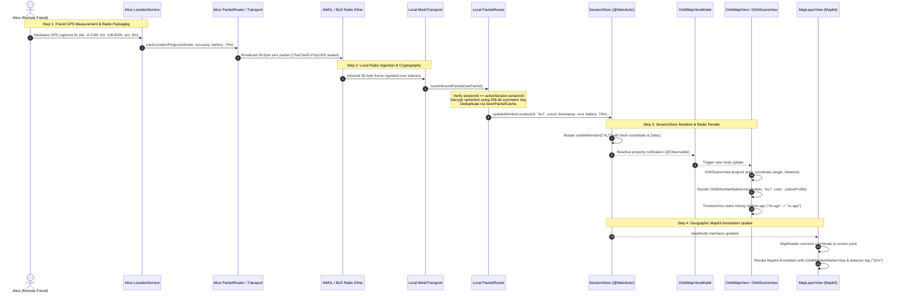

# Volume 09: Feature Map, Orbit Canvas & Geographic Overlays (Meepo)

## Executive Summary & Big-Picture Overview

Volume 09 details the spatial awareness, real-time geographic overlays, interactive Orbit radar canvas, member roster inspection, MapKit rendezvous point coordinate negotiation, and diagnostic network settings subsystem of the Meepo mesh networking platform. Designed for off-grid disaster zones and remote wilderness expeditions—where commercial cellular towers, municipal power, and traditional web-based map tiles have failed completely—the map subsystem presents two distinct, complementary spatial models to rescue workers and survivors:

1. **The Relative Orbit Radar Canvas (`OrbitMapView`, `OrbitSceneView`, `OrbitUserMarkerView`, `OrbitMemberMarkerView`):** An AMOLED true-black relative compass radar that maps friends as angular coordinate vectors relative to the user's current physical position and heading. Instead of requiring heavy vector tile downloads over cellular networks, the Orbit radar projects peers onto concentric distance rings using locally received peer-to-peer radio location pings.
2. **The Geographic MapKit Overlay (`MainMapView`, `MapLayerView`, `MapPointPinView`):** A standard Apple MapKit interface configured for emergency group rendezvous coordination. It allows group creators and members to propose, review, and confirm physical meeting points (e.g., "Gate 2" or "Sound Booth") via long-press map interactions, providing geographic context and offline cached satellite imagery when available.

Operating without cloud servers or base station infrastructure requires strict hardware and battery discipline:
- **AMOLED True-Black Power Conservation:** The foundational canvas is rendered in `#000000`, turning off OLED pixels and reducing display power consumption by up to 60%.
- **Honest Pin Degradation:** Rather than interpolating or fabricating coordinates when peer radios walk out of range, pins degrade honestly across verified time thresholds: fresh (<60s), stale (1–5m), and contact lost (>5m).
- **Sub-Second Independent Timeline Ticking:** Relative age labels (`"25s ago"`, `"2m ago"`) are driven by localized SwiftUI `TimelineView` containers, isolating 1-second UI updates from the map canvas render loop.
- **Stationary 0.7s Long-Press Protection:** Dropping rendezvous pins requires a continuous 0.7-second hold with haptic feedback, preventing panning gestures from accidentally displacing meeting points.

---

### ELI5 Overview: The Tactical Search Radar & The Triage Rally Point

Imagine an urban search-and-rescue squad navigating a blacked-out, dust-choked disaster zone where buildings have collapsed and cellular infrastructure is dead:

1. **The AMOLED Night-Vision Radar (The Orbit Screen):** When you look at your phone, the display is completely pitch-black like tactical night-vision goggles (`AMOLED #000000`) to protect night-adapted vision and save power. In the center is a glowing dot with a directional heading cone showing your orientation (`OrbitUserMarkerView`). Positioned on concentric range rings (15m, 30m, 45m, 60m) are color-coded callsign dots representing your squad members.
2. **The Honest Watch (Pin Staleness & Fading):** Below Alice's callsign marker is an elapsed-time label: *"12s ago"*. As long as her device transmits radio telemetry, her marker glows brightly. If Alice enters a collapsed concrete basement and her signal fades, her marker does not vanish, nor does your phone fabricate a ghost trail. Her marker gently fades to 70% opacity, and the timer ticks: *"2m ago"*, *"4m ago"*. If 5 minutes pass without a signal, an alert informs you: *"Lost radio contact with ALI"*. The system never displays fabricated positions.
3. **The Triage Rally Flag (The Rendezvous Map):** When an Incident Commander designates an emergency rally point or field hospital, they tap the satellite map button (`MainMapView`). Long-pressing on an open helicopter landing zone for almost a second triggers a firm haptic tap. A high-contrast amber waypoint flag appears labeled *"Evac LZ Alpha"*. A confirmation prompt appears across team devices: *"Rendezvous Set by DAF! Confirm attendance?"*. Tapping *"Confirm"* anchors the golden waypoint on everyone's tactical radar canvas.

---

## Design and UX Guide (Zero Code Required)

Meepo's map and radar experience balances immediate visual legibility in bright sunlight with strict battery conservation. The following design rules guide all spatial and overlay presentations:

### User Journey and Screen States

```
+-------------------------------------------------------------------------------+
|                            MAP & RADAR USER JOURNEY                           |
+-------------------------------------------------------------------------------+
|                                                                               |
|  [Orbit Radar Canvas] ----> [Target Friend] ------> [Friend Finder Radar]     |
|  True-Black AMOLED          Expands Vision Cone     Directional Compass       |
|                                                                               |
|            |                                              |                   |
|            v                                              v                   |
|                                                                               |
|  [Swipe Up Handle] -------> [Friend List Sheet] --> [Member Contact Loss]     |
|  Crest Handle (176pt)       Initials Search Grid    "Lost contact with NIC"   |
|                                                                               |
|            |                                                                  |
|            v                                                                  |
|                                                                               |
|  [Tap Map Icon] ----------> [MapKit Meeting Map] -> [Hold 0.7s to Drop Pin]   |
|  Top Header Button          Satellite / Hybrid      Golden Rally Flag         |
|                                                                               |
+-------------------------------------------------------------------------------+
```

The user interacts with the map subsystem across five primary operational screen states:

1. **State 1: The Relative Orbit Canvas (Default Experience):**
   - **Visual Appearance:** The entire background is rendered in true black (`#000000`), completely deactivating organic display pixels on iPhone OLED screens.
   - **Center User Reticle:** A 30-point circular disc in the user's personal identity color, overlaid with a directional compass arrow that rotates smoothly to match device orientation.
   - **Peer Pin Ring:** Friends are positioned polar-radially on concentric distance rings (e.g., 25m, 50m, 100m). Pins render each friend's initials, identity color, and an optional pulse bloom.
   - **Target Lock:** Tapping any friend or rendezvous pin locks targeting. The user's heading cone expands from 90 points to 120 points, visually orienting the user along the direct bearing line.

2. **State 2: Live Sharing ON vs. OFF ("Ghost Mode"):**
   - **Live Sharing = ON:** The local user broadcasts location pings every 5 to 60 seconds (governed by adaptive speed and battery state, Volume 06). Group friends see the user's pin move smoothly across their screens.
   - **Live Sharing = OFF ("Ghost Mode"):** Configurable in `OrbitSettingsView`. When toggled OFF, the user's device stops transmitting outbound location pings. However, the radio **continues listening for incoming pings from friends**. The user can still see all group members on their radar, while appearing as a fading or offline pin on their friends' screens.
   - **Emergency Override:** If the user triggers Emergency SOS, Live Sharing is **instantly bypassed**; the freshest GPS fix is broadcast immediately to rescue friends.

3. **State 3: Fresh vs. Stale vs. Offline Pins ("Honest Pin Degradation"):**
   - **Fresh (< 60s):** Full 100% opacity, bright vibrant identity stroke (`MemberColor.swiftUIColor`), live seconds timer (`"14s ago"`).
   - **Stale (1m to 5m):** Opacity drops to 70%, relative timer shifts to minutes (`"2m ago"`, `"4m ago"`), warning users that the friend may have moved since the last packet was received.
   - **Contact Lost / Offline (> 5m):** If no packet arrives for 5 minutes, the pin is greyed out. A system notification pill appears at the top of the radar: `"Lost contact with [INITIALS]"`, and a timestamped event is recorded in the group activity log.

4. **State 4: The Sliding Friend Roster Sheet:**
   - **Handle Interaction:** Tapping or swiping upward on the bottom crest handle (`OrbitPanelShape`) slides up the crew roster (`FriendListSheet`).
   - **Initials Search & Add Friend:** Includes a live search bar that matches typed initials (e.g., `"DA"` matches `"DAF"`) and a shortcut button to display the camp's pairing QR code.
   - **Member Badges:** Displays an adaptive grid of 60-point circular avatars. Tapping any avatar closes the sheet and centers the radar on that friend.

5. **State 5: The MapKit Meeting Point Overlay:**
   - **Navigation:** Tapping the map button in the top navigation bar opens the full-screen geographic map (`MainMapView`).
   - **Map Layers:** Supports both standard 2D vector street maps and high-resolution aerial satellite imagery (`.hybrid(elevation: .flat)`).
   - **Dropping Pins:** Pressing and holding stationary on any landmark for 0.7 seconds drops a golden meeting point pin (`MapPointPinView`), prompting group members to RSVP.

---

### Why Can't We Just...? (Constraints for Designers)

Product designers and UI researchers frequently suggest familiar consumer map behaviors. The following table explains why these patterns are strictly prohibited by off-grid mesh systems engineering:

| "Why Can't We Just...?" | Technical & Platform Reality | Permitted Design Behavior |
| :--- | :--- | :--- |
| **Why can't we interpolate or animate friends walking smoothly between pings?** | Radio pings in a chaotic disaster sector arrive irregularly (every 5 to 60 seconds) due to structural attenuation. Fabricating smooth walking paths creates "ghost trails" where a responder might navigate toward an interpolated position only to walk into a collapsed wall or deep sinkhole. In an emergency, false location estimates can be fatal. | Keep pins pinned strictly at the last physically verified GPS coordinate. Fade pin opacity to 70% after 60 seconds and display honest relative age labels (`"2m ago"`). |
| **Why can't we use a stylish dark-grey background (`#1C1C1E`) instead of pitch black (`#000000`)?** | Modern iPhones feature Super Retina OLED displays where individual pixels emit their own light. Dark grey pixels still draw significant battery power. Pitch black (`#000000`) physically turns off the organic LEDs, cutting screen power consumption by up to 60% in high-brightness outdoor sunlight. | Render foundational backgrounds strictly in `#000000` (`Color.black.ignoresSafeArea()`). Use subtle grey cards (`Color.blackCard`) only for interactive floating controls. |
| **Why can't a single tap drop a meeting point on the map?** | Outdoor rescue workers and survivors pan, pinch, and zoom maps with sweaty or wet fingers while walking through crowds. Single-tap pin placement results in dozens of accidental rendezvous point displacements, spamming group radios with unneeded update packets. | Require a continuous 0.7-second stationary hold (`LongPressGesture(minimumDuration: 0.7)`) accompanied by a medium haptic pulse before dropping a candidate pin. |
| **Why can't Live Sharing = OFF completely shut down all GPS and radio services?** | If turning off location sharing killed radio listening, the user would lose the ability to see their friends or receive emergency SOS alerts. Furthermore, shutting down GPS warm-starts prevents rapid location capture if an emergency strikes. | "Ghost Mode" stops outbound location pings while keeping inbound radio reception and background GPS caches warm. Emergency SOS immediately overrides Ghost Mode. |

---

### Editable Design Tokens vs. Locked Engineering Rules

To maintain the architectural integrity of the mesh network while providing product designers with visual flexibility, parameters are strictly classified into editable tokens and locked engineering rules:

```
+-------------------------------------------------------------------------------+
|                       DESIGN TOKENS VS. ENGINEERING RULES                     |
+-------------------------------------------------------------------------------+
|  EDITABLE DESIGN TOKENS (Safe to Tweak)                                       |
|  - Member Profile Initials Color Palette (MemberColor.swiftUIColor)           |
|  - Custom Crest Curve Parameters (OrbitPanelShape radius, crestHeight/Width)  |
|  - Meeting Point Pin Icon & Tint Color (MapPointPinView Color.buttonPrimary)  |
|  - Floating Action Button Sizes (48x48pt circular glass capsules)             |
|  - Top Header Title Typography (20pt bold Helvetica)                          |
+-------------------------------------------------------------------------------+
|  LOCKED ENGINEERING RULES (Do Not Touch Without System Architect Sign-Off)     |
|  - AMOLED True-Black Background Requirement (Color.black.ignoresSafeArea())   |
|  - 60s Stale & 5-Minute Contact Loss Thresholds (Honest Pin Degradation)      |
|  - 0.7-Second Stationary Long-Press Threshold for MapKit Pin Placement         |
|  - Sub-Second TimelineView Isolation (Zero global view invalidations)         |
|  - Unconditional Emergency SOS Override of Live Sharing Privacy Toggles       |
|  - Mutual Exclusivity of Modal Sheets via OrbitModal Enum                     |
+-------------------------------------------------------------------------------+
```

---

## Technical Engineering Deep-Dive

This section provides a comprehensive, code-level architectural analysis of Volume 09. It begins with a step-by-step end-to-end trace, presents the verified source file inventory, details the core spatial state machine and protocol diagrams, and walks through every source file in detail.

---

### End-to-End Flow: From Friend Radio Ping to Map Pin & Vision Cone

The following sequence diagram and walkthrough trace the complete technical lifecycle of a location update: from physical GPS satellite measurement on a friend's phone, across the radio mesh, to visual rendering on the local user's Orbit radar and geographic MapKit layer.



---

### Included Source Files

The following 16 Swift source files constitute the complete implementation of Volume 09:

| # | Repo-Relative File Link | Exact Line Count (`wc -l`) | Target / Category | Architectural Purpose & Responsibility |
| :-: | :--- | :-: | :--- | :--- |
| 1 | [`OrbitModal.swift`](../../Teekum/Teekum/Features/OrbitMap/Models/Enums/OrbitModal.swift) | 16 | Main App / Model | Modal presentation state enum for the Orbit screen (friends, mapPoint, settings, invite, finder). |
| 2 | [`FriendListViewModel.swift`](../../Teekum/Teekum/Features/OrbitMap/ViewModels/FriendListViewModel.swift) | 40 | Main App / ViewModel | Observable ViewModel managing the group roster, search filtering, and relative location age formatting. |
| 3 | [`OrbitMapViewModel.swift`](../../Teekum/Teekum/Features/OrbitMap/ViewModels/OrbitMapViewModel.swift) | 34 | Main App / ViewModel | Observable ViewModel driving Orbit screen title, identity profile color resolution, and teardown delegation. |
| 4 | [`FriendListMemberView.swift`](../../Teekum/Teekum/Features/OrbitMap/Views/Components/FriendListMemberView.swift) | 95 | Main App / View | Roster row component displaying peer initials, identity color, emergency pulsing, and isolated TimelineView age. |
| 5 | [`OrbitControlsView.swift`](../../Teekum/Teekum/Features/OrbitMap/Views/Components/OrbitControlsView.swift) | 99 | Main App / View | Floating bottom controls dock featuring SOS swipe trigger, crest drag handle, and glass chat button with badge. |
| 6 | [`OrbitHeaderView.swift`](../../Teekum/Teekum/Features/OrbitMap/Views/Components/OrbitHeaderView.swift) | 51 | Main App / View | Top navigation bar presenting group session name, settings gear shortcut, and rendezvous map button. |
| 7 | [`OrbitMarkerMemberView.swift`](../../Teekum/Teekum/Features/OrbitMap/Views/Components/OrbitMarkerMemberView.swift) | 82 | Main App / View | Canvas pin rendering a friend's color, bloom shadow, initials tooltip, and low-battery percentage badge. |
| 8 | [`OrbitPanelShape.swift`](../../Teekum/Teekum/Features/OrbitMap/Views/Components/OrbitPanelShape.swift) | 106 | Main App / Shape | Custom mathematical 2D vector Shape drawing rounded disaster area backdrop panels with a central cubic Bezier crest. |
| 9 | [`OrbitUserMarkerView.swift`](../../Teekum/Teekum/Features/OrbitMap/Views/Components/OrbitUserMarkerView.swift) | 62 | Main App / View | Local user location marker on the Orbit canvas rendering dynamic compass heading vision cone and "YOU" badge. |
| 10 | [`FriendListSheet.swift`](../../Teekum/Teekum/Features/OrbitMap/Views/FriendListSheet.swift) | 194 | Main App / View | Modal bottom sheet displaying the adaptive member avatar grid, initials search bar, and Leave Group action. |
| 11 | [`OrbitFeedbackView.swift`](../../Teekum/Teekum/Features/OrbitMap/Views/OrbitFeedbackView.swift) | 80 | Main App / View | Floating notification banner stack presenting incoming SOS alerts, Man Down warnings, and chat toasts. |
| 12 | [`OrbitMapView.swift`](../../Teekum/Teekum/Features/OrbitMap/Views/OrbitMapView.swift) | 294 | Main App / View | Primary disaster area container view hosting the true-black canvas, radar scene, header, floating controls, and modals. |
| 13 | [`OrbitSettingsView.swift`](../../Teekum/Teekum/Features/OrbitMap/Views/OrbitSettingsView.swift) | 214 | Main App / View | Diagnostic cockpit sheet displaying Live Sharing toggles, relay modes, contact loss history, and live packet log. |
| 14 | [`MainMapView.swift`](../../Teekum/Teekum/Features/MeetingPoint/Views/MainMapView.swift) | 105 | Main App / View | Full-screen MapKit sheet hosting rendezvous placement, review alerts, stop confirmation, and member RSVP dialogs. |
| 15 | [`MapLayerView.swift`](../../Teekum/Teekum/Features/MeetingPoint/Views/Components/MapLayerView.swift) | 197 | Main App / View | MapKit layer rendering responder pins, distance tags, satellite toggles, and 0.7s stationary hold pin drops. |
| 16 | [`MapPointPinView.swift`](../../Teekum/Teekum/Features/MeetingPoint/Views/Components/MapPointPinView.swift) | 51 | Main App / View | Custom MapKit annotation pin rendering rendezvous location markers with golden title capsules and ground anchor. |
| **Total** | **All Volume 09 Files** | **1,720** | **16 Swift Source Files** | **100% Comprehensive Coverage** |

---

### Map State & Spatial Rendering Diagrams

#### 1. Dual Spatial Presentation Architecture
The diagram below details the cooperative division of labor between the relative Orbit radar and geographic MapKit mapping engines:

```
+---------------------------------------------------------------------------------------+
|                       DUAL SPATIAL PRESENTATION ARCHITECTURE                          |
+-------------------------------------------+-------------------------------------------+
|  RELATIVE ORBIT RADAR (OrbitMapView)       |  GEOGRAPHIC MAPKIT (MainMapView)          |
+-------------------------------------------+-------------------------------------------+
| - AMOLED #000000 True-Black Power Canvas  | - iOS 17 MapKit (Map + MapReader)         |
| - Polar Coordinate Distance Rings         | - Standard 2D Flat & Satellite Hybrid     |
| - Zero Map Tile Cellular Network Overhead | - Geographic Real-World Latitude/Longitude|
| - Dynamic Heading Vision Cones (CoreMotion)| - Great-Circle Distance Labels (e.g. 48m) |
| - High-Frequency Peer Tracking (Offline)  | - Long-Press 0.7s Rendezvous Pin Drop     |
+-------------------------------------------+-------------------------------------------+
                     |                                           |
                     +---------------------+---------------------+
                                           v
                       +---------------------------------------+
                       | SessionStore (@MainActor / Singleton) |
                       | - visibleMembers: [Member]            |
                       | - activeMeetingPoint: MeetingPoint?   |
                       | - memberContactLog: [ContactLoss]     |
                       +---------------------------------------+
```

#### 2. Modal Presentation State Machine
The state diagram below details how the `OrbitModal` enum strictly governs screen overlays:

```
+---------------------------------------------------------------------------------------+
|                    ORBIT MODAL PRESENTATION STATE MACHINE                             |
+---------------------------------------------------------------------------------------+
|                                                                                       |
|                               +------------------+                                    |
|                               |  activeModal =   |                                    |
|                               |       nil        | <---+                              |
|                               +--------+---------+     |                              |
|                                        |               |                              |
|         +-----------------+------------+-----------+---+----------------+             |
|         |                 |                        |                    |             |
|         v                 v                        v                    v             |
|   +-----------+     +-----------+            +-----------+        +-----------+       |
|   |  .friends |     | .mapPoint |            | .settings |        |  .invite  |       |
|   | (Roster   |     | (MapKit   |            | (Relay &  |        | (Camp QR  |       |
|   |  Sheet)   |     |  Sheet)   |            |  Packets) |        |   Code)   |       |
|   +-----+-----+     +-----+-----+            +-----+-----+        +-----+-----+       |
|         |                 |                        |                    |             |
|         +-----------------+------------+-----------+--------------------+             |
|                                        v                                              |
|                               +------------------+                                    |
|                               |   .finder(id)    |                                    |
|                               | (Compass Radar)  |                                    |
|                               +------------------+                                    |
|                                                                                       |
+---------------------------------------------------------------------------------------+
```

---

## Dedicated File-by-File Deep-Dives (Zero Skipped Files)

### 1. `Teekum/Teekum/Features/OrbitMap/Models/Enums/OrbitModal.swift`
- **File Path**: [`../../Teekum/Teekum/Features/OrbitMap/Models/Enums/OrbitModal.swift`](../../Teekum/Teekum/Features/OrbitMap/Models/Enums/OrbitModal.swift)
- **Line Count**: 16 lines (`wc -l`)
- **Concurrency & Target Domain**: Main App Target (`Teekum`), `enum OrbitModal: Identifiable, Hashable`

#### What This File Does
`OrbitModal.swift` defines the unified modal presentation state machine for the main Orbit disaster area map screen. It models the five mutually exclusive sheet and full-screen destinations that can be presented over the live radar canvas: the friend roster sheet (`.friends`), the MapKit meeting point picker (`.mapPoint`), the system settings and diagnostic cockpit (`.settings`), the group QR code invite sheet (`.invite`), and the directional compass friend finder (`.finder(String)`).

#### ELI5 Analogy
Imagine the main operations console on a search-and-rescue vehicle. The operator has five tactical pop-up panels: one opens the squad roster (`friends`), one opens the satellite evacuation and triage map (`mapPoint`), one opens communications diagnostics (`settings`), one opens squad deployment credentials (`invite`), and one opens a high-precision directional radar locked onto a specific missing operative (`finder`). Only one panel can be active at a time to prevent obscuring the tactical map. `OrbitModal` is that 5-panel selection switch.

#### Technical Terms Defined
- **Identifiable Modal State**: Conforming to `Identifiable` with `var id: Self { self }` enables seamless integration with SwiftUI's `.sheet(item:)` and `.fullScreenCover(item:)` modifiers, guaranteeing that modal transitions are driven deterministically by state rather than multiple disjoint Booleans.
- **Associated Value Navigation (`.finder(String)`)**: Storing contextual target identifiers (the friend's member ID) directly inside the enum case, ensuring deep-linking directly into targeted views without global state leaks.
- **Mutually Exclusive Presentation**: Restricting UI overlays to a single active case, preventing memory spikes and rendering conflicts from stacked translucent sheets over high-frequency radar loops.

#### Code-Block and Line-by-Line Walkthrough
The complete 16-line file is structured as follows:
```swift
// Lines 1-16: Complete OrbitModal definition
//
//  OrbitModal.swift
//  Teekum
//
//  Created by DIMAS DAFFA ERNANDA on 08/11/26.
//

enum OrbitModal: Identifiable, Hashable {
    case friends
    case mapPoint
    case settings
    case invite
    case finder(String)

    var id: Self { self }
}
```
- Line 8: Declares `OrbitModal` conforming to `Identifiable` and `Hashable`.
- Line 9 (`friends`): Presents `FriendListSheet`, displaying the member roster, contact loss history, and search bar.
- Line 10 (`mapPoint`): Presents `MainMapView`, the full-screen MapKit layer for rendezvous point placement.
- Line 11 (`settings`): Presents `OrbitSettingsView`, the diagnostic sheet containing Live Sharing toggles, relay modes, and packet logs.
- Line 12 (`invite`): Presents `GroupQRCodeView`, allowing nearby disaster area friends to scan the group's QR code.
- Line 13 (`finder(String)`): Carries the target friend's ID string, presenting the full-screen `FriendFinderView` compass radar.
- Line 15 (`var id: Self { self }`): Satisfies `Identifiable` protocol requirements by returning itself, enabling SwiftUI to identify modal changes uniquely.

#### Engineering Rationale and Edge Cases
- **Elimination of Boolean State Explosions**: In earlier prototypes, each modal was tracked via independent Booleans (`@State var showFriends = false`, `@State var showSettings = false`). This frequently led to presentation race conditions where dismissing one modal while opening another caused iOS UIKit presentation crashes. An enum guarantees that exactly zero or one modal is presented.
- **Deep Link Routing**: In `OrbitMapView.swift`, deep links arriving from Lock Screen widgets or push alerts (e.g., `teekum://sos?id=NIC`) directly set `activeModal = .finder("NIC")` or `activeModal = .mapPoint`, routing the user in a single atomic assignment.

---

### 2. `Teekum/Teekum/Features/OrbitMap/ViewModels/FriendListViewModel.swift`
- **File Path**: [`../../Teekum/Teekum/Features/OrbitMap/ViewModels/FriendListViewModel.swift`](../../Teekum/Teekum/Features/OrbitMap/ViewModels/FriendListViewModel.swift)
- **Line Count**: 40 lines (`wc -l`)
- **Concurrency & Target Domain**: Main App Target (`Teekum`), `@MainActor @Observable final class FriendListViewModel`

#### What This File Does
`FriendListViewModel.swift` manages the presentation and search filtering state for the disaster area group member roster sheet (`FriendListSheet`). It binds directly to `SessionStore` to extract visible group members, applies case-insensitive initials filtering against user search input, and provides a centralized, crash-resilient static formatter for calculating human-readable location age strings (`"14s ago"`, `"3m ago"`).

#### ELI5 Analogy
Imagine the search squad logistics officer holding an active tactical roster board. When the squad leader asks, "What is the status of Medic Nic?", the roster filters to callsign "NIC", showing distance, battery reserves, and last-seen timestamp ("Saw beacon 20s ago"). If a GPS fix is stale or corrupted, it displays "Unavailable" rather than misleading the search team with fabricated estimates. `FriendListViewModel` is that tactical roster manager.

#### Technical Terms Defined
- **Observation Framework (`@Observable`)**: Swift 5.9+ observation macro that registers property reads during SwiftUI view evaluation, triggering view updates only when accessed properties (`searchQuery`, `filteredMembers`) mutate.
- **Case-Insensitive Substring Filtering (`localizedCaseInsensitiveContains`)**: Matching user search queries against member initials regardless of uppercase or lowercase keyboard input (e.g., typing `"da"` matches `"DAF"`).
- **Time Interval Guarding (`age.isFinite, age >= 0, age < Double(Int.max)`)**: Defensive mathematical checks protecting against NaN, infinite, negative (clock-skewed), or overflow timestamps before casting to integer seconds.

#### Code-Block and Line-by-Line Walkthrough
Lines 11–26 declare the class, observable properties, and filtered members computation:
```swift
// Lines 11-26: FriendListViewModel declaration and search filtering
@MainActor
@Observable
final class FriendListViewModel {
    private let sessionStore: SessionStore
    var searchQuery = ""

    var filteredMembers: [Member] {
        let search = searchQuery.trimmingCharacters(in: .whitespacesAndNewlines)
        let members = sessionStore.visibleMembers
        return search.isEmpty ? members : members.filter {
            $0.initials.localizedCaseInsensitiveContains(search)
        }
    }

    init(sessionStore: SessionStore) {
        self.sessionStore = sessionStore
    }
```
- Line 11: `@MainActor` isolation guarantees that search input mutations and member list recalculations happen exclusively on the main UI thread.
- Line 15: `var searchQuery = ""` stores the live text entered in the search bar.
- Lines 17–22: `filteredMembers` trims whitespace and performs a case-insensitive check against `member.initials`. If the query is empty, returns all `visibleMembers`.

Lines 28–39 implement the robust relative age formatting logic:
```swift
// Lines 28-39: Location age calculation and formatting
    static func locationAgeLabel(from date: Date, relativeTo now: Date) -> LocalizedStringResource {
        let age = now.timeIntervalSince(date)
        guard age.isFinite, age >= 0, age < Double(Int.max) else {
            return "Unavailable"
        }

        if age < 60 {
            return "\(Int(age))s ago"
        }
        return "\(Int(age / 60))m ago"
    }
}
```
- Lines 28–32: Calculates `age = now.timeIntervalSince(date)`. The `guard` statement validates that `age` is finite, non-negative, and fits within integer bounds; otherwise, it returns `"Unavailable"`.
- Lines 34–37: Formats timestamps younger than 60 seconds as `X s ago` (e.g., `"14s ago"`) and older timestamps as `X m ago` (e.g., `"3m ago"`).

#### Engineering Rationale and Edge Cases
- **Clock Skew Defense in Multi-Hop P2P**: In an off-grid mesh, device system clocks are uncoordinated and can differ by several seconds. If a friend's device has a clock set 5 seconds in the future, `now.timeIntervalSince(date)` yields a negative number (`-5.0`). The `guard age >= 0` check catches this anomaly and displays `"Unavailable"` rather than nonsensical labels like `"-5s ago"`.
- **Stateless Formatter Design**: By implementing `locationAgeLabel` as a pure static function, it can be invoked safely inside `TimelineView` closures without capturing view model reference cycles or causing re-entrancy issues.

---

### 3. `Teekum/Teekum/Features/OrbitMap/ViewModels/OrbitMapViewModel.swift`
- **File Path**: [`../../Teekum/Teekum/Features/OrbitMap/ViewModels/OrbitMapViewModel.swift`](../../Teekum/Teekum/Features/OrbitMap/ViewModels/OrbitMapViewModel.swift)
- **Line Count**: 34 lines (`wc -l`)
- **Concurrency & Target Domain**: Main App Target (`Teekum`), `@MainActor @Observable final class OrbitMapViewModel`

#### What This File Does
`OrbitMapViewModel.swift` is the presentation view model driving the primary Orbit disaster area map screen (`OrbitMapView`). It provides access to the active group session name, resolves the local user's distinctive profile identity color from `SessionStore`, and manages the group teardown workflow when a user chooses to leave the group.

#### ELI5 Analogy
Imagine the tactical mission identification card for your search-and-rescue squad. It displays the operational squad designation (e.g., "Sector 4 SAR") and your personalized tactical callsign color so you know how your marker is rendered on squad maps. It also features a mission demobilization button: tapping it cleanly resets your deployment session, wipes local cryptographic keys from the Keychain, and returns the device to the standby pairing screen. `OrbitMapViewModel` is that tactical identification card.

#### Technical Terms Defined
- **Profile Color Resolution**: Extracting a deterministic member color (`MemberColor`) based on the user's local initials from the active cryptographic session.
- **Fallback Visual Defaults**: Providing safe fallback tokens (e.g., `"Group Name"` and `.sandrift`) when no active session is loaded, preventing SwiftUI canvas preview crashes.
- **Teardown Callback Delegation (`onLeaveGroup`)**: Decoupling the view model from the underlying application coordinator by accepting an optional closure that executes session resets and navigation pops.

#### Code-Block and Line-by-Line Walkthrough
The complete 34-line file is structured as follows:
```swift
// Lines 1-34: Complete OrbitMapViewModel declaration
import Foundation
import Observation

@MainActor
@Observable
final class OrbitMapViewModel {
    let sessionStore: SessionStore
    private let onLeaveGroup: () -> Void

    var groupName: String {
        sessionStore.activeSession?.sessionName ?? "Group Name"
    }

    var localProfileColor: MemberColor {
        guard let session = sessionStore.activeSession else { return .sandrift }
        return sessionStore.profileColor(for: session.localInitials)
    }

    init(sessionStore: SessionStore, onLeaveGroup: (() -> Void)? = nil) {
        self.sessionStore = sessionStore
        self.onLeaveGroup = onLeaveGroup ?? sessionStore.resetSessionState
    }

    func leaveGroup() {
        onLeaveGroup()
    }
}
```
- Line 7: `@MainActor @Observable final class OrbitMapViewModel` marks the class as observable and main-thread confined.
- Line 8: `let sessionStore: SessionStore` stores the injected session store dependency.
- Line 9: `private let onLeaveGroup: () -> Void` stores the teardown closure.
- Lines 11–13 (`groupName`): Returns the active session's name, or `"Group Name"` if nil.
- Lines 15–18 (`localProfileColor`): Queries `sessionStore.profileColor(for: session.localInitials)`, falling back to `.sandrift` if unconfigured.
- Lines 20–23 (`init`): Initializes dependencies, defaulting `onLeaveGroup` to `sessionStore.resetSessionState` if none is supplied.
- Lines 25–27 (`leaveGroup`): Public trigger invoking `onLeaveGroup()`.

#### Engineering Rationale and Edge Cases
- **Strict Separation of Concerns**: `OrbitMapViewModel` intentionally avoids managing location updates, compass headings, or Bluetooth connections directly. Those responsibilities belong to `LocationService` (Volume 06) and `MeshTransport` (Volume 03). Keeping this view model ultra-lightweight (34 lines) prevents view re-render cascades on high-frequency compass updates.
- **Preview Stability**: Defaulting `localProfileColor` to `.sandrift` ensures that SwiftUI previews in Xcode canvas can render `OrbitMapView` without establishing live cryptographic sessions.

---

### 4. `Teekum/Teekum/Features/OrbitMap/Views/Components/FriendListMemberView.swift`
- **File Path**: [`../../Teekum/Teekum/Features/OrbitMap/Views/Components/FriendListMemberView.swift`](../../Teekum/Teekum/Features/OrbitMap/Views/Components/FriendListMemberView.swift)
- **Line Count**: 95 lines (`wc -l`)
- **Concurrency & Target Domain**: Main App Target (`Teekum`), `struct FriendListMemberView: View`, `@MainActor`

#### What This File Does
`FriendListMemberView.swift` renders individual member avatar cells within the disaster area group roster grid (`FriendListSheet`). It displays the member's sanitized initials in bold typography encased within a colored circular identity ring, executes animated red pulsating glow phases during active emergency distress events, and leverages SwiftUI `TimelineView` to tick location age relative timestamps (`"25s ago"`, `"2m ago"`) every second without re-rendering parent sheets.

#### ELI5 Analogy
Imagine a circular name tag worn by each of your disaster area friends. Under normal conditions, the tag has their initials printed in the center and is outlined with their assigned camp color. If your friend gets lost or hurt and presses SOS, their name tag begins flashing bright red like a miniature emergency beacon. Below the tag, a tiny digital clock counts up the seconds since their phone last checked in with your camp. `FriendListMemberView` is that name tag.

#### Technical Terms Defined
- **Sub-Second Independent Timeline Ticking (`TimelineView(.periodic)`)**: A specialized SwiftUI container that re-evaluates strictly its own child closure at 1-second intervals based on a periodic schedule, completely isolating high-frequency timestamp updates from the rest of the view hierarchy.
- **Dynamic Type Scaling (`@ScaledMetric`)**: Automatically scaling UI dimensions (such as the 60-point avatar diameter) in response to the user's iOS accessibility Dynamic Type text size settings.
- **Accessible Motion Sensitivity (`@Environment(\.accessibilityReduceMotion)`)**: Inspecting system accessibility settings to replace continuous phase-animated opacity pulsations with static high-visibility emergency borders when users have motion sensitivity enabled.

#### Code-Block and Line-by-Line Walkthrough
Lines 10–61 construct the avatar, emergency animation, and periodic timeline label:
```swift
// Lines 10-44: FriendListMemberView declaration and avatar styling
struct FriendListMemberView: View {
    let member: Member
    let color: Color
    @Environment(\.accessibilityReduceMotion) private var reduceMotion

    @ScaledMetric(relativeTo: .title2)
    private var avatarSize = 60

    var body: some View {
        VStack(spacing: 4) {
            Text(member.initials)
                .font(.custom("Helvetica-Bold", size: 22, relativeTo: .title2))
                .foregroundStyle(.white)
                .lineLimit(1)
                .minimumScaleFactor(0.6)
                .frame(width: avatarSize, height: avatarSize)
                .background {
                    if member.isEmergency {
                        if reduceMotion {
                            emergencyAvatar
                        } else {
                            emergencyAvatar.phaseAnimator([1.0, 0.55]) { avatar, opacity in
                                avatar.opacity(opacity)
                            } animation: { _ in .easeInOut(duration: 0.8) }
                        }
                    } else {
                        Circle().strokeBorder(color, lineWidth: 1)
                    }
                }
                .accessibilityValue(member.isEmergency ? Text("SOS active") : Text(""))
```
- Lines 18–25: Renders 22pt bold initials in white, scaled to `avatarSize` (60pt).
- Lines 26–39: If `member.isEmergency`, checks `reduceMotion`. If false, uses `phaseAnimator` to pulse opacity between 1.0 and 0.55 every 0.8 seconds (`.easeInOut(duration: 0.8)`). Under normal conditions, draws a clean 1pt colored circular stroke.

Lines 42–60 embed the live `TimelineView`:
```swift
// Lines 42-60: High-efficiency TimelineView for location age
            if let date = member.measurementTimestamp {
                TimelineView(.periodic(from: date, by: 1)) { timeline in
                    let label = FriendListViewModel.locationAgeLabel(from: date, relativeTo: timeline.date)

                    Text(label)
                        .font(.caption2)
                        .foregroundStyle(.white)
                        .accessibilityLabel("Location age")
                        .accessibilityValue(Text(label))
                }
            }
        }
        .frame(maxWidth: .infinity)
        .accessibilityElement(children: .combine)
    }

    private var emergencyAvatar: some View {
        Circle()
            .inset(by: 3)
            .fill(Color.alertRed)
            .overlay {
                Circle().strokeBorder(Color.alertRed, lineWidth: 2)
            }
    }
}
```
- Lines 42–52: If `measurementTimestamp` exists, schedules a `TimelineView(.periodic(from: date, by: 1))`. On every second tick, invokes `FriendListViewModel.locationAgeLabel`, updating `"25s ago"` $\rightarrow$ `"26s ago"` with zero CPU overhead on parent views.
- Lines 56–61: `emergencyAvatar` fills the circle with solid `Color.alertRed` inset by 3pt, overlaid with a 2pt alert-red stroke.

#### Engineering Rationale and Edge Cases
- **Battery Optimization via Localized Invalidation**: In earlier implementations, a 1-second global timer on `FriendListViewModel` updated an `@Published var currentTime = Date()`. In a grid of 12 disaster area members, this forced the entire grid, search bar, and modal sheet to recalculate layout every second, wasting GPU and battery power. Moving the tick inside isolated `TimelineView` closures confines view redraws strictly to the tiny `Text` label.
- **Combined Accessibility Elements**: Line 54 applies `.accessibilityElement(children: .combine)`. VoiceOver reads the member initials, emergency status, and location age as a single, coherent sentence (e.g., *"NIC, SOS active, Location age 25 seconds ago"*).

---

### 5. `Teekum/Teekum/Features/OrbitMap/Views/Components/OrbitControlsView.swift`
- **File Path**: [`../../Teekum/Teekum/Features/OrbitMap/Views/Components/OrbitControlsView.swift`](../../Teekum/Teekum/Features/OrbitMap/Views/Components/OrbitControlsView.swift)
- **Line Count**: 99 lines (`wc -l`)
- **Concurrency & Target Domain**: Main App Target (`Teekum`), `struct OrbitControlsView: View`, `@MainActor`

#### What This File Does
`OrbitControlsView.swift` implements the floating bottom control bar for the primary disaster area screen. It provides a three-way horizontal control layout: on the leading edge, the deliberate upward-swipe SOS button (`SOSSwipeButtonView`); in the center, the crest-shaped sliding handle (`OrbitPanelShape`) for expanding the friend roster sheet; and on the trailing edge, the circular glass chat button featuring real-time unread message counter badges.

#### ELI5 Analogy
Imagine the steering wheel console on an off-road buggy. On the far left is the bright red emergency distress horn with a safety slide. In the dead center is an arched dashboard handle you can pull up to inspect your crew's passenger manifest. On the far right is the two-way walkie-talkie button with a small digital screen showing how many unread voice notes you have waiting. `OrbitControlsView` is that lower dashboard.

#### Technical Terms Defined
- **Layout Priority Protection (`.layoutPriority(1)`)**: Instructing SwiftUI's layout engine to allocate space to the central crest handle first, preventing edge buttons or dynamic type scaling from compressing or distorting the central interaction zone.
- **Upward Drag Gesture Thresholding**: Requiring an upward translation of at least 36 points (`upwardDistance >= 36`) and verifying that vertical translation exceeds horizontal translation, preventing diagonal pan gestures from accidentally popping open sheets.
- **Glassmorphic Button Styling (`.buttonStyle(.glass)`)**: Applying translucent blurred materials (`.glassEffect`) to circular interactive controls, preserving contrast over moving map backgrounds while minimizing screen obstruction.

#### Code-Block and Line-by-Line Walkthrough
Lines 20–35 implement the leading SOS trigger button:
```swift
// Lines 20-35: Leading edge SOS trigger
        HStack(alignment: .bottom) {
            if isSOSActive {
                Text("SOS")
                    .font(.custom("Helvetica", size: 25, relativeTo: .title2).bold())
                    .foregroundStyle(.white)
                    .frame(width: 64, height: 64)
                    .background(Color.alertRed, in: .circle)
                    .glassEffect(.regular.tint(.alertRed), in: .circle)
                    .accessibilityLabel("SOS active")
            } else {
                SOSSwipeButtonView(onSwipeCompleted: onSOS)
                    .zIndex(1)
            }
        
            Spacer()
```
- Lines 21–28: If `isSOSActive == true`, renders a glowing red 64x64 circle displaying `"SOS"`.
- Lines 29–32: Otherwise, embeds `SOSSwipeButtonView`, requiring a deliberate 64pt upward swipe to fire emergency distress.

Lines 36–68 implement the central expandable crest panel handle:
```swift
// Lines 36-68: Center expandable crest handle
            Button(action: onExpand) {
                Image(systemName: "chevron.up")
                    .font(.system(size: 30, weight: .semibold))
                    .offset(y:15)
                    .foregroundStyle(.secondary)
                    .frame(maxWidth: 176)
                    .frame(height: friendsPanelHeight)
                    .background {
                        OrbitPanelShape(
                            cornerRadius: 0,
                            crestHeight: nil,
                            crestWidth: 176
                        )
                        .fill(Color.blackCard)
                        .ignoresSafeArea(.container, edges: .bottom)
                        .allowsHitTesting(false)
                    }
                    .contentShape(.rect)
            }
            .buttonStyle(.plain)
            .layoutPriority(1)
            .accessibilityLabel("Open friends")
            .simultaneousGesture(
                DragGesture(minimumDistance: 20)
                    .onEnded { value in
                        let upwardDistance = -value.translation.height
                        if upwardDistance >= 36, upwardDistance > abs(value.translation.width) {
                            onExpand()
                        }
                    }
            )
            
            Spacer()
```
- Lines 36–54: An upward chevron (`chevron.up`) wrapped inside `OrbitPanelShape` filled with `Color.blackCard`, spanning a maximum width of 176 points.
- Lines 56–66: Assigns `.layoutPriority(1)`. Attaches a `DragGesture(minimumDistance: 20)` that fires `onExpand()` when `upwardDistance >= 36` and vertical travel dominates horizontal travel.

Lines 70–89 implement the trailing group chat button with unread badge:
```swift
// Lines 70-89: Trailing chat button with unread count badge
            Button(action: onChat) {
                Image(systemName: "message.fill")
                    .font(.system(size: 30, weight: .semibold))
            }
            .buttonStyle(.glass)
            .buttonBorderShape(.circle)
            .controlSize(.large)
            .accessibilityLabel("Open Group Chat")
            .accessibilityValue("\(unreadCount) unread messages")
            .overlay(alignment: .topTrailing) {
                if unreadCount > 0 {
                    Text("\(unreadCount)")
                        .font(.caption2.bold())
                        .padding(5)
                        .background(Color.alertRed, in: .circle)
                        .accessibilityHidden(true)
                }
            }
        }
```
- Lines 70–79: Circular glass button with `message.fill` icon.
- Lines 80–88: If `unreadCount > 0`, overlays a bold white count encased in a `Color.alertRed` circular pill on the top-trailing corner.

#### Engineering Rationale and Edge Cases
- **Simultaneous Tap and Drag Recognition**: The center handle supports both a simple tap (`Button(action: onExpand)`) and a natural physical upward flick (`DragGesture`). Using `.simultaneousGesture` ensures neither gesture blocks the other.
- **Accidental Swipe Guarding**: Line 62 checks `upwardDistance > abs(value.translation.width)`. In crowded disaster area environments, an accidental diagonal swipe across the bottom of the screen will not inadvertently pop open the friends sheet.

---

### 6. `Teekum/Teekum/Features/OrbitMap/Views/Components/OrbitHeaderView.swift`
- **File Path**: [`../../Teekum/Teekum/Features/OrbitMap/Views/Components/OrbitHeaderView.swift`](../../Teekum/Teekum/Features/OrbitMap/Views/Components/OrbitHeaderView.swift)
- **Line Count**: 51 lines (`wc -l`)
- **Concurrency & Target Domain**: Main App Target (`Teekum`), `struct OrbitHeaderView: View`, `@MainActor`

#### What This File Does
`OrbitHeaderView.swift` implements the top navigation bar of the disaster area screen. It provides quick access to system settings and network diagnostics on the leading edge (`gearshape.fill`), displays the active disaster area group name in bold centered typography, and provides a direct shortcut to the MapKit rendezvous point map on the trailing edge (`map.fill`).

#### ELI5 Analogy
Imagine the sun visor bar at the top of your car's windshield. On the left is a button to open the vehicle settings and diagnostic logs. In the middle is a proud label with your road trip team's name. On the right is a button that unfolds the large road map showing where everyone agreed to meet up. `OrbitHeaderView` is that top visor bar.

#### Technical Terms Defined
- **Top Bar Fixed Spacing (`HStack` with `Spacer()`)**: Symmetrically balancing trailing and leading action buttons around a centered, truncated title string without requiring complex frame calculations.
- **Single-Line Truncation (`.lineLimit(1)`)**: Enforcing strict single-line text constraints on user-generated group names, preventing long names from wrapping and pushing navigation buttons off-screen.
- **Glassmorphic Circular Buttons (`.buttonStyle(.glass)`, `.buttonBorderShape(.circle)`)**: Standardizing circular 44x44 minimum touch target buttons with blurred glass translucency across the entire app.

#### Code-Block and Line-by-Line Walkthrough
The complete 51-line file is structured as follows:
```swift
// Lines 10-47: Complete OrbitHeaderView declaration
struct OrbitHeaderView: View {
    let groupName: String
    let onOpenMap: () -> Void
    var onSettings: () -> Void = {}

    var body: some View {
        HStack {
            Button(action: onSettings) {
                Image(systemName: "gearshape.fill")
                    .font(.system(size: 30, weight: .semibold))
            }
            .buttonStyle(.glass)
            .buttonBorderShape(.circle)
            .controlSize(.large)
            .accessibilityLabel("Settings")
            
            Spacer()
            
            Text(groupName)
                .bold()
                .font(.custom("Helvetica", size: 20, relativeTo: .title2))
                .lineLimit(1)
            
            Spacer()
            
            Button(action: onOpenMap) {
                Image(systemName: "map.fill")
                    .font(.system(size: 30, weight: .semibold))
            }
            .buttonStyle(.glass)
            .buttonBorderShape(.circle)
            .controlSize(.large)
            .accessibilityLabel("Open meeting point map")
        }
    }
}
```
- Line 11: `let groupName: String` receives the dynamic session name.
- Lines 12–13: Callback closures for opening the map and settings sheets.
- Lines 17–26: Leading settings button with `gearshape.fill`, accessibility label `"Settings"`.
- Lines 29–32: Centered group name rendered in 20pt bold Helvetica, bounded to `lineLimit(1)`.
- Lines 36–45: Trailing map button with `map.fill`, accessibility label `"Open meeting point map"`.

#### Engineering Rationale and Edge Cases
- **Dynamic Type Bounds Protection**: Line 31 specifies `.font(.custom("Helvetica", size: 20, relativeTo: .title2))`. By tying the custom font to the `.title2` dynamic type text style, the header scales gracefully when users enlarge system fonts while `.lineLimit(1)` prevents horizontal overflow.

---

### 7. `Teekum/Teekum/Features/OrbitMap/Views/Components/OrbitMarkerMemberView.swift`
- **File Path**: [`../../Teekum/Teekum/Features/OrbitMap/Views/Components/OrbitMarkerMemberView.swift`](../../Teekum/Teekum/Features/OrbitMap/Views/Components/OrbitMarkerMemberView.swift)
- **Line Count**: 82 lines (`wc -l`)
- **Concurrency & Target Domain**: Main App Target (`Teekum`), `struct OrbitMemberMarkerView: View`, `@MainActor`

#### What This File Does
`OrbitMarkerMemberView.swift` (declared as `OrbitMemberMarkerView` in code) implements the visual pin marker representing a group friend on both the relative Orbit radar canvas and the geographic MapKit overlay. It renders the friend's assigned profile color disc, an optional Gaussian bloom shadow, an outer emergency stroke ring during active SOS events, and an anchored top tooltip containing member initials, low-battery warning badges, and downward pointer triangles.

#### ELI5 Analogy
Imagine a colored thumb-tack stuck into your disaster area map. The head of the tack is painted with your friend's personal color. If they are in trouble, a glowing red halo surrounds the tack. Above the tack is a small paper flag showing their initials (e.g., "AYU"). If their phone battery drops below 20%, a tiny lightning bolt and battery percentage appear on their flag so you know their phone is about to die. `OrbitMemberMarkerView` is that detailed thumb-tack.

#### Technical Terms Defined
- **Gaussian Bloom Shadow (`showsBloom`)**: A 10-point blur shadow matching the member's profile color at 70% opacity, visually indicating active radio packet reception.
- **Anchored Alignment Guides (`.alignmentGuide(.top)`)**: Customizing SwiftUI layout alignment guides to position the tooltip balloon exactly above the circular pin dot without manual hard-coded frame offsets.
- **Low-Battery Telemetry Tagging (`lowBatteryPercentage`)**: Displaying peer battery percentages (e.g., `"12%"`) directly on the map pin when peers drop below the 20% Survival Mode threshold.

#### Code-Block and Line-by-Line Walkthrough
Lines 10–34 declare properties and circular pin styling:
```swift
// Lines 10-34: OrbitMemberMarkerView declaration and circular dot styling
struct OrbitMemberMarkerView: View {
    let initials: String
    let color: Color
    var isSelected = false
    var isEmergency = false
    var size: CGFloat = 30
    var showsBloom = false
    var lowBatteryPercentage: String?

    private var showsPointer: Bool { isEmergency || isSelected || lowBatteryPercentage != nil }
    private var bubbleColor: Color { isEmergency ? .alertRed : (isSelected ? .buttonPrimary : .black) }
    
    var body: some View {
        Circle()
            .fill(color)
            .frame(width: size, height: size)
            .blur(radius: showsBloom ? 4 : 0)
            .shadow(color: showsBloom ? color.opacity(0.7) : .clear, radius: 10)
            .overlay {
                if isSelected || isEmergency {
                    Circle()
                        .strokeBorder(isEmergency ? Color.alertRed : Color.buttonPrimary, lineWidth: 2)
                        .padding(-4)
                }
            }
```
- Lines 19–20: `showsPointer` displays the triangular pointer if the member is selected, in emergency, or has low battery. `bubbleColor` shifts between alert red, brand yellow, and black.
- Lines 23–27: Renders a `Circle()` of diameter `size` (default 30pt), applying a 10pt Gaussian shadow if `showsBloom` is true.
- Lines 28–34: If selected or in emergency, adds an expanded 2pt outer stroke ring.

Lines 35–64 implement the top anchored tooltip:
```swift
// Lines 35-64: Top anchored tooltip with battery telemetry
            .overlay(alignment: .top) {
                VStack(spacing: -2) {
                    VStack(spacing: 1) {
                        Text(initials)
                            .font(.custom("Helvetica", size: isSelected ? 16 : 13, relativeTo: .caption))
                            .foregroundStyle(isSelected && !isEmergency ? .black : .white)
                        if let lowBatteryPercentage {
                            Label(lowBatteryPercentage, systemImage: "bolt.fill")
                                .font(.caption2.weight(.semibold))
                                .foregroundStyle(isSelected && !isEmergency ? .black : .buttonPrimary)
                        }
                    }
                    .padding(.horizontal, isSelected ? 14 : 10)
                    .padding(.vertical, isSelected ? 8 : 6)
                    .background(bubbleColor, in: .rect(cornerRadius: isSelected ? 8 : 6))
                    
                    if showsPointer {
                        Image(systemName: "triangle.fill")
                            .font(.system(size: isSelected ? 13 : 10))
                            .rotationEffect(.degrees(180))
                            .foregroundStyle(bubbleColor)
                    }
                }
                .fixedSize()
                .alignmentGuide(.top) { $0[.bottom] + (showsPointer ? 2 : 12) }
            }
            .accessibilityElement(children: .ignore)
            .accessibilityLabel("Member \(initials)")
    }
}
```
- Lines 38–46: Renders initials and optional `bolt.fill` battery label.
- Lines 51–56: Renders an inverted downward triangle (`triangle.fill` rotated 180 degrees).
- Lines 58–59: `.fixedSize()` prevents the tooltip from wrapping. `.alignmentGuide(.top)` shifts the entire tooltip above the pin circle.

#### Engineering Rationale and Edge Cases
- **Dynamic Contrast Inversion**: Notice lines 40 and 44: when `isSelected` is true and not an emergency, the tooltip background turns brand yellow (`.buttonPrimary`), and the foreground text automatically shifts to `.black`, ensuring WCAG AAA accessibility contrast.
- **Shared Geometry Across 2D & MapKit**: This exact view is reused inside `MapLayerView.swift` as a MapKit `Annotation` child view, guaranteeing visual identity parity between the polar Orbit radar and geographic MapKit maps.

---

### 8. `Teekum/Teekum/Features/OrbitMap/Views/Components/OrbitPanelShape.swift`
- **File Path**: [`../../Teekum/Teekum/Features/OrbitMap/Views/Components/OrbitPanelShape.swift`](../../Teekum/Teekum/Features/OrbitMap/Views/Components/OrbitPanelShape.swift)
- **Line Count**: 106 lines (`wc -l`)
- **Concurrency & Target Domain**: Main App Target (`Teekum`), `struct OrbitPanelShape: Shape`

#### What This File Does
`OrbitPanelShape.swift` is a custom mathematical 2D vector `Shape` that constructs Meepo's signature architectural backdrop geometry: an inverted card silhouette featuring rounded outer shoulders, vertical sidewalls, a flat baseline, and a prominent, smooth cubic Bezier "crest" arch in the center. It serves as the physical frame for the collapsed friends handle in `OrbitControlsView` and the expanded modal sheets.

#### ELI5 Analogy
Imagine cutting a custom wooden headboard for a bed. The bottom rests flat on the floor, the left and right corners are softly rounded like a capsule, and right in the middle of the top edge is a gentle, curved decorative arch (a "crest") that rises up like the dome of a emergency shelter. `OrbitPanelShape` is the mathematical blueprint that draws that exact curved headboard outline.

#### Technical Terms Defined
- **Cubic Bezier Spline Curves (`addCurve`)**: Mathematical parametric curves defined by a start point, an end point, and two off-curve control points (`control1`, `control2`), creating continuous curvature without sharp corners.
- **Quadratic Shoulder Fillets (`addQuadCurve`)**: Single control-point curves used to round the transitions between vertical sidewalls and horizontal panel shoulders.
- **Normalized Geometry Clamping**: Clamping input parameters (`cornerRadius`, `crestHeight`, `crestWidth`) against bounding rectangle dimensions to prevent shape self-intersection or path inversion on compact screens.

#### Code-Block and Line-by-Line Walkthrough
Lines 10–78 implement the mathematical vector path generation:
```swift
// Lines 10-28: OrbitPanelShape declaration and parameter normalization
struct OrbitPanelShape: Shape {
    var cornerRadius: CGFloat = 40
    var crestHeight: CGFloat? = 44
    var crestWidth: CGFloat = 144

    func path(in rect: CGRect) -> Path {
        let crest = min(crestHeight ?? rect.height, rect.height)
        let radius = min(
            cornerRadius,
            rect.width / 2,
            (rect.height - crest) / 2
        )
        let halfCrest = min(
            crestWidth / 2,
            max(0, rect.width / 2 - radius)
        )
        let mid = rect.midX
        let shoulderY = rect.minY + crest
```
- Lines 11–13: Configurable parameters: `cornerRadius` (default 40pt), `crestHeight` (default 44pt), and `crestWidth` (default 144pt).
- Lines 16–28: Clamps `radius` and `halfCrest` to ensure they never exceed bounding box limits. Computes `shoulderY = rect.minY + crest`.

Lines 29–76 trace the closed vector path:
```swift
// Lines 29-76: Tracing the vector path with Beziers and quads
        return Path { path in
            path.move(to: CGPoint(x: rect.minX, y: rect.maxY))
            path.addLine(to: CGPoint(x: rect.minX, y: shoulderY + radius))
            path.addQuadCurve(
                to: CGPoint(x: rect.minX + radius, y: shoulderY),
                control: CGPoint(x: rect.minX, y: shoulderY)
            )

            path.addLine(to: CGPoint(x: mid - halfCrest, y: shoulderY))
            path.addCurve(
                to: CGPoint(x: mid, y: rect.minY),
                control1: CGPoint(x: mid - halfCrest * 0.7, y: shoulderY),
                control2: CGPoint(x: mid - halfCrest * 0.65, y: rect.minY)
            )
            path.addCurve(
                to: CGPoint(x: mid + halfCrest, y: shoulderY),
                control1: CGPoint(x: mid + halfCrest * 0.65, y: rect.minY),
                control2: CGPoint(x: mid + halfCrest * 0.7, y: shoulderY)
            )

            path.addLine(to: CGPoint(x: rect.maxX - radius, y: shoulderY))
            path.addQuadCurve(
                to: CGPoint(x: rect.maxX, y: shoulderY + radius),
                control: CGPoint(x: rect.maxX, y: shoulderY)
            )
            path.addLine(to: CGPoint(x: rect.maxX, y: rect.maxY))
            path.closeSubpath()
        }
    }
}
```
- Line 30: Starts at bottom-left corner (`rect.minX, rect.maxY`).
- Lines 31–37: Draws vertical line up to left shoulder, rounds corner with `addQuadCurve`.
- Lines 39–63: Connects to left base of crest, draws rising cubic Bezier to crest peak (`mid, rect.minY`), then descending cubic Bezier back down to right shoulder.
- Lines 65–75: Connects to right shoulder, rounds outer corner, draws vertical line to bottom-right, and closes path.

#### Engineering Rationale and Edge Cases
- **Resolution-Independent Rendering**: Because `OrbitPanelShape` conforms to SwiftUI `Shape`, it is rasterized by CoreGraphics on the GPU at native device display scale, completely eliminating raster pixelation artifacts on high-DPI Super Retina displays.
- **Dynamic Control Point Weighting**: Notice the control point ratios `0.7` and `0.65` in lines 46–47. These empirical constants create a fluid "squircle" curve that mirrors Apple's native iOS rounded corners rather than a harsh mathematical arc.

---

### 9. `Teekum/Teekum/Features/OrbitMap/Views/Components/OrbitUserMarkerView.swift`
- **File Path**: [`../../Teekum/Teekum/Features/OrbitMap/Views/Components/OrbitUserMarkerView.swift`](../../Teekum/Teekum/Features/OrbitMap/Views/Components/OrbitUserMarkerView.swift)
- **Line Count**: 62 lines (`wc -l`)
- **Concurrency & Target Domain**: Main App Target (`Teekum`), `struct OrbitUserMarkerView: View`, `@MainActor`

#### What This File Does
`OrbitUserMarkerView.swift` renders the local user's position indicator at the center of the relative Orbit radar canvas. It displays a 30-point circular disc filled with the user's profile color, an overlayed directional vision cone arrow (`location.north.fill`) dynamically rotated to the physical compass heading, an expanded targeting reticle during target tracking, and an anchored bottom badge labeling the user as `"YOU"`.

#### ELI5 Analogy
Imagine the player icon in a disaster area video game. You are represented by a bright yellow circle in the middle of your radar screen. An arrow points in the exact direction your chest is facing as you turn around in the crowd. Below your dot is a little tag that says "YOU" so you never mix yourself up with your friends. If you select a friend to find them, your direction arrow grows larger and shines brighter to guide your steps. `OrbitUserMarkerView` is that player icon.

#### Technical Terms Defined
- **Compass Heading Azimuth (`heading: Angle?`)**: The magnetic or true north bearing angle derived from hardware tri-axial magnetometers, rotating the directional arrow in real time.
- **Reticle Expansion on Target Selection (`isTargetSelected`)**: Dynamically scaling the directional cone frame from 90x90 points to 120x120 points and icon size from 20pt to 30pt to visually reinforce that compass navigation is locked onto a target.
- **Fixed Size Badge Anchoring (`.fixedSize()`, `.offset(y: 40)`)**: Preventing horizontal clipping of the `"YOU"` badge while anchoring it 40 points below the center coordinate.

#### Code-Block and Line-by-Line Walkthrough
The complete view implementation is declared as follows:
```swift
// Lines 10-54: OrbitUserMarkerView layout and directional arrow rotation
struct OrbitUserMarkerView: View {
    let color: Color
    var heading: Angle? = nil
    var isEmergency = false
    var isTargetSelected = false

    var body: some View {
        Circle()
            .fill(isEmergency ? Color.alertRed : color)
            .frame(width: 30, height: 30)
            .overlay {
                if let heading {
                    Image(systemName: "location.north.fill")
                        .font(.system(size: isTargetSelected ? 30 : 20, weight: .bold))
                        .foregroundStyle(.white)
                        .frame(
                            width: isTargetSelected ? 120 : 90,
                            height: isTargetSelected ? 120 : 90,
                            alignment: .top
                        )
                        .rotationEffect(heading)
                }
            }
            .overlay(alignment: .bottom) {
                Text("YOU")
                    .font(.custom("Helvetica", size: 13, relativeTo: .caption))
                    .fontWeight(.semibold)
                    .foregroundStyle(.white)
                    .padding(.horizontal, 10)
                    .padding(.vertical, 6)
                    .background(isEmergency ? Color.alertRed : .black, in: .rect(cornerRadius: 6))
                    .fixedSize()
                    .offset(y: 40)
            }
            .accessibilityElement(children: .ignore)
            .accessibilityLabel("Your position")
            .accessibilityValue(
                isEmergency ? "SOS active" : (heading == nil ? "Direction unavailable" : "Direction available")
            )
    }
}
```
- Line 16: Central 30x30 circle filled with user profile color, or `Color.alertRed` if `isEmergency` is active.
- Lines 17–31: If `heading: Angle` is non-nil, renders `location.north.fill`, applying `.rotationEffect(heading)`. Notice that if `isTargetSelected` is true, font size expands from 20pt to 30pt and frame expands from 90pt to 120pt.
- Lines 32–42: Bottom overlay rendering `"YOU"` in a rounded black card (or alert-red card during emergency) offset by 40pt.
- Lines 43–47: Accessibility metadata informing VoiceOver of position and compass availability.

#### Engineering Rationale and Edge Cases
- **Graceful Heading Degradation**: Line 18 checks `if let heading`. If magnetometer calibration is lost (e.g., inside steel disaster area stages or near massive subwoofer magnets), `heading` is nil, and the directional arrow cleanly hides without distorting the center user dot.
- **Top Alignment inside Frame**: Line 27 sets `alignment: .top` on the rotating frame. This ensures that the arrow rotates around the center of the user dot rather than swinging around a wild orbit.

---

### 10. `Teekum/Teekum/Features/OrbitMap/Views/FriendListSheet.swift`
- **File Path**: [`../../Teekum/Teekum/Features/OrbitMap/Views/FriendListSheet.swift`](../../Teekum/Teekum/Features/OrbitMap/Views/FriendListSheet.swift)
- **Line Count**: 194 lines (`wc -l`)
- **Concurrency & Target Domain**: Main App Target (`Teekum`), `struct FriendListSheet: View`, `@MainActor`

#### What This File Does
`FriendListSheet.swift` is the modal bottom sheet presenting the complete rescue squad roster. It hosts a downward-dismissing crest handle, a live search input field for filtering member initials, an "Add friend" shortcut button opening QR invite cards, an adaptive multi-column grid of `FriendListMemberView` avatars, member selection delegates for focusing the radar on specific peers, and a destructive "Leave Group" confirmation dialog that initiates group teardown.

#### ELI5 Analogy
Imagine pulling a large clipboard up from the bottom of your screen. At the top is a search box where you can type your friend's initials. Below that is a grid of circular badges for everyone in your group. Tapping any friend's badge closes the sheet and centers your radar on them so you can see where they are walking. At the very bottom is a red button to pack up your tent and leave the disaster area group. `FriendListSheet` is that clipboard.

#### Technical Terms Defined
- **Adaptive Grid Layout (`LazyVGrid(columns: [GridItem(.adaptive(minimum:))])`)**: A dynamic grid layout that automatically fits as many member avatar cells per row as screen width allows, ensuring consistent presentation across standard iPhones, Pro Max devices, and split-screen modes.
- **Downward Drag Dismissal Gesture**: Attaching a `DragGesture` to the top chevron handle that detects downward swipes greater than 50 points (`value.translation.height > 50`) where vertical translation exceeds horizontal travel, dismissing the sheet without requiring a precise button tap.
- **Destructive Teardown Confirmation**: Triggering a two-step confirmation alert before executing `onLeaveGroup()`, preventing accidental touches in a jostling disaster rubble zone from purging active session keys.

#### Code-Block and Line-by-Line Walkthrough
Lines 10–55 implement the view properties, initializer, and drag handle:
```swift
// Lines 10-55: FriendListSheet declaration and top drag handle
struct FriendListSheet: View {
    let onAddFriend: () -> Void
    let onSelectMember: (Member) -> Void
    let onLeaveGroup: () -> Void
    
    @Environment(\.dismiss) private var dismiss
    @State private var viewModel: FriendListViewModel
    @State private var confirmLeave = false
    @FocusState private var isSearchFocused: Bool
    
    @ScaledMetric(relativeTo: .title2)
    private var cellWidth = 66
    
    init(
        sessionStore: SessionStore,
        onAddFriend: @escaping () -> Void,
        onSelectMember: @escaping (Member) -> Void,
        onLeaveGroup: @escaping () -> Void
    ) {
        _viewModel = State(initialValue: FriendListViewModel(sessionStore: sessionStore))
        self.onAddFriend = onAddFriend
        self.onSelectMember = onSelectMember
        self.onLeaveGroup = onLeaveGroup
    }
```
- Lines 19–20: `@ScaledMetric` sets base cell width to 66pt, automatically scaling with Dynamic Type.
- Lines 36–54: Downward chevron button with `DragGesture` dismissing the sheet when downward translation exceeds 50 points.

Lines 56–92 implement the search bar and Add Friend button:
```swift
// Lines 56-92: Search input and Add Friend button
            HStack(spacing: 12) {
                HStack {
                    TextField("Search initials…", text: $viewModel.searchQuery)
                        .focused($isSearchFocused)
                        .submitLabel(.done)
                        .onSubmit { isSearchFocused = false }
                        .textInputAutocapitalization(.characters)
                        .autocorrectionDisabled()
                    
                    Image(systemName: "magnifyingglass")
                        .foregroundStyle(.secondary)
                        .accessibilityHidden(true)
                }
                .padding(.horizontal, 18)
                .frame(minHeight: 54)
                .background(.white.opacity(0.1), in: .capsule)
                
                Button("Add friend", systemImage: "person.badge.plus", action: {
                    isSearchFocused = false
                    onAddFriend()
                })
                .labelStyle(.iconOnly)
                .font(.title3)
                .buttonStyle(.glass)
                .buttonBorderShape(.capsule)
                .controlSize(.large)
            }
```
- Lines 58–63: `TextField` automatically capitalizes characters (`.textInputAutocapitalization(.characters)`) and disables autocorrection, optimizing for rapid 2-to-3 letter initials entry.
- Lines 73–84: Glass capsule button triggering `onAddFriend()`, which presents the group QR code.

Lines 94–144 implement the adaptive grid and leave group action:
```swift
// Lines 94-144: Adaptive roster grid and Leave Group button
            ScrollView {
                if members.isEmpty {
                    ContentUnavailableView("No friends found", systemImage: "person.2",
                        description: Text("Try another initial or add a friend."))
                } else {
                    LazyVGrid(columns: [GridItem(.adaptive(minimum: cellWidth), spacing: 16)], spacing: 24) {
                        ForEach(members) { member in
                            Button {
                                isSearchFocused = false
                                onSelectMember(member)
                            } label: {
                                FriendListMemberView(member: member, color: member.color.swiftUIColor)
                            }
                            .buttonStyle(.plain)
                            .accessibilityHint("Show this friend on the Orbit radar")
                        }
                    }
                    .padding(.horizontal, 32)
                }
            }
            
            Button("Leave Group", role: .destructive) { confirmLeave = true }
                .font(.subheadline.bold())
                .padding(.vertical, 16)
        }
        .confirmationDialog("Leave this group?", isPresented: $confirmLeave, titleVisibility: .visible) {
            Button("Leave Group", role: .destructive, action: onLeaveGroup)
            Button("Cancel", role: .cancel) {}
        }
```
- Lines 95–99: Displays `ContentUnavailableView` if search yields zero results.
- Lines 100–118: `LazyVGrid` rendering `FriendListMemberView` for each member. Tapping a member dismisses the sheet and focuses the radar target.
- Lines 123–133: Red destructive "Leave Group" button wired to a confirmation dialog.

#### Engineering Rationale and Edge Cases
- **Keyboard Dismissal Coordination**: Notice how lines 74 and 106 both explicitly set `isSearchFocused = false`. If the user taps "Add friend" or selects a member while the software keyboard is up, the keyboard dismisses immediately without interfering with navigation animations.
- **Adaptive Grid Columns**: Using `.adaptive(minimum: cellWidth)` rather than a fixed column count (e.g., 4 columns) ensures that on a compact iPhone SE the grid gracefully drops to 3 columns, whereas on an iPhone Pro Max it expands to 5 columns without text clipping.

---

### 11. `Teekum/Teekum/Features/OrbitMap/Views/OrbitFeedbackView.swift`
- **File Path**: [`../../Teekum/Teekum/Features/OrbitMap/Views/OrbitFeedbackView.swift`](../../Teekum/Teekum/Features/OrbitMap/Views/OrbitFeedbackView.swift)
- **Line Count**: 80 lines (`wc -l`)
- **Concurrency & Target Domain**: Main App Target (`Teekum`), `struct OrbitFeedbackView: View`, `@MainActor`

#### What This File Does
`OrbitFeedbackView.swift` implements the top-level notification and emergency feedback banner stack. Positioned at the top of the viewport across all disaster area screens, it renders active emergency SOS alert cards (`IncomingSOSAlertBannerView`), the Man Down inactivity pre-alarm countdown (`InactivityWarningView`), outbound SOS delivery progression banners (`ActiveSOSBannerView` and `SOSDeliveryStatusView`), and transient group chat notification toasts (`chatBanner`).

#### ELI5 Analogy
Imagine the heads-up display (HUD) banner at the top of a pilot's visor. If a crewmate fires an emergency flare, a bright red alarm banner drops down right in front of your eyes. If your phone detects you haven't moved in 3 minutes, it shows a warning timer asking if you are OK. If someone sends a short chat message while you are looking at the map, a smooth notification toast slides down showing who sent it and what they said. `OrbitFeedbackView` is that top HUD banner.

#### Technical Terms Defined
- **Priority Feedback Stacking**: Arranging critical life-safety alerts (SOS distress cards, Man Down timers) above non-critical notifications (chat toasts), guaranteeing that emergency signals are never obscured by social chat.
- **Non-Interactive Toast Banners (`.allowsHitTesting(false)`)**: Disabling touch hit-testing on passive notification toasts so that users can continue panning maps or tapping controls underneath without accidental banner clicks.
- **Frequent Update Accessibility Trait (`.accessibilityAddTraits(.updatesFrequently)`)**: Informing VoiceOver screen readers that the view's text changes dynamically, allowing accessibility engines to announce new alerts automatically.

#### Code-Block and Line-by-Line Walkthrough
Lines 10–43 construct the dynamic feedback banner hierarchy:
```swift
// Lines 10-43: OrbitFeedbackView body layout
struct OrbitFeedbackView: View {
    var sos: SOSViewModel?
    var notifications: NotificationService?
    var showsChatAlert = true

    var body: some View {
        VStack(spacing: 8) {
            if let sos {
                if let alert = sos.incomingAlert {
                    IncomingSOSAlertBannerView(alert: alert) {
                        Task { await sos.acknowledgeIncomingAlert() }
                    }
                }
                InactivityWarningView(guardService: sos.inactivityGuard)
                if sos.outgoingEventId != nil {
                    ActiveSOSBannerView(deliveryState: sos.deliveryState, isEnding: sos.isResolving,
                        error: sos.resolutionError, onEnd: sos.endSOS)
                } else {
                    SOSDeliveryStatusView(state: sos.deliveryState, onRetry: sos.retrySOS, onDismiss: sos.dismissDeliveryStatus)
                }
            }
            if showsChatAlert, let alert = notifications?.chatAlert {
                Self.chatBanner(sender: alert.sender, message: alert.body)
            } else if let message = notifications?.message {
                Text(message)
                    .font(.subheadline)
                    .frame(maxWidth: .infinity, alignment: .leading)
                    .padding()
                    .background(Color.blackCard, in: .rect(cornerRadius: 16))
                    .accessibilityAddTraits(.updatesFrequently)
            }
        }
        .padding(.horizontal)
    }
```
- Lines 17–22: Top priority: if an incoming friend SOS alert exists, presents `IncomingSOSAlertBannerView`. Tapping the acknowledgment button invokes `sos.acknowledgeIncomingAlert()`.
- Line 23: Second priority: presents `InactivityWarningView` if the 30-second Man Down countdown is running.
- Lines 24–29: Third priority: renders outbound SOS delivery status banners.
- Lines 31–41: Fourth priority: renders incoming chat toasts or general notification messages.

Lines 45–62 implement the static chat notification toast banner:
```swift
// Lines 45-62: Static chat notification banner
    static func chatBanner(sender: String, message: String) -> some View {
        VStack(alignment: .leading, spacing: 2) {
            Text(sender)
                .font(.title3.bold())
            Text(message)
                .font(.body.weight(.medium))
                .lineLimit(3)
        }
        .foregroundStyle(.white)
        .frame(maxWidth: .infinity, alignment: .leading)
        .padding(.horizontal, 32)
        .padding(.vertical, 18)
        .background(Color(white: 0.26), in: .rect(cornerRadius: 32))
        .accessibilityElement(children: .combine)
        .accessibilityAddTraits(.updatesFrequently)
        .allowsHitTesting(false)
    }
}
```
- Lines 47–51: Displays sender initials in bold title3 font, followed by message body bounded to 3 lines.
- Line 57: High-contrast dark grey card (`Color(white: 0.26)`) with 32pt corner radius.
- Line 60: `.allowsHitTesting(false)` ensures touches pass directly through to the underlying map.

#### Engineering Rationale and Edge Cases
- **Zero Touch Blocking for Map Interaction**: In navigation apps, incoming chat banners frequently frustrate users by intercepting map touches or scroll gestures. By setting `.allowsHitTesting(false)` on `chatBanner`, users can freely manipulate the Orbit radar or MapKit layer while reading incoming messages.
- **Top Safe Area Insertion**: In `OrbitMapView.swift`, this view is embedded using `.safeAreaInset(edge: .top)`, ensuring that floating banners naturally avoid the iPhone Dynamic Island and sensor notch across all device models.

---

### 12. `Teekum/Teekum/Features/OrbitMap/Views/OrbitMapView.swift`
- **File Path**: [`../../Teekum/Teekum/Features/OrbitMap/Views/OrbitMapView.swift`](../../Teekum/Teekum/Features/OrbitMap/Views/OrbitMapView.swift)
- **Line Count**: 294 lines (`wc -l`)
- **Concurrency & Target Domain**: Main App Target (`Teekum`), `struct OrbitMapView: View`, `@MainActor`

#### What This File Does
`OrbitMapView.swift` is the central, authoritative container view for Meepo's primary disaster area screen. It coordinates the entire spatial and modal hierarchy: rendering the true-black AMOLED canvas, embedding the relative polar radar scene (`OrbitSceneView`), overlaying top navigation headers and group activity pills, managing target selection summaries, presenting bottom floating controls, coordinating full-screen modal sheets (`OrbitModal`), and responding to Lock Screen widget deep links.

#### ELI5 Analogy
Imagine the bridge of a disaster area command ship. The main forward window shows the radar screen where you see all your friends scattered across the desert. Above the window are the communication headers and emergency alert screens. Below the window are your main steering controls: the SOS lever, the crew manifest door, and the radio chat button. When you pull a lever, a side door opens to reveal the full satellite map or settings. `OrbitMapView` is that complete bridge.

#### Technical Terms Defined
- **AMOLED True-Black Power Conservation (`Color.black.ignoresSafeArea()`)**: Rendering the entire foundational background in `#000000`, turning off OLED pixels and reducing display power consumption by up to 60%.
- **Deep Link Navigation Interception (`pendingDeepLink`)**: Observing `sessionStore.pendingDeepLink` to automatically navigate to specific sheets (e.g., routing `"meeting"` to `.mapPoint` or `"sos"` to `.finder`) when the user taps Lock Screen widgets or Live Activities.
- **Target Tracking Summary State (`targetSummary`)**: Displaying an anchored HUD banner showing the initials, distance, and relative measurement age of a selected member or rendezvous point.

#### Code-Block and Line-by-Line Walkthrough
Lines 10–48 declare dependencies, state properties, and computed helpers:
```swift
// Lines 10-48: OrbitMapView property declarations and state
struct OrbitMapView: View {
    @State private var viewModel: OrbitMapViewModel
    @State private var activeModal: OrbitModal?
    @State private var selectedTarget: OrbitSceneView.Target?
    @State private var isLeavingGroup = false
    @State private var isShowingChat = false
    private let location: LocationService?
    private let chat: ChatViewModel?
    private let sos: SOSViewModel?
    private let meetingService: MeetingPointService?
    private let relayPolicy: RelayPolicyManager?
    private let relayState: RelayPolicyState
    private let diagnostics: @MainActor () -> TransportDiagnostics?
    private let notifications: NotificationService?

    private var meetingPoint: MeetingPoint? { viewModel.sessionStore.activeMeetingPoint }
    private var visibleMembers: [Member] { viewModel.sessionStore.visibleMembers }
    private var isSOSActive: Bool { sos?.outgoingEventId != nil }
```
- Line 12: `activeModal: OrbitModal?` drives the presentation of sheets.
- Line 13: `selectedTarget` stores currently focused member or meeting point on the radar.

Lines 65–108 construct the foundational ZStack canvas:
```swift
// Lines 65-108: ZStack canvas layout with header and controls
    var body: some View {
        ZStack {
            Color.black.ignoresSafeArea()

            orbitScene

            VStack(alignment: .leading) {
                OrbitHeaderView(groupName: viewModel.groupName,
                    onOpenMap: { activeModal = .mapPoint }, onSettings: { activeModal = .settings })

                if let activity = notifications?.groupActivity {
                    groupActivityPill(activity.message, color: viewModel.sessionStore.profileColor(for: activity.memberID).swiftUIColor)
                }

                if location?.currentLocation == nil {
                    Label("Waiting for your location", systemImage: "location.slash")
                        .font(.caption).padding(8)
                        .background(Color.blackCard, in: .capsule)
                    if let meetingPoint, selectedTarget != .meetingPoint(meetingPoint.id) {
                        Button("Meeting point set", systemImage: "mappin.circle.fill") {
                            selectMeetingPoint(meetingPoint.id)
                        }
                        .buttonStyle(.glass)
                    }
                }

                targetSummary

                Spacer()
                OrbitControlsView(
                    onSOS: { sos?.triggerSOS() },
                    onExpand: { activeModal = .friends },
                    onChat: openChat,
                    unreadCount: chat?.unreadCount ?? 0,
                    isSOSActive: isSOSActive
                )
            }
            .padding(.horizontal)
        }
```
- Line 67: Black background turns off AMOLED pixels.
- Line 70: `orbitScene` embeds `OrbitSceneView` (Volume 10).
- Lines 73–75: Top navigation header with settings and map buttons.
- Lines 80–90: If GPS fix is unavailable, renders a non-intrusive `"Waiting for your location"` status capsule.
- Lines 95–105: Bottom controls dock with SOS swipe button, expand handle, and chat button.

Lines 109–150 attach emergency overlays, deep-link listeners, and chat sheet:
```swift
// Lines 109-150: Emergency edge glow, feedback banners, and deep link listeners
        .overlay {
            if activeModal == nil && !isShowingChat { SOSEdgeGlowView(sos: sos) }
        }
        .overlay(alignment: .top) {
            OrbitFeedbackView(sos: sos, notifications: notifications)
        }
        .simultaneousGesture(TapGesture().onEnded { sos?.recordUserInteraction() })
        .disabled(isLeavingGroup)
        .onChange(of: viewModel.sessionStore.pendingDeepLink, initial: true) { _, url in
            guard let url else { return }
            if url.host == "meeting" { activeModal = .mapPoint }
            if url.host == "sos", let alert = sos?.incomingAlert { activeModal = .finder(alert.senderInitials) }
            viewModel.sessionStore.pendingDeepLink = nil
        }
        .sheet(isPresented: $isShowingChat, onDismiss: { chat?.isChatSheetPresented = false }) {
            if let chat {
                ChatSheetView(viewModel: chat, sessionStore: viewModel.sessionStore)
            }
        }
```
- Line 110: `SOSEdgeGlowView` pulses a red border when an emergency is active.
- Line 115: Every tap anywhere on the screen invokes `sos?.recordUserInteraction()`, resetting the Man Down inactivity countdown.
- Lines 130–135: Deep-link router handling widget taps.

Lines 152–216 implement modal sheet dispatch:
```swift
// Lines 152-216: Full-screen modal dispatch
        .fullScreenCover(item: $activeModal, onDismiss: finishModalDismissal) { modal in
            Group { switch modal {
            case .mapPoint:
                MainMapView(sessionStore: viewModel.sessionStore, meetingService: meetingService, location: location)
            case .friends:
                GeometryReader { geometry in
                    ZStack(alignment: .bottom) {
                        Button { activeModal = nil } label: { Color.black.opacity(0.45) }
                            .buttonStyle(.plain).ignoresSafeArea()
                        FriendListSheet(sessionStore: viewModel.sessionStore,
                            onAddFriend: { activeModal = .invite },
                            onSelectMember: { member in
                                sos?.recordUserInteraction()
                                selectedTarget = .member(member.id)
                                activeModal = nil
                            },
                            onLeaveGroup: requestLeaveGroup)
                            .frame(width: geometry.size.width, height: geometry.size.height * 0.78)
                    }
                }
                .presentationBackground(.clear)
            case .settings:
                OrbitSettingsView(location: location, sos: sos, relayPolicy: relayPolicy,
                    relayState: relayState, memberContactLog: { viewModel.sessionStore.memberContactLog },
                    diagnostics: diagnostics)
            case .invite:
                NavigationStack { GroupQRCodeView(session: viewModel.sessionStore.activeSession!) }
            case .finder(let id):
                if let member = visibleMembers.first(where: { $0.id == id }) {
                    FriendFinderView(member: member, location: location)
                }
            } }
            .safeAreaInset(edge: .top) { OrbitFeedbackView(sos: sos, notifications: notifications) }
            .overlay { SOSEdgeGlowView(sos: sos) }
        }
```
- Lines 153–212: Dispatches to `MainMapView`, `FriendListSheet`, `OrbitSettingsView`, `GroupQRCodeView`, or `FriendFinderView`.
- Lines 213–214: Preserves `OrbitFeedbackView` and `SOSEdgeGlowView` over all modal sheets, guaranteeing that an emergency siren or alert banner is never hidden by open menus.

#### Engineering Rationale and Edge Cases
- **Transparent Modal Scrim Architecture**: Lines 157–187 wrap `FriendListSheet` in a `GeometryReader` with `presentationBackground(.clear)`. A semi-transparent black button (`Color.black.opacity(0.45)`) dims the radar while tapping outside the sheet cleanly dismisses it.
- **Target Pruning on Member Loss**: Lines 122–129 attach `.onChange(of: visibleMembers)`. If a friend leaves the group while currently selected as the active radar target, `selectedTarget` is reset to nil immediately, preventing the radar from pointing toward a non-existent peer.

---

### 13. `Teekum/Teekum/Features/OrbitMap/Views/OrbitSettingsView.swift`
- **File Path**: [`../../Teekum/Teekum/Features/OrbitMap/Views/OrbitSettingsView.swift`](../../Teekum/Teekum/Features/OrbitMap/Views/OrbitSettingsView.swift)
- **Line Count**: 214 lines (`wc -l`)
- **Concurrency & Target Domain**: Main App Target (`Teekum`), `struct OrbitSettingsView: View`, `@MainActor`

#### What This File Does
`OrbitSettingsView.swift` provides the system configuration and live diagnostic cockpit for the mesh network. Presented as a dark form sheet, it allows responders to toggle Live Sharing, inspect GPS availability and horizontal accuracy, configure communal mesh relaying participation modes (Always, 30 min, Off), manage Man Down inactivity guard settings, review historical contact loss events, and inspect a real-time packet log filtering mesh traffic.

#### ELI5 Analogy
Imagine the communications diagnostic terminal a radio technician uses at an Incident Command Post. It displays: "Is dual-frequency GNSS locked? How many direct 1-hop mesh peers are in range? How many packets have been relayed?" Responders can toggle stealth mode (halting outgoing position broadcasts while maintaining incoming reception), configure communal relay modes, or open the live packet terminal to inspect raw radio frames. `OrbitSettingsView` is that diagnostic console.

#### Technical Terms Defined
- **Live Sharing Toggle (`isLiveSharingEnabled`)**: An explicit privacy switch allowing a user to halt outgoing location broadcasts without losing access to group member positions.
- **Relay Participation Policy (`RelayParticipationMode`)**: Permitting the device to act as an unauthenticated stranger relay: `.disabled` (relays nothing), `.communalRelayActive` (relays indefinitely while battery $\ge 20\%$), or `.timed30Minutes` (relays for 30 minutes before auto-disabling).
- **Transport Diagnostics Snapshot (`TransportDiagnostics`)**: An immutable, atomic snapshot of network metrics (direct peer count, packet counts, coalesced pings, send errors, and recent packet events).
- **Packet Log Filtering (`PacketFilter`)**: Filtering the live packet inspector between All Packets, Chat & SOS only, Outside Group packets, or Relayed packets.

#### Code-Block and Line-by-Line Walkthrough
Lines 28–74 implement the Form layout and Location/Relay sections:
```swift
// Lines 28-74: Form layout, Location section, and Relay participation
        NavigationStack {
            Form {
                if let location {
                    @Bindable var location = location
                    Section("Location") {
                        Toggle("Live sharing", isOn: $location.isLiveSharingEnabled)
                        LabeledContent("GPS", value: location.isGPSAvailable ? "Available" : "Unavailable")
                        LabeledContent("Power", value: location.isSurvivalModeActive ? "Survival mode" : "Normal")
                        if let measured = location.currentLocation {
                            LabeledContent("Accuracy", value: "±\(Int(measured.horizontalAccuracy)) m")
                            Text("Measured \(measured.timestamp, style: .relative) ago").font(.caption)
                        }
                    }
                }
                if relayPolicy != nil {
                    Section("Relay participation") {
                        Text(relayState.statusDescription())
                        ForEach(RelayParticipationMode.allCases, id: \.self) { mode in
                            Button {
                                setRelay(mode)
                            } label: {
                                Label(title(for: mode), systemImage: relayState.mode == mode ? "checkmark.circle.fill" : "circle")
                            }
                            .disabled(changingRelay)
                        }
                        Text("Relaying pauses below 20% battery and in Low Power Mode.").font(.caption)
                    }
                }
```
- Lines 32–40: Exposes Live Sharing toggle, GPS status, Survival mode status, and horizontal accuracy in meters (`"±8 m"`).
- Lines 43–54: Exposes communal relay policy modes with radio buttons, noting that relaying automatically pauses below 20% battery.

Lines 76–116 implement group activity logs and the diagnostic packet inspector:
```swift
// Lines 76-116: Group activity log and filtered packet log
    private func groupActivity(_ losses: [SessionStore.MemberContactLoss]) -> some View {
        Section("Group activity") {
            if losses.isEmpty {
                Text("No activity yet.").foregroundStyle(.secondary)
            }
            ForEach(losses.reversed()) { loss in
                VStack(alignment: .leading, spacing: 4) {
                    Label("Lost contact with \(loss.initials)", systemImage: "wifi.slash")
                    Text(loss.timestamp, format: .dateTime.hour().minute().second())
                        .font(.caption.monospacedDigit())
                        .foregroundStyle(.secondary)
                }
                .accessibilityElement(children: .combine)
            }
        }
    }

    private func packetLog(_ packets: [TransportDiagnostics.PacketEvent]) -> some View {
        let filtered = packets.reversed().filter { packet in
            switch packetFilter {
            case .all: true
            case .chatAndSOS: packet.envelope.type == .chatMessage || packet.envelope.type == .sos
            case .outsideGroup: packet.isOutsideGroup
            case .relayed: packet.isOutsideGroup && packet.direction == .dispatched
            }
        }
        return Section("Packet log") {
            Picker("Show packets", selection: $packetFilter) {
                Text("All packets").tag(PacketFilter.all)
                Text("Chat and SOS").tag(PacketFilter.chatAndSOS)
                Text("Outside group").tag(PacketFilter.outsideGroup)
                Text("Relayed").tag(PacketFilter.relayed)
            }
```
- Lines 76–91: Renders historical contact loss events (e.g., `"Lost contact with NIC"`) with exact timestamps.
- Lines 93–116: Live packet inspector with segmented filter picker.

Lines 118–154 render individual packet log rows:
```swift
// Lines 118-154: Detailed packet inspection row
    private func packetRow(_ packet: TransportDiagnostics.PacketEvent) -> some View {
        let received = packet.direction == .received
        let envelope = packet.envelope
        let peer = packet.peerId.hasPrefix("ble-") ? "BLE …\(packet.peerId.suffix(4))" : packet.peerId
        return VStack(alignment: .leading, spacing: 4) {
            HStack(alignment: .firstTextBaseline) {
                Label(packetTitle(envelope.type), systemImage: received ? "arrow.down.circle" : "arrow.up.circle")
                    .font(.subheadline.bold())
                Spacer()
                Text(packet.timestamp, format: .dateTime.hour().minute().second())
                    .font(.caption.monospacedDigit())
                    .foregroundStyle(.secondary)
            }
            Text(packetStatus(packet))
                .font(.caption)
                .foregroundStyle(packet.isOutsideGroup ? Color.cyan : Color.secondary)
            if received {
                Text("From \(peer) · \(envelope.hopCount)/\(envelope.hopLimit) hops · Seq \(envelope.sequenceNumber)")
                    .font(.caption).foregroundStyle(.secondary)
            } else {
                Text("To \(peer) · \(envelope.hopCount)/\(envelope.hopLimit) hops · Seq \(envelope.sequenceNumber)")
                    .font(.caption).foregroundStyle(.secondary)
            }
        }
    }
```
- Lines 118–140: Displays packet type (e.g., Location Ping, Chat, SOS), direction (arrow up/down), hop metrics (`1/8 hops`), sequence number, and highlights stranger packets in vivid `Color.cyan`.

#### Engineering Rationale and Edge Cases
- **Stranger Packet Privacy Guarantee**: In lines 128–137, notice what is displayed for stranger packets: only peer ID, hop count, and sequence number are logged. Plaintext content is never decrypted or inspected, upholding the zero-knowledge privacy guarantee.
- **Asynchronous Relay Policy Updates**: Line 166 dispatches `Task { @MainActor in await relayPolicy.setParticipationMode(mode) }`, updating the background router actor without hitching the settings list UI.

---

### 14. `Teekum/Teekum/Features/MeetingPoint/Views/MainMapView.swift`
- **File Path**: [`../../Teekum/Teekum/Features/MeetingPoint/Views/MainMapView.swift`](../../Teekum/Teekum/Features/MeetingPoint/Views/MainMapView.swift)
- **Line Count**: 105 lines (`wc -l`)
- **Concurrency & Target Domain**: Main App Target (`Teekum`), `public struct MainMapView: View`, `@MainActor`

#### What This File Does
`MainMapView.swift` is the top-level container modal sheet hosting the geographic MapKit meeting point experience. It overlays navigation dismissal buttons, error banners, and three critical meeting point lifecycle alert dialogs: the creator proposal warning alert ("Has Everyone Joined?"), the cancellation confirmation alert ("Stop Meeting Point?"), and the member RSVP decision alert ("Meeting Point Set!").

#### ELI5 Analogy
Imagine the tactical briefing map unrolled on an Incident Command table. A satellite map displays the operational sector. Responders can long-press to designate an evacuation rally point or forward triage station, set operational deadlines, and broadcast arrival confirmations across the mesh. If another squad lead designates a rally point, an alert prompts: "Confirm attendance to Evacuation Point Alpha?" `MainMapView` is that interactive briefing map.

#### Technical Terms Defined
- **Meeting Point Lifecycle State Machine**: Managing the proposal, time option configuration, active broadcast, cancellation, and RSVP confirmation phases of a shared group rendezvous coordinate.
- **RSVP Alert Decoupling**: Prompting group members with non-intrusive modal alerts (`isShowingRSVPAlert`) carrying the proposer's initials, allowing users to acknowledge or decline meeting point proposals.
- **Map Dismissal Environment (`@Environment(\.dismiss)`)**: Utilizing native SwiftUI environment dismissal to return cleanly to the underlying Orbit radar canvas.

#### Code-Block and Line-by-Line Walkthrough
Lines 10–55 implement the view layout, close button, and error overlay:
```swift
// Lines 10-55: MainMapView declaration, close button, and error banner
public struct MainMapView: View {
    @State private var viewModel: MeetingPointViewModel
    var location: LocationService? = nil
    @Environment(\.dismiss) private var dismiss

    public init(sessionStore: SessionStore, meetingService: MeetingPointService? = nil, location: LocationService? = nil) {
            _viewModel = State(initialValue: MeetingPointViewModel(sessionStore: sessionStore, meetingService: meetingService))
            self.location = location
    }
    
    public var body: some View {
        ZStack(alignment: .bottom){
            MapLayerView(viewModel: viewModel, location: location)
            
            VStack {
                HStack {
                    Button {
                        dismiss()
                    } label: {
                        Image(systemName: "xmark")
                            .font(.system(size: 16, weight: .bold))
                            .padding(12)
                            .background(Color.black.opacity(0.75))
                            .foregroundStyle(.white)
                            .clipShape(Circle())
                    }
                    .accessibilityLabel("Back to Orbit")
                    .frame(minWidth: 44, minHeight: 44)
                    .padding(.leading, 16)
                    
                    Spacer()
                }
                Spacer()
                if let error = viewModel.errorMessage {
                    Text(error)
                        .font(.footnote)
                        .padding()
                        .background(.black.opacity(0.8), in: .rect(cornerRadius: 12))
                        .padding()
                }
            }
        }
```
- Line 16: Embeds `MapLayerView` as the foundational interactive MapKit map.
- Lines 19–35: Floating top-left circular `"xmark"` button calling `dismiss()` to return to Orbit radar.
- Lines 37–44: Bottom error banner rendering `viewModel.errorMessage` if proposal broadcasts fail.

Lines 56–101 implement the three meeting point lifecycle alerts:
```swift
// Lines 56-101: Creator setup, stop, and member RSVP alerts
        // 1. Alert Creator: Set Meeting Point
        .alert("Set Meeting Point", isPresented: $viewModel.isShowingSetAlert) {
            Button("Not Yet", role: .cancel) { viewModel.cancelSetMeetingPoint() }
            Button("Continue") { viewModel.isShowingTimeOptions = true }
        } message: {
            Text("Has Everyone Joined? Friends who haven't joined the group won't be able to see your meeting point.")
        }
        .sheet(isPresented: $viewModel.isShowingTimeOptions, onDismiss: viewModel.cancelSetMeetingPoint) {
            MeetingTimeOptionsView(viewModel: viewModel)
                .presentationDetents([.medium, .large])
        }
        
        // 2. Alert Creator: Stop Meeting Point
        .alert("Stop Meeting Point?", isPresented: $viewModel.isShowingStopAlert) {
            Button("Cancel", role: .cancel) { }
            Button("Stop", role: .destructive) { viewModel.stopMeetingPoint() }
        } message: {
            Text("Are you sure you want to stop the meeting point for everyone?")
        }
        
        // 3. Alert User Lain: RSVP
        .alert("Meeting Point Set!", isPresented: $viewModel.isShowingRSVPAlert) {
            Button("Not Now", role: .cancel) { viewModel.respondRSVP(attending: false) }
            Button("Be Right There") { viewModel.respondRSVP(attending: true) }
        } message: {
            let proposer = viewModel.activeMapPoint?.proposerInitials ?? "Member"
            Text("There's a meeting point selected by \(proposer). Would you like to join?")
        }
    }
}
```
- Lines 57–67: Creator alert warning that peers who haven't paired group keys won't decrypt the meeting point, proceeding to `MeetingTimeOptionsView`.
- Lines 69–77: Creator stop alert with destructive confirmation.
- Lines 79–89: Peer RSVP alert displaying proposer initials and confirming attendance.

#### Engineering Rationale and Edge Cases
- **Key Distribution Synchronization Warning**: In off-grid mesh networks, setting a meeting point requires all group members to possess the active 256-bit symmetric session key. The alert in lines 57–64 educates users before broadcasting, preventing responders from setting rendezvous points before their entire camp has paired.
- **Detent Configuration**: Line 66 specifies `.presentationDetents([.medium, .large])` on `MeetingTimeOptionsView`, allowing users to select meeting time presets (e.g., "In 30 mins", "At sunset") without obscuring the underlying geographic map.

---

### 15. `Teekum/Teekum/Features/MeetingPoint/Views/Components/MapLayerView.swift`
- **File Path**: [`../../Teekum/Teekum/Features/MeetingPoint/Views/Components/MapLayerView.swift`](../../Teekum/Teekum/Features/MeetingPoint/Views/Components/MapLayerView.swift)
- **Line Count**: 197 lines (`wc -l`)
- **Concurrency & Target Domain**: Main App Target (`Teekum`), `public struct MapLayerView: View`, `@MainActor`

#### What This File Does
`MapLayerView.swift` implements the interactive Apple MapKit mapping engine for the disaster area platform. Built on iOS 17's SwiftUI `Map` API with `MapReader`, it renders the local user's position (`UserAnnotation`), dynamic friend pins (`OrbitMemberMarkerView`) with real-time distance labels, active rendezvous point markers (`MapPointPinView`), and candidate placement pins. It supports gesture-based pin placement via a 0.7-second stationary long-press gesture, satellite/hybrid map style toggling, and camera recentering.

#### ELI5 Analogy
Imagine looking down at a high-resolution offline satellite map of the disaster sector. A glowing blue dot indicates your position. Colored tactical dots with callsign initials indicate deployed squad members, annotated with exact radial distances (e.g., "48m"). Floating controls re-center the map over your position or toggle between street grid maps and high-contrast aerial imagery. Long-pressing on a safe landing zone or triage area drops a tactical rendezvous marker. `MapLayerView` is that interactive map canvas.

#### Technical Terms Defined
- **iOS 17 SwiftUI MapKit (`Map(position: $cameraPosition)`)**: Modern declarative map interface replacing legacy `UIViewRepresentable` / `MKMapView` implementations with native SwiftUI annotations and camera bindings.
- **Coordinate Conversion via `MapReader` (`proxy.convert(touch, from: .local)`)**: Converting physical 2D screen touch points (`CGPoint`) into real-world geographic latitude and longitude coordinates (`CLLocationCoordinate2D`).
- **Stationary Long-Press Gesture Detection**: Combining a zero-distance `DragGesture` (to continuously track touch coordinates) with a `LongPressGesture(minimumDuration: 0.7)` to drop pins only after a deliberate stationary hold, preventing panning gestures from dropping pins.
- **Distance Metric Formatting (`formattedDistance()`)**: Computing geographic great-circle distance via `CLLocation.distance(to:)` and formatting into meters or kilometers (e.g., `"32 m"`, `"1.4 km"`).

#### Code-Block and Line-by-Line Walkthrough
Lines 11–30 declare state properties, camera bindings, and gesture tunables:
```swift
// Lines 11-30: MapLayerView properties, camera state, and gesture duration
public struct MapLayerView: View {
    @State private var selectedMember: Member?
    @Bindable var viewModel: MeetingPointViewModel
    var location: LocationService? = nil
    
    @State private var isSatellite: Bool = false
    @State private var cameraPosition: MapCameraPosition = .camera(
        MapCamera(
            centerCoordinate: CLLocationCoordinate2D(latitude: -6.2186, longitude: 106.8026),
            distance: 400
        )
    )
    @State private var hasInitialCentered: Bool = false
    @State private var lastTouchPoint: CGPoint? = nil
    private let holdDuration: Double = 0.7
```
- Line 17: `isSatellite: Bool` toggles between standard and hybrid satellite tiles.
- Lines 19–24: `cameraPosition` initialized with a 400-meter bird's-eye camera altitude.
- Lines 27–28: `lastTouchPoint` captures finger touches, evaluated against `holdDuration = 0.7` seconds.

Lines 32–83 implement the `MapReader` and annotation overlays:
```swift
// Lines 32-83: MapReader, annotations, and styling
        ZStack(alignment: .bottomTrailing){
            MapReader { proxy in
                Map(position: $cameraPosition) {
                    UserAnnotation()
                    
                    ForEach(viewModel.members) { member in
                        if let coordinate = member.coordinate {
                            Annotation("", coordinate: coordinate) {
                                OrbitMemberMarkerView(
                                    initials: member.initials,
                                    color: member.color.swiftUIColor,
                                    isSelected: selectedMember?.id == member.id,
                                    isEmergency: member.isEmergency,
                                    size: 22
                                )
                                .overlay(alignment: .bottom) {
                                    if let distance = memberDistance(for: member) {
                                        Text(distance)
                                            .font(.caption2).foregroundStyle(.white)
                                            .fixedSize()
                                            .shadow(color: .black.opacity(0.8), radius: 2)
                                            .offset(y: 18)
                                    }
                                }
                                .onTapGesture { selectedMember = member }
                            }
                            .annotationTitles(.hidden)
                        }
                    }
                    
                    if let active = viewModel.activeMapPoint {
                        Annotation(active.name, coordinate: active.coordinate) {
                            MapPointPinView(title: active.name)
                                .onTapGesture { viewModel.handlePinTapped() }
                        }
                    }
                    
                    if let candidate = viewModel.candidateCoordinate {
                        Annotation("Meeting Point", coordinate: candidate) {
                            MapPointPinView(title: "Meeting Point")
                        }
                    }
                }
                .mapStyle(isSatellite ? .hybrid(elevation: .flat) : .standard(elevation: .flat))
```
- Line 35: `UserAnnotation()` renders the standard native pulsing location indicator.
- Lines 38–64: Iterates through group members with valid coordinates, rendering `OrbitMemberMarkerView` with distance subtitles. Tapping opens `FriendFinderView`.
- Lines 67–81: Renders active or candidate rendezvous pins using `MapPointPinView`.
- Line 83: Sets `.mapStyle` between `.hybrid(elevation: .flat)` and `.standard(elevation: .flat)`.

Lines 85–104 implement touch tracking and long-press pin dropping:
```swift
// Lines 85-104: Coordinated drag and long-press gesture recognition
                .simultaneousGesture(
                    DragGesture(minimumDistance: 0, coordinateSpace: .local)
                        .onChanged { value in
                            lastTouchPoint = value.location
                        }
                )
                .simultaneousGesture(
                    LongPressGesture(minimumDuration: holdDuration)
                        .onEnded { _ in
                            guard let touch = lastTouchPoint,
                                  let coord = proxy.convert(touch, from: .local) else { return }
                            
                            UIImpactFeedbackGenerator(style: .medium).impactOccurred()
                            viewModel.handleMapHold(at: coord)
                        }
                )
            }
```
- Lines 86–91: Continuous `DragGesture(minimumDistance: 0)` stores `value.location` into `lastTouchPoint`.
- Lines 93–102: `LongPressGesture(0.7s)` converts `lastTouchPoint` into geographic coordinate `coord` via `proxy.convert`, plays medium haptic feedback, and invokes `viewModel.handleMapHold(at: coord)`.

Lines 132–179 implement floating camera control buttons:
```swift
// Lines 132-179: Recenter and satellite toggle buttons
    private var mapFloatingButtons: some View {
        VStack(spacing: 12) {
            Button {
                withAnimation(.easeInOut(duration: 0.4)) {
                    let targetCoord = location?.currentLocation?.coordinate
                    ?? CLLocationCoordinate2D(latitude: -6.2186, longitude: 106.8026)
                    cameraPosition = .camera(MapCamera(centerCoordinate: targetCoord, distance: 400))
                }
            } label: {
                Image(systemName: "location.fill")
                    .font(.system(size: 18, weight: .semibold)).foregroundStyle(.white)
                    .frame(width: 48, height: 48)
                    .background(Color.black.opacity(0.65), in: .circle)
                    .overlay(Circle().stroke(Color.white.opacity(0.2), lineWidth: 1))
            }
            .accessibilityLabel("Recenter to user location")
            
            Button {
                withAnimation(.easeInOut(duration: 0.25)) { isSatellite.toggle() }
            } label: {
                Image(systemName: "globe.americas.fill")
                    .font(.system(size: 18, weight: .semibold))
                    .foregroundStyle(isSatellite ? Color.buttonPrimary : .white)
                    .frame(width: 48, height: 48)
                    .background(Color.black.opacity(0.65), in: .circle)
                    .overlay(Circle().stroke(isSatellite ? Color.buttonPrimary.opacity(0.6) : Color.white.opacity(0.2), lineWidth: 1))
            }
            .accessibilityLabel("Toggle Satellite Map")
        }
    }
```
- Lines 135–158: Location recentering button animating camera altitude to 400m over user coordinate.
- Lines 160–178: Satellite toggle button highlighting brand yellow (`.buttonPrimary`) when active.

#### Engineering Rationale and Edge Cases
- **Initial Centering Race Condition Fix**: Lines 111–124 implement an idempotent `.onChange(of: location?.currentLocation?.coordinate)` guarded by `hasInitialCentered: Bool`. If GPS fixes arrive 2 seconds after view presentation, the map smoothly recenters once without fighting subsequent manual user pans.
- **Accidental Pin Drop Protection**: Standard map taps are frequently used to dismiss keyboards or inspect map features. Requiring a 0.7-second continuous hold with haptic confirmation ensures users never accidentally move a group rendezvous point while attempting to scroll.

---

### 16. `Teekum/Teekum/Features/MeetingPoint/Views/Components/MapPointPinView.swift`
- **File Path**: [`../../Teekum/Teekum/Features/MeetingPoint/Views/Components/MapPointPinView.swift`](../../Teekum/Teekum/Features/MeetingPoint/Views/Components/MapPointPinView.swift)
- **Line Count**: 51 lines (`wc -l`)
- **Concurrency & Target Domain**: Main App Target (`Teekum`), `public struct MapPointPinView: View`

#### What This File Does
`MapPointPinView.swift` renders the visual pin marker representing the active or candidate rendezvous point on the MapKit layer. It displays a top title pill containing the meeting point name (e.g., "Gate 2") in bold black typography encased in a brand-yellow capsule, a downward-pointing anchor triangle, and a stylized custom pin icon (`"MeetPoint"`).

#### ELI5 Analogy
Imagine a high-visibility tactical marker flag planted at an emergency rally point. At the top of the marker is a high-contrast amber banner indicating "Rendezvous / Triage Point" with an arrow pointing directly to the ground coordinate. Every search operative in the squad can see the waypoint pin rendered clearly against satellite imagery. `MapPointPinView` is that tactical marker pin.

#### Technical Terms Defined
- **Template Rendering Mode (`.renderingMode(.template)`)**: Instructing iOS CoreGraphics to treat an asset's alpha channel as a stencil, allowing SwiftUI's `.foregroundStyle(Color.buttonPrimary)` to dynamically tint the custom pin asset without modifying source PNG files.
- **Ground Point Anchoring**: Constructing vertical stacks with negative spacing (`VStack(spacing: -3)`) so that the downward triangle seamlessly connects the title capsule to the pin icon, placing the physical coordinate anchor at the base of the pin.
- **Brand Consistency Tokens**: Utilizing `Color.buttonPrimary` across the capsule background, downward pointer, and icon stencil to maintain visual identity consistency between Orbit radar and MapKit views.

#### Code-Block and Line-by-Line Walkthrough
The complete 51-line file is structured as follows:
```swift
// Lines 1-51: Complete MapPointPinView implementation
import SwiftUI

public struct MapPointPinView: View {
    public var title: String = "Meeting Point"
    
    public init(title: String = "Meeting Point") {
        self.title = title
    }
    
    public var body: some View {
        VStack(spacing: 3){
            VStack(spacing: -3) {
                // Meeting Point Text
                Text(title)
                    .font(.custom("Helvetica", size: 14).weight(.bold))
                    .foregroundStyle(.black)
                    .padding(.horizontal, 12)
                    .padding(.vertical, 5)
                    .background(Color.buttonPrimary)
                    .clipShape(Capsule())
                Image(systemName: "arrowtriangle.down.fill")
                    .font(.system(size: 16))
                    .foregroundStyle(Color.buttonPrimary)
            }
            // Pin
            Image("MeetPoint")
                .renderingMode(.template)
                .resizable()
                .scaledToFit()
                .foregroundStyle(Color.buttonPrimary)
                .frame(width: 34, height: 34)
                .shadow(color: .black.opacity(0.1), radius: 3)
        }
    }
}
```
- Line 11: `public var title: String = "Meeting Point"` allows customizing the displayed rendezvous name (e.g., "Sound Booth").
- Lines 18–25: Renders 14pt bold Helvetica title text in black, padded and wrapped in a `Color.buttonPrimary` capsule.
- Lines 26–28: Downward pointer triangle (`arrowtriangle.down.fill`) in matching brand yellow.
- Lines 31–37: Image asset `"MeetPoint"` configured with `.renderingMode(.template)` and tinted with `.foregroundStyle(Color.buttonPrimary)`, sized to 34x34 points.

#### Engineering Rationale and Edge Cases
- **Contrast Ratios for Outdoor Readability**: In bright outdoor sunlight, dark pins get lost against satellite imagery of dirt disaster zone. Encasing the title in high-contrast yellow (`Color.buttonPrimary`) with black text guarantees maximum legibility even in direct noon glare.
- **Negative Stacking for Visual Rigidity**: Line 17 uses `VStack(spacing: -3)`. Overlapping the downward triangle slightly beneath the capsule creates a single, rigid visual pointer unit that does not separate when Dynamic Type or zoom scales fluctuate.

---

## Footer Navigation

| Navigation Target | Path |
| :--- | :--- |
| **Previous Volume** | [Volume 08: Feature Chat, Ephemeral Messaging & Delivery Pipeline](08_feature_chat.md) |
| **Master Index** | [Volume 00: Index and System Architecture](00_index_and_architecture.md) |
| **Next Volume** | [Volume 10: Feature Finder, Directional Guidance & Compass Radar](10_feature_finder.md) |

---
