# Volume 00: Indeks Utama, Arsitektur & Buku Panduan Rekayasa (Engineering Handbook)

## Panduan Desain dan UX (Tanpa Memerlukan Kode)

### Alur Pembacaan Utama untuk Anggota Tim Non-Teknis
Jika Anda adalah seorang desainer produk (*product designer*), koordinator misi, perencana tanggap bencana, atau presenter stan pameran yang belum memiliki latar belakang rekayasa perangkat lunak, **jangan mulai dari sini**. 

Mulailah perjalanan Anda dari **[Volume 14: Panduan Non-Teknis, Operasional & Pameran](14_non_technical_and_exhibition_guide.md)**. Volume 14 memuat narasi proyek lengkap dari awal hingga akhir, rincian tantangan keruntuhan kota dan pemadaman jaringan listrik total (*grid blackout*), persona operasional, fase penerapan (*deployment*), penjelasan sehari-hari mengenai jaringan *mesh* multi-hop dan enkripsi, analisis sanggahan kompetitor, skrip demo stan langsung selama 3 menit, serta penelusuran menyeluruh setiap fitur di Meepo dalam bahasa awam tanpa blok kode Swift dan tanpa jargon teknis yang rumit.

Setelah Anda membaca Volume 14, bacalah bagian khusus `## Panduan Desain dan UX (Tanpa Memerlukan Kode)` yang terdapat di bagian atas Volume [06](06_location_and_live_activity.md), [07](07_feature_sos.md), [08](08_feature_chat.md), [09](09_feature_map.md), [10](10_feature_finder.md), [11](11_feature_pairing_and_meeting.md), dan [12](12_feature_diagnostics.md) untuk memahami aturan interaksi pada tingkat layar, kasus batas visual (*edge cases*), dan batasan desain.

---

### Ikhtisar Produk & Fisika Kebencanaan dalam Bahasa Awam
Meepo (secara internal diberi nama sandi TeeKum pada awal masa rekayasa dan pengembangan) adalah pelacak tim pencarian dan pertolongan (*search-and-rescue*) nirkabel dan tanpa server (*serverless*), radar jarak dekat taktis (*tactical proximity radar*), serta tali keselamatan darurat (*emergency distress lifeline*) yang dirancang khusus untuk lingkungan pascabencana saat telekomunikasi kota, menara seluler, dan jaringan listrik telah runtuh total.

Aplikasi tradisional yang bergantung pada internet mengasumsikan ketersediaan infrastruktur global yang utuh: stopkontak listrik yang andal, menara seluler yang beroperasi, kabel serat optik bawah tanah, dan pusat data *cloud*. Dalam peristiwa gempa bumi besar, tsunami, badai topan, atau keruntuhan struktur perkotaan, infrastruktur tersebut langsung lumpuh seketika:
1. **Pemadaman Jaringan Listrik Total (Total Grid Blackout):** Pembangkit listrik trip/padam, tulang punggung serat optik terputus di bawah pergeseran tanah/aspal, dan menara seluler mati begitu baterai cadangannya habis.
2. **Penyerapan Gelombang Radio yang Ekstrem (Severe Radio Wave Absorption):** Pelat beton, tulangan baja, reruntuhan batu bata, dan puing-puing menyerap serta menghamburkan sinyal radio jarak pendek secara agresif, mengurangi jangkauan langsung Bluetooth antar-ponsel dari seratus meter menjadi hanya sepuluh atau lima belas meter.
3. **Kekacauan Sensorik yang Memekakkan Telinga (Deafening Sensory Chaos):** Suara sirine yang meraung-raung, alat berat pembersih puing, deru angin badai, dan gemuruh generator darurat menelan habis denting notifikasi ponsel pintar yang halus serta getaran lembut di dalam saku.
4. **Kebutaan Visual Total (Complete Visual Blackout):** Kegelapan, asap kebakaran yang pekat, dan awan debu puing di udara membuat anggota regu mustahil mengidentifikasi rekan secara visual meskipun hanya berjarak sepuluh meter.
5. **Kelangkaan Daya Kritis 72 Jam Emas (Critical 72-Hour Power Scarcity):** Petugas penyelamat dan korban selamat harus bertahan berhari-hari tanpa stopkontak listrik, menjadikan penghematan daya baterai sebagai penentu hidup dan mati.

Meepo mengatasi kendala-kendala fisik ini dengan mengubah ponsel pintar biasa menjadi jaringan *mesh* radio ad-hoc yang kooperatif. Perangkat-perangkat meneruskan paket-paket terenkripsi secara hening dari saku ke saku di sepanjang zona bencana seperti estafet ember kemanusiaan (*humanitarian bucket brigade*), memungkinkan koordinasi darurat melintasi blok-blok kota yang hancur tanpa internet, menara seluler, atau server terpusat.

---

### Tanya Jawab Utama (FAQ) untuk Desainer: "Mengapa Kita Tidak Bisa...?"

Ketika desainer produk pertama kali merancang antarmuka untuk Meepo, mereka secara alami bertanya mengapa konvensi tertentu dari aplikasi konsumen standar yang terhubung ke *cloud* (seperti WhatsApp, iMessage, atau Google Maps) tidak dapat digunakan dalam skenario bencana. Di bawah ini adalah realitas rekayasa mendasar di balik batasan desain unik Meepo:

#### 1. "Mengapa kita tidak mengizinkan pesan taktis yang lebih panjang atau pesan suara?"
- **Batasannya:** Pesan teks di Meepo dibatasi secara ketat maksimal dua puluh bita (20 bytes) teks UTF-8 (dua puluh karakter teks dasar, atau lima emoji berukuran 4 bita). Rekaman audio dan lampiran foto dilarang keras.
- **Alasan Keberadaannya:** Paket radio yang melintasi mesh multi-hop harus berukuran mikroskopis agar dapat bertahan dari interferensi ekstrem dan koneksi yang lemah di antara reruntuhan gedung. Setiap paket di Meepo dikemas ke dalam datagram transmisi kawat (*wire datagram*) yang berukuran tetap tepat 56 bita. Jika paket lebih besar, paket tersebut akan terpecah (terfragmentasi) ke beberapa *frame* Bluetooth Low Energy. Di zona bencana di mana beton dan puing terus-menerus memblokir sinyal, pesan yang terfragmentasi mengalami kegagalan transmisi paket yang parah (*catastrophic packet loss*). Pesan ringkas 20 bita dapat menyelinap melalui jendela radio yang sangat sempit dalam hitungan milidetik. Emoji menghabiskan 4 bita masing-masing karena standar Unicode internasional merepresentasikan piktograf kompleks dengan empat bita 8-bit.

#### 2. "Mengapa SOS darurat tidak bisa diaktifkan hanya dengan satu ketukan cepat?"
- **Batasannya:** Mengaktifkan SOS darurat memerlukan penekanan tombol bahaya merah secara kuat selama tiga detik penuh, atau melakukan usapan ke atas (*swipe up*) yang disengaja dan berkelanjutan minimal sejauh 64 poin.
- **Alasan Keberadaannya:** Petugas penyelamat memanjat reruntuhan yang tidak stabil, merangkak melalui celah sempit, membawa peralatan berat, dan sering terbentur rintangan. Tombol darurat satu ketukan akan memicu puluhan alarm palsu yang tidak disengaja di setiap giliran kerja, menguras sumber daya penyelamatan. Penekanan 3 detik secara terus-menerus atau tarikan ke atas yang disengaja menjamin adanya niat sadar manusia, namun tetap cukup sederhana untuk dilakukan oleh petugas yang panik, terperangkap, atau terluka saat mengenakan sarung tangan tebal.

#### 3. "Mengapa kita tidak menampilkan centang terkirim standar segera setelah pesan meninggalkan ponsel?"
- **Batasannya:** Meepo menerapkan Triad Pengiriman Jujur (*Honest Delivery Triad*): *Sent / Terkirim* (satu titik abu-abu: disiarkan ke udara lokal), *Relayed / Diteruskan* (dua titik biru: dijemput dan dibawa oleh ponsel perantara rekan), dan *Delivered / Diterima* (dua centang hijau terang: terverifikasi diterima di layar rekan satu tim).
- **Alasan Keberadaannya:** Dalam jaringan mesh bencana yang terputus dari internet, pesan yang keluar dari antena Anda tidak berarti pemimpin tim Anda telah menerimanya; mereka mungkin berada di dalam bunker bawah tanah berlapis beton atau ponsel mereka mungkin sedang mati. Memberikan indikasi pengiriman yang salah saat pesan baru mencapai relawan perantara akan menciptakan ilusi operasional berbahaya yang dapat menunda penyelamatan.

#### 4. "Mengapa anggota regu tidak bisa mengusulkan titik kumpul yang berbeda secara bersamaan?"
- **Batasannya:** Sebuah regu hanya memiliki tepat satu titik kumpul (*rally point*) aktif pada satu waktu, diatur oleh aturan Penguncian Pembuat (*Setter Lock*): hanya komandan insiden atau petugas yang menetapkan titik kumpul yang berwenang untuk memindahkan atau membatalkannya.
- **Alasan Keberadaannya:** Dalam operasi bencana yang bertekanan tinggi dan bising, beberapa pin titik kumpul yang saling bersaing akan memicu kekacauan, memecah regu penyelamat, dan menyebabkan korban diarahkan ke lokasi evakuasi tanpa petugas. Memastikan satu area berkumpul aktif dengan kunci pembuat menjamin kejelasan operasional tanpa ambiguitas. Anggota tim dapat memberikan konfirmasi kehadiran (RSVP) *"Saya akan ke sana"* atau *"Tidak bisa hadir"*, namun tujuannya tetap kokoh dan tidak berubah.

#### 5. "Mengapa radar tidak menampilkan anggota tim yang berada ratusan meter jauhnya?"
- **Batasannya:** Radar jarak dekat taktis memiliki batas keras sejauh enam puluh meter (60 m). Petugas yang berada di luar 60 meter akan dijepit (*clamped*) di lingkar tepi luar lingkaran dengan panah arah dan angka jarak pasti.
- **Alasan Keberadaannya:** Radar taktis adalah alat pemulihan jarak dekat yang dirancang untuk kontak visual langsung di tengah asap, debu, atau kegelapan. Jika radar menampilkan radius lima ratus meter, rekan satu tim yang berjarak sepuluh meter yang sedang menyisir struktur runtuh yang sama akan bertumpuk menjadi kelompok titik yang tidak terbaca di tengah layar. Menjepit anggota yang jauh ke lingkar terluar menjaga kisi pencarian jarak dekat tetap bersih sambil tetap memberikan pembacaan arah mata angin (*bearing*) dan jarak untuk regu yang jauh.

#### 6. "Mengapa pengguna harus menyetujui modal Persetujuan Mesh sebelum bergabung dengan regu?"
- **Batasannya:** Modal `MeshAgreementView` mewajibkan pengguna untuk secara eksplisit memberikan persetujuan penerusan kooperatif di latar belakang (*background relaying*) sebelum mengaktifkan sesi mereka.
- **Alasan Keberadaannya:** Beroperasi sebagai relai darurat melibatkan konsumsi sejumlah kecil daya baterai dan *bandwidth* radio untuk meneruskan paket keselamatan hidup terenkripsi milik regu tetangga dan korban selamat. Panduan Apple App Store dan undang-undang privasi internasional mewajibkan persetujuan eksplisit yang terinformasi (*informed consent*) sebelum aplikasi menggunakan radio perangkat untuk perutean mesh *peer-to-peer* di latar belakang.

---

### Token Desain yang Dapat Diedit vs. Aturan Rekayasa Terkunci

Tabel di bawah ini memberikan batasan yang jelas bagi desainer produk dan insinyur front-end, merinci elemen mana yang dapat disesuaikan secara bebas versus aturan rekayasa yang tidak dapat diubah tanpa merusak kompatibilitas protokol:

| Komponen / Subsistem | Token Desain yang Dapat Diedit (Aman untuk Iterasi UI) | Aturan Rekayasa Terkunci (Tidak Boleh Diubah / Merusak Protokol) |
| :--- | :--- | :--- |
| **Tema Gelap Taktis & Palet** | Aksen darurat dengan visibilitas tinggi, radius sudut kartu (*corner radius*), presentasi lembar/sheet (`Theme.swift`). | Latar belakang hitam murni (`Color.black`) wajib dipertahankan pada layar utama untuk menjaga penghentian konsumsi daya piksel OLED. |
| **Warna Panggilan Regu (Callsign)** | Kode heksadesimal presisi untuk perenderan UI lencana avatar (`MemberColor.swift`). | Kode warna transmisi kawat (*wire color code*) dibatasi ketat 1 bita (`0x01` hingga `0x0B`); penambahan warna baru memerlukan pendaftaran kode bita unik. |
| **Preset Obrolan Taktis** | Label tombol preset, urutan, dan penataan gaya ikon (`ChatMessagePayload.swift`). | Panjang pesan mikro dibatasi secara ketat maksimal 20 bita UTF-8; pesan yang melebihi 20 bita akan memicu galat serialisasi (*serialization errors*). |
| **Kanvas Radar Taktis** | Opasitas garis cincin jarak, animasi denyut blip, kadensi strobo optik (`RadarCirclesView.swift`). | Radius maksimum keras radar dibatasi tepat 60 meter (cincin 15m, 30m, 60m); koordinat di luar 60m wajib dijepit (*clamp*) ke lingkar terluar. |
| **Titik Temu & Triase (Rally Point)** | Aset ikon pin, gaya lencana RSVP, tata letak sheet (`MeetingPointCardView.swift`). | Radius *geofence* kedatangan dibatasi tepat 25 meter; titik kumpul secara otomatis kedaluwarsa dan dibubarkan setelah 60 menit. |
| **Suar SOS Darurat** | Gradien warna tombol geser, intensitas umpan balik haptik, volume sirene (`SOSSwipeButtonView.swift`). | Penimpaan darurat universal (*universal emergency override*) bersifat wajib; SOS harus tetap memancar bahkan ketika baterai lemah atau pembagian lokasi dijeda. |
| **Pelindung Ketidakaktifan (Stillness Guard / Man-Down)** | Salinan teks dialog hitung mundur peringatan, suara denting pra-peringatan (`InactivityGuardService.swift`). | Ambang batas ketidaktergerakan (*stillness*) dibatasi tepat 180 detik; hitung mundur peringatan pra-bahaya dibatasi tepat 30 detik. |
| **Mode Bertahan Baterai (Battery Survival Mode)** | Teks banner daya rendah, penyajian ikon, teks dialog peringatan (`OrbitSettingsView.swift`). | Ambang batas penghentian Mode Bertahan dikunci ketat pada baterai 20%; transmisi relai non-darurat dan obrolan harus dihentikan pada $\le 20\%$. |
| **Tata Letak Protokol Kawat (Wire Protocol Layout)** | Tidak ada (Nol presentasi visual). | Ukuran datagram dibatasi tepat 56 bita (10 Amplop + 30 Ciphertext + 16 Tag Poly1305); perubahan apa pun akan merusak kompatibilitas jaringan. |
| **Primitif Kriptografi** | Tidak ada (Nol presentasi visual). | AEAD ChaCha20-Poly1305 dengan *nonce* 12-bita dan AAD bertopeng 10-bita (`hopCount = 0`) diberlakukan secara matematis. |

---

## Tabel Indeks Navigasi Utama

Buku Panduan Rekayasa Meepo disusun dalam lima belas volume komprehensif yang mencakup seluruh aspek arsitektur, kriptografi, jaringan, domain, dan pengalaman pengguna (*user experience*) di dalam repositori.

Setiap berkas sumber Swift (213 berkas), manifes konfigurasi (4 berkas), dan *bridging header* (1 berkas) yang ada di disk terpetakan secara lengkap di seluruh Volume 01 hingga 13. Volume 14 berfungsi sebagai panduan produk dan pameran tanpa kode, sedangkan Volume 00 berfungsi sebagai indeks arsitektur utama:

| Volume | Judul & Fokus Utama | Jumlah Berkas | Jumlah Baris (`wc -l`) | Target Pembaca & Prasyarat |
| :---: | :--- | :---: | :---: | :--- |
| **[00](00_index_and_architecture.md)** | **Indeks Utama, Arsitektur & Buku Panduan Rekayasa**<br>*Navigasi utama, alur pembacaan, resep praktis (cookbook), arsitektur sistem, dan glosarium teknis.* | 1 Indeks Utama | ~1.100 | Semua insinyur, lulusan baru, dan pimpinan teknis (*tech leads*). |
| **[01](01_app_lifecycle.md)** | **Siklus Hidup Aplikasi, Arsitektur & UI Bersama**<br>*Titik masuk SwiftUI App, orkestrasi SessionController, injeksi dependensi, dan token bersama.* | 6 Swift + 3 Konfigurasi | 902 | Arsitek aplikasi, pimpinan iOS, dan insinyur UI. |
| **[02](02_models_and_wire_types.md)** | **Model Biner, Tipe Kawat & Entitas Domain Sesi**<br>*Datagram 56-bita, amplop 10-bita, kodek muatan, dan MeepoConfiguration terpusat.* | 29 Berkas Swift | 2.258 | Insinyur protokol dan pengembang sistem. |
| **[03](03_transport_and_security.md)** | **Transport Antar-Rekan, Pembingkaian Aliran & Keamanan Kriptografi**<br>*Network.framework, penemuan Bonjour, pembingkaian aliran (stream framing), dan ChaCha20-Poly1305 AEAD.* | 26 Berkas Swift | 2.626 | Insinyur keamanan dan spesialis transport radio. |
| **[04](04_mesh_routing_engine.md)** | **Mesin Perutean Mesh, AODV & Kebijakan Relai**<br>*Router paket multi-hop, penemuan rute AODV, penyimpanan-dan-penerusan (store-and-forward), dan pembatas laju.* | 29 Berkas Swift | 2.565 | Perancang protokol jaringan dan insinyur mesh. |
| **[05](05_messaging_and_codecs.md)** | **Penyaluran Pesan, Kotak Keluar Berprioritas & Kodek Inisial**<br>*Antrean kotak keluar 4 tingkat prioritas, kompresi inisial Base-37, dan pengirim pesan.* | 8 Berkas Swift | 891 | Insinyur sistem inti dan spesialis optimasi. |
| **[06](06_location_and_live_activity.md)** | **Layanan Lokasi, Perangkat Keras Adaptif & Live Activity**<br>*Penyaringan CoreLocation adaptif, tidur saat tidak bergerak, dan Dynamic Island ActivityKit.* | 17 Swift + 1 Konfigurasi | 1.758 | Insinyur iOS, spesialis sensor, dan pembuat widget. |
| **[07](07_feature_sos.md)** | **Fitur SOS, Mesin Penerusan & Penjaga Ketidakaktifan**<br>*Pengiriman sinyal bahaya, sirine audio, penjaga ketidaktergerakan 180 dtk, hitung mundur 30 dtk, dan pendaran tepi.* | 21 Berkas Swift | 1.986 | Insinyur sistem keselamatan dan pengembang fitur. |
| **[08](08_feature_chat.md)** | **Fitur Obrolan, Pesan Efemeral & Saluran Pengiriman**<br>*Obrolan mikro 20-bita, preset satu tangan, tanda terima pengiriman, dan pembatasan daya 20%.* | 17 Berkas Swift | 1.607 | Pengembang front-end iOS dan tim fitur. |
| **[09](09_feature_map.md)** | **Fitur Peta, Kanvas Orbit & Hamparan Geografis**<br>*Kanvas MapKit luring, pin avatar neon, kerucut hadap, dan pemudaran pin usang.* | 16 Berkas Swift | 1.720 | Pengembang MapKit dan insinyur visual UI. |
| **[10](10_feature_finder.md)** | **Fitur Pencari, Panduan Arah & Matematika Radar**<br>*Radar taktis 60m, trigonometri kutub murni GPS+Kompas, dan suar senter strobo optik.* | 3 Berkas Swift | 332 | Insinyur matematika dan pengembang grafis. |
| **[11](11_feature_pairing_and_meeting.md)** | **Fitur Pemasangan Grup, Titik Temu & Kunci Pembuat**<br>*Pemasangan QR tanpa-cloud, sidik jari kunci, aturan titik kumpul Setter Lock, dan kedatangan 25m.* | 27 Berkas Swift | 1.964 | Arsitek keamanan dan pengembang fitur produk. |
| **[12](12_feature_diagnostics.md)** | **Fitur Diagnostik, Telemetri Paket & Kesehatan Jaringan**<br>*Sniffer buffer cincin 100-paket, HUD koneksi, uji kesehatan triase, dan sandbox virtual.* | 6 Berkas Swift | 305 | Insinyur lapangan, pimpinan QA, dan spesialis triase. |
| **[13](13_automated_testing_and_verification.md)** | **Pengujian Otomatis, Paritas Kawat & Kerangka Verifikasi**<br>*70 pengujian otomatis (XCTest + Swift Testing), TestMeshClock virtual, dan paritas kawat.* | 8 Swift + 1 Header | 2.338 | Insinyur QA, pembuat otomasi, dan pengelola CI. |
| **[14](14_non_technical_and_exhibition_guide.md)** | **Panduan Non-Teknis, Operasional & Pameran**<br>*Kisah proyek tanpa kode, fisika bencana, 5 persona operasional, 7 fase penerapan, panduan fitur bahasa awam, analisis sanggahan kompetitor, skrip demo stan langsung 3 menit, dan glosarium sehari-hari 20 istilah.* | Panduan Tanpa Kode | ~600 | Manajer produk, desainer, penghubung tanggap bencana, dan presenter pameran. |
| **Total** | **Basis Kode Rekayasa Meepo Lengkap** | **218 Berkas Fisik** | **22.689 Baris** | **100% Cakupan Repositori di Seluruh Subsistem** |

---

## Empat Alur Pembacaan Berbasis Peran

Untuk memaksimalkan efisiensi dan menyediakan lintasan pembelajaran yang optimal untuk berbagai latar belakang teknis dan tanggung jawab, buku panduan ini menyediakan empat alur pembacaan terstruktur:

```
+-----------------------------------------------------------------------------------+
|                        ALUR PEMBACAAN BERBASIS PERAN                              |
+-----------------------------------------------------------------------------------+
|                                                                                   |
|  [ALUR A: SISTEM & PROTOKOL]           [ALUR B: FRONTEND & JUNIOR]                |
|  Bottom-Up (Kawat -> Transport -> UI)  Top-Down (UI -> ViewModel -> Mesin Inti)   |
|  02 -> 03 -> 04 -> 05 -> 13 -> 01      01 -> 08 -> 09 -> 10 -> 11 -> 06 -> 07     |
|                                                                                   |
|  [ALUR C: VERIFIKASI & QA]             [ALUR D: DESAIN & NON-TEKNIS]              |
|  Test-Driven (Kontrak & Diagnostik)    Tanpa Kode (Kisah Proyek -> Panduan UX)    |
|  13 -> 12 -> 02 -> 03 -> 04            14 -> Bagian Atas 06..12 -> FAQ Vol 00     |
|                                                                                   |
+-----------------------------------------------------------------------------------+
```

### Alur A: Bottom-Up dari Kawat ke UI (Insinyur Sistem & Protokol)
*Dirancang untuk insinyur backend senior, sistem terbenam (embedded), sistem, dan kriptografi yang ingin memahami invarian jaringan sebelum menyentuh antarmuka pengguna:*
1. Mulai dengan **[Volume 02: Model & Tipe Kawat](02_models_and_wire_types.md)** untuk menguasai tata letak kawat tetap 56-bita, amplop teks-terbuka (*cleartext*) 10-bita, pemisahan nomor urut (*sequence number*), dan serialisasi muatan (*payload*).
2. Lanjutkan ke **[Volume 03: Transport & Keamanan](03_transport_and_security.md)** untuk memahami pembingkaian aliran `Network.framework`, penemuan Bonjour, dan enkripsi ChaCha20-Poly1305.
3. Kuasai **[Volume 04: Mesin Perutean Mesh](04_mesh_routing_engine.md)** untuk memeriksa perutean paket multi-hop, penemuan rute reaktif AODV, penyimpanan-dan-penerusan (*store-and-forward*), serta pembatasan laju dengan *token-bucket*.
4. Pelajari **[Volume 05: Penyaluran Pesan & Kodek](05_messaging_and_codecs.md)** untuk penjadwalan antrean keluar berprioritas dan kompresi inisial Base-37.
5. Dalami **[Volume 13: Pengujian Otomatis & Verifikasi](13_automated_testing_and_verification.md)** untuk memverifikasi kontrak paritas transmisi kawat dan simulasi waktu virtual.
6. Akhiri dengan **[Volume 01: Siklus Hidup Aplikasi](01_app_lifecycle.md)** untuk melihat bagaimana perakitan dependensi utama dan batas konkurensi terhubung ke titik masuk aplikasi.

### Alur B: Top-Down dari UI ke Radio (Lulusan Baru & Pengembang iOS Frontend)
*Dirancang untuk lulusan universitas baru, alumni Apple Developer Academy, dan pengembang antarmuka SwiftUI yang lebih menyukai pendekatan belajar dari layar visual menuju layanan latar belakang:*
1. Mulai dengan **[Volume 01: Siklus Hidup Aplikasi](01_app_lifecycle.md)** untuk memahami router navigasi utama (`AppRootView`) dan manajemen status (`SessionController`).
2. Berpindah ke **[Volume 08: Fitur Obrolan](08_feature_chat.md)** untuk menjelajahi daftar obrolan SwiftUI, chip pesan preset, dan status tanda terima pengiriman (*delivery receipts*).
3. Jelajahi **[Volume 09: Fitur Peta](09_feature_map.md)** untuk menguasai perenderan kanvas MapKit luring, penanda avatar neon, dan pemudaran pin usang (*stale pin fading*).
4. Pelajari **[Volume 10: Fitur Pencari](10_feature_finder.md)** untuk memahami kanvas radar taktis 60m yang berputar dan suar strobo optik.
5. Tinjau **[Volume 11: Fitur Pemasangan Grup & Pertemuan](11_feature_pairing_and_meeting.md)** untuk pemindaian undangan QR dan lembar RSVP titik kumpul.
6. Pelajari **[Volume 06: Layanan Lokasi & Live Activity](06_location_and_live_activity.md)** serta **[Volume 07: Fitur SOS](07_feature_sos.md)** untuk mempelajari bagaimana data sensor, widget ActivityKit, dan modal peringatan darurat berinteraksi dengan komponen UI.

### Alur C: Verifikasi & QA (Pengujian & Audit Keamanan)
*Dirancang untuk pimpinan QA, insinyur otomasi, dan auditor keamanan yang bertugas memverifikasi stabilitas platform serta ketepatan kriptografi:*
1. Mulai dengan **[Volume 13: Pengujian Otomatis & Verifikasi](13_automated_testing_and_verification.md)** untuk memahami kerangka uji ganda XCTest/Swift Testing, 70 kasus pengujian, manipulasi waktu deterministik dengan `TestMeshClock`, dan injeksi GPS melalui `LocationService+Testing`.
2. Lanjutkan ke **[Volume 12: Fitur Diagnostik](12_feature_diagnostics.md)** untuk memeriksa pemantauan paket (*packet sniffing*) pada perangkat, telemetri *ring buffer*, dan kotak pasir (*sandbox*) injeksi paket sintetis.
3. Lakukan referensi silang dengan **[Volume 02: Model & Tipe Kawat](02_models_and_wire_types.md)** dan **[Volume 03: Transport & Keamanan](03_transport_and_security.md)** untuk memeriksa nilai batas, presisi kuantisasi koordinat, serta perlindungan manipulasi MAC Poly1305.
4. Audit **[Volume 04: Mesin Perutean Mesh](04_mesh_routing_engine.md)** untuk memverifikasi pencegahan putaran relai (*loop prevention*), batas *bandwidth* token bucket, dan jadwal retensi *store-and-forward* yang toleran terhadap penundaan.

### Alur D: Non-Teknis, Desain & Pameran (Tanpa Kode)
*Dirancang untuk manajer produk, desainer UI/UX, koordinator tanggap bencana, dan presenter stan pameran:*
1. Baca **[Volume 14: Panduan Non-Teknis, Operasional & Pameran](14_non_technical_and_exhibition_guide.md)** dari awal hingga akhir untuk menguasai kisah kemanusiaan secara utuh, lima kendala fisik bencana, analogi mesh estafet ember, persona operasional, fase penerapan, dan penjelasan fitur dalam bahasa awam.
2. Tinjau bagian atas `## Panduan Desain dan UX (Tanpa Memerlukan Kode)` pada **Volume 00** (dokumen ini) untuk membaca FAQ "Mengapa Kita Tidak Bisa..." dan tabel Token Desain vs. Aturan Terkunci.
3. Rujuk bagian khusus `## Panduan Desain dan UX (Tanpa Memerlukan Kode)` di awal Volume **[06](06_location_and_live_activity.md)**, **[07](07_feature_sos.md)**, **[08](08_feature_chat.md)**, **[09](09_feature_map.md)**, **[10](10_feature_finder.md)**, **[11](11_feature_pairing_and_meeting.md)**, dan **[12](12_feature_diagnostics.md)** saat merancang layar tertentu atau menjelaskan fitur kepada relawan di lapangan.

---

## Resep Praktis (Cookbook): "Di Mana Saya Harus Mengedit Jika Ingin...?"

Bagi lulusan universitas baru, alumni Apple Developer Academy, dan insinyur yang baru bergabung, memodifikasi platform jaringan mesh asinkron bisa terasa menantang. Resep praktis (*cookbook*) di bawah ini menyediakan tabel pencarian berbasis tugas yang memetakan permintaan perubahan produk secara langsung ke berkas kode sumber yang tepat beserta volume buku panduan yang sesuai:

| Tugas Praktis Nyata | Berkas Sumber yang Perlu Dimodifikasi (Relatif Repositori) | Volume Utama | Variabel / Metode Kunci yang Disentuh |
| :--- | :--- | :---: | :--- |
| **Mengubah atau menambah tombol preset obrolan cepat** | `Teekum/Teekum/Core/Packets/ChatMessagePayload.swift`<br>`Teekum/Teekum/Features/Chat/ViewModels/ChatViewModel.swift` | [05](05_messaging_and_codecs.md)<br>[08](08_feature_chat.md) | `presetAtTheShelter`, `presetINeedHelp`, `presetChips`<br>`sendPresetMessage(_:)` |
| **Menyesuaikan radius cincin radar 60m atau warna garis** | `Teekum/Teekum/Features/OrbitMap/Views/RadarCirclesView.swift`<br>`Teekum/Teekum/Features/OrbitMap/ViewModels/OrbitMapViewModel.swift` | [09](09_feature_map.md)<br>[10](10_feature_finder.md) | `radarRadius = 60.0`, `ringRadii = [15, 30, 60]`<br>`ringStrokeColor`, `radarRange` |
| **Memodifikasi durasi tahan tombol SOS atau jarak geser** | `Teekum/Teekum/Features/SOS/Views/Components/SOSSwipeButtonView.swift`<br>`Teekum/Teekum/Features/SOS/ViewModels/SOSViewModel.swift` | [07](07_feature_sos.md) | `completesSwipe(dragOffset)` (ambang batas 64pt)<br>`holdDuration = 3.0`, `triggerSOS()` |
| **Mengubah batas waktu pin usang atau radius ketidakpastian** | `Teekum/Teekum/Core/Configuration/MeepoConfiguration.swift`<br>`Teekum/Teekum/Core/Session/SessionStore.swift` | [02](02_models_and_wire_types.md)<br>[06](06_location_and_live_activity.md) | `timing.stalePeerThreshold = 180`<br>`refreshMemberVisibility(now:peers:)` |
| **Mengedit Live Activity di Layar Terkunci & Dynamic Island** | `TeekumWidgets/SessionLiveActivityWidget.swift`<br>`Teekum/Teekum/Core/LiveActivity/SessionActivityAttributes.swift` | [06](06_location_and_live_activity.md) | `DynamicIsland { ... }`, `compactLeading`, `compactTrailing`<br>`SessionActivityAttributes.ContentState` |
| **Memperbarui radius kedatangan geofence titik kumpul (25m)** | `Teekum/Teekum/Core/Configuration/MeepoConfiguration.swift`<br>`Teekum/Teekum/Core/Meeting/MeetingPointService.swift` | [02](02_models_and_wire_types.md)<br>[11](11_feature_pairing_and_meeting.md) | `arrivalRadiusMeters = 25.0`<br>`checkArrival(userLocation:)` |
| **Menambahkan warna avatar anggota baru** | `Teekum/Teekum/Core/Session/MemberColor.swift`<br>`Teekum/Teekum/Shared/UI/Theme.swift` | [02](02_models_and_wire_types.md)<br>[01](01_app_lifecycle.md) | `MemberColor` kasus enum, `wireColorCode`<br>`selectableColors`, pemetaan `swiftUIColor` |
| **Menyesuaikan batas waktu Stillness Guard (180 dtk diam)** | `Teekum/Teekum/Features/SOS/Services/InactivityGuardService.swift`<br>`Teekum/Teekum/Core/Configuration/MeepoConfiguration.swift` | [07](07_feature_sos.md)<br>[02](02_models_and_wire_types.md) | `stillnessThreshold = 180.0`<br>`warningCountdownSeconds = 30.0` |
| **Memodifikasi ambang batas mode bertahan baterai (20%)** | `Teekum/Teekum/Core/Configuration/MeepoConfiguration.swift`<br>`Teekum/Teekum/Features/Chat/ViewModels/ChatViewModel.swift`<br>`Teekum/Teekum/Core/Relay/RelayPolicyManager.swift` | [02](02_models_and_wire_types.md)<br>[04](04_mesh_routing_engine.md)<br>[08](08_feature_chat.md) | `battery.survivalThreshold = 0.20`<br>`updateBattery(level:isLowPower:)`<br>`evaluateRelayPermission(batteryLevel:)` |
| **Menambahkan paket uji sintetis di Diagnostik** | `Teekum/Teekum/Core/Transport/PeerTransportService+Diagnostics.swift`<br>`Teekum/Teekum/Features/Diagnostics/ViewModels/MeshDebuggerViewModel.swift` | [12](12_feature_diagnostics.md) | `simulatePacketArrival(envelope:payload:fromPeerId:rssi:)`<br>`injectSyntheticPacket()` |

---

## Arsitektur Sistem Tingkat Tinggi & Ikhtisar Bahasa Awam (ELI5)

Arsitektur Meepo terorganisasi ke dalam empat lapisan yang terisolasi secara bersih: Presentasi & Tampilan (*Presentation & Views*), Koordinasi & ViewModel Domain (*Coordination & Domain ViewModels*), Mesin Inti & Router Mesh (*Core Engines & Mesh Routers*), serta Abstraksi & Mock Perangkat Keras (*Hardware Abstraction Mocks*).

```mermaid
graph TD
    subgraph UI ["Lapisan Presentasi & UI (SwiftUI / @MainActor)"]
        Root["AppRootView / TeekumApp"]
        MapUI["OrbitMapView (MapKit Luring)"]
        RadarUI["FriendFinderView (Radar Taktis 60m)"]
        ChatUI["ChatConversationView (Obrolan 20-Bita)"]
        SOSUI["SOSView (Modal Darurat & Pendaran Tepi)"]
        PairingUI["GroupPairingView (Pemindai QR)"]
        WidgetUI["SessionLiveActivityWidget (ActivityKit)"]
    end

    subgraph VM ["Koordinasi & ViewModels (@MainActor)"]
        Ctrl["SessionController (Orkestrator Siklus Hidup)"]
        Store["SessionStore (Status Global Observable)"]
        MapVM["OrbitMapViewModel"]
        ChatVM["ChatViewModel"]
        SOSVM["SOSViewModel"]
        PairingVM["PairingViewModel"]
        DiagVM["MeshDebuggerViewModel"]
    end

    subgraph Core ["Mesin Inti & Aktor Mesh (Konkurensi Latar Belakang)"]
        Router["PacketRouter (Actor: Demux Masuk & Relai)"]
        Outbox["PriorityOutboxQueue (Actor: Penjadwalan 4 Tingkat)"]
        ChatEngine["ChatMessageEngine (Status Pengiriman & Dedup)"]
        SOSEngine["SOSForwardingEngine (Kadensi Coba Ulang & Sirine)"]
        AODV["RouteDiscoveryService (Rute Multi-Hop Reaktif)"]
        Custody["CarryMessageStore (Penyimpanan & Penerusan Toleran Tunda)"]
        Limiter["ForwardingRateLimiter (Pembatas Token Bucket)"]
        SeqAlloc["PacketSequenceAllocator (Penghitung Monotonik Keychain)"]
    end

    subgraph Transport ["Transport & Keamanan (Network.framework & CryptoKit)"]
        PTS["PeerTransportService (Actor: NWListener / NWBrowser)"]
        Crypto["CryptoService (ChaCha20-Poly1305 AEAD)"]
        BLE["BLEFrameCodec (Segmentasi & Perakitan MTU)"]
        Sensors["LocationService (CoreLocation & Filter Gerak)"]
        Clock["TestMeshClock / SystemClock (Protokol MeshClock)"]
    end

    Root --> Ctrl
    Ctrl --> Store
    MapUI --> MapVM
    RadarUI --> MapVM
    ChatUI --> ChatVM
    SOSUI --> SOSVM
    PairingUI --> PairingVM
    WidgetUI --> Store

    MapVM --> Store
    ChatVM --> ChatEngine
    SOSVM --> SOSEngine
    PairingVM --> Store
    DiagVM --> PTS

    Ctrl --> Router
    Router --> Crypto
    Router --> Custody
    Router --> AODV
    Router --> Limiter
    Router --> Outbox

    ChatEngine --> Outbox
    SOSEngine --> Outbox
    Outbox --> PTS
    PTS --> BLE
    PTS --> Crypto
    Sensors --> Store
    Clock -.-> Core
```



### Penjelasan Sistem Bahasa Awam: Armada Bencana Otonom

Untuk memahami bagaimana dua puluh sembilan layanan dan aktor inti ini bekerja bersama sebagai satu kesatuan koordinasi darurat, bayangkan sebuah armada kendaraan tanggap bencana kemanusiaan yang dikerahkan ke kota yang terendam banjir dan luluh lantak tanpa adanya menara seluler:

1. **Kabin Komando Taktis (`UI` & `ViewModels`):** Di dalam kabin setiap kendaraan, para petugas penyelamat melihat layar digital kontras tinggi yang kokoh, radar taktis, dan layar peringatan korban darurat (`OrbitMapView`, `FriendFinderView`, `SOSView`). Para tenaga medis lapangan tidak perlu memahami perutean paket; mereka dapat langsung melihat posisi korban yang terperangkap, lokasi pemimpin tim, dan arah tujuan berkendara.
2. **Buku Log Operasional (`SessionStore` & `SessionController`):** Duduk di samping pengemudi, komandan regu mengelola buku catatan misi utama (`SessionStore`). Setiap kali seorang pengintai mengabarkan koordinat korban melalui radio atau mendirikan titik evakuasi, komandan mencatatnya. Seluruh layar di dalam kendaraan diperbarui seketika melalui mekanisme observasi (@Observable).
3. **Komputer Perutean Taktis (`PacketRouter` & Mesin Inti):** Di bagian belakang kendaraan terdapat komputer perutean radio otomatis (`PacketRouter`). Ketika sebuah paket terenkripsi tiba melalui antena, router memeriksa tajuknya: jika ditujukan untuk regu ini, router menyerahkannya kepada petugas medis (`ChatMessageEngine` atau `SOSForwardingEngine`); jika merupakan panggilan darurat dari lingkungan sekitar, router meneruskannya ke pemancar prioritas tinggi (`PriorityOutboxQueue`) untuk dipancarkan melintasi reruntuhan menuju rumah sakit utama.
4. **Pemancar Berlapis Baja (`Transport` & `CryptoService`):** Di atap kendaraan terpasang pemancar radio berkeamanan tinggi (`PeerTransportService`). Setiap pesan yang disiarkan ke zona bencana disegel di dalam kapsul titanium digital terenkripsi oleh `CryptoService`. Meskipun pihak tak berwenang menyadap gelombang radio tersebut, mereka hanya akan mendengar desis suara acak (*static noise*).

---

## Glosarium Teknis Utama & Referensi Cepat Bahasa Awam (ELI5)

Glosarium komprehensif di bawah ini menyediakan definisi formal yang jelas yang dipadukan dengan analogi dunia nyata sehari-hari untuk dua puluh istilah teknis mendasar yang digunakan di seluruh platform dan buku panduan Meepo:

| Istilah Teknis | Definisi Rekayasa Formal | Analogi Sehari-hari (Bahasa Awam / ELI5) |
| :--- | :--- | :--- |
| **`actor`** | Sebuah tipe referensi Swift yang menyediakan sinkronisasi otomatis dan eksklusi bersama (*mutual exclusion*), melindungi status internal yang dapat bermutasi dari kondisi balapan data (*data races*) di berbagai *thread*. | Meja pendaftaran triase satu pintu di klinik darurat lapangan: petugas harus mengantre dalam satu barisan rapi; hanya satu tenaga medis yang mencatat data korban ke dalam buku induk pada satu waktu tertentu. |
| **`@MainActor`** | Sebuah aktor Swift yang unik secara global yang mengeksekusi semua operasi secara ketat pada thread utama aplikasi, wajib digunakan untuk semua tampilan SwiftUI dan pembaruan status UI. | Petugas papan operasi bencana di Pos Komando Insiden: hanya petugas yang ditunjuk ini yang diizinkan memperbarui peta situasi utama dan tampilan taktis yang dipantau oleh para pemimpin lapangan. |
| **`@Observable`** | Makro Swift yang secara otomatis melacak pembacaan properti dan memicu pembatalan (*invalidation*) tampilan SwiftUI secara granular dan mulus saat properti yang diamati berubah nilai. | Papan status taktis otomatis di pusat kendali bencana yang langsung memperbarui layar tenaga medis di lapangan pada milidetik yang sama saat komandan insiden memasukkan perintah triase baru. |
| **`Sendable`** | Protokol Swift yang menandakan bahwa nilai suatu tipe dapat dipindahkan dengan aman melintasi batas-batas aktor yang berjalan konkuren tanpa risiko perlombaan data (*data races*) atau kerusakan memori. | Wadah transit medis bersertifikasi dan tertutup rapat secara kedap udara yang dapat dipindahtangankan antar-regu pencari atau dibawa melintasi reruntuhan terjal tanpa ada risiko kebocoran isi data di dalamnya. |
| **`[weak self]`** | Pengubah penangkapan penutup (*closure capture modifier*) yang mencegah siklus referensi (*memory leaks*) dengan memegang referensi opsional tanpa kepemilikan (*non-owning*) ke instansi pembungkusnya. | Seorang penyelamat yang terhubung dengan klip pengaman cepat lepas ke perahu karet evakuasi; jika perahu terseret arus banjir bandang, klip penyelamat langsung terlepas sehingga mereka tidak ikut tertarik tenggelam ke bawah air. |
| **`AsyncStream`** | Urutan asinkron yang memenuhi protokol `AsyncSequence`, menyediakan jembatan untuk menghasilkan nilai dari API berbasis panggilan balik (*callback*) atau delegasi ke dalam model konkurensi terstruktur Swift. | Aliran sensor otomatis dari monitor seismik reruntuhan yang mengeluarkan peringatan gelombang kejut akustik satu per satu begitu sensor bawah tanah mendeteksi adanya pergeseran struktural. |
| **Apple Wireless Direct Link (AWDL)** | Protokol Wi-Fi *peer-to-peer* berpemilik milik Apple yang beroperasi pada saluran 6 dan 44/149, menjadi tenaga utama di balik AirDrop dan AirPlay tanpa memerlukan router Wi-Fi eksternal. | Tautan radio taktis langsung berkecepatan tinggi antara dua regu pencari yang beroperasi dalam jarak 30 meter satu sama lain, berbagi peta luring dan daftar regu tanpa memerlukan menara seluler. |
| **Bonjour (`_teekum._tcp`)** | Arsitektur jaringan tanpa konfigurasi (*zero-configuration*) menggunakan multicast DNS (mDNS) untuk menemukan layanan dan titik akhir rekan pada tautan lokal tanpa memerlukan server DNS pusat. | Meniup peluit suar SAR ultrasonik melintasi zona reruntuhan bencana yang gelap gulita, di mana hanya pemancar tim dan kalung pelacak anjing K9 yang dapat mendengar dan mengunci arah suaranya. |
| **ChaCha20-Poly1305** | Skema Enkripsi Terotentikasi dengan Data Terkait (*Authenticated Encryption with Associated Data* / AEAD) berkecepatan tinggi dan berkeamanan kuat yang menggabungkan *stream cipher* ChaCha20 dengan pengotentikasi Poly1305. | Kapsul transmisi titanium lapis baja kedap air yang disegel dengan kunci kimia anti-perusakan; jika ada siapa pun di lapangan reruntuhan yang mencoba mencongkelnya atau mengubah isinya, segel kimia akan pecah secara kasat mata. |
| **Authenticated Associated Data (AAD)** | Bita tajuk (*header*) teks biasa yang diverifikasi oleh tag MAC kriptografi tanpa dienkripsi, memungkinkan tajuk perutean diperiksa selama dalam perjalanan. | Slip perutean taktis teks biasa yang diselipkan ke dalam kantong luar transparan pada tas spesimen medis: setiap kurir lapangan dapat membaca sektor tujuan dan penghitung hop, namun membuka spesimen memerlukan pemutusan segel. |
| **AAD Hop-Count Masking** | Penopengan bita `hopCount` menjadi `0x00` selama pembuatan tag MAC, memungkinkan router perantara menaikkan nilai penghitung hop tanpa membatalkan tag otentikasi. | Mengecap buku log kurir lapangan dengan tinta termal khusus yang memungkinkan pelari relai perantara mencap perkembangan hop mereka di bagian margin tanpa membatalkan segel kriptografi utama milik komandan. |
| **Ad-hoc On-Demand Distance Vector (AODV)** | Protokol perutean reaktif yang menemukan jalur jaringan hanya saat sebuah paket perlu dikirim, menggunakan paket Permintaan Rute (*Route Request* / RREQ) dan Respons Rute (*Route Response* / RREP). | Bertanya kepada petugas di pos evakuasi: *"Bisakah Anda menghubungi relai sektor berikutnya sampai menemukan Pemimpin Regu Sarah?"* dan mencatat pos setiap pelari di sepanjang rute kembali. |
| **Fixed-Point Coordinate Quantization** | Penskalaan derajat garis lintang/bujur presisi-ganda (*double-precision*) dengan faktor $10^7$ menjadi bilangan bulat 32-bit bertanda (*signed 32-bit integers*), mempertahankan presisi spasial sub-11cm hanya dalam 8 bita. | Menandai koordinat kisi pencarian pada peta operasi fisik taktis menggunakan kotak kisi 10 meter yang telah dicetak sebelumnya, daripada menghitung angka desimal derajat yang panjang di lapangan. |
| **Token Bucket Limiter** | Algoritma kontrol kemacetan (*congestion control*) yang mengumpulkan token virtual dengan laju konstan untuk menegakkan batas rata-rata *throughput* sembari tetap mengizinkan transmisi burst sesekali. | Pos jatah air darurat yang membagikan satu botol air minum 1 liter setiap lima detik, memungkinkan regu yang kehausan mengambil jatah dengan cepat tanpa membiarkan satu unit pun menguras habis tandon pusat. |
| **`MeepoConfiguration` / `TeeKumConfiguration`** | Repositori konfigurasi terpusat yang mendeklarasikan semua pengatur waktu jaringan, batas hop, jeda coba ulang (*retry backoff*), pemutus baterai, dan ambang batas UI di satu lokasi. | Rencana Operasi Insiden (*Incident Action Plan* / IAP) standar dan buku doktrin operasional yang dibagikan kepada setiap tim pencari saat pengarahan pagi, memastikan semua regu menggunakan frekuensi radio, batas waktu, dan aturan bertahan yang seragam. |
| **Store-and-Forward Custody** | Penyimpanan datagram terenkripsi di memori persisten saat tidak ada jalur jaringan yang tersedia, membawanya secara fisik hingga bertemu dengan rekan yang dapat dijangkau. | Kurir sepeda motor tanggap bencana yang membawa kantong surat triase darurat melintasi lembah zona mati radio, menyimpannya dengan aman sampai ia berkendara masuk ke dalam jangkauan radio pangkalan rumah sakit lapangan. |
| **Dead-Man Inactivity Guard** | Sistem keselamatan berbasis sensor yang memantau ketidaktergerakan akselerometer, memulai hitung mundur bahaya jika ketiadaan gerakan mengindikasikan cedera atau hilangnya kesadaran. | Sensor akustik dan gerak yang dipasang pada rompi teknisi pencari di dalam gedung parkir yang runtuh; jika teknisi tersebut tidak bergerak sama sekali selama 45 detik setelah gempa susulan, sensor memicu sirine darurat yang keras dan memancarkan suar SOS. |
| **ActivityKit Live Activity** | Kemampuan sistem operasi iOS yang memproyeksikan widget status waktu-nyata langsung ke Layar Terkunci (*Lock Screen*) dan Dynamic Island tanpa perlu membuka aplikasi utama. | Tampilan *heads-up display* (HUD) yang diproyeksikan langsung ke sudut kaca helm penyelamat, menampilkan jarak anggota regu, arah kompas, dan peringatan triase tanpa perlu melepaskan tangan dari alat penyelamat. |
| **Battery Survival Mode (20%)** | Ambang batas penghematan daya otomatis yang menghentikan relai mesh dan obrolan non-darurat di latar belakang untuk mencadangkan sisa baterai khusus bagi suar SOS darurat. | Protokol penghematan daya otomatis pada radio lapangan darurat yang mematikan sirkuit pengulang (*repeater*) non-esensial saat baterai menyentuh 20%, mencadangkan seluruh sisa daya khusus untuk transmisi suar SOS darurat dan pelacakan sinyal bahaya. |
| **Setter Lock Rule** | Invarian otorisasi yang membatasi pembatalan dan pemindahan titik temu secara ketat hanya kepada anggota yang pertama kali mengusulkan titik temu tersebut. | Menancapkan bendera Komando Insiden di titik kumpul bencana: semua tim penyelamat dan warga yang dievakuasi dapat menuju ke bendera tersebut, tetapi hanya Komandan Insiden yang menancapkan bendera yang berwenang memindahkan atau mencabutnya. |

---

## Ringkasan Arsitektur Buku Panduan & Verifikasi Lintas-Volume

Dengan diselesaikannya volume ini, Buku Panduan Rekayasa Meepo menetapkan referensi teknis yang komprehensif dan bebas dari perbedaan (*zero-drift*) di seluruh basis kode fisik:
- **15 Volume Terintegrasi (`00` hingga `14`):** Mencakup arsitektur, model, transport, perutean mesh, pengiriman prioritas, sensor, SOS darurat, obrolan, peta luring, radar taktis, pemasangan grup, diagnostik langsung, pengujian otomatis, dan narasi tanggap bencana non-teknis.
- **100% Cakupan Kode Sumber Repositori:** Tepat 213 berkas sumber Swift, 4 manifes konfigurasi, dan 1 *bridging header* telah dipetakan, diindeks, dan dianalisis tanpa ada berkas yang terlewat atau tidak bertuan.
- **Standar Verifikasi yang Ketat:** Diverifikasi terhadap jumlah baris berkas fisik aktual, implementasi aktif ChaCha20-Poly1305 pada `CryptoKit`, topologi *multipeer* Bonjour pada `Network.framework`, dan rangkaian pengujian yang tepat berisi 70 kasus uji.

---

## Navigasi Catatan Kaki (Footer Navigation)

- **[Volume 01: Siklus Hidup Aplikasi, Arsitektur & UI Bersama](01_app_lifecycle.md)**
- **[Volume 02: Model Biner, Tipe Kawat & Entitas Domain Sesi](02_models_and_wire_types.md)**
- **[Volume 14: Panduan Non-Teknis, Operasional & Pameran](14_non_technical_and_exhibition_guide.md)**
