# Volume 01: Siklus Hidup Aplikasi, Arsitektur & UI Bersama (Meepo)

## 1. Ringkasan Eksekutif & Gambaran Umum Tingkat Tinggi

Volume 01 menetapkan alur eksekusi fundamental, graf komposisi layanan, mesin status (*state machine*) siklus hidup, dan primitif antarmuka pengguna bersama dari klien jaringan mesh Meepo. Dokumen ini merinci mekanisme *runtime* saat aplikasi diinisialisasi dari biner Mach-O yang dikompilasi menjadi lingkungan SwiftUI yang terisolasi aktor (*actor-isolated*), responsif, dan mampu menemukan rekan (*peers*), bertukar *frame* yang disegel secara kriptografis, serta mempertahankan komunikasi darurat tanpa konektivitas internet.

Di inti arsitektur Meepo terdapat pemisahan tanggung jawab yang ketat (*strict separation of concerns*) antara:
1. **Siklus Hidup Aplikasi & Komposisi:** Dikelola oleh `TeekumApp` dan `SessionController`, mengatur proses *startup*, transisi adegan (*scene phase*) latar belakang, penanganan *deep link*, dan peralihan sesi transaksional.
2. **Navigasi Utama & Identitas Struktural:** Dikoordinasikan secara deklaratif oleh `AppRootView` menggunakan identitas struktural SwiftUI alih-alih koordinator UIKit yang berat.
3. **Utilitas Lintas-Sistem & Token Desain:** Dipusatkan di dalam `Formatters`, `PrimaryButtonView`, dan `Theme`, menyediakan pemformatan bebas alokasi memori berlebih (*zero-allocator*), kuantisasi kawat titik-tetap (*fixed-point*), dan penataan gaya mode gelap darurat dengan kontras tinggi.
4. **Manifes Build Deklaratif & Keamanan:** Didefinisikan melalui XcodeGen (`project.yml`, `project-parity.yml`) dan Apple Property List (`Info.plist`), mengunci registrasi layanan Bonjour, kapabilitas perangkat keras latar belakang, dan deskripsi penggunaan privasi *sandbox*.

---

### Ikhtisar Boot Sistem Bahasa Awam (ELI5)

Bayangkan aplikasi Meepo sebagai sebuah Pos Komando Insiden berteknologi tinggi dan otonom yang diterjunkan ke zona bencana parah—seperti lapangan puing gempa bumi, cekungan sungai yang banjir, atau jaringan perkotaan yang padam total—di mana menara seluler dan Wi-Fi komersial telah runtuh sepenuhnya:

1. **Membuka Gerbang Utama (`@main` & Peluncuran Mach-O):** Saat Anda mengetuk ikon Meepo di iPhone Anda, kernel sistem operasi dan penaut dinamis (*dynamic linker* / `dyld`) memuat biner aplikasi ke dalam memori. Atribut `@main` di `TeekumApp.swift` bertindak sebagai kunci utama yang menyalakan daya pos komando pangkalan.
2. **Menghidupkan Petugas Komando (`SessionController`):** Aplikasi menginstansiasi `SessionController`. Layaknya seorang Kepala Operasional (*Chief Operating Officer*), `SessionController` mengaktifkan pemancar radio pangkalan (`PeerTransportService`), menginisialisasi brankas kriptografi (`CryptoService`), menyiapkan sirine darurat (`SOSForwardingEngine`), dan mengalibrasi kompas GPS (`LocationService`).
3. **Memeriksa Kredensial (Pemulihan Status Asinkron):** Segera setelah jendela aplikasi menyala, petugas komando memeriksa brankas penyimpanan lokal (`.task { await controller.restore() }`). Jika perangkat sebelumnya telah terdaftar dalam regu penyelamat aktif sebelum aplikasi ditangguhkan, petugas komando mengambil kunci regu 256-bit dari iOS Keychain, membangun kembali tautan radio ad-hoc pada `_teekum._tcp`, dan melanjutkan tampilan telemetri taktis pada Dynamic Island.
4. **Membuka Pintu yang Tepat (`AppRootView`):** Gerbang pendaftaran pangkalan (`AppRootView`) memverifikasi apakah perangkat memegang sesi regu yang aktif. Jika telah terdaftar, gerbang langsung mengarahkan ke radar pencarian taktis dan peta regu (`OrbitMapView`). Jika baru dimobilisasi, gerbang mengarahkan operator ke pemasangan regu (`GroupPairingView`) untuk membentuk regu pencari baru atau memindai kode QR penugasan milik pemimpin insiden.
5. **Melindungi Baterai & Daya (`updatePower()` & Penjaga Ketidakaktifan):** Setiap kali Anda kembali ke aplikasi (`scenePhase == .active`), petugas komando memeriksa level baterai Anda. Jika baterai perangkat turun di bawah 20%, aplikasi secara otomatis mengaktifkan pemutus "Mode Bertahan" (*Survival Mode*), mematikan penerusan mesh latar belakang non-esensial dan mencadangkan sisa daya secara eksklusif untuk suar sinyal bahaya SOS darurat kritis serta tanda terima ACK triase berprioritas tinggi di tengah pemadaman listrik berkepanjangan.

---

## Berkas Sumber yang Disertakan

Tabel berikut merinci setiap berkas kode sumber dan konfigurasi yang ditetapkan untuk Volume 01. Setiap jalur berkas ditautkan relatif terhadap dokumen ini, disertai dengan jumlah baris yang telah diverifikasi (`wc -l`) dan tanggung jawab arsitektural tunggalnya:

| Jalur Berkas | Kategori | Jumlah Baris (`wc -l`) | Peran Arsitektural |
| :--- | :--- | :---: | :--- |
| [TeekumApp.swift](../../Teekum/Teekum/App/TeekumApp.swift) | Sumber Swift | 47 | Titik masuk biner (`@main`), pengamat fase adegan, host tampilan utama, penyaji banner toast, dan penerima deep link. |
| [AppRootView.swift](../../Teekum/Teekum/App/AppRootView.swift) | Sumber Swift | 36 | Papan hubung navigasi utama deklaratif yang merutekan antara `GroupPairingView` dan `OrbitMapView` berdasarkan status sesi aktif. |
| [SessionController.swift](../../Teekum/Teekum/App/SessionController.swift) | Sumber Swift | 383 | Titik komposisi pusat (*composition root*), koordinator siklus hidup layanan, mesin transisi status berbasis generasi, dan jembatan konkurensi. |
| [Formatters.swift](../../Teekum/Teekum/Shared/Formatters.swift) | Sumber Swift | 158 | Utilitas pemformatan bersama, pemformat tanggal tercache, tampilan jarak metrik, dan kodek kuantisasi kawat titik-tetap. |
| [PrimaryButtonView.swift](../../Teekum/Teekum/Shared/UI/PrimaryButtonView.swift) | Sumber Swift | 38 | Komponen tombol tindakan utama terstandarisasi dengan tinggi target sentuh minimal 50pt dan bentuk kapsul, dioptimalkan untuk aktivasi cepat satu ketukan dengan sarung tangan penyelamat. |
| [Theme.swift](../../Teekum/Teekum/Shared/UI/Theme.swift) | Sumber Swift | 44 | Token desain merek terpusat, palet mode gelap darurat kontras tinggi, latar belakang kartu, dan penginisialisasi warna hex bitwise. |
| [Info.plist](../../Config/Info.plist) | Manifes Konfigurasi | 52 | Property list aplikasi yang mendeklarasikan skema URL `teekum://`, layanan Bonjour (`_teekum._tcp`, `_teekum._udp`), dan mode latar belakang. |
| [project.yml](../../project.yml) | Manifes Konfigurasi | 96 | Spesifikasi proyek XcodeGen utama yang mendefinisikan target (`Teekum`, `TeekumWidgets`, `TeekumTests`), Swift 6.0, dan izin privasi. |
| [project-parity.yml](../../project-parity.yml) | Manifes Konfigurasi | 48 | Manifes XcodeGen lanjutan yang mengonfigurasi target referensi prototipe saudara dan skema pengujian kontrak paritas diferensial. |
| **Total Artefak Volume 01** | **9 Berkas** | **902** | **100% Akuntansi Basis Kode Volume 01** |

---

## Arsitektur Graf Startup & Dependensi

Meepo memanfaatkan pola titik komposisi (*composition root*) terpadu yang di-host di dalam `@MainActor final class SessionController`. Ketika proses aplikasi melakukan *boot*, semua dependensi diinstansiasi dalam graf berurutan secara ketat dan terurut secara topologis (*topologically sorted graph*) untuk memastikan bahwa aktor kriptografi dan transport tingkat rendah telah tersedia sebelum mesin fitur tingkat tinggi dan ViewModel terhubung kepadanya.

Diagram berikut mengilustrasikan urutan *boot* lengkap, topologi instansiasi layanan, dan hierarki perutean tampilan:

```mermaid
graph TD
    subgraph OS_Boot ["Sistem Operasi & Pemuat Biner"]
        dyld["dyld (Dynamic Link Editor)"] --> KernelExec["Eksekusi Kernel (Perintah Muat Mach-O)"]
        KernelExec --> MainStub["Stub Masuk @main (TeekumApp.$main)"]
        MainStub --> AppInit["TeekumApp.init()"]
    end

    subgraph Composition_Root ["SessionController (Composition Root)"]
        AppInit --> StateCtrl["@State controller = SessionController()"]
        
        StateCtrl --> Store["SessionStore (Model Domain Observable)"]
        StateCtrl --> Holder["SessionHolder (Referensi Sesi Tak Langsung)"]
        StateCtrl --> Crypto["CryptoService (Aktor ChaCha20-Poly1305)"]
        StateCtrl --> SeqAlloc["PacketSequenceAllocator (Penghitung Anti-Replay)"]
        StateCtrl --> Transport["PeerTransportService (Network.framework NWListener/NWBrowser)"]
        StateCtrl --> LocService["LocationService (CoreLocation & CoreMotion)"]
        StateCtrl --> NotifService["NotificationService (Penyaluran Banner UserNotifications)"]
        StateCtrl --> LiveAct["LiveActivityManager (Dynamic Island ActivityKit)"]
        StateCtrl --> Persist["SessionPersistence (Penyimpanan Keychain & Disk)"]
        StateCtrl --> SeenCache["SeenPacketCache (Cache Deduplikasi 1024-Entri)"]
        
        Transport --> RoutingTable["RoutingTable (Tabel Hop AODV)"]
        Transport --> NeighborTable["NeighborTable (Registri Tautan 1-Hop)"]
        Transport --> RelayMgr["RelayPolicyManager (Token-Bucket & Pembatas Baterai)"]
        
        Crypto & SeqAlloc & Transport & RoutingTable & NeighborTable --> RouteDiscovery["RouteDiscoveryService (Mesin AODV Reaktif)"]
        Crypto & SeqAlloc & Transport & RoutingTable & NeighborTable & RelayMgr --> ChatEngine["ChatMessageEngine (Penyimpanan RAM Efemeral)"]
        Crypto & SeqAlloc & Transport & RoutingTable & NeighborTable & RelayMgr --> SOSEngine["SOSForwardingEngine (Saluran Siaran Bahaya)"]
        
        ChatEngine --> ChatVM["ChatViewModel"]
        SOSEngine & LocService --> SOSVM["SOSViewModel"]
        Store & Crypto & Transport & SeqAlloc --> MeetingService["MeetingPointService (Titik Kumpul & Setter Lock)"]
    end

    subgraph Navigation_Hierarchy ["AppRootView (Perutean Struktural)"]
        AppInit --> RootView["AppRootView(sessionStore, controller)"]
        
        RootView --> Decision{"sessionStore.hasActiveSession?"}
        Decision -- "false (Tidak Ada Sesi Aktif)" --> PairingNav["NavigationStack -> GroupPairingView"]
        Decision -- "true (Sesi Aktif)" --> OrbitCanvas["OrbitMapView (Kanvas Radar Taktis)"]
        
        OrbitCanvas --> InjectedDeps["Sub-Layanan Terinjeksi: Lokasi, Obrolan, SOS, Titik Kumpul, Relai, Diagnostik"]
    end

    subgraph Lifecycle_Hooks ["Loop Eksekusi Runtime"]
        AppInit --> TaskRestore[".task { await controller.restore() }"]
        TaskRestore --> PersistLoad["SessionPersistence.load()"]
        PersistLoad -- "Sesi Dipulihkan" --> Transition["transition(to: session)"]
        
        AppInit --> URLHook[".onOpenURL -> controller.handleURL(_)"]
        AppInit --> SceneHook[".onChange(of: scenePhase) -> updatePower() & resetStillness()"]
    end
```



---

## 1. Teekum/Teekum/App/TeekumApp.swift

### Metadata Berkas
| Atribut | Spesifikasi |
| :--- | :--- |
| **Jalur Relatif Repositori** | `Teekum/Teekum/App/TeekumApp.swift` |
| **Jumlah Baris (`wc -l`)** | 47 baris |
| **Tipe Berkas** | Berkas Sumber Swift |
| **Target Kompilasi** | `Teekum` (Target Aplikasi) |
| **Domain Konkurensi** | `@MainActor` (Diisolasi secara implisit melalui protokol `App` dan `Scene` SwiftUI) |
| **Peran Arsitektural** | Titik Masuk Aplikasi, Jangkar Komposisi Utama, Pengamat Siklus Hidup Adegan & Pengamat Deep Link |

### Apa yang Dilakukan Berkas Ini
`TeekumApp.swift` berfungsi sebagai titik masuk biner untuk aplikasi iOS Meepo, menjalankan konfigurasi awal saat sistem operasi meluncurkan proses. Berkas ini menginstansiasi dan memiliki `SessionController` yang berumur panjang melalui `@State`, memantau transisi status siklus hidup aplikasi melalui `scenePhase`, dan merutekan URL deep link yang masuk ke manajer sesi. Selain itu, berkas ini memasang `AppRootView` di dalam `WindowGroup`, memaksakan skema warna gelap untuk operasi lapangan bencana minim cahaya dan penghematan daya piksel OLED, serta menampung banner kesalahan toast tingkat atas dan dialog konfirmasi peralihan grup.

### Analogi Bahasa Awam (ELI5)
Bayangkan `TeekumApp.swift` sebagai konsol kendali master dan pintu palka masuk dari sebuah Pos Komando Insiden. Ketika tanggap darurat dinyalakan (`@main`), konsol menginisialisasi sistem radio komunikasi taktis pusat (`SessionController`), mengunci antarmuka ke dalam mode gelap kontras tinggi untuk melindungi adaptasi penglihatan malam selama pencarian di reruntuhan (`.preferredColorScheme(.dark)`), memantau apakah petugas sedang aktif di layar atau melakukan penyisiran pencarian di latar belakang (`scenePhase`), dan memproses tautan penugasan insiden yang masuk (`.onOpenURL`) setiap kali seorang petugas membuka URL penugasan misi.

### Istilah Teknis yang Didefinisikan
- **`Mach-O` (Mach Object):** Format berkas biner eksekusi standar yang digunakan oleh iOS dan macOS. Biner Mach-O berisi kode mesin terkompilasi, tabel simbol, perintah penaut dinamis, dan metadata yang dibagi menjadi segmen-segmen (seperti `__TEXT` untuk instruksi eksekusi, `__DATA` untuk variabel yang dapat bermutasi, dan `__LINKEDIT` untuk informasi penaut dinamis).
- **`dyld` (Dynamic Link Editor):** Program sistem operasi tingkat rendah yang dimuat oleh kernel ke dalam ruang proses selama peluncuran aplikasi. `dyld` membaca perintah muat Mach-O, memuat pustaka dinamis bersama (seperti `SwiftUI.framework`, `Network.framework`, dan `CoreLocation.framework`), mengikat simbol yang belum terselesaikan, mengeksekusi penginisialisasi statis C++, dan mentransfer kendali eksekusi ke titik masuk biner.
- **`@main`:** Atribut bahasa Swift yang menunjukkan titik masuk utama dari suatu *executable*. Jika diterapkan pada tipe yang mematuhi `App` atau `UIApplicationDelegate`, kompilator Swift menyintesis fungsi tingkat-C tersembunyi `main(argc, argv)` yang menginisialisasi struktur *runtime* dan memanggil metode statis `$main()` pada tipe yang dianotasi.
- **Protokol `App`:** Protokol deklaratif yang diperkenalkan pada SwiftUI 2.0 yang mendefinisikan siklus hidup, struktur, dan hierarki jendela dari suatu aplikasi. Tipe yang mematuhi `App` mengimplementasikan properti `body` yang mengembalikan satu atau lebih adegan (seperti `WindowGroup`).
- **`WindowGroup`:** Kontainer adegan SwiftUI mendasar yang menyajikan hierarki jendela. Di iOS, `WindowGroup` mengelola satu `UIWindow` utama yang didukung oleh `UIWindowScene`, yang beradaptasi secara otomatis dengan fitur multi-jendela iPadOS jika diaktifkan.
- **`@State`:** Pembungkus properti (*property wrapper*) SwiftUI yang digunakan untuk mendeklarasikan sumber kebenaran (*source of truth*) lokal milik tampilan. Saat diterapkan di dalam `App` atau `View`, SwiftUI mengalokasikan dan mempertahankan penyimpanan dasar di luar struktur *view* itu sendiri, menjamin bahwa evaluasi ulang properti `body` tidak menginstansiasi ulang objek status tersebut.
- **`@Environment(\.scenePhase)`:** Pembungkus properti yang membaca status eksekusi saat ini dari adegan operasional dari lingkungan SwiftUI. Enum `ScenePhase` mengekspos tiga status berbeda: `.active` (adegan berada di latar depan dan menerima interaksi pengguna), `.inactive` (adegan terlihat tetapi tidak menerima peristiwa, misalnya saat tampilan pengalih aplikasi atau peringatan sistem muncul), dan `.background` (adegan tersembunyi sepenuhnya dan memenuhi syarat untuk ditangguhkan/suspensi).
- **Modifier `.task`:** Modifier siklus hidup SwiftUI yang menjadwalkan `Task` Konkurensi Swift asinkron saat tampilan terkait muncul di layar. *Runtime* secara otomatis membatalkan tugas yang diluncurkan jika tampilan ditutup sebelum tugas selesai.
- **`.onOpenURL(perform:)`:** Modifier adegan deklaratif yang mendaftarkan penutupan panggilan balik (*callback closure*) yang dipanggil setiap kali aplikasi menerima skema URL kustom yang masuk (seperti `teekum://`) atau Universal Link.
- **`.alert(_:isPresented:actions:message:)`:** Modifier presentasi yang merender dialog modal asli di atas hierarki tampilan, terikat pada pengikatan dua arah (`Binding<Bool>`).
- **`.preferredColorScheme(.dark)`:** Modifier tampilan yang menimpa tampilan tingkat sistem, memaksa hierarki tampilan dan semua lembar/modal yang disajikan untuk merender secara eksklusif menggunakan token warna dan latar belakang mode gelap.

### Penelusuran Blok Kode dan Baris demi Baris

```swift
// Baris 1-8
//
//  TeekumApp.swift
//  Teekum
//
//  Created by DIMAS DAFFA ERNANDA on 27/10/26.
//

import SwiftUI
```
- **Baris 1–6:** Header berkas yang mendokumentasikan pembuat dan tanggal pembuatan.
- **Baris 8:** `import SwiftUI` mengimpor kerangka kerja antarmuka pengguna deklaratif dan siklus hidup aplikasi.

```swift
// Baris 10-14
@main
struct TeekumApp: App {
    @State private var controller = SessionController()
    @Environment(\.scenePhase) private var scenePhase
```
- **Baris 10:** `@main` menetapkan `TeekumApp` sebagai titik masuk yang dapat dieksekusi. Kompilator Swift menyintesis stub titik masuk yang memanggil `TeekumApp.$main()`, yang selanjutnya menginisialisasi infrastruktur dasar `UIApplication` dan `UIWindowScene`.
- **Baris 11:** `struct TeekumApp: App` mendeklarasikan struktur aplikasi utama yang mematuhi protokol `App`.
- **Baris 12:** `@State private var controller = SessionController()` menginstansiasi koordinator sesi master sebagai sumber kebenaran persisten yang privat. Karena `@State` terikat pada kontainer tingkat atas aplikasi, `SessionController` dialokasikan tepat satu kali saat proses dimulai dan tetap hidup sepanjang masa eksekusi aplikasi.
- **Baris 13:** `@Environment(\.scenePhase) private var scenePhase` membaca fase siklus hidup adegan jendela aktif yang dikelola oleh sistem.

```swift
// Baris 15-20
    var body: some Scene {
        WindowGroup {
            AppRootView(sessionStore: controller.store, controller: controller)
                .preferredColorScheme(.dark)
                .disabled(controller.isTransitioning)
                .overlay(alignment: .top) {
```
- **Baris 15:** `var body: some Scene` mendefinisikan konten adegan utama aplikasi.
- **Baris 16:** `WindowGroup` membuat kontainer presentasi jendela platform.
- **Baris 17:** `AppRootView(sessionStore: controller.store, controller: controller)` menginstansiasi koordinator navigasi utama, menginjeksikan `SessionStore` terpusat dan meneruskan `controller` sebagai referensi koordinator opsional.
- **Baris 18:** `.preferredColorScheme(.dark)` memberlakukan tampilan gelap di seluruh jendela aplikasi, menjamin bahwa elemen UI, bilah navigasi, dan lembar sistem menggunakan gaya gelap secara default untuk operasi pencarian darurat malam hari dan penghematan baterai OLED.
- **Baris 19:** `.disabled(controller.isTransitioning)` menonaktifkan sementara semua interaksi pengguna di seluruh layar setiap kali pengontrol sesi melakukan transisi status sesi asinkron (seperti membuat, bergabung, atau meninggalkan grup). Ini mencegah ketukan ganda, kondisi balapan (*race condition*), atau tindakan navigasi selama proses pembongkaran sesi berlangsung.
- **Baris 20:** `.overlay(alignment: .top)` menempelkan hamparan notifikasi mengambang yang disejajarkan ke tepi atas jendela.

```swift
// Baris 21-30
                    if let message = controller.errorMessage {
                        VStack {
                            Text(message).font(.subheadline)
                            Button("Dismiss") { controller.errorMessage = nil }
                        }
                        .padding()
                        .background(Color.blackCard, in: .rect(cornerRadius: 16))
                        .padding()
                    }
                }
```
- **Baris 21:** `if let message = controller.errorMessage` memeriksa apakah pesan galat operasional telah tercatat pada pengontrol.
- **Baris 22–25:** `VStack` merender string pesan galat dalam tipografi `.subheadline` dan menyediakan `Button("Dismiss")` yang tindakannya mengatur ulang `controller.errorMessage` menjadi `nil`, menutup toast tersebut.
- **Baris 26–28:** Mengatur padding dalam, menerapkan latar belakang `Color.blackCard` berbentuk persegi panjang dengan radius sudut 16pt, dan menambahkan padding luar untuk memberikan jarak kartu dari tepi layar.
- **Baris 29–30:** Menutup closure overlay.

```swift
// Baris 31-38
                .task { await controller.restore() }
                .onOpenURL(perform: controller.handleURL)
                .alert("Join another group?", isPresented: $controller.isShowingGroupSwitch) {
                    Button("Cancel", role: .cancel, action: controller.cancelPendingInvite)
                    Button("Leave and join", role: .destructive, action: controller.joinPendingInvite)
                } message: {
                    Text("This leaves your current group and clears its conversation before opening the invite.")
                }
```
- **Baris 31:** `.task { await controller.restore() }` menginisiasi tugas asinkron segera setelah `WindowGroup` muncul. Modifier ini memanggil `controller.restore()` untuk memuat sesi aktif yang disimpan sebelumnya dari penyimpanan lokal terenkripsi (`SessionPersistence`) tanpa memblokir thread UI utama selama startup aplikasi.
- **Baris 32:** `.onOpenURL(perform: controller.handleURL)` mendaftarkan `controller.handleURL(_:)` sebagai penerima untuk pemanggilan skema URL kustom yang masuk (`teekum://`).
- **Baris 33:** `.alert("Join another group?", isPresented: $controller.isShowingGroupSwitch)` mengikat peringatan sistem ke `controller.isShowingGroupSwitch`, yang bernilai `true` saat pengguna memindai atau mengeklik tautan undangan saat sudah tergabung dalam grup aktif.
- **Baris 34:** `Button("Cancel", role: .cancel, action: controller.cancelPendingInvite)` menyediakan tindakan pembatalan yang membuang undangan tertunda dan menutup peringatan.
- **Baris 35:** `Button("Leave and join", role: .destructive, action: controller.joinPendingInvite)` menyajikan tindakan destruktif yang meninggalkan sesi aktif saat ini, menghapus riwayat pesan efemeralnya, dan bergabung dengan grup baru.
- **Baris 36–38:** `message: { Text(...) }` menampilkan pesan penjelasan yang memperingatkan pengguna bahwa grup mereka saat ini akan ditinggalkan dan percakapannya akan dibersihkan.

```swift
// Baris 39-47
                .onChange(of: scenePhase) { _, phase in
                    if phase == .active {
                        controller.sos.recordUserInteraction()
                        Task { await controller.updatePower() }
                    }
                }
        }
    }
}
```
- **Baris 39:** `.onChange(of: scenePhase) { _, phase in` memantau transisi fase adegan sistem.
- **Baris 40:** `if phase == .active` memeriksa apakah aplikasi baru saja beralih ke status aktif di latar depan (*foreground*).
- **Baris 41:** `controller.sos.recordUserInteraction()` memberi tahu subsistem SOS darurat bahwa pengguna telah berinteraksi dengan perangkat, mengatur ulang pengatur waktu hitung mundur Penjaga Ketidakaktifan CoreMotion (*Inactivity Guard* / "Man Down").
- **Baris 42:** `Task { await controller.updatePower() }` meluncurkan tugas asinkron untuk memeriksa status baterai, status pengisian daya, dan Mode Daya Rendah iOS, memperbarui kuota penerusan di `RelayPolicyManager`.
- **Baris 44–47:** Menutup penangan fase adegan, `WindowGroup`, `TeekumApp`, dan berkas.

### Dasar Pemikiran Rekayasa dan Kasus Batas (*Edge Cases*)
- **Mengapa `@State private var controller = SessionController()` digunakan alih-alih `@StateObject`:** Pada Swift 5.9 dan Swift 6, tipe yang mematuhi makro `@Observable` dilacak secara otomatis oleh *runtime* Observation. Berbeda dengan tipe `ObservableObject` lama yang memerlukan `@StateObject` untuk menghindari instansiasi ulang yang berulang, kelas `@Observable` dikelola secara langsung melalui `@State` standar, mengurangi beban kerja *runtime* dan menghilangkan kode *boilerplate* `@Published`.
- **Perlindungan Watchdog Peluncuran (`0x8badf00d`):** *Springboard* iOS akan mematikan aplikasi apa pun yang memblokir thread utama selama peluncuran lebih lama dari ambang batas *watchdog* sistem (biasanya 10–20 detik). Dengan memanggil `await controller.restore()` di dalam modifier tampilan `.task` alih-alih di dalam `SessionController.init()`, semua operasi I/O disk dan pencarian Keychain terjadi secara asinkron setelah urutan peluncuran Mach-O awal selesai.
- **Konfigurasi Skema URL yang Hilang:** Jika `CFBundleURLSchemes` tidak ada di `Info.plist`, deep link yang masuk (`teekum://invite/...`) akan gagal membuka aplikasi sepenuhnya, menyebabkan `.onOpenURL` tidak pernah terpicu.
- **Penonaktifan Layar Selama Transisi:** Modifier `.disabled(controller.isTransitioning)` memitigasi kondisi balapan (*race condition*) di mana pengguna mungkin mengetuk tombol saat kunci kriptografi sedang dibuat atau dihapus, mencegah inkonsistensi status sesi.

---

## 2. Teekum/Teekum/App/AppRootView.swift

### Metadata Berkas
| Atribut | Spesifikasi |
| :--- | :--- |
| **Jalur Relatif Repositori** | `Teekum/Teekum/App/AppRootView.swift` |
| **Jumlah Baris (`wc -l`)** | 36 baris |
| **Tipe Berkas** | Berkas Sumber Swift |
| **Target Kompilasi** | `Teekum` (Target Aplikasi) |
| **Domain Konkurensi** | `@MainActor` (Diisolasi secara implisit melalui protokol `View` SwiftUI) |
| **Peran Arsitektural** | Koordinator Navigasi Utama, Papan Hubung Struktural Berbasis Status & Node Perakitan Injeksi Dependensi |

### Apa yang Dilakukan Berkas Ini
`AppRootView.swift` berfungsi sebagai koordinator tampilan utama dan papan hubung navigasi dasar aplikasi. Berkas ini memeriksa `sessionStore.hasActiveSession` untuk merender secara kondisional antara `OrbitMapView` (tampilan mesh regu taktis aktif) atau `GroupPairingView` (tampilan orientasi serta pembuatan/penerimaan sesi grup). Berkas ini bertindak sebagai gerbang injeksi dependensi ringan, meneruskan sub-layanan dan panggilan balik (*callback*) terkait ke tampilan anak tanpa memerlukan pola navigasi yang berat seperti koordinator UIKit.

### Analogi Bahasa Awam (ELI5)
Bayangkan gerbang staging lapangan di pos komando pangkalan bencana darurat. Jika seorang petugas penyelamat belum terdaftar dalam regu penyelamat aktif (`!sessionStore.hasActiveSession`), gerbang mengarahkan mereka ke meja pendaftaran regu (`GroupPairingView`) untuk membentuk regu baru atau memindai kode QR kriptografi milik pemimpin insiden. Begitu perangkat diaktifkan dalam sesi penyelamatan aktif (`sessionStore.hasActiveSession`), gerbang terbuka dan menampilkan dasbor operasi taktis (`OrbitMapView`), menyediakan lokasi GPS waktu-nyata dari anggota regu, radar pencarian, dan pengiriman pesan mikro terenkripsi.

### Istilah Teknis yang Didefinisikan
- **Protokol `View`:** Protokol SwiftUI mendasar yang mewakili bagian dari antarmuka pengguna. Tipe yang mematuhi `View` menyediakan properti `body` yang secara deklaratif mendeskripsikan tata letak dan hierarkinya.
- **Identitas Struktural (*Structural Identity*):** Mekanisme yang digunakan SwiftUI untuk melacak tampilan berdasarkan posisi leksikalnya di dalam alur kontrol percabangan `if-else`. Saat nilai `sessionStore.hasActiveSession` beralih, SwiftUI menghancurkan hierarki tampilan cabang yang tidak aktif dan membangun hierarki tampilan baru yang sepenuhnya segar untuk cabang aktif, menjamin kebersihan status tampilan (*state cleanliness*).
- **Injeksi Dependensi (*Dependency Injection* / DI):** Pola desain rekayasa perangkat lunak di mana suatu objek menerima dependensi kolaboratornya dari pemanggil eksternal (`AppRootView` menerima `sessionStore` dan meneruskan layanan ke `OrbitMapView`) alih-alih membuatnya sendiri secara langsung.
- **`@MainActor`:** Aktor global Swift yang membatasi eksekusi kode pada thread utama sistem operasi, menjamin bahwa semua pembaruan antarmuka pengguna, animasi, dan mutasi status tampilan terjadi tanpa perlombaan data (*data races*).
- **Proyeksi / Pemetaan Penutupan (*Closure Projection*):** Teknik mengubah referensi opsional menjadi penutupan tanpa parameter (`controller.map { owner in { owner.leave() } }`), melindungi tampilan anak dari keharusan memegang referensi langsung ke pengontrol induknya.
- **`#Preview`:** Makro Swift yang diperkenalkan pada Xcode 15 yang membuat penyedia kanvas pratinjau menggunakan sintaksis penutupan (*trailing closure*) yang ringan, menggantikan struktur `PreviewProvider` lama.

### Penelusuran Blok Kode dan Baris demi Baris

```swift
// Baris 1-8
//
//  AppRootView.swift
//  Teekum
//
//  Created by DIMAS DAFFA ERNANDA on 02/11/26.
//

import SwiftUI
```
- **Baris 1–6:** Header berkas yang mendokumentasikan pembuat dan tanggal pembuatan.
- **Baris 8:** `import SwiftUI` mengimpor kerangka kerja yang diperlukan untuk komposisi tampilan deklaratif.

```swift
// Baris 10-13
struct AppRootView: View {
    let sessionStore: SessionStore
    var controller: SessionController?
```
- **Baris 10:** `struct AppRootView: View` mendefinisikan struktur tampilan utama.
- **Baris 11:** `let sessionStore: SessionStore` menyimpan referensi yang tidak dapat diubah ke penyimpanan status sesi yang dapat diamati (*observable*).
- **Baris 12:** `var controller: SessionController?` menyimpan referensi opsional ke koordinator sesi tingkat atas. Menjadikannya opsional memungkinkan `AppRootView` dipratinjau atau diuji tanpa harus menginstansiasi pengontrol perangkat keras radio lengkap.

```swift
// Baris 14-26
    var body: some View {
        if sessionStore.hasActiveSession {
            OrbitMapView(sessionStore: sessionStore, location: controller?.location,
                chat: controller?.chat, sos: controller?.sos, meetingService: controller?.meeting,
                relayPolicy: controller?.relayPolicy, relayState: controller?.relayState ?? .init(mode: .disabled),
                diagnostics: { controller?.diagnostics }, notifications: controller?.notifications,
                onLeaveGroup: controller.map { owner in { owner.leave() } })
        } else {
            NavigationStack {
                GroupPairingView(sessionStore: sessionStore, onActivate: activateSession)
            }
        }
    }
```
- **Baris 14:** `var body: some View` mendeskripsikan tata letak tampilan utama.
- **Baris 15:** `if sessionStore.hasActiveSession` mengevaluasi apakah `GroupSession` yang terverifikasi sedang aktif.
- **Baris 16–20:** Cabang aktif: Menginstansiasi `OrbitMapView`, meneruskan `sessionStore`, layanan lokasi (`controller?.location`), ViewModel obrolan (`controller?.chat`), ViewModel SOS (`controller?.sos`), layanan titik temu (`controller?.meeting`), pengelola kebijakan relai (`controller?.relayPolicy`), status relai (`controller?.relayState ?? .init(mode: .disabled)`), closure diagnostik (`{ controller?.diagnostics }`), layanan notifikasi (`controller?.notifications`), dan closure `onLeaveGroup` yang dibangun melalui `controller.map { owner in { owner.leave() } }`.
- **Baris 21:** Cabang `else` yang dieksekusi saat tidak ada sesi aktif.
- **Baris 22–25:** Cabang non-aktif: Membungkus `GroupPairingView` di dalam `NavigationStack` untuk menyediakan hierarki bilah navigasi selama pemindaian QR dan pembuatan grup, meneruskan `sessionStore` dan closure `activateSession`.

```swift
// Baris 28-36
    private var activateSession: (@MainActor (GroupSession) -> Void)? {
        guard let controller else { return nil }
        return { controller.activate($0) }
    }
}

#Preview {
    AppRootView(sessionStore: .preview)
}
```
- **Baris 28–31:** `private var activateSession` mengembalikan closure opsional yang menerima `GroupSession` dan memanggil `controller.activate($0)` pada aktor utama. Jika `controller` bernilai `nil` (misalnya pada pratinjau mandiri), properti ini mengembalikan `nil`.
- **Baris 32:** Menutup `AppRootView`.
- **Baris 34–36:** `#Preview` merender `AppRootView` dengan stub pratinjau `SessionStore.preview` pada kanvas Xcode.

### Dasar Pemikiran Rekayasa dan Kasus Batas (*Edge Cases*)
- **Mengapa Koordinator UIKit Dihilangkan:** Dalam arsitektur UIKit tradisional, pola Koordinator mengelola tumpukan navigasi, presentasi modal, dan tautan dalam. Di SwiftUI, percabangan kondisional deklaratif (`if sessionStore.hasActiveSession { OrbitMapView(...) } else { GroupPairingView(...) }`) memanfaatkan identitas struktural. Saat `hasActiveSession` berubah, SwiftUI secara otomatis membongkar seluruh graf tampilan dari status yang dibuang, memastikan nol bug desinkronisasi pengontrol tampilan (*view controller*).
- **Pencegahan Kebocoran Memori & Perembesan Status (*State Bleed*):** Karena `OrbitMapView` dilepas (*unmounted*) sepenuhnya saat meninggalkan sesi, semua status SwiftUI sementara pada tampilan anak (seperti lembar obrolan, buffer input teks, dan target radar yang dipilih) segera didealokasi, mencegah data regu bencana dan telemetri triase tertinggal di memori.
- **Arsitektur Terpisah untuk Pratinjau:** Menjaga `controller` tetap opsional memungkinkan pratinjau SwiftUI menginstansiasi `AppRootView` dengan *store mock* ringan, menghindari upaya untuk memulai soket pendengar Bonjour atau perangkat keras Bluetooth di dalam runner pratinjau Xcode.

---

## 3. Teekum/Teekum/App/SessionController.swift

### Metadata Berkas
| Atribut | Spesifikasi |
| :--- | :--- |
| **Jalur Relatif Repositori** | `Teekum/Teekum/App/SessionController.swift` |
| **Jumlah Baris (`wc -l`)** | 383 baris |
| **Tipe Berkas** | Berkas Sumber Swift |
| **Target Kompilasi** | `Teekum` (Target Aplikasi) |
| **Domain Konkurensi** | `@MainActor` (Dianotasi secara eksplisit, isolasi aktor tingkat kelas), `@Observable` |
| **Peran Arsitektural** | Titik Komposisi Pusat, Koordinator Siklus Hidup Layanan, Mesin Transisi Status Berbasis Generasi, Jembatan Konkurensi & Pengirim Deep Link |

### Apa yang Dilakukan Berkas Ini
`SessionController.swift` berfungsi sebagai titik komposisi utama, koordinator, dan pengelola siklus hidup untuk seluruh aplikasi. Berkas ini menginstansiasi, merangkai, dan mengatur masa hidup semua subsistem tingkat rendah, termasuk transport radio (`PeerTransportService`), kriptografi (`CryptoService`), alokasi nomor urut (`PacketSequenceAllocator`), perutean (`RouteDiscoveryService`), obrolan (`ChatMessageEngine`), SOS darurat (`SOSForwardingEngine`), pelacakan lokasi (`LocationService`), dan Live Activities (`LiveActivityManager`). Berkas ini menerapkan model transisi sesi transaksional berbasis token generasi yang menjamin pembongkaran menyeluruh, pembersihan Keychain, dan pembatalan tugas-tugas usang saat meninggalkan atau beralih grup.

### Analogi Bahasa Awam (ELI5)
Bayangkan `SessionController` sebagai Komandan Insiden di pusat operasi darurat. Komandan mengorkestrasi semua tautan radio ad-hoc, kunci enkripsi, regu SAR, dan daftar nama anggota regu. Ketika operasi penyelamatan dimulai, Komandan menyalakan radio lokal (`PeerTransportService`), menginisialisasi kunci enkripsi ChaCha20-Poly1305, merutekan telemetri lokasi regu, serta memantau cadangan baterai petugas dan kesehatan jaringan. Jika seorang anggota regu didemobilisasi atau meninggalkan misi, Komandan memerintahkan semua saluran radio dibungkam, membersihkan kunci sesi secara kriptografis dari iOS Keychain (`SecItemDelete`), serta menghapus peta taktis dan pesan mikro efemeral dari memori agar koordinat triase rahasia tidak jatuh ke pihak yang tidak berwenang.

### Istilah Teknis yang Didefinisikan
- **Makro `@Observable`:** Diperkenalkan pada Swift 5.9 sebagai bagian dari kerangka kerja `Observation`. Makro ini mengubah kelas menjadi tipe yang dapat diamati pada waktu kompilasi dengan menghasilkan hook pelacakan observasi pada akses properti, memungkinkan tampilan SwiftUI merender ulang hanya ketika properti tertentu yang diakses mengalami perubahan nilai (menggantikan `ObservableObject` dan `@Published`).
- **Titik Komposisi (*Composition Root*):** Lokasi struktural unik dalam aplikasi di mana semua graf dependensi dirakit, dependensi diinjeksikan ke dalam pengontrol dan ViewModel, dan masa hidup layanan dikendalikan.
- **Pola Token Generasi (*Generation Token Pattern* / `UUID`):** Pola sinkronisasi konkurensi yang menghasilkan pengenal baru (di sini berupa `UUID`) pada setiap transisi status. Tugas asinkron yang berjalan lama menangkap token generasi pada awal eksekusinya; jika transisi baru terjadi, pengontrol memperbarui generasinya, dan tugas latar belakang membuang hasilnya begitu mendeteksi ketidakcocokan token (`generation == current`).
- **Konkurensi Terstruktur (*Structured Concurrency* / `withTaskGroup`):** Desain konkurensi di Swift di mana tugas-tugas anak terikat pada cakupan leksikal dari grup tugas induk. Semua tugas anak harus selesai atau dibatalkan secara eksplisit sebelum grup tugas kembali, menghilangkan ancaman *thread* latar belakang yang terlantar atau menggantung.
- **`AsyncStream`:** Urutan asinkron dalam Konkurensi Swift yang bertindak sebagai jembatan antara sumber peristiwa berbasis panggilan balik (*callback*), berbasis delegasi, atau berbasis soket dengan perulangan modern `for await ... in`.
- **Jaringan Toleran Penundaan (*Delay-Tolerant Networking* / DTN / *Carry-Custody*):** Arsitektur jaringan yang dirancang untuk lingkungan mesh yang terputus atau terhubung secara berkala. Ketika hop perantara tidak tersedia, paket disimpan dalam memori non-volatil atau RAM dan dibawa secara fisik oleh node yang bergerak hingga bertemu dengan node tujuan atau relai lainnya.
- **Serangan Putar Ulang (*Replay Attack*):** Serangan jaringan di mana musuh menyadap *frame* radio terenkripsi yang sah dan memancarkannya kembali di kemudian hari untuk memicu tindakan yang tidak sah (misalnya mengulang alarm SOS palsu). Meepo mencegah serangan putar ulang dengan memverifikasi nomor urut yang bertambah secara monotonik per slot anggota.
- **ActivityKit / Dynamic Island:** Kerangka kerja Apple untuk menampilkan data aplikasi langsung yang terus diperbarui pada Layar Terkunci iPhone dan di dalam penutup perangkat keras Dynamic Island.

### Penelusuran Blok Kode dan Baris demi Baris

#### Blok 1: Impor dan Deklarasi Kelas (Baris 1–29)
```swift
// Baris 1-29
//
//  SessionController.swift
//  Teekum
//
//  Created by DIMAS DAFFA ERNANDA on 11/11/26.
//

import CoreLocation
import Foundation
import Observation

/// App composition and session lifetimes. Feature state and packet rules remain with their owners.
@MainActor
@Observable
final class SessionController {
    let store: SessionStore
    let location: LocationService
    let transport: PeerTransportService
    let relayPolicy: RelayPolicyManager
    let chat: ChatViewModel
    let sos: SOSViewModel
    let meeting: MeetingPointService
    let notifications = NotificationService()
    private(set) var relayState = RelayPolicyState(mode: .disabled)
    private(set) var diagnostics: TransportDiagnostics?
    var errorMessage: String?
    var isTransitioning = false
    var isShowingGroupSwitch = false
```
- **Baris 1–6:** Header berkas yang mendokumentasikan pembuat dan tanggal pembuatan.
- **Baris 8–10:** Mengimpor `CoreLocation` (untuk kalkulasi koordinat), `Foundation` (untuk timer, tanggal, UUID), dan `Observation` (untuk makro `@Observable`).
- **Baris 12:** Komentar rekayasa yang memperjelas cakupan arsitektural: komposisi aplikasi dan masa hidup layanan berada di sini, sedangkan status domain dan aturan perutean paket tetap berada pada pemiliknya masing-masing.
- **Baris 13–15:** `@MainActor @Observable final class SessionController` mendeklarasikan kelas yang diisolasi ke aktor utama, dapat diamati oleh SwiftUI, dan tertutup dari pewarisan kelas (*subclassing*).
- **Baris 16–23:** Layanan publik yang tidak dapat diubah yang diinstansiasi selama komposisi: `store` (daftar anggota dan status sesi), `location` (pelacakan GPS), `transport` (transport radio Bonjour), `relayPolicy` (pengatur baterai dan penerusan), `chat` (antarmuka obrolan efemeral), `sos` (antarmuka darurat), `meeting` (sinkronisasi titik kumpul), dan `notifications` (peringatan push dan banner).
- **Baris 24–29:** Properti publik yang dapat diamati: `relayState` (mode penerusan saat ini), `diagnostics` (cuplikan telemetri radio terbaru), `errorMessage` (pesan toast sementara), `isTransitioning` (menandai persiapan/pembongkaran sesi aktif), dan `isShowingGroupSwitch` (memicu peringatan peralihan grup).

#### Blok 2: Dependensi Privat dan Status (Baris 30–47)
```swift
// Baris 30-47
    private let holder: SessionHolder
    private let crypto = CryptoService()
    private let sequences = PacketSequenceAllocator()
    private let routes: RouteDiscoveryService
    private let chatEngine: ChatMessageEngine
    private let sosEngine: SOSForwardingEngine
    private let seen = SeenPacketCache()
    private let persistence = SessionPersistence()
    private let liveActivity = LiveActivityManager()
    private var publisher: LocationPublisher?
    private var router: PacketRouter?
    private var sessionTask: Task<Void, Never>?
    private var transitionTask: Task<Void, Never>?
    private var generation = UUID()
    private var didRestore = false
    private var directPeers: Set<String> = []
    private var routeProbes: [String: Task<Void, Never>] = [:]
```
- **Baris 30–38:** Layanan arsitektur internal: `holder` (penyedia referensi sesi tak langsung), `crypto` (aktor ChaCha20-Poly1305), `sequences` (alokator anti-replay), `routes` (perutean reaktif AODV), `chatEngine` (saluran obrolan RAM), `sosEngine` (saluran siaran darurat), `seen` (cache deduplikasi 1024-entri), `persistence` (penyimpanan Keychain/disk), dan `liveActivity` (pengelola ActivityKit).
- **Baris 39–47:** Status sesi dinamis: `publisher` opsional (ping lokasi periodik), `router` opsional (penyalur paket masuk), `sessionTask` (grup tugas latar belakang terstruktur), `transitionTask` (eksekutor transisi yang diserialisasi), `generation` (token UUID untuk pencegahan kondisi balapan), `didRestore` (mencegah pemulihan ganda), `directPeers` (ID rekan tetangga fisik 1-hop), dan `routeProbes` (tugas pencarian rute AODV aktif per rekan).

#### Blok 3: Inisialisasi Graf Dependensi (Baris 48–80)
```swift
// Baris 48-80
    init(store: SessionStore = SessionStore()) {
        self.store = store
        let holder = SessionHolder()
        self.holder = holder
        let location = LocationService()
        self.location = location
        let transport = PeerTransportService()
        self.transport = transport
        relayPolicy = RelayPolicyManager(transport: transport)
        let routing = RoutingTable()
        routes = RouteDiscoveryService(routingTable: routing, neighborTable: transport.neighborTable,
            transport: transport, cryptoService: crypto, sequenceAllocator: sequences)
        let chatEngine = ChatMessageEngine(transport: transport, cryptoService: crypto,
            routingTable: routing, neighborTable: transport.neighborTable, rateLimiter: transport.rateLimiter,
            sequenceAllocator: sequences)
        self.chatEngine = chatEngine
        chat = ChatViewModel(service: chatEngine, sessionProvider: { holder.session })
        let sosEngine = SOSForwardingEngine(transport: transport, cryptoService: crypto,
            routingTable: routing, neighborTable: transport.neighborTable, rateLimiter: transport.rateLimiter,
            sequenceAllocator: sequences, sessionProvider: { holder.session }, audioAlerter: DefaultSOSAudioAlerter())
        self.sosEngine = sosEngine
        sos = SOSViewModel(engine: sosEngine, locationService: location, sessionProvider: { holder.session })
        meeting = MeetingPointService(sessionStore: store, cryptoService: crypto, transport: transport,
            sequenceAllocator: sequences)
        sos.onIncomingAlert = { [weak self] alert in
            guard let self, holder.session != nil else { return }
            store.setEmergency(true, for: alert.senderInitials)
            notifications.notify(title: "SOS from \(alert.senderInitials)", body: alert.emergencyType.title, showBanner: false)
        }
        sos.onIncomingSOSResolved = { [weak store] initials in
            store?.setEmergency(false, for: initials)
        }
    }
```
- **Baris 48–56:** `init` menetapkan `SessionStore` yang disediakan atau baru dibuat, mengalokasikan `SessionHolder`, `LocationService`, `PeerTransportService`, dan merangkai `RelayPolicyManager`.
- **Baris 57–64:** Menginstansiasi `RoutingTable`, menyiapkan `RouteDiscoveryService`, mengonfigurasi `ChatMessageEngine`, dan membangun `ChatViewModel` dengan meneruskan penyedia dinamis `{ holder.session }`.
- **Baris 65–71:** Mengonfigurasi `SOSForwardingEngine` dengan `DefaultSOSAudioAlerter`, membangun `SOSViewModel`, dan menyusun `MeetingPointService`.
- **Baris 72–79:** Menghubungkan panggilan balik darurat lintas-sistem: ketika peringatan bahaya tiba, menandai anggota dalam status darurat di `SessionStore` dan memicu notifikasi audio lokal; saat bahaya diselesaikan, membersihkan bendera darurat tersebut.

#### Blok 4: Siklus Hidup & Transisi Sesi (Baris 82–160)
```swift
// Baris 82-160
    func restore() async {
        guard !didRestore, ProcessInfo.processInfo.environment["XCTestConfigurationFilePath"] == nil else { return }
        didRestore = true
        do {
            if let session = try await persistence.load(), store.activeSession == nil {
                transition(to: session, acceptedConsent: false)
            } else {
                await liveActivity.stop()
            }
        } catch { errorMessage = "Unable to restore your group. Please join again." }
    }

    func activate(_ session: GroupSession) { transition(to: session, acceptedConsent: true) }
    func leave() { transition(to: nil, acceptedConsent: false) }

    func joinPendingInvite() {
        guard let invite = store.pendingInvite else { return }
        leave()
        store.pendingInvite = invite
        isShowingGroupSwitch = false
    }

    func cancelPendingInvite() {
        store.pendingInvite = nil
        isShowingGroupSwitch = false
    }

    private func transition(to session: GroupSession?, acceptedConsent: Bool) {
        generation = UUID()
        let current = generation
        router?.stop()
        holder.session = nil
        let previous = transitionTask
        previous?.cancel()
        let oldSessionTask = sessionTask
        oldSessionTask?.cancel()
        for probe in routeProbes.values { probe.cancel() }
        routeProbes.removeAll()
        sessionTask = nil
        store.resetSessionState()
        store.activeSession = session
        errorMessage = nil
        isTransitioning = true
        transitionTask = Task { [weak self] in
            await previous?.value
            await oldSessionTask?.value
            guard let self else { return }
            await stopServices()
            guard generation == current, !Task.isCancelled else { return }
            guard let session else {
                do { try await persistence.clear() }
                catch { errorMessage = "Your group was left, but its saved key could not be removed." }
                guard generation == current else { return }
                isTransitioning = false
                return
            }
            do {
                try await persistence.save(session)
                guard generation == current, !Task.isCancelled else { return }
                holder.session = session
                if acceptedConsent { await relayPolicy.setParticipationMode(.communalRelayActive) }
                await prepareServices(session, generation: current)
                guard generation == current, !Task.isCancelled else { return }
                isTransitioning = false
                sessionTask = Task { [weak self] in
                    guard let self else { return }
                    await consumeSession(session, generation: current)
                }
            } catch {
                guard generation == current else { return }
                holder.session = nil
                store.resetSessionState()
                errorMessage = error.localizedDescription
                isTransitioning = false
                await stopServices()
            }
        }
    }
```
- **Baris 82–92:** `restore()` memeriksa `didRestore` dan memverifikasi bahwa proses tidak berjalan di dalam runner pengujian unit Xcode (`XCTestConfigurationFilePath == nil`). Jika ada sesi tersimpan, memulai transisi ke sesi tersebut.
- **Baris 94–107:** Metode niat publik: `activate` (bergabung dengan sesi baru dengan persetujuan), `leave` (bertransisi ke `nil`), `joinPendingInvite` (meninggalkan grup saat ini dan menetapkan undangan tertunda), dan `cancelPendingInvite` (membuang undangan tertunda).
- **Baris 109–124:** `transition` menaikkan `generation = UUID()`, menghentikan router aktif, mengosongkan `holder.session`, membatalkan `transitionTask`, membatalkan `sessionTask`, membatalkan semua probe penemuan rute, membersihkan `sessionStore`, dan menetapkan `isTransitioning = true`.
- **Baris 125–137:** Tugas transisi asinkron menunggu tugas sebelumnya selesai (`await previous?.value`, `await oldSessionTask?.value`), membongkar layanan lama (`stopServices()`), dan jika `session == nil`, menghapus Keychain secara aman melalui `persistence.clear()`.
- **Baris 138–158:** Jika mengaktifkan sesi, menyimpan kredensial ke Keychain (`persistence.save`), menetapkan mode relai komunal jika persetujuan diberikan, menyiapkan semua layanan (`prepareServices`), mengatur ulang `isTransitioning = false`, dan meluncurkan `sessionTask` yang mengeksekusi `consumeSession`.

#### Blok 5: Persiapan dan Pembongkaran Layanan (Baris 161–214)
```swift
// Baris 161-214
    private func prepareServices(_ session: GroupSession, generation current: UUID) async {
        guard generation == current, !Task.isCancelled else { return }
        do { try location.startTracking() }
        catch { errorMessage = error.localizedDescription }
        await notifications.requestAuthorization()
        guard generation == current, !Task.isCancelled else { return }
        await relayPolicy.synchronizePersistedParticipation()
        await updatePower()
        await chatEngine.configure(sessionProvider: { [holder] in holder.session }, recipientsProvider: { [weak store] in
            store?.members.map(\.id) ?? []
        })
        await chat.start()
        await sos.start()
        guard generation == current, !Task.isCancelled else { return }
        do { try await transport.start(serviceType: "_teekum._tcp", session: session) }
        catch { errorMessage = error.localizedDescription }
        guard generation == current, !Task.isCancelled else { return }
        location.hasDistantPeersProvider = { [weak self] in self?.hasDistantMembers ?? false }
        location.hasStalePeersProvider = { [weak store] in store?.members.contains { $0.isWithinStaleRecoveryWindow() } ?? false }
        await routes.setOnTargetReached { [weak self] _ in
            Task { @MainActor [weak self] in
                guard let self, generation == current else { return }
                location.triggerBurstPings()
            }
        }
        let publisher = LocationPublisher(locationService: location, sessionProvider: { [holder] in holder.session },
            cryptoService: crypto, transport: transport, sequenceAllocator: sequences)
        self.publisher = publisher
        publisher.start()
        router = makeRouter(generation: current)
        await liveActivity.start(session: session)
    }

    private func stopServices() async {
        router?.stop()
        router = nil
        publisher?.stop()
        publisher = nil
        holder.session = nil
        meeting.reset()
        notifications.clear()
        await liveActivity.stop()
        location.clearSessionMeasurements()
        await chat.stop()
        await chatEngine.configure(sessionProvider: nil)
        await chatEngine.clearHistory()
        await sos.stop()
        await transport.stop()
        await routes.setOnTargetReached(nil)
        await routes.teardown()
        await seen.removeAll()
        diagnostics = nil
        directPeers.removeAll()
    }
```
- **Baris 161–174:** `prepareServices` memulai pelacakan GPS, meminta otorisasi notifikasi pengguna, menyinkronkan mode relai, memperbarui metrik baterai, mengonfigurasi penerima mesin obrolan, serta menyalakan mesin obrolan dan SOS.
- **Baris 175–177:** Menyalakan `PeerTransportService` dengan tipe layanan `_teekum._tcp` untuk `session` aktif.
- **Baris 178–185:** Menginjeksikan penyedia jarak rekan dinamis dan keusangan ke dalam `LocationService`, dan memasang panggilan balik pada `routes` untuk memicu ping lokasi burst setiap kali penemuan rute AODV berhasil.
- **Baris 186–192:** Membuat dan memulai `LocationPublisher`, membangun `PacketRouter`, dan meluncurkan Live Activity ActivityKit.
- **Baris 194–214:** `stopServices` menghentikan setiap mesin aktif: menghentikan router, menghentikan penyiar lokasi, menghapus `holder.session`, mengatur ulang status titik kumpul, membersihkan badge notifikasi, mengakhiri Live Activity, menghapus riwayat lokasi, menghentikan obrolan dan membersihkan riwayat RAM obrolan, menghentikan SOS, mematikan transport radio, membongkar tabel perutean AODV, mengosongkan cache paket yang terlihat, membersihkan diagnostik, dan mengosongkan kumpulan rekan.

#### Blok 6: Loop Konsumsi Sesi (Baris 216–288)
```swift
// Baris 216-288
    private func consumeSession(_ session: GroupSession, generation current: UUID) async {
        guard let router else { return }
        let inbound = await transport.inboundPackets
        let peers = await transport.peerUpdates
        await withTaskGroup(of: Void.self) { tasks in
            tasks.addTask { [weak self] in
                await self?.consumeInbound(inbound, router: router, session: session, generation: current)
            }
            tasks.addTask { [weak self] in
                await self?.consumePeers(peers, generation: current)
            }
            tasks.addTask { [weak self] in
                await self?.maintainSession(session, generation: current)
            }
        }
    }

    private func consumeInbound(_ inbound: AsyncStream<InboundPacket>, router: PacketRouter,
                                session: GroupSession, generation current: UUID) async {
        for await packet in inbound {
            guard generation == current, !Task.isCancelled else { break }
            await router.routeInboundPacket(packet, for: session)
        }
    }

    private func consumePeers(_ peers: AsyncStream<[PeerInfo]>, generation current: UUID) async {
        for await update in peers {
            guard generation == current, !Task.isCancelled else { break }
            await acceptPeerUpdate(update)
        }
    }

    private func maintainSession(_ session: GroupSession, generation current: UUID) async {
        var lastGlobalProbe = Date.distantPast
        var lastProbe: [String: Date] = [:]
        while !Task.isCancelled {
            do { try await Task.sleep(for: .seconds(1)) } catch { break }
            guard generation == current else { break }
            await updatePower()
            let snapshot = await transport.getDiagnostics()
            guard generation == current else { break }
            diagnostics = snapshot
            let losses = store.refreshMemberVisibility(now: .now, peers: snapshot.activeDirectPeers)
            notifications.notifyGroupActivity(losses.map(\.initials), joined: false)
            meeting.checkExpiration()
            if let coordinate = location.currentLocation?.coordinate { meeting.checkArrival(userLocation: coordinate) }
            let stale = store.members.contains { $0.isWithinStaleRecoveryWindow() }
            if location.hasStalePeers != stale {
                location.hasStalePeers = stale
                if stale { location.triggerCadenceEvaluation() }
            }
            await liveActivity.update(peerCount: store.visibleMembers.count + 1, unreadCount: chat.unreadCount,
                meeting: store.activeMeetingPoint, location: location.currentLocation,
                sosSender: sos.outgoingEventId != nil ? session.localInitials : store.members.first(where: \.isEmergency)?.id,
                relay: relayState)
            guard generation == current else { break }
            let now = Date.now
            if now.timeIntervalSince(lastGlobalProbe) >= MeshTimingConfiguration.default.staleRouteReqStaggerInterval,
               let target = store.members.filter({
                   routeProbes[$0.id] == nil && $0.isEligibleForStaleRouteDiscovery() && now.timeIntervalSince(lastProbe[$0.id] ?? .distantPast) >= 10
               }).min(by: { $0.lastSeen < $1.lastSeen }) {
                lastGlobalProbe = now
                lastProbe[target.id] = now
                let id = target.id
                routeProbes[id] = Task { [weak self, routes] in
                    guard !Task.isCancelled else { return }
                    _ = try? await routes.initiateDiscovery(to: id, session: session, timeout: 3)
                    guard let self, generation == current else { return }
                    routeProbes.removeValue(forKey: id)
                }
            }
        }
    }
```
- **Baris 216–231:** `consumeSession` membuka grup tugas terstruktur asinkron (`withTaskGroup`) yang meluncurkan tiga pekerja konkuren: `consumeInbound`, `consumePeers`, dan `maintainSession`.
- **Baris 233–239:** `consumeInbound` melakukan iterasi melalui AsyncStream `transport.inboundPackets`, merutekan setiap paket 56-bita melalui `router.routeInboundPacket`.
- **Baris 241–246:** `consumePeers` melakukan iterasi melalui AsyncStream `transport.peerUpdates`, memperbarui status tetangga.
- **Baris 248–288:** `maintainSession` menjalankan loop pemeliharaan 1 detik: memperbarui status baterai dan daya, mengambil cuplikan diagnostik transport, mendeteksi hilangnya kontak anggota, memeriksa kedatangan titik kumpul dan kedaluwarsa 1 jam, memperbarui Live Activity, dan memulai probe penemuan rute AODV bertahap untuk anggota grup yang usang (*stale*).

#### Blok 7: Pabrik Packet Router dan Panggilan Balik (Baris 290–332)
```swift
// Baris 290-332
    private func makeRouter(generation current: UUID) -> PacketRouter {
        PacketRouter(cryptoService: crypto, peerTransport: transport, relayPolicyManager: relayPolicy,
            routeDiscoveryService: routes, seenPacketCache: seen,
            onLocationPing: { [weak self] ping, inbound in
                guard let self, generation == current else { return }
                let isNew = !store.members.contains { $0.id == ping.senderInitials }
                store.applyLocationPing(ping, inbound: inbound)
                if isNew { notifications.notifyGroupActivity([ping.senderInitials], joined: true) }
            }, onSOS: { [weak self] payload, inbound in
                guard let self, generation == current else { return }
                let isNew = !store.members.contains { $0.id == payload.senderInitials }
                store.applySOSLocation(payload, inbound: inbound)
                if isNew { notifications.notifyGroupActivity([payload.senderInitials], joined: true) }
                try? await sosEngine.handleInboundSOSPacket(rawPacket: inbound.rawPacket, fromPeerId: inbound.sourcePeerId)
            }, onACK: { [weak self] inbound in
                guard let self, generation == current else { return }
                await sosEngine.handleInboundACK(rawPacket: inbound.rawPacket, fromPeerId: inbound.sourcePeerId)
                guard generation == current else { return }
                _ = await chatEngine.processDeliveryACK(rawPacket: inbound.rawPacket, fromPeerId: inbound.sourcePeerId)
            }, onMeetingUpdate: { [weak self] update in
                guard let self, generation == current, meeting.applyInboundUpdate(update) else { return }
                if update.senderInitials != store.activeSession?.localInitials {
                    switch update.action {
                    case .propose:
                        notifications.notify(title: "Meeting point", body: "\(update.senderInitials) updated the group rendezvous.")
                    case .cancel:
                        notifications.notify(title: "Meeting point", body: "\(update.senderInitials) cancelled the group rendezvous.")
                    case .accept, .decline:
                        break
                    }
                }
            }, onChat: { [weak self] inbound in
                guard let self, generation == current,
                      let outcome = try? await chatEngine.handleInboundPacket(inbound, relay: false) else { return }
                guard generation == current else { return }
                if let message = outcome.deliveredMessage {
                    notifications.notifyChat(sender: message.senderInitials, body: message.text)
                }
            }, onSOSResolved: { [weak self] event in
                guard let self, generation == current else { return }
                await sos.acceptResolution(event)
            })
    }
```
- **Baris 290–292:** `makeRouter` membangun `PacketRouter` dengan referensi kriptografi dan transport.
- **Baris 293–297:** `onLocationPing`: Memperbarui koordinat anggota di `SessionStore` dan memberi tahu pengguna jika anggota baru terdeteksi.
- **Baris 298–303:** `onSOS`: Menerapkan koordinat darurat, memberi tahu pengguna, dan meneruskan ke `sosEngine.handleInboundSOSPacket`.
- **Baris 304–308:** `onACK`: Mengirimkan frame ACK ke `sosEngine` dan `chatEngine` untuk memajukan mesin status pengiriman.
- **Baris 309–320:** `onMeetingUpdate`: Menerapkan pembaruan titik kumpul ke `meeting` dan menyajikan banner notifikasi untuk pertemuan baru atau yang dibatalkan.
- **Baris 321–327:** `onChat`: Menyerahkan datagram obrolan ke `chatEngine` dan menampilkan notifikasi push untuk pesan teks yang baru diterima.
- **Baris 328–331:** `onSOSResolved`: Meneruskan peristiwa penyelesaian darurat ke `sos.acceptResolution`.

#### Blok 8: Pembaruan Rekan, Daya dan Deep Links (Baris 334–383)
```swift
// Baris 334-383
    private func acceptPeerUpdate(_ peers: [PeerInfo]) async {
        let current = generation
        let connected = Set(peers.filter(\.isDirectLink).map(\.id))
        let disconnected = directPeers.subtracting(connected)
        let newlyConnected = connected.subtracting(directPeers)
        directPeers = connected
        for peer in disconnected {
            await routes.handleNeighborDisconnected(peerId: peer)
            guard generation == current else { return }
        }
        let knownMembers = Set(store.members.map(\.id))
        store.applyPeerSnapshot(peers, connected: connected)
        notifications.notifyGroupActivity(store.members.map(\.id).filter { !knownMembers.contains($0) }, joined: true)
        if !connected.isEmpty {
            location.publishCurrentState()
        }
        if !newlyConnected.isEmpty {
            await meeting.syncActiveMeetingPointToPeers()
        }
    }

    private var hasDistantMembers: Bool {
        store.members.contains { member in
            if let rssi = member.rssi, rssi <= MeshTimingConfiguration.default.distantRSSIThreshold { return true }
            guard let local = location.currentLocation, let coordinate = member.coordinate else { return false }
            return local.distance(to: coordinate) >= MeshTimingConfiguration.default.distantDistanceThresholdMeters
        }
    }

    func updatePower() async {
        location.updateBatteryState()
        await relayPolicy.updatePowerMetrics(batteryLevel: location.currentBatteryLevel, isLowPowerMode: location.isLowPowerMode)
        await transport.updateCarryPowerMetrics(location.currentBatteryLevel, isLowPowerMode: location.isLowPowerMode)
        await chatEngine.setBatteryLevel(location.currentBatteryLevel, isLowPowerMode: location.isLowPowerMode)
        chat.updateBattery(level: location.currentBatteryLevel, isLowPower: location.isLowPowerMode)
        relayState = await relayPolicy.currentState()
    }

    func handleURL(_ url: URL) {
        if url.scheme == "teekum", url.host == "session" { leave(); return }
        if url.scheme == "teekum", ["meeting", "sos"].contains(url.host ?? ""), store.hasActiveSession {
            store.pendingDeepLink = url
            return
        }
        if let invite = GroupSession.parseInvite(from: url) {
            store.pendingInvite = invite
            isShowingGroupSwitch = store.hasActiveSession
        }
    }
}
```
- **Baris 334–353:** `acceptPeerUpdate` menghitung perbedaan himpunan antara rekan langsung yang terhubung sebelumnya dan cuplikan baru. Memberi tahu tabel perutean tentang terputusnya tautan (`handleNeighborDisconnected`), menyinkronkan titik kumpul ke rekan yang baru bergabung, dan memicu publikasi lokasi segera.
- **Baris 355–361:** `hasDistantMembers` menghitung apakah ada anggota grup yang memiliki sinyal lebih lemah dari -75 dBm RSSI atau berjarak lebih dari 30 meter, memicu pelacakan GPS frekuensi tinggi di `LocationService`.
- **Baris 363–370:** `updatePower` menyinkronkan persentase baterai dan mode daya rendah di seluruh layanan lokasi, kebijakan relai, penyimpanan bawaan (*carry store*), dan mesin obrolan.
- **Baris 372–383:** `handleURL` merutekan skema kustom: `teekum://session` meninggalkan grup aktif; `teekum://meeting` dan `teekum://sos` menyimpan deep link tertunda; dan URL undangan grup yang valid menetapkan `store.pendingInvite` dan meminta konfirmasi pengguna jika sudah berada dalam sesi.

### Dasar Pemikiran Rekayasa dan Kasus Batas (*Edge Cases*)
- **Isolasi Konkurensi Token Generasi:** Tanpa `generation = UUID()`, jika pengguna membuat grup secara cepat, meninggalkannya, dan membuat grup lain, tugas jaringan lambat atau penulisan disk yang tertunda dari grup pertama dapat dieksekusi dalam konteks grup kedua. Pemeriksaan generasi (`guard generation == current`) sebelum setiap pernyataan mutasi status bertindak sebagai dinding api (*firewall*) konkurensi yang kedap udara.
- **Pembersihan Memori Saat Meninggalkan Sesi:** Saat `leave()` dieksekusi, `stopServices()` memanggil `chatEngine.clearHistory()`, `persistence.clear()`, dan menyetel ulang `SessionStore`. Ini memastikan bahwa kunci simetris dan muatan pesan tidak pernah tertinggal di memori setelah meninggalkan grup.
- **Gerbang Mode Bertahan Darurat:** Di dalam `updatePower()`, jika `location.currentBatteryLevel` turun di bawah 20%, `relayPolicy.updatePowerMetrics` memicu pemutusan baterai, menonaktifkan penerusan paket orang asing (*stranger relaying*) dan memperlambat ping lokasi menjadi interval 60 detik untuk memperpanjang daya tahan ponsel darurat.
- **Ketahanan Perlindungan Putar Ulang (*Replay Protection*):** Saat meninggalkan grup, `sequences` sengaja dipertahankan atau diinisialisasi ulang secara aman untuk mencegah penggunaan kembali penghitung urutan dengan kunci simetris yang sama.

---

## 4. Teekum/Teekum/Shared/Formatters.swift

### Metadata Berkas
| Atribut | Spesifikasi |
| :--- | :--- |
| **Jalur Relatif Repositori** | `Teekum/Teekum/Shared/Formatters.swift` |
| **Jumlah Baris (`wc -l`)** | 158 baris |
| **Tipe Berkas** | Berkas Sumber Swift |
| **Target Kompilasi** | `Teekum` (Target Aplikasi) |
| **Domain Konkurensi** | Ekstensi publik tanpa cakupan pada tipe nilai Foundation dan CoreLocation; tanpa status (*stateless*), tidak dapat bermutasi, aman untuk *thread* (kompatibel dengan `nonisolated` / `Sendable`) |
| **Peran Arsitektural** | Pemformat UI Bersama, Kodek Kuantisasi Kawat & Utilitas Konversi Metrik |

### Apa yang Dilakukan Berkas Ini
`Formatters.swift` menyediakan ekstensi pemformatan terpusat dan kuantisasi numerik di seluruh basis kode. Berkas ini mengonversi jarak pecahan (*floating-point*) menjadi string metrik, memetakan desimal baterai menjadi bilangan bulat terkuantisasi dan nama SF Symbol, memformat stempel waktu tanpa beban alokasi memori berulang, serta mengompresi koordinat geografis dan arah kompas menjadi representasi biner titik-tetap untuk protokol kawat 56-bita.

### Analogi Bahasa Awam (ELI5)
Bayangkan `Formatters.swift` sebagai penerjemah taktis universal dan pengukur lapangan untuk personel pencarian dan pertolongan. Alih-alih meneriakkan koordinat angka desimal 8-bita yang sulit dibaca atau nilai milivolt listrik mentah melalui radio yang berderak, perangkat ini mengubah telemetri sensor mentah menjadi pembacaan situasional yang cepat dipahami: "45 meter jauhnya", "Sektor arah jam 3", "Baterai 42% (Normal)", atau "Suar terakhir: 2 menit yang lalu". Pada saat yang sama, ketika mengemas data ke dalam bingkai radio 56-bita yang sangat ringkas, alat ini bertindak sebagai pengukur presisi titik-tetap, memadatkan koordinat pecahan menjadi bilangan bulat 32-bit bertanda dengan akurasi sub-11cm.

### Istilah Teknis yang Didefinisikan
- **`CLLocationDistance`:** Alias tipe CoreLocation untuk `Double` yang mewakili jarak dalam meter.
- **Kuantisasi Titik-Tetap (*Fixed-Point Quantization*):** Teknik pengkodean numerik di mana angka pecahan kontinu dikalikan dengan faktor skala tetap dan dibulatkan menjadi bilangan bulat. Hal ini memungkinkan presisi tinggi (seperti resolusi GPS ~11cm di seluruh dunia menggunakan bilangan bulat bertanda 32-bit) sekaligus menghilangkan perbedaan serialisasi pecahan non-deterministik di berbagai arsitektur CPU.
- **Caching Pemformat Statis (*Static Formatter Caching*):** Praktik menginstansiasi kelas pemformat yang mahal (seperti `DateFormatter`) satu kali saja di dalam properti statis. Di iOS, mengalokasikan `DateFormatter` memerlukan pencarian basis data zona waktu, kalender, dan lokal; men-cache instans statis mencegah penurunan *frame rate* pada thread utama selama perenderan UI yang cepat.
- **SF Symbols:** Pustaka milik Apple yang berisi lebih dari 5.000 glif ikonografi berbasis vektor yang terintegrasi langsung ke dalam tipografi San Francisco.
- **Arah Kompas (`CLLocationDirection`):** Alias tipe CoreLocation untuk `Double` yang mewakili derajat relatif terhadap utara magnetik atau utara sebenarnya (0,0 hingga 359,9 derajat).
- **Arah Jam Taktis (*Tactical Clock Direction*):** Sistem navigasi sudut relatif yang membagi lingkaran 360 derajat di sekitar pengguna menjadi 12 sektor 30 derajat yang setara dengan angka pada jarum jam analog ("Lurus ke Depan", "Arah Jam 12", "Arah Jam 3", "Di Belakang").

### Penelusuran Blok Kode dan Baris demi Baris

#### Blok 1: Pemformatan Jarak (Baris 1–29)
```swift
// Baris 1-29
//
//  Formatters.swift
//  Teekum
//
//  Created by Nicho on 05/11/26.
//

import Foundation
import CoreLocation

// MARK: - Distance Formatting Extension

extension CLLocationDistance {
    /// Formats a distance into a human-readable metric string (e.g. "45 m", "1.2 km").
    ///
    /// - Parameters:
    ///   - spaced: Whether to place a space between the number and unit (e.g. "1.2 km" vs "1.2km"). Default is true.
    ///   - includeSuffix: If true, appends " away" (e.g. "1.2 km away"). Default is false.
    public func formattedDistance(spaced: Bool = true, includeSuffix: Bool = false) -> String {
        let text: String
        let space = spaced ? " " : ""
        if self >= 1000.0 {
            text = String(format: "%.1f\(space)km", self / 1000.0)
        } else {
            text = String(format: "%.0f\(space)m", self)
        }
        return includeSuffix ? "\(text) away" : text
    }
}
```
- **Baris 1–9:** Header berkas dan impor (`Foundation` dan `CoreLocation`).
- **Baris 11–13:** Memperluas `CLLocationDistance`.
- **Baris 19–28:** `formattedDistance`: memeriksa apakah jarak `>= 1000.0` meter; jika ya, membagi dengan 1000.0 dan memformat ke satu tempat desimal (`"%.1f km"`); jika tidak, memformat ke bilangan bulat terdekat (`"%.0f m"`). Menambahkan `" away"` jika `includeSuffix` bernilai true.

#### Blok 2: Pemformatan & Kuantisasi Baterai (Baris 31–56)
```swift
// Baris 31-56
// MARK: - Battery Formatting & Quantization Extension

extension Float {
    /// Converts a normalized battery level (0.0 to 1.0) into a clamped 0...100 UInt8 percentage.
    public var asBatteryPercentage: UInt8 {
        UInt8(min(100, max(0, Int((self * 100.0).rounded()))))
    }
    
    /// Formats normalized battery level as a percentage string (e.g. "85%").
    public var formattedBatteryPercentage: String {
        String(format: "%.0f%%", (self * 100.0).rounded())
    }
    
    /// Returns the standard SF Symbol icon name corresponding to this normalized battery level (0.0 to 1.0).
    public var batterySystemImage: String {
        if self <= 0.20 {
            return "battery.25"
        } else if self <= 0.50 {
            return "battery.50"
        } else if self <= 0.75 {
            return "battery.75"
        } else {
            return "battery.100"
        }
    }
}
```
- **Baris 33–37:** `asBatteryPercentage`: mengalikan float (0.0 hingga 1.0) dengan 100.0, membulatkan ke bilangan bulat, dan menjepitnya antara 0 dan 100 sebagai `UInt8` untuk serialisasi muatan transmisi kawat.
- **Baris 39–42:** `formattedBatteryPercentage`: memformat level baterai yang dinormalisasi sebagai string persentase yang bersih (`"85%"`).
- **Baris 44–55:** `batterySystemImage`: memetakan ambang batas persentase baterai ke nama SF Symbol yang sesuai: `<= 0.20` mengembalikan `"battery.25"`, `<= 0.50` mengembalikan `"battery.50"`, `<= 0.75` mengembalikan `"battery.75"`, dan lebih tinggi mengembalikan `"battery.100"`.

#### Blok 3: Ekstensi Pemformatan Tanggal (Baris 58–107)
```swift
// Baris 58-107
// MARK: - Relative Date Formatting & Time Display Extensions

extension Date {
    private static let shortTimeFormatter: DateFormatter = {
        let f = DateFormatter()
        f.dateFormat = "HH:mm"
        return f
    }()
    
    private static let secondsTimeFormatter: DateFormatter = {
        let f = DateFormatter()
        f.dateFormat = "HH:mm:ss"
        return f
    }()
    
    private static let meetupTimeFormatter: DateFormatter = {
        let f = DateFormatter()
        f.dateFormat = "h:mm a"
        return f
    }()
    
    /// Formats date to "HH:mm" (e.g. "14:35") without reallocating formatters.
    public var formattedShortTime: String {
        Self.shortTimeFormatter.string(from: self)
    }

    /// Formats date to "HH:mm:ss" (e.g. "14:35:12") without reallocating formatters.
    public var formattedSecondsTime: String {
        Self.secondsTimeFormatter.string(from: self)
    }

    /// Formats date to "h:mm a" (e.g. "2:35 PM") without reallocating formatters.
    public var formattedMeetupTime: String {
        Self.meetupTimeFormatter.string(from: self)
    }

    /// Formats the elapsed time since this date into a compact tactical elapsed-time badge (e.g. "12s ago", "4m ago", "2h ago").
    public func compactTimeAgo(from now: Date = Date()) -> String {
        let elapsed = max(0, now.timeIntervalSince(self))
        if elapsed < 60 {
            return "\(Int(elapsed))s ago"
        }
        let minutes = Int(elapsed / 60)
        if minutes < 60 {
            return "\(minutes)m ago"
        }
        let hours = Int(minutes / 60)
        return "\(hours)h ago"
    }
}
```
- **Baris 60–77:** Mendeklarasikan tiga singleton `DateFormatter` statis privat yang tercache: `shortTimeFormatter` (`"HH:mm"`), `secondsTimeFormatter` (`"HH:mm:ss"`), dan `meetupTimeFormatter` (`"h:mm a"`).
- **Baris 79–92:** Properti terhitung publik yang mengeksekusi pemformatan terhadap pemformat tercache tanpa *overhead* alokasi memori.
- **Baris 94–106:** `compactTimeAgo(from:)`: menghitung detik yang telah berlalu dari `now`. Jika `< 60s`, mengembalikan `"[X]s ago"`; jika `< 60m`, mengembalikan `"[X]m ago"`; selain itu mengembalikan `"[X]h ago"`.

#### Blok 4: Kuantisasi Koordinat (Baris 109–126)
```swift
// Baris 109-126
// MARK: - Coordinate Quantization Extension

extension CLLocationCoordinate2D {
    /// Big-endian signed 32-bit integer representing latitude (~11cm resolution worldwide).
    public var rawLatitude: Int32 {
        Int32((latitude * LocationPin.coordinateScalingFactor).rounded())
    }
    
    /// Big-endian signed 32-bit integer representing longitude (~11cm resolution worldwide).
    public var rawLongitude: Int32 {
        Int32((longitude * LocationPin.coordinateScalingFactor).rounded())
    }
    
    /// Dequantizes signed 32-bit raw integer coordinates back into a native `CLLocationCoordinate2D`.
    public static func dequantize(latitudeRaw: Int32, longitudeRaw: Int32) -> CLLocationCoordinate2D {
        LocationPin.dequantize(latitudeRaw: latitudeRaw, longitudeRaw: longitudeRaw)
    }
}
```
- **Baris 111–120:** `rawLatitude` dan `rawLongitude`: mengalikan garis lintang/bujur dengan `LocationPin.coordinateScalingFactor` (`10.000.000,0`), membulatkan ke bilangan bulat 32-bit bertanda (`Int32`). Ini menghasilkan presisi sub-meter (~1,1 cm di khatulistiwa) sekaligus memuat setiap koordinat ke dalam tepat 4 bita kawat biner.
- **Baris 122–125:** `dequantize`: membalikkan faktor skala titik-tetap untuk merekonstruksi koordinat pecahan asli.

#### Blok 5: Arah Kompas & Arah Jam Taktis (Baris 128–158)
```swift
// Baris 128-158
// MARK: - Compass Heading Quantization Extension

extension CLLocationDirection {
    /// Quantizes compass heading (0..<360) into a single 1-byte integer (0...255).
    public var quantizedHeadingByte: UInt8 {
        UInt8(min(255, max(0, Int((self * 255.0 / 360.0).rounded()))))
    }
    
    /// Reconstructs compass heading in degrees from a 1-byte quantized integer.
    public static func fromHeadingByte(_ byte: UInt8) -> CLLocationDirection {
        Double(byte) * 360.0 / 255.0
    }
}

// MARK: - Relative Clock Direction Extension

extension Double {
    /// Formats a relative bearing (0..<360 degrees) into a tactical clock direction (e.g. "Ahead", "2 o'clock", "Behind").
    public var clockDirection: String {
        let normalized = (self + 360.0).truncatingRemainder(dividingBy: 360.0)
        let hour = Int((normalized + 15.0) / 30.0) % 12
        let displayHour = hour == 0 ? 12 : hour
        if displayHour == 12 {
            return "Ahead"
        } else if displayHour == 6 {
            return "Behind"
        } else {
            return "\(displayHour) o'clock"
        }
    }
}
```
- **Baris 130–140:** `quantizedHeadingByte`: menskalakan 0.0..<360.0 derajat kompas menjadi bilangan bulat 8-bit tanpa tanda (0...255) untuk paket ping lokasi, menghemat 7 bita dibandingkan dengan `Double` 64-bit mentah. `fromHeadingByte` merekonstruksi derajat dari bita terkuantisasi.
- **Baris 144–157:** `clockDirection`: menormalisasi sudut bearing menjadi 0..<360, menggeser 15 derajat untuk memusatkan sektor jam 30 derajat, menghitung modulo 12, dan memformat sebagai `"Ahead"` (12), `"Behind"` (6), atau `"[X] o'clock"`.

### Dasar Pemikiran Rekayasa dan Kasus Batas (*Edge Cases*)
- **Pilihan Penskalaan Titik-Tetap:** Menggunakan faktor skala $10^7$ memetakan koordinat di rentang [-90.0, 90.0] dan [-180.0, 180.0] menjadi $[-900.000.000, 900.000.000]$ dan $[-1.800.000.000, 1.800.000.000]$. Kedua rentang ini masuk dengan aman di dalam batas $[-2.147.483.648, 2.147.483.647]$ dari integer 32-bit bertanda (`Int32`), mencegah terjadinya *integer overflow*.
- **Keamanan Thread DateFormatter Statis:** Di Swift pada platform Apple, `DateFormatter` aman untuk thread (*thread-safe*) untuk operasi pemformatan. Men-cache instans sebagai `private static let` menjamin bahwa thread latar belakang dan aktor utama dapat memformat stempel waktu tanpa pertikaian kunci (*lock contention*).
- **Aritmatika Modulo pada Sudut:** Menggunakan `(self + 360.0).truncatingRemainder(dividingBy: 360.0)` mencegah nilai bearing negatif menghasilkan arah jam yang tidak valid.

---

## 5. Teekum/Teekum/Shared/UI/PrimaryButtonView.swift

### Metadata Berkas
| Atribut | Spesifikasi |
| :--- | :--- |
| **Jalur Relatif Repositori** | `Teekum/Teekum/Shared/UI/PrimaryButtonView.swift` |
| **Jumlah Baris (`wc -l`)** | 38 baris |
| **Tipe Berkas** | Berkas Sumber Swift |
| **Target Kompilasi** | `Teekum` (Target Aplikasi) |
| **Domain Konkurensi** | `@MainActor` (Diisolasi secara implisit melalui protokol `View` SwiftUI) |
| **Peran Arsitektural** | Komponen Tombol Tindakan Utama yang Dapat Digunakan Kembali, Target Aksesibilitas & Permukaan Sentuh Terstandarisasi |

### Apa yang Dilakukan Berkas Ini
`PrimaryButtonView.swift` merender komponen tombol tindakan utama kontras tinggi terstandarisasi yang digunakan di seluruh alur kerja pemasangan (*pairing*) dan orientasi aplikasi. Berkas ini merangkum penataan gaya tombol, persyaratan tinggi target sentuh minimum (50 poin), jarak ikon horizontal, penskalaan font dinamis, dan bentuk kliping kapsul tanpa bergantung pada koordinator tombol UIKit.

### Analogi Bahasa Awam (ELI5)
Bayangkan `PrimaryButtonView` sebagai tombol tekan karet tebal dan menyala pada radio militer yang kokoh atau kotak panggilan darurat SAR. Tombol ini direkayasa dengan area sentuh yang luas setinggi 50pt agar petugas penyelamat yang kelelahan dapat menekannya dengan andal di tengah hujan lebat, dalam kegelapan total, atau saat mengenakan sarung tangan pemadam kebakaran tebal, diperkuat oleh umpan balik haptik yang tajam dan ikon yang jelas untuk mencegah ketukan yang tidak disengaja dalam kondisi stres ekstrem.

### Istilah Teknis yang Didefinisikan
- **`LocalizedStringKey`:** Struktur SwiftUI yang mewakili kunci pelokalan yang dicari di tabel `Localizable.strings` aplikasi pada waktu proses (*runtime*).
- **Target Sentuh Pedoman Antarmuka Manusia (*Human Interface Guidelines* / HIG):** Pedoman aksesibilitas Apple yang mengamanatkan area target sentuh interaktif minimum minimal 44x44 poin (di sini diperkuat dengan tinggi minimum 50pt).
- **Dynamic Type & `relativeTo`:** Modifier penskalaan font SwiftUI yang menskalakan font kustom secara proporsional dengan pengaturan ukuran teks aksesibilitas sistem pengguna.
- **Bentuk Kapsul (*Capsule Shape*):** Persegi panjang membulat yang radius sudutnya sama dengan setengah tingginya, menciptakan ujung berbentuk setengah lingkaran.
- **`.buttonStyle(.plain)`:** Modifier SwiftUI yang menghilangkan gaya tombol default platform untuk mencegah kedipan sorotan yang tidak diinginkan atau konflik dengan warna latar belakang kustom.

### Penelusuran Blok Kode dan Baris demi Baris

```swift
// Baris 1-9
//
//  PrimaryButtonView.swift
//  Teekum
//
//  Created by Ari Hasan on 05/11/26.
//

import SwiftUI
```
- **Baris 1–7:** Header berkas yang mendokumentasikan pembuat dan tanggal pembuatan.
- **Baris 9:** `import SwiftUI` mengimpor kerangka kerja antarmuka.

```swift
// Baris 10-14
struct PrimaryButtonView: View {
    let title: LocalizedStringKey
    var trailingSystemImage: String? = nil
    let action: () -> Void
```
- **Baris 10:** Mendeklarasikan `struct PrimaryButtonView: View`.
- **Baris 11:** `let title: LocalizedStringKey` menerima label tombol yang dapat dilokalkan.
- **Baris 12:** `var trailingSystemImage: String? = nil` menerima nama ikon SF Symbol opsional.
- **Baris 13:** `let action: () -> Void` menyimpan closure panggilan balik klik.

```swift
// Baris 15-32
    var body: some View {
        Button(action: action) {
            HStack(spacing: 8) {
                Text(title)
                if let trailingSystemImage {
                    Image(systemName: trailingSystemImage)
                        .accessibilityHidden(true)
                }
            }
            .font(.custom("Helvetica", size: 16, relativeTo: .headline))
            .bold()
            .foregroundStyle(.black)
            .frame(maxWidth: .infinity, minHeight: 50)
            .background(Color.buttonPrimary, in: Capsule())
        }
        .buttonStyle(.plain)
    }
}
```
- **Baris 15–16:** Mendefinisikan `body` yang berisi `Button` asli SwiftUI.
- **Baris 17–23:** Tumpukan horizontal (`HStack`) dengan jarak 8pt yang merender judul tombol dan gambar sistem opsional di bagian belakang. Ikon ditandai dengan `.accessibilityHidden(true)` sehingga VoiceOver hanya membacakan judul tombol.
- **Baris 24–28:** Mengonfigurasi tipografi tebal kustom (`Helvetica`, 16pt, relatif terhadap `.headline`), teks latar depan hitam kontras tinggi, ekspansi lebar penuh (`maxWidth: .infinity`), tinggi sentuh minimum 50pt, dan latar belakang kapsul biru pastel `Color.buttonPrimary`.
- **Baris 30:** `.buttonStyle(.plain)` menghapus artefak sorotan default platform.
- **Baris 32:** Menutup tampilan.

```swift
// Baris 34-38
#Preview {
    PrimaryButtonView(title: "Generate QR", action: {})
        .padding(24)
        .background(.black)
}
```
- **Baris 34–38:** `#Preview` merender tombol dengan latar belakang hitam pada kanvas Xcode.

### Dasar Pemikiran Rekayasa dan Kasus Batas (*Edge Cases*)
- **Aksesibilitas dan VoiceOver:** Menandai ikon dekoratif sebagai `.accessibilityHidden(true)` mencegah pembaca layar membaca nama SF Symbol mentah (misalnya "arrow right circle"), memastikan VoiceOver hanya mengumumkan judul semantik tombol.
- **Rasio Kontras WCAG:** Teks hitam pada `Color.buttonPrimary` (`#A9CFF5`) memberikan rasio kontras tinggi (melebihi 8:1), jauh di atas persyaratan WCAG AA sebesar 4,5:1.

---

## 6. Teekum/Teekum/Shared/UI/Theme.swift

### Metadata Berkas
| Atribut | Spesifikasi |
| :--- | :--- |
| **Jalur Relatif Repositori** | `Teekum/Teekum/Shared/UI/Theme.swift` |
| **Jumlah Baris (`wc -l`)** | 44 baris |
| **Tipe Berkas** | Berkas Sumber Swift |
| **Target Kompilasi** | `Teekum` (Target Aplikasi) dan `TeekumWidgets` (Target Ekstensi Widget) |
| **Domain Konkurensi** | Ekstensi pada tipe `Color` SwiftUI; properti statis dan penginisialisasi yang tidak dapat diubah; aman untuk thread dan agnostik terhadap `@MainActor` |
| **Peran Arsitektural** | Token Desain Terpusat, Konstanta Palet & Penginisialisasi Warna Hex |

### Apa yang Dilakukan Berkas Ini
`Theme.swift` mendefinisikan token desain visual dan palet warna terpusat untuk aplikasi Meepo dan ekstensi widget-nya. Berkas ini mendeklarasikan konstanta warna untuk penggunaan lapangan darurat mode gelap, penanda peringatan darurat, permukaan kartu, dan identitas profil anggota, disertai dengan ekstensi penginisialisasi warna heksadesimal integer.

### Analogi Bahasa Awam (ELI5)
Bayangkan `Theme.swift` sebagai spesifikasi desain resmi dan palet warna penglihatan malam untuk peralatan tanggap darurat bencana. Alih-alih membiarkan setiap layar atau lapisan peta menggunakan warna yang acak-acakan, pustaka token desain master ini memberlakukan standar kontras taktis yang tepat—seperti Coconut Milk dengan visibilitas tinggi (`themePrimary`) untuk teks bebas silau dengan latar belakang gelap gulita, Amber hati-hati untuk peringatan baterai, dan Siren Red dengan intensitas tinggi (`alertRedFire`) untuk suar darurat SOS yang kritis bagi keselamatan jiwa.

### Istilah Teknis yang Didefinisikan
- **Token Desain (*Design Tokens*):** Variabel semantik terpusat yang menyimpan keputusan desain (warna, tipografi, jarak) untuk memastikan konsistensi visual di seluruh aplikasi dan ekstensinya.
- **Ruang Warna sRGB (*sRGB Color Space*):** Ruang warna Red Green Blue standar yang digunakan di seluruh layar digital, didefinisikan oleh IEC 61966-2-1.
- **Penguraian Warna Heksadesimal (*Hexadecimal Color Parsing*):** Aritmatika bitwise yang mengekstrak komponen saluran warna Merah (Red), Hijau (Green), dan Biru (Blue) 8-bit dari integer 24-bit atau 32-bit tanpa tanda (`(hex & 0xFF0000) >> 16`).
- **Pergeseran Bit & Penopengan (*Bit Shift & Masking*):** Operasi bitwise tingkat rendah (`&`, `>>`) yang mengisolasi rentang bita tertentu dari suatu nilai integer.

### Penelusuran Blok Kode dan Baris demi Baris

```swift
// Baris 1-9
//
//  Theme.swift
//  Teekum
//
//  Created by DIMAS DAFFA ERNANDA on 02/11/26.
//

import SwiftUI
```
- **Baris 1–7:** Header berkas yang mendokumentasikan pembuat dan tanggal pembuatan.
- **Baris 9:** `import SwiftUI` mengimpor kerangka kerja.

```swift
// Baris 10-33
extension Color {
    
    // MARK: - Brand & Accent Colors
    static let themePrimary     = Color(hex: 0xF2EFE7) // Pantone Coconut Milk
    static let themeMaple       = Color(hex: 0xC36316) // Pantone Autumn Maple
    static let alertRed       = Color(hex: 0x910002) // Alert Red
    static let alertRedFire = Color(hex: 0xF82F0D)
    
    // MARK: - Backgrounds & Shadows
    static let themeShadow      = Color(hex: 0x1C1F2A) // Pantone 532 C
    static let blackCard        = Color(hex: 0x141414)
    
    // MARK: - Button Color
    static let buttonPrimary = Color(hex: 0xA9CFF5)
    
    // MARK: - Profile Color
    static let yellowProfile = Color(hex: 0xF3EBA3)
    static let redProfile = Color(hex: 0xF4A5A6)
    static let greenProfile = Color(hex: 0x9EEBCE)
    static let purpleProfile = Color(hex: 0xBAAFE0)
    static let pinkProfile = Color(hex: 0xE9ACE1)
   
}
```
- **Baris 10:** Memperluas tipe `Color` SwiftUI.
- **Baris 13–16:** Warna merek dan aksen: `themePrimary` (0xF2EFE7 Coconut Milk), `themeMaple` (0xC36316 Autumn Maple), `alertRed` (0x910002 merah darurat gelap), dan `alertRedFire` (0xF82F0D merah suar aktif).
- **Baris 19–20:** Latar belakang dan elevasi: `themeShadow` (0x1C1F2A) dan `blackCard` (0x141414).
- **Baris 23:** Aksen tombol utama: `buttonPrimary` (0xA9CFF5).
- **Baris 26–30:** Warna identitas profil anggota: `yellowProfile`, `redProfile`, `greenProfile`, `purpleProfile`, dan `pinkProfile`.

```swift
// Baris 35-44
// MARK: - Convenience Initializers
extension Color {
    
    /// Initialize a color using a hex integer value (e.g., `0xF2EFE7`)
    init(hex: UInt32, opacity: Double = 1.0) {
        let red   = Double((hex & 0xFF0000) >> 16) / 255.0
        let green = Double((hex & 0x00FF00) >> 8)  / 255.0
        let blue  = Double(hex & 0x0000FF)         / 255.0
        self.init(.sRGB, red: red, green: green, blue: blue, opacity: opacity)
    }
}
```
- **Baris 35–37:** Memperluas `Color` dengan penginisialisasi kemudahan heksadesimal.
- **Baris 38–41:** Ekstraksi bitwise: menggeser dan menopeng Merah `(hex & 0xFF0000) >> 16`, Hijau `(hex & 0x00FF00) >> 8`, dan Biru `hex & 0x0000FF`, membaginya dengan 255.0 untuk menghasilkan komponen ternormalisasi di [0.0, 1.0].
- **Baris 42:** Memanggil `self.init(.sRGB, red:green:blue:opacity:)`.

### Dasar Pemikiran Rekayasa dan Kasus Batas (*Edge Cases*)
- **Kompilasi Lintas-Target:** Di `project.yml`, `Theme.swift` dikompilasi ke dalam `Teekum` dan `TeekumWidgets`. Hal ini memungkinkan widget Layar Terkunci dan Dynamic Island berbagi token warna yang sama persis dengan aplikasi utama tanpa duplikasi kode.
- **Integer Hex Dibandingkan String:** Mengurai nilai hex dari integer (`0xF2EFE7`) dievaluasi pada waktu kompilasi tanpa beban alokasi string atau *overhead* penguraian regex.

---

## 7. Config/Info.plist

### Metadata Berkas
| Atribut | Spesifikasi |
| :--- | :--- |
| **Jalur Relatif Repositori** | `Config/Info.plist` |
| **Jumlah Baris (`wc -l`)** | 52 baris |
| **Tipe Berkas** | Manifes Property List XML |
| **Target Kompilasi** | `Teekum` (Konfigurasi Bundle Target Aplikasi) |
| **Domain Konkurensi** | Manifes konfigurasi waktu build statis yang diurai oleh iOS Springboard dan subsistem runtime |
| **Peran Arsitektural** | Manifes Keamanan Aplikasi, Deklarasi Eksekusi Latar Belakang & Hak Protokol Bonjour |

### Apa yang Dilakukan Berkas Ini
`Config/Info.plist` berfungsi sebagai manifes konfigurasi utama untuk bundle aplikasi utama. Berkas ini mendeklarasikan hak (*entitlements*) dan kapabilitas sistem operasi yang kritis, termasuk pendaftaran skema URL kustom (`teekum://`), tipe layanan Bonjour lokal (`_teekum._tcp`, `_teekum._udp`), dukungan ActivityKit Live Activity, serta mode eksekusi latar belakang (`location`, `bluetooth-central`, `bluetooth-peripheral`).

### Analogi Bahasa Awam (ELI5)
Bayangkan `Config/Info.plist` sebagai lisensi operasi taktis resmi dan izin keamanan yang ditunjukkan Meepo kepada sistem keamanan iOS. Berkas ini secara resmi mendaftarkan hak istimewa latar belakang khusus yang diperlukan untuk kelangsungan hidup di lapangan bencana—seperti mempertahankan penemuan radio hemat energi saat ponsel terkunci di saku taktis petugas (`bluetooth-central`), memancarkan suar penemuan rekan di saluran ad-hoc lokal (`_teekum._tcp`), dan melacak koordinat GPS regu di latar belakang (`location`).

### Istilah Teknis yang Didefinisikan
- **Information Property List (`Info.plist`):** Berkas kunci-nilai berstruktur XML yang dikemas di dalam setiap bundle aplikasi iOS yang mendefinisikan metadata eksekusi, pengenal bundle, pembuatan versi, dan izin runtime.
- **`CFBundleURLTypes` & `CFBundleURLSchemes`:** Kunci konfigurasi yang mendaftarkan skema URL kustom ke sistem operasi, memungkinkan aplikasi eksternal, tautan Safari, tag NFC, atau pemindaian kode QR merutekan tautan dalam (*deep links*) ke dalam aplikasi.
- **`NSBonjourServices`:** Kunci keamanan wajib yang diwajibkan oleh Apple sejak iOS 14. Aplikasi apa pun yang menggunakan `Network.framework` atau API Bonjour untuk menemukan atau mengiklankan layanan di jaringan lokal wajib mendeklarasikan tipe layanan dalam array ini; layanan yang tidak dideklarasikan akan diblokir oleh OS.
- **`NSSupportsLiveActivities`:** Bendera kapabilitas boolean yang menunjukkan apakah aplikasi diizinkan untuk memulai dan memperbarui Live Activities ActivityKit.
- **`UIBackgroundModes`:** Kumpulan kapabilitas yang memberikan hak eksekusi latar belakang kepada aplikasi. Tanpa deklarasi ini, watchdog iOS akan mematikan soket jaringan latar belakang dan aliran lokasi dalam beberapa detik setelah pengguna mengunci ponsel mereka.

### Penelusuran Blok Kode dan Baris demi Baris

```xml
<!-- Baris 1-10 -->
<?xml version="1.0" encoding="UTF-8"?>
<!--
Info.plist
Teekum

Created by DIMAS DAFFA ERNANDA on 11/11/26.
-->
<!DOCTYPE plist PUBLIC "-//Apple//DTD PLIST 1.0//EN" "http://www.apple.com/DTDs/PropertyList-1.0.dtd">
<plist version="1.0">
<dict>
```
- **Baris 1–9:** Prolog XML, komentar header berkas, Definisi Tipe Dokumen (DTD) yang mendeklarasikan kepatuhan terhadap spesifikasi Property List 1.0 Apple, dan tag root `<plist><dict>`.

```xml
<!-- Baris 11-24 -->
	<key>CFBundleDevelopmentRegion</key>
	<string>$(DEVELOPMENT_LANGUAGE)</string>
	<key>CFBundleExecutable</key>
	<string>$(EXECUTABLE_NAME)</string>
	<key>CFBundleIdentifier</key>
	<string>$(PRODUCT_BUNDLE_IDENTIFIER)</string>
	<key>CFBundleInfoDictionaryVersion</key>
	<string>6.0</string>
	<key>CFBundleName</key>
	<string>$(PRODUCT_NAME)</string>
	<key>CFBundlePackageType</key>
	<string>APPL</string>
	<key>CFBundleShortVersionString</key>
	<string>1.0</string>
```
- **Baris 11–24:** Parameter identitas bundle inti yang diisi melalui variabel ekspansi pengaturan build (`$(DEVELOPMENT_LANGUAGE)`, `$(EXECUTABLE_NAME)`, `$(PRODUCT_BUNDLE_IDENTIFIER)`, `$(PRODUCT_NAME)`), tipe paket `APPL` (Aplikasi), dan versi pemasaran `1.0`.

```xml
<!-- Baris 25-37 -->
	<key>CFBundleURLTypes</key>
	<array>
		<dict>
			<key>CFBundleURLName</key>
			<string>com.fantasticenam.meepo</string>
			<key>CFBundleURLSchemes</key>
			<array>
				<string>teekum</string>
			</array>
		</dict>
	</array>
	<key>CFBundleVersion</key>
	<string>1</string>
```
- **Baris 25–35:** Mendaftarkan skema URL kustom `teekum` di bawah pengenal bundle `com.fantasticenam.meepo`. Ini memungkinkan format tautan dalam seperti `teekum://invite/...`, `teekum://meeting`, dan `teekum://sos`.
- **Baris 36–37:** Penghitung build `CFBundleVersion` disetel ke `1`.

```xml
<!-- Baris 38-52 -->
	<key>NSBonjourServices</key>
	<array>
		<string>_teekum._tcp</string>
		<string>_teekum._udp</string>
	</array>
	<key>NSSupportsLiveActivities</key>
	<true/>
	<key>UIBackgroundModes</key>
	<array>
		<string>location</string>
		<string>bluetooth-central</string>
		<string>bluetooth-peripheral</string>
	</array>
</dict>
</plist>
```
- **Baris 38–42:** `NSBonjourServices` memberikan otorisasi kepada aplikasi untuk memindai dan mengiklankan `_teekum._tcp` dan `_teekum._udp` melalui `Network.framework`.
- **Baris 43–44:** `NSSupportsLiveActivities` disetel ke `<true/>`, memberikan izin untuk meluncurkan sesi Dynamic Island.
- **Baris 45–50:** `UIBackgroundModes` mendeklarasikan kapabilitas latar belakang untuk `location` (pelacakan lokasi GPS berkelanjutan), `bluetooth-central` (menghubungkan ke rekan terdekat melalui BLE saat layar terkunci), dan `bluetooth-peripheral` (menyiarkan suar penemuan saat layar terkunci).
- **Baris 51–52:** Tag penutup dictionary XML dan plist.

### Dasar Pemikiran Rekayasa dan Kasus Batas (*Edge Cases*)
- **Kegagalan Hening Layanan Bonjour yang Tidak Dideklarasikan:** Jika `_teekum._tcp` dihapus dari `NSBonjourServices`, `NWBrowser` akan mulai memindai tanpa memicu galat seketika, namun tidak akan menemukan perangkat apa pun karena pembatasan privasi jaringan lokal iOS.
- **Penghentian Paksa Suspensi Latar Belakang:** Jika `location` atau `bluetooth-central` dihilangkan dari `UIBackgroundModes`, kernel iOS akan menangguhkan thread aplikasi dalam waktu 5 hingga 30 detik setelah layar terkunci, menghentikan penerusan pesan rekan dan memutus kontinuitas jaringan mesh multi-hop.

---

## 8. project.yml

### Metadata Berkas
| Atribut | Spesifikasi |
| :--- | :--- |
| **Jalur Relatif Repositori** | `project.yml` |
| **Jumlah Baris (`wc -l`)** | 96 baris |
| **Tipe Berkas** | Manifes Spesifikasi Proyek YAML (XcodeGen) |
| **Target Kompilasi** | Definisi Konfigurasi Build untuk semua target |
| **Domain Konkurensi** | Spesifikasi build statis yang diproses oleh CLI `xcodegen` |
| **Peran Arsitektural** | Generator Proyek Deklaratif, Definisi Target, Spesifikasi Graf Dependensi & Registri Manifes Privasi |

### Apa yang Dilakukan Berkas Ini
`project.yml` adalah spesifikasi generator proyek deklaratif yang digunakan oleh XcodeGen untuk menghasilkan proyek `Teekum.xcodeproj`. Berkas ini mengonfigurasi target penerapan (iOS 27.0), versi Swift (6.0), dan definisi target untuk aplikasi utama (`Teekum`), ekstensi widget (`TeekumWidgets`), dan bundel pengujian unit (`TeekumTests`), termasuk jalur direktori sumber, dependensi lintas-target, pengaturan build, dan string izin penggunaan privasi.

### Analogi Bahasa Awam (ELI5)
Bayangkan `project.yml` sebagai cetak biru arsitektur master untuk membangun seluruh pabrik perangkat lunak. Alih-alih meminta insinyur perangkat lunak mengklik ratusan tombol secara manual di dalam layar pengaturan Xcode yang rumit—yang sering kali menyebabkan kerusakan berkas dan konflik penggabungan kode (*merge conflicts*)—berkas cetak biru tunggal ini secara otomatis memberi tahu komputer secara persis bagaimana membangun proyek Xcode dari awal setiap kali dijalankan.

### Istilah Teknis yang Didefinisikan
- **XcodeGen:** Alat baris perintah yang menyintesis berkas proyek Xcode (`.xcodeproj`) dari spesifikasi YAML yang dapat dibaca manusia (`project.yml`), sepenuhnya menghilangkan konflik penggabungan di `project.pbxproj`.
- **Target:** Produk akhir yang dibangun oleh Xcode, seperti aplikasi iOS yang dapat dieksekusi (`Teekum`), ekstensi aplikasi (`TeekumWidgets`), atau bundel pengujian (`TeekumTests`).
- **Penyematan Dependensi Target (*Target Dependency Embedding*):** Konfigurasi Xcode di mana satu target (seperti ekstensi WidgetKit) dikompilasi dan disalin ke dalam direktori `PlugIns/` aplikasi host sehingga sistem operasi dapat memuatnya.
- **Deskripsi Penggunaan Privasi (`INFOPLIST_KEY_*`):** String wajib yang ditampilkan kepada pengguna saat aplikasi meminta akses ke sensor perangkat keras sensitif (Kamera, Lokasi, Bluetooth, Jaringan Lokal, CoreMotion).
- **`APPLICATION_EXTENSION_API_ONLY`:** Pengaturan build yang membatasi ekstensi aplikasi untuk hanya menggunakan API yang aman untuk eksekusi ekstensi latar belakang, melarang panggilan yang tidak aman seperti `UIApplication.shared`.

### Penelusuran Blok Kode dan Baris demi Baris

```yaml
# Baris 1-18
name: Teekum

options:
  minimumXcodeGenVersion: "2.46.0"
  deploymentTarget:
    iOS: "27.0"

settings:
  base:
    SWIFT_VERSION: "6.0"
    CODE_SIGN_STYLE: Automatic
    GENERATE_INFOPLIST_FILE: YES
    ENABLE_PREVIEWS: YES
    MARKETING_VERSION: "1.0"
    CURRENT_PROJECT_VERSION: "1"
    ASSETCATALOG_COMPILER_APPICON_NAME: AppIcon
    ASSETCATALOG_COMPILER_GLOBAL_ACCENT_COLOR_NAME: AccentColor
```
- **Baris 1–7:** Menetapkan nama proyek `Teekum`, versi minimum XcodeGen `2.46.0`, dan target penerapan `iOS: "27.0"`.
- **Baris 8–18:** Pengaturan build dasar: Swift versi `6.0`, penandatanganan kode otomatis, pembuatan `Info.plist` otomatis, pratinjau diaktifkan, versi `1.0 (1)`, dan pengikatan katalog aset untuk ikon aplikasi dan warna aksen global.

```yaml
# Baris 19-52
targets:
  Teekum:
    type: application
    platform: iOS
    sources:
      - path: Teekum/Teekum
    info:
      path: Config/Info.plist
      properties:
        NSBonjourServices: ["_teekum._tcp", "_teekum._udp"]
        UIBackgroundModes: [location, bluetooth-central, bluetooth-peripheral]
        NSSupportsLiveActivities: true
        CFBundleURLTypes:
          - CFBundleURLName: com.fantasticenam.meepo
            CFBundleURLSchemes: [teekum]
    dependencies:
      - target: TeekumWidgets
        embed: true
    settings:
      base:
        PRODUCT_BUNDLE_IDENTIFIER: com.fantasticenam.meepo
        TARGETED_DEVICE_FAMILY: "1"
        INFOPLIST_KEY_NSCameraUsageDescription: "Use the camera to preview a group QR code when joining a group."
        INFOPLIST_KEY_NSLocationWhenInUseUsageDescription: "Show your location on the map when choosing a group meeting point."
        INFOPLIST_KEY_NSLocationAlwaysAndWhenInUseUsageDescription: "Share your location with your group during an active session."
        INFOPLIST_KEY_NSLocalNetworkUsageDescription: "Discover nearby phones and exchange encrypted group messages without internet."
        INFOPLIST_KEY_NSBluetoothAlwaysUsageDescription: "Exchange encrypted messages with nearby phones without internet."
        INFOPLIST_KEY_NSMotionUsageDescription: "Adjust location updates to your movement and monitor inactivity when you choose to enable it."
        INFOPLIST_KEY_CFBundleDisplayName: Meepo
        INFOPLIST_KEY_UIApplicationSceneManifest_Generation: YES
        INFOPLIST_KEY_UIApplicationSupportsIndirectInputEvents: YES
        INFOPLIST_KEY_UILaunchScreen_Generation: YES
        INFOPLIST_KEY_UISupportedInterfaceOrientations_iPhone: UIInterfaceOrientationPortrait
```
- **Baris 19–24:** Mendefinisikan target aplikasi `Teekum`, mengambil kode sumber dari `Teekum/Teekum`.
- **Baris 25–34:** Menggabungkan `Config/Info.plist` dan menginjeksikan layanan Bonjour, mode latar belakang, Live Activities, dan skema URL.
- **Baris 35–37:** Mendeklarasikan dependensi yang disematkan pada `TeekumWidgets`.
- **Baris 38–51:** Mengonfigurasi pengenal bundle `com.fantasticenam.meepo`, keluarga perangkat `1` (iPhone), dan string deskripsi penggunaan privasi untuk Kamera, Lokasi, Jaringan Lokal, Bluetooth, dan CoreMotion.

```yaml
# Baris 53-85
  TeekumWidgets:
    type: app-extension
    platform: iOS
    sources:
      - path: TeekumWidgets
      - path: Teekum/Teekum/Core/LiveActivity/SessionActivityAttributes.swift
      - path: Teekum/Teekum/Core/Session/MemberColor.swift
      - path: Teekum/Teekum/Shared/UI/Theme.swift
    info:
      path: Config/Widgets-Info.plist
      properties:
        NSExtension:
          NSExtensionPointIdentifier: com.apple.widgetkit-extension
    settings:
      base:
        PRODUCT_BUNDLE_IDENTIFIER: com.fantasticenam.meepo.widgets
        TARGETED_DEVICE_FAMILY: "1"
        SKIP_INSTALL: YES
        APPLICATION_EXTENSION_API_ONLY: YES
        ASSETCATALOG_COMPILER_APPICON_NAME: ""

  TeekumTests:
    type: bundle.unit-test
    platform: iOS
    sources:
      - path: TeekumTests
        excludes: [PacketCodecTest.swift, TeekumTests-Bridging-Header.h]
    dependencies:
      - target: Teekum
    settings:
      base:
        PRODUCT_BUNDLE_IDENTIFIER: com.fantasticenam.meepo.tests
```
- **Baris 53–61:** Mendefinisikan ekstensi widget `TeekumWidgets`, menyertakan sumber daya `TeekumWidgets` ditambah kompilasi langsung berkas bersama: `SessionActivityAttributes.swift`, `MemberColor.swift`, dan `Theme.swift`.
- **Baris 62–73:** Menautkan `Config/Widgets-Info.plist`, menetapkan extension point `com.apple.widgetkit-extension`, bundle ID `com.fantasticenam.meepo.widgets`, dan mengaktifkan `APPLICATION_EXTENSION_API_ONLY`.
- **Baris 74–85:** Mendefinisikan target pengujian unit `TeekumTests`, mengecualikan `PacketCodecTest.swift` dan `TeekumTests-Bridging-Header.h`, serta mendeklarasikan dependensi pada `Teekum`.

```yaml
# Baris 86-96
schemes:
  Teekum:
    build:
      targets:
        Teekum: all
    run:
      config: Debug
    test:
      targets:
        - TeekumTests
      gatherCoverageData: false
```
- **Baris 86–96:** Mendefinisikan skema `Teekum` untuk build, run di bawah konfigurasi Debug, dan mengeksekusi target pengujian `TeekumTests`.

### Dasar Pemikiran Rekayasa dan Kasus Batas (*Edge Cases*)
- **Crash Seketika Jika Deskripsi Penggunaan Hilang:** Di iOS, mengakses perangkat keras (Kamera, GPS, Bluetooth, Jaringan Lokal, CoreMotion) tanpa string `NS*UsageDescription` terkait di `Info.plist` memicu penghentian proses seketika yang tidak dapat ditangkap (*SIGABRT / EXC_CRASH*). Mendefinisikannya secara terpusat di `project.yml` menjamin penyertaannya dalam proses build yang dihasilkan.
- **Kompilasi Sumber Lintas-Target:** Alih-alih membuat kerangka kerja dinamis terpisah untuk tiga berkas bersama (`SessionActivityAttributes`, `MemberColor`, `Theme`), `project.yml` mengompilasinya secara langsung ke dalam kedua target. Ini menghindari *overhead* pemuatan pustaka dinamis (`dyld`) selama startup aplikasi.

---

## 9. project-parity.yml

### Metadata Berkas
| Atribut | Spesifikasi |
| :--- | :--- |
| **Jalur Relatif Repositori** | `project-parity.yml` |
| **Jumlah Baris (`wc -l`)** | 48 baris |
| **Tipe Berkas** | Manifes Ekstensi Proyek YAML (XcodeGen) |
| **Target Kompilasi** | Kerangka Kerja Pengujian Verifikasi Paritas |
| **Domain Konkurensi** | Spesifikasi build statis yang diproses oleh XcodeGen untuk pengujian regresi |
| **Peran Arsitektural** | Kerangka Kerja Referensi Prototipe, Target Uji Paritas & Generator Skema Lintas-Arsitektur |

### Apa yang Dilakukan Berkas Ini
`project-parity.yml` adalah spesifikasi XcodeGen lanjutan yang mengimpor `project.yml` dan mendefinisikan target pengujian tambahan untuk verifikasi paritas perilaku dan protokol terhadap prototipe referensi saudara. Berkas ini membuat target framework `PrototypeReference` (mengompilasi berkas prototipe dengan Swift 5.0 dan isolasi `MainActor`) dan target `PrototypeParityTests` yang menjalankan `ParityContractTests.swift` di bawah kondisi kompilasi `PROTOTYPE_REFERENCE`.

### Analogi Bahasa Awam (ELI5)
Bayangkan `project-parity.yml` sebagai tempat uji perbandingan rekayasa. Berkas ini memungkinkan para insinyur menempatkan mesin prototipe lama berdampingan dengan mesin produksi baru, memasukkan input listrik dan sinyal radio yang identik ke keduanya, dan memverifikasi bahwa mesin baru menghasilkan paket kawat dan tanda tangan kriptografi yang sama persis hingga bita terakhir, tanpa perlu mengubah prototipe lama.

### Istilah Teknis yang Didefinisikan
- **XcodeGen `include`:** Direktif yang mengimpor berkas konfigurasi YAML lain, menggabungkan target, pengaturan, dan skema.
- **Kondisi Kompilasi Aktif (*Active Compilation Conditions* / `SWIFT_ACTIVE_COMPILATION_CONDITIONS`):** Bendera pra-prosesor yang diteruskan ke `swiftc` (misalnya `PROTOTYPE_REFERENCE`), memungkinkan kompilasi kondisional melalui `#if PROTOTYPE_REFERENCE`.
- **Target Referensi Saudara (*Sibling Reference Target*):** Strategi pengujian yang mengompilasi basis kode eksternal atau warisan sebagai kerangka kerja baca-saja (*read-only*) untuk mengeksekusi pengujian diferensial otomatis terhadap implementasi baru.
- **Pengujian Paritas (*Parity Testing*):** Verifikasi otomatis bahwa sistem yang ditulis ulang atau direfaktor menghasilkan output, efek samping, dan representasi kawat yang identik untuk input yang sama dengan acuan lama (*legacy baseline*).

### Penelusuran Blok Kode dan Baris demi Baris

```yaml
# Baris 1-8
#  project-parity.yml
#  Teekum
#
#  Created by DIMAS DAFFA ERNANDA on 11/11/26.

include:
  - project.yml
```
- **Baris 1–4:** Komentar header berkas.
- **Baris 6–8:** `include: - project.yml` mengimpor seluruh definisi proyek dasar, menggabungkan target, opsi, dan skemanya.

```yaml
# Baris 9-26
# Target uji referensi opsional; membaca prototipe saudara tanpa memodifikasinya.
targets:
  PrototypeReference:
    type: framework
    platform: iOS
    sources:
      - path: "../TeeKum-Prototype/TeeKum Prototype/Core"
        excludes: [Messaging/PacketRouter.swift, Notifications, LiveActivity, Transport/SimulatedMeshTransport.swift]
      - path: "../TeeKum-Prototype/TeeKum Prototype/Shared/UI/Formatters.swift"
      - path: "../TeeKum-Prototype/TeeKum Prototype/Features/Chat/Services"
      - path: "../TeeKum-Prototype/TeeKum Prototype/Features/SOS/Services"
      - path: "../TeeKum-Prototype/TeeKum Prototype/Features/SOS/ViewModels/SOSViewModel.swift"
    settings:
      base:
        SWIFT_VERSION: "5.0"
        SWIFT_DEFAULT_ACTOR_ISOLATION: MainActor
        PRODUCT_BUNDLE_IDENTIFIER: com.fantasticenam.meepo.prototype-reference
```
- **Baris 9–21:** Mendefinisikan target framework `PrototypeReference`, mengompilasi sumber dari direktori prototipe saudara `../TeeKum-Prototype/TeeKum Prototype/Core`, mengecualikan layanan yang tidak portabel.
- **Baris 22–26:** Mengonfigurasi `SWIFT_VERSION: "5.0"` dan `SWIFT_DEFAULT_ACTOR_ISOLATION: MainActor` untuk mengompilasi kode prototipe lama tanpa diagnostik isolasi aktor Swift 6 yang ketat, di bawah ID bundle `com.fantasticenam.meepo.prototype-reference`.

```yaml
# Baris 27-48
  PrototypeParityTests:
    type: bundle.unit-test
    platform: iOS
    sources:
      - path: TeekumTests/ParityContractTests.swift
    dependencies:
      - target: Teekum
      - target: PrototypeReference
    settings:
      base:
        SWIFT_ACTIVE_COMPILATION_CONDITIONS: "$(inherited) PROTOTYPE_REFERENCE"
        PRODUCT_BUNDLE_IDENTIFIER: com.fantasticenam.meepo.prototype-parity-tests

schemes:
  TeekumParity:
    build:
      targets:
        Teekum: all
    test:
      targets:
        - TeekumTests
        - PrototypeParityTests
```
- **Baris 27–39:** Mendefinisikan target pengujian unit `PrototypeParityTests` yang bersumber dari `TeekumTests/ParityContractTests.swift`, menautkan `Teekum` dan `PrototypeReference`, serta mengaktifkan bendera kompilator `PROTOTYPE_REFERENCE`.
- **Baris 40–48:** Mendefinisikan skema `TeekumParity` yang membangun `Teekum` dan menjalankan pengujian standar `TeekumTests` beserta `PrototypeParityTests`.

### Dasar Pemikiran Rekayasa dan Kasus Batas (*Edge Cases*)
- **Verifikasi Non-Invasif:** Dengan mereferensikan `../TeeKum-Prototype` sebagai direktori saudara baca-saja, para insinyur dapat melakukan pengujian diferensial otomatis tanpa menyalin berkas prototipe ke dalam repositori produksi.
- **Batas Isolasi Kompilator:** Menentukan `SWIFT_VERSION: "5.0"` pada `PrototypeReference` mencegah galat kompilator yang diakibatkan oleh model konkurensi pra-Swift 6 milik prototipe sembari tetap mempertahankan penegakan konkurensi Swift 6 secara penuh pada `Teekum`.

---

## Navigasi Catatan Kaki (Footer Navigation)

| Jangkar Navigasi | Dokumen Target | Deskripsi |
| :--- | :--- | :--- |
| **Volume Sebelumnya** | [Volume 00: Indeks Utama & Arsitektur Sistem](00_index_and_architecture.md) | Indeks buku panduan, topologi sistem, graf dependensi komponen, dan arsitektur protokol. |
| **Volume Saat Ini** | **Volume 01: Siklus Hidup Aplikasi, Arsitektur & UI Bersama** | Dokumen aktif. |
| **Volume Berikutnya** | [Volume 02: Model Biner, Tipe Kawat & Entitas Domain Sesi](02_models_and_wire_types.md) | Datagram kawat 56-bita, amplop teks-terbuka, muatan biner, dan model domain. |

---
