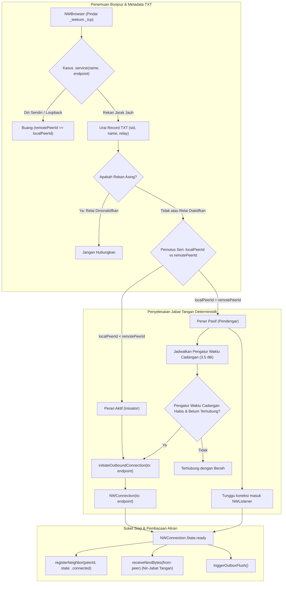
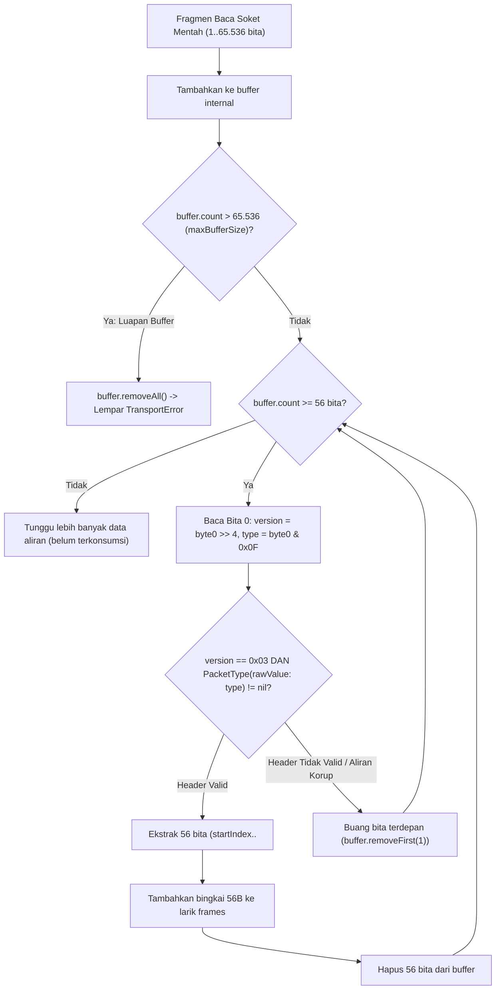
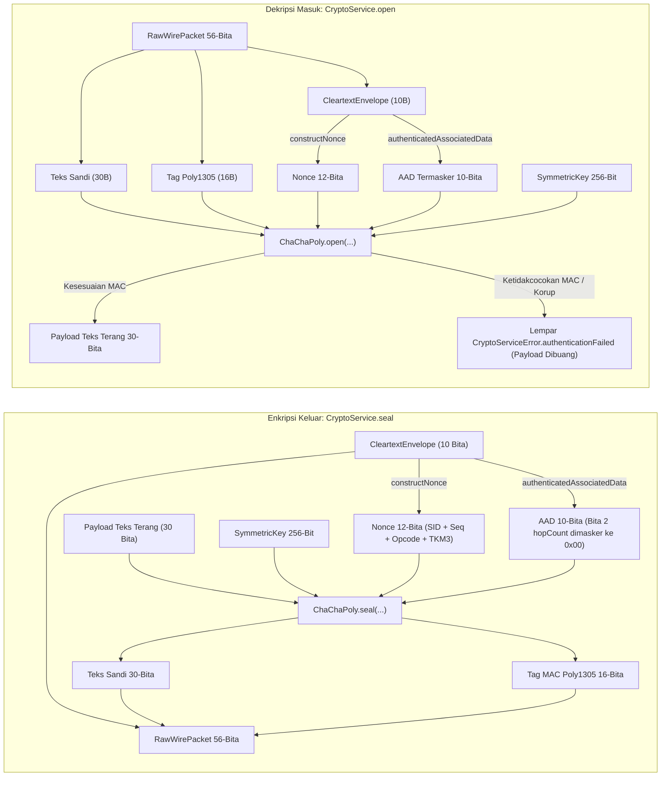

# Volume 03: Transport Layer, Stream Framing & Security

## Ringkasan Eksekutif & Gambaran Umum

Volume 03 merinci subsistem transmisi radio, protokol pembingkaian aliran (*stream framing*), mekanisme hak penitipan toleran-tunda (*delay-tolerant custody*), dan infrastruktur kriptografi berbenteng perangkat keras dari klien jaringan *mesh* Meepo. Dalam lingkungan *off-grid* ekstrem di mana menara seluler dan infrastruktur Wi-Fi tidak tersedia atau mengalami kemacetan parah, Meepo memanfaatkan Apple Wireless Direct Link (AWDL) dan CoreBluetooth untuk membentuk jaringan *mesh peer-to-peer* yang tangguh dan mampu memulihkan dirinya sendiri (*self-healing*).

Pada lapisan fisik dan transport, Meepo mengoordinasikan tiga domain fungsional utama:
1. **Penemuan Rekan (*Peer Discovery*) & Pemasangan Radio Otonom:** Dikelola oleh `PeerTransportService` melalui `NWListener` dan `NWBrowser` dari Network.framework. Simpul mengumumkan keberadaannya menggunakan Bonjour Multicast DNS (mDNS) melalui `_teekum._tcp` dengan *record* TXT tersemat, menyelesaikan upaya penyambungan serentak melalui algoritma pemutus seri leksikografis deterministik (`localPeerId < remotePeerId`).
2. **Pembingkaian Aliran (*Stream Framing*) & Resinkronisasi:** Aliran bita TCP berkelanjutan melalui AWDL tidak mempertahankan batas datagram. `StreamMessageFramer` menyangga fragmen aliran, membatasi paket *wire* 56-bita, dan mengeksekusi resinkronisasi geser-maju 1-bita (*1-byte forward-sliding resynchronization*) untuk segera pulih dari korupsi aliran tanpa menghapus bingkai valid yang tergabung. Tautan CoreBluetooth dipertahankan secara bersamaan melalui `BLEPeerLink` dan `BLEFrameCodec`, memotong bingkai melintasi batas MTU Attribute Protocol (ATT).
3. **Enkripsi Terotentikasi Nir-Pengetahuan (*Zero-Knowledge Authenticated Encryption*):** Dieksekusi oleh `CryptoService` yang mematuhi `CryptoServiceProtocol`. *Payload* dienkripsi menggunakan *stream cipher* ChaCha20 dengan kunci sesi simetris 256-bit dan diotentikasi menggunakan tag MAC Poly1305 128-bit. Amplop perutean tanpa enkripsi 10-bita diikat sebagai Authenticated Associated Data (AAD) dengan Bita 2 (`hopCount`) dimasker ke `0x00`, memungkinkan simpul relai multi-hop meneruskan paket secara buta tanpa mengubah tag otentikasi kriptografis.

---

### Gambaran Umum Sederhana (ELI5): Kantor Pos Radio Rahasia

Bayangkan sebuah detasemen komunikasi pencarian dan penyelamatan (SAR) darurat yang beroperasi di pusat kota yang runtuh di mana menara seluler hancur dan listrik kota padam total:

1. **Suar dan Pengawas di Atap Gedung (`NWListener` & `NWBrowser`):** Setiap petugas membawa suar radio taktis yang dikonfigurasi dengan ID sesi regu dan inisial tanda panggil mereka (*record* TXT Bonjour). Perangkat mereka memindai frekuensi radio lokal dengan pencari arah digital (`NWBrowser`) untuk mencari rekan operasi sembari terus mengumumkan kehadirannya kepada simpul penyelamat tetangga (`NWListener`).
2. **Aturan Jabat Tangan yang Sopan (Pemutus Seri / *Tie-Breaking*):** Ketika dua unit pencari melihat suar radio satu sama lain secara bersamaan, mereka tidak memulai koneksi secara berbarengan. Mereka memeriksa urutan abjad ID *peer* mereka: perangkat yang ID-nya lebih awal dalam abjad memprakarsai tautan keluar (`initiateOutboundConnection`), sementara perangkat kedua menunggu untuk menerima tautan masuk (`handleIncomingConnection`).
3. **Pemisah Aliran (*Stream Decoupler* - `StreamMessageFramer`):** Data taktis tiba melalui tautan TCP *peer-to-peer* mentah dalam aliran fragmen bita yang terus-menerus. *Framer* bertindak seperti pembaca pita otomatis yang mengukur tepat 56 bita, memverifikasi header bita protokol ajaib, dan memotong setiap kapsul pengiriman independen secara rapi. Jika derau atau statis radio yang rusak masuk ke dalam aliran, *framer* bergerak maju bita demi bita hingga mengunci kembali header yang bersih, mencegah data sampah menghentikan antrean.
4. **Kantong Kurir Toleran-Tunda (`CarryMessageStore`):** Jika sebuah unit lapangan memiliki pesan medis mendesak untuk Petugas Medis Bob, tetapi Bob saat ini berada di luar jangkauan radio di balik reruntuhan beton, unit tersebut memasukkan pesan itu ke dalam kantong taktis toleran-tundanya hingga 10 menit. Setiap kali petugas tersebut bergerak mendekati simpul pencari lainnya, perangkat mereka memeriksa apakah rekan tersebut memiliki rute ke Bob dan menyerahkan pesan tersebut.
5. **Segel Lilin Tak Terpecahkan (`CryptoService`):** Setiap pengiriman dikunci di dalam kapsul titanium berperisai baja (`ChaCha20`). Di bagian luar kapsul dan label perutean taktis dicapkan segel lilin kimiawi (`Poly1305 MAC`). Setiap simpul relawan perantara di zona bencana dapat memeriksa label perutean *cleartext* untuk meneruskan paket, tetapi jika pihak yang tidak berwenang mengubah label atau merusak kapsul, segel kimiawi akan pecah berkeping-keping dan simpul penerima segera memusnahkan paket yang rusak tersebut.

---

## Daftar Berkas Sumber yang Disertakan

Tabel berikut merinci setiap berkas kode sumber yang ditetapkan untuk Volume 03. Setiap jalur berkas ditautkan secara relatif terhadap dokumen ini, disertai dengan kategorinya, jumlah baris yang diverifikasi (`wc -l`), dan peran arsitektural tunggalnya:

| Jalur Berkas | Kategori | Jumlah Baris (`wc -l`) | Tujuan & Tanggung Jawab Arsitektural |
| :--- | :--- | :---: | :--- |
| [CryptoService.swift](../../Teekum/Teekum/Core/Security/CryptoService.swift) | Keamanan | 145 | Aktor yang mengeksekusi penyegelan dan pembukaan terotentikasi ChaCha20-Poly1305 AEAD dengan validasi AAD 10-bita termasker. |
| [CryptoServiceError.swift](../../Teekum/Teekum/Core/Security/CryptoServiceError.swift) | Keamanan | 40 | Enumerasi galat kriptografis yang mencakup kegagalan enkripsi, ketidakcocokan tag otentikasi, dan paket yang diubah. |
| [CryptoServiceProtocol.swift](../../Teekum/Teekum/Core/Security/CryptoServiceProtocol.swift) | Keamanan | 43 | Kontrak protokol yang mendeklarasikan kemampuan enkripsi dan dekripsi AEAD asinkron. |
| [KeychainStore.swift](../../Teekum/Teekum/Core/Security/KeychainStore.swift) | Keamanan | 100 | Pembungkus Keychain aman yang menyediakan penyimpanan dan pembersihan kunci sesi simetris 256-bit berbasis perangkat keras. |
| [PacketSequenceAllocator.swift](../../Teekum/Teekum/Core/Security/PacketSequenceAllocator.swift) | Keamanan | 59 | Pengalokasi nomor urut monotonik yang menyediakan isolasi penghitung anti-pemutaran ulang dan partisi slot anggota. |
| [PacketSequenceError.swift](../../Teekum/Teekum/Core/Security/PacketSequenceError.swift) | Keamanan | 20 | Domain galat alokasi urutan yang menangani luapan penghitung (*counter overflow*) dan pelanggaran batas urutan. |
| [InboundFrame.swift](../../Teekum/Teekum/Core/Transport/InboundFrame.swift) | Transport | 31 | Tipe nilai yang merepresentasikan bingkai protokol masuk dengan penyangga bita mentah, pengidentifikasi sumber, dan RSSI. |
| [InboundPacket.swift](../../Teekum/Teekum/Core/Transport/InboundPacket.swift) | Transport | 28 | Struktur yang merangkum paket *wire* 56-bita yang diterima dengan ID rekan sumber fisik, RSSI, dan stempel waktu. |
| [MeshTransport.swift](../../Teekum/Teekum/Core/Transport/MeshTransport.swift) | Transport | 51 | Protokol yang mendeklarasikan kemampuan transport *mesh* multi-hop, kueri tetangga, dan penerusan bingkai. |
| [PeerConnection.swift](../../Teekum/Teekum/Core/Transport/PeerConnection.swift) | Transport | 41 | Enkapsulasi dari NWConnection Network.framework dua arah yang mengelola saluran aliran TCP/UDP. |
| [PeerInfo.swift](../../Teekum/Teekum/Core/Transport/PeerInfo.swift) | Transport | 34 | Model rekan terdeteksi yang memegang titik akhir layanan Bonjour, kapabilitas *record* TXT, dan metrik kualitas tautan. |
| [PeerTransport.swift](../../Teekum/Teekum/Core/Transport/PeerTransport.swift) | Transport | 49 | Protokol transport inti yang mendeklarasikan penemuan Bonjour, penyiapan pendengar (*listener*), dan manajemen koneksi rekan. |
| [SendOutcome.swift](../../Teekum/Teekum/Core/Transport/SendOutcome.swift) | Transport | 34 | Struktur hasil transmisi yang mencatat status pengiriman, jumlah percobaan, dan latensi pulang-pergi (*round-trip*). |
| [TransportCapabilities.swift](../../Teekum/Teekum/Core/Transport/TransportCapabilities.swift) | Transport | 21 | Struktur yang mendeklarasikan kemampuan transport (dukungan relai, batas MTU) yang diiklankan secara dinamis dalam *record* TXT Bonjour. |
| [TransportError.swift](../../Teekum/Teekum/Core/Transport/TransportError.swift) | Transport | 68 | Enum galat transport radio yang mencakup koneksi terputus, kegagalan batas waktu (*timeout*), dan kehabisan penyangga pipa. |
| [TransportState.swift](../../Teekum/Teekum/Core/Transport/TransportState.swift) | Transport | 32 | Enumerasi status siklus hidup untuk lapisan transport radio (diam, mencari, terhubung, dihentikan). |
| [StreamMessageFramer.swift](../../Teekum/Teekum/Core/Transport/StreamMessageFramer.swift) | Transport | 80 | Mesin pengurai aliran yang membatasi paket 56-bita di seluruh aliran bita TCP yang tersegmentasi atau tergabung. |
| [BLEFrameCodec.swift](../../Teekum/Teekum/Core/Transport/BLEFrameCodec.swift) | CoreBluetooth | 32 | Kodek fragmentasi dan penyusunan ulang bingkai yang memotong paket *wire* 56-bita menjadi bingkai Bluetooth yang aman sesuai batas MTU. |
| [BLEPeerLink.swift](../../Teekum/Teekum/Core/Transport/BLEPeerLink.swift) | CoreBluetooth | 283 | Aktor manajemen tautan CoreBluetooth yang mengoordinasikan periklanan periferal dan saluran koneksi sentral. |
| [CarryMessageStore.swift](../../Teekum/Teekum/Core/Transport/CarryMessageStore.swift) | Kustodi | 108 | Aktor penitipan pesan simpan-dan-teruskan (*store-and-forward*) yang menahan paket belum terkonfirmasi untuk pengangkutan fisik oportunistik. |
| [PeerTransportService.swift](../../Teekum/Teekum/Core/Transport/PeerTransportService.swift) | Transport | 349 | Aktor transport radio primer yang mengelola tautan rekan, mesin penemuan, dan pemultipleksan bingkai. |
| [PeerTransportService+Connection.swift](../../Teekum/Teekum/Core/Transport/PeerTransportService+Connection.swift) | Transport | 195 | Ekstensi siklus hidup koneksi yang menangani perubahan status NWListener, koneksi masuk, dan upaya pemanggilan (*dial*). |
| [PeerTransportService+Discovery.swift](../../Teekum/Teekum/Core/Transport/PeerTransportService+Discovery.swift) | Transport | 292 | Ekstensi penemuan Bonjour yang mengelola periklanan NWBrowser dan NWListener untuk tipe layanan _teekum._tcp. |
| [PeerTransportService+Framing.swift](../../Teekum/Teekum/Core/Transport/PeerTransportService+Framing.swift) | Transport | 89 | Ekstensi pembingkaian aliran yang memproses bingkai protokol berawalan panjang melalui aliran TCP berkelanjutan. |
| [PeerTransportService+Sending.swift](../../Teekum/Teekum/Core/Transport/PeerTransportService+Sending.swift) | Transport | 329 | Ekstensi transmisi keluar yang menangani pembingkaian unicast, sebaran siaran (*broadcast fan-out*), dan penitipan pesan. |
| [PeerTransportService+Carry.swift](../../Teekum/Teekum/Core/Transport/PeerTransportService+Carry.swift) | Kustodi | 73 | Ekstensi transport simpan-dan-teruskan yang mengirimkan titipan pesan oportunistik saat rekan terhubung kembali. |
| **Total Artefak Volume 03** | **26 Berkas** | **2626** | **100% Akuntansi Basis Kode Volume 03** |

---

## Arsitektur Jalur Pipa Transport & Kriptografi

Diagram berikut mengilustrasikan alur penemuan rekan dan pemutusan seri koneksi, mesin status pembingkaian aliran 56-bita, serta alur pipa enkripsi dan dekripsi terotentikasi ChaCha20-Poly1305.

### 1. Penemuan Rekan, Evaluasi Record TXT & Pemutus Seri (Tie-Breaking)



---

### 2. Pembingkaian Aliran 56-Bita & Resinkronisasi (`StreamMessageFramer`)



---

### 3. Jalur Pipa Penyegelan & Pembukaan Terotentikasi ChaCha20-Poly1305



---

## 1. Teekum/Teekum/Core/Security/CryptoService.swift

### Metadata Berkas
| Atribut | Spesifikasi |
| :--- | :--- |
| **Jalur Relatif Repositori** | [CryptoService.swift](../../Teekum/Teekum/Core/Security/CryptoService.swift) |
| **Jumlah Baris (`wc -l`)** | 145 baris |
| **Tipe Berkas** | Berkas Sumber Swift |
| **Target Kompilasi** | `Teekum` (Target Aplikasi) |
| **Semantik Tipe** | Swift `actor`, tipe referensi dengan isolasi aktor |
| **Domain Konkurensi** | Aktor terisolasi yang mengeksekusi operasi kriptografi waktu konstan. |
| **Peran Arsitektural** | Aktor yang mengeksekusi penyegelan dan pembukaan terotentikasi ChaCha20-Poly1305 AEAD dengan validasi AAD 10-bita termasker. |

### Apa yang Dilakukan Berkas Ini
`CryptoService.swift` mengimplementasikan inti kriptografi dari tumpukan jaringan *mesh* Meepo. Mematuhi `CryptoServiceProtocol`, berkas ini mengeksekusi enkripsi dan dekripsi simetris terotentikasi ChaCha20-Poly1305 AEAD atas slot *payload* dalam 30-bita. Berkas ini secara ketat mengikat amplop *cleartext* 10-bita sebagai Authenticated Associated Data (AAD) sembari memasker Bita 2 (`hopCount`) menjadi `0x00`, mencegah simpul relai membatalkan tag otentikasi. Lebih jauh, berkas ini menegakkan aturan bahwa *payload* teks terang tidak pernah diekspos ke logika aplikasi jika verifikasi tag kriptografis gagal.

### Analogi Sederhana (ELI5)
Bayangkan `CryptoService` sebagai perwira brankas keamanan kriptografi di dalam markas lapangan taktis. Saat seorang penyelamat mengirimkan laporan korban 30-bita atau ping lokasi, mereka menyerahkan *payload* tersebut, amplop perutean *cleartext* 10-bita, dan kunci misi 256-bit regu kepada perwira tersebut. Perwira menyegel *payload* di dalam wadah kriptografi yang diperkeras menggunakan `ChaCha20`, mencap segel MAC otentikasi Poly1305 di seluruh wadah dan amplop perutean, serta mengeluarkan datagram *wire* terstandarisasi 56-bita. Saat datagram masuk tiba dari seberang zona bencana, perwira memvalidasi segel Poly1305 terlebih dahulu; jika satu bit saja rusak oleh derau radio atau diubah oleh pihak yang tidak berwenang, datagram tersebut segera dimusnahkan tanpa pernah didekripsi.

### Definisi Istilah Teknis
- **AEAD (Authenticated Encryption with Associated Data):** Mode kriptografi yang secara bersamaan menjamin kerahasiaan (*confidentiality*, melalui enkripsi) serta integritas dan keaslian (*integrity/authenticity*, melalui MAC kriptografis) atas teks sandi maupun metadata yang tidak terenkripsi (Data Terkait / Associated Data).
- **ChaCha20-Poly1305 (`ChaChaPoly`):** Standar algoritma AEAD berkinerja tinggi berbasis *stream cipher* (RFC 8439) yang menggabungkan cipher ChaCha20 karya Daniel J. Bernstein dengan MAC Poly1305. Algoritma ini berjalan dalam waktu konstan (*constant-time*) pada CPU ARM seluler, membuatnya kebal total terhadap serangan saluran samping waktu tembolok (*cache-timing side-channel attacks*).
- **AAD (Authenticated Associated Data):** Data tidak terenkripsi yang disertakan dalam perhitungan tag MAC. Penerima dapat memeriksa AAD dalam teks terang (*cleartext*) untuk perutean, tetapi modifikasi apa pun pada AAD akan menyebabkan verifikasi MAC gagal.
- **Nonce (Number Used Once):** Vektor inisialisasi 12-bita yang TIDAK PERNAH boleh diulang dengan kunci yang sama. Di Meepo, *nonce* disintesis secara deterministik dari ID sesi 24-bit, penghitung urutan 32-bit, *opcode*, dan tag domain `"TKM3"`.
- **Isolasi Aktor (*Actor Isolation*):** Mekanisme konkurensi waktu kompilasi Swift yang melindungi *state* termutasi internal dengan hanya mengizinkan satu tugas asinkron dieksekusi dalam konteks aktor pada waktu tertentu.

### Pembahasan Kode Baris demi Baris
#### Baris 1–42: Deklarasi Aktor dan `seal(payload:envelope:using:)`
```swift
//
//  CryptoService.swift
//  Teekum
//
//  Created by Nicho on 05/11/26.
//

import Foundation
import CryptoKit

/// Seals and opens V3 payloads with ChaCha20-Poly1305.
public actor CryptoService: CryptoServiceProtocol {
    public init() {}
    
    /// Seals 30 bytes of private inner payload using ChaCha20-Poly1305 authenticated symmetric encryption,
    /// binding the 10-byte cleartext envelope as Associated Authenticated Data (AAD) with masked hop count.
    public func seal(
        payload: Data,
        envelope: CleartextEnvelope,
        using key: SymmetricKey
    ) throws -> (ciphertext: Data, authTag: Data) {
        guard payload.count == PacketConstants.encryptedPayloadSize else {
            throw PacketCodecError.invalidPacketSize(
                expected: PacketConstants.encryptedPayloadSize,
                actual: payload.count
            )
        }
        
        let nonceData = envelope.constructNonce()
        guard let nonce = try? ChaChaPoly.Nonce(data: nonceData) else {
            throw CryptoServiceError.encryptionFailed("Nonce construction failed: invalid nonce byte length.")
        }
        
        let aad = envelope.authenticatedAssociatedData()
        
        do {
            let sealedBox = try ChaChaPoly.seal(payload, using: key, nonce: nonce, authenticating: aad)
            return (ciphertext: Data(sealedBox.ciphertext), authTag: Data(sealedBox.tag))
        } catch {
            throw CryptoServiceError.encryptionFailed(error.localizedDescription)
        }
    }
```
- **Baris 12:** Mendeklarasikan `CryptoService` sebagai `actor` yang mematuhi `CryptoServiceProtocol`.
- **Baris 17–21:** Tanda tangan fungsi menerima `payload` teks terang 30-bita, `envelope`, dan `SymmetricKey`.
- **Baris 22–27:** Memastikan bahwa *payload* masuk tepat berukuran 30 bita (`PacketConstants.encryptedPayloadSize`), melemparkan `PacketCodecError.invalidPacketSize` jika terjadi ketidakcocokan.
- **Baris 29–32:** Menghasilkan *nonce* 12-bita melalui `envelope.constructNonce()`. Memvalidasi pembentukan dengan membuat instans `ChaChaPoly.Nonce`.
- **Baris 34:** Menghitung AAD 10-bita melalui `envelope.authenticatedAssociatedData()`, yang memasker Bita 2 (`hopCount`) menjadi `0x00`.
- **Baris 36–41:** Memanggil `ChaChaPoly.seal(...)`. Mengembalikan tupel `(ciphertext: 30 bytes, authTag: 16 bytes)`. Setiap galat ditangkap dan dibungkus dalam `CryptoServiceError.encryptionFailed`.

#### Baris 44–84: Dekripsi Payload Terotentikasi (`open`)
```swift
    /// Verifies the 16-byte Poly1305 authentication tag against the 10-byte envelope AAD and decrypts the 30-byte payload.
    /// Throws `CryptoServiceError.authenticationFailed` if tampered by any third party.
    ///
    /// Plaintext payload is NEVER exposed to application logic if authentication fails.
    public func open(
        ciphertext: Data,
        envelope: CleartextEnvelope,
        authTag: Data,
        using key: SymmetricKey
    ) throws -> Data {
        guard ciphertext.count == PacketConstants.encryptedPayloadSize else {
            throw PacketCodecError.invalidPacketSize(
                expected: PacketConstants.encryptedPayloadSize,
                actual: ciphertext.count
            )
        }
        guard authTag.count == PacketConstants.authTagSize else {
            throw PacketCodecError.invalidPacketSize(
                expected: PacketConstants.authTagSize,
                actual: authTag.count
            )
        }
        
        let nonceData = envelope.constructNonce()
        guard let nonce = try? ChaChaPoly.Nonce(data: nonceData) else {
            throw CryptoServiceError.authenticationFailed
        }
        
        let aad = envelope.authenticatedAssociatedData()
        
        guard let sealedBox = try? ChaChaPoly.SealedBox(nonce: nonce, ciphertext: ciphertext, tag: authTag) else {
            throw CryptoServiceError.authenticationFailed
        }
        
        do {
            let decrypted = try ChaChaPoly.open(sealedBox, using: key, authenticating: aad)
            return decrypted
        } catch {
            throw CryptoServiceError.authenticationFailed
        }
    }
```
- **Baris 48–53:** Tanda tangan untuk membuka teks sandi terhadap amplop dan tag MAC 16-bita.
- **Baris 54–65:** Menegakkan secara ketat bahwa `ciphertext.count == 30` dan `authTag.count == 16`.
- **Baris 67–70:** Menyusun kembali *nonce* 12-bita yang cocok dengan sintesis pengirim.
- **Baris 72:** Menurunkan AAD termasker identik dari amplop.
- **Baris 74–76:** Menyusun `ChaChaPoly.SealedBox`.
- **Baris 78–83:** Memanggil `ChaChaPoly.open(sealedBox, using: key, authenticating: aad)`. Jika tag tidak cocok atau data korup, melempar `CryptoServiceError.authenticationFailed`. Yang paling penting, tidak ada data teks terang yang dikembalikan jika terjadi kegagalan.

#### Baris 86–130: Pembantu Tingkat Tinggi untuk Paket dan Jaringan Kabel
```swift
    // MARK: - High-Level Packet Helpers
    
    /// Seals an inner payload and envelope into a complete 56-byte `RawWirePacket`.
    public func sealPacket(
        payload: Data,
        envelope: CleartextEnvelope,
        using key: SymmetricKey
    ) throws -> RawWirePacket {
        let (ciphertext, authTag) = try seal(payload: payload, envelope: envelope, using: key)
        return RawWirePacket(envelope: envelope, ciphertext: ciphertext, authTag: authTag)
    }
    
    /// Opens and verifies a 56-byte `RawWirePacket`, returning the verified envelope and decrypted 30-byte payload.
    public func openPacket(
        _ packet: RawWirePacket,
        using key: SymmetricKey
    ) throws -> (envelope: CleartextEnvelope, payload: Data) {
        let plaintext = try open(
            ciphertext: packet.ciphertext,
            envelope: packet.envelope,
            authTag: packet.authTag,
            using: key
        )
        return (envelope: packet.envelope, payload: plaintext)
    }
    
    /// Seals an inner payload directly to a 56-byte binary datagram ready for radio transmission.
    public func sealToWireBytes(
        payload: Data,
        envelope: CleartextEnvelope,
        using key: SymmetricKey
    ) throws -> Data {
        let packet = try sealPacket(payload: payload, envelope: envelope, using: key)
        return try packet.toWireData()
    }
    
    /// Parses a 56-byte binary datagram from the network, verifies the authentication tag,
    /// and returns the decrypted payload and envelope.
    public func openWireBytes(
        _ wireData: Data,
        using key: SymmetricKey
    ) throws -> (envelope: CleartextEnvelope, payload: Data) {
        let packet = try RawWirePacket.fromWireData(wireData)
        return try openPacket(packet, using: key)
    }
```
- **Baris 89–96:** `sealPacket` membungkus `seal()` dan membuat instans `RawWirePacket` bertipe.
- **Baris 99–110:** `openPacket` membongkar dan memverifikasi `RawWirePacket`.
- **Baris 113–120:** `sealToWireBytes` menghasilkan penyangga kabel serial 56-bita persis yang siap untuk pengiriman soket.
- **Baris 124–130:** `openWireBytes` mengurai 56 bita mentah menjadi `RawWirePacket` serta mengotentikasi dan mendekripsinya.

#### Baris 132–144: Utilitas Pembangkitan Kunci
```swift
    // MARK: - Key Generation
    
    /// Generates a cryptographically secure 256-bit symmetric key.
    nonisolated public func generateSymmetricKey() -> SymmetricKey {
        SymmetricKey(size: .bits256)
    }
    
    nonisolated public func generateSymmetricKeyData() -> Data {
        let key = generateSymmetricKey()
        return key.withUnsafeBytes { Data($0) }
    }
}
```
- **Baris 135–142:** Ditandai `nonisolated` untuk memungkinkan *thread* pemanggil menghasilkan kunci 256-bit baru dan mengekspor penyangga biner mentah 32-bita tanpa harus menunggu giliran antrean tugas aktor.

### Rasional Rekayasa dan Kasus Batas
- **Isolasi Kunci Aktor (*Actor Key Isolation*):** Menempatkan operasi enkripsi di dalam aktor Swift menjamin bahwa pekerjaan kriptografis dieksekusi dalam konteks konkurensi khusus, mencegah *race condition* antar-*thread* atau korupsi *state* CryptoKit internal.
- **Sikap Keamanan Gagal-Tutup (*Fail-Closed Security Posture*):** Jika satu bit saja dalam bingkai 56-bita rusak melalui transmisi radio, verifikasi Poly1305 akan gagal, dan `open()` langsung melempar galat. Teks sandi yang rusak tersebut sepenuhnya dibuang tanpa pernah menyentuh ViewModel fitur atau tembolok memori.

---

---

## 2. Teekum/Teekum/Core/Security/CryptoServiceError.swift

### Metadata Berkas
| Atribut | Spesifikasi |
| :--- | :--- |
| **Jalur Relatif Repositori** | [CryptoServiceError.swift](../../Teekum/Teekum/Core/Security/CryptoServiceError.swift) |
| **Jumlah Baris (`wc -l`)** | 40 baris |
| **Tipe Berkas** | Berkas Sumber Swift |
| **Target Kompilasi** | `Teekum` (Target Aplikasi) |
| **Semantik Tipe** | Nilai enum, `Error`, `LocalizedError`, `Sendable` |
| **Domain Konkurensi** | Enum nilai `Sendable` tanpa batasan; propagasi galat yang aman untuk *thread*. |
| **Peran Arsitektural** | Enumerasi galat kriptografis yang mencakup kegagalan enkripsi, ketidakcocokan tag otentikasi, dan paket yang diubah. |

### Apa yang Dilakukan Berkas Ini
`CryptoServiceError.swift` mendefinisikan tipe galat spesifik-domain yang dapat terjadi selama penyegelan kriptografis, pembukaan paket, pembuatan kunci, dan operasi Keychain. Setiap kasus menyediakan deskripsi diagnostik terlokalisasi yang dapat ditindaklanjuti yang secara jelas membedakan antara kegagalan operasional (seperti galat Keychain) dan pelanggaran keamanan (seperti tag otentikasi yang dirusak).

### Analogi Sederhana (ELI5)
Bayangkan `CryptoServiceError` sebagai buku catatan lencana peringatan petugas keamanan. Jika sebuah pesan masuk memiliki segel lilin yang rusak, petugas menggantungkan lencana "Peringatan Perusakan" (`.authenticationFailed`). Jika brankas kunci macet, petugas menggantungkan lencana "Brankas Perangkat Keras Macet" (`.keychainLoadFailed`). Ini memberi tahu aplikasi apakah harus mencoba membuka kembali brankas atau membunyikan alarm darurat.

### Definisi Istilah Teknis
- **`LocalizedError`:** Protokol pustaka standar Swift yang menyediakan deskripsi ramah pengguna (`errorDescription`) untuk galat.
- **`OSStatus`:** Kode status bilangan bulat bertanda 32-bit yang dikembalikan oleh API C Security framework Apple (`SecItemAdd`, `SecItemCopyMatching`, dll.), di mana 0 (`errSecSuccess`) menunjukkan keberhasilan dan angka negatif menunjukkan galat spesifik.
- **Verifikasi Perusakan (*Tamper Verification*):** Pemeriksaan kriptografis yang mengonfirmasi bahwa data belum dimodifikasi selama transit antara pengirim dan penerima.

### Pembahasan Kode Baris demi Baris
#### Baris 1–40: Deklarasi Enum dan Deskripsi
```swift
//
//  CryptoServiceError.swift
//  Teekum
//
//  Created by Nicho on 05/11/26.
//

import Foundation

public enum CryptoServiceError: Error, LocalizedError {
    case encryptionFailed(String)
    case authenticationFailed
    case keyGenerationFailed
    case keychainSaveFailed(OSStatus)
    case keychainLoadFailed(OSStatus)
    case keychainDeleteFailed(OSStatus)
    case keyNotFound
    case invalidKeySize(expected: Int, actual: Int)
    
    public var errorDescription: String? {
        switch self {
        case let .encryptionFailed(reason):
            return "Encryption failed: \(reason)"
        case .authenticationFailed:
            return "Tamper verification failed: authentication tag does not match Associated Authenticated Data."
        case .keyGenerationFailed:
            return "Failed to generate secure symmetric key."
        case let .keychainSaveFailed(status):
            return "Keychain item addition failed with OSStatus \(status)."
        case let .keychainLoadFailed(status):
            return "Keychain retrieval failed with OSStatus \(status)."
        case let .keychainDeleteFailed(status):
            return "Keychain deletion failed with OSStatus \(status)."
        case .keyNotFound:
            return "Requested symmetric key not found in iOS Keychain."
        case let .invalidKeySize(expected, actual):
            return "Invalid symmetric key size: expected \(expected) bytes, got \(actual) bytes."
        }
    }
}
```
- **Baris 10–18:** Mendeklarasikan 8 kondisi kegagalan diskret yang mencakup kesalahan enkripsi, ketidakcocokan MAC, galat pembuatan kunci, kegagalan operasi CRUD Keychain dengan `OSStatus` yang mendasarinya, kunci yang hilang, dan panjang bita kunci yang tidak valid.
- **Baris 20–39:** `errorDescription` memetakan setiap kasus enum ke string diagnostik deskriptif untuk pencatatan log dan telemetri.

### Rasional Rekayasa dan Kasus Batas
- **Mengekspos `OSStatus` yang Mendasari:** Menyertakan `OSStatus` di dalam `.keychainSaveFailed(status)` dan `.keychainLoadFailed(status)` memungkinkan diagnostik yang tepat saat men-debug batasan keamanan perangkat keras iOS, seperti penguncian perangkat atau kesalahan konfigurasi *entitlement*.

---

---

## 3. Teekum/Teekum/Core/Security/CryptoServiceProtocol.swift

### Metadata Berkas
| Atribut | Spesifikasi |
| :--- | :--- |
| **Jalur Relatif Repositori** | [CryptoServiceProtocol.swift](../../Teekum/Teekum/Core/Security/CryptoServiceProtocol.swift) |
| **Jumlah Baris (`wc -l`)** | 43 baris |
| **Tipe Berkas** | Berkas Sumber Swift |
| **Target Kompilasi** | `Teekum` (Target Aplikasi) |
| **Semantik Tipe** | Kontrak protokol Swift `Actor` |
| **Domain Konkurensi** | Protokol yang mewajibkan tipe yang mematuhinya berupa aktor terisolasi. |
| **Peran Arsitektural** | Kontrak protokol yang mendeklarasikan kemampuan enkripsi dan dekripsi AEAD asinkron. |

### Apa yang Dilakukan Berkas Ini
`CryptoServiceProtocol.swift` menetapkan kontrak antarmuka formal untuk operasi kriptografi dan pembuatan kunci di seluruh sistem Meepo. Dengan mewarisi dari `Actor`, berkas ini menegakkan bahwa setiap implementasi layanan produksi atau tiruan (*mock*) harus berupa sebuah aktor, menjamin bahwa operasi kriptografi dieksekusi dalam domain konkurensi yang terisolasi.

### Analogi Sederhana (ELI5)
`CryptoServiceProtocol` adalah deskripsi pekerjaan dan buku aturan bagi penjaga keamanan brankas. Di dalamnya tertulis: "Siapa pun yang mengambil pekerjaan ini harus duduk di ruang amannya sendiri (`Actor`), harus tahu cara menyegel pesan, harus tahu cara memverifikasi segel lilin, dan harus mampu menempa kunci master baru."

### Definisi Istilah Teknis
- **Protokol Aktor (*Actor Protocol*):** Protokol yang mewarisi dari `Actor`, mewajibkan setiap tipe yang mematuhinya dideklarasikan sebagai `actor` Swift, sehingga mewarisi jaminan isolasi aktor.
- **Pemisahan Antarmuka (*Interface Segregation*):** Prinsip desain arsitektur yang menyatakan bahwa klien tidak boleh dipaksa untuk bergantung pada metode yang tidak mereka gunakan, menyediakan batasan yang jelas untuk pengujian unit dan injeksi objek tiruan (*mock*).

### Pembahasan Kode Baris demi Baris
#### Baris 1–43: Definisi Protokol
```swift
//
//  CryptoServiceProtocol.swift
//  Teekum
//
//  Created by Nicho on 05/11/26.
//

import Foundation
import CryptoKit

/// Authoritative contract for cryptographic operations and secure key storage.
/// Implemented as a Swift `actor` to safeguard key material in memory.
public protocol CryptoServiceProtocol: Actor {
    /// Seals 30 bytes of private inner payload using authenticated symmetric encryption,
    /// binding the 10-byte cleartext envelope as Associated Authenticated Data (AAD).
    func seal(
        payload: Data,
        envelope: CleartextEnvelope,
        using key: SymmetricKey
    ) throws -> (ciphertext: Data, authTag: Data)
    
    /// Seals an inner payload directly to a 56-byte binary datagram ready for radio transmission.
    func sealToWireBytes(
        payload: Data,
        envelope: CleartextEnvelope,
        using key: SymmetricKey
    ) throws -> Data
    
    /// Verifies the 16-byte Poly1305 / AES-GCM tag against the 10-byte envelope AAD and decrypts the 30-byte payload.
    /// Throws `CryptoServiceError.authenticationFailed` if tampered by a third party.
    func open(
        ciphertext: Data,
        envelope: CleartextEnvelope,
        authTag: Data,
        using key: SymmetricKey
    ) throws -> Data
    
    /// Generates a cryptographically secure 256-bit symmetric key.
    func generateSymmetricKey() -> SymmetricKey
    
    /// Generates raw 32-byte key data suitable for GroupSession & QR invite creation
    func generateSymmetricKeyData() -> Data
}
```
- **Baris 13:** Mendeklarasikan `public protocol CryptoServiceProtocol: Actor`.
- **Baris 16–20:** Kontrak untuk menyegel *payload* 30-bita dengan pengikatan AAD.
- **Baris 23–27:** Kontrak untuk menghasilkan penyangga kabel serial 56-bita.
- **Baris 31–36:** Kontrak untuk membuka dan memverifikasi *sealed box*.
- **Baris 39–42:** Kontrak untuk pembuatan kunci.

### Rasional Rekayasa dan Kasus Batas
- **Mengapa Dibatasi pada `Actor`:** Jika `CryptoServiceProtocol` tidak mewajibkan `Actor`, pengembang dapat secara tidak sengaja mengimplementasikan kelas referensi yang tidak aman untuk *thread*, yang memungkinkan akses bersamaan ke konteks kriptografi bersama. Menegakkan `protocol ...: Actor` menjadikan keamanan *thread* sebagai persyaratan wajib kompilator.

---

---

## 4. Teekum/Teekum/Core/Security/KeychainStore.swift

### Metadata Berkas
| Atribut | Spesifikasi |
| :--- | :--- |
| **Jalur Relatif Repositori** | [KeychainStore.swift](../../Teekum/Teekum/Core/Security/KeychainStore.swift) |
| **Jumlah Baris (`wc -l`)** | 100 baris |
| **Tipe Berkas** | Berkas Sumber Swift |
| **Target Kompilasi** | `Teekum` (Target Aplikasi) |
| **Semantik Tipe** | Swift `actor`, `Security.framework`, Hardware Keychain |
| **Domain Konkurensi** | Aktor terisolasi yang mengelola item Keychain Secure Enclave berbasis perangkat keras. |
| **Peran Arsitektural** | Pembungkus Keychain aman yang menyediakan penyimpanan dan pembersihan kunci sesi simetris 256-bit berbasis perangkat keras. |

### Apa yang Dilakukan Berkas Ini
`KeychainStore.swift` menyediakan penyimpanan yang didukung perangkat keras, pengambilan kembali, dan pembersihan kriptografis atas kunci sesi simetris 256-bit. Berinteraksi langsung dengan Security framework Apple (`Security.framework`), berkas ini mengisolasi rahasia sesi di dalam Keychain khusus perangkat menggunakan `kSecAttrAccessibleAfterFirstUnlockThisDeviceOnly`. Hal ini memastikan bahwa kunci enkripsi sesi tidak pernah meninggalkan perangkat fisik, dikecualikan dari cadangan iCloud/iTunes yang tidak terenkripsi, dan dapat langsung dibersihkan seketika pengguna meninggalkan grup.

### Analogi Sederhana (ELI5)
Bayangkan `KeychainStore` sebagai brankas dinding biometrik yang tertanam di dalam pondasi rumah Anda. Brankas ini menyimpan kunci kuningan master kelompok Anda. Bahkan jika seseorang membobol rumah Anda dan menyalin buku catatan pribadi Anda (`UserDefaults`), mereka tidak dapat membuka brankas dinding ini tanpa *chip* keamanan perangkat keras ponsel Anda. Saat Anda meninggalkan kelompok zona bencana, brankas tersebut secara magnetis mendemagnetisasi dan menghapus kunci tersebut secara permanen.

### Definisi Istilah Teknis
- **`kSecClassGenericPassword`:** Kelas item Keychain yang digunakan untuk menyimpan blob data sensitif sembarang, seperti kunci simetris atau kata sandi.
- **`kSecAttrAccessibleAfterFirstUnlockThisDeviceOnly`:** Kelas perlindungan aksesibilitas yang menetapkan bahwa data dienkripsi dengan kunci perangkat keras yang diturunkan dari kode sandi pengguna dan Secure Enclave, hanya dapat diakses setelah perangkat dibuka kuncinya satu kali setelah proses *boot*, dan secara ketat dilarang untuk dipulihkan ke perangkat fisik lain melalui cadangan iCloud atau iTunes.
- **`errSecDuplicateItem`:** Kode galat OSStatus (-25299) yang dikembalikan saat mencoba memasukkan item ke dalam Keychain dengan kunci yang sudah ada, memicu operasi pembaruan di tempat (`SecItemUpdate`).

### Pembahasan Kode Baris demi Baris
#### Baris 1–23: Deklarasi dan Penamaan Akun
```swift
//
//  KeychainStore.swift
//  Teekum
//
//  Created by Nicho on 05/11/26.
//

import Foundation
import Security
import CryptoKit

public actor KeychainStore {
    
    private let serviceName: String
    
    public init(serviceName: String = "com.teekum.session") {
        self.serviceName = serviceName
    }
    
    private func keychainAccount(for sessionId: UInt32) -> String {
        "session_0x\(PacketConstants.formatSessionId(sessionId))"
    }
```
- **Baris 12:** Mendeklarasikan `public actor KeychainStore`.
- **Baris 14–18:** Menginjeksikan pengidentifikasi layanan yang dapat dikonfigurasi, dengan nilai default `"com.teekum.session"`.
- **Baris 20–22:** `keychainAccount` memformat string pengidentifikasi akun menggunakan ID sesi 24-bit yang diformat sebagai heksadesimal huruf kapital (misalnya `"session_0x7E3AF5"`).

#### Baris 24–57: Penyisipan Kunci Aman & Pembaruan (storeKeyInKeychain)
```swift
    /// Persists key bytes in the device-only Keychain; reports failure instead of pretending recovery is durable.
    public func storeKeyInKeychain(_ key: SymmetricKey, forSessionId sessionId: UInt32) throws {
        let keyData = key.withUnsafeBytes { Data($0) }
        guard keyData.count == 32 else {
            throw CryptoServiceError.invalidKeySize(expected: 32, actual: keyData.count)
        }
        
        let account = keychainAccount(for: sessionId)
        let query: [String: Any] = [
            kSecClass as String: kSecClassGenericPassword,
            kSecAttrService as String: serviceName,
            kSecAttrAccount as String: account,
            kSecValueData as String: keyData,
            kSecAttrAccessible as String: kSecAttrAccessibleAfterFirstUnlockThisDeviceOnly
        ]
        
        let status = SecItemAdd(query as CFDictionary, nil)
        if status == errSecDuplicateItem {
            let updateQuery: [String: Any] = [
                kSecClass as String: kSecClassGenericPassword,
                kSecAttrService as String: serviceName,
                kSecAttrAccount as String: account
            ]
            let updateAttrs: [String: Any] = [
                kSecValueData as String: keyData
            ]
            let updateStatus = SecItemUpdate(updateQuery as CFDictionary, updateAttrs as CFDictionary)
            if updateStatus != errSecSuccess {
                throw CryptoServiceError.keychainSaveFailed(updateStatus)
            }
        } else if status != errSecSuccess {
            throw CryptoServiceError.keychainSaveFailed(status)
        }
    }
```
- **Baris 26–29:** Mengekstrak bita kunci mentah dan memvalidasi bahwa panjangnya tepat 32 bita (256 bit).
- **Baris 31–38:** Menyusun kamus Keychain yang menentukan kelas kata sandi generik, nama layanan, nama akun, data kunci, dan aksesibilitas khusus perangkat.
- **Baris 40:** Memanggil fungsi `SecItemAdd`.
- **Baris 41–56:** Jika `status == errSecDuplicateItem`, melakukan `SecItemUpdate` langsung di tempat untuk menimpa kunci yang ada. Jika ada operasi yang gagal dengan status tidak berhasil, melempar `CryptoServiceError.keychainSaveFailed`.

#### Baris 59–84: Pemuatan Kunci (loadKeyFromKeychain)
```swift
    /// Reads the symmetric session key from the iOS Keychain.
    public func loadKeyFromKeychain(forSessionId sessionId: UInt32) throws -> SymmetricKey? {
        let account = keychainAccount(for: sessionId)
        let query: [String: Any] = [
            kSecClass as String: kSecClassGenericPassword,
            kSecAttrService as String: serviceName,
            kSecAttrAccount as String: account,
            kSecReturnData as String: true,
            kSecMatchLimit as String: kSecMatchLimitOne
        ]
        
        var item: CFTypeRef?
        let status = SecItemCopyMatching(query as CFDictionary, &item)
        if status == errSecItemNotFound {
            return nil
        }
        guard status == errSecSuccess, let data = item as? Data else {
            throw CryptoServiceError.keychainLoadFailed(status)
        }
        guard data.count == 32 else {
            throw CryptoServiceError.invalidKeySize(expected: 32, actual: data.count)
        }
        
        return SymmetricKey(data: data)
    }
```
- **Baris 61–68:** Menyiapkan kamus pencarian yang meminta blob data (`kSecReturnData`) dengan batas satu kecocokan (`kSecMatchLimitOne`).
- **Baris 70–74:** Memanggil `SecItemCopyMatching`. Jika item tidak ditemukan, mengembalikan `nil` secara bersih.
- **Baris 75–82:** Menegaskan `status == errSecSuccess` dan `data.count == 32`, lalu mengembalikan `SymmetricKey` yang telah direkonstitusi.

#### Baris 85–99: Pembersihan Kunci (purgeKeyFromKeychain)
```swift
    /// Permanently purges the session key from the iOS Keychain.
    public func purgeKeyFromKeychain(forSessionId sessionId: UInt32) throws {
        let account = keychainAccount(for: sessionId)
        let query: [String: Any] = [
            kSecClass as String: kSecClassGenericPassword,
            kSecAttrService as String: serviceName,
            kSecAttrAccount as String: account
        ]
        
        let status = SecItemDelete(query as CFDictionary)
        if status != errSecSuccess && status != errSecItemNotFound {
            throw CryptoServiceError.keychainDeleteFailed(status)
        }
    }
}
```
- **Baris 87–97:** Mengeksekusi `SecItemDelete`. Jika item sudah tidak ada, mengabaikan peringatan dan menganggap berhasil; melempar `keychainDeleteFailed` jika terjadi galat sistem.

### Rasional Rekayasa dan Kasus Batas
- **Pertahanan Migrasi Khusus Perangkat (*Device-Only Migration Defense*):** Penggunaan `ThisDeviceOnly` memastikan bahwa jika pihak yang tidak berwenang mencadangkan ponsel penyelamat ke komputer atau memulihkan cadangan iCloud ke ponsel lain, kunci sesi tidak dapat diekstraksi, mencegah simpul penyadap kloningan menyusup ke saluran pertolongan bencana.

---

---

## 5. Teekum/Teekum/Core/Security/PacketSequenceAllocator.swift

### Metadata Berkas
| Atribut | Spesifikasi |
| :--- | :--- |
| **Jalur Relatif Repositori** | [PacketSequenceAllocator.swift](../../Teekum/Teekum/Core/Security/PacketSequenceAllocator.swift) |
| **Jumlah Baris (`wc -l`)** | 59 baris |
| **Tipe Berkas** | Berkas Sumber Swift |
| **Target Kompilasi** | `Teekum` (Target Aplikasi) |
| **Semantik Tipe** | Swift `actor`, Penghitung Monotonik Keychain, Anti-Pemutaran Ulang |
| **Domain Konkurensi** | Aktor terisolasi yang mengelola alokasi urutan anti-pemutaran ulang yang persisten. |
| **Peran Arsitektural** | Pengalokasi nomor urut monotonik yang menyediakan isolasi penghitung anti-pemutaran ulang dan partisi slot anggota. |

### Apa yang Dilakukan Berkas Ini
`PacketSequenceAllocator.swift` mengalokasikan nomor urut paket yang bertambah secara monotonik untuk transmisi bingkai keluar. Secara krusial, berkas ini mempertahankan penghitung urutan monotonik di dalam iOS Keychain dengan kunci *hash* komposit dari kunci sesi, ID sesi, dan *slot* anggota lokal. Hal ini menjamin bahwa nomor urut tidak pernah mundur di seluruh muat ulang aplikasi atau saat bergabung kembali ke grup, melindungi cipher ChaCha20-Poly1305 dari penggunaan ulang *nonce* yang fatal (*catastrophic nonce reuse*).

### Analogi Sederhana (ELI5)
Bayangkan seorang petugas triase darurat yang mengeluarkan gelang bernomor urut kepada para korban selama evakuasi massal. Jika listrik padam dan generator klinik lapangan menyala ulang, mesin penomoran tidak boleh mereset kembali ke nomor #1, jika tidak korban yang berbeda akan menerima nomor triase ganda yang sama, menyebabkan kekacauan rekam medis dan memicu bencana kriptografis melalui penggunaan ulang *nonce*. `PacketSequenceAllocator` mengukir setiap blok urutan yang dialokasikan ke dalam penyimpanan perangkat keras non-volatil. Saat daya kembali, ia melanjutkan penomoran dari angka aman berikutnya, memastikan keunikan mutlak di seluruh masa hidup regu.

### Definisi Istilah Teknis
- **Penghitung Monotonik (*Monotonic Counter*):** Nilai numerik yang bertambah secara ketat dan tidak pernah berkurang atau berulang.
- **Katastrofe Nonce (*Nonce Catastrophe*):** Pada *stream cipher* seperti ChaCha20, menggunakan kembali *nonce* yang sama dengan kunci simetris yang sama memungkinkan penyerang melakukan XOR pada dua teks sandi, melepaskan enkripsi dan mengekspos teks terang.
- **Partisi Slot Anggota (*Member Slot Partitioning*):** Membagi ruang urutan 32-bit sedemikian rupa sehingga setiap peserta grup menempati jalur 8-bit eksklusif ($0..255$), memastikan nol benturan dengan penghitung rekan.

### Pembahasan Kode Baris demi Baris
#### Baris 1–59: Implementasi Aktor Lengkap
```swift
//
//  PacketSequenceAllocator.swift
//  Teekum
//
//  Created by DIMAS DAFFA ERNANDA on 11/11/26.
//

import CryptoKit
import Foundation
import Security

/// Shared by every packet emitter. Keep counter records after leave so rejoining a key cannot restart its nonce space.
public actor PacketSequenceAllocator {
    private let serviceName: String

    public init(serviceName: String = "com.teekum.packet-sequences") {
        self.serviceName = serviceName
    }

    public func next(for session: GroupSession) throws -> UInt32 {
        var identity = session.symmetricKeyData
        identity.append(contentsOf: PacketConstants.encodeSessionId24(session.sessionId))
        identity.append(session.memberSlot)
        let account = SHA256.hash(data: identity).map { String(format: "%02x", $0) }.joined()
        let query: [String: Any] = [
            kSecClass as String: kSecClassGenericPassword,
            kSecAttrService as String: serviceName,
            kSecAttrAccount as String: account
        ]
        var readQuery = query
        readQuery[kSecReturnData as String] = true
        readQuery[kSecMatchLimit as String] = kSecMatchLimitOne
        var item: CFTypeRef?
        let readStatus = SecItemCopyMatching(readQuery as CFDictionary, &item)
        let previous: UInt32
        if readStatus == errSecItemNotFound {
            previous = 0
        } else if readStatus == errSecSuccess, let data = item as? Data, data.count == 4 {
            previous = data.reduce(UInt32(0)) { ($0 << 8) | UInt32($1) }
        } else {
            throw PacketSequenceError.storage(readStatus)
        }
        guard previous < 0x00ff_ffff else { throw PacketSequenceError.exhausted }
        let counter = previous + 1
        var bigEndian = counter.bigEndian
        let value = Data(bytes: &bigEndian, count: 4)
        let status: OSStatus
        if readStatus == errSecItemNotFound {
            var insert = query
            insert[kSecValueData as String] = value
            insert[kSecAttrAccessible as String] = kSecAttrAccessibleAfterFirstUnlockThisDeviceOnly
            status = SecItemAdd(insert as CFDictionary, nil)
        } else {
            status = SecItemUpdate(query as CFDictionary, [kSecValueData as String: value] as CFDictionary)
        }
        guard status == errSecSuccess else { throw PacketSequenceError.storage(status) }
        return CleartextEnvelope.makeSequenceNumber(memberSlot: session.memberSlot, counter: counter)
    }
}
```
- **Baris 13:** Mendeklarasikan `public actor PacketSequenceAllocator`.
- **Baris 20–24:** Menghasilkan string identitas komposit deterministik: menambahkan ID sesi 3-bita dan *slot* anggota 1-bita ke kunci simetris 32-bita, lalu melakukan *hash* dengan SHA-256 untuk membuat pengidentifikasi akun Keychain.
- **Baris 25–42:** Membaca nilai penghitung sebelumnya dari Keychain. Jika tidak ada, menginisialisasi ke 0. Jika ada, mendeserialisasi bilangan bulat *big-endian* 4-bita.
- **Baris 43:** Menegakkan secara ketat bahwa `previous < 0x00FFFFFF` (24 bit = 16.777.215 paket). Jika penghitung 24-bit habis, melempar `PacketSequenceError.exhausted`.
- **Baris 44–56:** Menaikkan penghitung (`previous + 1`) dan menyimpan kembali bilangan bulat 4-bita yang diperbarui ke Keychain dengan `kSecAttrAccessibleAfterFirstUnlockThisDeviceOnly`.
- **Baris 57:** Menggabungkan `session.memberSlot` pada 8 bit teratas dengan `counter` pada 24 bit terbawah melalui `CleartextEnvelope.makeSequenceNumber`, mengembalikan nomor urut 32-bit final.

### Rasional Rekayasa dan Kasus Batas
- **Mengapa Catatan Penghitung Dipertahankan Setelah Keluar:** Bahkan jika pengguna meninggalkan sesi grup, catatan penghitung untuk kunci sesi tersebut tidak pernah dihapus. Jika pengguna kemudian bergabung kembali ke jaringan zona bencana yang sama dengan kunci yang sama, penghitung mereka melanjutkan dari titik terakhir yang tercatat, menghilangkan risiko tabrakan *replay* atau penggunaan ulang *nonce*.

---

---

## 6. Teekum/Teekum/Core/Security/PacketSequenceError.swift

### Metadata Berkas
| Atribut | Spesifikasi |
| :--- | :--- |
| **Jalur Relatif Repositori** | [PacketSequenceError.swift](../../Teekum/Teekum/Core/Security/PacketSequenceError.swift) |
| **Jumlah Baris (`wc -l`)** | 20 baris |
| **Tipe Berkas** | Berkas Sumber Swift |
| **Target Kompilasi** | `Teekum` (Target Aplikasi) |
| **Semantik Tipe** | Nilai enum, `Error`, `LocalizedError`, Pelindung Batas Urutan |
| **Domain Konkurensi** | Enum nilai `Sendable` tanpa batasan. |
| **Peran Arsitektural** | Domain galat alokasi urutan yang menangani luapan penghitung (*counter overflow*) dan pelanggaran batas urutan. |

### Apa yang Dilakukan Berkas Ini
`PacketSequenceError.swift` mendefinisikan kasus galat yang terkait dengan alokasi nomor urut paket. Berkas ini menangani kondisi kehabisan penghitung (mencapai batas paket 24-bit) dan kegagalan penyimpanan perangkat keras Keychain.

### Analogi Sederhana (ELI5)
Ini adalah indikator diagnostik pada pengalokasi urutan: ia membunyikan peringatan jika ruang urutan telah menghabiskan anggarannya (`.exhausted`) atau jika penyimpanan gagal mempertahankan penghitung (`.storage`).

### Definisi Istilah Teknis
- **Kehabisan Penghitung (*Counter Exhaustion*):** Kondisi di mana penghitung monotonik telah mencapai batas representasi bilangan bulat maksimumnya ($2^{24}-1 = 16.777.215$).
- **Kebijakan Kehabisan Aman-Gagal (*Fail-Safe Exhaustion Policy*):** Menghentikan transmisi dan mewajibkan pengguna membentuk sesi baru dengan kunci baru setelah kapasitas penghitung tercapai, mencegah pembalikan aritmatika (*arithmetic rollover*).

### Pembahasan Kode Baris demi Baris
#### Baris 1–20: Deklarasi Enum Lengkap
```swift
//
//  PacketSequenceError.swift
//  Teekum
//
//  Created by DIMAS DAFFA ERNANDA on 11/11/26.
//

import Foundation

public enum PacketSequenceError: Error, LocalizedError {
    case exhausted
    case storage(Int32)

    public var errorDescription: String? {
        switch self {
        case .exhausted: "This session has reached its packet limit. Create a new group before sending again."
        case .storage: "Unable to reserve a safe packet number. Please try again after unlocking your phone."
        }
    }
}
```
- **Baris 10:** Mendeklarasikan enum yang mematuhi `Error` dan `LocalizedError`.
- **Baris 11–12:** Mendeklarasikan kasus `.exhausted` dan `.storage(Int32)`.
- **Baris 14–19:** Menyediakan instruksi bagi pengguna: menginstruksikan pengguna untuk membuat grup baru saat penghitung habis, atau membuka kunci ponsel jika penyimpanan Keychain gagal.

### Rasional Rekayasa dan Kasus Batas
- **Mencegah Pemutaran Ulang Nonce (*Nonce Rollover*):** Membiarkan penghitung 24-bit memutar kembali dari `16.777.215` ke `0` akan melanggar invarian bahwa *nonce* tidak boleh berulang di bawah kunci yang sama. Pelemparan galat eksplisit saat habis menegakkan keamanan kriptografi absolut.

---

---

## 7. Teekum/Teekum/Core/Transport/InboundFrame.swift

### Metadata Berkas
| Atribut | Spesifikasi |
| :--- | :--- |
| **Jalur Relatif Repositori** | [InboundFrame.swift](../../Teekum/Teekum/Core/Transport/InboundFrame.swift) |
| **Jumlah Baris (`wc -l`)** | 31 baris |
| **Tipe Berkas** | Berkas Sumber Swift |
| **Target Kompilasi** | `Teekum` (Target Aplikasi) |
| **Semantik Tipe** | Struktur nilai, `nonisolated`, `Sendable` |
| **Domain Konkurensi** | Tipe nilai `Sendable` tanpa batasan; aman di seluruh konteks konkurensi. |
| **Peran Arsitektural** | Tipe nilai yang merepresentasikan bingkai protokol masuk dengan penyangga bita mentah, pengidentifikasi sumber, dan RSSI. |

### Apa yang Dilakukan Berkas Ini
`InboundFrame.swift` mendefinisikan kontainer tingkat *transport* yang merepresentasikan bingkai protokol fisik yang baru diterima melalui tautan radio (AWDL atau BLE). Berkas ini membawa penyangga bita mentah, `RawWirePacket` pra-urai opsional, pengidentifikasi jaringan rekan sumber, RSSI tautan opsional, dan stempel waktu penerimaan. Struktur ini memisahkan penerimaan aliran tingkat rendah dan pembingkaian dari dekripsi kriptografi dan perutean *mesh* tingkat tinggi.

### Analogi Sederhana (ELI5)
Bayangkan seorang petugas penerimaan di terminal pengiriman barang. Saat truk pengiriman tiba, petugas menempatkan setiap paket ke dalam baki penerimaan standar (`InboundFrame`). Baki tersebut menampung paket mentah, ID truk yang mengantarkannya, pembacaan meteran seberapa kuat sinyal radio saat truk tiba, dan waktu kedatangannya.

### Definisi Istilah Teknis
- **Bingkai Kabel Mentah (*Raw Wire Frame*):** Potongan biner yang belum diurai tepat berukuran 56 bita yang diekstraksi dari aliran *transport* sebelum verifikasi kriptografi.
- **ID Rekan Sumber Fisik (*Physical Source Peer ID*):** Pengidentifikasi tetangga radio langsung 1-hop yang mentransmisikan bingkai melintasi tautan lokal (berbeda dari pembuat pesan aslinya).
- **RSSI Tautan (Received Signal Strength Indicator):** Daya sinyal radio yang diamati dalam dBm pada tautan fisik lokal.

### Pembahasan Kode Baris demi Baris
#### Baris 1–31: Deklarasi Struct Lengkap
```swift
//
//  InboundFrame.swift
//  Teekum
//
//  Created by Nicho on 06/11/26.
//

import Foundation

/// Complete received protocol frame carrying raw wire bytes and optional decoded packet.
nonisolated public struct InboundFrame: Sendable {
    public let rawData: Data
    public let rawPacket: RawWirePacket?
    public let sourcePeerId: String
    public let receivedRssi: Int8?
    public let receivedAt: Date
    
    public nonisolated init(
        rawData: Data,
        rawPacket: RawWirePacket? = nil,
        sourcePeerId: String,
        receivedRssi: Int8? = nil,
        receivedAt: Date = Date()
    ) {
        self.rawData = rawData
        self.rawPacket = rawPacket
        self.sourcePeerId = sourcePeerId
        self.receivedRssi = receivedRssi
        self.receivedAt = receivedAt
    }
}
```
- **Baris 11:** Mendeklarasikan `nonisolated public struct InboundFrame: Sendable`.
- **Baris 12–16:** Mendefinisikan properti *immutable*: `rawData` (penyangga 56-bita mentah), `rawPacket` (kontainer *wire* terdeserialisasi opsional), `sourcePeerId` (pengirim 1-hop), `receivedRssi`, dan `receivedAt`.
- **Baris 18–30:** Inisialisator publik berbasis anggota dengan stempel waktu default dan nilai opsional nil.

### Rasional Rekayasa dan Kasus Batas
- **Membawa `rawPacket` Opsional:** Dengan mencoba penguraian struktural ringan (`RawWirePacket.fromWireData`) pada saat ekstraksi bingkai sembari tetap mempertahankan `rawData`, mesin penerusan buta (*blind forwarding*) hilir dapat memeriksa header amplop tanpa harus memotong ulang penyangga bita.

---

---

## 8. Teekum/Teekum/Core/Transport/InboundPacket.swift

### Metadata Berkas
| Atribut | Spesifikasi |
| :--- | :--- |
| **Jalur Relatif Repositori** | [InboundPacket.swift](../../Teekum/Teekum/Core/Transport/InboundPacket.swift) |
| **Jumlah Baris (`wc -l`)** | 28 baris |
| **Tipe Berkas** | Berkas Sumber Swift |
| **Target Kompilasi** | `Teekum` (Target Aplikasi) |
| **Semantik Tipe** | Struktur nilai, `Sendable`, Amplop Paket Tervalidasi |
| **Domain Konkurensi** | Tipe nilai `Sendable` tanpa batasan. |
| **Peran Arsitektural** | Struktur yang merangkum paket *wire* 56-bita yang diterima dengan ID rekan sumber fisik, RSSI, dan stempel waktu. |

### Apa yang Dilakukan Berkas Ini
`InboundPacket.swift` merepresentasikan paket *wire* 56-bita yang telah divalidasi secara struktural yang berhasil melewati pembingkaian kabel awal. Berbeda dengan `InboundFrame` yang memungkinkan paket opsional, `InboundPacket` menjamin bahwa `rawPacket` tidak bernilai nil dan mematuhi tata letak datagram tiga segmen, siap untuk dibuka secara kriptografi oleh `CryptoService`.

### Analogi Sederhana (ELI5)
Mengikuti alur penerimaan terminal pengiriman barang: setelah paket dikonfirmasi sebagai kantong diplomatik resmi 56-bita, paket dipindahkan dari baki penerimaan ke gerobak inspeksi keamanan (`InboundPacket`). Paket tersebut sekarang dijamin memiliki label alamat yang dapat dibaca dan brankas terkunci, siap untuk diperiksa segel lilinnya oleh petugas keamanan brankas.

### Definisi Istilah Teknis
- **Datagram Tervalidasi Struktural (*Structurally Validated Datagram*):** Paket yang jumlah bitanya cocok dengan `PacketConstants.wirePacketSize` (56 bita) dan bit versi serta *opcode*-nya mematuhi spesifikasi protokol.
- **Amplop Paket Bertipe (*Typed Packet Envelope*):** Model Swift yang mengikat header 10-bita tanpa enkripsi dengan teks sandi 30-bita dan tag MAC 16-bita.

### Pembahasan Kode Baris demi Baris
#### Baris 1–28: Deklarasi Struct Lengkap
```swift
//
//  InboundPacket.swift
//  Teekum
//
//  Created by Nicho on 06/11/26.
//

import Foundation

/// An incoming 56-byte packet received from the peer-to-peer radio transport.
public struct InboundPacket: Sendable {
    public let rawPacket: RawWirePacket
    public let sourcePeerId: String
    public let receivedRssi: Int8?
    public let receivedAt: Date
    
    public init(
        rawPacket: RawWirePacket,
        sourcePeerId: String,
        receivedRssi: Int8? = nil,
        receivedAt: Date = Date()
    ) {
        self.rawPacket = rawPacket
        self.sourcePeerId = sourcePeerId
        self.receivedRssi = receivedRssi
        self.receivedAt = receivedAt
    }
}
```
- **Baris 11:** Mendeklarasikan `public struct InboundPacket: Sendable`.
- **Baris 12–15:** Mendeklarasikan non-opsional `rawPacket: RawWirePacket`, `sourcePeerId`, `receivedRssi`, dan `receivedAt`.
- **Baris 17–27:** Inisialisator berbasis anggota.

### Rasional Rekayasa dan Kasus Batas
- **Jaminan Tingkat Tipe (*Type-Level Guarantee*):** Dengan menyediakan tipe yang berbeda (`InboundFrame` vs `InboundPacket`), sistem menjamin pada tingkat kompilator bahwa komponen yang menangani `InboundPacket` tidak akan pernah menemukan data bernilai nil atau data yang hanya terbingkai sebagian.

---

---

## 9. Teekum/Teekum/Core/Transport/MeshTransport.swift

### Metadata Berkas
| Atribut | Spesifikasi |
| :--- | :--- |
| **Jalur Relatif Repositori** | [MeshTransport.swift](../../Teekum/Teekum/Core/Transport/MeshTransport.swift) |
| **Jumlah Baris (`wc -l`)** | 51 baris |
| **Tipe Berkas** | Berkas Sumber Swift |
| **Target Kompilasi** | `Teekum` (Target Aplikasi) |
| **Semantik Tipe** | Kontrak protokol Swift `Actor`, Penerusan Buta (*Blind Forwarding*) |
| **Domain Konkurensi** | Kontrak protokol aktor untuk layanan transport *mesh*. |
| **Peran Arsitektural** | Protokol yang mendeklarasikan kemampuan transport *mesh* multi-hop, kueri tetangga, dan penerusan bingkai. |

### Apa yang Dilakukan Berkas Ini
`MeshTransport.swift` menetapkan antarmuka tingkat tinggi yang agnostik terhadap *transport* untuk jaringan *mesh* multi-hop. Berkas ini menentukan aliran asinkron (*asynchronous streams*) untuk bingkai yang diterima, hasil pengiriman, peristiwa tetangga, dan galat. Secara krusial, berkas ini mendefinisikan kontrak `forwardFrame` untuk penerusan paket buta (*blind packet forwarding*)—memungkinkan simpul perantara merelai paket dengan menaikkan `hopCount` tanpa memiliki kunci kriptografi yang diperlukan untuk mendekripsi *payload*.

### Analogi Sederhana (ELI5)
`MeshTransport` adalah buku aturan resmi untuk mengoperasikan stasiun relai *off-grid*. Di dalamnya ditentukan bahwa setiap stasiun yang memenuhi syarat harus menyediakan sabuk konveyor (`AsyncStream`) untuk paket dan tanda terima yang masuk, harus tahu cara menyiarkan pengumuman ke semua tenda tetangga, dan harus tahu cara meneruskan surat tersegel orang asing melintasi area perkemahan tanpa membukanya.

### Definisi Istilah Teknis
- **Penerusan Paket Buta (*Blind Packet Forwarding*):** Merelai datagram terenkripsi menuju tujuannya hanya dengan membaca metadata perutean amplop yang tidak terenkripsi, menaikkan penghitung hop, dan meneruskan paket tanpa mendekripsi *payload*.
- **AsyncStream:** Urutan asinkron dalam Swift Concurrency yang menjembatani *callback push* berbasis peristiwa ke dalam loop iterasi asinkron `for await` modern.
- **Penegakan Batas Hop (*Hop Limit Enforcement*):** Membuang paket saat `hopCount`-nya mencapai atau melampaui `hopLimit`, mencegah terjadinya *looping* tak terbatas dalam topologi jaringan siklik.

### Pembahasan Kode Baris demi Baris
#### Baris 1–51: Kontrak Protokol
```swift
//
//  MeshTransport.swift
//  Teekum
//
//  Created by Nicho on 06/11/26.
//

import Foundation

/// Authoritative transport-independent abstraction for Phase 2 multi-hop mesh networking.
public protocol MeshTransport: Actor {
    /// Inbound stream of complete received wire frames.
    var inboundFrames: AsyncStream<InboundFrame> { get }
    
    /// Stream of transmission outcomes for each submitted or forwarded packet.
    var sendOutcomes: AsyncStream<SendOutcome> { get }
    
    /// Stream of neighbor connection and state change events.
    var neighborEvents: AsyncStream<NeighborEvent> { get }
    
    /// Stream of transport errors.
    var transportErrors: AsyncStream<TransportError> { get }
    
    /// Starts the transport for an active session.
    func start(serviceType: String, session: GroupSession) async throws
    
    /// Stops the transport and cleans up all radio/socket resources.
    func stop() async
    
    /// Submits a complete 56-byte protocol frame to a specific connected peer.
    func sendFrame(_ data: Data, to peerId: String) async throws -> SendOutcome
    
    /// Submits a complete 56-byte protocol frame for broadcast to all connected direct peers.
    func broadcastFrame(_ data: Data) async throws
    
    /// Blindly forwards an opaque 56-byte protocol frame to a designated next hop.
    /// Does not decrypt the payload. Mutates only hopCount (+1) and enforces hopLimit.
    func forwardFrame(_ data: Data, to nextHopPeerId: String) async throws -> SendOutcome
    
    /// Current view of directly reachable neighbors.
    func activeNeighbors() async -> [NeighborInfo]
    
    /// Current queue depth across urgent, normal, and relay queues.
    func queueDepth() async -> QueueDepth
    
    /// Updates relay participation status.
    func setRelayParticipation(enabled: Bool) async
    
    /// Checks if relaying is currently permitted.
    func isRelayPermitted() async -> Bool
}
```
- **Baris 11:** Deklarasi protokol yang membatasi tipe yang mematuhinya pada `Actor`.
- **Baris 13–22:** Empat aliran peristiwa asinkron: `inboundFrames`, `sendOutcomes`, `neighborEvents`, dan `transportErrors`.
- **Baris 25–28:** Metode siklus hidup: `start(serviceType:session:)` dan `stop()`.
- **Baris 31–38:** Primitif transmisi inti: `sendFrame` unicast, `broadcastFrame`, dan `forwardFrame` buta.
- **Baris 41–50:** Inspeksi dan kontrol *state*: `activeNeighbors()`, `queueDepth()`, dan pengalihan status partisipasi relai.

### Rasional Rekayasa dan Kasus Batas
- **Mengapa `forwardFrame` Mengembalikan `SendOutcome`:** Saat simpul perantara meneruskan paket atas nama orang asing, pelacakan apakah pengiriman lokal berhasil atau gagal memungkinkan tabel perutean memperbarui metrik keandalan tautan hop berikutnya.

---

---

## 10. Teekum/Teekum/Core/Transport/PeerConnection.swift

### Metadata Berkas
| Atribut | Spesifikasi |
| :--- | :--- |
| **Jalur Relatif Repositori** | [PeerConnection.swift](../../Teekum/Teekum/Core/Transport/PeerConnection.swift) |
| **Jumlah Baris (`wc -l`)** | 41 baris |
| **Tipe Berkas** | Berkas Sumber Swift |
| **Target Kompilasi** | `Teekum` (Target Aplikasi) |
| **Semantik Tipe** | Kelas referensi, `@unchecked Sendable`, Stream Framer |
| **Domain Konkurensi** | Keamanan *thread* `@unchecked Sendable` yang dikelola dalam antrean serial. |
| **Peran Arsitektural** | Enkapsulasi dari NWConnection Network.framework dua arah yang mengelola saluran aliran TCP/UDP. |

### Apa yang Dilakukan Berkas Ini
`PeerConnection.swift` merangkum satu tautan *transport* dua arah aktif yang didukung oleh `NWConnection` Apple. Berkas ini melacak identifikasi rekan, nama tampilan, titik akhir jaringan, kesiapan koneksi, arah tautan (keluar vs masuk), keanggotaan sesi grup, kapabilitas *transport* yang diiklankan, penghitung percobaan ulang, dan stempel waktu aktivitas terakhir terlihat. Setiap `PeerConnection` memiliki instans `StreamMessageFramer` sendiri untuk menangani penyusunan ulang aliran TCP berkelanjutan.

### Analogi Sederhana (ELI5)
Bayangkan `PeerConnection` sebagai saluran *walkie-talkie* langsung yang dinyalakan antara Anda dan satu rekan penyelamat tertentu. Saluran ini mengingat dengan siapa Anda berbicara, apakah saluran sedang terbuka atau sedang menghubungkan, apakah mereka berada di regu pribadi Anda, dan memiliki pemutar kaset khusus (`StreamMessageFramer`) yang merekam dan memotong sinyal masuk mereka menjadi pesan-pesan tepat 56 bita.

### Definisi Istilah Teknis
- **`NWConnection`:** Abstraksi tingkat tinggi Swift/C Network.framework untuk mengelola aliran jaringan dua arah (aliran TCP atau aliran datagram UDP) melalui antarmuka seluler, Wi-Fi, atau AWDL *peer-to-peer*.
- **`NWEndpoint`:** Deskripsi titik akhir jaringan, seperti titik akhir layanan Bonjour (`NWEndpoint.service`) atau host/port IP (`NWEndpoint.hostPort`).
- **Status Pemutus Seri Koneksi (*Connection Tie-Breaking State*):** Menyimpan `isOutbound` memungkinkan layanan menentukan rekan mana yang memprakarsai jabat tangan TCP, menyelesaikan kondisi perlombaan koneksi ganda (*dual-connection race conditions*).

### Pembahasan Kode Baris demi Baris
#### Baris 1–41: Deklarasi Kelas Lengkap
```swift
//
//  PeerConnection.swift
//  Teekum
//
//  Created by Nicho on 06/11/26.
//

import Foundation
import Network

final class PeerConnection: @unchecked Sendable {
    var peerId: String
    var displayName: String
    var endpoint: NWEndpoint
    var connection: NWConnection
    var isReady: Bool = false
    var isOutbound: Bool
    var isGroupMember: Bool
    var capabilities: TransportCapabilities
    let framer = StreamMessageFramer()
    var retryCount: Int = 0
    var lastSeen: Date = Date()
    
    init(
        peerId: String,
        displayName: String,
        endpoint: NWEndpoint,
        connection: NWConnection,
        isOutbound: Bool,
        isGroupMember: Bool = false,
        capabilities: TransportCapabilities = .standardMesh
    ) {
        self.peerId = peerId
        self.displayName = displayName
        self.endpoint = endpoint
        self.connection = connection
        self.isOutbound = isOutbound
        self.isGroupMember = isGroupMember
        self.capabilities = capabilities
    }
}
```
- **Baris 11:** Mendeklarasikan `final class PeerConnection: @unchecked Sendable`.
- **Baris 12–22:** Mendeklarasikan properti termutasi: `peerId`, `displayName`, `endpoint`, `connection: NWConnection` yang mendasari, bendera `isReady`, arah `isOutbound`, status `isGroupMember`, `capabilities`, `framer` tersemat, `retryCount`, dan `lastSeen`.
- **Baris 24–40:** Inisialisator berbasis anggota yang menetapkan nilai default untuk keanggotaan grup (`false`) dan kapabilitas (`.standardMesh`).

### Rasional Rekayasa dan Kasus Batas
- **Mengapa Setiap Rekan Memiliki Framer Sendiri:** Aliran bita TCP dari rekan yang berbeda tiba secara independen pada deskriptor berkas soket yang berbeda. Jika satu *framer* dipakai bersama lintas rekan, potongan bita dari Rekan A dan Rekan B akan bercampur aduk di dalam penyangga, merusak batas-batas bingkai. Mengkhususkan satu `StreamMessageFramer` per koneksi menjamin isolasi aliran bita.

---

---

## 11. Teekum/Teekum/Core/Transport/PeerInfo.swift

### Metadata Berkas
| Atribut | Spesifikasi |
| :--- | :--- |
| **Jalur Relatif Repositori** | [PeerInfo.swift](../../Teekum/Teekum/Core/Transport/PeerInfo.swift) |
| **Jumlah Baris (`wc -l`)** | 34 baris |
| **Tipe Berkas** | Berkas Sumber Swift |
| **Target Kompilasi** | `Teekum` (Target Aplikasi) |
| **Semantik Tipe** | Struktur nilai, `Identifiable`, `Equatable`, `Sendable` |
| **Domain Konkurensi** | Tipe nilai `Sendable` tanpa batasan. |
| **Peran Arsitektural** | Model rekan terdeteksi yang memegang titik akhir layanan Bonjour, kapabilitas *record* TXT, dan metrik kualitas tautan. |

### Apa yang Dilakukan Berkas Ini
`PeerInfo.swift` memodelkan rekan aktif yang ditemukan atau terhubung melalui tautan radio. Berkas ini menangkap pengidentifikasi unik rekan, nama tampilan yang ramah pengguna, RSSI tautan fisik, keterarahan tautan 1-hop (`isDirectLink`), keanggotaan sesi grup (`isGroupMember`), dan stempel waktu aktivitas terakhir yang diamati. Model ini mendorong tampilan kehadiran rekan di seluruh lapisan UI.

### Analogi Sederhana (ELI5)
`PeerInfo` adalah titik radar pada peta zona bencana Anda. Titik tersebut memberi tahu Anda nama orang tersebut ("NIC"), apakah mereka berada dalam jangkauan radio langsung atau melompat melalui ponsel orang lain, apakah mereka anggota regu bencana pribadi Anda, dan berapa detik yang lalu radio mereka melakukan ping ke layar Anda.

### Definisi Istilah Teknis
- **Tautan Langsung 1-Hop (*1-Hop Direct Link*):** Koneksi radio fisik langsung antara dua antena tanpa melalui perangkat penerus perantara (`isDirectLink == true`).
- **Anggota Grup vs. Rekan Asing (*Group Member vs. Stranger Peer*):** Anggota grup berbagi ID sesi 24-bit dan kunci simetris 256-bit yang aktif; rekan asing berasal dari sesi yang berbeda tetapi dapat bekerja sama dalam merelai paket secara buta.

### Pembahasan Kode Baris demi Baris
#### Baris 1–34: Deklarasi Struct Lengkap
```swift
//
//  PeerInfo.swift
//  Teekum
//
//  Created by Nicho on 06/11/26.
//

import Foundation

/// Information regarding an active peer discovered over the radio link.
public struct PeerInfo: Identifiable, Equatable, Sendable {
    public let id: String
    public let displayName: String
    public let rssi: Int8?
    public let isDirectLink: Bool
    public let isGroupMember: Bool
    public let lastSeen: Date
    
    public init(
        id: String,
        displayName: String,
        rssi: Int8? = nil,
        isDirectLink: Bool = true,
        isGroupMember: Bool = true,
        lastSeen: Date = Date()
    ) {
        self.id = id
        self.displayName = displayName
        self.receivedRssi = rssi
        self.isDirectLink = isDirectLink
        self.isGroupMember = isGroupMember
        self.lastSeen = lastSeen
    }
}
```
- **Baris 11:** Mendeklarasikan `public struct PeerInfo: Identifiable, Equatable, Sendable`.
- **Baris 12–17:** Properti yang mendefinisikan identitas (`id`, `displayName`), metrik fisik (`rssi`), topologi (`isDirectLink`), otorisasi (`isGroupMember`), dan aktivitas (`lastSeen`).
- **Baris 19–33:** Inisialisator berbasis anggota dengan nilai default.

### Rasional Rekayasa dan Kasus Batas
- **Pemfilteran Kehadiran di UI:** ViewModel memeriksa `isGroupMember` untuk membedakan antara teman yang lokasinya harus dipetakan pada layar radar versus rekan relai asing yang hanya dimanfaatkan untuk penerusan latar belakang.

---

---

## 12. Teekum/Teekum/Core/Transport/PeerTransport.swift

### Metadata Berkas
| Atribut | Spesifikasi |
| :--- | :--- |
| **Jalur Relatif Repositori** | [PeerTransport.swift](../../Teekum/Teekum/Core/Transport/PeerTransport.swift) |
| **Jumlah Baris (`wc -l`)** | 49 baris |
| **Tipe Berkas** | Berkas Sumber Swift |
| **Target Kompilasi** | `Teekum` (Target Aplikasi) |
| **Semantik Tipe** | Kontrak protokol Swift `Actor`, Transport Radio |
| **Domain Konkurensi** | Kontrak protokol aktor untuk transport radio fisik. |
| **Peran Arsitektural** | Protokol transport inti yang mendeklarasikan penemuan Bonjour, penyiapan pendengar (*listener*), dan manajemen koneksi rekan. |

### Apa yang Dilakukan Berkas Ini
`PeerTransport.swift` mendefinisikan kontrak dasar untuk layanan transport radio *peer-to-peer* tingkat rendah Apple. Dibatasi pada `Actor`, berkas ini menetapkan aliran asinkron untuk datagram masuk (`inboundPackets`), pembaruan rekan, perubahan *state*, dan galat *transport*. Berkas ini mendefinisikan metode untuk periklanan/penjelajahan Bonjour, transmisi *unicast*, sebaran siaran (*broadcast fan-out*), retensi titipan toleran-tunda (*delay-tolerant carry retention*), dan diagnostik *runtime*.

### Analogi Sederhana (ELI5)
`PeerTransport` adalah buku manual instruksi utama untuk pemancar radio ponsel Anda. Di dalamnya tertulis: "Untuk menjadi pemancar radio yang disetujui, Anda harus berada di bilik komando terisolasi (`Actor`), menyediakan umpan langsung untuk pesan masuk dan penampakan teman, serta tahu cara memancarkan paket melalui udara."

### Definisi Istilah Teknis
- **Transport Peer-to-Peer:** Pertukaran data nirkabel langsung antar perangkat tanpa melalui *gateway* internet terpusat atau stasiun pemancar seluler (BTS).
- **Retensi Titipan (*Carry Retention*):** Mengambil hak asuh fisik atas sebuah paket di dalam memori perangkat lokal sehingga saat pengguna berjalan melintasi zona bencana, paket tersebut dapat dikirimkan ke rekan-rekan yang baru ditemui.

### Pembahasan Kode Baris demi Baris
#### Baris 1–49: Deklarasi Protokol dan Ekstensi
```swift
//
//  PeerTransport.swift
//  Teekum
//
//  Created by Nicho on 06/11/26.
//

import Foundation

/// Authoritative contract for the low-level Apple Peer-to-Peer transport service (`Network.framework`).
/// Must be implemented as a Swift `actor` to guarantee thread-safe radio access.
public protocol PeerTransport: Actor {
    /// Live asynchronous stream of inbound 56-byte binary datagrams.
    var inboundPackets: AsyncStream<InboundPacket> { get }
    
    /// Live asynchronous stream of active peer updates.
    var peerUpdates: AsyncStream<[PeerInfo]> { get }
    
    /// Live asynchronous stream of transport operational state changes.
    var stateUpdates: AsyncStream<TransportState> { get }
    
    /// Live asynchronous stream of transport errors.
    var transportErrors: AsyncStream<TransportError> { get }
    
    /// Starts local Bonjour listener and browser for the active session.
    func start(serviceType: String, session: GroupSession) async throws
    
    /// Stops all listeners, connections, and advertising, releasing radio resources.
    func stop() async
    
    /// Broadcasts a 56-byte datagram to all currently connected direct peers.
    func broadcastPacket(_ data: Data) async throws
    
    /// Transmits a 56-byte datagram to a specific connected peer.
    func sendPacket(_ data: Data, to peerId: String) async throws
    
    /// Retains authenticated or policy-approved frames for later delivery.
    func retainReceivedForCarry(_ packet: RawWirePacket, excludingPeerId: String?) async

    /// Returns the number of direct peer connections currently established.
    func activeDirectPeerCount() async -> Int
    
    /// Captures a live diagnostic snapshot of transport state and peer telemetry.
    func getDiagnostics() async -> TransportDiagnostics
}

public extension PeerTransport {
    func retainReceivedForCarry(_ packet: RawWirePacket, excludingPeerId: String?) async {}
}
```
- **Baris 12:** Deklarasi protokol yang dibatasi pada `Actor`.
- **Baris 14–23:** Empat aliran peristiwa utama: `inboundPackets`, `peerUpdates`, `stateUpdates`, dan `transportErrors`.
- **Baris 26–29:** Kontrol siklus hidup: `start` dan `stop`.
- **Baris 32–38:** Kontrak transmisi: `broadcastPacket`, `sendPacket`, dan `retainReceivedForCarry`.
- **Baris 41–44:** Metode inspeksi: `activeDirectPeerCount` dan `getDiagnostics`.
- **Baris 47–49:** Ekstensi protokol default yang menyediakan implementasi kosong default untuk `retainReceivedForCarry`.

### Rasional Rekayasa dan Kasus Batas
- **Default Protokol untuk Titipan (*Carry*):** Menyediakan implementasi kosong default dalam ekstensi protokol memastikan bahwa objek tiruan pengujian (*test mocks*) dan transport simulasi tidak perlu mengimplementasikan logika penyangga titipan yang kompleks kecuali jika sedang secara khusus menguji jaringan toleran-tunda.

---

---

## 13. Teekum/Teekum/Core/Transport/SendOutcome.swift

### Metadata Berkas
| Atribut | Spesifikasi |
| :--- | :--- |
| **Jalur Relatif Repositori** | [SendOutcome.swift](../../Teekum/Teekum/Core/Transport/SendOutcome.swift) |
| **Jumlah Baris (`wc -l`)** | 34 baris |
| **Tipe Berkas** | Berkas Sumber Swift |
| **Target Kompilasi** | `Teekum` (Target Aplikasi) |
| **Semantik Tipe** | Struktur nilai, `nonisolated`, `Sendable`, `Equatable` |
| **Domain Konkurensi** | Tipe nilai `Sendable` tanpa batasan. |
| **Peran Arsitektural** | Struktur hasil transmisi yang mencatat status pengiriman, jumlah percobaan, dan latensi pulang-pergi (*round-trip*). |

### Apa yang Dilakukan Berkas Ini
`SendOutcome.swift` merepresentasikan hasil transmisi bingkai lokal atau upaya penerusan hop berikutnya. Berkas ini memasangkan UUID operasi unik dengan ID rekan tujuan, *opcode* tipe paket, *boolean* keberhasilan, `TransportError` opsional, dan stempel waktu. Hal ini memungkinkan pengirim keluar memantau keberhasilan pengiriman soket asinkron.

### Analogi Sederhana (ELI5)
Bayangkan `SendOutcome` sebagai tanda terima transmisi taktis langsung yang diserahkan kembali ke mesin pengiriman. Saat sebuah pesan diserahkan ke tautan radio lokal, lapisan *transport* mengembalikan status transmisi definitif: "Terkirim ke Rekan Bob: Berhasil" atau "Terkirim ke Rekan Bob: Gagal (Koneksi Terputus)".

### Definisi Istilah Teknis
- **Konfirmasi Pengiriman (*Dispatch Acknowledgment*):** Konfirmasi lokal bahwa data telah diterima oleh penyangga kernel jaringan OS (`NWConnection.send completion`), berbeda dari ACK jaringan ujung-ke-ujung (*end-to-end*).
- **Telemetri Pengiriman (*Send Telemetry*):** Pelacakan kuantitatif dari tingkat keberhasilan dan kegagalan transmisi melintasi tautan radio.

### Pembahasan Kode Baris demi Baris
#### Baris 1–34: Deklarasi Struct Lengkap
```swift
//
//  SendOutcome.swift
//  Teekum
//
//  Created by Nicho on 06/11/26.
//

import Foundation

/// Outcome of a local frame submission or next-hop forwarding attempt.
nonisolated public struct SendOutcome: Sendable, Equatable {
    public let id: UUID
    public let destinationPeerId: String
    public let packetType: PacketType
    public let isSuccess: Bool
    public let error: TransportError?
    public let timestamp: Date
    
    public nonisolated init(
        id: UUID = UUID(),
        destinationPeerId: String,
        packetType: PacketType,
        isSuccess: Bool,
        error: TransportError? = nil,
        timestamp: Date = Date()
    ) {
        self.id = id
        self.destinationPeerId = destinationPeerId
        self.packetType = packetType
        self.isSuccess = isSuccess
        self.error = error
        self.timestamp = timestamp
    }
}
```
- **Baris 11:** Mendeklarasikan `nonisolated public struct SendOutcome: Sendable, Equatable`.
- **Baris 12–17:** Properti yang mencatat UUID upaya, tujuan, tipe paket, bendera keberhasilan, galat opsional, dan stempel waktu.
- **Baris 19–33:** Inisialisator nonisolated berbasis anggota.

### Rasional Rekayasa dan Kasus Batas
- **Mengapa `SendOutcome` Membawa `PacketType`:** Mesin fitur (seperti `SOSForwardingEngine` atau `ChatMessageEngine`) mengamati aliran `sendOutcomes` bersama. Menyertakan `packetType` memungkinkan setiap mesin memfilter dan bereaksi hanya terhadap hasil yang relevan dengan subsistem spesifiknya.

---

---

## 14. Teekum/Teekum/Core/Transport/TransportCapabilities.swift

### Metadata Berkas
| Atribut | Spesifikasi |
| :--- | :--- |
| **Jalur Relatif Repositori** | [TransportCapabilities.swift](../../Teekum/Teekum/Core/Transport/TransportCapabilities.swift) |
| **Jumlah Baris (`wc -l`)** | 21 baris |
| **Tipe Berkas** | Berkas Sumber Swift |
| **Target Kompilasi** | `Teekum` (Target Aplikasi) |
| **Semantik Tipe** | Struktur nilai, `OptionSet`, `Sendable`, `Hashable` |
| **Domain Konkurensi** | Tipe nilai `Sendable` tanpa batasan. |
| **Peran Arsitektural** | Struktur yang mendeklarasikan kemampuan transport (dukungan relai, batas MTU) yang diiklankan secara dinamis dalam *record* TXT Bonjour. |

### Apa yang Dilakukan Berkas Ini
`TransportCapabilities.swift` mendefinisikan *option set* 8-bit yang mewakili kemampuan radio fisik dan fitur penerusan protokol yang didukung oleh sebuah simpul. Berkas ini merangkum bendera untuk AWDL langsung, CoreBluetooth langsung, penerusan buta buram (*opaque blind relaying*), dan penerusan Darurat SOS berprioritas tinggi.

### Analogi Sederhana (ELI5)
Ini adalah sekumpulan lencana fitur kecil yang saling dipertukarkan ponsel saat mereka pertama kali bertemu. Satu lencana mengatakan "Saya memiliki Wi-Fi Direct", yang lain mengatakan "Saya memiliki Bluetooth", dan yang ketiga mengatakan "Saya dapat meneruskan suar SOS darurat untuk siapa saja".

### Definisi Istilah Teknis
- **OptionSet:** Protokol Swift untuk tipe himpunan bit matematis di mana masing-masing bit mewakili opsi *boolean*, mendukung operasi himpunan seperti gabungan (*union*), irisan (*intersection*), dan pemeriksaan anggota.
- **Serialisasi Bitmask (*Bitmask Serialization*):** Mengemas beberapa bendera kapabilitas *boolean* ke dalam satu bilangan bulat mentah 1-bita (`UInt8`), meminimalkan *overhead* metadata dalam *record* TXT Bonjour.

### Pembahasan Kode Baris demi Baris
#### Baris 1–21: Deklarasi OptionSet Lengkap
```swift
//
//  TransportCapabilities.swift
//  Teekum
//
//  Created by Nicho on 06/11/26.
//

import Foundation

/// Supported physical and radio transport capabilities advertised or discovered per neighbor.
public struct TransportCapabilities: OptionSet, Sendable, Equatable, Hashable {
    public let rawValue: UInt8
    public init(rawValue: UInt8) { self.rawValue = rawValue }
    
    public static let awdlDirect  = TransportCapabilities(rawValue: 1 << 0)
    public static let bleDirect   = TransportCapabilities(rawValue: 1 << 1)
    public static let relayOpaque = TransportCapabilities(rawValue: 1 << 2)
    public static let urgentSOS   = TransportCapabilities(rawValue: 1 << 3)
    
    public static let standardMesh: TransportCapabilities = [.awdlDirect, .relayOpaque, .urgentSOS]
}
```
- **Baris 11:** Mendeklarasikan struktur yang didukung oleh `UInt8`, mematuhi `OptionSet`, `Sendable`, `Equatable`, dan `Hashable`.
- **Baris 15–18:** Mendeklarasikan bendera bit: bit 0 untuk `.awdlDirect`, bit 1 untuk `.bleDirect`, bit 2 untuk `.relayOpaque`, dan bit 3 untuk `.urgentSOS`.
- **Baris 20:** Mendeklarasikan prasetel `.standardMesh` yang menggabungkan kemampuan AWDL, relai, dan SOS.

### Rasional Rekayasa dan Kasus Batas
- **Memodifikasi Kapabilitas Secara Dinamis:** Ketika sebuah ponsel memasuki Mode Bertahan Hidup zona bencana (baterai $< 20\%$), ponsel tersebut membersihkan bit `.relayOpaque` sembari tetap mempertahankan `.urgentSOS`, seketika memberi sinyal kepada simpul di sekitarnya bahwa ia hanya akan meneruskan lalu lintas keselamatan jiwa.

---

---

## 15. Teekum/Teekum/Core/Transport/TransportError.swift

### Metadata Berkas
| Atribut | Spesifikasi |
| :--- | :--- |
| **Jalur Relatif Repositori** | [TransportError.swift](../../Teekum/Teekum/Core/Transport/TransportError.swift) |
| **Jumlah Baris (`wc -l`)** | 68 baris |
| **Tipe Berkas** | Berkas Sumber Swift |
| **Target Kompilasi** | `Teekum` (Target Aplikasi) |
| **Semantik Tipe** | Nilai enum, `Error`, `LocalizedError`, `Equatable` |
| **Domain Konkurensi** | Enum nilai `Sendable` tanpa batasan. |
| **Peran Arsitektural** | Enum galat transport radio yang mencakup koneksi terputus, kegagalan batas waktu (*timeout*), dan kehabisan penyangga pipa. |

### Apa yang Dilakukan Berkas Ini
`TransportError.swift` menyediakan enumerasi mendalam dari kasus kegagalan transport radio. Berkas ini mencakup galat operasional (kegagalan pendengar, soket terputus, layanan belum dimulai), galat pemformatan protokol (ukuran paket tidak valid, *payload* cacat), gangguan perutean *mesh* (batas hop terlampaui, deteksi *loop*), dan batasan kebijakan (relai dinonaktifkan, batas laju terlampaui).

### Analogi Sederhana (ELI5)
`TransportError` adalah bagan pemecahan masalah yang dipasang di dinding menara kontrol radio. Jika kabel putus, bagan menunjuk ke "Koneksi Gagal". Jika seseorang mencoba mengirim surat yang terlalu berat, bagan menunjuk ke "Ukuran Paket Tidak Valid". Jika terdeteksi lingkaran gema, bagan menunjuk ke "Loop Terdeteksi".

### Definisi Istilah Teknis
- **Deteksi Loop Penerusan (*Forwarding Loop Detection*):** Mengidentifikasi bahwa sebuah paket telah melintasi simpul lokal (menggunakan tembolok paket yang pernah dilihat) dan membuangnya sebelum ditransmisikan ulang.
- **Pembatasan Laju Token Bucket (*Token Bucket Rate Limiting*):** Membatasi laju paket yang diteruskan untuk mencegah kemacetan spektrum radio dan pengurasan baterai.

### Pembahasan Kode Baris demi Baris
#### Baris 1–68: Deklarasi Enum Lengkap
```swift
//
//  TransportError.swift
//  Teekum
//
//  Created by Nicho on 06/11/26.
//

import Foundation

/// Transport-specific errors.
public enum TransportError: Error, LocalizedError, Equatable {
    case notStarted
    case listenerFailed(String)
    case browserFailed(String)
    case connectionFailed(String)
    case sendFailed(String)
    case invalidPacketSize
    case peerNotFound(String)
    case queueFull(String)
    case handshakeFailed(String)
    case relayDisabled
    case hopLimitExceeded(count: UInt8, limit: UInt8)
    case rateLimitExceeded(String)
    case loopDetected(String)
    case sessionInvalid
    case sessionMismatch
    case securityVerificationFailed
    case malformedPacket
    
    public var errorDescription: String? {
        switch self {
        case .notStarted:
            return "Peer transport service is not started."
        case let .listenerFailed(reason):
            return "NWListener failed: \(reason)"
        case let .browserFailed(reason):
            return "NWBrowser failed: \(reason)"
        case let .connectionFailed(reason):
            return "NWConnection failed: \(reason)"
        case let .sendFailed(reason):
            return "Packet transmission failed: \(reason)"
        case .invalidPacketSize:
            return "Wire packet size must be exactly \(PacketConstants.wirePacketSize) bytes."
        case let .peerNotFound(id):
            return "Target peer '\(id)' is not currently reachable."
        case let .queueFull(reason):
            return "Outbox queue capacity exceeded: \(reason)"
        case let .handshakeFailed(reason):
            return "Peer handshake negotiation failed: \(reason)"
        case .relayDisabled:
            return "Mesh relaying is disabled by user policy or battery constraints."
        case let .hopLimitExceeded(count, limit):
            return "Packet hop count (\(count)) reached or exceeded limit (\(limit))."
        case let .rateLimitExceeded(reason):
            return "Forwarding rate limit exceeded: \(reason)"
        case let .loopDetected(reason):
            return "Forwarding loop prevented: \(reason)"
        case .sessionInvalid:
            return "Active cryptographic session is invalid or missing."
        case .sessionMismatch:
            return "Packet session ID does not match the active group session."
        case .securityVerificationFailed:
            return "Cryptographic authentication failed: invalid Poly1305 MAC tag or expired replay timestamp."
        case .malformedPacket:
            return "Packet payload is malformed or corrupted."
        }
    }
}
```
- **Baris 11–29:** Mendeklarasikan 17 kasus galat diskret yang mencakup kesalahan soket tingkat rendah, pelanggaran ukuran, pengecualian perutean, dan ketidakcocokan kriptografi.
- **Baris 31–67:** `errorDescription` memetakan setiap galat ke string diagnostik yang jelas dan dapat ditindaklanjuti.

### Rasional Rekayasa dan Kasus Batas
- **Telemetri Eksplisit `hopLimitExceeded`:** Membawa parameter `(count: UInt8, limit: UInt8)` dalam enum galat memungkinkan pencatatan log diagnostik jaringan untuk mencatat metrik diameter jaringan persis saat paket kedaluwarsa.

---

---

## 16. Teekum/Teekum/Core/Transport/TransportState.swift

### Metadata Berkas
| Atribut | Spesifikasi |
| :--- | :--- |
| **Jalur Relatif Repositori** | [TransportState.swift](../../Teekum/Teekum/Core/Transport/TransportState.swift) |
| **Jumlah Baris (`wc -l`)** | 32 baris |
| **Tipe Berkas** | Berkas Sumber Swift |
| **Target Kompilasi** | `Teekum` (Target Aplikasi) |
| **Semantik Tipe** | Nilai enum, `Equatable`, `Sendable`, Mesin Status UI |
| **Domain Konkurensi** | Enum nilai `Sendable` tanpa batasan. |
| **Peran Arsitektural** | Enumerasi status siklus hidup untuk lapisan transport radio (diam, mencari, terhubung, dihentikan). |

### Apa yang Dilakukan Berkas Ini
`TransportState.swift` mendefinisikan status siklus hidup operasional dari transport radio *peer-to-peer*. Dipancarkan melalui aliran `stateUpdates`, berkas ini memodelkan perkembangan mulai dari dihentikan, memulai, mencari rekan terdekat, mempertahankan koneksi langsung aktif dengan jumlah rekan, hingga berhenti jika terjadi kegagalan fatal yang tidak dapat dipulihkan.

### Analogi Sederhana (ELI5)
Ini adalah LED status berwarna di bagian depan radio Anda: Abu-abu untuk Mati, Kuning Berkedip untuk Mencari, Hijau Menyala dengan penghitung untuk Terhubung (misal "3 Penyelamat dalam Jangkauan Radio Langsung"), Kuning Tua untuk Mencari/Menyambung Ulang, dan Merah Berkedip untuk Galat Radio.

### Definisi Istilah Teknis
- **Mesin Status Operasional (*Operational State Machine*):** Model perilaku formal yang mendefinisikan status diskret yang dapat ditempati mesin dan transisi yang valid di antaranya.
- **Nilai Terkait dalam Enum (*Associated Values in Enums*):** Kemampuan Swift untuk melampirkan data *payload* kontekstual (seperti jumlah rekan aktif atau galat spesifik) langsung ke dalam sebuah kasus enum.

### Pembahasan Kode Baris demi Baris
#### Baris 1–32: Deklarasi Enum Lengkap
```swift
//
//  TransportState.swift
//  Teekum
//
//  Created by Nicho on 06/11/26.
//

import Foundation

/// Connection lifecycle and operational states of the peer-to-peer transport.
public enum TransportState: Equatable, Sendable {
    case stopped
    case starting
    case discovering
    case connected(peerCount: Int)
    case failed(TransportError)
    
    public var description: String {
        switch self {
        case .stopped:
            return "Stopped"
        case .starting:
            return "Starting Radio..."
        case .discovering:
            return "Searching for Nearby Peers..."
        case let .connected(count):
            return "Connected (\(count) active peer\(count == 1 ? "" : "s"))"
        case let .failed(error):
            return "Transport Failed: \(error.localizedDescription)"
        }
    }
}
```
- **Baris 11:** Mendeklarasikan `public enum TransportState: Equatable, Sendable`.
- **Baris 12–16:** Mendefinisikan 5 status operasional: `.stopped`, `.starting`, `.discovering`, `.connected(peerCount: Int)`, dan `.failed(TransportError)`.
- **Baris 18–31:** Properti terhitung `description` yang mengembalikan string status ramah pengguna yang diformat untuk spanduk UI.

### Rasional Rekayasa dan Kasus Batas
- **Nilai Terkait Jumlah Rekan:** Melampirkan `peerCount` ke `.connected` memastikan bahwa setiap tampilan yang mengamati `stateUpdates` langsung menerima kepadatan jaringan saat ini tanpa memerlukan kueri asinkron terpisah ke tabel tetangga.

---

---

## 17. Teekum/Teekum/Core/Transport/StreamMessageFramer.swift

### Metadata Berkas
| Atribut | Spesifikasi |
| :--- | :--- |
| **Jalur Relatif Repositori** | [StreamMessageFramer.swift](../../Teekum/Teekum/Core/Transport/StreamMessageFramer.swift) |
| **Jumlah Baris (`wc -l`)** | 80 baris |
| **Tipe Berkas** | Berkas Sumber Swift |
| **Target Kompilasi** | `Teekum` (Target Aplikasi) |
| **Semantik Tipe** | Kelas referensi, `@unchecked Sendable`, Resinkronisasi Geser 1-Bita |
| **Domain Konkurensi** | Dimiliki per-koneksi; aman untuk *thread* di dalam antrean serial. |
| **Peran Arsitektural** | Mesin pengurai aliran yang membatasi paket 56-bita di seluruh aliran bita TCP yang tersegmentasi atau tergabung. |

### Apa yang Dilakukan Berkas Ini
`StreamMessageFramer.swift` mengelola akumulasi fragmen aliran bita, pembatasan bingkai, dan resinkronisasi pemindaian maju untuk koneksi jaringan berbasis aliran (seperti TCP melalui AWDL / Wi-Fi Direct). Karena TCP adalah aliran bita berkelanjutan tanpa konsep batas pesan aplikasi bawaan, satu pembacaan soket dapat menghasilkan paket parsial, beberapa paket yang bergabung (*coalesced*), atau paket yang terpecah. `StreamMessageFramer` menyangga fragmen aliran, mengekstrak datagram *wire* 56-bita lengkap, menegakkan batas keamanan memori 64 KB, dan melakukan pembuangan bita geser 1-bita untuk memulihkan sinkronisasi jika menemukan bita yang rusak.

### Analogi Sederhana (ELI5)
Bayangkan perekam data seismik presisi yang mencatat siaran radio darurat. Sinyal tiba melalui saluran TCP *peer-to-peer* sebagai aliran bita mentah yang tidak terformat dan terus-menerus. Pembingkai aliran memindai aliran bita tersebut, mendeteksi panjang wadah tepat 56 bita, memverifikasi bahwa awal bingkai berisi versi protokol dan header tipe yang valid, lalu mengekstrak paket lengkap dengan bersih. Jika interferensi radio atau statis listrik memasukkan bita yang rusak ke dalam tautan, *framer* bergeser maju satu bita demi satu bita hingga tersinkronisasi kembali dengan header valid berikutnya, membuang bita yang rusak sehingga pipa dekripsi darurat tidak pernah macet.

### Definisi Istilah Teknis
- **Pembingkaian Aliran Bita TCP (*TCP Byte Stream Framing*):** Teknik menetapkan batas pesan aplikasi melalui protokol aliran seperti TCP, di mana data ditransmisikan sebagai urutan bita tanpa gangguan tanpa penanda rekaman bawaan.
- **Koalesensi TCP (*TCP Coalescing*):** Penggabungan beberapa paket aplikasi kecil menjadi satu segmen TCP atau penyangga pembacaan soket oleh kernel sistem operasi (misalnya, melalui algoritma Nagle) untuk mengoptimalkan *throughput* jaringan.
- **Pemisahan TCP (*TCP Splitting*):** Fragmentasi satu paket aplikasi di beberapa potongan pembacaan soket berturut-turut karena batasan MTU atau paketisasi jaringan.
- **Resinkronisasi Jendela Geser (*Sliding Window Resynchronization*):** Mekanisme pemulihan kesalahan di mana parser membuang satu bita yang rusak di bagian depan penyangga dan bergeser maju satu indeks, memeriksa apakah bita berikutnya merupakan versi protokol dan header *opcode* yang valid.
- **Pelindung Penyangga Tak Terbatas (*Unbounded Buffer Guard*):** Batasan perlindungan memori yang mengosongkan penyangga internal jika bita yang terakumulasi melebihi `maxBufferSize` (65.536 bita), mencegah serangan kehabisan memori penolakan layanan (*denial-of-service*) dari aliran yang cacat.

### Pembahasan Kode Baris demi Baris
#### Baris 1–36: Deklarasi Kelas, Penyangga, dan Inisialisator
```swift
//
//  StreamMessageFramer.swift
//  Teekum
//
//  Created by Nicho on 06/11/26.
//

import Foundation

/// Manages chunk buffering, frame delimitation, and stream resynchronization for stream-based
/// peer-to-peer connections (such as TCP over AWDL / Wi-Fi Direct).
///
/// Because stream transports do not guarantee packet boundaries, a single read may deliver:
/// 1. A partial 56-byte packet (e.g. 20 bytes).
/// 2. Multiple coalesced packets (e.g. 112 bytes for 2 packets).
/// 3. Split packets (e.g. 70 bytes = 1 full packet + 14 bytes of the next).
///
/// `StreamMessageFramer` buffers incomplete chunks, extracts complete 56-byte packets,
/// scans forward across corrupted bytes to recover synchronization, and prevents memory exhaustion.
public final class StreamMessageFramer: @unchecked Sendable {
    /// Internal byte buffer accumulating stream data.
    private var buffer = Data()
    
    /// Maximum allowed buffer capacity before triggering an overflow error to prevent unbounded memory growth.
    public let maxBufferSize: Int
    
    /// Creates a new framer instance with a bounded buffer limit.
    public init(maxBufferSize: Int = 65536) {
        self.maxBufferSize = maxBufferSize
    }
    
    /// Current number of unconsumed bytes awaiting more stream data.
    public var unconsumedByteCount: Int {
        buffer.count
    }
```
- **Baris 20:** Mendeklarasikan `public final class StreamMessageFramer: @unchecked Sendable`. Keamanan *thread* terjamin karena setiap `PeerConnection` memiliki instans *framer* eksklusif yang hanya diakses di dalam antrean pengiriman serial atau aktor transport.
- **Baris 22–25:** Mendeklarasikan `buffer` akumulasi privat (`Data`) dan batas `maxBufferSize` yang tidak dapat diubah (default 65.536 bita / 64 KB).
- **Baris 28–35:** Inisialisator dan pengakses `unconsumedByteCount`.

#### Baris 37–74: Penerimaan Fragmen dan Ekstraksi Bingkai (processIncomingChunk)
```swift
    public func processIncomingChunk(_ chunk: Data) throws -> [Data] {
        guard !chunk.isEmpty else { return [] }
        
        buffer.append(chunk)
        
        guard buffer.count <= maxBufferSize else {
            buffer.removeAll()
            throw TransportError.listenerFailed("Stream buffer overflow: exceeded max buffer size of \(maxBufferSize) bytes.")
        }
        
        var frames: [Data] = []
        
        while buffer.count >= PacketConstants.wirePacketSize {
            let startIndex = buffer.startIndex
            let byte0 = buffer[startIndex]
            let version = (byte0 >> 4) & 0x0F
            let typeRaw = byte0 & 0x0F
            
            // Check if Byte 0 contains valid protocol version (0x01) and recognized PacketType (0x01...0x06)
            if version == PacketConstants.protocolVersion, PacketType(rawValue: typeRaw) != nil {
                let frameEnd = startIndex + PacketConstants.wirePacketSize
                let frameData = buffer.subdata(in: startIndex..<frameEnd)
                frames.append(frameData)
                buffer.removeSubrange(startIndex..<frameEnd)
            } else {
                // Stream misalignment detected: discard the leading byte to seek the next valid packet header
                buffer.removeFirst(1)
            }
        }
        
        return frames
    }
```
- **Baris 44–46:** Mengabaikan fragmen kosong; menambahkan bita masuk ke `buffer`.
- **Baris 48–51:** Menjaga dari luapan penyangga: jika bita yang terakumulasi melebihi 64 KB, membersihkan penyangga sepenuhnya dan melempar `TransportError.listenerFailed`.
- **Baris 53:** Menginisialisasi larik `frames` kosong.
- **Baris 55–71:** Loop ekstraksi berjalan selama `buffer.count >= PacketConstants.wirePacketSize` (56 bita):
  - **Baris 56–59:** Membaca `byte0` pada `startIndex`. Mengekstrak 4 bit teratas sebagai `version` dan 4 bit terbawah sebagai `typeRaw`.
  - **Baris 62:** Memeriksa apakah `version == PacketConstants.protocolVersion` (0x03) DAN `PacketType(rawValue: typeRaw) != nil` (*opcode* valid 0x01..0x08).
  - **Baris 63–66:** Jika valid, memotong tepat 56 bita (`startIndex..<frameEnd`), menambahkannya ke `frames`, dan menghapus potongan 56-bita tersebut dari `buffer`.
  - **Baris 67–70:** Jika tidak valid, ketidaksejajaran aliran bita terdeteksi. Menghapus satu bita terdepan (`buffer.removeFirst(1)`) untuk bergeser maju dan memindai batas paket valid berikutnya.
- **Baris 73:** Mengembalikan semua bingkai 56-bita yang berhasil diekstraksi.

#### Baris 76–80: Pengosongan Penyangga (Reset)
```swift
    /// Clears the accumulation buffer (e.g. upon socket reset or disconnect).
    public func reset() {
        buffer.removeAll()
    }
}
```
- **Baris 77–79:** `reset()` mengosongkan penyangga internal saat soket ditutup atau disambung ulang.

### Rasional Rekayasa dan Kasus Batas
- **Pemulihan Geser 1-Bita vs Membuang Penyangga:** Pada jaringan ad-hoc nirkabel yang tidak stabil, derau radio atau gangguan soket terkadang dapat menyuntikkan bita yang rusak ke dalam aliran TCP. Jika *framer* membuang seluruh penyangga saat menemukan satu bita yang tidak valid, semua paket berikutnya yang tergabung dalam fragmen tersebut akan hilang. Dengan hanya membuang 1 bita dan bergeser maju, *framer* dengan cepat melakukan resinkronisasi dengan batas paket 56-bita valid berikutnya.

---

---

## 18. Teekum/Teekum/Core/Transport/BLEFrameCodec.swift

### Metadata Berkas
| Atribut | Spesifikasi |
| :--- | :--- |
| **Jalur Relatif Repositori** | [BLEFrameCodec.swift](../../Teekum/Teekum/Core/Transport/BLEFrameCodec.swift) |
| **Jumlah Baris (`wc -l`)** | 32 baris |
| **Tipe Berkas** | Berkas Sumber Swift |
| **Target Kompilasi** | `Teekum` (Target Aplikasi) |
| **Semantik Tipe** | Struktur nilai, `nonisolated`, Pemotongan Berawalan Offset |
| **Domain Konkurensi** | Struktur nilai nonisolated; aman untuk *thread*. |
| **Peran Arsitektural** | Kodek fragmentasi dan penyusunan ulang bingkai yang memotong paket *wire* 56-bita menjadi bingkai Bluetooth yang aman sesuai batas MTU. |

### Apa yang Dilakukan Berkas Ini
`BLEFrameCodec.swift` menangani pemotongan dan penyusunan ulang bingkai *wire* terenkripsi 56-bita melintasi batasan MTU Attribute Protocol (ATT) Bluetooth Low Energy (BLE). Karena penulisan karakteristik BLE sering kali dibatasi pada panjang nilai maksimum antara 20 hingga 512 bita, kodek ini membagi bingkai 56-bita menjadi fragmen-fragmen berawalan *offset* dan menyusun kembali fragmen masuk menjadi datagram *wire* asli tanpa mengubah format kabel terenkripsi yang mendasarinya.

### Analogi Sederhana (ELI5)
Bayangkan mengirim pesan darurat 56-bita melalui saluran radio berdaya sangat rendah (BLE GATT) yang jendela transfer fisiknya dibatasi hingga 20 bita per pancaran. Anda mempartisi pengiriman 56-bita tersebut menjadi tiga fragmen taktis bernomor: Fragmen 1 membawa header *offset* 0 dan 19 bita pertama, Fragmen 2 membawa *offset* 19 dan 19 bita berikutnya, dan Fragmen 3 membawa bita yang tersisa. Perangkat penyelamat penerima memeriksa *offset* fragmen, merekonstruksi pesan 56-bita yang lengkap, dan memvalidasi segel kriptografisnya.

### Definisi Istilah Teknis
- **ATT MTU (Attribute Protocol Maximum Transmission Unit):** Panjang paket maksimum dalam bita yang dapat dikirim dalam satu operasi baca atau tulis karakteristik CoreBluetooth (sering kali bernilai default 23 bita, dengan 3 bita header ATT sehingga menyisakan 20 bita untuk *payload*).
- **Fragmentasi Berawalan Offset (*Offset-Prefixed Fragmentation*):** Menambahkan bilangan bulat 1-bita di awal yang menunjukkan indeks bita mulai dari fragmen dalam wadah induk 56-bita.
- **Jarak Pemotongan Fragmen (*Fragment Slicing Stride*):** Membagi *payload* 56-bita menjadi potongan-potongan menggunakan `stride(from:to:by:)`.

### Pembahasan Kode Baris demi Baris
#### Baris 1–32: Implementasi Struct Lengkap
```swift
//
//  BLEFrameCodec.swift
//  Teekum
//
//  Created by DIMAS DAFFA ERNANDA on 11/11/26.
//

import Foundation

/// Offset-prefixed fragments preserve the existing 56-byte encrypted wire format.
nonisolated struct BLEFrameCodec {
    private var buffer: Data?

    static func fragments(_ frame: Data, maximumValueLength: Int) -> [Data] {
        guard frame.count == 56, maximumValueLength >= 2 else { return [] }
        let size = min(56, maximumValueLength - 1)
        return stride(from: 0, to: 56, by: size).map { offset in
            Data([UInt8(offset)]) + frame.subdata(in: offset..<min(56, offset + size))
        }
    }

    mutating func receive(_ fragment: Data) -> Data? {
        guard let offset = fragment.first else { buffer = nil; return nil }
        if offset == 0 { buffer = Data() }
        guard var next = buffer, next.count == Int(offset), fragment.count > 1,
              next.count + fragment.count - 1 <= 56 else { buffer = nil; return nil }
        next.append(fragment.dropFirst())
        if next.count == 56 { buffer = nil; return next }
        buffer = next
        return nil
    }
}
```
- **Baris 11:** Mendeklarasikan `nonisolated struct BLEFrameCodec` dengan `buffer: Data?` opsional privat.
- **Baris 14–20:** `fragments(_:maximumValueLength:)`:
  - Menegaskan `frame.count == 56` dan `maximumValueLength >= 2`.
  - Menentukan ukuran *payload* fragmen sebagai `min(56, maximumValueLength - 1)` (menyisakan 1 bita untuk header *offset*).
  - Menggunakan `stride(from: 0, to: 56, by: size)` untuk memotong bingkai, menambahkan `Data([UInt8(offset)])` di depan setiap potongan.
- **Baris 22–31:** `receive(_:)`:
  - Mengekstrak `offset = fragment.first`.
  - Jika `offset == 0`, menginisialisasi penyangga akumulasi baru.
  - Memverifikasi bahwa `next.count == Int(offset)` (menegakkan urutan kedatangan yang ketat), `fragment.count > 1`, dan ukuran total tidak melebihi 56 bita. Jika validasi gagal, mereset penyangga dan mengembalikan nil.
  - Menambahkan potongan *payload* (`fragment.dropFirst()`).
  - Jika `next.count == 56`, mereset penyangga dan mengembalikan bingkai *wire* 56-bita lengkap yang telah disusun kembali. Jika belum lengkap, menyimpan penyangga perantara dan mengembalikan nil.

### Rasional Rekayasa dan Kasus Batas
- **Mempertahankan Format Kabel Terenkripsi (*Preserving Encrypted Wire Format*):** Dengan melakukan fragmentasi pada lapisan *transport* menggunakan awalan 1-bita, rutinitas kriptografi tingkat tinggi tetap sepenuhnya tidak peduli apakah sebuah bingkai tiba melalui Wi-Fi Direct AWDL atau Bluetooth Low Energy.

---

---

## 19. Teekum/Teekum/Core/Transport/BLEPeerLink.swift

### Metadata Berkas
| Atribut | Spesifikasi |
| :--- | :--- |
| **Jalur Relatif Repositori** | [BLEPeerLink.swift](../../Teekum/Teekum/Core/Transport/BLEPeerLink.swift) |
| **Jumlah Baris (`wc -l`)** | 283 baris |
| **Tipe Berkas** | Berkas Sumber Swift |
| **Target Kompilasi** | `Teekum` (Target Aplikasi) |
| **Semantik Tipe** | Kelas referensi, `@MainActor`, GATT Sentral/Periferal Ganda |
| **Domain Konkurensi** | Terisolasi pada `@MainActor` untuk mengoordinasikan delegasi CoreBluetooth. |
| **Peran Arsitektural** | Aktor manajemen tautan CoreBluetooth yang mengoordinasikan periklanan periferal dan saluran koneksi sentral. |

### Apa yang Dilakukan Berkas Ini
`BLEPeerLink.swift` mengimplementasikan manajer tautan Bluetooth Low Energy otonom yang berfungsi sebagai transport cadangan bagi Wi-Fi Direct AWDL. Berjalan pada `@MainActor` untuk memenuhi persyaratan *threading* delegasi CoreBluetooth, berkas ini secara bersamaan bertindak sebagai BLE Central (memindai periferal yang mengiklankan UUID layanan kustom Meepo) dan BLE Peripheral (mengiklankan dan menerima langganan). Berkas ini memotong bingkai keluar menggunakan `BLEFrameCodec`, menegakkan batas antrean 256 fragmen per rekan, dan mempertahankan urutan transmisi yang ketat tanpa penyisipan (*non-interleaved*).

### Analogi Sederhana (ELI5)
Bayangkan membawa radio lapangan tangguh yang dilengkapi dengan tautan terarah kecepatan tinggi utama dan lampu suar optik/radio cadangan berdaya sangat rendah. Saat beroperasi di zona reruntuhan bencana menggunakan Apple Wireless Direct Link (AWDL), layanan latar belakang ini terus menyiarkan suar Bluetooth berenergi rendah (`serviceID`) dan mendengarkan regu pencari di sekitarnya. Jika Wi-Fi AWDL berkecepatan tinggi terputus karena terhalang reruntuhan beton tebal, kedua perangkat seketika beralih ke Bluetooth Low Energy, saling bertukar paket taktis penting dan mempertahankan konektivitas penyelamatan jiwa.

### Definisi Istilah Teknis
- **CBCentralManager:** Objek CoreBluetooth yang memindai, menemukan, dan menghubungkan ke perangkat periferal jarak jauh.
- **CBPeripheralManager:** Objek CoreBluetooth yang mengelola layanan GATT yang dipublikasikan, mengiklankan karakteristik, dan merespons permintaan baca/tulis dari perangkat sentral jarak jauh.
- **GATT (Generic Attribute Profile):** Struktur data hierarkis yang digunakan oleh BLE, diorganisasikan ke dalam Layanan (diidentifikasi oleh UUID) dan Karakteristik (nilai yang dapat dibaca/ditulis).
- **Transmisi Tanpa Sisipan (*Non-Interleaved Transmission*):** Menjamin bahwa semua fragmen dari Pesan A sepenuhnya ditransmisikan dan dikonfirmasi sebelum fragmen apa pun dari Pesan B mulai ditransmisikan melintasi tautan fisik yang sama.
- **`@preconcurrency`:** Atribut kompilator Swift yang diterapkan pada kepatuhan protokol untuk menekan peringatan konkurensi ketat saat berinteraksi dengan kerangka kerja warisan Apple yang delegasinya dieksekusi pada antrean pengiriman eksplisit.

### Pembahasan Kode Baris demi Baris
#### Baris 1–48: Deklarasi, UUID, dan Inisialisator
```swift
//
//  BLEPeerLink.swift
//  Teekum
//
//  Created by DIMAS DAFFA ERNANDA on 11/11/26.
//

import Foundation
import CoreBluetooth

/// Core Bluetooth delegates stay on the main queue; the transport actor owns routing.
@MainActor
final class BLEPeerLink: NSObject, @preconcurrency CBCentralManagerDelegate, @preconcurrency CBPeripheralManagerDelegate, @preconcurrency CBPeripheralDelegate {
    private struct QueuedFragment {
        let bytes: Data
        let completedPacket: CleartextEnvelope?
    }

    private let serviceID = CBUUID(string: "A974CB10-7752-4F44-81A8-03047F278201")
    private let dataID = CBUUID(string: "A974CB11-7752-4F44-81A8-03047F278201")
    private var central: CBCentralManager!
    private var peripheral: CBPeripheralManager!
    private var characteristic: CBMutableCharacteristic?
    private var remotes: [UUID: CBPeripheral] = [:]
    private var writable: [UUID: CBCharacteristic] = [:]
    private var subscribers: [UUID: CBCentral] = [:]
    private var buffers: [String: BLEFrameCodec] = [:]
    private var queues: [String: [QueuedFragment]] = [:]
    private var writing: Set<UUID> = []
    private var active = false
    private let receive: @Sendable (Data, String) -> Void
    private let dispatched: @Sendable (CleartextEnvelope, String) -> Void
    private let peersChanged: @Sendable ([String]) -> Void
    private let report: @Sendable (String) -> Void

    init(receive: @escaping @Sendable (Data, String) -> Void,
         dispatched: @escaping @Sendable (CleartextEnvelope, String) -> Void,
         peersChanged: @escaping @Sendable ([String]) -> Void,
         report: @escaping @Sendable (String) -> Void) {
        self.receive = receive
        self.dispatched = dispatched
        self.peersChanged = peersChanged
        self.report = report
        super.init()
        central = CBCentralManager(delegate: self, queue: .main)
        peripheral = CBPeripheralManager(delegate: self, queue: .main)
    }
```
- **Baris 12–13:** Dianotasi dengan `@MainActor`, dideklarasikan sebagai `final class` yang mematuhi `CBCentralManagerDelegate`, `CBPeripheralManagerDelegate`, dan `CBPeripheralDelegate`.
- **Baris 14–17:** Struktur `QueuedFragment` yang mengikat bita fragmen mentah ke amplop paket lengkap opsional.
- **Baris 19–20:** UUID 128-bit kustom untuk layanan GATT Meepo (`A974CB10...`) dan karakteristik data (`A974CB11...`).
- **Baris 21–34:** *State* internal yang melacak periferal terhubung (`remotes`), karakteristik yang dapat ditulis (`writable`), sentral yang berlangganan (`subscribers`), kodek per-rekan (`buffers`), antrean keluar (`queues`), himpunan penulisan aktif (`writing`), dan penutup (*closures*) panggilan balik.
- **Baris 36–47:** Inisialisator yang mengikat penutup dan membuat instans manajer sentral serta periferal pada antrean `.main`.

#### Baris 49–91: Siklus Hidup, Pemindaian, dan Publikasi
```swift
    func start() {
        active = true
        scan()
        publish()
    }

    func stop() {
        active = false
        central.stopScan()
        peripheral.stopAdvertising()
        peripheral.removeAllServices()
        for remote in remotes.values { central.cancelPeripheralConnection(remote) }
        remotes.removeAll(); writable.removeAll(); subscribers.removeAll()
        queues.removeAll(); buffers.removeAll(); writing.removeAll()
        characteristic = nil
        updatePeers()
    }

    private func scan() {
        guard active, central.state == .poweredOn else { return }
        central.scanForPeripherals(withServices: [serviceID])
    }

    private func publish() {
        guard active, peripheral.state == .poweredOn, characteristic == nil else { return }
        let value = CBMutableCharacteristic(type: dataID, properties: [.write, .notify], value: nil, permissions: [.writeable])
        characteristic = value
        let service = CBMutableService(type: serviceID, primary: true)
        service.characteristics = [value]
        peripheral.add(service)
    }
```
- **Baris 49–53:** `start()` mengaktifkan pemindaian dan penerbitan layanan GATT.
- **Baris 55–65:** `stop()` membatalkan pemindaian, menghentikan iklan, memutus semua koneksi periferal/sentral aktif, membersihkan semua penyangga dan antrean, serta memperbarui daftar rekan.
- **Baris 79–82:** `scan()` memulai penemuan periferal yang cocok dengan `serviceID`.
- **Baris 84–91:** `publish()` membuat `CBMutableCharacteristic` dengan properti `.write` dan `.notify` lalu mempublikasikannya di dalam `CBMutableService`.

#### Baris 93–154: Pembaruan Status Sentral & Periferal dan Jabat Tangan Koneksi
```swift
    func centralManagerDidUpdateState(_ central: CBCentralManager) {
        report("BLE central: \(stateDescription(central.state))")
        if central.state != .poweredOn {
            remotes.removeAll(); writable.removeAll(); writing.removeAll()
            queues = queues.filter { !$0.key.hasPrefix("ble-p:") }
            buffers = buffers.filter { !$0.key.hasPrefix("ble-p:") }
            updatePeers()
        }
        scan()
    }

    func peripheralManagerDidUpdateState(_ peripheral: CBPeripheralManager) {
        report("BLE peripheral: \(stateDescription(peripheral.state))")
        if peripheral.state != .poweredOn {
            characteristic = nil
            subscribers.removeAll()
            queues = queues.filter { !$0.key.hasPrefix("ble-c:") }
            buffers = buffers.filter { !$0.key.hasPrefix("ble-c:") }
            updatePeers()
        }
        publish()
    }

    func centralManager(_ central: CBCentralManager, didDiscover remote: CBPeripheral, advertisementData: [String: Any], rssi RSSI: NSNumber) {
        guard active, remotes[remote.identifier] == nil, remotes.count < 8 else { return }
        remotes[remote.identifier] = remote
        remote.delegate = self
        central.connect(remote)
    }

    func centralManager(_ central: CBCentralManager, didConnect remote: CBPeripheral) {
        guard active else { central.cancelPeripheralConnection(remote); return }
        remote.discoverServices([serviceID])
    }
```
- **Baris 93–114:** Memantau status daya Bluetooth. Membersihkan *state* tautan terputus jika perangkat keras dimatikan atau diatur ulang.
- **Baris 124–129:** `didDiscover`: Menegakkan batas maksimum 8 koneksi periferal jarak jauh, mendaftarkan periferal dan menghubungkannya.
- **Baris 131–134:** `didConnect`: Menemukan layanan Meepo pada periferal yang terhubung.

#### Baris 155–211: Penemuan Karakteristik, Langganan, dan Penerimaan Data
```swift
    func peripheral(_ remote: CBPeripheral, didDiscoverCharacteristicsFor service: CBService, error: Error?) {
        guard active, error == nil, let value = service.characteristics?.first(where: { $0.uuid == dataID }) else {
            central.cancelPeripheralConnection(remote); return
        }
        writable[remote.identifier] = value
        remote.setNotifyValue(true, for: value)
    }

    func peripheral(_ remote: CBPeripheral, didUpdateValueFor characteristic: CBCharacteristic, error: Error?) {
        guard active, error == nil, let data = characteristic.value else { return }
        ingest(data, from: "ble-p:\(remote.identifier)")
    }

    func peripheralManager(_ peripheral: CBPeripheralManager, central: CBCentral, didSubscribeTo characteristic: CBCharacteristic) {
        guard active, subscribers.count < 8 else { return }
        subscribers[central.identifier] = central
        updatePeers()
    }

    func peripheralManager(_ peripheral: CBPeripheralManager, didReceiveWrite requests: [CBATTRequest]) {
        for request in requests {
            guard active, request.characteristic.uuid == dataID, request.offset == 0,
                  let value = request.value, value.count >= 2, value.count <= 57,
                  subscribers[request.central.identifier] != nil else {
                peripheral.respond(to: request, withResult: .requestNotSupported); continue
            }
            ingest(value, from: "ble-c:\(request.central.identifier)")
            peripheral.respond(to: request, withResult: .success)
        }
    }

    private func ingest(_ fragment: Data, from peer: String) {
        if let frame = buffers[peer, default: BLEFrameCodec()].receive(fragment) {
            receive(frame, peer)
        }
    }
```
- **Baris 155–168:** Berlangganan pemberitahuan (*notifications*) pada karakteristik `dataID` yang ditemukan.
- **Baris 177–180:** Menerima fragmen masuk dari periferal jarak jauh (`ble-p:<UUID>`).
- **Baris 182–186:** Mendaftarkan perangkat sentral yang berlangganan (`ble-c:<UUID>`), dibatasi maksimal 8 pelanggan.
- **Baris 195–205:** Menangani permintaan tulis masuk dari sentral, memvalidasi panjang potongan ($2..57$ bita) dan *offset* 0.
- **Baris 207–211:** `ingest`: Meneruskan fragmen masuk ke `BLEFrameCodec` rekan. Saat bingkai 56-bita lengkap disusun kembali, memicu panggilan balik `receive(frame, peer)`.

#### Baris 213–283: Transmisi Fragmen, Antrean, dan Pengurasan (Flushing)
```swift
    /// Bound queues and fragment at the negotiated ATT limit; never interleave frames per link.
    func send(_ frame: Data, to target: String?) {
        guard active, frame.count == 56 else { return }
        let envelope = try? CleartextEnvelope.deserialize(from: frame)
        let ids = target.map { [$0] } ?? peerIDs()
        for id in ids {
            guard (queues[id]?.count ?? 0) < 256 else { report("BLE queue full: \(id)"); continue }
            var limit = 20
            if id.hasPrefix("ble-p:"), let uuid = UUID(uuidString: String(id.dropFirst(6))), let remote = remotes[uuid] {
                limit = remote.maximumWriteValueLength(for: .withResponse)
            } else if id.hasPrefix("ble-c:"), let uuid = UUID(uuidString: String(id.dropFirst(6))), let subscriber = subscribers[uuid] {
                limit = subscriber.maximumUpdateValueLength
            } else { continue }
            let fragments = BLEFrameCodec.fragments(frame, maximumValueLength: limit)
            guard (queues[id]?.count ?? 0) + fragments.count <= 256 else {
                report("BLE queue full: \(id)"); continue
            }
            queues[id, default: []].append(contentsOf: fragments.enumerated().map { index, bytes in
                QueuedFragment(bytes: bytes, completedPacket: index == fragments.count - 1 ? envelope : nil)
            })
        }
        flush()
    }

    private func flush() {
        for (uuid, remote) in remotes {
            let id = "ble-p:\(uuid)"
            guard !writing.contains(uuid), let value = writable[uuid], value.isNotifying,
                  let fragment = queues[id]?.first else { continue }
            writing.insert(uuid)
            remote.writeValue(fragment.bytes, for: value, type: .withResponse)
        }
        guard let value = characteristic else { return }
        for (uuid, subscriber) in subscribers {
            let id = "ble-c:\(uuid)"
            while let fragment = queues[id]?.first {
                guard peripheral.updateValue(fragment.bytes, for: value, onSubscribedCentrals: [subscriber]) else { return }
                completeFragment(for: id)
            }
        }
    }

    func peripheral(_ remote: CBPeripheral, didWriteValueFor characteristic: CBCharacteristic, error: Error?) {
        writing.remove(remote.identifier)
        if let error {
            report("BLE write: \(error.localizedDescription)")
            central.cancelPeripheralConnection(remote)
            return
        }
        let id = "ble-p:\(remote.identifier)"
        completeFragment(for: id)
        flush()
    }

    private func completeFragment(for peerId: String) {
        guard let fragment = queues[peerId]?.first else { return }
        queues[peerId]?.removeFirst()
        if let envelope = fragment.completedPacket {
            dispatched(envelope, peerId)
        }
    }
```
- **Baris 214–235:** `send(_:to:)`: Memperoleh batas MTU (`maximumWriteValueLength` atau `maximumUpdateValueLength`), memotong bingkai 56-bita menjadi fragmen, dan memasukkan fragmen ke antrean sembari menegakkan batas 256 fragmen.
- **Baris 237–253:** `flush()`: Menulis fragmen ke periferal jarak jauh menggunakan `.withResponse` dan memperbarui sentral yang berlangganan melalui `updateValue`.
- **Baris 255–265:** `didWriteValueFor`: Setelah konfirmasi penulisan diterima, menghapus bendera penulisan aktif, menyelesaikan fragmen, dan memicu `flush()` untuk fragmen antrean berikutnya.
- **Baris 267–273:** `completeFragment`: Saat fragmen terakhir dari sebuah paket dikonfirmasi, memicu panggilan balik `dispatched(envelope, peerId)`.

### Rasional Rekayasa dan Kasus Batas
- **Mengapa Delegasi CoreBluetooth Berjalan pada `.main`:** Mesin status internal CoreBluetooth dapat mengalami *race condition* dan kehilangan pembaruan *state* jika delegasi dikirim ke antrean latar belakang tanpa serialisasi yang ketat. Mempertahankan delegasi pada antrean `.main` sembari mengirimkan bingkai jaringan ke aktor latar belakang `PeerTransportService` memberikan stabilitas yang sangat kokoh.
- **Pengidentifikasi Berawalan (`ble-p:` vs `ble-c:`):** Menggunakan prefiks eksplisit membedakan antara periferal jarak jauh dan sentral yang berlangganan yang berbagi kunci UUID yang identik, mencegah benturan dalam kamus antrean dan penyangga.

---

---

## 20. Teekum/Teekum/Core/Transport/CarryMessageStore.swift

### Metadata Berkas
| Atribut | Spesifikasi |
| :--- | :--- |
| **Jalur Relatif Repositori** | [CarryMessageStore.swift](../../Teekum/Teekum/Core/Transport/CarryMessageStore.swift) |
| **Jumlah Baris (`wc -l`)** | 108 baris |
| **Tipe Berkas** | Berkas Sumber Swift |
| **Target Kompilasi** | `Teekum` (Target Aplikasi) |
| **Semantik Tipe** | Struktur nilai, `nonisolated`, Kustodi DTN 10-Menit |
| **Domain Konkurensi** | Struktur nilai nonisolated yang disinkronkan oleh PeerTransportService. |
| **Peran Arsitektural** | Aktor penitipan pesan simpan-dan-teruskan (*store-and-forward*) yang menahan paket belum terkonfirmasi untuk pengangkutan fisik oportunistik. |

### Apa yang Dilakukan Berkas Ini
`CarryMessageStore.swift` mengimplementasikan penyimpanan hak asuh simpan-dan-teruskan (*store-and-forward custody store*) untuk Delay-Tolerant Networking (DTN) di lingkungan zona bencana yang terputus. Berkas ini menyangga paket-paket bernilai tinggi (`.chatMessage`, `.ack`, dan `.sosResolved`) hingga 10 menit (600 detik) dengan kapasitas 256 paket. Berkas ini mengeksekusi jadwal transmisi ulang dua kecepatan (percobaan cepat setiap 5 detik untuk 3 percobaan pertama, melambat menjadi 20 detik setelahnya) dan menegakkan penyamaran identitas batas hop untuk memastikan deduplikasi paket melintasi relai fisik.

### Analogi Sederhana (ELI5)
Bayangkan seorang kurir bencana relawan yang melintasi distrik yang terendam banjir. Jika Anda memiliki pesan medis mendesak yang ditujukan untuk Petugas Medis Charlie, tetapi Charlie saat ini beroperasi di luar jangkauan radio di balik tanggul yang banjir, Anda tidak membuang pesan tersebut. Anda menyimpannya di dalam kantong kurir taktis tahan air Anda (`CarryMessageStore`). Saat Anda mendaki atau berperahu melalui sektor-sektor penyelamatan di sekitarnya, perangkat Anda secara otomatis memeriksa kontak radio langsung dengan Charlie atau simpul SAR perantara yang memiliki rute kepadanya, lalu mencoba mengirimkan ulang pesan tersebut. Setelah 10 menit (600 detik), jika pesan tersebut tidak dapat dikirimkan, pesan tersebut akan kedaluwarsa secara anggun untuk mencegah instruksi taktis yang sudah usang menumpuk di antrean.

### Definisi Istilah Teknis
- **DTN (Delay-Tolerant Networking):** Arsitektur jaringan yang dirancang untuk beroperasi secara efektif di seluruh tautan nirkabel yang terputus, terputus-putus, atau berlatensi tinggi dengan menyimpan pesan dalam hak asuh persisten pada simpul-simpul perantara.
- **Penyamaran Identitas Batas Hop (*Hop Count Identity Masking*):** Memasker Bita 2 (`hopCount`) menjadi `0x00` saat menghitung kunci penyimpanan paket, memastikan bahwa salinan ganda dari paket yang tiba dengan jumlah hop berbeda tetap cocok dengan entri kustodi yang identik.
- **Jadwal Percobaan Ulang Dua Kecepatan (*Two-Speed Retry Schedule*):** Kebijakan *backoff* adaptif di mana pesan yang belum dikonfirmasi dicoba ulang secara cepat selama 3 upaya pertama (`carryFastRetryInterval` = 5 dtk), kemudian diperlambat ke laju hemat daya (`carrySlowRetryInterval` = 20 dtk).
- **Penggusuran FIFO (*FIFO Eviction*):** Menggusur paket tersimpan tertua saat penyimpanan kustodi mencapai kapasitas maksimumnya (256 item).

### Pembahasan Kode Baris demi Baris
#### Baris 1–34: Deklarasi, Kapasitas, dan Model Data
```swift
//
//  CarryMessageStore.swift
//  Teekum
//
//  Created by DIMAS DAFFA ERNANDA on 11/11/26.
//

import Foundation

/// Bounded ciphertext custody for the active session. Owned by PeerTransportService.
/// shortcut: custody is in memory; persist encrypted entries if process-restart delivery is required.
nonisolated struct CarryMessageStore {
    static let retention: TimeInterval = 600
    private let capacity: Int
    private let retention: TimeInterval
    private struct Entry {
        let data: Data
        let expiresAt: Date
        let isForeign: Bool
        var sources: Set<String> = []
        struct Attempt {
            var count: Int
            var lastSentAt: Date
        }
        var attempts: [String: Attempt] = [:]
    }
    private var entries: [Data: Entry] = [:]
    private var order: [Data] = []

    init(capacity: Int = 256, retention: TimeInterval = Self.retention) {
        self.capacity = max(1, capacity)
        self.retention = max(1, retention)
    }
```
- **Baris 12:** Mendeklarasikan `nonisolated struct CarryMessageStore`.
- **Baris 13:** Mendefinisikan konstanta retensi statis 600 detik (10 menit).
- **Baris 16–26:** Model `Entry` yang menyimpan data 56-bita mentah, tanggal kedaluwarsa, bendera relai asing, himpunan rekan sumber yang sudah dikunjungi, dan kamus upaya transmisi per rekan target.
- **Baris 27–28:** Kamus `entries` dengan kunci identitas paket termasker dan larik `order` yang melacak urutan penyisipan FIFO.
- **Baris 30–33:** Inisialisator yang menegakkan kapasitas minimum 1.

#### Baris 35–51: Penerimaan Kustodi (remember)
```swift
    mutating func remember(_ data: Data, isForeign: Bool, excludingPeerId: String? = nil, now: Date = Date()) {
        purge(now: now)
        guard let packet = try? RawWirePacket.fromWireData(data),
              [.chatMessage, .ack, .sosResolved].contains(packet.envelope.type) else { return }
        let key = identity(data)
        // Retries and loops must not extend custody or reset the hop budget.
        if entries[key] != nil {
            if let excludingPeerId { entries[key]?.sources.insert(excludingPeerId) }
            return
        }
        while order.count >= capacity {
            entries.removeValue(forKey: order.removeFirst())
        }
        entries[key] = Entry(data: data, expiresAt: now.addingTimeInterval(retention), isForeign: isForeign,
            sources: Set(excludingPeerId.map { [$0] } ?? []))
        order.append(key)
    }
```
- **Baris 36:** Membersihkan entri yang sudah kedaluwarsa.
- **Baris 37–38:** Menegakkan bahwa hanya paket `.chatMessage`, `.ack`, dan `.sosResolved` yang disimpan untuk *carry*. Ping telemetri dan peringatan SOS mentah (yang membanjiri *mesh*) dikecualikan dari simpan-dan-teruskan.
- **Baris 39:** Menghitung kunci penyimpanan termasker melalui `identity(data)`.
- **Baris 41–44:** Jika kunci sudah ada, memperbarui pengecualian sumber tanpa mereset masa kedaluwarsa atau anggaran hop.
- **Baris 45–47:** Menegakkan batas kapasitas FIFO (256 item).
- **Baris 48–50:** Membuat `Entry` baru dengan masa kedaluwarsa 10 menit dan menambahkan kunci ke `order`.

#### Baris 53–76: Penjadwal Pengiriman Oportunistik (nextTransmission)
```swift
    /// ACKs precede chat; each peer gets bounded fast attempts, then slow carry retries.
    mutating func nextTransmission(to peers: [String], now: Date = Date()) -> (data: Data, peer: String, isForeign: Bool)? {
        purge(now: now)
        var candidate: (data: Data, peer: String, isForeign: Bool)?
        var oldest = Date.distantFuture
        var bestPriority = Int.max
        for key in order {
            guard let entry = entries[key] else { continue }
            let priority = (entry.data[entry.data.startIndex] & 0x0F) == PacketType.ack.rawValue ? 0 : 1
            for peer in peers where !entry.sources.contains(peer) {
                let attempt = entry.attempts[peer]
                let last = attempt?.lastSentAt ?? .distantPast
                let delay = (attempt?.count ?? 0) < MeepoConfiguration.Chat.carryFastAttemptLimit
                    ? MeepoConfiguration.Chat.carryFastRetryInterval : MeepoConfiguration.Chat.carrySlowRetryInterval
                if now.timeIntervalSince(last) >= delay,
                   priority < bestPriority || (priority == bestPriority && last < oldest) {
                    bestPriority = priority
                    oldest = last
                    candidate = (entry.data, peer, entry.isForeign)
                }
            }
        }
        return candidate
    }
```
- **Baris 55–58:** Membersihkan item yang kedaluwarsa; menginisialisasi pelacak kandidat pengiriman.
- **Baris 59–61:** Mengevaluasi paket dalam urutan FIFO. Memprioritaskan ACK (`priority = 0`) di atas pesan obrolan (`priority = 1`).
- **Baris 62:** Mengiterasi rekan-rekan yang terhubung, mengecualikan rekan mana pun yang merupakan sumber asli dari paket tersebut.
- **Baris 63–66:** Menerapkan interval percobaan ulang dua kecepatan: jika upaya $< 3$, membutuhkan jeda 5 detik (`carryFastRetryInterval`); jika tidak, membutuhkan jeda 20 detik (`carrySlowRetryInterval`).
- **Baris 67–72:** Memilih kandidat terbaik berdasarkan prioritas dan stempel waktu pengiriman tertua.

#### Baris 78–108: Pelacakan, Pemeliharaan, dan Penyamaran Identitas
```swift
    mutating func markAttempt(_ data: Data, to peer: String, now: Date = Date()) {
        let key = identity(data)
        let count = entries[key]?.attempts[peer]?.count ?? 0
        entries[key]?.attempts[peer] = Entry.Attempt(count: count + 1, lastSentAt: now)
    }

    mutating func disconnected(_ peer: String) {
        for key in order { entries[key]?.attempts.removeValue(forKey: peer) }
    }

    mutating func removeForeign() {
        entries = entries.filter { !$0.value.isForeign }
        order.removeAll { entries[$0] == nil }
    }

    mutating func removeAll() {
        entries.removeAll()
        order.removeAll()
    }

    private mutating func purge(now: Date) {
        entries = entries.filter { $0.value.expiresAt > now }
        order.removeAll { entries[$0] == nil }
    }

    private func identity(_ data: Data) -> Data {
        var key = data
        if key.count > 2 { key[key.startIndex + 2] = 0 }
        return key
    }
}
```
- **Baris 78–82:** `markAttempt` menaikkan jumlah percobaan ulang dan memperbarui stempel waktu untuk rekan tertentu.
- **Baris 84–86:** `disconnected` membersihkan riwayat percobaan untuk rekan yang terputus, memungkinkan pengiriman ulang segera saat terhubung kembali.
- **Baris 88–91:** `removeForeign` membersihkan semua paket relai orang asing saat pengguna menonaktifkan relai *mesh* komunal atau daya baterai turun di bawah 20%.
- **Baris 103–107:** `identity`: Memasker Bita 2 (`hopCount`) menjadi `0x00`.

### Rasional Rekayasa dan Kasus Batas
- **Mengapa Jumlah Hop Harus Dimasker dalam Kunci Kustodi:** Jika Bita 2 tidak dimasker dalam kunci penyimpanan, sebuah paket yang melintasi 1 hop dan salinan transmisi ulang yang melintasi 2 hop akan diperlakukan sebagai dua pesan yang berbeda, menyebabkan penyimpanan ganda dan membuang memori. Memasker Bita 2 menjamin deduplikasi di seluruh jalur pengiriman multi-hop.

---

---

## 21. Teekum/Teekum/Core/Transport/PeerTransportService.swift

### Metadata Berkas
| Atribut | Spesifikasi |
| :--- | :--- |
| **Jalur Relatif Repositori** | [PeerTransportService.swift](../../Teekum/Teekum/Core/Transport/PeerTransportService.swift) |
| **Jumlah Baris (`wc -l`)** | 349 baris |
| **Tipe Berkas** | Berkas Sumber Swift |
| **Target Kompilasi** | `Teekum` (Target Aplikasi) |
| **Semantik Tipe** | Swift `actor`, Koordinator Radio Utama, Token Generasi |
| **Domain Konkurensi** | Aktor terisolasi yang mengoordinasikan jalur pipa AWDL, BLE, dan perutean. |
| **Peran Arsitektural** | Aktor transport radio primer yang mengelola tautan rekan, mesin penemuan, dan pemultipleksan bingkai. |

### Apa yang Dilakukan Berkas Ini
`PeerTransportService.swift` adalah koordinator transport radio pusat dalam arsitektur Meepo. Mematuhi `PeerTransport` dan `MeshTransport`, berkas ini mengelola seluruh siklus hidup periklanan Bonjour lokal (`NWListener`), pemindaian rekan berkelanjutan (`NWBrowser`), tautan soket TCP/UDP aktif melalui Apple Wireless Direct Link (AWDL), cadangan CoreBluetooth peran-ganda (`BLEPeerLink`), dan kotak keluar berantrean prioritas (`PriorityOutboxQueue`). Berkas ini memiliki tabel tetangga (*neighbor table*), pembatas laju penerusan, mesin titipan toleran-tunda, dan menyediakan beberapa aliran peristiwa asinkron untuk mesin aplikasi tingkat tinggi.

### Analogi Sederhana (ELI5)
Bayangkan `PeerTransportService` sebagai kepala perwira komunikasi radio dan manajer pengiriman taktis di sektor tanggap bencana. Perwira tersebut mengoordinasikan antena radio utama (`NWListener`), menyapu spektrum radio dengan pemindai otomatis (`NWBrowser`), mengelola tautan cadangan Bluetooth Low Energy (`BLEPeerLink`), mengatur pengiriman keluar ke dalam antrean prioritas (suar marabahaya SOS vs telemetri regu rutin), dan mengalirkan laporan regu yang baru diterima langsung ke dasbor komando melalui Swift `AsyncStream`.

### Definisi Istilah Teknis
- **Apple Wireless Direct Link (AWDL):** Protokol Wi-Fi *peer-to-peer* milik Apple yang memungkinkan komunikasi berlatensi rendah dan berkecepatan tinggi secara langsung antar perangkat iOS tanpa harus bergabung dengan titik akses Wi-Fi tradisional, diaktifkan melalui `includePeerToPeer = true`.
- **Token Generasi Radio (`radioGeneration`):** Nilai `UUID` unik yang dinaikkan pada setiap siklus berhenti/mulai sesi. Panggilan balik asinkron memeriksa token generasi ini untuk membuang panggilan balik terlambat dari sesi yang sudah kedaluwarsa atau dibatalkan.
- **Antrean Kotak Keluar Prioritas (`PriorityOutboxQueue`):** Antrean transmisi dua jalur yang memprioritaskan peringatan SOS darurat dan konfirmasi pengiriman di atas pesan obrolan biasa dan paket relai orang asing di latar belakang.
- **AsyncStream Tersangga (`bufferingPolicy: .bufferingNewest(128)`):** Aliran asinkron yang mempertahankan penyangga melingkar internal dari item-item terbaru, membuang item terlama saat terjadi tekanan balik (*backpressure*) penerima yang parah untuk mencegah kehabisan memori.

### Pembahasan Kode Baris demi Baris
#### Baris 1–55: Deklarasi Aktor, Properti State, dan Antrean
```swift
//
//  PeerTransportService.swift
//  Teekum
//
//  Created by Nicho on 06/11/26.
//

import Foundation
import Network

public actor PeerTransportService: PeerTransport, MeshTransport {
    
    // MARK: - Active Session & Radio Configuration
    
    var activeSession: GroupSession?
    var serviceType: String = "_teekum._tcp"
    var isUDP: Bool = false
    var localPeerId: String = ""
    
    var listener: NWListener?
    var browser: NWBrowser?
    let dispatchQueue = DispatchQueue(label: "com.teekum.peertransport", qos: .userInitiated)
    
    /// Map of connected or connecting peers keyed by peer ID.
    var connections: [String: PeerConnection] = [:]
    
    /// Endpoints currently visible in NWBrowser results keyed by peer ID.
    var latestBrowseResults: Set<NWBrowser.Result> = []
    var discoveredEndpoints: [String: (endpoint: NWEndpoint, displayName: String?, isGroup: Bool)] = [:]
    
    /// Dual-lane prioritized outbox with stranger relay ring buffer.
    let outbox = PriorityOutboxQueue()
    var isFlushingOutbox: Bool = false
    var carryStore = CarryMessageStore()
    var carryTask: Task<Void, Never>?
    var carryPowerPermitted = true
    var bleLink: BLEPeerLink?
    var blePeers: [String] = []
    var radioGeneration = UUID()
    var listenerRecoveryTask: Task<Void, Never>?
    var browserRecoveryTask: Task<Void, Never>?
    var fallbackTasks: [String: Task<Void, Never>] = [:]
    var reconnectTasks: [String: Task<Void, Never>] = [:]
    var outboxRetryTask: Task<Void, Never>?
    var outboxFlushTask: Task<Void, Never>?
    
    /// Neighbor management registry.
    public let neighborTable: NeighborTable
    
    /// Forwarding rate limiter enforcing Decision 7 token bucket budgets.
    public let rateLimiter: ForwardingBudgetManaging
    
    /// User-controlled communal mesh relay toggle.
    public internal(set) var isRelayEnabled: Bool = true
```
- **Baris 11:** Mendeklarasikan `public actor PeerTransportService` yang mematuhi kedua protokol.
- **Baris 15–22:** Konfigurasi inti: sesi aktif, tipe layanan (`_teekum._tcp`), ID rekan lokal, *listener*, *browser*, dan antrean pengiriman serial.
- **Baris 25–29:** Soket dan kamus titik akhir yang ditemukan.
- **Baris 32–46:** Status subsistem: `outbox`, `carryStore`, tugas latar belakang, `bleLink`, dan UUID `radioGeneration`.
- **Baris 48–54:** Dependensi yang diinjeksikan: `neighborTable`, `rateLimiter`, dan sakelar `isRelayEnabled`.

#### Baris 56–150: Aliran Peristiwa Asinkron dan Inisialisator
```swift
    // MARK: - Streams & Continuations
    
    var inboundContinuation: AsyncStream<InboundPacket>.Continuation?
    public private(set) var inboundPackets: AsyncStream<InboundPacket>
    
    var inboundFrameContinuation: AsyncStream<InboundFrame>.Continuation?
    public private(set) var inboundFrames: AsyncStream<InboundFrame>
    
    var sendOutcomeContinuation: AsyncStream<SendOutcome>.Continuation?
    public private(set) var sendOutcomes: AsyncStream<SendOutcome>
    
    var neighborEventContinuation: AsyncStream<NeighborEvent>.Continuation?
    public private(set) var neighborEvents: AsyncStream<NeighborEvent>
    
    var peerUpdatesContinuation: AsyncStream<[PeerInfo]>.Continuation?
    public private(set) var peerUpdates: AsyncStream<[PeerInfo]>
    
    var stateUpdatesContinuation: AsyncStream<TransportState>.Continuation?
    public private(set) var stateUpdates: AsyncStream<TransportState>
    
    var transportErrorsContinuation: AsyncStream<TransportError>.Continuation?
    public private(set) var transportErrors: AsyncStream<TransportError>
```
- **Baris 58–78:** Menyiapkan tujuh instans `AsyncStream` publik yang dipasangkan dengan *continuation* internal.
- **Baris 92–150:** Inisialisator menginjeksikan atau membuat instans default `NeighborTable` dan `ForwardingRateLimiter`. Menghubungkan semua aliran dengan kebijakan penyangga tekanan balik (misalnya `.bufferingNewest(128)`).

#### Baris 151–195: Logika Pengaturan Ulang Aliran (resetStreams)
```swift
    /// Recreates streams and continuations ensuring fresh, un-terminated streams for each session.
    func resetStreams() {
        var localInbound: AsyncStream<InboundPacket>.Continuation?
        self.inboundPackets = AsyncStream { continuation in
            localInbound = continuation
        }
        self.inboundContinuation = localInbound
        
        var localInboundFrame: AsyncStream<InboundFrame>.Continuation?
        self.inboundFrames = AsyncStream(bufferingPolicy: .bufferingNewest(128)) { continuation in
            localInboundFrame = continuation
        }
        self.inboundFrameContinuation = localInboundFrame
        
        var localOutcomes: AsyncStream<SendOutcome>.Continuation?
        self.sendOutcomes = AsyncStream(bufferingPolicy: .bufferingNewest(128)) { continuation in
            localOutcomes = continuation
        }
        self.sendOutcomeContinuation = localOutcomes
        
        var localNeighborEvents: AsyncStream<NeighborEvent>.Continuation?
        self.neighborEvents = AsyncStream(bufferingPolicy: .bufferingNewest(128)) { continuation in
            localNeighborEvents = continuation
        }
        self.neighborEventContinuation = localNeighborEvents
        
        var localPeerUpdates: AsyncStream<[PeerInfo]>.Continuation?
        self.peerUpdates = AsyncStream(bufferingPolicy: .bufferingNewest(1)) { continuation in
            localPeerUpdates = continuation
        }
        self.peerUpdatesContinuation = localPeerUpdates
        
        var localStateUpdates: AsyncStream<TransportState>.Continuation?
        self.stateUpdates = AsyncStream(bufferingPolicy: .bufferingNewest(1)) { continuation in
            localStateUpdates = continuation
        }
        self.stateUpdatesContinuation = localStateUpdates
        
        var localErrors: AsyncStream<TransportError>.Continuation?
        self.transportErrors = AsyncStream(bufferingPolicy: .bufferingNewest(16)) { continuation in
            localErrors = continuation
        }
        self.transportErrorsContinuation = localErrors
    }
```
- **Baris 152–194:** `resetStreams` membuat ulang setiap aliran dan *continuation* sebelum meluncurkan sesi baru, memastikan pelanggan hilir tidak menemukan aliran yang telah dihentikan dari sesi sebelumnya.

#### Baris 196–248: Memulai Transport Radio (start)
```swift
    // MARK: - PeerTransport Protocol Lifecycle Implementation
    
    /// Starts Bonjour advertising (NWListener) and discovery (NWBrowser) for the active session.
    public func start(serviceType: String, session: GroupSession) async throws {
        await stop()
        resetStreams()
        
        self.activeSession = session
        self.serviceType = serviceType
        self.isUDP = serviceType.contains("udp")
        self.localPeerId = session.localInitials
        let generation = radioGeneration
        let link = await BLEPeerLink(
            receive: { [weak self] data, peer in Task { await self?.receiveBLE(data, from: peer, generation: generation) } },
            dispatched: { [weak self] envelope, peer in
                Task { await self?.recordSendSuccess(envelope, to: peer, generation: generation) }
            },
            peersChanged: { [weak self] peers in Task { await self?.updateBLEPeers(peers, generation: generation) } },
            report: { [weak self] message in Task { await self?.logEvent(message, level: .info) } }
        )
        guard isCurrentGeneration(generation) else {
            await link.stop()
            throw TransportError.notStarted
        }
        bleLink = link
        await link.start()
        guard isCurrentGeneration(generation) else {
            await link.stop()
            throw TransportError.notStarted
        }
        carryTask = Task { [weak self] in
            while !Task.isCancelled {
                do { try await Task.sleep(for: .milliseconds(500)) } catch { break }
                await self?.replayCarriedMessage()
            }
        }
        
        logEvent("Starting radio transport (Initials: \(localPeerId), Service: \(serviceType), Mode: \(isUDP ? "UDP" : "TCP")).", level: .info)
        updateState(.starting)
        
        do {
            try startListener()
            try startBrowser()
            updateState(.discovering)
            logEvent("Bonjour listener and browser active. Advertising local peer.", level: .info)
        } catch {
            let transportError = TransportError.listenerFailed(error.localizedDescription)
            updateState(.failed(transportError))
            transportErrorsContinuation?.yield(transportError)
            logEvent("Failed to start radio transport: \(error.localizedDescription)", level: .error)
            throw transportError
        }
    }
```
- **Baris 199–206:** Menghentikan *transport* yang ada, mengatur ulang aliran, dan menyimpan kredensial sesi.
- **Baris 207–225:** Membuat instans `BLEPeerLink` dengan panggilan balik terisolasi dan memulai periklanan/pemindaian Bluetooth, memvalidasi token generasi sebelum melanjutkan.
- **Baris 226–231:** Menjalankan `carryTask` dengan loop periodik 500ms untuk memutar ulang pesan simpan-dan-teruskan yang dititipkan.
- **Baris 237–247:** Menjalankan `startListener()` dan `startBrowser()`, mentransisikan *state* ke `.discovering`.

#### Baris 250–309: Menghentikan Transport Radio (stop)
```swift
    /// Stops all radio advertising, browsing, and active socket connections.
    public func stop() async {
        logEvent("Stopping radio transport and releasing sockets.", level: .info)
        
        radioGeneration = UUID()
        let generation = radioGeneration
        activeSession = nil
        packetEvents.removeAll()
        listenerRecoveryTask?.cancel()
        listenerRecoveryTask = nil
        browserRecoveryTask?.cancel()
        browserRecoveryTask = nil
        for task in fallbackTasks.values { task.cancel() }
        fallbackTasks.removeAll()
        for task in reconnectTasks.values { task.cancel() }
        reconnectTasks.removeAll()
        outboxRetryTask?.cancel()
        outboxRetryTask = nil
        outboxFlushTask?.cancel()
        outboxFlushTask = nil
        isFlushingOutbox = false
        let oldBLE = bleLink
        bleLink = nil
        blePeers.removeAll()
        carryTask?.cancel()
        carryTask = nil
        carryStore.removeAll()
        browser?.cancel()
        browser = nil
        
        listener?.cancel()
        listener = nil
        
        for peer in connections.values {
            peer.connection.cancel()
        }
        connections.removeAll()
        discoveredEndpoints.removeAll()
        latestBrowseResults.removeAll()
        outbox.clear()
        
        updateState(.stopped)
        emitPeerUpdates()
        inboundContinuation?.finish()
        inboundFrameContinuation?.finish()
        sendOutcomeContinuation?.finish()
        neighborEventContinuation?.finish()
        peerUpdatesContinuation?.finish()
        stateUpdatesContinuation?.finish()
        transportErrorsContinuation?.finish()
        for neighbor in await neighborTable.activeNeighbors() {
            guard generation == radioGeneration else { break }
            await neighborTable.removeNeighbor(peerId: neighbor.id)
        }
        await oldBLE?.stop()
    }
```
- **Baris 254–276:** Membatalkan `radioGeneration`, membatalkan semua tugas pemulihan dan pengurasan antrean, membersihkan kotak keluar, dan mengosongkan kustodi *carry*.
- **Baris 277–286:** Membatalkan `NWBrowser`, `NWListener`, dan semua soket `NWConnection` yang aktif.
- **Baris 291–304:** Mentransisikan status ke `.stopped`, menyelesaikan semua *continuation* aliran, menghapus tetangga di `neighborTable`, dan menghentikan tautan BLE.

#### Baris 307–349: Pelindung Generasi, Pembaruan State, dan Diagnostik
```swift
    func isCurrentGeneration(_ generation: UUID) -> Bool {
        generation == radioGeneration && activeSession != nil
    }

    // MARK: - State Management & Helpers
    
    func updateState(_ newState: TransportState) {
        guard currentState != newState else { return }
        currentState = newState
        stateUpdatesContinuation?.yield(newState)
    }
    
    func refreshConnectionState() {
        let count = connections.values.filter { $0.isReady }.count + blePeers.count
        if count > 0 {
            updateState(.connected(peerCount: count))
        } else if currentState != .stopped && activeSession != nil {
            updateState(.discovering)
        }
    }
    
    func emitPeerUpdates() {
        let peerList = connections.values.map { peer in
            PeerInfo(
                id: peer.peerId,
                displayName: peer.displayName,
                rssi: nil,
                isDirectLink: peer.isReady,
                isGroupMember: peer.isGroupMember,
                lastSeen: peer.lastSeen
            )
        }
        peerUpdatesContinuation?.yield(peerList + blePeers.map { PeerInfo(id: $0, displayName: "Bluetooth peer", isGroupMember: false) })
    }
    
    func logEvent(_ message: String, level: DiagnosticEvent.EventLevel) {
        let event = DiagnosticEvent(message: message, level: level)
        diagnosticEvents.append(event)
        if diagnosticEvents.count > maxDiagnosticEvents {
            diagnosticEvents.removeFirst(diagnosticEvents.count - maxDiagnosticEvents)
        }
    }
}
```
- **Baris 307–309:** Memvalidasi token generasi yang aktif.
- **Baris 313–348:** Mengelola perubahan *state*, penghitungan koneksi (rekan AWDL + BLE), pembaruan roster, dan pencatatan diagnostik terbatas (50 peristiwa).

### Rasional Rekayasa dan Kasus Batas
- **Pencegahan Kondisi Perlombaan Token Generasi (*Generation-Token Race Condition Prevention*):** Saat keluar atau beralih sesi, *handler* penutupan soket asinkron atau tugas pengatur waktu latar belakang dapat dieksekusi setelah sesi baru dimulai. Memeriksa `isCurrentGeneration(generation)` mencegah panggilan balik pemutusan hubungan yang sudah basi merusak koneksi yang baru terbentuk.

---

---

## 22. Teekum/Teekum/Core/Transport/PeerTransportService+Connection.swift

### Metadata Berkas
| Atribut | Spesifikasi |
| :--- | :--- |
| **Jalur Relatif Repositori** | [PeerTransportService+Connection.swift](../../Teekum/Teekum/Core/Transport/PeerTransportService+Connection.swift) |
| **Jumlah Baris (`wc -l`)** | 195 baris |
| **Tipe Berkas** | Berkas Sumber Swift |
| **Target Kompilasi** | `Teekum` (Target Aplikasi) |
| **Semantik Tipe** | Ekstensi Swift `actor`, Backoff Eksponensial, Nir-Jabat Tangan |
| **Domain Konkurensi** | Ekstensi terisolasi pada aktor. |
| **Peran Arsitektural** | Ekstensi siklus hidup koneksi yang menangani perubahan status NWListener, koneksi masuk, dan upaya pemanggilan (*dial*). |

### Apa yang Dilakukan Berkas Ini
`PeerTransportService+Connection.swift` mengelola siklus hidup tingkat rendah dari soket `NWConnection` masuk dan keluar. Berkas ini menangani panggilan keluar (*outbound dials*), menerima koneksi masuk dari `NWListener`, memantau status koneksi (`ready`, `failed`, `cancelled`, `waiting`), mendaftarkan tetangga terverifikasi dengan `NeighborTable`, dan mengimplementasikan mesin penyambungan ulang dengan *exponential backoff* (1,0 dtk, 2,0 dtk, 4,0 dtk + *jitter*) yang dibatasi hingga 3 percobaan untuk rekan yang terputus secara mendadak.

### Analogi Sederhana (ELI5)
Berkas ini bertindak sebagai operator papan hubung lapangan taktis. Saat Anda perlu membangun tautan langsung dengan regu penyelamat tetangga, operator merutekan panggilan koneksi keluar (`initiateOutboundConnection`). Saat tim pencari yang berdekatan mencoba menghubungi Anda, operator memvalidasi dan menerima tautan masuk (`handleIncomingConnection`). Jika interferensi struktural menyebabkan koneksi terputus, operator menjalankan jadwal penundaan bertahap (1 dtk, 2 dtk, 4 dtk) untuk menyambungkan kembali tautan sebelum menandai tetangga tersebut sebagai tidak terjangkau.

### Definisi Istilah Teknis
- **Panggilan Keluar Deterministik (*Deterministic Outbound Dialing*):** Memulai koneksi hanya jika ID rekan lokal secara leksikografis lebih kecil daripada ID rekan jarak jauh, menghindari koneksi paralel ganda.
- **Rekonsiliasi Tautan Masuk Pra-Penemuan (*Pre-Discovery Inbound Link Reconciliation*):** Mengidentifikasi dan memberi nama koneksi soket masuk yang tiba dari `NWListener` beberapa milidetik sebelum `NWBrowser` selesai menemukan rekaman layanan Bonjour rekan jarak jauh.
- **Backoff Eksponensial dengan Jitter (*Exponential Backoff with Jitter*):** Strategi penentuan waktu koneksi ulang yang menggandakan penundaan antar percobaan berturut-turut ($1\text{ dtk}, 2\text{ dtk}, 4\text{ dtk}$) dan menambahkan interval acak kecil ($0,1\text{ dtk}..0,3\text{ dtk}$) untuk mencegah badai koneksi ulang yang terjadi serentak.

### Pembahasan Kode Baris demi Baris
#### Baris 1–68: Panggilan Keluar dan Penerimaan Sambungan Masuk
```swift
//
//  PeerTransportService+Connection.swift
//  Teekum
//
//  Created by Nicho on 06/11/26.
//

import Foundation
import Network

// MARK: - Connection Lifecycle & Reconnection

extension PeerTransportService {
    
    func initiateOutboundConnection(to endpoint: NWEndpoint, peerId: String, displayName: String?, isGroupMember: Bool) {
        // Prevent duplicate connection attempts
        if let existing = connections[peerId], existing.isReady {
            return
        }
        
        let params = createParameters()
        let nwConn = NWConnection(to: endpoint, using: params)
        
        let peer = PeerConnection(
            peerId: peerId,
            displayName: displayName ?? "Peer-\(peerId.prefix(4))",
            endpoint: endpoint,
            connection: nwConn,
            isOutbound: true,
            isGroupMember: isGroupMember
        )
        connections[peerId] = peer
        
        setupConnectionHandlers(peer)
        nwConn.start(queue: dispatchQueue)
    }
    
    func handleIncomingConnection(_ connection: NWConnection) {
        // Inbound connection from NWListener
        var resolvedPeerId = "inbound-\(UUID().uuidString.prefix(6))"
        var resolvedDisplayName = "Connecting..."
        var isGroup = false
        
        // Find awaiting discovered peer that should be connecting to us (remoteId < localPeerId)
        if let awaitingPeer = discoveredEndpoints.keys.first(where: { remoteId in
            remoteId < localPeerId && connections[remoteId] == nil
        }) {
            resolvedPeerId = awaitingPeer
            if let info = discoveredEndpoints[awaitingPeer] {
                resolvedDisplayName = info.displayName ?? "Peer-\(awaitingPeer.prefix(3))"
                isGroup = info.isGroup
            }
        }
        
        let peer = PeerConnection(
            peerId: resolvedPeerId,
            displayName: resolvedDisplayName,
            endpoint: connection.endpoint,
            connection: connection,
            isOutbound: false,
            isGroupMember: isGroup
        )
        connections[resolvedPeerId] = peer
        
        logEvent("Incoming link established with peer \(resolvedPeerId) from endpoint \(connection.endpoint).", level: .info)
        setupConnectionHandlers(peer)
        connection.start(queue: dispatchQueue)
    }
```
- **Baris 15–36:** `initiateOutboundConnection`: Memeriksa apakah koneksi sudah ada; membuat `NWConnection`, mendaftarkan di `connections`, melampirkan *handler*, dan memulai koneksi pada `dispatchQueue`.
- **Baris 38–68:** `handleIncomingConnection`: Menerima koneksi masuk dari `NWListener`. Mencoba mencocokkan titik akhir dengan rekan ditemukan yang sedang ditunggu (`remoteId < localPeerId`). Membungkus dalam `PeerConnection` dengan `isOutbound = false` dan memulai soket.

#### Baris 70–120: Handler Status dan Kesiapan Soket
```swift
    func setupConnectionHandlers(_ peer: PeerConnection) {
        let conn = peer.connection
        
        conn.stateUpdateHandler = { [weak self, weak peer] state in
            guard let self = self, let peer = peer else { return }
            Task { await self.handleConnectionStateChange(peer: peer, state: state) }
        }
    }
    
    func handleConnectionStateChange(peer: PeerConnection, state: NWConnection.State) {
        guard activeSession != nil, connections[peer.peerId] === peer else { return }
        switch state {
        case .ready:
            peer.isReady = true
            peer.retryCount = 0
            peer.lastSeen = Date()
            logEvent("Connection to \(peer.peerId) reached READY state (isGroup: \(peer.isGroupMember)).", level: .info)
            
            Task {
                await neighborTable.registerOrUpdateNeighbor(
                    id: peer.peerId,
                    displayName: peer.displayName,
                    state: .connected,
                    rssi: nil,
                    isGroupMember: peer.isGroupMember,
                    capabilities: peer.capabilities
                )
            }
            
            // Start reading frames directly without handshake
            receiveNextBytes(from: peer)
            
            refreshConnectionState()
            emitPeerUpdates()
            triggerOutboxFlush()
            
        case let .failed(error):
            logEvent("Connection to \(peer.peerId) FAILED: \(error.localizedDescription)", level: .warning)
            handleDisconnection(peer: peer, error: error)
            
        case .cancelled:
            logEvent("Connection to \(peer.peerId) CANCELLED.", level: .info)
            handleDisconnection(peer: peer, error: nil)
            
        case let .waiting(error):
            logEvent("Connection to \(peer.peerId) WAITING: \(error.localizedDescription)", level: .warning)
            
        default:
            break
        }
    }
```
- **Baris 70–77:** Melampirkan `stateUpdateHandler` dengan referensi lemah ke aktor *transport*.
- **Baris 79–105:** Menangani status `.ready`: menandai siap, mereset percobaan ulang, memperbarui `neighborTable`, memulai loop pembacaan aliran (`receiveNextBytes`), menyegarkan status, dan memicu pengurasan kotak keluar.
- **Baris 106–113:** Merutekan status `.failed` dan `.cancelled` ke fungsi `handleDisconnection`.

#### Baris 122–195: Pemutusan Sambungan dan Penyambungan Ulang Exponential Backoff
```swift
    func handleDisconnection(peer: PeerConnection, error: Error?) {
        guard connections[peer.peerId] === peer else { return }
        let peerId = peer.peerId
        peer.isReady = false
        carryStore.disconnected(peerId)
        peer.connection.cancel()
        connections.removeValue(forKey: peerId)
        
        Task {
            await neighborTable.removeNeighbor(peerId: peerId)
        }
        
        refreshConnectionState()
        emitPeerUpdates()
        
        if let error = error {
            let err = TransportError.connectionFailed(error.localizedDescription)
            transportErrorsContinuation?.yield(err)
            
            // Bounded Reconnect Attempt
            scheduleReconnection(for: peerId, lastEndpoint: peer.endpoint, currentRetry: peer.retryCount)
        }
    }
    
    func scheduleReconnection(for peerId: String, lastEndpoint: NWEndpoint, currentRetry: Int) {
        guard activeSession != nil, currentState != .stopped else { return }
        
        let maxRetries = 3
        guard currentRetry < maxRetries else {
            logEvent("Peer \(peerId) exceeded max reconnect retries (\(maxRetries)). Marking unreachable.", level: .warning)
            transportErrorsContinuation?.yield(.peerNotFound(peerId))
            return
        }
        
        let nextRetry = currentRetry + 1
        // Exponential backoff: 1.0s, 2.0s, 4.0s + jitter
        let delaySeconds = min(5.0, Double(1 << (nextRetry - 1))) + Double.random(in: 0.1...0.3)
        logEvent("Scheduling reconnection attempt \(nextRetry)/\(maxRetries) to \(peerId) in \(String(format: "%.1f", delaySeconds))s.", level: .info)
        
        let generation = radioGeneration
        reconnectTasks[peerId]?.cancel()
        reconnectTasks[peerId] = Task { [weak self] in
            do { try await Task.sleep(for: .seconds(delaySeconds)) } catch { return }
            await self?.attemptReconnection(peerId: peerId, endpoint: lastEndpoint, retryCount: nextRetry,
                generation: generation)
        }
    }
    
    func attemptReconnection(peerId: String, endpoint: NWEndpoint, retryCount: Int, generation: UUID) {
        guard isCurrentGeneration(generation), currentState != .stopped else { return }
        reconnectTasks.removeValue(forKey: peerId)
        // Ensure no active connection exists before reconnecting
        if let existing = connections[peerId], existing.isReady {
            return
        }
        
        logEvent("Executing reconnection attempt \(retryCount) to peer \(peerId)...", level: .info)
        let params = createParameters()
        let nwConn = NWConnection(to: endpoint, using: params)
        
        let peer = PeerConnection(
            peerId: peerId,
            displayName: "Peer-\(peerId.prefix(4))",
            endpoint: endpoint,
            connection: nwConn,
            isOutbound: true
        )
        peer.retryCount = retryCount
        connections[peerId] = peer
        
        setupConnectionHandlers(peer)
        nwConn.start(queue: dispatchQueue)
    }
}
```
- **Baris 122–144:** `handleDisconnection`: Memutuskan soket, membersihkan upaya *carry*, menghapus dari `neighborTable`, dan memanggil `scheduleReconnection` jika galat yang menyebabkan putusnya sambungan.
- **Baris 146–168:** `scheduleReconnection`: Membatasi percobaan hingga maksimal 3 kali. Menghitung penundaan *backoff* ($1\text{ dtk}, 2\text{ dtk}, 4\text{ dtk} + 0,1..0,3\text{ dtk}$ *jitter*). Menjalankan tugas yang terikat pada `radioGeneration`.
- **Baris 170–194:** `attemptReconnection`: Memvalidasi generasi dan sesi yang aktif, memanggil kembali titik akhir, dan memulai ulang alur *handler* koneksi.

### Rasional Rekayasa dan Kasus Batas
- **Jabat Tangan Teks Terang Nol (*Zero Cleartext Handshake*):** Perhatikan baris 99: `receiveNextBytes(from: peer)` dipanggil segera setelah status `.ready` tercapai. Meepo sengaja menghindari paket jabat tangan teks terang tingkat aplikasi melalui soket. Otentikasi diverifikasi secara kriptografis pada bingkai data 56-bita pertama melalui tag MAC Poly1305, memangkas latensi penyiapan koneksi menjadi nol putaran (*zero round-trips*).

---

---

## 23. Teekum/Teekum/Core/Transport/PeerTransportService+Discovery.swift

### Metadata Berkas
| Atribut | Spesifikasi |
| :--- | :--- |
| **Jalur Relatif Repositori** | [PeerTransportService+Discovery.swift](../../Teekum/Teekum/Core/Transport/PeerTransportService+Discovery.swift) |
| **Jumlah Baris (`wc -l`)** | 292 baris |
| **Tipe Berkas** | Berkas Sumber Swift |
| **Target Kompilasi** | `Teekum` (Target Aplikasi) |
| **Semantik Tipe** | Ekstensi Swift `actor`, Bonjour AWDL, Pemutus Seri (*Tie-Breaking*) |
| **Domain Konkurensi** | Ekstensi terisolasi pada aktor. |
| **Peran Arsitektural** | Ekstensi penemuan Bonjour yang mengelola periklanan NWBrowser dan NWListener untuk tipe layanan _teekum._tcp. |

### Apa yang Dilakukan Berkas Ini
`PeerTransportService+Discovery.swift` mengelola pendaftaran layanan jaringan lokal dan penemuan rekan melalui Apple Wireless Direct Link (AWDL). Berkas ini membuat parameter jaringan dengan *TCP keepalive* dan bendera *peer-to-peer*, mempublikasikan kehadiran lokal melalui `NWListener` dengan *record* TXT Bonjour terenkode, memindai simpul terdekat melalui `NWBrowser`, dan mengeksekusi protokol pemutus seri deterministik (`localPeerId < remotePeerId`) untuk menghilangkan perlombaan koneksi ganda antar rekan yang saling menemukan secara bersamaan.

### Analogi Sederhana (ELI5)
Bayangkan dua tim SAR yang memasuki sektor reruntuhan yang sama. Perangkat kedua tim mendeteksi siaran layanan Bonjour satu sama lain pada saat yang bersamaan. Untuk mencegah benturan koneksi ganda—di mana kedua perangkat mencoba memulai tautan keluar pada milidetik yang sama sehingga mengunci soket radio—mereka mengikuti aturan protokol deterministik: perangkat dengan pengidentifikasi rekan yang lebih kecil secara leksikografis memulai koneksi TCP keluar (`initiateOutboundConnection`), sementara rekan dengan urutan lebih tinggi mendengarkan dan menerima (`handleIncomingConnection`), menjamin satu saluran dua arah yang bersih.

### Definisi Istilah Teknis
- **Bonjour / mDNS (Multicast DNS):** Standar jaringan nir-konfigurasi Apple (RFC 6762 / 6763) yang memungkinkan perangkat menemukan layanan dan menyelesaikan nama *host* pada tautan lokal tanpa memerlukan server DNS unicast.
- **Record TXT:** Kamus kunci-nilai yang dilampirkan pada siaran layanan Bonjour yang digunakan untuk menyiarkan metadata ringan (ID sesi, nama tampilan, izin relai) sebelum koneksi soket terbentuk.
- **`includePeerToPeer = true`:** Konfigurasi `NWParameters` penting yang menginstruksikan Network.framework untuk mencari melintasi antarmuka Apple Wireless Direct Link (AWDL) daripada membatasi lalu lintas ke perute Wi-Fi infrastruktur.
- **Pemutus Seri Deterministik (*Deterministic Tie-Breaking*):** Mekanisme algoritmik yang menentukan simpul mana yang bertindak sebagai klien TCP (inisiator) dan mana yang bertindak sebagai server TCP (pendengar) berdasarkan pengurutan leksikografis ID rekan yang unik.
- **Jendela Koneksi Cadangan (*Fallback Connection Window*):** Pengatur waktu 3,5 detik yang dijadwalkan oleh rekan pasif. Jika rekan aktif gagal memulai koneksi dalam waktu 3,5 detik, rekan pasif memutus penantian dan memprakarsai koneksi sendiri.

### Pembahasan Kode Baris demi Baris
#### Baris 1–32: Konfigurasi Parameter Jaringan
```swift
//
//  PeerTransportService+Discovery.swift
//  Teekum
//
//  Created by Nicho on 06/11/26.
//

import Foundation
import Network

// MARK: - Bonjour Discovery, Advertising & Tie-Breaking

extension PeerTransportService {
    
    // MARK: - Network Parameters
    
    func createParameters() -> NWParameters {
        let params: NWParameters
        if isUDP {
            params = NWParameters.udp
        } else {
            let tcpOptions = NWProtocolTCP.Options()
            tcpOptions.enableKeepalive = true
            tcpOptions.keepaliveIdle = 5
            tcpOptions.keepaliveInterval = 2
            tcpOptions.keepaliveCount = 3
            params = NWParameters(tls: nil, tcp: tcpOptions)
        }
        params.includePeerToPeer = true
        return params
    }
```
- **Baris 17–31:** `createParameters`: Mengonfigurasi opsi TCP dengan *keepalive* agresif: `keepaliveIdle = 5s`, `keepaliveInterval = 2s`, `keepaliveCount = 3`. Menetapkan `params.includePeerToPeer = true` untuk mengaktifkan transmisi radio AWDL.

#### Baris 33–96: Inisialisasi Listener dan Browser Bonjour
```swift
    // MARK: - Bonjour Listener & Browser Setup
    
    func startListener() throws {
        guard let session = activeSession else { return }
        
        let params = createParameters()
        let newListener = try NWListener(using: params)
        
        // Encode metadata in Bonjour TXT record
        var txtDict: [String: Data] = [:]
        txtDict["sid"] = PacketConstants.formatSessionId(session.sessionId).data(using: .utf8)
        txtDict["name"] = session.localMemberName.data(using: .utf8)
        txtDict["relay"] = (isRelayEnabled ? "1" : "0").data(using: .utf8)
        let txtData = NetService.data(fromTXTRecord: txtDict)
        
        newListener.service = NWListener.Service(
            name: localPeerId,
            type: serviceType,
            domain: nil,
            txtRecord: txtData
        )
        
        let generation = radioGeneration
        newListener.stateUpdateHandler = { [weak self] state in
            Task {
                guard await self?.isCurrentGeneration(generation) == true else { return }
                await self?.handleListenerState(state)
            }
        }
        
        newListener.newConnectionHandler = { [weak self] connection in
            Task {
                guard await self?.isCurrentGeneration(generation) == true else { connection.cancel(); return }
                await self?.handleIncomingConnection(connection)
            }
        }
        
        newListener.start(queue: dispatchQueue)
        self.listener = newListener
    }
    
    func startBrowser() throws {
        let params = createParameters()
        let descriptor = NWBrowser.Descriptor.bonjourWithTXTRecord(type: serviceType, domain: nil)
        let newBrowser = NWBrowser(for: descriptor, using: params)
        
        let generation = radioGeneration
        newBrowser.stateUpdateHandler = { [weak self] state in
            Task {
                guard await self?.isCurrentGeneration(generation) == true else { return }
                await self?.handleBrowserState(state)
            }
        }
        
        newBrowser.browseResultsChangedHandler = { [weak self] results, changes in
            Task {
                guard await self?.isCurrentGeneration(generation) == true else { return }
                await self?.handleBrowseResults(results, changes: changes)
            }
        }
        
        newBrowser.start(queue: dispatchQueue)
        self.browser = newBrowser
    }
```
- **Baris 35–72:** `startListener`: Membuat `NWListener`. Mengemas ID sesi 24-bit, nama tampilan, dan bendera relai ke dalam *record* TXT Bonjour melalui `NetService.data(fromTXTRecord:)`. Melampirkan *handler* status dan koneksi baru yang terikat pada `radioGeneration`.
- **Baris 74–96:** `startBrowser`: Membuat instans `NWBrowser` yang memindai tipe layanan `_teekum._tcp` dengan *record* TXT. Menyiapkan *handler* perubahan hasil perambanan.

#### Baris 98–174: Mulai Ulang Listener dan Browser yang Mampu Memulihkan Diri
```swift
    // MARK: - State Handlers
    
    func restartListener(generation: UUID) {
        guard isCurrentGeneration(generation), currentState != .stopped else { return }
        listener?.cancel()
        listener = nil
        do {
            try startListener()
            logEvent("NWListener successfully restarted.", level: .info)
        } catch {
            logEvent("NWListener restart failed: \(error.localizedDescription)", level: .error)
        }
    }
    
    func restartBrowser(generation: UUID) {
        guard isCurrentGeneration(generation), currentState != .stopped else { return }
        browser?.cancel()
        browser = nil
        do {
            try startBrowser()
            logEvent("NWBrowser successfully restarted.", level: .info)
        } catch {
            logEvent("NWBrowser restart failed: \(error.localizedDescription)", level: .error)
        }
    }
    
    func handleListenerState(_ state: NWListener.State) {
        switch state {
        case .ready:
            logEvent("NWListener ready on AWDL interface.", level: .info)
        case let .failed(error):
            let err = TransportError.listenerFailed(error.localizedDescription)
            logEvent("NWListener failed: \(error)", level: .error)
            if activeSession != nil, currentState != .stopped {
                logEvent("NWListener failed during active session, scheduling recovery restart...", level: .warning)
                let generation = radioGeneration
                listenerRecoveryTask?.cancel()
                listenerRecoveryTask = Task { [weak self] in
                    do { try await Task.sleep(for: .seconds(1)) } catch { return }
                    await self?.restartListener(generation: generation)
                }
            } else {
                updateState(.failed(err))
                transportErrorsContinuation?.yield(err)
            }
        case .cancelled:
            logEvent("NWListener cancelled.", level: .info)
        default:
            break
        }
    }
```
- **Baris 100–122:** Rutinitas re-inisialisasi untuk *listener* dan *browser*.
- **Baris 124–174:** `handleListenerState` & `handleBrowserState`: Jika *listener* atau *browser* mengalami kegagalan *daemon* jaringan OS saat berada dalam sesi aktif, berkas ini menjadwalkan mulai ulang pemulihan otomatis setelah 1 detik, memberikan ketahanan pemulihan mandiri terhadap gangguan jaringan iOS sementara.

#### Baris 176–268: Penerimaan Hasil Perambanan dan Logika Pemutus Seri
```swift
    // MARK: - Discovery & Tie-Breaking
    
    func handleBrowseResults(_ results: Set<NWBrowser.Result>, changes: Set<NWBrowser.Result.Change>) {
        guard let session = activeSession else { return }
        latestBrowseResults = results
        
        var currentDiscovered: [String: (endpoint: NWEndpoint, displayName: String?, isGroup: Bool)] = [:]
        
        for result in results {
            guard case let .service(name, _, _, _) = result.endpoint else { continue }
            let remotePeerId = name
            
            // 1. Prevent connecting to self or loopback ghosts from previous session
            guard remotePeerId != localPeerId, !remotePeerId.starts(with: localPeerId) else { continue }
            
            // 2. Check session ID from TXT record if present
            var remoteName: String?
            var isGroup = false
            var isRemoteRelayEnabled = true // default true for backwards compatibility
            if case let .bonjour(txtRecord) = result.metadata {
                if let sidStr = txtRecord.dictionary["sid"],
                   let advertisedSid = UInt32(sidStr, radix: 16),
                   PacketConstants.isValidSessionId(advertisedSid) {
                    isGroup = (advertisedSid == (session.sessionId & PacketConstants.sessionIdMask))
                }
                if let name = txtRecord.dictionary["name"] {
                    remoteName = name
                }
                if let relayStr = txtRecord.dictionary["relay"] {
                    isRemoteRelayEnabled = (relayStr == "1")
                }
            }
            
            // If communal relaying is disabled locally, or remote stranger has relay disabled, do not peer
            if !isGroup {
                guard isRelayEnabled && isRemoteRelayEnabled else {
                    continue
                }
            }
            
            currentDiscovered[remotePeerId] = (result.endpoint, remoteName, isGroup)
        }
        
        self.discoveredEndpoints = currentDiscovered
        
        // Evaluate connection initiation for discovered peers
        for (remotePeerId, info) in currentDiscovered {
            // Check if connection already exists
            if let existing = connections[remotePeerId] {
                if existing.isReady {
                    continue // Connection is already established and healthy
                }
            }
            
            // Reconcile pre-discovery inbound link if it arrived before NWBrowser completed
            if localPeerId > remotePeerId {
                if let inboundEntry = connections.first(where: { $0.key.starts(with: "inbound-") }) {
                    let inboundConn = inboundEntry.value
                    connections.removeValue(forKey: inboundEntry.key)
                    inboundConn.peerId = remotePeerId
                    inboundConn.displayName = info.displayName ?? "Peer-\(remotePeerId.prefix(3))"
                    inboundConn.isGroupMember = info.isGroup
                    connections[remotePeerId] = inboundConn
                    logEvent("Matched pre-discovery inbound link to peer \(remotePeerId) (group: \(info.isGroup)).", level: .info)
                    
                    Task {
                        await neighborTable.registerOrUpdateNeighbor(
                            id: remotePeerId,
                            displayName: inboundConn.displayName,
                            state: inboundConn.isReady ? .connected : .connecting,
                            rssi: nil,
                            isGroupMember: info.isGroup,
                            capabilities: inboundConn.capabilities
                        )
                    }
                    emitPeerUpdates()
                    continue
                }
            }
            
            // Deterministic Tie-Breaking:
            // The peer with the smaller peerId initiates the outbound connection.
            // The peer with the larger peerId waits for the incoming connection.
            if localPeerId < remotePeerId {
                logEvent("Discovered peer \(remotePeerId) (Initiator role: local < remote, group: \(info.isGroup)). Connecting...", level: .info)
                initiateOutboundConnection(to: info.endpoint, peerId: remotePeerId, displayName: info.displayName, isGroupMember: info.isGroup)
            } else {
                logEvent("Discovered peer \(remotePeerId) (Listener role: local > remote, group: \(info.isGroup)). Awaiting incoming link.", level: .info)
                // Schedule fallback connection in case remote is delayed
                scheduleFallbackConnection(to: info.endpoint, peerId: remotePeerId, displayName: info.displayName, isGroupMember: info.isGroup)
            }
        }
    }
```
- **Baris 184–217:** Memfilter diri sendiri dan hantu koneksi lama; mengurai *record* TXT untuk `sid` dan `relay`. Jika rekan adalah orang asing (`isGroup == false`), memastikan bahwa simpul lokal dan simpul jarak jauh sama-sama mengaktifkan relai.
- **Baris 231–254:** Rekonsiliasi pra-penemuan: jika soket TCP masuk selesai sebelum *record* mDNS tiba, mengganti nama *placeholder* `inbound-*` menjadi `remotePeerId`.
- **Baris 256–267:** Pemutus seri deterministik:
  - Jika `localPeerId < remotePeerId`: memulai koneksi keluar.
  - Jika `localPeerId > remotePeerId`: menunggu koneksi masuk dan menjadwalkan pengatur waktu cadangan.

#### Baris 269–292: Pelindung Koneksi Cadangan (Fallback)
```swift
    func scheduleFallbackConnection(to endpoint: NWEndpoint, peerId: String, displayName: String?, isGroupMember: Bool) {
        let generation = radioGeneration
        fallbackTasks[peerId]?.cancel()
        fallbackTasks[peerId] = Task { [weak self] in
            do { try await Task.sleep(for: .seconds(3.5)) } catch { return }
            await self?.checkAndFallbackConnect(to: endpoint, peerId: peerId, displayName: displayName,
                isGroupMember: isGroupMember, generation: generation)
        }
    }
    
    func checkAndFallbackConnect(to endpoint: NWEndpoint, peerId: String, displayName: String?, isGroupMember: Bool, generation: UUID) {
        guard isCurrentGeneration(generation), currentState != .stopped else { return }
        fallbackTasks.removeValue(forKey: peerId)
        guard discoveredEndpoints[peerId] != nil else { return }
        
        if let conn = connections[peerId], conn.isReady {
            return // Successfully connected in the meantime
        }
        
        logEvent("Fallback connection trigger for peer \(peerId). Initiating outbound link.", level: .info)
        initiateOutboundConnection(to: endpoint, peerId: peerId, displayName: displayName, isGroupMember: isGroupMember)
    }
}
```
- **Baris 270–291:** Jika perangkat yang ditunjuk sebagai inisiator terhenti atau lambat, setelah 3,5 detik fungsi `checkAndFallbackConnect` memulai koneksi keluar secara mandiri, memastikan kebuntuan (*deadlock*) tidak pernah membiarkan rekan-rekan terputus.

### Rasional Rekayasa dan Kasus Batas
- **Penolakan Hantu Loopback Diri Sendiri (*Self-Loopback Ghost Rejection*):** Dalam jaringan Bonjour di iOS, membatalkan pendaftaran layanan tidak selalu membersihkan tembolok mDNS lokal seketika. Baris 189 (`guard remotePeerId != localPeerId, !remotePeerId.starts(with: localPeerId)`) secara ketat mencegah aplikasi menemukan dan memanggil dirinya sendiri.

---

---

## 24. Teekum/Teekum/Core/Transport/PeerTransportService+Framing.swift

### Metadata Berkas
| Atribut | Spesifikasi |
| :--- | :--- |
| **Jalur Relatif Repositori** | [PeerTransportService+Framing.swift](../../Teekum/Teekum/Core/Transport/PeerTransportService+Framing.swift) |
| **Jumlah Baris (`wc -l`)** | 89 baris |
| **Tipe Berkas** | Berkas Sumber Swift |
| **Target Kompilasi** | `Teekum` (Target Aplikasi) |
| **Semantik Tipe** | Ekstensi Swift `actor`, Penerimaan Aliran, Loop Pembacaan Asinkron |
| **Domain Konkurensi** | Ekstensi terisolasi pada aktor. |
| **Peran Arsitektural** | Ekstensi pembingkaian aliran yang memproses bingkai protokol berawalan panjang melalui aliran TCP berkelanjutan. |

### Apa yang Dilakukan Berkas Ini
`PeerTransportService+Framing.swift` mengimplementasikan loop penerimaan asinkron berkelanjutan untuk soket `NWConnection` yang aktif. Berkas ini memasukkan penyangga soket mentah ke dalam `StreamMessageFramer` khusus milik rekan, mencatat aktivitas tetangga fisik, mengekstrak datagram kabel 56-bita, memancarkan bingkai mentah ke `inboundFrames`, dan mengirimkan instans `InboundPacket` yang valid ke aliran paket utama.

### Analogi Sederhana (ELI5)
Berkas ini berfungsi sebagai petugas komunikasi radio penerima yang memantau aliran rekan yang masuk. Saat aliran bita mentah tiba melalui koneksi rekan, petugas memasukkannya ke dalam pembingkai aliran (`StreamMessageFramer`). Setiap kali kapsul pengiriman 56-bita yang valid berhasil didekode, petugas memperbarui metrik kesehatan tautan radio rekan (memverifikasi anggota regu aktif) dan mengirimkan paket mentah tersebut ke sabuk konveyor pemrosesan pusat.

### Definisi Istilah Teknis
- **Loop Pembacaan Asinkron (*Asynchronous Read Loop*):** Pola rekursi asinkron di mana panggilan balik `conn.receive` memproses bita yang tersedia dan segera menjadwalkan panggilan `receiveNextBytes` berikutnya untuk menjaga pipa pembacaan soket tetap penuh.
- **EOF (End Of File):** Sinyal jaringan (`isComplete == true`) yang menunjukkan bahwa rekan jarak jauh telah menutup sisi transmisi dari koneksi TCP secara bersih.

### Pembahasan Kode Baris demi Baris
#### Baris 1–89: Ekstensi Pembingkaian Lengkap
```swift
//
//  PeerTransportService+Framing.swift
//  Teekum
//
//  Created by Nicho on 06/11/26.
//

import Foundation
import Network

// MARK: - Message Framing & Reception

extension PeerTransportService {
    
    func receiveNextBytes(from peer: PeerConnection) {
        let conn = peer.connection
        
        conn.receive(minimumIncompleteLength: 1, maximumLength: 65536) { [weak self, weak peer] content, _, isComplete, error in
            guard let self = self, let peer = peer else { return }
            
            Task {
                await self.processReceivedData(peer: peer, content: content, isComplete: isComplete, error: error)
            }
        }
    }
    
    func processReceivedData(peer: PeerConnection, content: Data?, isComplete: Bool, error: NWError?) {
        guard activeSession != nil, connections[peer.peerId] === peer else { return }
        if let error = error {
            logEvent("Read error on \(peer.peerId): \(error.localizedDescription)", level: .warning)
            handleDisconnection(peer: peer, error: error)
            return
        }
        
        if let data = content, !data.isEmpty {
            peer.lastSeen = Date()
            
            do {
                // Ingest chunk into the message framer to handle partial reads / coalescing
                let frames = try peer.framer.processIncomingChunk(data)
                
                for frame in frames {
                    packetsReceivedCount += 1
                    
                    Task {
                        await neighborTable.recordNeighborActivity(
                            peerId: peer.peerId,
                            rssi: nil,
                            isGroupMember: peer.isGroupMember
                        )
                    }
                    
                    let wirePacket = try? RawWirePacket.fromWireData(frame)
                    
                    let inboundFrame = InboundFrame(
                        rawData: frame,
                        rawPacket: wirePacket,
                        sourcePeerId: peer.peerId,
                        receivedRssi: nil,
                        receivedAt: Date()
                    )
                    inboundFrameContinuation?.yield(inboundFrame)
                    
                    if let wirePacket = wirePacket {
                        recordPacket(wirePacket.envelope, direction: .received, peerId: peer.peerId)
                        let inbound = InboundPacket(
                            rawPacket: wirePacket,
                            sourcePeerId: peer.peerId,
                            receivedRssi: nil,
                            receivedAt: Date()
                        )
                        inboundContinuation?.yield(inbound)
                    }
                }
            } catch {
                logEvent("Framer processing failure: \(error.localizedDescription)", level: .error)
            }
        }
        
        if isComplete {
            logEvent("Peer \(peer.peerId) stream closed (EOF received).", level: .info)
            handleDisconnection(peer: peer, error: nil)
            return
        }
        
        // Loop receive
        receiveNextBytes(from: peer)
    }
}
```
- **Baris 15–25:** `receiveNextBytes`: Menjadwalkan `conn.receive` dengan panjang minimum 1 dan panjang maksimum 65.536 bita. Setelah selesai, mengirimkan data ke `processReceivedData` di dalam aktor *transport*.
- **Baris 27–33:** Menjaga sesi aktif dan identitas koneksi; menangani galat pembacaan soket dengan memutuskan rekan.
- **Baris 35–78:** Memperbarui `peer.lastSeen`. Memasukkan fragmen ke dalam `peer.framer.processIncomingChunk`. Untuk setiap bingkai 56-bita yang lengkap:
  - Menaikkan `packetsReceivedCount`.
  - Mencatat aktivitas dalam `neighborTable`.
  - Mendeserialisasi `RawWirePacket`.
  - Memancarkan `InboundFrame` ke `inboundFrameContinuation`.
  - Jika valid, mencatat telemetri paket dan memancarkan `InboundPacket` ke `inboundContinuation`.
- **Baris 80–84:** Jika `isComplete == true` (EOF), mencatat penutupan aliran dan memutuskan rekan dengan bersih.
- **Baris 86–88:** Memasang kembali `receiveNextBytes` untuk mempertahankan loop pembacaan berkelanjutan.

### Rasional Rekayasa dan Kasus Batas
- **Menangani EOF Secara Anggun:** Dalam protokol TCP, pematian yang teratur akan mengirimkan EOF (paket FIN). Mendeteksi `isComplete == true` tanpa galat memungkinkan layanan memutuskan rekan secara bersih dan memicu pembaruan rekan seketika tanpa mencatat peringatan galat palsu.

---

---

## 25. Teekum/Teekum/Core/Transport/PeerTransportService+Sending.swift

### Metadata Berkas
| Atribut | Spesifikasi |
| :--- | :--- |
| **Jalur Relatif Repositori** | [PeerTransportService+Sending.swift](../../Teekum/Teekum/Core/Transport/PeerTransportService+Sending.swift) |
| **Jumlah Baris (`wc -l`)** | 329 baris |
| **Tipe Berkas** | Berkas Sumber Swift |
| **Target Kompilasi** | `Teekum` (Target Aplikasi) |
| **Semantik Tipe** | Ekstensi Swift `actor`, Penerusan Buta, Kotak Keluar Prioritas |
| **Domain Konkurensi** | Ekstensi terisolasi pada aktor. |
| **Peran Arsitektural** | Ekstensi transmisi keluar yang menangani pembingkaian unicast, sebaran siaran (*broadcast fan-out*), dan penitipan pesan. |

### Apa yang Dilakukan Berkas Ini
`PeerTransportService+Sending.swift` menangani semua transmisi bingkai keluar di seluruh tautan *unicast*, siaran lokal, dan relai buta multi-hop. Berkas ini berintegrasi dengan `ForwardingBudgetManaging` untuk menegakkan batas laju *token-bucket* pada lalu lintas yang diteruskan, memutasi Bita 2 (`hopCount`) selama relai buta, mengosongkan kotak keluar prioritas dua jalur, berkoordinasi dengan `CarryMessageStore` untuk retensi toleran-tunda, dan mengelola percobaan ulang transmisi menggunakan penundaan *backoff* yang dapat dikonfigurasi.

### Analogi Sederhana (ELI5)
Berkas ini bertindak sebagai dermaga pengiriman taktis dan koordinator prioritas keluar. Saat pesan keluar disiapkan, koordinator memverifikasi bahwa amplop tepat berukuran 56 bita. Jika meneruskan lalu lintas multi-hop untuk tim penyelamat lain, koordinator menaikkan penghitung hop, mengonfirmasi bahwa paket belum melebihi batas 7-hop, dan memverifikasi bahwa anggaran penerusan per jam masih mencukupi. Berkas ini selalu memprioritaskan peringatan keselamatan jiwa SOS di depan telemetri regu rutin, menjalankan percobaan ulang otomatis jika hambatan reruntuhan sementara menjatuhkan paket radio.

### Definisi Istilah Teknis
- **Mutasi Relai Buta (*Blind Relay Mutation*):** Memodifikasi secara ketat hanya Bita 2 (`hopCount = hopCount + 1`) dari datagram 56-bita terenkripsi sembari membiarkan 55 bita lainnya tidak tersentuh. Karena Bita 2 dimasker menjadi `0x00` selama otentikasi AAD, mutasi ini tidak membatalkan tag MAC Poly1305.
- **Pembatasan Laju Token Bucket (*Token Bucket Rate Limiting*):** Algoritma pembentukan lalu lintas di mana token ditambahkan ke ember pada laju tetap; meneruskan paket membutuhkan konsumsi token. Jika ember kosong, penerusan ditolak untuk mencegah kemacetan jaringan.
- **Pengurasan Prioritas Dua Jalur (*Dual-Lane Priority Draining*):** Melayani antrean mendesak (SOS dan ACK) terlebih dahulu sebelum memproses lalu lintas biasa atau paket relai orang asing.
- **Pengantrean Ulang Backoff Transmisi (*Transmission Backoff Re-queuing*):** Memasukkan kembali paket yang gagal ke dalam antrean kotak keluar jika kuota percobaan masih tersisa, menunggu jeda percobaan ulang sebelum mencoba pengiriman soket lainnya.

### Pembahasan Kode Baris demi Baris
#### Baris 1–47: Pengiriman Bingkai Unicast (sendFrame)
```swift
//
//  PeerTransportService+Sending.swift
//  Teekum
//
//  Created by Nicho on 06/11/26.
//

import Foundation
import Network

// MARK: - Frame Transmission & Priority Outbox

extension PeerTransportService {
    
    // MARK: - MeshTransport Sending & Forwarding
    
    /// Submits a complete 56-byte protocol frame to a specific connected peer.
    public func sendFrame(_ data: Data, to peerId: String) async throws -> SendOutcome {
        guard currentState != .stopped, activeSession != nil else {
            throw TransportError.notStarted
        }
        guard data.count == PacketConstants.wirePacketSize else {
            throw TransportError.invalidPacketSize
        }
        if blePeers.contains(peerId) {
            rememberForCarry(data)
            try outbox.enqueue(data: data, destinationPeerId: peerId, isRelay: false)
            triggerOutboxFlush()
            let packet = try RawWirePacket.fromWireData(data)
            return SendOutcome(destinationPeerId: peerId, packetType: packet.envelope.type, isSuccess: true)
        }
        guard let peer = connections[peerId], peer.isReady else {
            let err = TransportError.peerNotFound(peerId)
            let byte0 = data[data.startIndex]
            let pType = PacketType(rawValue: byte0 & 0x0F) ?? .locationPing
            let failedOutcome = SendOutcome(destinationPeerId: peerId, packetType: pType, isSuccess: false, error: err)
            sendOutcomeContinuation?.yield(failedOutcome)
            throw err
        }
        
        rememberForCarry(data)
        let item = try outbox.enqueue(data: data, destinationPeerId: peerId, isRelay: false)
        triggerOutboxFlush()
        
        let outcome = SendOutcome(id: item.id, destinationPeerId: peerId, packetType: item.packetType, isSuccess: true)
        return outcome
    }
```
- **Baris 18–24:** Menegaskan sesi aktif dan memvalidasi bahwa `data.count == 56`.
- **Baris 25–31:** Jika target adalah rekan BLE yang terhubung, menyimpannya untuk *carry*, memasukkannya ke antrean kotak keluar, memicu pengurasan antrean, dan mengembalikan hasil sukses.
- **Baris 32–39:** Jika target adalah AWDL, memverifikasi kesiapan koneksi; melempar `TransportError.peerNotFound` jika tidak siap.
- **Baris 41–46:** Menyimpan untuk kustodi *carry*, memasukkan ke antrean outbox, memicu pengurasan antrean, dan mengembalikan `SendOutcome`.

#### Baris 49–115: Penerusan Paket Buta (forwardFrame)
```swift
    /// Submits a complete 56-byte protocol frame for broadcast to all connected direct peers.
    public func broadcastFrame(_ data: Data) async throws {
        try await broadcastPacket(data)
    }
    
    /// Blindly forwards an opaque 56-byte protocol frame to a designated next hop.
    /// Does not decrypt the payload. Mutates only hopCount (+1) and enforces hopLimit.
    public func forwardFrame(_ data: Data, to nextHopPeerId: String) async throws -> SendOutcome {
        guard currentState != .stopped, activeSession != nil else {
            throw TransportError.notStarted
        }
        guard isRelayEnabled else {
            throw TransportError.relayDisabled
        }
        guard data.count == PacketConstants.wirePacketSize else {
            throw TransportError.invalidPacketSize
        }
        
        let byte0 = data[data.startIndex]
        guard (byte0 >> 4) == PacketConstants.protocolVersion else {
            throw PacketCodecError.unsupportedVersion(byte0 >> 4)
        }
        
        let hopLimit = data[data.startIndex + 1]
        let hopCount = data[data.startIndex + 2]
        
        guard hopLimit >= 1 && hopLimit <= PacketConstants.sosHopLimit else {
            throw PacketCodecError.invalidHopLimit(hopLimit)
        }
        guard hopCount < hopLimit else {
            throw PacketCodecError.hopCountExceededLimit(count: hopCount, limit: hopLimit)
        }
        
        guard blePeers.contains(nextHopPeerId) || connections[nextHopPeerId]?.isReady == true else {
            let err = TransportError.peerNotFound(nextHopPeerId)
            let pType = PacketType(rawValue: byte0 & 0x0F) ?? .locationPing
            let failedOutcome = SendOutcome(destinationPeerId: nextHopPeerId, packetType: pType, isSuccess: false, error: err)
            sendOutcomeContinuation?.yield(failedOutcome)
            throw err
        }
        
        // Rate limiting budget check
        let packetType = PacketType(rawValue: byte0 & 0x0F) ?? .locationPing
        if packetType == .sos {
            let allowed = await rateLimiter.consumeSOSToken()
            guard allowed else {
                throw TransportError.rateLimitExceeded("Urgent SOS forwarding budget exceeded")
            }
        } else {
            let allowed = [.chatMessage, .ack, .sosResolved].contains(packetType)
                ? await rateLimiter.consumeOrdinaryToken() : await rateLimiter.consumeTelemetryToken()
            guard allowed else {
                throw TransportError.rateLimitExceeded("Ordinary relay budget exhausted")
            }
        }
        
        // Mutate only hopCount: Byte 2 incremented by 1
        var mutatedData = data
        mutatedData[mutatedData.startIndex + 2] = hopCount + 1
        
        rememberForCarry(mutatedData)
        let item = try outbox.enqueue(data: mutatedData, destinationPeerId: nextHopPeerId, isRelay: true)
        triggerOutboxFlush()
        
        let outcome = SendOutcome(id: item.id, destinationPeerId: nextHopPeerId, packetType: packetType, isSuccess: true)
        return outcome
    }
```
- **Baris 56–65:** Memvalidasi sesi aktif, `isRelayEnabled`, dan ukuran 56-bita.
- **Baris 67–80:** Memvalidasi versi protokol (`0x03`), batas hop ($1..7$), dan menegaskan `hopCount < hopLimit`.
- **Baris 90–103:** Anggaran pembatasan laju: mengonsumsi token SOS untuk `.sos`, token biasa untuk obrolan/ACK/penyelesaian, atau token telemetri untuk ping lokasi. Melempar galat jika anggaran habis.
- **Baris 105–107:** **Mutasi Relai Buta:** Menaikkan Bita 2 (`hopCount + 1`).
- **Baris 109–114:** Menyimpan dalam *carry store*, memasukkan ke antrean kotak keluar dengan `isRelay = true`, memicu pengurasan antrean, dan mengembalikan hasil.

#### Baris 117–191: Manajemen Siaran dan Sakelar Relai
```swift
    // MARK: - Legacy PeerTransport Broadcast & Send
    
    /// Broadcasts a 56-byte wire datagram to all currently connected direct peers.
    public func broadcastPacket(_ data: Data) async throws {
        guard currentState != .stopped, activeSession != nil else {
            throw TransportError.notStarted
        }
        guard data.count == PacketConstants.wirePacketSize else {
            throw TransportError.invalidPacketSize
        }
        
        let isSOSResolution = (data[data.startIndex] & 0x0F) == PacketType.sosResolved.rawValue
        if !isSOSResolution { rememberForCarry(data) }
        try outbox.enqueue(data: data, destinationPeerId: nil, isRelay: false)
        if isSOSResolution { rememberForCarry(data) }
        triggerOutboxFlush()
    }
    
    public func sendPacket(_ data: Data, to peerId: String) async throws {
        if let peer = connections[peerId], peer.isReady {
            _ = try await sendFrame(data, to: peerId)
        } else {
            try await broadcastPacket(data)
        }
    }
    
    public func setRelayParticipation(enabled: Bool) async {
        guard isRelayEnabled != enabled else { return }
        isRelayEnabled = enabled
        if !enabled {
            outbox.clearRelayQueue()
            carryStore.removeForeign()
            logEvent("Mesh relay participation disabled. Purged relay outbox.", level: .info)
        } else {
            logEvent("Mesh relay participation enabled.", level: .info)
        }
        
        if enabled, activeSession != nil {
            handleBrowseResults(latestBrowseResults, changes: [])
        }
        
        // Update Bonjour TXT record dynamically with relay flag
        if let session = activeSession, let currentListener = listener {
            var txtDict: [String: Data] = [:]
            txtDict["sid"] = PacketConstants.formatSessionId(session.sessionId).data(using: .utf8)
            txtDict["name"] = session.localMemberName.data(using: .utf8)
            txtDict["relay"] = (enabled ? "1" : "0").data(using: .utf8)
            let txtData = NetService.data(fromTXTRecord: txtDict)
            currentListener.service = NWListener.Service(
                name: localPeerId,
                type: serviceType,
                domain: nil,
                txtRecord: txtData
            )
        }
    }
```
- **Baris 120–134:** `broadcastPacket`: Memasukkan ke antrean kotak keluar dengan `destinationPeerId = nil` (target siaran).
- **Baris 154–185:** `setRelayParticipation`: Mengalihkan status partisipasi relai. Jika dinonaktifkan, membersihkan antrean relai orang asing dan kustodi titipan pihak asing. Memperbarui *record* TXT Bonjour secara dinamis dengan `relay = 0` atau `1`.

#### Baris 193–252: Pengurasan Kotak Keluar (drainOutbox)
```swift
    func triggerOutboxFlush() {
        guard !isFlushingOutbox else { return }
        isFlushingOutbox = true
        
        outboxFlushTask = Task { [weak self] in
            await self?.drainOutbox()
        }
    }
    
    func drainOutbox() async {
        let generation = radioGeneration
        while generation == radioGeneration, let item = outbox.dequeue() {
            guard !item.isRelay || isRelayEnabled else { continue }
            let readyPeers = connections.values.filter { $0.isReady }
            
            if let targetId = item.destinationPeerId {
                // Send to specific target peer
                if blePeers.contains(targetId) {
                    await bleLink?.send(item.packetData, to: targetId)
                    guard generation == radioGeneration else { break }
                    carryStore.markAttempt(item.packetData, to: targetId)
                } else if let peer = connections[targetId], peer.isReady {
                    sendData(item.packetData, on: peer, outboxItem: item)
                } else {
                    logEvent("Target peer \(targetId) unavailable for packet \(item.packetType).", level: .warning)
                    sendErrorsCount += 1
                    let err = TransportError.peerNotFound(targetId)
                    transportErrorsContinuation?.yield(err)
                    
                    Task {
                        await neighborTable.recordTransmissionOutcome(peerId: targetId, success: false)
                    }
                    let failedOutcome = SendOutcome(
                        id: item.id,
                        destinationPeerId: targetId,
                        packetType: item.packetType,
                        isSuccess: false,
                        error: err
                    )
                    sendOutcomeContinuation?.yield(failedOutcome)
                }
            } else {
                // Broadcast to all active direct peers
                await bleLink?.send(item.packetData, to: nil)
                guard generation == radioGeneration else { break }
                for peer in blePeers { carryStore.markAttempt(item.packetData, to: peer) }
                if readyPeers.isEmpty && blePeers.isEmpty {
                    logEvent("No direct peers available to broadcast \(item.packetType).", level: .warning)
                } else {
                    for peer in readyPeers {
                        sendData(item.packetData, on: peer, outboxItem: item)
                    }
                }
            }
        }
        
        if generation == radioGeneration { isFlushingOutbox = false }
    }
```
- **Baris 194–201:** `triggerOutboxFlush` menjalankan tugas pengurasan asinkron.
- **Baris 203–251:** `drainOutbox`: Mengeluarkan item sesuai urutan prioritas. Mengirimkan ke tautan BLE atau mengiterasi soket `PeerConnection` yang siap. Jika target tidak tersedia, mencatat kegagalan dalam `neighborTable` dan memancarkan status gagal.

#### Baris 253–329: Pengiriman Kabel dan Percobaan Ulang Galat Transmisi
```swift
    func sendData(_ data: Data, on peer: PeerConnection, outboxItem: OutboxItem) {
        let peerId = peer.peerId
        carryStore.markAttempt(data, to: peerId)
        let generation = radioGeneration
        peer.connection.send(content: data, completion: .contentProcessed { [weak self, weak peer] error in
            guard let self = self else { return }
            Task {
                guard await self.isCurrentGeneration(generation) else { return }
                if let error = error {
                    if let p = peer {
                        await self.neighborTable.recordTransmissionOutcome(peerId: p.peerId, success: false)
                    }
                    await self.handleSendError(error, on: peer, outboxItem: outboxItem)
                    
                    let outcome = SendOutcome(
                        id: outboxItem.id,
                        destinationPeerId: peer?.peerId ?? (outboxItem.destinationPeerId ?? "broadcast"),
                        packetType: outboxItem.packetType,
                        isSuccess: false,
                        error: .sendFailed(error.localizedDescription)
                    )
                    await self.recordSendOutcome(outcome)
                } else {
                    if let p = peer {
                        await self.neighborTable.recordTransmissionOutcome(peerId: p.peerId, success: true)
                    }
                    let envelope = try? CleartextEnvelope.deserialize(from: data)
                    await self.recordSendSuccess(envelope, to: peerId, generation: generation)
                    
                    let outcome = SendOutcome(
                        id: outboxItem.id,
                        destinationPeerId: peer?.peerId ?? (outboxItem.destinationPeerId ?? "broadcast"),
                        packetType: outboxItem.packetType,
                        isSuccess: true
                    )
                    await self.recordSendOutcome(outcome)
                }
            }
        })
    }
    
    func handleSendError(_ error: NWError, on peer: PeerConnection?, outboxItem: OutboxItem) {
        sendErrorsCount += 1
        lastErrorMessage = error.localizedDescription
        logEvent("Transmission error for \(outboxItem.packetType): \(error.localizedDescription)", level: .warning)
        
        guard !outboxItem.isRelay || isRelayEnabled else { return }
        if outbox.requeueForRetry(outboxItem) {
            let attempt = outboxItem.attemptCount + 1
            logEvent("Re-queuing \(outboxItem.isRelay ? "stranger relay" : "urgent") packet \(outboxItem.packetType) (attempt \(attempt)/\(outboxItem.maxRetries + 1)).", level: .info)
            let delay = MeshTimingConfiguration.default.distantLinkRetryDelay
            let generation = radioGeneration
            outboxRetryTask?.cancel()
            outboxRetryTask = Task { [weak self] in
                do { try await Task.sleep(for: .seconds(delay)) } catch { return }
                guard await self?.isCurrentGeneration(generation) == true else { return }
                await self?.triggerOutboxFlush()
            }
        } else {
            transportErrorsContinuation?.yield(.sendFailed(error.localizedDescription))
        }
    }
}
```
- **Baris 253–292:** `sendData`: Mengirimkan penyangga melalui `peer.connection.send(content:completion:)`. Pada panggilan balik penyelesaian, memperbarui skor keandalan tautan di `neighborTable` dan memancarkan `SendOutcome`.
- **Baris 306–328:** `handleSendError`: Menaikkan penghitung galat. Jika percobaan masih tersisa (`outbox.requeueForRetry`), menjadwalkan pengurasan percobaan ulang setelah `distantLinkRetryDelay` (1,5 dtk).

### Rasional Rekayasa dan Kasus Batas
- **Mengapa Relai Buta Tidak Menyentuh AAD:** Di dalam `forwardFrame`, simpul relai menaikkan Bita 2 pada bita kabel mentah. Karena `authenticatedAssociatedData()` memasker Bita 2 menjadi `0x00`, tag MAC Poly1305 tetap sepenuhnya utuh di seluruh 7 hop, memungkinkan simpul tujuan memverifikasi keaslian pengirim asli tanpa memerlukan kunci penandatanganan ulang perantara.

---

---

## 26. Teekum/Teekum/Core/Transport/PeerTransportService+Carry.swift

### Metadata Berkas
| Atribut | Spesifikasi |
| :--- | :--- |
| **Jalur Relatif Repositori** | [PeerTransportService+Carry.swift](../../Teekum/Teekum/Core/Transport/PeerTransportService+Carry.swift) |
| **Jumlah Baris (`wc -l`)** | 73 baris |
| **Tipe Berkas** | Berkas Sumber Swift |
| **Target Kompilasi** | `Teekum` (Target Aplikasi) |
| **Semantik Tipe** | Ekstensi Swift `actor`, Loop Pemutaran Ulang DTN, Pemutusan Baterai 20% |
| **Domain Konkurensi** | Ekstensi terisolasi pada aktor. |
| **Peran Arsitektural** | Ekstensi transport simpan-dan-teruskan yang mengirimkan titipan pesan oportunistik saat rekan terhubung kembali. |

### Apa yang Dilakukan Berkas Ini
`PeerTransportService+Carry.swift` mengintegrasikan peristiwa tautan Bluetooth Low Energy dan mengoordinasikan hak asuh simpan-dan-teruskan jaringan toleran-tunda (DTN). Berkas ini menyinkronkan daftar rekan BLE ke dalam tabel tetangga, menerima bingkai 56-bita mentah dari CoreBluetooth, mengambil hak asuh fisik atas paket yang dapat dikirimkan (`retainReceivedForCarry`), menegakkan batas kelangsungan hidup baterai 20%, dan mengeksekusi loop berkala 500ms `replayCarriedMessage` untuk mengirimkan pesan tersimpan kepada rekan-rekan yang baru ditemui.

### Analogi Sederhana (ELI5)
Berkas ini bertindak sebagai penghemat daya darurat dan manajer sinkronisasi regu. Jika baterai perangkat turun di bawah 20%, berkas ini segera menghentikan penerusan *mesh* latar belakang yang tidak penting, mencadangkan semua sisa baterai untuk suar marabahaya darurat pengguna sendiri. Saat daya mencukupi, berkas ini menjalankan evaluasi sinkronisasi berkala setiap 500ms, memeriksa anggota regu yang baru terhubung yang belum menerima pembaruan triase atau pesan titik temu terbaru, lalu menyinkronkan paket-paket yang hilang tersebut melalui tautan radio langsung.

### Definisi Istilah Teknis
- **Peningkatan Hop Pra-Emptif (*Pre-Emptive Hop Increment*):** Menaikkan `hopCount` sebesar 1 pada saat hak asuh fisik diterima ke dalam `CarryMessageStore`, memastikan bahwa percobaan transmisi ulang berikutnya ke beberapa rekan tidak menghabiskan hop tambahan.
- **Batas Mode Bertahan Hidup Bencana (20% Baterai):** Aturan manajemen daya yang ketat yang segera menonaktifkan hak asuh toleran-tunda dan relai komunal saat baterai turun di bawah 0,20 atau Mode Daya Rendah diaktifkan.

### Pembahasan Kode Baris demi Baris
#### Baris 1–73: Ekstensi Kustodi Lengkap
```swift
//
//  PeerTransportService+Carry.swift
//  Teekum
//
//  Created by DIMAS DAFFA ERNANDA on 11/11/26.
//

import Foundation

extension PeerTransportService {
    func updateBLEPeers(_ peers: [String], generation: UUID) async {
        guard generation == radioGeneration, activeSession != nil else { return }
        for peer in blePeers where !peers.contains(peer) {
            carryStore.disconnected(peer)
            await neighborTable.removeNeighbor(peerId: peer)
            guard isCurrentGeneration(generation) else { return }
        }
        blePeers = peers
        for peer in peers {
            await neighborTable.registerOrUpdateNeighbor(id: peer, displayName: "Bluetooth peer", state: .connected,
                rssi: nil, isGroupMember: false, capabilities: .standardMesh)
            guard isCurrentGeneration(generation) else { return }
        }
        refreshConnectionState()
        emitPeerUpdates()
    }

    func receiveBLE(_ data: Data, from peer: String, generation: UUID) {
        guard generation == radioGeneration, activeSession != nil,
              let packet = try? RawWirePacket.fromWireData(data) else { return }
        packetsReceivedCount += 1
        recordPacket(packet.envelope, direction: .received, peerId: peer)
        inboundContinuation?.yield(InboundPacket(rawPacket: packet, sourcePeerId: peer))
        inboundFrameContinuation?.yield(InboundFrame(rawData: data, rawPacket: packet, sourcePeerId: peer))
    }

    public func retainReceivedForCarry(_ packet: RawWirePacket, excludingPeerId: String? = nil) {
        guard activeSession != nil,
              packet.envelope.hopCount < packet.envelope.hopLimit else { return }
        var forwarded = packet
        forwarded.envelope.hopCount += 1
        if let data = try? forwarded.toWireData() { rememberForCarry(data, excludingPeerId: excludingPeerId) }
    }

    func rememberForCarry(_ data: Data, excludingPeerId: String? = nil) {
        guard let session = activeSession, let packet = try? RawWirePacket.fromWireData(data) else { return }
        let foreign = packet.envelope.sessionId != session.sessionId
        guard !foreign || isRelayEnabled else { return }
        carryStore.remember(data, isForeign: foreign, excludingPeerId: excludingPeerId)
    }

    public func updateCarryPowerMetrics(_ batteryLevel: Float, isLowPowerMode: Bool) {
        carryPowerPermitted = batteryLevel >= 0.20 && !isLowPowerMode
    }

    func replayCarriedMessage() async {
        guard carryPowerPermitted, activeSession != nil, currentState != .stopped else { return }
        let peers = (connections.values.filter { $0.isReady }.map(\.peerId) + blePeers).sorted()
        let generation = radioGeneration
        guard carryStore.nextTransmission(to: peers) != nil,
              await rateLimiter.consumeOrdinaryToken(), activeSession != nil,
              generation == radioGeneration, carryPowerPermitted else { return }
        guard let next = carryStore.nextTransmission(to: peers),
              !next.isForeign || isRelayEnabled else { return }
        do {
            // Already incremented when custody was taken: retries never spend another hop.
            try outbox.enqueue(data: next.data, destinationPeerId: next.peer, isRelay: next.isForeign)
            triggerOutboxFlush()
        } catch {
            logEvent("Carry enqueue deferred: \(error)", level: .warning)
        }
    }
}
```
- **Baris 11–26:** `updateBLEPeers`: Menyinkronkan rekan CoreBluetooth ke dalam `neighborTable`, membersihkan catatan rekan yang terputus di `carryStore`, dan memperbarui status koneksi.
- **Baris 28–35:** `receiveBLE`: Mengurai bingkai BLE yang telah disusun kembali, memperbarui penghitung paket, dan memancarkan data ke `inboundContinuation` serta `inboundFrameContinuation`.
- **Baris 37–43:** `retainReceivedForCarry`: Memeriksa `hopCount < hopLimit`. Menaikkan `hopCount += 1` seketika, membuat serialisasi ke bita kabel, dan menyimpannya di `carryStore`.
- **Baris 45–50:** `rememberForCarry`: Memeriksa kecocokan ID sesi (`isForeign`). Membuang paket orang asing jika `isRelayEnabled == false`.
- **Baris 52–54:** `updateCarryPowerMetrics`: Menonaktifkan hak asuh *carry* jika `batteryLevel < 0.20` atau `isLowPowerMode == true`.
- **Baris 56–72:** `replayCarriedMessage`: Mengumpulkan rekan AWDL dan BLE yang terhubung. Berkonsultasi dengan `carryStore.nextTransmission`, mengonsumsi token penerusan biasa, dan memasukkan pesan ke antrean outbox untuk transmisi.

### Rasional Rekayasa dan Kasus Batas
- **Invarian Jumlah Hop Selama Percobaan Ulang:** Perhatikan baris 66: *Sudah dinaikkan saat hak asuh diambil: percobaan ulang tidak pernah menghabiskan hop lagi.* Jika jumlah hop dinaikkan pada setiap upaya percobaan ulang, pesan yang dicoba ulang tiga kali melintasi tautan yang sama akan menghabiskan 3 hop dari masa hidupnya secara artifisial. Menaikkan hop tepat satu kali saat menerima hak asuh mempertahankan jarak hop topologis yang sebenarnya.

---

---

## Navigasi Catatan Kaki (Footer Navigation)

| Target Navigasi | Jalur |
| :--- | :--- |
| **Volume Sebelumnya** | [Volume 02: Binary Models, Wire Types & Session Domain Entities](02_models_and_wire_types.md) |
| **Indeks Utama** | [Volume 00: Index and System Architecture](00_index_and_architecture.md) |
| **Volume Berikutnya** | [Volume 04: Mesh Routing Engine, AODV & Relay Policy](04_mesh_routing_engine.md) |
