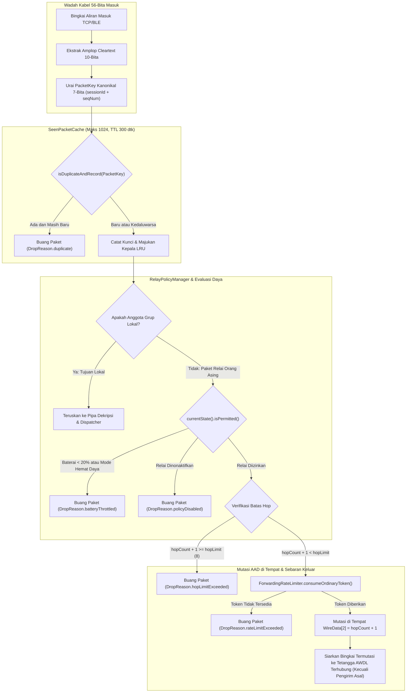
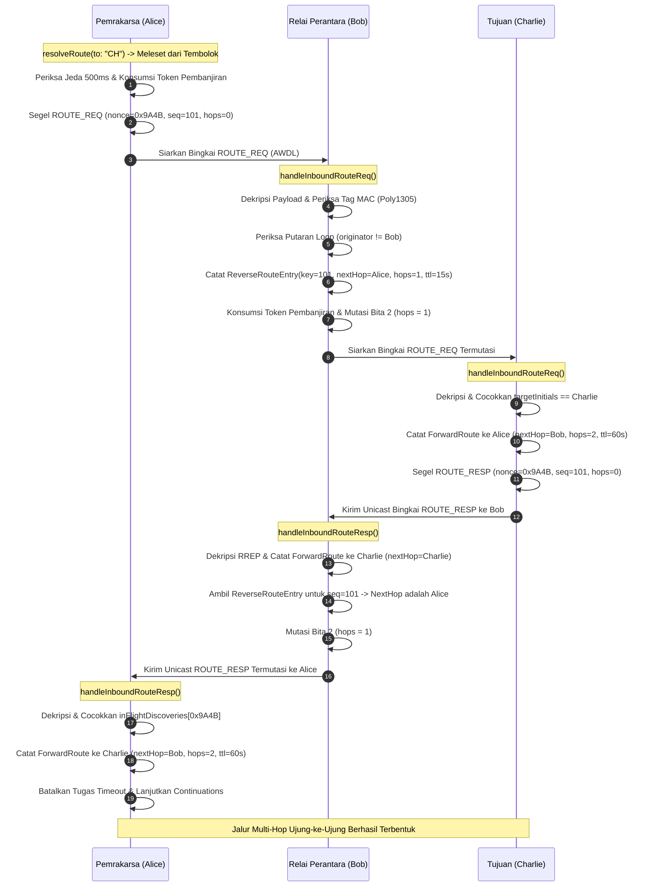

# Volume 04: Mesin Perutean Mesh, AODV & Kebijakan Relai (Meepo)

## Ringkasan Eksekutif & Gambaran Umum

Volume 04 mendalami mesin penerusan *multi-hop mesh* inti, penemuan rute reaktif, manajemen tetangga fisik, dan penegakan kebijakan relai sadar-baterai pada sistem Meepo. Ketika ponsel pintar beroperasi di lingkungan bencana *off-grid* yang parah—seperti medan reruntuhan gempa bumi, komunitas yang terisolasi banjir, atau pascabencana badai dahsyat di mana infrastruktur kota hancur total—jangkauan radio *peer-to-peer* langsung (Apple Wireless Direct Link / AWDL dan Bluetooth Low Energy / BLE) jarang melebihi 30 hingga 100 meter karena adanya rintangan fisik dan redaman struktural. Untuk menghadirkan suar darurat SOS penyelamat jiwa, pesan mikro taktis, dan telemetri lokasi regu melintasi bermil-mil medan terganggu dan berbagai sektor operasional, Meepo mengubah perangkat iOS yang berpartisipasi menjadi jaringan relai *multi-hop* yang otonom dan kooperatif.

Mesin perutean *mesh* dirancang berdasarkan tiga prinsip arsitektur fundamental:
1. **Penerusan Buta Nir-Pengetahuan (*Blind, Zero-Knowledge Forwarding*):** Simpul perelai bertindak sebagai kurir paket yang tidak tepercaya. Karena *payload* di dalam paket disegel menggunakan kunci simetris ChaCha20-Poly1305 AEAD 256-bit yang hanya dibagikan dalam sesi grup pribadi, simpul perantara orang asing tidak dapat memeriksa isi pesan, mengidentifikasi identitas pengirim/penerima, atau melacak koordinat lokasi. Simpul relai hanya memeriksa amplop *cleartext* 10-bita, memverifikasi ID sesi 24-bit dan batas 8-hop, memutasi Bita 2 (`hopCount`) di tempat, lalu meneruskan wadah tersebut. Penyamaran hop pada Authenticated Associated Data (AAD) menjamin bahwa penaikan `hopCount` tidak membatalkan tag MAC kriptografis pengirim aslinya.
2. **Peredaman Badai Siaran Deterministik & Penganggaran Sumber Daya:** Pengiriman banjir *multi-hop* secara inheren membawa risiko badai siaran (*broadcast storms*) dan pengurasan baterai. Meepo menghentikan replikasi paket eksponensial melalui tembolok duplikat *Least Recently Used* (LRU) terbatas yang terisolasi dalam aktor (`SeenPacketCache`, menampung 1.024 entri selama 300 detik) dengan kunci `PacketKey` kanonikal 7-bita yang menghilangkan jumlah hop yang berubah-ubah. Selain itu, `ForwardingRateLimiter` menegakkan algoritma *token bucket* dua jalur: lalu lintas *mesh* rutin dibatasi pada kondisi tunak 2,0 paket/detik dengan reservasi telemetri khusus, sementara siaran SOS mendesak berjalan pada jalur independen 4,0 paket/detik dengan cadangan lonjakan 8-token.
3. **Penemuan Multi-Hop AODV Reaktif & Penghematan Baterai:** Alih-alih menghasilkan detak jantung perutean proaktif yang terus-menerus menguras baterai, Meepo menggunakan protokol penemuan Ad-hoc On-Demand Distance Vector (AODV) berbasis kebutuhan (`RouteDiscoveryService`). Rute hanya dicari ketika ada pesan yang harus dikirim ke tujuan yang belum memiliki rute. Bingkai `ROUTE_REQ` yang masuk membentuk rute balik efemeral (TTL 15 detik), memungkinkan paket `ROUTE_RESP` melakukan transmisi *unicast* langsung kembali ke pemrakarsa. Lebih jauh, `RelayPolicyManager` menegakkan persetujuan *opt-in* yang ketat dan secara otomatis mengaktifkan Mode Bertahan Hidup bantuan bencana saat baterai perangkat turun di bawah 20% atau Mode Daya Rendah diaktifkan, seketika memutuskan relai orang asing dan membersihkan antrean paket transit.

---

### Gambaran Umum Sederhana (ELI5): Regu Pembawa Ember Penjaga Privasi

Bayangkan sebuah zona bencana perkotaan setelah gempa bumi besar di mana menara seluler, jaringan listrik, dan kabel serat optik hancur lebur. Tim Tanggap Darurat Komunitas (CERT) dan regu penyelamat relawan sipil tersebar di seluruh blok kota yang runtuh:

1. **Rantang Logam Terkunci (Penerusan Buta):** Penyelamat Alice di Sektor 1 perlu mengirimkan laporan korban darurat kepada Komandan Insiden Dave di posko utama, namun radio Alice hanya dapat menjangkau Bob yang berada 40 meter di depannya. Alice memasukkan laporannya ke dalam kapsul baja 56-bita yang dikunci dengan kunci simetris 256-bit pribadi regu yang hanya dapat dibuka oleh Dave. Pada selongsong transparan luar diselipkan secarik slip perutean: *"Untuk Sesi #42, Langkah Maksimum: 8, Langkah Saat Ini: 0"*. Saat Bob menerima kapsul tersebut, ia tidak dapat membaca rincian korban atau koordinat regu. Bob hanya menaikkan angka "0" menjadi "1" dan meneruskannya ke Charlie.
2. **Buku Catatan Penjaga Pintu (`SeenPacketCache`):** Setiap simpul penyelamat di zona bencana memiliki buku catatan kriptografis yang mencatat tanda tangan dari 1.024 paket terakhir yang ditanganinya. Jika relai tetangga mencoba menyerahkan tanda tangan paket yang sudah pernah diproses Charlie dua menit lalu, perangkat Charlie langsung membuangnya. Ini mencegah paket berputar-putar tanpa henti di tengah reruntuhan dalam badai siaran yang dahsyat.
3. **Kran Jatah Air (`ForwardingRateLimiter`):** Setiap simpul menegakkan batas laju yang stabil (2 paket per detik) untuk telemetri rutin agar tidak membanjiri lebar pita radio yang terbatas. Namun, jika suar darurat SOS yang kritis bagi keselamatan jiwa tiba, suar tersebut melewati antrean rutin dan masuk ke jalur prioritas darurat agar panggilan bahaya tidak pernah tertunda oleh ping lokasi biasa.
4. **Jejak Remah Roti Pramuka (Penemuan AODV Reaktif):** Jika perangkat Alice tidak memiliki rute aktif ke Dave di balik reruntuhan, perangkat Alice mengirimkan pengintai rute otomatis: *"Di mana Dave?"* Saat permintaan bergerak dari Bob ke Charlie lalu ke Dave, setiap simpul mencatat jejak arah baliknya. Saat perangkat Dave menerima pertanyaan tersebut, ia mengirimkan Respons Rute terotentikasi kembali melalui jalur sebaliknya, menetapkan rute *multi-hop* terverifikasi untuk satu jam berikutnya.
5. **Garis Penyelamat Baterai (Mode Bertahan Hidup Bencana):** Meneruskan paket *mesh* untuk unit penyelamat tetangga adalah misi kemanusiaan yang mulia, namun tidak ada petugas yang boleh kehabisan baterai ponsel di zona bencana. Ketika baterai perangkat turun di bawah 20%, sistem secara otomatis mengaktifkan Mode Bertahan Hidup, mematikan fungsi relai pihak ketiga dan membuang paket transit yang tidak penting untuk menghemat sisa daya baterai secara eksklusif bagi suar darurat SOS milik petugas itu sendiri.

---

## Daftar Berkas Sumber yang Disertakan

Tabel berikut merinci setiap berkas kode sumber yang ditetapkan untuk Volume 04. Setiap jalur berkas ditautkan secara relatif terhadap dokumen ini, disertai dengan kategorinya, jumlah baris yang diverifikasi (`wc -l`), dan peran arsitektural tunggalnya:

| Jalur Berkas | Kategori | Jumlah Baris (`wc -l`) | Tujuan & Tanggung Jawab Arsitektural |
| :--- | :--- | :---: | :--- |
| [SeenPacketCache.swift](../../Teekum/Teekum/Core/Mesh/SeenPacketCache.swift) | Tembolok | 174 | Aktor yang mengimplementasikan tembolok peredam paket duplikat LRU terbatas 1.024-entri yang aman untuk *thread* dengan TTL 300 detik. |
| [DropReason.swift](../../Teekum/Teekum/Core/Mesh/Relay/DropReason.swift) | Relai | 20 | Enumerasi klasifikasi yang merinci alasan pasti pembuangan paket di seluruh jalur pipa penerusan dan perutean. |
| [ForwardingBudgetManaging.swift](../../Teekum/Teekum/Core/Mesh/Relay/ForwardingBudgetManaging.swift) | Relai | 26 | Kontrak protokol yang mendeklarasikan kuota penerusan asinkron dan metode verifikasi batas laju. |
| [ForwardingRateLimiter.swift](../../Teekum/Teekum/Core/Mesh/Relay/ForwardingRateLimiter.swift) | Relai | 131 | Aktor yang menegakkan batas laju *token-bucket* ganda untuk relai rutin, reservasi telemetri, dan lonjakan SOS mendesak. |
| [RelayParticipationMode.swift](../../Teekum/Teekum/Core/Mesh/Relay/RelayParticipationMode.swift) | Relai | 14 | Enumerasi mode relai pengguna (dinonaktifkan, relaiKomunalAktif, 30MenitTerbatas) yang mengontrol partisipasi penerusan *mesh*. |
| [RelayPolicyManager.swift](../../Teekum/Teekum/Core/Mesh/Relay/RelayPolicyManager.swift) | Relai | 327 | Aktor yang menegakkan ambang batas baterai, sesi terbatas waktu, aturan relai orang asing, dan agregasi telemetri anonim. |
| [RelayPolicyState.swift](../../Teekum/Teekum/Core/Mesh/Relay/RelayPolicyState.swift) | Relai | 59 | Model status *immutable* yang menggerakkan deskripsi pengaturan pengguna, sakelar mode, dan evaluasi Mode Bertahan Hidup bantuan bencana. |
| [RelayStatus.swift](../../Teekum/Teekum/Core/Mesh/Relay/RelayStatus.swift) | Relai | 44 | Enumerasi status operasional relai tingkat tinggi (aktifSelalu, aktifTerbatas, jedaBateraiBertahanHidup, dihentikanNonaktif). |
| [InFlightDiscovery.swift](../../Teekum/Teekum/Core/Mesh/Routing/InFlightDiscovery.swift) | Perutean | 18 | Struktur status internal yang melacak upaya penemuan rute AODV yang sedang berlangsung dengan pengatur waktu coba ulang dan *continuation*. |
| [NeighborEntry.swift](../../Teekum/Teekum/Core/Mesh/Routing/NeighborEntry.swift) | Perutean | 22 | Struktur perutean internal yang merepresentasikan simpul tetangga fisik 1-hop yang dipantau dengan rasio kehilangan transmisi. |
| [NeighborEvent.swift](../../Teekum/Teekum/Core/Mesh/Routing/NeighborEvent.swift) | Perutean | 16 | Enumerasi peristiwa siklus hidup yang dipancarkan pada penemuan tetangga, perubahan status koneksi, atau penggusuran tabel. |
| [NeighborInfo.swift](../../Teekum/Teekum/Core/Mesh/Routing/NeighborInfo.swift) | Perutean | 39 | Model status tetangga publik yang mengekspos RSSI terhaluskan, skor kualitas tautan, dan stempel waktu terakhir terlihat. |
| [NeighborManaging.swift](../../Teekum/Teekum/Core/Mesh/Routing/NeighborManaging.swift) | Perutean | 28 | Protokol yang mendeklarasikan registri tetangga, evaluasi kualitas tautan, dan kontrak pemangkasan. |
| [NeighborState.swift](../../Teekum/Teekum/Core/Mesh/Routing/NeighborState.swift) | Perutean | 15 | Enumerasi klasifikasi kesehatan tautan (menghubungkan, terhubung, terdegradasi, usang) yang mengatur prioritas perutean tetangga. |
| [NeighborTable+Health.swift](../../Teekum/Teekum/Core/Mesh/Routing/NeighborTable+Health.swift) | Perutean | 150 | Ekstensi tabel tetangga yang mengeksekusi evaluasi hasil transmisi, pemeringkatan kandidat, dan penggusuran dua tahap. |
| [NeighborTable+Registry.swift](../../Teekum/Teekum/Core/Mesh/Routing/NeighborTable+Registry.swift) | Perutean | 152 | Ekstensi tabel tetangga yang mencatat koneksi langsung, pemfilteran tetangga aktif, dan batas kapasitas. |
| [NeighborTable.swift](../../Teekum/Teekum/Core/Mesh/Routing/NeighborTable.swift) | Perutean | 96 | Aktor yang mengelola tabel tetangga fisik 1-hop berkapasitas 64 entri dan aliran siaran peristiwa. |
| [ReverseRouteEntry.swift](../../Teekum/Teekum/Core/Mesh/Routing/ReverseRouteEntry.swift) | Perutean | 27 | Struktur perutean balik efemeral yang disimpan selama penemuan rute AODV untuk memandu pengiriman Respons Rute (RREP). |
| [RouteDiscoveryFailure.swift](../../Teekum/Teekum/Core/Mesh/Routing/RouteDiscoveryFailure.swift) | Perutean | 40 | Enumerasi galat penemuan rute AODV (waktuHabis, tujuanTidakTerjangkau, batasHopTerlampaui, loopTerdeteksi). |
| [RouteDiscoveryService+Inbound.swift](../../Teekum/Teekum/Core/Mesh/Routing/RouteDiscoveryService+Inbound.swift) | Perutean | 332 | Ekstensi masuk AODV yang memproses Permintaan Rute (RREQ) dan Respons Rute (RREP) masuk dengan penyamaran hop AAD. |
| [RouteDiscoveryService+Initiation.swift](../../Teekum/Teekum/Core/Mesh/Routing/RouteDiscoveryService+Initiation.swift) | Perutean | 161 | Ekstensi inisiasi AODV yang menyelesaikan rute tertembolok, menggabungkan permintaan bersamaan, dan menyiarkan datagram RREQ. |
| [RouteDiscoveryService+Maintenance.swift](../../Teekum/Teekum/Core/Mesh/Routing/RouteDiscoveryService+Maintenance.swift) | Perutean | 92 | Ekstensi pemeliharaan rute yang membatalkan tautan terputus, mengeksekusi pembersihan sesi, dan mengekspor diagnostik. |
| [RouteDiscoveryService.swift](../../Teekum/Teekum/Core/Mesh/Routing/RouteDiscoveryService.swift) | Perutean | 140 | Aktor inti yang mengoordinasikan penemuan rute *multi-hop* AODV reaktif, penghitung urutan, dan pembanjiran *token bucket*. |
| [RouteEntry.swift](../../Teekum/Teekum/Core/Mesh/Routing/RouteEntry.swift) | Perutean | 38 | Entri tabel perutean yang mengikat slot anggota tujuan ke ID rekan hop berikutnya, jarak hop, biaya, dan masa kedaluwarsa. |
| [RouteReqHandlingResult.swift](../../Teekum/Teekum/Core/Mesh/Routing/RouteReqHandlingResult.swift) | Perutean | 18 | Klasifikasi hasil untuk penanganan paket RREQ (dijawabDenganRResp, diteruskan, dibuangDuplikat, dibuangLoop). |
| [RouteRespHandlingResult.swift](../../Teekum/Teekum/Core/Mesh/Routing/RouteRespHandlingResult.swift) | Perutean | 17 | Klasifikasi hasil untuk penanganan paket RREP (penemuanSelesai, diteruskanKeHopBalik, dibuangUsang). |
| [RoutingTable.swift](../../Teekum/Teekum/Core/Mesh/Routing/RoutingTable.swift) | Perutean | 313 | Aktor yang mengelola jalur perutean *multi-hop* AODV dinamis, kedaluwarsa TTL, monotonisitas urutan, dan pencarian hop berikutnya. |
| [RoutingTableManaging.swift](../../Teekum/Teekum/Core/Mesh/Routing/RoutingTableManaging.swift) | Perutean | 43 | Protokol yang mendeklarasikan kueri rute *multi-hop*, pendaftaran, pengambilan rute balik, dan kontrak pembatalan. |
| [SeenRREQEntry.swift](../../Teekum/Teekum/Core/Mesh/Routing/SeenRREQEntry.swift) | Perutean | 13 | Entri tembolok deduplikasi yang mencatat siaran RREQ terbaru untuk meredam putaran siaran (*broadcast loops*). |
| **Total Artefak Volume 04** | **29 Berkas** | **2565** | **100% Akuntansi Basis Kode Volume 04** |

---

## Arsitektur Penerusan Mesh & Perutean AODV

Diagram berikut mengilustrasikan alur pipa penerusan *multi-hop*, mekanisme pembatas laju ember ganda, pertukaran penemuan rute AODV reaktif, dan siklus hidup kesehatan tetangga fisik 1-hop.

### 1. Alur Pipa Penerusan Buta Multi-Hop & Deduplikasi



### 2. Arsitektur Pembatasan Laju Token Bucket Dua Jalur

```
+===================================================================================+
|                       ForwardingRateLimiter Token Buckets                         |
+===================================================================================+
|                                                                                   |
|  [ EMBER RELAI RUTIN ]                                                            |
|  Laju Pengisian: 2,0 token/dtk | Kapasitas Lonjakan: Dikonfigurasi (misal 4 token)|
|                                                                                   |
|  +-----------------------------------------------------------------------------+  |
|  | [ Token 1 ]  [ Token 2 ]  [ Token 3 ]  [ Token 4 ]                         |  |
|  +-----------------------------------------------------------------------------+  |
|         |                                        ^                                |
|         v                                        | (Menyisakan cadangan 1.0)      |
|   Paket Mesh Biasa                       Siaran Telemetri                         |
|   (Obrolan, ACK, Relai)                  (Lokasi, Ping)                           |
|                                                                                   |
|  -------------------------------------------------------------------------------  |
|                                                                                   |
|  [ EMBER PRIORITAS SOS MENDESAK (TERISOLASI) ]                                    |
|  Laju Pengisian: 4,0 token/dtk | Kapasitas Lonjakan: 8,0 token                    |
|                                                                                   |
|  +-----------------------------------------------------------------------------+  |
|  | [ SOS 1 ] [ SOS 2 ] [ SOS 3 ] [ SOS 4 ] [ SOS 5 ] [ SOS 6 ] [ SOS 7 ] [ SOS 8 ]|
|  +-----------------------------------------------------------------------------+  |
|         |                                                                         |
|         v                                                                         |
|   Suar Marabahaya SOS Mendesak (Throughput Terjamin, Bebas Hambatan Lalu Lintas)  |
+===================================================================================+
```

### 3. Urutan Penemuan Rute AODV Reaktif (Siaran RREQ / Unicast RREP)



---

## Pembahasan Mendalam Berkas demi Berkas

---

## 1. Teekum/Teekum/Core/Mesh/SeenPacketCache.swift

- **Tautan Relatif Repositori:** [`../../Teekum/Teekum/Core/Mesh/SeenPacketCache.swift`](../../Teekum/Teekum/Core/Mesh/SeenPacketCache.swift)
- **Jumlah Baris:** 174 baris
- **Domain Konkurensi:** Swift `actor` (`public actor SeenPacketCache`)
- **Semantik Tipe:** Tipe referensi dengan isolasi aktor yang menjamin status deduplikasi tersinkronisasi di seluruh aliran kedatangan paket yang bersamaan.

### Apa yang Dilakukan Berkas Ini
`SeenPacketCache.swift` mengimplementasikan tembolok peredam paket duplikat *Least Recently Used* (LRU) terbatas yang terisolasi dalam aktor. Berkas ini mencatat paket-paket yang baru saja diamati menggunakan `PacketKey` kanonikal 7-bita (dibentuk dengan menggabungkan ID sesi 24-bit dan nomor urut 32-bit, sembari secara sengaja mengabaikan `hopCount` dan `hopLimit` 1-bita yang bermutasi). Dengan menampung hingga 1.024 entri dengan batas waktu simpan geser (*sliding retention time-to-live* / TTL) selama 300 detik (5 menit), berkas ini menjamin bahwa banjir siaran multi-jalur dan rute relai melingkar tidak menimbulkan badai siaran atau kerja CPU/radio yang sia-sia.

### Analogi Sederhana (ELI5)
Bayangkan seorang penjaga pos ketat yang mengawasi frekuensi radio di sektor operasional bencana. Setiap kali sebuah paket tiba melalui *mesh*, penjaga memeriksa buku log aktif berisi 1.024 tanda tangan paket terakhir yang diterima dalam lima menit terakhir. Jika tanda tangan yang sama persis sudah tercatat di buku log, penjaga langsung membuang paket tersebut sebelum memakan waktu komputasi sedikit pun. Jika tanda tangannya baru, penjaga mencatatnya ke dalam tembolok. Jika buku catatan mencapai batas 1.024 entri, penjaga menghapus tanda tangan tertua yang paling jarang dilihat menggunakan aturan LRU untuk memberi ruang bagi lalu lintas baru.

### Definisi Istilah Teknis
- **Penggusuran LRU (Least Recently Used Eviction):** Algoritma penggantian tembolok yang membuang item yang paling lama tidak diakses terlebih dahulu ketika kapasitas tembolok telah mencapai batas maksimum.
- **PacketKey:** Pengidentifikasi kanonikal 7-bita yang dapat di-*hash* (`sessionId` + `sequenceNumber`) yang secara unik mengidentifikasi transmisi paket yang tidak dapat diubah di seluruh masa hidup *multi-hop*-nya, tidak terpengaruh oleh kenaikan jumlah hop.
- **TTL Retensi Geser (*Sliding Retention TTL*):** Kebijakan masa hidup di mana entri tetap berlaku selama 300 detik sejak kedatangan, dan kedatangan duplikat baru menyentuh stempel waktu akses untuk menjaga catatan aliran aktif tetap hidup.
- **Badai Siaran (*Broadcast Storm*):** Kondisi kegagalan dalam jaringan ad-hoc nirkabel di mana simpul-simpul terus menyiarkan ulang paket yang sama satu sama lain tanpa henti, menghabiskan seluruh spektrum radio dan membuat penyangga penerima macet.
- **MeshClock:** Abstraksi protokol yang diinjeksikan untuk pengukuran waktu (`clock.now()`) yang memungkinkan pengujian unit instan dan 100% deterministik tanpa bergantung pada penundaan jam sistem nyata.

### Pembahasan Kode Baris demi Baris

#### Baris 1–45: Deklarasi Aktor, `CacheEntry`, dan Inisialisator
```swift
//
//  SeenPacketCache.swift
//  Teekum
//
//  Created by Nicho on 08/11/26.
//

import Foundation

/// Thread-safe in-memory Bounded LRU Duplicate Packet Suppression Cache.
///
/// Implements Architectural Decision 2 & 7:
/// - Max capacity: 1,024 entries (~7.1 KB RAM footprint)
/// - Sliding retention TTL: 300 seconds (5 minutes)
/// - Deterministic eviction: Oldest / least-recently-seen packet key evicted on overflow
/// - Injected `MeshClock` dependency for 100% deterministic unit testing
/// - Keyed by canonical 7-byte `PacketKey` (excluding mutating hop metadata)
public actor SeenPacketCache {
    
    public struct CacheEntry: Sendable {
        public let key: PacketKey
        public let arrivalTime: Date
        public var lastAccessed: Date
    }
    
    private let capacity: Int
    private let ttl: TimeInterval
    private let clock: MeshClock
    
    /// Map of canonical packet key -> entry
    private var entries: [PacketKey: CacheEntry] = [:]
    
    /// Ordered list of keys maintaining LRU order (most recently accessed at the end)
    private var lruOrder: [PacketKey] = []
    
    public init(
        capacity: Int = 1024,
        ttl: TimeInterval = 300.0,
        clock: MeshClock = SystemMeshClock()
    ) {
        self.capacity = max(1, capacity)
        self.ttl = max(1.0, ttl)
        self.clock = clock
    }
```
- **Baris 10–18:** Mendeklarasikan `SeenPacketCache` sebagai sebuah aktor. Baris 12–17 mendokumentasikan Keputusan Arsitektur 2 dan 7: kapasitas maksimum 1.024 entri yang hanya membutuhkan jejak RAM ~7,1 KB, TTL 300 detik, penggusuran LRU deterministik, injeksi `MeshClock`, dan kunci kanonikal 7-bita.
- **Baris 20–24:** Mendefinisikan struktur nilai bersarang `CacheEntry` yang memegang `key`, `arrivalTime` yang tidak dapat diubah, dan stempel waktu `lastAccessed` yang dapat dimutasi.
- **Baris 26–34:** Penyimpanan terdiri dari kamus `entries: [PacketKey: CacheEntry]` untuk pencarian O(1) dan larik `lruOrder: [PacketKey]` yang memelihara urutan kronologis akses di mana bagian awal mewakili entri terlama dan bagian akhir mewakili entri terbaru.
- **Baris 36–44:** Inisialisator menegakkan batas keselamatan minimum (`max(1, capacity)` dan `max(1.0, ttl)`) serta menetapkan `SystemMeshClock` default.

#### Baris 46–66: Kueri dan Inspeksi (`count`, `contains`, `insert`)
```swift
    /// Current number of unexpired entries in the cache.
    public var count: Int {
        entries.count
    }
    
    /// Checks whether the packet key is present and unexpired.
    /// Does NOT mutate the cache or record the key.
    public func contains(_ key: PacketKey, now: Date? = nil) -> Bool {
        let currentTime = now ?? clock.now()
        guard let entry = entries[key] else { return false }
        if currentTime.timeIntervalSince(entry.arrivalTime) >= ttl {
            return false
        }
        return true
    }
    
    /// Inserts or touches a packet key in the cache.
    public func insert(_ key: PacketKey, now: Date? = nil) {
        let currentTime = now ?? clock.now()
        _ = recordKey(key, now: currentTime)
    }
```
- **Baris 47–49:** `count` mengekspos jumlah ukuran kamus saat ini.
- **Baris 53–60:** `contains(_:now:)` melakukan pemeriksaan nir-mutasi: mengembalikan `true` hanya jika kuncinya ada dan waktu yang berlalu sejak `arrivalTime` lebih kecil dari `ttl`. Jika sudah kedaluwarsa, mengembalikan `false` tanpa memodifikasi *state*.
- **Baris 63–66:** `insert(_:now:)` memaksa penyisipan atau pembaruan dengan mendelegasikannya ke fungsi pembantu internal `recordKey`.

#### Baris 68–103: Deduplikasi Atomik (`isDuplicateAndRecord`)
```swift
    /// Atomically checks if a packet key is a duplicate, and if not, records it.
    ///
    /// - Returns: `true` if the packet was already present and fresh (duplicate to drop).
    ///            `false` if the packet was not seen before (fresh packet to process).
    public func isDuplicateAndRecord(_ key: PacketKey, now: Date? = nil) -> Bool {
        let currentTime = now ?? clock.now()
        
        // Fast lookup
        if let existing = entries[key] {
            if currentTime.timeIntervalSince(existing.arrivalTime) < ttl {
                // Fresh duplicate! Update LRU order
                touchLRU(key, now: currentTime)
                return true
            } else {
                // Expired entry found: treat as fresh arrival
                removeEntry(key)
            }
        }
        
        // Evict expired entries if approaching capacity
        if entries.count >= capacity {
            purgeExpiredEntries(currentTime: currentTime)
        }
        
        // If still at capacity, evict least recently accessed entry (head of lruOrder)
        while entries.count >= capacity, !lruOrder.isEmpty {
            let oldest = lruOrder.removeFirst()
            entries.removeValue(forKey: oldest)
        }
        
        // Insert new entry
        let newEntry = CacheEntry(key: key, arrivalTime: currentTime, lastAccessed: currentTime)
        entries[key] = newEntry
        lruOrder.append(key)
        return false
    }
```
- **Baris 72–74:** Titik masuk utama yang dieksekusi pada setiap bingkai radio yang masuk.
- **Baris 76–85:** Memeriksa apakah `entries[key]` ada. Jika waktu yang berlalu berada dalam batas `ttl`, memanggil `touchLRU(key, now: currentTime)` dan mengembalikan `true` (paket harus dibuang sebagai duplikat). Jika entri telah kedaluwarsa, menghapusnya agar bingkai masuk dapat diterima sebagai kedatangan baru.
- **Baris 88–90:** Jika jumlah entri mendekati atau mencapai kapasitas, menjalankan `purgeExpiredEntries` untuk membersihkan entri usang sebelum melakukan penggusuran LRU.
- **Baris 93–96:** Jika tembolok masih penuh setelah pembersihan entri kedaluwarsa, mengambil entri dari `lruOrder.removeFirst()` (entri yang paling lama tidak diakses) dan menghapusnya dari `entries`.
- **Baris 99–102:** Menyisipkan `CacheEntry` yang baru, menambahkan kunci ke akhir `lruOrder`, dan mengembalikan `false` (memberitahu pemanggil bahwa paket ini baru dan harus diproses/diteruskan).

#### Baris 104–173: Pembantu Penggusuran, Pembersihan, dan Pemeliharaan LRU
```swift
    /// Manually purges all expired entries beyond the 5-minute TTL window.
    public func purgeExpired(now: Date? = nil) {
        let currentTime = now ?? clock.now()
        purgeExpiredEntries(currentTime: currentTime)
    }
    
    /// Wipes all cached packet keys (e.g. on group teardown).
    public func removeAll() {
        entries.removeAll()
        lruOrder.removeAll()
    }
    
    // MARK: - Private Helpers
    
    private func recordKey(_ key: PacketKey, now: Date) -> Bool {
        if let existing = entries[key] {
            if now.timeIntervalSince(existing.arrivalTime) < ttl {
                touchLRU(key, now: now)
                return true
            } else {
                removeEntry(key)
            }
        }
        
        if entries.count >= capacity {
            purgeExpiredEntries(currentTime: now)
        }
        
        while entries.count >= capacity, !lruOrder.isEmpty {
            let oldest = lruOrder.removeFirst()
            entries.removeValue(forKey: oldest)
        }
        
        let newEntry = CacheEntry(key: key, arrivalTime: now, lastAccessed: now)
        entries[key] = newEntry
        lruOrder.append(key)
        return false
    }
    
    private func touchLRU(_ key: PacketKey, now: Date) {
        if var entry = entries[key] {
            entry.lastAccessed = now
            entries[key] = entry
        }
        if let idx = lruOrder.firstIndex(of: key) {
            lruOrder.remove(at: idx)
            lruOrder.append(key)
        }
    }
    
    private func removeEntry(_ key: PacketKey) {
        entries.removeValue(forKey: key)
        if let idx = lruOrder.firstIndex(of: key) {
            lruOrder.remove(at: idx)
        }
    }
    
    private func purgeExpiredEntries(currentTime: Date) {
        let cutoff = currentTime.addingTimeInterval(-ttl)
        var toRemove: Set<PacketKey> = []
        for (key, entry) in entries {
            if entry.arrivalTime < cutoff {
                toRemove.insert(key)
            }
        }
        for key in toRemove {
            removeEntry(key)
        }
    }
}
```
- **Baris 106–115:** `purgeExpired` dan `removeAll` menyediakan kemampuan pembersihan untuk pengatur waktu menganggur dan pembubaran grup.
- **Baris 144–153:** `touchLRU` memperbarui `lastAccessed` pada entri dan memindahkan kunci ke posisi paling belakang di `lruOrder`.
- **Baris 155–160:** `removeEntry` secara sinkron membersihkan kamus dan larik berurutan.
- **Baris 162–173:** `purgeExpiredEntries` menghitung ambang batas pemotongan ketat (`currentTime - ttl`) dan menghapus semua entri yang lebih lama dari ambang tersebut.

### Rasional Rekayasa dan Kasus Batas
- **Mengapa Metadata Hop Dihilangkan dari PacketKey:** Saat simpul A mentransmisikan paket dengan `hopCount: 0`, dan simpul perantara B merelainya dengan `hopCount: 1`, simpul C dapat menerima kedua bingkai jika berada dalam jangkauan radio keduanya. Jika `hopCount` disertakan dalam kunci, simpul C akan menganggapnya sebagai dua paket berbeda dan meneruskan keduanya, menciptakan replikasi siaran eksponensial. Menghilangkan `hopCount` dan `hopLimit` memastikan deduplikasi yang benar-benar idempoten.
- **Jejak RAM Terbatas:** Dengan 1.024 entri, masing-masing menyimpan kunci 7-bita dan dua referensi `Date` 8-bita, konsumsi memori dibatasi di bawah 8 KB, mencegah *crash* akibat tekanan memori pada lingkungan latar belakang iOS yang terbatas.
- **Keamanan Konkurensi Aktor:** Beberapa tugas penerimaan radio asinkron dari pembingkaian TCP AWDL dapat memanggil `isDuplicateAndRecord` secara bersamaan. Isolasi aktor menjamin semantik pemeriksaan dan penyisipan atomik tanpa kondisi perlombaan (*race conditions*).

---

## 2. Teekum/Teekum/Core/Mesh/Relay/DropReason.swift

- **Tautan Relatif Repositori:** [`../../Teekum/Teekum/Core/Mesh/Relay/DropReason.swift`](../../Teekum/Teekum/Core/Mesh/Relay/DropReason.swift)
- **Jumlah Baris:** 20 baris
- **Domain Konkurensi:** Swift `enum` (`public enum DropReason: Sendable, Equatable`)
- **Semantik Tipe:** Tipe nilai yang mematuhi `Sendable` dan `Equatable` untuk pensinyalan peristiwa lintas aktor yang aman dan berbiaya nol.

### Apa yang Dilakukan Berkas Ini
`DropReason.swift` mendefinisikan enumerasi terpadu yang mengklasifikasikan mengapa sebuah paket *mesh* yang masuk atau yang direlai ditolak atau dibuang oleh mesin penerusan. Berkas ini memungkinkan pelacakan telemetri mendalam tanpa memeriksa atau mencatat isi *payload* yang sensitif, mengaitkan kehilangan paket dengan peredaman duplikat, kehabisan batas hop, batas laju, penghematan baterai, kebijakan pengguna, saturasi antrean, paket cacat, kegagalan kriptografis, atau kehilangan simulasi pengujian.

### Analogi Sederhana (ELI5)
Bayangkan sebuah fasilitas penyortiran pos yang membubuhkan cap kode penolakan tertentu pada setiap paket yang dikembalikan tanpa terkirim: "Prangko Ganda", "Melebihi Batas Jarak", "Kuota Penuh", atau "Peringatan Bahan Bakar Rendah". Fasilitas tersebut tidak membaca surat di dalamnya; fasilitas hanya menghitung kode penolakan pada bagan operasional anonim agar manajer mengetahui alasan penurunan kinerja pengiriman.

### Definisi Istilah Teknis
- **Taksonomi Alasan Pembuangan (*Drop Reason Taxonomy*):** Kategorisasi standar peristiwa degradasi jaringan yang memungkinkan lapisan telemetri membedakan antara perilaku protokol normal (seperti peredaman duplikat) dan kondisi jaringan abnormal (seperti saturasi antrean).
- **Kehilangan Tersimulasi (*Simulated Loss*):** Pembuangan paket buatan yang sengaja diperkenalkan oleh lingkungan pengujian otomatis untuk memverifikasi percobaan ulang lapisan tautan, pemulihan rute, dan heuristik degradasi.

### Pembahasan Kode Baris demi Baris

#### Baris 1–20: Pembahasan Berkas Lengkap
```swift
//
//  DropReason.swift
//  Teekum
//
//  Created by Nicho on 06/11/26.
//

import Foundation

public enum DropReason: Sendable, Equatable {
    case duplicate
    case hopLimitExceeded
    case rateLimitExceeded
    case batteryThrottled
    case policyDisabled
    case queueSaturation
    case malformed
    case securityVerificationFailed
    case simulatedLoss
}
```
- **Baris 10–20:** Mendeklarasikan `DropReason` dengan 9 kasus kegagalan eksplisit:
  - `duplicate`: Paket sudah tercatat dalam `SeenPacketCache` dalam jendela TTL 5 menit.
  - `hopLimitExceeded`: Paket telah mencapai atau melebihi batas hop maksimum yang ditentukan (misalnya 8 hop).
  - `rateLimitExceeded`: Paket masuk tiba saat ember token penerusan sedang kosong.
  - `batteryThrottled`: Baterai perangkat keras turun di bawah 20% atau Mode Hemat Daya aktif.
  - `policyDisabled`: Pengguna mengonfigurasi mode relai ke `.disabled`.
  - `queueSaturation`: Penyangga cincin antrean kotak keluar prioritas penuh.
  - `malformed`: Ukuran bingkai atau header amplop *cleartext* melanggar spesifikasi kabel jaringan.
  - `securityVerificationFailed`: Tag MAC Poly1305 gagal atau terjadi ketidakcocokan AAD.
  - `simulatedLoss`: Pembuangan yang disuntikkan oleh pengujian unit atau simulator *chaos monkey*.

### Rasional Rekayasa dan Kasus Batas
- **Telemetri Anonim:** Dengan mengategorikan pembuangan melalui sebuah enum dan bukan pesan teks atau pencatatan data mentah, aplikasi mengumpulkan metrik kesehatan operasional agregat tanpa melanggar privasi pengguna atau menyimpan riwayat pelacakan.
- **Overhead Nol:** Sebagai enum Swift sederhana tanpa nilai terasosiasi, tipe ini dikompilasi menjadi tag bilangan bulat 8-bit pada *stack*, menjamin alokasi memori nol selama pemrosesan paket berkecepatan tinggi.

---

## 3. Teekum/Teekum/Core/Mesh/Relay/ForwardingBudgetManaging.swift

- **Tautan Relatif Repositori:** [`../../Teekum/Teekum/Core/Mesh/Relay/ForwardingBudgetManaging.swift`](../../Teekum/Teekum/Core/Mesh/Relay/ForwardingBudgetManaging.swift)
- **Jumlah Baris:** 26 baris
- **Domain Konkurensi:** Swift `protocol` yang mewarisi dari `Actor` (`public protocol ForwardingBudgetManaging: Actor`)
- **Semantik Tipe:** Abstraksi protokol yang mendefinisikan kontrak terisolasi dalam aktor untuk batas laju penerusan dan anggaran *token bucket*.

### Apa yang Dilakukan Berkas Ini
`ForwardingBudgetManaging.swift` mendeklarasikan antarmuka formal untuk pengelola anggaran penerusan berbasis *token-bucket*. Berkas ini menyediakan metode untuk mengonsumsi token bagi lalu lintas relai latar belakang rutin (2 paket/detik), siaran telemetri, dan lonjakan SOS darurat mendesak (hingga 4 paket/detik). Selain itu, berkas ini menentukan ekstensi protokol default untuk konsumsi token telemetri.

### Analogi Sederhana (ELI5)
Bayangkan sebuah loket token taman hiburan dengan dua dispenser token terpisah: dispenser hijau untuk wahana komedi putar rutin yang terisi kembali secara lambat, dan dispenser merah berkedip untuk ambulans medis darurat yang terisi kembali secara instan. Setiap operator wahana harus melapor ke loket protokol ini sebelum mengizinkan pengunjung melewati pintu putar.

### Definisi Istilah Teknis
- **Protokol Terikat Aktor (*Actor-Constrained Protocol*):** Protokol Swift yang dideklarasikan dengan `: Actor`, mewajibkan tipe yang mematuhinya berupa sebuah aktor dan memastikan bahwa semua pemanggilan metode bersifat asinkron dan terisolasi pada konteks eksekusi aktor tersebut.
- **Lalu Lintas Biasa vs Prioritas SOS:** Pesan *mesh* rutin (telemetri, pembaruan lokasi, obrolan) berbagi kuota penerusan yang terbatas, sedangkan paket SOS penyelamat jiwa mengakses anggaran independen berkecepatan lebih tinggi.

### Pembahasan Kode Baris demi Baris

#### Baris 1–26: Deklarasi Protokol Lengkap dan Ekstensi Default
```swift
//
//  ForwardingBudgetManaging.swift
//  Teekum
//
//  Created by Nicho on 06/11/26.
//

import Foundation

public protocol ForwardingBudgetManaging: Actor {
    /// Attempts to consume tokens for forwarding ordinary traffic (2 pkts/sec).
    func consumeOrdinaryToken() async -> Bool

    /// Telemetry leaves one burst token available for reliable traffic.
    func consumeTelemetryToken() async -> Bool
    
    /// Attempts to consume tokens for urgent SOS forwarding (max 4 pkts/sec).
    func consumeSOSToken() async -> Bool
    
    /// Current available ordinary token reserve.
    func availableTokens() async -> Double
}

public extension ForwardingBudgetManaging {
    func consumeTelemetryToken() async -> Bool { await consumeOrdinaryToken() }
}
```
- **Baris 10–22:** Mendeklarasikan empat persyaratan inti: `consumeOrdinaryToken()`, `consumeTelemetryToken()`, `consumeSOSToken()`, dan `availableTokens()`. Semua metode ditandai `async` karena isolasi aktor.
- **Baris 24–26:** Menyediakan implementasi cadangan default di mana `consumeTelemetryToken()` mendelegasikan langsung ke `consumeOrdinaryToken()` jika aktor yang mematuhinya tidak mengimplementasikan logika reservasi lonjakan telemetri kustom.

### Rasional Rekayasa dan Kasus Batas
- **Pemisahan Arsitektur (*Architectural Decoupling*):** Memisahkan perutean paket dan aktor transport *mesh* dari implementasi pembatas laju konkret, memungkinkan pengujian unit menginjeksikan pembatas laju tiruan (*mock rate limiters*) yang menyimulasikan kehabisan anggaran atau pengisian instan.

---

## 4. Teekum/Teekum/Core/Mesh/Relay/ForwardingRateLimiter.swift

- **Tautan Relatif Repositori:** [`../../Teekum/Teekum/Core/Mesh/Relay/ForwardingRateLimiter.swift`](../../Teekum/Teekum/Core/Mesh/Relay/ForwardingRateLimiter.swift)
- **Jumlah Baris:** 131 baris
- **Domain Konkurensi:** Swift `actor` (`public actor ForwardingRateLimiter: ForwardingBudgetManaging`)
- **Semantik Tipe:** Tipe referensi dengan isolasi aktor yang melindungi cadangan token termutasi dan stempel waktu pengisian kembali.

### Apa yang Dilakukan Berkas Ini
`ForwardingRateLimiter.swift` mengimplementasikan pembatasan laju *token-bucket* ganda untuk melindungi transceiver radio perangkat dan cadangan baterai dari kehabisan daya. Berkas ini mengelola dua cadangan token independen: ember lalu lintas biasa (dikonfigurasi untuk kondisi tunak 2,0 paket/detik dengan kapasitas lonjakan) dan ember SOS mendesak (dikonfigurasi untuk 4,0 paket/detik dengan kapasitas lonjakan 8 token). Lebih jauh lagi, berkas ini menerapkan kebijakan reservasi telemetri yang menyisakan setidaknya satu token lonjakan biasa untuk pesan obrolan andal dan paket konfirmasi (ACK).

### Analogi Sederhana (ELI5)
Bayangkan sebuah penampungan air dengan dua kran. Kran bawah mengairi sistem penyiram rumput rutin di posko bencana dan terisi kembali 2 tetes per detik hingga memenuhi gelas kecil. Kran darurat atas mengairi selang pemadam kebakaran dan memiliki tangki cadangan khusus yang terisi jauh lebih cepat. Jika gelas rutin hampir kosong, penyiram rumput berhenti sejenak agar selalu ada sisa tetesan air untuk pesan penting *walkie-talkie*.

### Definisi Istilah Teknis
- **Algoritma Token Bucket (*Token Bucket Algorithm*):** Algoritma pembatasan laju di mana token terakumulasi pada laju pengisian tetap hingga kapasitas lonjakan maksimum. Mentransmisikan paket mengonsumsi satu token; jika tidak ada token tersisa, paket ditolak.
- **Kapasitas Lonjakan (*Burst Capacity*):** Jumlah maksimum token yang dapat ditampung oleh sebuah ember, memungkinkan lonjakan singkat transmisi berkecepatan tinggi setelah periode hening tanpa melanggar batas laju rata-rata jangka panjang.
- **Pengisian Token Pecahan (*Fractional Token Refill*):** Menghitung penambahan token berdasarkan waktu yang berlalu (`elapsed * refillRate`) menggunakan matematika floating-point, menghindari ketidakstabilan pada batas detik diskret.

### Pembahasan Kode Baris demi Baris

#### Baris 1–50: Deklarasi Aktor, Properti, dan Inisialisator
```swift
//
//  ForwardingRateLimiter.swift
//  TeeKum Prototype
//
//  Created by Nicho on 29/10/26.
//

import Foundation

/// Token bucket forwarding budgets, initialized from TeeKumConfiguration:
/// - Ordinary traffic shares a configured refill rate and burst capacity.
/// - Telemetry leaves one ordinary burst token for reliable chat/ACK traffic.
/// - SOS retains its independent urgent budget (8-token burst capacity).
///
/// Supports an injected `MeshClock` for deterministic automated unit testing.
public actor ForwardingRateLimiter: ForwardingBudgetManaging {
    private let clock: MeshClock
    
    // Ordinary traffic token bucket
    private let ordinaryCapacity: Double
    private let ordinaryRefillRate: Double // tokens per second
    private var ordinaryTokens: Double
    private var lastOrdinaryRefill: Date
    
    // SOS priority token bucket
    private let sosCapacity: Double
    private let sosRefillRate: Double // tokens per second
    private var sosTokens: Double
    private var lastSOSRefill: Date
    
    public init(
        clock: MeshClock = SystemMeshClock(),
        ordinaryCapacity: Double = MeepoConfiguration.Timing.ordinaryRelayBurstCapacity,
        ordinaryRefillRate: Double = MeepoConfiguration.Timing.ordinaryRelayRateLimit,
        sosCapacity: Double = 8.0,
        sosRefillRate: Double = MeepoConfiguration.Timing.urgentSOSRateLimit
    ) {
        self.clock = clock
        self.ordinaryCapacity = ordinaryCapacity
        self.ordinaryRefillRate = ordinaryRefillRate
        self.sosCapacity = sosCapacity
        self.sosRefillRate = sosRefillRate
        
        let now = clock.now()
        self.ordinaryTokens = ordinaryCapacity
        self.lastOrdinaryRefill = now
        self.sosTokens = sosCapacity
        self.lastSOSRefill = now
    }
```
- **Baris 16–30:** Mendeklarasikan *state* aktor: `clock`, kapasitas (`ordinaryCapacity`, `sosCapacity`), laju pengisian dalam token/dtk (`ordinaryRefillRate`, `sosRefillRate`), saldo token saat ini (`ordinaryTokens`, `sosTokens`), dan stempel waktu pengisian terakhir (`lastOrdinaryRefill`, `lastSOSRefill`).
- **Baris 31–49:** Inisialisator mengambil nilai default langsung dari konstanta `MeepoConfiguration.Timing`, menginisialisasi ember ke kapasitas penuh, dan mencatat stempel waktu awal dari `clock.now()`.

#### Baris 51–70: Matematika Pengisian Kembali (`refillOrdinary`, `refillSOS`)
```swift
    /// Refills ordinary token bucket based on elapsed time.
    private func refillOrdinary(now: Date) {
        let elapsed = max(0.0, now.timeIntervalSince(lastOrdinaryRefill))
        if elapsed > 0 {
            let refilled = elapsed * ordinaryRefillRate
            ordinaryTokens = min(ordinaryCapacity, ordinaryTokens + refilled)
            lastOrdinaryRefill = now
        }
    }
    
    /// Refills SOS token bucket based on elapsed time.
    private func refillSOS(now: Date) {
        let elapsed = max(0.0, now.timeIntervalSince(lastSOSRefill))
        if elapsed > 0 {
            let refilled = elapsed * sosRefillRate
            sosTokens = min(sosCapacity, sosTokens + refilled)
            lastSOSRefill = now
        }
    }
```
- **Baris 52–59:** `refillOrdinary` menghitung waktu yang berlalu sejak pengisian terakhir, mengalikannya dengan `ordinaryRefillRate`, membatasi token ke `ordinaryCapacity` melalui fungsi `min()`, dan memperbarui `lastOrdinaryRefill`.
- **Baris 62–69:** `refillSOS` melakukan perhitungan serupa untuk ember SOS independen menggunakan `sosRefillRate` dan `sosCapacity`.

#### Baris 71–107: Konsumsi Token (`consumeOrdinaryToken`, `consumeTelemetryToken`, `consumeSOSToken`)
```swift
    /// Attempts to consume 1 token for forwarding ordinary relay traffic.
    /// Returns true if permitted, false if rate limit exceeded.
    public func consumeOrdinaryToken() async -> Bool {
        let now = clock.now()
        refillOrdinary(now: now)
        
        if ordinaryTokens >= 1.0 {
            ordinaryTokens -= 1.0
            return true
        } else {
            return false
        }
    }
    
    /// Telemetry shares the ordinary budget but leaves one burst token for chat/ACK.
    /// This is a reservation inside the configured budget, not an additional allowance.
    public func consumeTelemetryToken() async -> Bool {
        refillOrdinary(now: clock.now())
        let reserve = min(1.0, max(0.0, ordinaryCapacity - 1.0))
        guard ordinaryTokens >= 1.0 + reserve else { return false }
        ordinaryTokens -= 1.0
        return true
    }

    /// Attempts to consume 1 token for forwarding urgent SOS priority traffic.
    /// Returns true if permitted, false if SOS limit exceeded.
    public func consumeSOSToken() async -> Bool {
        let now = clock.now()
        refillSOS(now: now)
        
        if sosTokens >= 1.0 {
            sosTokens -= 1.0
            return true
        } else {
            return false
        }
    }
```
- **Baris 73–83:** Memeriksa apakah `ordinaryTokens >= 1.0`. Jika ya, mengurangi 1.0 dan mengembalikan `true`; jika tidak, mengembalikan `false`.
- **Baris 87–93:** Di dalam `consumeTelemetryToken()`, menghitung `reserve = min(1.0, max(0.0, ordinaryCapacity - 1.0))`. Fungsi ini mewajibkan `ordinaryTokens >= 1.0 + reserve`. Hal ini menjamin bahwa telemetri latar belakang rutin tidak akan pernah menguras ember sampai habis, selalu menyisakan setidaknya 1,0 token yang siap digunakan kapan saja untuk pesan obrolan pengguna atau konfirmasi kriptografis (ACK).
- **Baris 97–107:** `consumeSOSToken()` memeriksa ember SOS yang terpisah, memastikan lalu lintas keselamatan jiwa terlindungi sepenuhnya dari kehabisan kuota lalu lintas biasa.

#### Baris 109–131: Observabilitas dan Pengaturan Ulang
```swift
    /// Current available ordinary token reserve.
    public func availableTokens() async -> Double {
        let now = clock.now()
        refillOrdinary(now: now)
        return ordinaryTokens
    }
    
    /// Current available SOS token reserve.
    public func availableSOSTokens() async -> Double {
        let now = clock.now()
        refillSOS(now: now)
        return sosTokens
    }
    
    /// Manually resets token reserves to full capacity.
    public func reset() {
        let now = clock.now()
        ordinaryTokens = ordinaryCapacity
        lastOrdinaryRefill = now
        sosTokens = sosCapacity
        lastSOSRefill = now
    }
}
```
- **Baris 110–121:** Mengisi ulang dan memeriksa saldo token *floating-point* saat ini untuk cuplikan telemetri.
- **Baris 124–130:** `reset()` seketika mengisi kembali kedua ember ke kapasitas maksimumnya.

### Rasional Rekayasa dan Kasus Batas
- **Anggaran SOS Terisolasi:** Jika ada simpul orang asing yang jahat atau bermasalah membanjiri paket obrolan biasa, ember biasa akan habis dan membuang bingkai orang asing tersebut. Namun, karena SOS menggunakan ember terisolasi dengan batas lonjakan 8 token, suar darurat masuk tetap dapat diteruskan tanpa hambatan.
- **Presisi Floating-Point:** Penggunaan `Double` untuk token memungkinkan akumulasi pecahan pada interval sub-detik (misalnya, 100ms menghasilkan 0,2 token pada laju 2,0 token/detik), memastikan transmisi yang mulus dan bebas lonjakan tanpa pembulatan 1 detik yang kaku.

---

---

## 5. Teekum/Teekum/Core/Mesh/Relay/RelayParticipationMode.swift

- **Tautan Relatif Repositori:** [`../../Teekum/Teekum/Core/Mesh/Relay/RelayParticipationMode.swift`](../../Teekum/Teekum/Core/Mesh/Relay/RelayParticipationMode.swift)
- **Jumlah Baris:** 14 baris
- **Domain Konkurensi:** Swift `enum` (`public enum RelayParticipationMode: String, Sendable, Codable, CaseIterable`)
- **Semantik Tipe:** Tipe nilai yang mematuhi `String`, `Sendable`, `Codable`, dan `CaseIterable` untuk serialisasi langsung ke `UserDefaults` dan pengikatan (*binding*) pemilih SwiftUI.

### Apa yang Dilakukan Berkas Ini
`RelayParticipationMode.swift` mendefinisikan mode operasional yang dapat dipilih pengguna yang mengatur apakah perangkat berpartisipasi dalam relai *mesh* komunal. Berkas ini merangkum tiga pilihan privasi dan sumber daya inti pengguna: dinonaktifkan sepenuhnya, selalu aktif selama kesehatan baterai memungkinkan, atau aktif untuk jendela waktu sementara selama 30 menit.

### Analogi Sederhana (ELI5)
Bayangkan sebuah sakelar *hotspot* Wi-Fi pribadi dengan tiga pengaturan: "Mati" (jangan pernah membagikan data dengan siapa pun), "Selalu Nyala" (berbagi dengan petugas penyelamat dan penyintas selama baterai saya di atas 20%), atau "Pengatur Waktu: 30 Menit" (pinjamkan radio saya selama setengah jam, lalu matikan secara otomatis agar saya tidak lupa).

### Definisi Istilah Teknis
- **Relai Komunal (*Communal Relay*):** Praktik di mana simpul-simpul peserta secara sukarela menggunakan sebagian kecil dari lebar pita radio dan daya baterai mereka untuk meneruskan paket terenkripsi atas nama peserta *mesh* lainnya.
- **Sesi Terbatas Waktu (*Timed Session*):** Status keikutsertaan sementara yang secara otomatis bertransisi kembali ke nonaktif setelah 1.800 detik (30 menit) untuk mencegah pengurasan baterai jangka panjang yang tidak disengaja.

### Pembahasan Kode Baris demi Baris

#### Baris 1–14: Deklarasi Enum Lengkap
```swift
//
//  RelayParticipationMode.swift
//  Teekum
//
//  Created by Nicho on 06/11/26.
//

import Foundation

public enum RelayParticipationMode: String, Sendable, Codable, CaseIterable {
    case disabled            // Relay OFF: never forwards stranger packets
    case communalRelayActive // Always relay while battery >= 20%
    case timed30Minutes      // Relay for 30 minutes, then automatically pause
}
```
- **Baris 10–14:** Mendeklarasikan `RelayParticipationMode` dengan nilai mentah `String`. Tiga kasus tersebut dipetakan ke:
  - `disabled`: Penolakan mutlak; perangkat membuang semua bingkai relai orang asing dan menghapus antrean kotak keluar relai.
  - `communalRelayActive`: Partisipasi penuh diaktifkan, tunduk pada pemeriksaan baterai Mode Bertahan Hidup bencana.
  - `timed30Minutes`: Partisipasi yang dibatasi oleh pengatur waktu hitung mundur 30 menit.

### Rasional Rekayasa dan Kasus Batas
- **Privasi Berdasarkan Default (*Privacy by Default*):** Dengan menjadikan `disabled` sebagai status awal default hingga persetujuan eksplisit diberikan oleh pengguna selama orientasi grup atau konfigurasi pengaturan, aplikasi mematuhi pedoman privasi dan pelestarian baterai Apple yang ketat.
- **Persistensi Codable:** Dukungan tipe `String` memastikan penyimpanan yang dapat dibaca manusia dan aman untuk migrasi di `UserDefaults`.

---

## 6. Teekum/Teekum/Core/Mesh/Relay/RelayPolicyManager.swift

- **Tautan Relatif Repositori:** [`../../Teekum/Teekum/Core/Mesh/Relay/RelayPolicyManager.swift`](../../Teekum/Teekum/Core/Mesh/Relay/RelayPolicyManager.swift)
- **Jumlah Baris:** 327 baris
- **Domain Konkurensi:** Swift `actor` (`public actor RelayPolicyManager`)
- **Semantik Tipe:** Tipe referensi dengan isolasi aktor yang mengatur kebijakan relai pengguna, ambang batas baterai, dan agregasi telemetri.

### Apa yang Dilakukan Berkas Ini
`RelayPolicyManager.swift` berfungsi sebagai orkestrator kebijakan pusat untuk relai *mesh* orang asing dan penghematan daya perangkat keras. Mematuhi isolasi aktor, berkas ini menegakkan persetujuan keikutsertaan pengguna secara eksplisit, mengelola sesi 30 menit terbatas waktu, dan secara otomatis mengaktifkan Mode Bertahan Hidup bantuan bencana saat baterai perangkat turun di bawah 20% atau Mode Daya Rendah iOS diaktifkan. Saat penangguhan atau penghentian relai terjadi, berkas ini segera menghentikan penerusan di `MeshTransport` dan membersihkan semua bingkai orang asing yang mengantre dari `PriorityOutboxQueue`, sembari memelihara telemetri sumber daya yang diagregasi secara ketat dan anonim tanpa mencatat koordinat lokasi.

### Analogi Sederhana (ELI5)
Bayangkan manajer energi dari karavan berkemah bertenaga surya. Manajer mengizinkan pekemah tetangga mencolokkan ponsel mereka ke soket daya eksternal karavan, tetapi hanya jika pemiliknya menekan "Izinkan" di dasbor. Manajer mengawasi pengukur baterai utama secara terus-menerus. Jika baterai karavan turun di bawah 20%, atau jika pengatur waktu 30 menit habis, manajer seketika memutuskan pemutus sirkuit ke soket luar, membersihkan permintaan pengisian yang tertunda, dan menghemat setiap sisa watt daya agar mesin dan lampu darurat karavan tetap berfungsi.

### Definisi Istilah Teknis
- **Mode Bertahan Hidup Bantuan Bencana (*Disaster Relief Survival Mode*):** Status penghematan baterai kritis yang terpicu secara otomatis saat tingkat baterai turun di bawah 20% (`< 0.20`) atau Mode Daya Rendah iOS diaktifkan. Mode ini mematikan semua relai orang asing untuk menghemat daya bagi fitur keselamatan lokal.
- **Pengurasan Antrean Relai (*Relay Queue Drainage*):** Pembersihan dan dealokasi segera paket orang asing yang mengantre dari kotak keluar prioritas saat relai ditangguhkan, mencegah paket usang membebani memori atau ditransmisikan saat bangun.
- **AsyncStream Non-Isolated:** Pola konkurensi yang mengekspos properti `AsyncStream<RelayPolicyState>` bertanda `nonisolated` sehingga komponen UI eksternal dapat mengamati transisi status tanpa harus menunggu lompatan giliran aktor (*actor-hops*).
- **Telemetri Anonim (*Anonymous Telemetry*):** Pengumpulan jumlah operasional kasar (paket yang diteruskan, pembuangan berdasarkan kategori) tanpa mencatat pengenal, stempel waktu, atau koordinat geospasial, mematuhi standar telemetri nir-pengetahuan yang ketat.

### Pembahasan Kode Baris demi Baris

#### Baris 1–83: Dependensi, Properti State, Penghitung Telemetri, dan Inisialisator
```swift
//
//  RelayPolicyManager.swift
//  TeeKum Prototype
//
//  Created by Nicho on 29/10/26.
//

import Foundation

/// Actor-isolated communal relay participation and battery policy manager.
///
/// - Enforces explicit user opt-in for stranger relaying.
/// - Persists user preference via `UserDefaults` with support for timed 30-minute sessions.
/// - Enforces disaster relief Survival Mode (<20% battery or Low Power Mode) with immediate shutdown of stranger forwarding.
/// - Drains and purges queued stranger packets promptly upon relay termination.
/// - Integrates with `MeshTransport` and `PriorityOutboxQueue` to enforce resource budgets at the service layer.
/// - Tracks strictly aggregated resource telemetry with ZERO sensitive location coordinates or tracking history.
/// - Fully testable via injected `MeshClock`.
public actor RelayPolicyManager {
    
    // MARK: - Dependencies
    
    private let clock: MeshClock
    private let userDefaults: UserDefaults
    private let storageKeyPrefix: String
    private weak var transport: MeshTransport?
    private let outbox: PriorityOutboxQueue?
    
    // MARK: - State Properties
    
    private var mode: RelayParticipationMode
    private var timedExpiryDate: Date?
    private var batteryLevel: Float
    private var isLowPowerModeActive: Bool
    
    // MARK: - Telemetry Counters (Anonymous, zero location retention)
    
    private var totalPacketsForwarded: Int = 0
    private var totalSOSForwarded: Int = 0
    private var packetsDroppedRateLimit: Int = 0
    private var packetsDroppedHopLimit: Int = 0
    private var duplicatePacketsSuppressed: Int = 0
    private var packetsDroppedPolicy: Int = 0
    private var packetsDroppedBattery: Int = 0
    private var packetsDroppedQueueSaturation: Int = 0
    private var packetsDroppedMalformed: Int = 0
    private var packetsDroppedSecurity: Int = 0
    private var packetsDroppedSimulatedLoss: Int = 0
    
    // MARK: - Reactive State Stream
    
    private var stateContinuation: AsyncStream<RelayPolicyState>.Continuation?
    public nonisolated let stateUpdates: AsyncStream<RelayPolicyState>
    
    // MARK: - Storage Keys
    
    private var modeStorageKey: String { "\(storageKeyPrefix).participationMode" }
    private var expiryStorageKey: String { "\(storageKeyPrefix).timedExpiryDate" }
    
    // MARK: - Initialization
    
    public init(
        clock: MeshClock = SystemMeshClock(),
        userDefaults: UserDefaults = .standard,
        storageKeyPrefix: String = "com.teekum.relay",
        transport: MeshTransport? = nil,
        outbox: PriorityOutboxQueue? = nil,
        initialBatteryLevel: Float = 1.0,
        initialLowPowerMode: Bool = false,
        defaultMode: RelayParticipationMode? = nil
    ) {
        self.clock = clock
        self.userDefaults = userDefaults
        self.storageKeyPrefix = storageKeyPrefix
        self.transport = transport
        self.outbox = outbox
        self.batteryLevel = initialBatteryLevel
        self.isLowPowerModeActive = initialLowPowerMode
        
        var continuation: AsyncStream<RelayPolicyState>.Continuation?
        self.stateUpdates = AsyncStream(bufferingPolicy: .bufferingNewest(1)) { continuation = $0 }
        self.stateContinuation = continuation
```
- **Baris 10–28:** Mendeklarasikan `RelayPolicyManager` sebagai aktor. Dependensi mencakup `MeshClock` yang diinjeksikan, instans `UserDefaults`, prefiks kunci, referensi lemah (*weak reference*) ke `MeshTransport` (menghindari siklus retensi), dan `PriorityOutboxQueue`.
- **Baris 30–35:** Melacak status termutasi internal: `mode`, `timedExpiryDate`, `batteryLevel` (0,0 hingga 1,0), dan `isLowPowerModeActive`.
- **Baris 38–48:** Mengagregasi penghitung operasional anonim untuk paket yang diteruskan dan pembuangan yang diklasifikasikan berdasarkan `DropReason`.
- **Baris 52–54:** Membuat aliran `stateUpdates` non-isolated yang didukung oleh *continuation* penyangga elemen tunggal (`.bufferingNewest(1)`).
- **Baris 62–83:** Di dalam inisialisator, menyiapkan dependensi dan aliran.

#### Baris 84–140: Pemulihan Persistensi dan Sinkronisasi
```swift
        // Restore persisted mode or use provided default / fallback to disabled
        if let defaultMode = defaultMode {
            self.mode = defaultMode
            self.timedExpiryDate = nil
        } else if let savedRaw = userDefaults.string(forKey: "\(storageKeyPrefix).participationMode"),
                  let savedMode = RelayParticipationMode(rawValue: savedRaw) {
            self.mode = savedMode
            if savedMode == .timed30Minutes {
                let expiryEpoch = userDefaults.double(forKey: "\(storageKeyPrefix).timedExpiryDate")
                if expiryEpoch > 0 {
                    let expiry = Date(timeIntervalSince1970: expiryEpoch)
                    if clock.now() < expiry {
                        self.timedExpiryDate = expiry
                    } else {
                        // Already expired while app was closed -> pause relaying
                        self.timedExpiryDate = expiry
                    }
                } else {
                    self.timedExpiryDate = nil
                }
            } else {
                self.timedExpiryDate = nil
            }
        } else {
            // Default at first launch: disabled until user explicitly opts in / accepts compact
            self.mode = .disabled
            self.timedExpiryDate = nil
        }
    }
    
    // MARK: - Subsystem 4: Policy Management
    
    /// Returns the current effective relay policy state.
    public func currentState() -> RelayPolicyState {
        RelayPolicyState(
            mode: mode,
            batteryLevel: batteryLevel,
            isLowPowerModeActive: isLowPowerModeActive,
            timedExpiryDate: timedExpiryDate
        )
    }
    
    /// Pairing persists consent separately; refresh it before starting session discovery.
    /// Preserve the original timed expiry instead of granting another 30 minutes.
    public func synchronizePersistedParticipation() async {
        if let raw = userDefaults.string(forKey: modeStorageKey),
            let savedMode = RelayParticipationMode(rawValue: raw) {
            mode = savedMode
            let expiry = userDefaults.double(forKey: expiryStorageKey)
            timedExpiryDate = savedMode == .timed30Minutes && expiry > 0
                ? Date(timeIntervalSince1970: expiry) : nil
        }
        let permitted = currentState().isPermitted(at: clock.now())
        if !permitted { outbox?.clearRelayQueue() }
        await transport?.setRelayParticipation(enabled: permitted)
        emitStateUpdate()
    }
```
- **Baris 85–112:** Menangani pemulihan awal dari `UserDefaults`. Jika tidak ada preferensi yang tersimpan, default diatur secara ketat ke `.disabled`. Jika `.timed30Minutes` tersimpan, membaca stempel waktu *epoch* `timedExpiryDate`; jika aplikasi berjalan di latar belakang/tertutup dan bangun setelah batas waktu, stempel kedaluwarsa tetap dipertahankan sehingga `status` mengevaluasi ke `.timedExpired`.
- **Baris 117–124:** `currentState()` menyusun cuplikan *immutable* `RelayPolicyState`.
- **Baris 128–140:** `synchronizePersistedParticipation()` menyegarkan pengaturan dari disk, memeriksa izin melalui `currentState().isPermitted()`, membersihkan antrean kotak keluar jika dinonaktifkan, memperbarui transport radio, dan memancarkan pembaruan status reaktif.

#### Baris 142–202: Mutasi Mode (`setParticipationMode`, `setTimedParticipation`)
```swift
    /// Updates the user's chosen participation mode and persists to disk.
    public func setParticipationMode(_ newMode: RelayParticipationMode) async {
        let now = clock.now()
        self.mode = newMode
        
        switch newMode {
        case .communalRelayActive:
            self.timedExpiryDate = nil
            userDefaults.removeObject(forKey: expiryStorageKey)
            
            // Check if battery permits
            if batteryLevel >= 0.20 && !isLowPowerModeActive {
                await transport?.setRelayParticipation(enabled: true)
            } else {
                await transport?.setRelayParticipation(enabled: false)
                outbox?.clearRelayQueue()
            }
            
        case .timed30Minutes:
            let expiry = now.addingTimeInterval(1800) // 30 minutes
            self.timedExpiryDate = expiry
            userDefaults.set(expiry.timeIntervalSince1970, forKey: expiryStorageKey)
            
            if batteryLevel >= 0.20 && !isLowPowerModeActive {
                await transport?.setRelayParticipation(enabled: true)
            } else {
                await transport?.setRelayParticipation(enabled: false)
                outbox?.clearRelayQueue()
            }
            
        case .disabled:
            self.timedExpiryDate = nil
            userDefaults.removeObject(forKey: expiryStorageKey)
            
            // Stop relaying immediately and drain queue
            await stopRelayingInternal()
        }
        
        userDefaults.set(newMode.rawValue, forKey: modeStorageKey)
        emitStateUpdate()
    }
    
    /// Sets a timed relay session for an explicit duration (seconds).
    public func setTimedParticipation(durationSeconds: TimeInterval = 1800) async {
        let now = clock.now()
        self.mode = .timed30Minutes
        let expiry = now.addingTimeInterval(durationSeconds)
        self.timedExpiryDate = expiry
        
        userDefaults.set(RelayParticipationMode.timed30Minutes.rawValue, forKey: modeStorageKey)
        userDefaults.set(expiry.timeIntervalSince1970, forKey: expiryStorageKey)
        
        if batteryLevel >= 0.20 && !isLowPowerModeActive && durationSeconds > 0 {
            await transport?.setRelayParticipation(enabled: true)
        } else {
            await transport?.setRelayParticipation(enabled: false)
            outbox?.clearRelayQueue()
        }
        emitStateUpdate()
    }
```
- **Baris 143–182:** `setParticipationMode` menangani peralihan mode oleh pengguna. Untuk `.communalRelayActive`, membersihkan pengatur waktu yang ada, memverifikasi bahwa `batteryLevel >= 0.20` dan `!isLowPowerModeActive`, lalu memberi sinyal `transport.setRelayParticipation(enabled: true)`. Untuk `.timed30Minutes`, menetapkan batas waktu 1.800 detik (30 menit) ke masa depan. Untuk `.disabled`, memanggil `stopRelayingInternal()`.
- **Baris 185–202:** `setTimedParticipation` memungkinkan durasi khusus (misalnya, selama pengujian atau alur pengguna khusus), menegakkan pemeriksaan baterai yang sama dan mempertahankan stempel waktu kedaluwarsa *epoch*.

#### Baris 204–249: Penghentian Relai dan Evaluasi Metrik Daya Perangkat Keras
```swift
    /// Promptly halts stranger relaying, sets mode to disabled, and purges all queued relay packets.
    public func stopRelaying() async {
        self.mode = .disabled
        self.timedExpiryDate = nil
        userDefaults.set(RelayParticipationMode.disabled.rawValue, forKey: modeStorageKey)
        userDefaults.removeObject(forKey: expiryStorageKey)
        
        await stopRelayingInternal()
        emitStateUpdate()
    }
    
    private func stopRelayingInternal() async {
        // 1. Clear outbox relay queue ring buffer
        outbox?.clearRelayQueue()
        
        // 2. Notify radio transport to drop relay forwarding
        await transport?.setRelayParticipation(enabled: false)
    }
    
    /// Updates hardware power metrics from UIDevice / ProcessInfo.
    public func updatePowerMetrics(batteryLevel: Float, isLowPowerMode: Bool) async {
        let clamped = min(1.0, max(0.0, batteryLevel))
        self.batteryLevel = clamped
        self.isLowPowerModeActive = isLowPowerMode
        
        let now = clock.now()
        let isPermitted = currentState().isPermitted(at: now)
        
        if !isPermitted {
            // Hard cutoff: purge queued stranger packets and disable transport relay
            outbox?.clearRelayQueue()
            await transport?.setRelayParticipation(enabled: false)
        } else if mode != .disabled {
            // Restore relaying if battery recovered above threshold and not expired
            await transport?.setRelayParticipation(enabled: true)
        }
        
        emitStateUpdate()
    }
    
    /// Evaluates whether forwarding a packet of the given type is currently permitted.
    public func canRelay(packetType: PacketType) async -> Bool {
        let now = clock.now()
        return currentState().isPermitted(at: now)
    }
```
- **Baris 205–221:** `stopRelaying()` dan `stopRelayingInternal()` memastikan penghentian atomik segera: membersihkan penyangga cincin relai di `PriorityOutboxQueue` dan menginstruksikan `MeshTransport` untuk menolak lalu lintas relai yang masuk.
- **Baris 224–242:** `updatePowerMetrics` menerima pembaruan tingkat baterai dan Mode Daya Rendah (biasanya diisi oleh `UIDevice.batteryLevelDidChangeNotification` dan `NSProcessInfoPowerStateDidChange`). Jika `!isPermitted`, fungsi ini mengeksekusi pemutusan keras segera dan pembersihan antrean. Jika tingkat baterai kemudian naik (misalnya perangkat dicolokkan ke pengisi daya portabel) dan mode bukan dinonaktifkan, relai dipulihkan secara bersih.
- **Baris 245–248:** `canRelay(packetType:)` mengevaluasi izin saat ini pada waktu kueri.

#### Baris 250–327: Diagnostik Relai, Cuplikan Telemetri Sumber Daya, dan Pencatatan Peristiwa
```swift
    // MARK: - Subsystem 6: Relay Diagnostics & Resource Telemetry
    
    /// Records a successful packet forwarding event.
    public func recordForwardEvent(type: PacketType) {
        totalPacketsForwarded += 1
        if type == .sos {
            totalSOSForwarded += 1
        }
    }
    
    /// Records a dropped packet event with specific reason.
    public func recordDropEvent(reason: DropReason) {
        switch reason {
        case .rateLimitExceeded:
            packetsDroppedRateLimit += 1
        case .hopLimitExceeded:
            packetsDroppedHopLimit += 1
        case .duplicate:
            duplicatePacketsSuppressed += 1
        case .batteryThrottled:
            packetsDroppedBattery += 1
            packetsDroppedPolicy += 1
        case .policyDisabled:
            packetsDroppedPolicy += 1
        case .queueSaturation:
            packetsDroppedQueueSaturation += 1
        case .malformed:
            packetsDroppedMalformed += 1
        case .securityVerificationFailed:
            packetsDroppedSecurity += 1
        case .simulatedLoss:
            packetsDroppedSimulatedLoss += 1
        }
    }
    
    /// Captures a live snapshot of relay telemetry (zero location retention).
    public func snapshot() async -> RelayTelemetry {
        let state = currentState()
        let isSurvival = (state.batteryLevel < 0.20) || state.isLowPowerModeActive
        let activeNeighbors = await transport?.activeNeighbors().count ?? 0
        
        return RelayTelemetry(
            totalPacketsForwarded: totalPacketsForwarded,
            totalSOSForwarded: totalSOSForwarded,
            packetsDroppedRateLimit: packetsDroppedRateLimit,
            packetsDroppedHopLimit: packetsDroppedHopLimit,
            duplicatePacketsSuppressed: duplicatePacketsSuppressed,
            packetsDroppedPolicy: packetsDroppedPolicy,
            packetsDroppedBattery: packetsDroppedBattery,
            activeRoutesCount: 0,
            activeNeighborsCount: activeNeighbors,
            currentForwardingRatePerSec: 0.0,
            isdisaster reliefSurvivalActive: isSurvival
        )
    }
    
    /// Resets all diagnostic counters (for testing and session resets).
    public func resetCounters() {
        totalPacketsForwarded = 0
        totalSOSForwarded = 0
        packetsDroppedRateLimit = 0
        packetsDroppedHopLimit = 0
        duplicatePacketsSuppressed = 0
        packetsDroppedPolicy = 0
        packetsDroppedBattery = 0
        packetsDroppedQueueSaturation = 0
        packetsDroppedMalformed = 0
        packetsDroppedSecurity = 0
        packetsDroppedSimulatedLoss = 0
    }
    
    // MARK: - Private Helpers
    
    private func emitStateUpdate() {
        let state = currentState()
        stateContinuation?.yield(state)
    }
}
```
- **Baris 253–283:** Fungsi pencatatan peristiwa memperbarui bilangan bulat internal tanpa mencatat *payload* paket, identitas pengirim, atau data koordinat apa pun.
- **Baris 286–304:** `snapshot()` menggabungkan hitungan saat ini, jumlah tetangga aktif, dan `isdisaster reliefSurvivalActive` ke dalam struktur `RelayTelemetry` yang tidak dapat diubah.
- **Baris 307–319:** `resetCounters()` mereset semua hitungan menjadi nol untuk isolasi pengujian.
- **Baris 323–326:** Memancarkan pembaruan status ke aliran `stateContinuation`.

### Rasional Rekayasa dan Kasus Batas
- **Ambang Batas Keras Baterai 20%:** Selama operasi bencana berhari-hari di mana jaringan listrik hancur dan petugas penyelamat tidak dapat mengisi ulang daya ponsel mereka, baterai adalah penopang keselamatan utama. Mengizinkan relai *mesh* pihak ketiga berjalan di latar belakang saat baterai di bawah 20% berisiko membuat petugas atau korban kehabisan daya total, mencegah mereka memancarkan suar SOS penyelamat jiwa saat terjebak. Meepo menegakkan batas kelangsungan hidup 20% ini pada tingkat aktor, secara otomatis mematikan relai latar belakang untuk menghemat 20% sisa daya secara eksklusif bagi transmisi darurat pengguna sendiri.
- **Penggusuran Cepat Antrean Outbox:** Mengatur bendera internal saja tidak cukup; jika paket orang asing sudah mengantre di penyangga cincin sebelum baterai turun di bawah 20%, membiarkannya di antrean akan memungkinkan lapisan transport mentransmisikannya melalui AWDL dan menghabiskan daya baterai yang langka. Memanggil `outbox.clearRelayQueue()` segera membebaskan memori dan mematikan transmisi radio.

---

## 7. Teekum/Teekum/Core/Mesh/Relay/RelayPolicyState.swift

- **Tautan Relatif Repositori:** [`../../Teekum/Teekum/Core/Mesh/Relay/RelayPolicyState.swift`](../../Teekum/Teekum/Core/Mesh/Relay/RelayPolicyState.swift)
- **Jumlah Baris:** 59 baris
- **Domain Konkurensi:** Swift `struct` (`nonisolated public struct RelayPolicyState: Sendable, Equatable`)
- **Semantik Tipe:** Tipe nilai yang mematuhi `Sendable` dan `Equatable` untuk transmisi yang aman dan tidak dapat diubah melintasi batas aktor dan tampilan SwiftUI.

### Apa yang Dilakukan Berkas Ini
`RelayPolicyState.swift` merepresentasikan cuplikan *immutable* dari mesin kebijakan relai pada titik waktu tertentu. Berkas ini merangkum mode yang dipilih pengguna, tingkat baterai, status Mode Daya Rendah, dan batas waktu kedaluwarsa opsional. Berkas ini menyediakan fungsi pembantu logika bisnis (`isPermitted(at:)`, `status(at:)`, dan `statusDescription(at:)`) untuk mengevaluasi apakah penerusan paket diperbolehkan dan untuk menghasilkan string status ramah pengguna untuk tampilan UI.

### Analogi Sederhana (ELI5)
Bayangkan sebuah panel pengukur elektronik pada dasbor kendaraan penyelamat darurat: Mode: "Siklus Waktu Terbatas", Baterai: "85%", Mode Hemat Daya: "Mati", Jendela Relai: "Tersisa 14 menit". Setiap petugas lapangan dapat melihat sekilas ringkasan status ini dan langsung memahami apakah simpul sedang meneruskan lalu lintas *mesh* atau sedang menghemat daya, tanpa perlu mengganggu aktor internal.

### Definisi Istilah Teknis
- **Evaluasi Status Fungsi Murni (*Pure Function State Evaluation*):** Menghitung izin kebijakan melalui `isPermitted(at:)` di mana waktu diberikan sebagai argumen eksplisit (`now`), memungkinkan pengujian unit deterministik atas kedaluwarsa waktu tanpa perlu menjalankan penundaan asinkron nyata.
- **Proyeksi Status (*State Projection*):** Mengonversi properti telemetri mentah (`batteryLevel`, `isLowPowerModeActive`, `timedExpiryDate`) menjadi status operasional diskret tingkat tinggi (`RelayStatus`).

### Pembahasan Kode Baris demi Baris

#### Baris 1–26: Deklarasi Struct, Properti, dan Inisialisator
```swift
//
//  RelayPolicyState.swift
//  Teekum
//
//  Created by Nicho on 06/11/26.
//

import Foundation

nonisolated public struct RelayPolicyState: Sendable, Equatable {
    public let mode: RelayParticipationMode
    public let batteryLevel: Float           // 0.0 to 1.0
    public let isLowPowerModeActive: Bool
    public let timedExpiryDate: Date?
    
    public nonisolated init(
        mode: RelayParticipationMode = .communalRelayActive,
        batteryLevel: Float = 1.0,
        isLowPowerModeActive: Bool = false,
        timedExpiryDate: Date? = nil
    ) {
        self.mode = mode
        self.batteryLevel = batteryLevel
        self.isLowPowerModeActive = isLowPowerModeActive
        self.timedExpiryDate = timedExpiryDate
    }
```
- **Baris 10–26:** Mendeklarasikan `RelayPolicyState` *immutable* bertanda `nonisolated`. Berisi empat properti primitif: `mode`, `batteryLevel` (0,0 hingga 1,0), `isLowPowerModeActive`, dan `timedExpiryDate` opsional.

#### Baris 28–40: Evaluasi Izin Penerusan (`isPermitted`, `isRelayPermitted`)
```swift
    public func isPermitted(at now: Date = Date()) -> Bool {
        guard mode != .disabled else { return false }
        guard batteryLevel >= 0.20 && !isLowPowerModeActive else { return false }
        if let expiry = timedExpiryDate {
            return now < expiry
        }
        return true
    }
    
    public var isRelayPermitted: Bool {
        isPermitted(at: Date())
    }
```
- **Baris 28–35:** `isPermitted(at:)` mengevaluasi tiga gerbang berurutan:
  1. `mode != .disabled`: Jika dinonaktifkan, segera mengembalikan `false`.
  2. `batteryLevel >= 0.20 && !isLowPowerModeActive`: Jika di bawah 20% atau dalam Mode Daya Rendah, mengembalikan `false` (Mode Bertahan Hidup Darurat).
  3. `now < expiry`: Jika dalam mode berbatas waktu, mengembalikan `true` hanya jika `now` benar-benar sebelum `expiry`. Jika semua kondisi terpenuhi, mengembalikan `true`.
- **Baris 37–39:** `isRelayPermitted` menyediakan properti kenyamanan yang mengevaluasi izin terhadap tanggal jam dinding saat ini.

#### Baris 41–59: Penurunan Status Tingkat Tinggi (`status`, `statusDescription`)
```swift
    public func status(at now: Date = Date()) -> RelayStatus {
        guard mode != .disabled else { return .stoppedDisabled }
        if batteryLevel < 0.20 { return .pausedSurvivalBattery }
        if isLowPowerModeActive { return .pausedLowPowerMode }
        if let expiry = timedExpiryDate {
            if now >= expiry {
                return .timedExpired
            } else {
                let remaining = max(0, Int(expiry.timeIntervalSince(now)))
                return .activeTimed(remainingSeconds: remaining)
            }
        }
        return .activeAlways
    }
    
    public func statusDescription(at now: Date = Date()) -> String {
        status(at: now).displayTitle
    }
}
```
- **Baris 41–54:** `status(at:)` memetakan properti status mentah menjadi kasus-kasus `RelayStatus` diskret: `.stoppedDisabled`, `.pausedSurvivalBattery`, `.pausedLowPowerMode`, `.timedExpired`, `.activeTimed(remainingSeconds:)`, atau `.activeAlways`.
- **Baris 56–58:** `statusDescription(at:)` meneruskan ke `displayTitle` untuk ditampilkan pada label SwiftUI.

### Rasional Rekayasa dan Kasus Batas
- **Semantik Nilai untuk Observasi UI:** Karena `RelayPolicyState` adalah struktur nilai yang tidak dapat diubah, tampilan SwiftUI yang mengamati aliran status menerima salinan berbeda yang memicu penggambaran ulang secara tepat sasaran hanya saat properti berubah, menghindari *bug* konkurensi akibat berbagi referensi.

---

## 8. Teekum/Teekum/Core/Mesh/Relay/RelayStatus.swift

- **Tautan Relatif Repositori:** [`../../Teekum/Teekum/Core/Mesh/Relay/RelayStatus.swift`](../../Teekum/Teekum/Core/Mesh/Relay/RelayStatus.swift)
- **Jumlah Baris:** 44 baris
- **Domain Konkurensi:** Swift `enum` (`public enum RelayStatus: Sendable, Equatable`)
- **Semantik Tipe:** Tipe nilai yang mematuhi `Sendable` dan `Equatable` untuk presentasi status UI yang aman untuk *thread*.

### Apa yang Dilakukan Berkas Ini
`RelayStatus.swift` mendefinisikan enumerasi status operasional yang mewakili kondisi penerusan aktif dari perangkat. Berkas ini menyediakan properti untuk memverifikasi apakah penerusan paket saat ini diizinkan secara aktif (`isForwardingPermitted`) dan untuk menghasilkan judul status yang ramah pengguna (`displayTitle`), seperti "Aktif (Terjadwal: 15m tersisa)", "Dijeda (<20% Baterai)", atau "Dijeda (Mode Daya Rendah)".

### Analogi Sederhana (ELI5)
Bayangkan sebuah lampu indikator pada dasbor skuter listrik. Alih-alih menampilkan angka tegangan listrik dan pembacaan milivolt yang rumit, lampu tersebut menyala dengan teks yang jelas: "Berjalan (Selalu)", "Berjalan (Tersisa 15 mnt)", "Jeda Baterai Lemah", atau "Dimatikan".

### Definisi Istilah Teknis
- **Klasifikasi Status Operasional (*Operational Status Classification*):** Memproyeksikan kondisi perangkat keras multi-variabel yang kompleks ke dalam status mesin status yang dapat ditindaklanjuti untuk pengguna.
- **Pemformatan Durasi Sisa (*Remaining Duration Formatting*):** Memformat interval detik mentah menjadi hitungan menit yang mudah dibaca manusia (`remainingSeconds / 60`), membulatkan ke atas ke setidaknya 1 menit untuk menghindari tampilan "0m tersisa" yang membingungkan sebelum waktu benar-benar habis.

### Pembahasan Kode Baris demi Baris

#### Baris 1–44: Deklarasi Enum Lengkap
```swift
//
//  RelayStatus.swift
//  Teekum
//
//  Created by Nicho on 06/11/26.
//

import Foundation

public enum RelayStatus: Sendable, Equatable {
    case activeAlways
    case activeTimed(remainingSeconds: Int)
    case pausedSurvivalBattery
    case pausedLowPowerMode
    case stoppedDisabled
    case timedExpired
    
    public var isForwardingPermitted: Bool {
        switch self {
        case .activeAlways, .activeTimed:
            return true
        case .pausedSurvivalBattery, .pausedLowPowerMode, .stoppedDisabled, .timedExpired:
            return false
        }
    }
    
    public var displayTitle: String {
        switch self {
        case .activeAlways:
            return "Active (Always)"
        case .activeTimed(let remainingSeconds):
            let mins = max(1, remainingSeconds / 60)
            return "Active (Timed: \(mins)m left)"
        case .pausedSurvivalBattery:
            return "Paused (<20% Battery)"
        case .pausedLowPowerMode:
            return "Paused (Low Power Mode)"
        case .stoppedDisabled:
            return "Stopped (Disabled)"
        case .timedExpired:
            return "Paused (30m Expired)"
        }
    }
}
```
- **Baris 10–16:** Mendefinisikan 6 kasus: `activeAlways`, `activeTimed(remainingSeconds:)`, `pausedSurvivalBattery`, `pausedLowPowerMode`, `stoppedDisabled`, dan `timedExpired`.
- **Baris 18–25:** `isForwardingPermitted` mengembalikan `true` hanya untuk `.activeAlways` dan `.activeTimed`. Semua kasus jeda atau henti mengembalikan `false`.
- **Baris 27–43:** `displayTitle` memetakan setiap kasus status ke string yang jelas dan profesional untuk kartu UI dan sakelar pengaturan.

### Rasional Rekayasa dan Kasus Batas
- **Penanganan UI yang Tuntas (*Exhaustive UI Handling*):** Menggunakan enum tertutup menjamin kelengkapan waktu kompilasi dalam pernyataan `switch` SwiftUI di seluruh layar pengaturan, lembar diagnostik, dan pemberitahuan spanduk.

---

---

---
## 9. Teekum/Teekum/Core/Mesh/Routing/InFlightDiscovery.swift

- **Tautan Relatif Repositori:** [`../../Teekum/Teekum/Core/Mesh/Routing/InFlightDiscovery.swift`](../../Teekum/Teekum/Core/Mesh/Routing/InFlightDiscovery.swift)
- **Jumlah Baris:** 18 baris
- **Domain Konkurensi:** Swift `struct` (`struct InFlightDiscovery`)
- **Semantik Tipe:** Wadah *state* internal yang dapat bermutasi (*internal mutable state container*) yang mengelola *continuation* asinkron untuk transaksi penemuan (*discovery*) AODV yang sedang aktif.

### Fungsi Berkas Ini
`InFlightDiscovery.swift` mendefinisikan model *state* internal yang merepresentasikan siaran Permintaan Rute (*Route Request* / `ROUTE_REQ`) yang aktif dan belum terselesaikan. Struktur ini melacak inisial anggota target, pengidentifikasi sesi (*session identifier*), *nonce* penemuan 32-bit, nomor urut (*sequence number*), stempel waktu mulai (*start timestamp*), tenggat batas waktu (*timeout deadline*), dan senarai *continuation* konkurensi Swift yang tertunda (`CheckedContinuation<RouteEntry, Error>`). Ketika pemanggil yang konkuren meminta rute ke tujuan yang sama, *continuation* mereka digabungkan (*coalesce*) ke dalam satu struktur *in-flight* ini.

### Analogi Sederhana (ELI5)
Bayangkan seorang operator radio darurat yang berteriak ke dalam hutan mencari "Alice". Alih-alih berteriak tiga kali secara terpisah ketika tiga teman yang berbeda menanyakan Alice, operator mencatat nama ketiga teman tersebut pada satu papan klip di bawah label "Pencarian Alice - Nonce #442". Ketika Alice akhirnya menjawab melalui radio, operator membagikan arah rute yang ditemukan kepada ketiga teman yang menunggu tersebut pada waktu yang persis bersamaan.

### Istilah Teknis
- **CheckedContinuation:** Mekanisme Swift Concurrency untuk menjembatani rutinitas berbasis *callback* atau berbasis *event* asinkron ke dalam sintaks `async/await`, yang secara ketat memeriksa saat *runtime* bahwa *continuation* dilanjutkan (*resumed*) tepat satu kali.
- **Penggabungan Permintaan (*Request Coalescing*):** Konsolidasi beberapa permintaan konkuren untuk tujuan yang sama menjadi satu transmisi siaran tunggal, mencegah lalu lintas radio yang mubazir.
- **Discovery Nonce:** Bilangan bulat acak kriptografis 32-bit yang dibuat per upaya penemuan rute, yang secara unik mengidentifikasi sesi kueri khusus ini di seluruh *mesh*.

### Penjelasan Kode Baris demi Baris

#### Baris 1–18: Deklarasi Struct Lengkap
```swift
//
//  InFlightDiscovery.swift
//  Teekum
//
//  Created by Nicho on 07/11/26.
//

import Foundation

struct InFlightDiscovery {
    let targetInitials: String
    let sessionId: UInt32
    let discoveryNonce: UInt32
    let sequenceNumber: UInt32
    let startedAt: Date
    let timeoutDeadline: Date
    var continuations: [CheckedContinuation<RouteEntry, Error>]
}
```
- **Baris 10–18:** Mendeklarasikan `InFlightDiscovery`:
  - `targetInitials`: Inisial anggota yang dicari yang telah disanitasi (misalnya "AL").
  - `sessionId`: Pengidentifikasi sesi 24-bit yang membatasi cakupan grup.
  - `discoveryNonce`: Token acak 32-bit yang dicocokkan dalam `RouteRespPayload` yang kembali.
  - `sequenceNumber`: Nomor urut tujuan yang terikat pada *frame* penemuan ini.
  - `startedAt` dan `timeoutDeadline`: Stempel waktu yang digunakan untuk menghitung latensi dan memicu batas waktu (*timeout*).
  - `continuations`: Senarai *continuation* tertunda yang menunggu resolusi rute atau kegagalan batas waktu.

### Pertimbangan Rekayasa dan Kasus Khusus
- **Senarai Continuation untuk Penggabungan Siaran (*Broadcast Coalescing*):** Pada skenario konkurensi tinggi (misalnya saat peluncuran aplikasi di mana tampilan UI secara simultan mencoba mengirim pembaruan lokasi dan pesan obrolan ke kontak yang sama), penggabungan ini menghindari penyiaran duplikat RREQ berulang kali melalui gelombang radio.

---

## 10. Teekum/Teekum/Core/Mesh/Routing/NeighborEntry.swift

- **Tautan Relatif Repositori:** [`../../Teekum/Teekum/Core/Mesh/Routing/NeighborEntry.swift`](../../Teekum/Teekum/Core/Mesh/Routing/NeighborEntry.swift)
- **Jumlah Baris:** 22 baris
- **Domain Konkurensi:** Swift `struct` (`public struct NeighborEntry`)
- **Semantik Tipe:** Tipe rekaman internal yang dapat bermutasi (*internal mutable record type*) yang menyimpan telemetri tautan fisik 1-*hop* dan rasio kegagalan di dalam `NeighborTable`.

### Fungsi Berkas Ini
`NeighborEntry.swift` merepresentasikan rekaman *state* internal untuk sebuah *node* tetangga fisik 1-*hop* yang dilacak. Membungkus `NeighborInfo` publik, struktur ini melacak statistik transmisi termasuk jumlah kumulatif paket yang dikirim, paket yang gagal, dan stempel waktu transmisi terakhir. Selain itu, struktur ini menghitung `packetLossRatio` dinamis yang digunakan oleh algoritma kesehatan tautan (*link health*) untuk mentransisikan *node* ke status terdegradasi (*degraded*).

### Analogi Sederhana (ELI5)
Bayangkan buku catatan pribadi seorang kurir pengantar barang. Untuk setiap rumah di rute jalannya, kurir mencatat detail kontak penghuni, menghitung berapa banyak paket yang berhasil diserahkan langsung dibandingkan berapa kali tidak ada orang yang membuka pintu. Jika pemilik rumah terlalu sering melewatkan pengiriman berturut-turut, kurir menandai rumah tersebut sebagai "Pengiriman Sulit" dan mencoba tetangga alternatif sebagai gantinya.

### Istilah Teknis
- **Rasio Kehilangan Paket (*Packet Loss Ratio*):** Hasil bagi transmisi paket yang gagal dibagi dengan total upaya transmisi (`packetsFailed / (packetsSent + packetsFailed)`), berfungsi sebagai metrik empiris keandalan tautan.
- **Tetangga Fisik 1-Hop (*Physical 1-Hop Neighbor*):** Sebuah *node peer* dalam jangkauan propagasi radio langsung yang dapat bertukar *frame* secara langsung tanpa perantara *relay*.

### Penjelasan Kode Baris demi Baris

#### Baris 1–22: Deklarasi Struct Lengkap dan Perhitungan Rasio Kehilangan
```swift
//
//  NeighborEntry.swift
//  Teekum
//
//  Created by Nicho on 08/11/26.
//

import Foundation

/// Internal mutable state record for a tracked 1-hop physical neighbor.
public struct NeighborEntry {
    var info: NeighborInfo
    var packetsSent: Int = 0
    var packetsFailed: Int = 0
    var lastPacketSentAt: Date? = nil
    
    var packetLossRatio: Double {
        let total = packetsSent + packetsFailed
        guard total > 0 else { return 0.0 }
        return Double(packetsFailed) / Double(total)
    }
}
```
- **Baris 11–16:** Penyimpanan mencakup `info: NeighborInfo` publik, penghitung `packetsSent` dan `packetsFailed`, serta `lastPacketSentAt: Date?` opsional.
- **Baris 17–21:** `packetLossRatio` mengembalikan 0.0 jika belum ada upaya yang dilakukan; jika sudah ada, menghitung rasio kegagalan desimal (*floating-point*) (`packetsFailed / total`).

### Pertimbangan Rekayasa dan Kasus Khusus
- **Kehilangan Tautan Lokal vs. Metrik Rute Mesh (*Local Link Loss vs. Mesh Route Metric*):** Berbeda dengan metrik pengiriman ujung-ke-ujung (*end-to-end*) *multi-hop*, `NeighborEntry` melacak hasil transmisi lapisan tautan (*link-layer*) pada soket radio langsung, memungkinkan deteksi cepat terhadap pemudaran sinyal RF (*RF fading*) sebelum batas waktu rute tingkat lebih tinggi terpicu.

---

## 11. Teekum/Teekum/Core/Mesh/Routing/NeighborEvent.swift

- **Tautan Relatif Repositori:** [`../../Teekum/Teekum/Core/Mesh/Routing/NeighborEvent.swift`](../../Teekum/Teekum/Core/Mesh/Routing/NeighborEvent.swift)
- **Jumlah Baris:** 16 baris
- **Domain Konkurensi:** Swift `enum` (`public enum NeighborEvent: Sendable, Equatable`)
- **Semantik Tipe:** Tipe nilai yang mematuhi `Sendable` dan `Equatable` untuk menyiarkan pembaruan siklus hidup di seluruh aliran *event* asinkron.

### Fungsi Berkas Ini
`NeighborEvent.swift` mendefinisikan *domain events* yang dipancarkan oleh `NeighborTable` ketika tetangga fisik 1-*hop* ditemukan, membentuk koneksi, mengalami degradasi tautan, terputus, atau dikeluarkan (*evicted*) karena batas waktu (*timeout*) atau batas kapasitas. *Event-event* ini memicu pembatalan tabel perutean (*routing table invalidation*), kanvas visualisasi *mesh*, dan log diagnostik.

### Analogi Sederhana (ELI5)
Bayangkan layar papan skor dinamis pada pertandingan olahraga yang mengumumkan: "Pemain Baru Memasuki Lapangan", "Pemain Terhubung ke Tim", "Sinyal Pemain Melemah", "Pemain Meninggalkan Lapangan", atau "Pemain Dikeluarkan dari Bangku Cadangan". Siapa pun yang memantau papan skor dapat langsung bereaksi tanpa harus berjalan ke bangku cadangan.

### Istilah Teknis
- **Event Siklus Hidup Tetangga (*Neighbor Lifecycle Event*):** Sebuah *event* asinkron yang memberi tahu konsumen hilir mengenai transisi status ketersediaan *peer* fisik.
- **Event Pengeluaran (*Eviction Event*):** Sebuah *event* yang menunjukkan bahwa tetangga dibuang dari registri karena keheningan berkepanjangan atau habisnya kapasitas tabel.

### Penjelasan Kode Baris demi Baris

#### Baris 1–16: Deklarasi Enum Lengkap
```swift
//
//  NeighborEvent.swift
//  Teekum
//
//  Created by Nicho on 06/11/26.
//

import Foundation

public enum NeighborEvent: Sendable, Equatable {
    case discovered(NeighborInfo)
    case connected(NeighborInfo)
    case disconnected(peerId: String)
    case stateChanged(peerId: String, oldState: NeighborState, newState: NeighborState)
    case evicted(peerId: String)
}
```
- **Baris 10–16:** Mendefinisikan lima kasus siklus hidup:
  - `discovered(NeighborInfo)`: Dipancarkan saat penemuan awal melalui Bonjour/AWDL atau *frame* masuk.
  - `connected(NeighborInfo)`: Dipancarkan saat koneksi radio terkonfirmasi beroperasi.
  - `disconnected(peerId:)`: Dipancarkan saat soket *peer* tertutup.
  - `stateChanged(peerId:oldState:newState:)`: Dipancarkan pada transisi kesehatan tautan (misalnya dari terhubung menjadi terdegradasi).
  - `evicted(peerId:)`: Dipancarkan saat entri dibuang untuk mematuhi batas kapasitas atau batas waktu ketidakaktifan.

### Pertimbangan Rekayasa dan Kasus Khusus
- **Arsitektur Terlepas (*Decoupled Architecture*):** Menggunakan aliran *event* daripada panggilan *delegate* yang terikat erat memungkinkan beberapa subsistem independen (seperti `RouteDiscoveryService`, `SessionController`, dan `OrbitCanvasView`) berlangganan secara konkuren terhadap perubahan topologi tetangga.

---

## 12. Teekum/Teekum/Core/Mesh/Routing/NeighborInfo.swift

- **Tautan Relatif Repositori:** [`../../Teekum/Teekum/Core/Mesh/Routing/NeighborInfo.swift`](../../Teekum/Teekum/Core/Mesh/Routing/NeighborInfo.swift)
- **Jumlah Baris:** 39 baris
- **Domain Konkurensi:** Swift `struct` (`public struct NeighborInfo: Sendable, Equatable, Identifiable`)
- **Semantik Tipe:** Tipe nilai yang tidak dapat diubah (*immutable value type*) yang mematuhi `Sendable`, `Equatable`, dan `Identifiable` untuk pembagian yang aman (*safe sharing*) dan *rendering* daftar SwiftUI.

### Fungsi Berkas Ini
`NeighborInfo.swift` mendefinisikan model publik yang mendeskripsikan tetangga radio langsung 1-*hop*. Model ini membungkus pengidentifikasi *peer* jarak jauh, nama tampilan Bonjour opsional, status kesehatan tautan (`NeighborState`), indikator kekuatan sinyal yang diterima (*received signal strength indicator* / `rssi` dalam dBm), tanggal terakhir terlihat (*last seen date*), estimasi latensi bolak-balik (*round-trip latency*), penanda keanggotaan grup sesi (*session group membership flag*), dan kapabilitas radio transport.

### Analogi Sederhana (ELI5)
Bayangkan kartu tanda pengenal lapangan tim tanggap darurat yang menampilkan: ID Unit: "Medic-Alpha-AWDL", Panggilan: "Dr. Sarah (SAR)", Sinyal: "-65 dBm (Radio langsung yang kuat)", Kontak Terakhir: "2 detik yang lalu", Anggota Regu: "Ya", Kapabilitas Node: "Relay Multi-Hop Aktif". Kartu ini memberi tahu mesin perutean segala hal yang perlu diketahui tentang tautan radio tetangga di tengah puing reruntuhan bencana.

### Istilah Teknis
- **RSSI (Received Signal Strength Indicator):** Daya sinyal radio yang diterima yang diukur dalam desibel relatif terhadap satu miliwatt (dBm). Nilai tipikal berkisar antara -30 dBm (berjarak beberapa inci) hingga -95 dBm (tepi batas jangkauan radio).
- **Waktu Bolak-Balik (*Round-Trip Time* / RTT):** Waktu yang berlalu dalam milidetik untuk sebuah pesan melakukan perjalanan dari *node* lokal ke tetangga jarak jauh dan kembali.
- **Penanda Isolasi Grup (*Group Isolation Flag* / `isGroupMember`):** Nilai boolean yang menunjukkan apakah tetangga fisik tersebut milik sesi grup kriptografis aktif pengguna lokal atau merupakan *node* asing (*stranger*) yang tidak terautentikasi.

### Penjelasan Kode Baris demi Baris

#### Baris 1–39: Deklarasi Struct Lengkap dan Initializer
```swift
//
//  NeighborInfo.swift
//  Teekum
//
//  Created by Nicho on 06/11/26.
//

import Foundation

public struct NeighborInfo: Sendable, Equatable, Identifiable {
    public let id: String                    // Remote peer identifier (e.g. initials or UUID)
    public let displayName: String?          // Optional display name from Bonjour TXT
    public let state: NeighborState          // Current link status
    public let rssi: Int8?                   // Signal strength in dBm (-30 dBm to -95 dBm)
    public let lastSeen: Date                // Last packet reception timestamp
    public let roundTripTimeMs: Double?      // Estimated latency over link
    public let isGroupMember: Bool           // True if matches local session ID
    public let capabilities: TransportCapabilities
    
    public init(
        id: String,
        displayName: String? = nil,
        state: NeighborState = .connected,
        rssi: Int8? = nil,
        lastSeen: Date = Date(),
        roundTripTimeMs: Double? = nil,
        isGroupMember: Bool = false,
        capabilities: TransportCapabilities = .standardMesh
    ) {
        self.id = id
        self.displayName = displayName
        self.state = state
        self.rssi = rssi
        self.lastSeen = lastSeen
        self.roundTripTimeMs = roundTripTimeMs
        self.isGroupMember = isGroupMember
        self.capabilities = capabilities
    }
}
```
- **Baris 10–19:** Mendeklarasikan properti: `id` yang mematuhi `Identifiable`, `displayName` opsional, `state` (`NeighborState`), `rssi` bertanda 8-bit opsional (-30 hingga -95), `lastSeen`, `roundTripTimeMs` opsional, `isGroupMember`, dan `capabilities` (`TransportCapabilities`).
- **Baris 21–38:** *Initializer* menyediakan nilai bawaan yang aman: `.connected`, stempel waktu saat ini untuk `lastSeen`, dan kapabilitas `.standardMesh`.

### Pertimbangan Rekayasa dan Kasus Khusus
- **RSSI 8-Bit Ringkas (`Int8`):** Karena nilai kekuatan sinyal dBm tidak pernah melebihi +127 atau turun di bawah -128, penggunaan `Int8` meminimalkan konsumsi memori sekaligus mempertahankan presisi radio yang tepat.

---

## 13. Teekum/Teekum/Core/Mesh/Routing/NeighborManaging.swift

- **Tautan Relatif Repositori:** [`../../Teekum/Teekum/Core/Mesh/Routing/NeighborManaging.swift`](../../Teekum/Teekum/Core/Mesh/Routing/NeighborManaging.swift)
- **Jumlah Baris:** 28 baris
- **Domain Konkurensi:** Swift `protocol` yang mewarisi `Actor` (`public protocol NeighborManaging: Actor`)
- **Semantik Tipe:** Abstraksi protokol yang mendefinisikan kontrak terisolasi-*actor* untuk registri tetangga fisik dan penyeleksi kesehatan tautan.

### Fungsi Berkas Ini
`NeighborManaging.swift` mendeklarasikan antarmuka protokol formal untuk manajer tetangga 1-*hop*. Protokol ini mendefinisikan metode untuk menanyakan tetangga aktif yang belum basi (*non-stale*), mencatat aktivitas saat paket tiba, mentransisikan status tautan, menghapus *peer* yang terputus, mengevaluasi kualitas tautan untuk memilih kandidat radio *next-hop* yang optimal, dan mengeluarkan *node* basi yang melampaui batas waktu ketidakaktifan.

### Analogi Sederhana (ELI5)
Bayangkan deskripsi tugas untuk koordinator pengawas lingkungan dalam tim tanggap bencana. Koordinator harus menyimpan daftar terbaru semua orang yang berdiri di dekatnya, memperbarui catatan setiap kali seseorang melambaikan tangan atau berbicara, mencoret siapa pun yang berjalan menjauh, dan memilih kurir yang paling dapat diandalkan ketika sebuah pesan harus diteruskan ke ujung lapangan.

### Istilah Teknis
- **Pemilihan Himpunan Kandidat (*Candidate Set Selection*):** Evaluasi beberapa tautan tetangga kandidat berdasarkan status tautan, rasio kehilangan paket, kekuatan sinyal, dan kesegaran untuk memilih satu pemancar fisik terbaik.
- **Kepatuhan Protokol Actor (*Actor Protocol Conformance*):** Menjamin bahwa semua operasi registri dieksekusi secara asinkron dan berurutan di dalam konteks *actor*, meniadakan *crash* akibat mutasi kamus pada много-utas (*multithreaded*).

### Penjelasan Kode Baris demi Baris

#### Baris 1–28: Deklarasi Protokol Lengkap
```swift
//
//  NeighborManaging.swift
//  Teekum
//
//  Created by Nicho on 06/11/26.
//

import Foundation

public protocol NeighborManaging: Actor {
    /// Returns all currently discovered and connected 1-hop physical neighbors.
    func activeNeighbors() async -> [NeighborInfo]
    
    /// Updates neighbor telemetry upon packet arrival or keep-alive tick.
    func recordNeighborActivity(peerId: String, rssi: Int8?, isGroupMember: Bool) async
    
    /// Updates neighbor connection state.
    func setNeighborState(peerId: String, state: NeighborState) async
    
    /// Removes a neighbor upon socket disconnection or keep-alive expiry.
    func removeNeighbor(peerId: String) async
    
    /// Selects the healthiest neighbor link for a given candidate set.
    func selectBestNextHop(excluding: Set<String>) async -> String?
    
    /// Evicts neighbors whose keep-alive has lapsed beyond the timeout threshold.
    func evictStaleNeighbors(thresholdSeconds: TimeInterval) async
}
```
- **Baris 10–28:** Mendeklarasikan 6 persyaratan asinkron inti untuk manajemen tetangga.

### Pertimbangan Rekayasa dan Kasus Khusus
- **Himpunan Pengecualian pada Pemilihan Kandidat (*Exclusion Set in Candidate Selection*):** `selectBestNextHop(excluding:)` memungkinkan algoritma perutean mengecualikan *node* yang baru saja meneruskan paket tersebut, mencegah transmisi pemantulan kembali (*bounce-back*) seketika.

---

## 14. Teekum/Teekum/Core/Mesh/Routing/NeighborState.swift

- **Tautan Relatif Repositori:** [`../../Teekum/Teekum/Core/Mesh/Routing/NeighborState.swift`](../../Teekum/Teekum/Core/Mesh/Routing/NeighborState.swift)
- **Jumlah Baris:** 15 baris
- **Domain Konkurensi:** Swift `enum` (`public enum NeighborState: Sendable, Equatable`)
- **Semantik Tipe:** Tipe nilai yang mematuhi `Sendable` dan `Equatable` yang menangkap tahapan kualitas tautan.

### Fungsi Berkas Ini
`NeighborState.swift` mendefinisikan *enum* klasifikasi kesehatan tautan untuk tetangga 1-*hop*. Ini mengklasifikasikan tautan radio ke dalam empat status operasional yang berbeda: `connecting` (*handshake* sedang berlangsung), `connected` (sehat, komunikasi dua arah), `degraded` (membawa rasio kehilangan paket yang terkuantifikasi), dan `stale` (batas waktu ketidakaktifan terlampaui, menunggu pengeluaran).

### Analogi Sederhana (ELI5)
Bayangkan bilah sinyal pada *walkie-talkie* Anda: "Menghubungkan" (sedang mencari saluran), "Hijau Penuh" (suara jernih), "Kuning Berderau" (suara putus-putus, 30% kata hilang), dan "Abu-abu" (radio menjadi hening).

### Istilah Teknis
- **Associated Value dalam Enum:** Fitur bahasa Swift di mana kasus *enum* membawa data muatan bertipe (di sini, `degraded(packetLossRatio: Double)` menyimpan rasio kegagalan yang tepat).
- **Ambang Batas Degradasi Tautan (*Link Degradation Threshold*):** Ambang batas (kehilangan >=20% selama minimal 3 kali percobaan) di mana tautan dianggap mengalami *loss*, tetapi masih dapat digunakan jika tidak ada alternatif sehat lainnya.

### Penjelasan Kode Baris demi Baris

#### Baris 1–15: Deklarasi Enum Lengkap
```swift
//
//  NeighborState.swift
//  Teekum
//
//  Created by Nicho on 06/11/26.
//

import Foundation

public enum NeighborState: Sendable, Equatable {
    case connecting
    case connected
    case degraded(packetLossRatio: Double)
    case stale
}
```
- **Baris 10–15:** Mendeklarasikan empat status. `degraded` membawa `packetLossRatio: Double`.

### Pertimbangan Rekayasa dan Kasus Khusus
- **Degraded vs. Stale:** Sebuah tautan bisa aktif namun mengalami banyak *loss* (`degraded`), di mana ia masih memenuhi syarat untuk penerusan paket jika tidak ada jalur lain. Sedangkan tautan `stale` telah berhenti mentransmisikan data sama sekali dan didiskualifikasi dari perutean.

---

## 15. Teekum/Teekum/Core/Mesh/Routing/NeighborTable+Health.swift

- **Tautan Relatif Repositori:** [`../../Teekum/Teekum/Core/Mesh/Routing/NeighborTable+Health.swift`](../../Teekum/Teekum/Core/Mesh/Routing/NeighborTable+Health.swift)
- **Jumlah Baris:** 150 baris
- **Domain Konkurensi:** Ekstensi Swift pada `actor NeighborTable`
- **Semantik Tipe:** Ekstensi terisolasi-*actor* yang mengimplementasikan heuristik kualitas tautan, evaluasi hasil transmisi, dan pengeluaran basi dua tahap (*two-stage stale eviction*).

### Fungsi Berkas Ini
`NeighborTable+Health.swift` memperluas `NeighborTable` dengan pelacakan kesehatan tautan, pemrosesan umpan balik transmisi, dan pemeringkatan tetangga kandidat. Berkas ini mengimplementasikan `selectBestNextHop(excluding:)` untuk mengurutkan *peer* kandidat berdasarkan status koneksi, rasio kehilangan paket, kekuatan sinyal RSSI, dan kesegaran waktu terlihat terakhir (*last-seen freshness*). Berkas ini mengevaluasi hasil transmisi melalui `recordTransmissionOutcome`, mentransisikan tautan ke `degraded` jika kehilangan melebihi 20% selama 3 upaya dan memulihkannya ke `connected` ketika kehilangan turun di bawah 10%. Terakhir, berkas ini memberlakukan pengeluaran ketidakaktifan dua tahap: mentransisikan *node* yang melewati `thresholdSeconds` ke `.stale` dan menghapus *node* yang melewati `thresholdSeconds * 2.0`.

### Analogi Sederhana (ELI5)
Bayangkan dokter tim bantuan bencana yang mengevaluasi pelari estafet. Ketika sebuah pesan harus dikirim, dokter mengumpulkan para pelari yang tersedia dan memilih yang paling sehat: preferensi pertama diberikan kepada pelari yang tidak cedera, preferensi kedua kepada pelari dengan cedera ringan daripada yang pincang parah, preferensi ketiga kepada pelari dengan radio paling kuat, dan preferensi keempat kepada siapa pun yang baru saja menyelesaikan putaran lari. Jika seorang pelari tidak melapor selama 10 menit, dokter menandai mereka "Hilang"; setelah 20 menit, nama mereka dihapus dari papan klip.

### Istilah Teknis
- **Penilaian Tautan Multi-Metrik (*Multi-Metric Link Scoring*):** Hierarki pengurutan deterministik yang memeringkat kandidat *next-hop* berdasarkan: 1) `.connected` di atas `.degraded`, 2) rasio kehilangan paket terendah (jika perbedaannya > 5%), 3) RSSI dBm tertinggi, 4) stempel waktu `lastSeen` paling baru.
- **Pengeluaran Basi Dua Tahap (*Two-Stage Stale Eviction*):** Strategi pengeluaran bertahap di mana *node* yang tidak aktif terlebih dahulu memasuki status karantina (`.stale`), mendiskualifikasikannya dari pencarian rute baru, sebelum dihapus secara permanen jika keheningan berlanjut selama dua kali periode ambang batas.

### Penjelasan Kode Baris demi Baris

#### Baris 1–56: Pemeringkatan dan Pemilihan Kandidat (`selectBestNextHop`)
```swift
//
//  NeighborTable+Health.swift
//  Teekum
//
//  Created by Nicho on 08/11/26.
//

import Foundation

// MARK: - Link Health, Candidate Selection & Eviction

extension NeighborTable {
    
    /// Selects the healthiest neighbor link for a given candidate set, excluding specified peers.
    public func selectBestNextHop(excluding: Set<String>) async -> String? {
        let candidates = entries.values.filter { entry in
            guard !excluding.contains(entry.info.id) else { return false }
            switch entry.info.state {
            case .connected, .degraded:
                return true
            case .connecting, .stale:
                return false
            }
        }
        
        guard !candidates.isEmpty else { return nil }
        
        // Sorting metric:
        // 1. .connected ranked higher than .degraded
        // 2. Degraded ranked by lower packetLossRatio
        // 3. Stronger RSSI (higher dBm, e.g. -45 dBm > -85 dBm)
        // 4. Fresher lastSeen date
        let sorted = candidates.sorted { (lhs: NeighborEntry, rhs: NeighborEntry) in
            let lhsConnected = lhs.info.state == .connected
            let rhsConnected = rhs.info.state == .connected
            if lhsConnected != rhsConnected {
                return lhsConnected
            }
            
            // If both degraded, compare loss ratio
            if case .degraded(let lLoss) = lhs.info.state, case .degraded(let rLoss) = rhs.info.state {
                if abs(lLoss - rLoss) > 0.05 {
                    return lLoss < rLoss
                }
            }
            
            // Compare RSSI if available
            if let lRssi = lhs.info.rssi, let rRssi = rhs.info.rssi, lRssi != rRssi {
                return lRssi > rRssi
            }
            
            return lhs.info.lastSeen > rhs.info.lastSeen
        }
        
        return sorted.first?.info.id
    }
```
- **Baris 15–26:** Menyaring `entries.values`: mengecualikan *peer* dalam himpunan `excluding`, dan hanya menerima status `.connected` dan `.degraded` (menyaring keluar status `.connecting` dan `.stale`).
- **Baris 33–54:** Mengurutkan kandidat yang tersisa:
  - Langkah 1: *Node* yang terhubung penuh menang atas *node* terdegradasi (`lhsConnected != rhsConnected`).
  - Langkah 2: Jika keduanya terdegradasi, membandingkan `packetLossRatio`. Jika perbedaannya lebih besar dari 5% (`abs(lLoss - rLoss) > 0.05`), rasio kehilangan yang lebih rendah menang.
  - Langkah 3: Membandingkan `rssi` jika tersedia (`lRssi > rRssi`).
  - Langkah 4: Menggunakan stempel waktu `lastSeen` yang paling segar (`lhs.info.lastSeen > rhs.info.lastSeen`).
- **Baris 55:** Mengembalikan pengidentifikasi kandidat berperingkat teratas, atau `nil` jika tidak ada kandidat yang cocok.

#### Baris 58–112: Umpan Balik Transmisi dan Pemulihan Status (`recordTransmissionOutcome`)
```swift
    /// Updates packet transmission outcome to evaluate link degradation.
    public func recordTransmissionOutcome(peerId: String, success: Bool) async {
        guard var entry = entries[peerId] else { return }
        let now = clock.now()
        entry.lastPacketSentAt = now
        
        if success {
            entry.packetsSent += 1
            // If degraded, recover to connected if loss ratio drops below 10%
            if case .degraded = entry.info.state, entry.packetLossRatio < 0.10 {
                let oldState = entry.info.state
                let updatedInfo = NeighborInfo(
                    id: peerId,
                    displayName: entry.info.displayName,
                    state: .connected,
                    rssi: entry.info.rssi,
                    lastSeen: now,
                    roundTripTimeMs: entry.info.roundTripTimeMs,
                    isGroupMember: entry.info.isGroupMember,
                    capabilities: entry.info.capabilities
                )
                entry.info = updatedInfo
                entries[peerId] = entry
                emitEvent(.stateChanged(peerId: peerId, oldState: oldState, newState: .connected))
                return
            }
        } else {
            entry.packetsFailed += 1
            let lossRatio = entry.packetLossRatio
            // If loss ratio >= 20% over at least 3 attempts, mark degraded
            let totalAttempts = entry.packetsSent + entry.packetsFailed
            if totalAttempts >= 3 && lossRatio >= 0.20 {
                let oldState = entry.info.state
                let newState = NeighborState.degraded(packetLossRatio: lossRatio)
                if oldState != newState {
                    let updatedInfo = NeighborInfo(
                        id: peerId,
                        displayName: entry.info.displayName,
                        state: newState,
                        rssi: entry.info.rssi,
                        lastSeen: now,
                        roundTripTimeMs: entry.info.roundTripTimeMs,
                        isGroupMember: entry.info.isGroupMember,
                        capabilities: entry.info.capabilities
                    )
                    entry.info = updatedInfo
                    entries[peerId] = entry
                    emitEvent(.stateChanged(peerId: peerId, oldState: oldState, newState: newState))
                    return
                }
            }
        }
        
        entries[peerId] = entry
    }
```
- **Baris 60–63:** Mencari `entry` yang dapat bermutasi berdasarkan `peerId` dan memperbarui `lastPacketSentAt`.
- **Baris 64–83:** Pada `success`, menambahkan `packetsSent`. Jika tautan berstatus `.degraded` dan rasio kehilangan baru turun di bawah 10% (`< 0.10`), memulihkan status tautan kembali ke `.connected` dan memancarkan `.stateChanged`.
- **Baris 84–109:** Pada kegagalan, menambahkan `packetsFailed`. Jika total upaya `>= 3` dan `packetLossRatio >= 0.20` (20%), mentransisikan tautan ke `.degraded(packetLossRatio: lossRatio)` dan memancarkan `.stateChanged`.

#### Baris 114–150: Pengeluaran Basi Dua Tahap (`evictStaleNeighbors`)
```swift
    /// Evicts neighbors whose keep-alive has lapsed beyond the timeout threshold.
    /// - Stage 1 (> threshold): Transition to .stale
    /// - Stage 2 (> 2 * threshold): Removed entirely
    public func evictStaleNeighbors(thresholdSeconds: TimeInterval) async {
        let now = clock.now()
        var peersToRemove: [String] = []
        
        for (peerId, var entry) in entries {
            let elapsed = now.timeIntervalSince(entry.info.lastSeen)
            if elapsed > thresholdSeconds * 2.0 {
                peersToRemove.append(peerId)
            } else if elapsed > thresholdSeconds {
                if entry.info.state != .stale {
                    let oldState = entry.info.state
                    let updatedInfo = NeighborInfo(
                        id: peerId,
                        displayName: entry.info.displayName,
                        state: .stale,
                        rssi: entry.info.rssi,
                        lastSeen: entry.info.lastSeen,
                        roundTripTimeMs: entry.info.roundTripTimeMs,
                        isGroupMember: entry.info.isGroupMember,
                        capabilities: entry.info.capabilities
                    )
                    entry.info = updatedInfo
                    entries[peerId] = entry
                    emitEvent(.stateChanged(peerId: peerId, oldState: oldState, newState: .stale))
                }
            }
        }
        
        for peerId in peersToRemove {
            entries.removeValue(forKey: peerId)
            emitEvent(.evicted(peerId: peerId))
        }
    }
}
```
- **Baris 117–144:** Memindai semua entri terhadap `now`. Jika waktu yang berlalu melebihi `thresholdSeconds * 2.0`, mengantrekan *peer* untuk dihapus segera. Jika waktu yang berlalu melebihi `thresholdSeconds` tetapi masih dalam 2x batas, mentransisikan ke `.stale` dan memancarkan `.stateChanged`.
- **Baris 145–149:** Menghapus *peer* yang kadaluarsa dari kamus dan memancarkan `.evicted(peerId:)`.

### Pertimbangan Rekayasa dan Kasus Khusus
- **Histeresis dalam Pemulihan Tautan (*Hysteresis in Link Recovery*):** Algoritma mengharuskan rasio kehilangan mencapai 20% sebelum didegradasi, namun mengharuskan turun di bawah 10% sebelum dipulihkan. Rentang histeresis 10% ini mencegah *flapping* tautan yang cepat saat transmisi di batas ambang bergantian antara sukses dan gagal.
- **Penyaring Upaya Minimum (*Minimum Attempt Filter*):** Mensyaratkan setidaknya 3 upaya (`totalAttempts >= 3`) mencegah satu *frame* yang tidak sengaja *drop* di awal menandai tautan yang sebenarnya sehat secara prematur sebagai terdegradasi.

---

## 16. Teekum/Teekum/Core/Mesh/Routing/NeighborTable+Registry.swift

- **Tautan Relatif Repositori:** [`../../Teekum/Teekum/Core/Mesh/Routing/NeighborTable+Registry.swift`](../../Teekum/Teekum/Core/Mesh/Routing/NeighborTable+Registry.swift)
- **Jumlah Baris:** 152 baris
- **Domain Konkurensi:** Ekstensi Swift pada `actor NeighborTable`
- **Semantik Tipe:** Ekstensi terisolasi-*actor* yang menyediakan registrasi, pencatatan aktivitas, penyaringan kueri, dan pembersihan pemutusan koneksi (*teardown cleanup*).

### Fungsi Berkas Ini
`NeighborTable+Registry.swift` memperluas `NeighborTable` dengan metode manajemen registri inti. Berkas ini mengekspos `activeNeighbors()` (mengembalikan semua tetangga terlacak yang tidak basi diurutkan dengan *node* terhubung di posisi pertama), menangani *tick* aktivitas paket periodik melalui `recordNeighborActivity`, memungkinkan penggantian status koneksi eksplisit melalui `setNeighborState`, mendaftarkan metadata *peer* lengkap melalui `registerOrUpdateNeighbor`, dan menghapus soket yang terputus melalui `removeNeighbor`.

### Analogi Sederhana (ELI5)
Bayangkan komputer resepsionis di meja depan kantor komando bencana. Ketika seseorang berjalan masuk ke kantor atau berbicara melalui interkom, resepsionis mencatat nama mereka dan memeriksa kartu tanda pengenalnya. Jika orang tersebut pernah datang sebelumnya, komputer memperbarui waktu kedatangan mereka. Ketika mereka keluar melalui gerbang depan, resepsionis mengeklik "Check Out", memberi tahu petugas keamanan.

### Istilah Teknis
- **Pencatatan Registri (*Registry Ingestion*):** Menambahkan entri *peer* baru atau memperbarui rekaman yang ada saat *frame* tiba tanpa membuat entri duplikat.
- **Penjaga Kapasitas (*Capacity Guard*):** Memeriksa dan menegakkan batas kapasitas tabel sebelum menyisipkan *peer* yang baru ditemukan untuk menghindari pertumbuhan memori yang tidak terbatas.

### Penjelasan Kode Baris demi Baris

#### Baris 1–26: Kueri Tetangga Aktif (`activeNeighbors`)
```swift
//
//  NeighborTable+Registry.swift
//  Teekum
//
//  Created by Nicho on 08/11/26.
//

import Foundation

// MARK: - Neighbor Discovery, Registration & State Transitions

extension NeighborTable {
    
    /// Returns all currently tracked neighbors that are not stale.
    public func activeNeighbors() async -> [NeighborInfo] {
        entries.values
            .map { $0.info }
            .filter { $0.state != .stale }
            .sorted { (lhs: NeighborInfo, rhs: NeighborInfo) in
                // Sort connected before degraded, then fresher lastSeen
                if lhs.state == .connected && rhs.state != .connected { return true }
                if lhs.state != .connected && rhs.state == .connected { return false }
                return lhs.lastSeen > rhs.lastSeen
            }
    }
```
- **Baris 15–25:** Memetakan `entries.values` ke `NeighborInfo`, menyaring keluar entri dalam status `.stale`, dan mengurutkan hasilnya sehingga *peer* `.connected` mendahului *peer* `.degraded`, menyelesaikan kondisi seimbang dengan mengutamakan stempel waktu `lastSeen` yang lebih baru.

#### Baris 27–74: Pencatatan Aktivitas (`recordNeighborActivity`)
```swift
    /// Updates neighbor telemetry upon packet arrival, ping, or keep-alive tick.
    public func recordNeighborActivity(peerId: String, rssi: Int8?, isGroupMember: Bool) async {
        let now = clock.now()
        
        if var existing = entries[peerId] {
            let previousState = existing.info.state
            let newState: NeighborState
            if case .degraded(let loss) = previousState {
                newState = .degraded(packetLossRatio: loss)
            } else {
                newState = .connected
            }
            
            let updatedInfo = NeighborInfo(
                id: peerId,
                displayName: existing.info.displayName,
                state: newState,
                rssi: rssi ?? existing.info.rssi,
                lastSeen: now,
                roundTripTimeMs: existing.info.roundTripTimeMs,
                isGroupMember: isGroupMember,
                capabilities: existing.info.capabilities
            )
            existing.info = updatedInfo
            entries[peerId] = existing
            
            if previousState != newState {
                emitEvent(.stateChanged(peerId: peerId, oldState: previousState, newState: newState))
            }
        } else {
            // New neighbor discovered
            enforceCapacityLimit()
            
            let newInfo = NeighborInfo(
                id: peerId,
                displayName: nil,
                state: .connected,
                rssi: rssi,
                lastSeen: now,
                roundTripTimeMs: nil,
                isGroupMember: isGroupMember,
                capabilities: .standardMesh
            )
            entries[peerId] = NeighborEntry(info: newInfo)
            emitEvent(.discovered(newInfo))
            emitEvent(.connected(newInfo))
        }
    }
```
- **Baris 28–55:** Jika `entries[peerId]` sudah ada, memperbarui `lastSeen` dengan `now`, memperbarui `rssi` jika pembacaan baru disediakan, mempertahankan rasio kehilangan yang terdegradasi, dan memancarkan `.stateChanged` jika status bertransisi.
- **Baris 56–73:** Jika `peerId` baru, memanggil `enforceCapacityLimit()`, menginisialisasi `NeighborInfo` dan `NeighborEntry` baru, memasukkan ke dalam `entries`, dan memancarkan `.discovered` yang diikuti dengan `.connected`.

#### Baris 76–152: Mutator Status, Registrasi Lengkap, dan Penghapusan
```swift
    /// Explicitly updates neighbor connection state.
    public func setNeighborState(peerId: String, state: NeighborState) async {
        guard var entry = entries[peerId] else { return }
        let oldState = entry.info.state
        guard oldState != state else { return }
        
        let updatedInfo = NeighborInfo(
            id: peerId,
            displayName: entry.info.displayName,
            state: state,
            rssi: entry.info.rssi,
            lastSeen: entry.info.lastSeen,
            roundTripTimeMs: entry.info.roundTripTimeMs,
            isGroupMember: entry.info.isGroupMember,
            capabilities: entry.info.capabilities
        )
        entry.info = updatedInfo
        entries[peerId] = entry
        
        emitEvent(.stateChanged(peerId: peerId, oldState: oldState, newState: state))
    }
    
    /// Registers or updates full neighbor metadata including display name and capabilities.
    public func registerOrUpdateNeighbor(
        id: String,
        displayName: String?,
        state: NeighborState = .connected,
        rssi: Int8? = nil,
        isGroupMember: Bool,
        capabilities: TransportCapabilities = .standardMesh
    ) async {
        let now = clock.now()
        
        if var existing = entries[id] {
            let oldState = existing.info.state
            let updated = NeighborInfo(
                id: id,
                displayName: displayName ?? existing.info.displayName,
                state: state,
                rssi: rssi ?? existing.info.rssi,
                lastSeen: now,
                roundTripTimeMs: existing.info.roundTripTimeMs,
                isGroupMember: isGroupMember,
                capabilities: capabilities
            )
            existing.info = updated
            entries[id] = existing
            
            if oldState != state {
                emitEvent(.stateChanged(peerId: id, oldState: oldState, newState: state))
            }
        } else {
            enforceCapacityLimit()
            let newInfo = NeighborInfo(
                id: id,
                displayName: displayName,
                state: state,
                rssi: rssi,
                lastSeen: now,
                roundTripTimeMs: nil,
                isGroupMember: isGroupMember,
                capabilities: capabilities
            )
            entries[id] = NeighborEntry(info: newInfo)
            emitEvent(.discovered(newInfo))
            if state == .connected {
                emitEvent(.connected(newInfo))
            }
        }
    }
    
    /// Removes a neighbor upon socket disconnection or keep-alive expiry.
    public func removeNeighbor(peerId: String) async {
        guard entries.removeValue(forKey: peerId) != nil else { return }
        emitEvent(.disconnected(peerId: peerId))
    }
}
```
- **Baris 77–96:** `setNeighborState` memperbarui status koneksi dan mengirimkan *event*.
- **Baris 99–145:** `registerOrUpdateNeighbor` menyediakan titik masuk komprehensif ketika rekaman TXT penemuan Bonjour menyelesaikan nama tampilan dan kapabilitas transport.
- **Baris 148–151:** `removeNeighbor` menghapus entri dan memancarkan `.disconnected(peerId:)`.

### Pertimbangan Rekayasa dan Kasus Khusus
- **Pelacakan Eksplisit Anggota Asing vs. Anggota Grup (*Explicit Stranger vs. Member Tracking*):** Tetangga radio langsung tidak dijamin merupakan teman atau anggota grup. Dengan melacak `isGroupMember` secara eksplisit pada setiap rekaman, Meepo memungkinkan *node* asing digunakan sebagai lompatan *relay* buta (*blind relay hops*) sambil mencegah data orang asing bocor ke tampilan daftar teman lokal.
---

## 17. Teekum/Teekum/Core/Mesh/Routing/NeighborTable.swift

- **Tautan Relatif Repositori:** [`../../Teekum/Teekum/Core/Mesh/Routing/NeighborTable.swift`](../../Teekum/Teekum/Core/Mesh/Routing/NeighborTable.swift)
- **Jumlah Baris:** 96 baris
- **Domain Konkurensi:** Swift `actor` (`public actor NeighborTable: NeighborManaging`)
- **Semantik Tipe:** *Actor* tipe referensi inti yang memelihara rekaman tetangga fisik 1-*hop* dan menyiarkan *event* siklus hidup.

### Fungsi Berkas Ini
`NeighborTable.swift` mendefinisikan *actor* inti `NeighborTable`. Mematuhi `NeighborManaging`, berkas ini menyimpan kamus entri tetangga fisik (`[String: NeighborEntry]`), yang dibatasi pada kapasitas terikat maksimum 64 entri (Keputusan Arsitektur 7). Berkas ini mengelola aliran *event* asinkron primer dan sekunder (`AsyncStream<NeighborEvent>`), mengirimkan *event* ke semua pelanggan (*subscribers*), dan mengimplementasikan pengeluaran kapasitas LRU terikat dengan menghapus *peer* yang paling lama tidak terlihat ketika batas 64 entri tercapai.

### Analogi Sederhana (ELI5)
Bayangkan buku besar induk yang disimpan di dalam menara kontrol posko bantuan bencana. Buku ini memiliki tepat 64 baris pada halamannya. Ketika buku penuh dan pengunjung ke-65 tiba di gerbang, penjaga gerbang mencari siapa yang paling lama tidak melapor, menghapus baris namanya dari halaman, dan memberikan tempat tersebut kepada pengunjung baru. Setiap kali sebuah baris berubah, penjaga mengumumkan pembaruan melalui pengeras suara kepada siapa pun yang mendengarkan.

### Istilah Teknis
- **Invarian Tabel Terikat (*Bounded Table Invariant*):** Jaminan memori yang ketat bahwa kamus internal tidak akan pernah melebihi 64 entri, mencegah kehabisan memori di bawah kondisi operasi *mesh* padat di sektor bencana yang ramai.
- **Pengiriman Event Banyak Pelanggan (*Multi-Subscriber Event Dispatch*):** Mengelola kamus `[UUID: AsyncStream<NeighborEvent>.Continuation]` bersama dengan *continuation* utama, memungkinkan beberapa tugas independen untuk memantau *event* tanpa saling mengganggu.

### Penjelasan Kode Baris demi Baris

#### Baris 1–46: Deklarasi Actor, Properti, dan Initializer
```swift
//
//  NeighborTable.swift
//  Teekum
//
//  Created by Nicho on 08/11/26.
//

import Foundation

/// Actor managing the 1-hop direct radio neighbor registry, link health tracking,
/// capability discovery, and health-based candidate selection for Phase 2 mesh transport.
///
/// Invariants:
/// - Maximum bounded capacity: 64 entries (Decision 7).
/// - Thread-safe actor isolation with injected `MeshClock` for deterministic tests.
/// - Emits real-time connection and disconnection events via `events` stream.
/// - Does not assume direct peers belong to the same group (`isGroupMember` is tracked explicitly).
/// - Neighbor discovery, registration, and status transitions: `NeighborTable+Registry.swift`.
/// - Link health tracking, best next-hop candidate selection, and stale eviction: `NeighborTable+Health.swift`.
public actor NeighborTable: NeighborManaging {
    
    // MARK: - Configuration & State
    
    let clock: MeshClock
    public let maxCapacity: Int
    
    var entries: [String: NeighborEntry] = [:]
    
    // Stream of neighbor events
    var eventContinuations: [UUID: AsyncStream<NeighborEvent>.Continuation] = [:]
    public private(set) var events: AsyncStream<NeighborEvent>
    var primaryContinuation: AsyncStream<NeighborEvent>.Continuation?
    
    // MARK: - Initialization
    
    public init(clock: MeshClock = SystemMeshClock(), maxCapacity: Int = 64) {
        self.clock = clock
        self.maxCapacity = maxCapacity
        
        var localContinuation: AsyncStream<NeighborEvent>.Continuation?
        self.events = AsyncStream { continuation in
            localContinuation = continuation
        }
        self.primaryContinuation = localContinuation
    }
```
- **Baris 10–20:** *Header* mendokumentasikan Keputusan Arsitektur 7 (kapasitas maksimal 64 entri), `MeshClock` yang disuntikkan, *streaming event*, dan modularisasi berkas.
- **Baris 22–33:** Properti *actor*: `clock`, `maxCapacity` (bawaan 64), `entries: [String: NeighborEntry]`, kamus pelanggan sekunder `eventContinuations: [UUID: Continuation]`, aliran `events` publik, dan `primaryContinuation`.
- **Baris 36–45:** *Initializer* mengikat jam (*clock*) dan kapasitas maksimal serta menyiapkan aliran *event* utama.

#### Baris 47–72: Pengiriman Event dan Pembuatan Aliran Sekunder
```swift
    // MARK: - Event Dispatch
    
    func emitEvent(_ event: NeighborEvent) {
        primaryContinuation?.yield(event)
        for continuation in eventContinuations.values {
            continuation.yield(event)
        }
    }
    
    /// Spawns a secondary subscribed event stream.
    public func makeEventStream() -> AsyncStream<NeighborEvent> {
        let id = UUID()
        return AsyncStream { continuation in
            self.eventContinuations[id] = continuation
            continuation.onTermination = { [weak self] _ in
                Task { [weak self] in
                    await self?.removeEventContinuation(id: id)
                }
            }
        }
    }
    
    func removeEventContinuation(id: UUID) {
        eventContinuations.removeValue(forKey: id)
    }
```
- **Baris 49–54:** `emitEvent` memberikan *event* ke `primaryContinuation` dan menyiarkannya ke seluruh *continuation* sekunder yang aktif.
- **Baris 57–67:** `makeEventStream()` menghasilkan `AsyncStream` terisolasi baru yang diberi kunci oleh `UUID` unik. Ketika konsumen menghentikan aliran, `onTermination` secara otomatis menghapus *continuation*, mencegah kebocoran memori.

#### Baris 73–96: Kueri dan Penegakan Batas Kapasitas
```swift
    // MARK: - Direct Querying & Bounds
    
    /// Returns neighbor information by identifier.
    public func neighbor(id: String) async -> NeighborInfo? {
        entries[id]?.info
    }
    
    /// Total count of tracked entries.
    public func count() async -> Int {
        entries.count
    }
    
    // MARK: - Capacity Management
    
    func enforceCapacityLimit() {
        guard entries.count >= maxCapacity else { return }
        
        // Evict least-recently-seen neighbor
        if let oldestKey = entries.min(by: { $0.value.info.lastSeen < $1.value.info.lastSeen })?.key {
            entries.removeValue(forKey: oldestKey)
            emitEvent(.evicted(peerId: oldestKey))
        }
    }
}
```
- **Baris 76–83:** `neighbor(id:)` dan `count()` menyediakan kueri cepat O(1).
- **Baris 87–95:** `enforceCapacityLimit()` memeriksa `entries.count >= maxCapacity`. Jika penuh, fungsi ini mencari entri dengan stempel waktu `lastSeen` tertua melalui `.min(by:)`, menghapusnya, dan memancarkan `.evicted(peerId: oldestKey)`.

### Pertimbangan Rekayasa dan Kasus Khusus
- **Invarian Memori Terikat (*Bounded Memory Invariant*):** Pada 64 entri, bahkan dalam lingkungan radio ekstrem dengan ratusan pekerja penyelamat dan penyintas menyiarkan rekaman TXT Bonjour, `NeighborTable` mengonsumsi kurang dari 8 KB RAM.
- **Pembersihan Pelanggan Dinamis (*Dynamic Subscriber Teardown*):** Menangani penghentian aliran melalui `onTermination` memastikan bahwa jika tampilan SwiftUI yang menyajikan lembar radar tetangga ditutup (*dismissed*), *continuation* aliran *event*-nya langsung dicabut pendaftarannya.

---

## 18. Teekum/Teekum/Core/Mesh/Routing/ReverseRouteEntry.swift

- **Tautan Relatif Repositori:** [`../../Teekum/Teekum/Core/Mesh/Routing/ReverseRouteEntry.swift`](../../Teekum/Teekum/Core/Mesh/Routing/ReverseRouteEntry.swift)
- **Jumlah Baris:** 27 baris
- **Domain Konkurensi:** Swift `struct` (`nonisolated public struct ReverseRouteEntry: Sendable, Equatable`)
- **Semantik Tipe:** Tipe nilai efemeral (*ephemeral value type*) yang mematuhi `Sendable` dan `Equatable` untuk pelacakan jalur balik selama penemuan rute AODV.

### Fungsi Berkas Ini
`ReverseRouteEntry.swift` mendefinisikan model perutean sementara yang dicatat oleh *node relay* perantara selama banjir keluar (*outbound flood*) Permintaan Rute (*Route Request* / `ROUTE_REQ`). Diberi kunci oleh nomor urut penemuan, struktur ini mengikat ID *peer* fisik masuk yang meneruskan RREQ, jumlah *hop* yang terakumulasi, dan tenggat kedaluwarsa efemeral (biasanya 15 detik). Ketika Respon Rute (*Route Response* / `ROUTE_RESP`) yang bersangkutan kembali, *node* perantara menggunakan entri ini untuk melakukan *unicast* respons kembali di sepanjang jalur balik yang tepat menuju pemrakarsa (*originator*).

### Analogi Sederhana (ELI5)
Bayangkan tim pencari dan penyelamat yang memasuki terowongan runtuh yang dipenuhi asap. Saat Pasukan Alpha bergerak maju, mereka menandai dinding terowongan dengan panah kapur reflektif yang menunjuk kembali ke tim yang baru saja merelai mereka: "Jika pesan balasan darurat untuk Komandan Sarah tiba dalam 15 detik, serahkan kembali ke Unit Bravo di Sektor 3." Begitu konfirmasi balasan telah diteruskan, tanda kapur dihapus agar jalur usang tidak membingungkan terowongan.

### Istilah Teknis
- **Pembelajaran Jalur Balik (*Reverse-Path Learning*):** Teknik perutean dalam jaringan *ad-hoc* reaktif (seperti AODV) di mana *node* mengamati siaran permintaan masuk untuk membangun jalur balik sementara ke pemrakarsa tanpa memerlukan banjir penemuan terpisah.
- **TTL Efemeral (15 detik):** Jendela validitas berumur pendek yang dirancang untuk bertahan lebih lama dari transaksi penemuan bolak-balik (biasanya 0,5 detik–3,0 detik) sekaligus membersihkan dengan cepat jika permintaan gagal atau dibuang di tempat lain.

### Penjelasan Kode Baris demi Baris

#### Baris 1–27: Deklarasi Struct Lengkap
```swift
//
//  ReverseRouteEntry.swift
//  Teekum
//
//  Created by Nicho on 06/11/26.
//

import Foundation

nonisolated public struct ReverseRouteEntry: Sendable, Equatable {
    public let discoveryKey: UInt32          // Discovery nonce or sequenceNumber
    public let incomingPeerId: String        // Node that forwarded the RREQ
    public let hopCount: UInt8               // Traversal hops observed
    public let expiresAt: Date               // Ephemeral TTL (typically 15s)
    
    public nonisolated init(
        discoveryKey: UInt32,
        incomingPeerId: String,
        hopCount: UInt8,
        expiresAt: Date
    ) {
        self.discoveryKey = discoveryKey
        self.incomingPeerId = incomingPeerId
        self.hopCount = hopCount
        self.expiresAt = expiresAt
    }
}
```
- **Baris 10–26:** Mendeklarasikan `ReverseRouteEntry` yang ditandai `nonisolated`. Properti mencakup:
  - `discoveryKey`: Nomor urut 32-bit dari amplop RREQ, yang digemakan dalam RREP yang kembali.
  - `incomingPeerId`: Tetangga fisik langsung 1-*hop* yang meneruskan RREQ.
  - `hopCount`: Jumlah *hop* yang telah dilalui sejauh ini.
  - `expiresAt`: Batas waktu kedaluwarsa absolut untuk validitas rute balik.

### Pertimbangan Rekayasa dan Kasus Khusus
- **Konsumsi Satu Kali melalui Pop (*One-Time Consumption via Pop*):** Dalam `RoutingTable`, rute balik dikonsumsi menggunakan `popReverseRoute()`. Menghapus entri segera setelah transmisi RREP mencegah serangan *replay* atau perulangan perutean (*routing loop*) yang menggemakan beberapa RREP identik.

---

## 19. Teekum/Teekum/Core/Mesh/Routing/RouteDiscoveryFailure.swift

- **Tautan Relatif Repositori:** [`../../Teekum/Teekum/Core/Mesh/Routing/RouteDiscoveryFailure.swift`](../../Teekum/Teekum/Core/Mesh/Routing/RouteDiscoveryFailure.swift)
- **Jumlah Baris:** 40 baris
- **Domain Konkurensi:** Swift `enum` (`public enum RouteDiscoveryFailure: Error, Sendable, Equatable, LocalizedError`)
- **Semantik Tipe:** Tipe nilai yang mematuhi `Error`, `Sendable`, `Equatable`, dan `LocalizedError` yang menyediakan sinyal kesalahan bertipe (*typed error signaling*) untuk penemuan rute AODV.

### Fungsi Berkas Ini
`RouteDiscoveryFailure.swift` mendefinisikan kesalahan *domain* yang dapat menyebabkan operasi penemuan rute AODV gagal. Berkas ini mencakup semua kasus batas protokol: batas waktu penemuan habis (*timeout*), tujuan tidak dapat dijangkau, batas *hop* terlampaui (>8 *hop*), anggaran banjir habis (*rate limit*), permintaan *in-flight* duplikat, penghentian sesi selama penemuan aktif, perulangan perutean (*routing loop*), dan transport radio yang belum siap.

### Analogi Sederhana (ELI5)
Bayangkan mengirimkan kurir lapangan untuk menemukan tim pencari yang terisolasi di sektor gempa. Ketika kurir kembali tanpa berhasil menemukan tim tersebut, mereka melaporkan alasan operasional yang tepat: "Batas waktu habis mencari di sektor yang runtuh", "Semua jalur radio tidak terjangkau", "Melebihi batas perimeter 8 hop mesh", "Dibatasi kuota laju banjir pesan", "Kurir lain sudah mencari unit tersebut", atau "Pemancar radio sedang dimatikan".

### Istilah Teknis
- **LocalizedError:** Protokol Foundation yang memungkinkan tipe kesalahan kustom menyediakan deskripsi kegagalan yang ramah pengguna (*errorDescription*).
- **Anggaran Banjir Habis (*Flooding Budget Exhausted*):** Kondisi kegagalan yang terpicu ketika sebuah *node* mencoba menyiarkan RREQ baru sebelum *token bucket* mengumpulkan cukup token (batas laju 2 paket/detik) atau masih dalam jendela jeda (*cooldown*) 500ms per target.

### Penjelasan Kode Baris demi Baris

#### Baris 1–40: Deklarasi Enum Lengkap dan Deskripsi Kesalahan
```swift
//
//  RouteDiscoveryFailure.swift
//  Teekum
//
//  Created by Nicho on 06/11/26.
//

import Foundation

public enum RouteDiscoveryFailure: Error, Sendable, Equatable, LocalizedError {
    case timeout
    case destinationUnreachable
    case hopLimitExceeded
    case floodingBudgetExhausted
    case alreadyInProgress
    case sessionTerminated
    case loopDetected
    case transportNotReady
    
    public var errorDescription: String? {
        switch self {
        case .timeout:
            return "Route discovery timed out without response."
        case .destinationUnreachable:
            return "Target destination is unreachable across the mesh."
        case .hopLimitExceeded:
            return "Route exceeds the maximum allowed 8 hops."
        case .floodingBudgetExhausted:
            return "Route discovery flooding budget exhausted (rate limited)."
        case .alreadyInProgress:
            return "A route discovery for this destination is already in progress."
        case .sessionTerminated:
            return "Active session was terminated during route discovery."
        case .loopDetected:
            return "Routing loop detected; route advertisement rejected."
        case .transportNotReady:
            return "Mesh transport is stopped or has no active radio connections."
        }
    }
}
```
- **Baris 10–19:** Mendeklarasikan delapan kasus kegagalan yang berbeda.
- **Baris 21–39:** Mengimplementasikan `errorDescription` yang memberikan penjelasan teknis yang jelas untuk setiap kondisi kegagalan.

### Pertimbangan Rekayasa dan Kasus Khusus
- **Penanganan Kesalahan Bertipe pada Continuation (*Typed Error Handling in Continuations*):** Melanjutkan *continuation* dengan kasus `RouteDiscoveryFailure` tertentu (alih-alih NSError generik) memungkinkan lapisan pemanggil (misalnya kotak keluar obrolan) memutuskan apakah akan menyangga (*buffer*) pesan untuk dicoba kembali nanti dengan strategi *store-and-forward* atau segera menampilkan pemberitahuan bahwa tujuan tidak terjangkau.

---

## 20. Teekum/Teekum/Core/Mesh/Routing/RouteDiscoveryService+Inbound.swift

- **Tautan Relatif Repositori:** [`../../Teekum/Teekum/Core/Mesh/Routing/RouteDiscoveryService+Inbound.swift`](../../Teekum/Teekum/Core/Mesh/Routing/RouteDiscoveryService+Inbound.swift)
- **Jumlah Baris:** 332 baris
- **Domain Konkurensi:** Ekstensi Swift pada `actor RouteDiscoveryService`
- **Semantik Tipe:** Ekstensi terisolasi-*actor* yang memproses datagram kabel Permintaan Rute (*Route Request* / `ROUTE_REQ`) dan Respon Rute (*Route Response* / `ROUTE_RESP`) AODV yang masuk.

### Fungsi Berkas Ini
`RouteDiscoveryService+Inbound.swift` mengimplementasikan verifikasi kriptografis, deteksi *loop*, deduplikasi, dan logika penerusan untuk *frame* penemuan rute yang masuk. Untuk paket `ROUTE_REQ` masuk, berkas ini memverifikasi batas *frame*, menegakkan batas 8-*hop*, memverifikasi tag MAC Poly1305, membuang siaran melingkar, memperbarui rute balik, dan merespons dengan `ROUTE_RESP` terotentikasi (jika perangkat lokal adalah tujuan yang dicari) atau meneruskan RREQ ke tetangga dengan jumlah *hop* yang dinaikkan. Untuk paket `ROUTE_RESP` masuk, berkas ini mengotentikasi respons, mendaftarkan jalur maju di `RoutingTable`, dan menyelesaikan penemuan *in-flight* lokal atau meneruskan RREP di sepanjang jalur balik yang telah dipelajari.

### Analogi Sederhana (ELI5)
Bayangkan seorang penjaga pos pemeriksaan di koridor evakuasi darurat. Ketika seorang pelari sukarelawan tiba membawa surat perintah taktis ("Mencari Medis Charlie"), penjaga pos memvalidasi segel kriptografisnya:
1. Jika segel MAC Poly1305 rusak atau dirusak, surat tersebut langsung dibakar.
2. Jika surat berasal dari pemimpin regu penjaga pos itu sendiri, itu adalah perulangan perutean melingkar dan langsung dibuang.
3. Jika surat telah melewati 8 pos perantara, surat tersebut telah mencapai perimeter maksimal dan dihentikan.
4. Jika pos pemeriksaan ini ADALAH Medis Charlie, penjaga menulis konfirmasi terotentikasi ("Medis Charlie Ditemukan"), menyegelnya dengan kunci regu, dan mengirimkannya kembali langsung di sepanjang jalur balik.
5. Jika Charlie berada lebih jauh di dalam sektor, penjaga mencatat jalur balik menuju pelari dan meneruskan penyelidikan melalui tautan radio tetangga.

### Istilah Teknis
- **Deteksi Loop melalui Inisial Pemrakarsa (*Loop Detection via Originator Initials*):** Memeriksa apakah `originatorInitials` dari muatan RREQ yang masuk cocok dengan `session.localInitials`. Jika benar, paket telah berputar kembali ke asalnya dan harus segera dibuang.
- **Deduplikasi melalui `(originatorInitials, discoveryNonce)`:** Menggabungkan inisial pengirim dengan *nonce* kueri 32-bit untuk mengidentifikasi instans RREQ secara unik, membuang kedatangan berikutnya kecuali jika mereka tiba melalui jalur *hop* yang lebih pendek.
- **Penyamaran AAD pada Peningkatan Hop (*AAD Masking on Hop Incrementation*):** Ketika *relay* perantara menaikkan Byte 2 (`hopCount`), tag MAC Poly1305 tetap sepenuhnya valid karena mesin penyandi AEAD secara ketat menyamarkan Byte 2 menjadi `0x00` baik selama enkripsi maupun dekripsi.

### Penjelasan Kode Baris demi Baris

#### Baris 1–64: Verifikasi dan Dekripsi RREQ Masuk
```swift
//
//  RouteDiscoveryService+Inbound.swift
//  Teekum
//
//  Created by Nicho on 07/11/26.
//

import Foundation
import CryptoKit

// MARK: - Inbound Packet Ingestion Pipeline (RREQ / RRESP)

extension RouteDiscoveryService {
    
    /// Ingests and processes an inbound Route Request packet.
    public func handleInboundRouteReq(
        wireData: Data,
        fromPeerId: String,
        session: GroupSession
    ) async throws -> RouteReqHandlingResult {
        let generation = sessionGeneration
        totalRReqReceivedCount += 1
        
        // 1. Packet structure verification
        guard wireData.count == PacketConstants.wirePacketSize else {
            return .droppedSecurityFailed
        }
        guard let rawPacket = try? RawWirePacket.fromWireData(wireData) else {
            return .droppedSecurityFailed
        }
        
        let envelope = rawPacket.envelope
        guard envelope.type == .routeReq else {
            return .droppedSecurityFailed
        }
        guard envelope.sessionId == session.sessionId else {
            // Addressed to different session (stranger traffic)
            return .droppedSecurityFailed
        }
        
        // 2. Hop limit bounds enforcement (capped at 8 hops)
        guard envelope.hopCount < envelope.hopLimit && envelope.hopCount < maxHops else {
            return .droppedHopLimitExceeded
        }
        
        // 3. Cryptographic authentication: Poly1305 MAC verification
        let decrypted: Data
        do {
            let key = SymmetricKey(data: session.symmetricKeyData)
            decrypted = try await cryptoService.open(
                ciphertext: rawPacket.ciphertext,
                envelope: rawPacket.envelope,
                authTag: rawPacket.authTag,
                using: key
            )
        } catch {
            return .droppedSecurityFailed
        }
        
        guard generation == sessionGeneration else { return .droppedSecurityFailed }
        guard let payload = try? RouteReqPayload.deserialize(from: decrypted) else {
            return .droppedSecurityFailed
        }
```
- **Baris 16–22:** Menangkap `sessionGeneration` untuk mendeteksi pembubaran sesi di seluruh lompatan asinkron dan menambahkan `totalRReqReceivedCount`.
- **Baris 24–40:** Memvalidasi panjang kabel 56-byte, mem-parsing `RawWirePacket`, memverifikasi *opcode* amplop adalah `.routeReq`, dan memastikan `envelope.sessionId` cocok dengan sesi grup.
- **Baris 42–44:** Menegakkan batas *hop*: `hopCount < hopLimit` dan `hopCount < maxHops` (dibatasi pada 8).
- **Baris 47–63:** Menjalankan dekripsi AEAD menggunakan `cryptoService.open()`. Jika verifikasi MAC Poly1305 gagal, mengembalikan `.droppedSecurityFailed`. Menseserialisasi penyangga 30-byte yang didekripsi ke dalam `RouteReqPayload`.

#### Baris 65–103: Deteksi Loop, Deduplikasi, dan Pembelajaran Rute Balik
```swift
        // 4. Routing loop detection: check if originator is self
        if payload.originatorInitials == session.localInitials {
            return .droppedLoopDetected
        }
        
        // 5. Deduplication using originator initials + discoveryNonce
        let rreqKey = "\(payload.originatorInitials):\(payload.discoveryNonce)"
        let now = clock.now()
        pruneExpiredSeenRREQs(now: now)
        
        if let existing = seenRREQs[rreqKey] {
            if envelope.hopCount >= existing.hopCount {
                // Duplicate request arrived via equal or longer path: drop
                return .droppedDuplicate
            }
            // Better / shorter path discovered: update reverse route
            await routingTable.recordReverseRoute(
                discoveryKey: envelope.sequenceNumber,
                incomingPeerId: fromPeerId,
                hopCount: envelope.hopCount + 1,
                ttl: 15.0
            )
            seenRREQs[rreqKey] = SeenRREQEntry(hopCount: envelope.hopCount, recordedAt: now)
        } else {
            // First time seeing this RREQ: record in seen cache and reverse table
            if seenRREQs.count >= maxSeenRREQCapacity {
                if let oldest = seenRREQs.min(by: { $0.value.recordedAt < $1.value.recordedAt })?.key {
                    seenRREQs.removeValue(forKey: oldest)
                }
            }
            seenRREQs[rreqKey] = SeenRREQEntry(hopCount: envelope.hopCount, recordedAt: now)
            await routingTable.recordReverseRoute(
                discoveryKey: envelope.sequenceNumber,
                incomingPeerId: fromPeerId,
                hopCount: envelope.hopCount + 1,
                ttl: 15.0
            )
        }
```
- **Baris 66–69:** Deteksi *loop*: jika `payload.originatorInitials == session.localInitials`, siaran berasal dari perangkat ini dan telah berputar balik; membuang dengan `.droppedLoopDetected`.
- **Baris 71–88:** Pemeriksaan deduplikasi: membentuk `rreqKey` sebagai `"originator:nonce"`. Jika sudah terlihat dan `hopCount >= existing.hopCount` yang masuk, dibuang sebagai duplikat. Jika kedatangan baru mewakili jalur yang lebih pendek (`hopCount < existing.hopCount`), memperbarui rute balik dan entri terlihat.
- **Baris 89–102:** Pada kedatangan pertama, mengeluarkan entri tertua jika kapasitas penuh (maksimal 128), menyimpan `SeenRREQEntry`, dan mendaftarkan rute balik efemeral 15 detik di `RoutingTable`.

#### Baris 104–180: Kedatangan di Tujuan dan Relai Penerusan RREQ
```swift
        // 6. Check if local node is the target destination
        if payload.targetInitials == session.localInitials {
            // Target member reached!
            // Record forward route back to the originator
            let forwardHopCount = envelope.hopCount + 1
            if let rt = routingTable as? RoutingTable {
                await rt.recordForwardRoute(
                    destinationId: payload.originatorInitials,
                    nextHop: fromPeerId,
                    hopCount: forwardHopCount,
                    cost: payload.routeCost + 1,
                    sequenceNumber: envelope.sequenceNumber,
                    ttl: 60.0,
                    sessionId: envelope.sessionId
                )
            } else {
                await routingTable.recordForwardRoute(
                    destinationId: payload.originatorInitials,
                    nextHop: fromPeerId,
                    hopCount: forwardHopCount,
                    cost: payload.routeCost + 1,
                    sequenceNumber: envelope.sequenceNumber,
                    ttl: 60.0
                )
            }
            
            // Craft authenticated Route Response
            let respPayload = RouteRespPayload(
                originatorInitials: payload.originatorInitials,
                targetInitials: session.localInitials,
                discoveryNonce: payload.discoveryNonce,
                routeCost: 0
            )
            let respEnvelope = CleartextEnvelope(
                type: .routeResp,
                hopLimit: maxHops,
                hopCount: 0,
                sessionId: envelope.sessionId,
                sequenceNumber: envelope.sequenceNumber // Echo sequenceNumber so relays match reverse route
            )
            let respWire = try await cryptoService.sealToWireBytes(
                payload: respPayload.serialize(),
                envelope: respEnvelope,
                using: SymmetricKey(data: session.symmetricKeyData)
            )
            
            guard generation == sessionGeneration else { return .droppedSecurityFailed }
            totalRRespSentCount += 1
            _ = try await transport.sendFrame(respWire, to: fromPeerId)
            onTargetReached?(payload.originatorInitials)
            return .answeredWithRResp(targetInitials: payload.targetInitials, nextHop: fromPeerId)
        }
        
        // 7. Intermediate Group Member: Relay RREQ forward
        let nextHopCount = envelope.hopCount + 1
        guard nextHopCount < maxHops else {
            return .droppedHopLimitExceeded
        }
        
        // Rate limit RREQ propagation
        guard consumeToken() else {
            return .droppedFloodingThrottled
        }
        
        // Mutate only hopCount (Byte 2) to preserve Poly1305 MAC under AAD hop masking
        var mutatedWire = wireData
        mutatedWire[mutatedWire.startIndex + 2] = nextHopCount
        
        let neighbors = await neighborTable.activeNeighbors()
        let targetPeers = neighbors.map(\.id).filter { $0 != fromPeerId }
        
        for peerId in targetPeers {
            _ = try? await transport.sendFrame(mutatedWire, to: peerId)
        }
        
        return .forwarded(nextHops: targetPeers, hopCount: nextHopCount)
    }
```
- **Baris 105–155:** Jika `payload.targetInitials == session.localInitials`, tujuan telah tercapai:
  - Mendaftarkan rute maju kembali ke pemrakarsa di `RoutingTable` dengan TTL 60 detik.
  - Membangun `RouteRespPayload` yang menggemakan `discoveryNonce` dan `sequenceNumber`.
  - Menyegel respons menggunakan kunci simetris grup dan mentransmisikannya langsung ke `fromPeerId`.
  - Memanggil *callback* `onTargetReached` dan mengembalikan `.answeredWithRResp`.
- **Baris 158–179:** Jika merupakan *node* perantara, memeriksa `nextHopCount < maxHops`, memverifikasi *token bucket* melalui `consumeToken()`, menaikkan Byte 2 langsung di tempat (`mutatedWire[startIndex + 2] = nextHopCount`), menyiarkan ke semua tetangga kecuali `fromPeerId`, dan mengembalikan `.forwarded`.

#### Baris 182–332: Pemrosesan RRESP Masuk dan Relai Unicast Jalur Balik
```swift
    /// Ingests and processes an inbound Route Response packet.
    public func handleInboundRouteResp(
        wireData: Data,
        fromPeerId: String,
        session: GroupSession
    ) async throws -> RouteRespHandlingResult {
        let generation = sessionGeneration
        totalRRespReceivedCount += 1
        
        // 1. Packet structure verification
        guard wireData.count == PacketConstants.wirePacketSize else {
            return .droppedSecurityFailed
        }
        guard let rawPacket = try? RawWirePacket.fromWireData(wireData) else {
            return .droppedSecurityFailed
        }
        
        let envelope = rawPacket.envelope
        guard envelope.type == .routeResp else {
            return .droppedSecurityFailed
        }
        guard envelope.sessionId == session.sessionId else {
            return .droppedSecurityFailed
        }
        
        // 2. Hop limit bounds check
        guard envelope.hopCount < maxHops else {
            return .droppedHopLimitExceeded
        }
        
        // 3. Cryptographic authentication: Poly1305 MAC verification
        let decrypted: Data
        do {
            let key = SymmetricKey(data: session.symmetricKeyData)
            decrypted = try await cryptoService.open(
                ciphertext: rawPacket.ciphertext,
                envelope: rawPacket.envelope,
                authTag: rawPacket.authTag,
                using: key
            )
        } catch {
            return .droppedSecurityFailed
        }
        
        guard generation == sessionGeneration else { return .droppedSecurityFailed }
        guard let payload = try? RouteRespPayload.deserialize(from: decrypted) else {
            return .droppedSecurityFailed
        }
        
        // 4. Originator Check: Are we the original requester?
        if payload.originatorInitials == session.localInitials {
            // Originator member reached!
            guard let inFlight = inFlightDiscoveries.removeValue(forKey: payload.discoveryNonce),
                  inFlight.targetInitials == payload.targetInitials else {
                // Stale, timed-out, or unsolicited RREP
                return .droppedStaleOrUnsolicited
            }
            
            let targetKey = "\(PacketConstants.formatSessionId(session.sessionId)):\(payload.targetInitials)"
            inFlightByTarget.removeValue(forKey: targetKey)
            
            // Loop check
            if fromPeerId == session.localInitials {
                return .droppedLoopDetected
            }
            
            let routeHopCount = envelope.hopCount + 1
            guard routeHopCount <= maxHops else {
                return .droppedHopLimitExceeded
            }
            
            let entry = RouteEntry(
                destinationId: payload.targetInitials,
                nextHopPeerId: fromPeerId,
                hopCount: routeHopCount,
                routeCost: payload.routeCost + 1,
                sequenceNumber: envelope.sequenceNumber,
                expiresAt: clock.now().addingTimeInterval(60.0),
                sessionId: envelope.sessionId
            )
            
            if let rt = routingTable as? RoutingTable {
                await rt.recordForwardRoute(
                    destinationId: payload.targetInitials,
                    nextHop: fromPeerId,
                    hopCount: routeHopCount,
                    cost: payload.routeCost + 1,
                    sequenceNumber: envelope.sequenceNumber,
                    ttl: 60.0,
                    sessionId: envelope.sessionId
                )
            } else {
                await routingTable.recordForwardRoute(
                    destinationId: payload.targetInitials,
                    nextHop: fromPeerId,
                    hopCount: routeHopCount,
                    cost: payload.routeCost + 1,
                    sequenceNumber: envelope.sequenceNumber,
                    ttl: 60.0
                )
            }
            
            totalDiscoveriesSucceededCount += 1
            discoveryTimeoutTasks.removeValue(forKey: payload.discoveryNonce)?.cancel()
            for cont in inFlight.continuations {
                cont.resume(returning: entry)
            }
            
            return .completedDiscovery(destination: payload.targetInitials, nextHop: fromPeerId, hopCount: routeHopCount)
        }
        
        // 5. Intermediate Group Member: Relay RREP along reverse path
        let intermediateHopCount = envelope.hopCount + 1
        guard intermediateHopCount <= maxHops else {
            return .droppedHopLimitExceeded
        }
        
        // Record forward route towards the responder
        if let rt = routingTable as? RoutingTable {
            await rt.recordForwardRoute(
                destinationId: payload.targetInitials,
                nextHop: fromPeerId,
                hopCount: intermediateHopCount,
                cost: payload.routeCost + 1,
                sequenceNumber: envelope.sequenceNumber,
                ttl: 60.0,
                sessionId: envelope.sessionId
            )
        } else {
            await routingTable.recordForwardRoute(
                destinationId: payload.targetInitials,
                nextHop: fromPeerId,
                hopCount: intermediateHopCount,
                cost: payload.routeCost + 1,
                sequenceNumber: envelope.sequenceNumber,
                ttl: 60.0
            )
        }
        
        // Pop reverse route for envelope.sequenceNumber
        guard let reverseRoute = await routingTable.popReverseRoute(for: envelope.sequenceNumber) else {
            return .droppedStaleOrUnsolicited
        }
        
        var mutatedWire = wireData
        mutatedWire[mutatedWire.startIndex + 2] = intermediateHopCount
        
        _ = try await transport.sendFrame(mutatedWire, to: reverseRoute.incomingPeerId)
        return .forwardedToReverseHop(nextHop: reverseRoute.incomingPeerId, hopCount: intermediateHopCount)
    }
}
```
- **Baris 188–230:** Memvalidasi struktur amplop dan mendekripsi RREP menggunakan ChaCha20-Poly1305.
- **Baris 232–291:** Jika perangkat lokal adalah pemrakarsa:
  - Mencari dan menghapus `inFlightDiscoveries[payload.discoveryNonce]`. Jika hilang, dibuang sebagai *unsolicited*/*stale*.
  - Menginisialisasi `RouteEntry` dan mencatat rute maju ke `RoutingTable`.
  - Membatalkan tugas batas waktu terjadwal, menambah penghitung keberhasilan, dan melanjutkan semua *continuation* yang menunggu dengan `RouteEntry` yang terselesaikan.
- **Baris 293–331:** Jika merupakan *relay* perantara:
  - Mempelajari rute maju menuju responden.
  - Mengambil dan menghapus (*pop*) rute balik yang cocok dengan `envelope.sequenceNumber` melalui `routingTable.popReverseRoute()`.
  - Menaikkan Byte 2 (`hopCount`) langsung di tempat dan melakukan *unicast frame* langsung ke `reverseRoute.incomingPeerId`.

### Pertimbangan Rekayasa dan Kasus Khusus
- **Mutasi Ketat Byte-2 (*Strict Byte-2 Mutation*):** *Node* yang meneruskan tidak pernah mengenkripsi ulang atau menandatangani ulang *frame* penemuan; mereka hanya memutasi Byte 2 (`hopCount`). Karena skema AEAD Meepo menyamarkan Byte 2 menjadi `0x00` saat menghitung tag MAC Poly1305, tanda tangan kriptografis tetap 100% valid di setiap lompatan *relay* tanpa *node* perantara memerlukan kunci enkripsi.
- **Penjaga Generasi Sesi (*Session Generation Guard*):** Jika pengguna mengakhiri sesi grup saat panggilan dekripsi asinkron atau panggilan jaringan sedang berlangsung (`generation != sessionGeneration`), paket segera dibuang, mencegah *callback* rute basi merusak sesi baru.
---

## 21. Teekum/Teekum/Core/Mesh/Routing/RouteDiscoveryService+Initiation.swift

- **Tautan Relatif Repositori:** [`../../Teekum/Teekum/Core/Mesh/Routing/RouteDiscoveryService+Initiation.swift`](../../Teekum/Teekum/Core/Mesh/Routing/RouteDiscoveryService+Initiation.swift)
- **Jumlah Baris:** 161 baris
- **Domain Konkurensi:** Ekstensi Swift pada `actor RouteDiscoveryService`
- **Semantik Tipe:** Ekstensi terisolasi-*actor* yang memprakarsai penemuan rute reaktif dan melacak batas waktu (*timeout*) asinkron.

### Fungsi Berkas Ini
`RouteDiscoveryService+Initiation.swift` mengimplementasikan API resolusi rute. Dengan inisial target yang diberikan, `resolveRoute` terlebih dahulu memeriksa `RoutingTable` untuk menemukan rute yang masih baru dan belum kedaluwarsa. Jika tidak ada, fungsi ini memprakarsai siaran penemuan AODV melalui `initiateDiscovery`. Fungsi ini menggabungkan kueri konkuren untuk target yang sama (*coalescing*), memberlakukan jeda 500ms per target, memeriksa *token bucket* 2,0 paket/detik, menyegel datagram `ROUTE_REQ` 56-byte, menyiarkannya melalui transport radio, dan menjadwalkan tugas batas waktu asinkron yang membatalkan penemuan jika tidak ada respons yang tiba dalam batas waktu yang ditentukan.

### Analogi Sederhana (ELI5)
Bayangkan seorang tenaga medis lapangan yang perlu mengirimkan data tanda-tanda vital korban mendesak ke pos bedah di seberang rintangan. Pertama, perangkat medis memeriksa tabel perutean lokal. Jika rute *multi-hop* aktif yang terverifikasi baru saja dicatat, pesan langsung dikirim. Jika tidak, sistem mengaktifkan penemuan AODV. Jika pencarian untuk pos bedah tersebut sudah berlangsung, sistem menunggu hasilnya. Jika belum, sistem memverifikasi pembatas laju *token-bucket* 2 paket/detik, menyegel datagram Permintaan Rute 56-byte, menyiarkannya ke tautan *peer* lokal, dan memulai pengatur waktu respons 3 detik.

### Istilah Teknis
- **Resolusi Rute Reaktif (*Reactive Route Resolution*):** Menanyakan atau mencari jalur hanya ketika pesan aplikasi siap dikirim (*on-demand*), daripada terus-menerus membanjiri jaringan dengan detak jantung (*heartbeat*) perutean proaktif.
- **Jeda Penemuan Per Target (*Per-Target Discovery Cooldown* / 500ms):** Penjaga pembatas laju yang mencegah siaran penemuan berulang yang terlalu cepat untuk penerima yang hilang yang sama dalam rentang setengah detik.
- **Checked Throwing Continuation:** Konstruksi konkurensi Swift (`withCheckedThrowingContinuation`) yang digunakan untuk menangguhkan fungsi asinkron hingga respons jaringan tiba atau batas waktu terpicu, mengembalikan nilai atau melempar kesalahan (*throw error*).

### Penjelasan Kode Baris demi Baris

#### Baris 1–36: Resolusi Jalur Cepat (`resolveRoute`)
```swift
//
//  RouteDiscoveryService+Initiation.swift
//  Teekum
//
//  Created by Nicho on 07/11/26.
//

import Foundation
import CryptoKit

// MARK: - Route Resolution & Discovery Initiation

extension RouteDiscoveryService {
    
    /// Resolves an on-demand route towards target initials in the given session.
    /// Returns immediately if an unexpired, active route already exists.
    public func resolveRoute(
        to targetInitials: String,
        session: GroupSession,
        timeout: TimeInterval = 3.0
    ) async throws -> RouteEntry {
        let sanitizedTarget = InitialsCodec.sanitize(targetInitials)
        
        // 1. Check existing unexpired route in routing table
        if let routingTable = routingTable as? RoutingTable {
            if let cached = await routingTable.findRoute(to: sanitizedTarget, inSession: session.sessionId), cached.isFresh {
                return cached
            }
        } else if let cached = await routingTable.findRoute(to: sanitizedTarget), cached.isFresh {
            return cached
        }
        
        // 2. Fall back to on-demand AODV discovery
        return try await initiateDiscovery(to: sanitizedTarget, session: session, timeout: timeout)
    }
```
- **Baris 17–35:** Pertama-tama menyucikan inisial via `InitialsCodec.sanitize`. Menanyakan `routingTable.findRoute` dengan cakupan `session.sessionId`. Jika entri ada dan `cached.isFresh` bernilai `true` (`Date() < expiresAt`), segera mengembalikannya tanpa menyentuh pemancar radio. Jika tidak, beralih ke `initiateDiscovery`.

#### Baris 37–134: Inisiasi Penemuan dan Penggabungan Permintaan (`initiateDiscovery`)
```swift
    /// Forces initiation of route discovery regardless of existing cached routes.
    public func initiateDiscovery(
        to targetInitials: String,
        session: GroupSession,
        timeout: TimeInterval = 3.0
    ) async throws -> RouteEntry {
        let generation = sessionGeneration
        let sanitizedTarget = InitialsCodec.sanitize(targetInitials)
        
        // Loop prevention: cannot discover route to self
        guard sanitizedTarget != session.localInitials else {
            throw RouteDiscoveryFailure.loopDetected
        }
        
        let targetKey = "\(PacketConstants.formatSessionId(session.sessionId)):\(sanitizedTarget)"
        
        // 1. Coalesce with existing in-flight discovery to avoid duplicate floods
        if let existingNonce = inFlightByTarget[targetKey],
           var existing = inFlightDiscoveries[existingNonce] {
            return try await withCheckedThrowingContinuation { cont in
                existing.continuations.append(cont)
                inFlightDiscoveries[existingNonce] = existing
            }
        }
        
        // 2. Check per-target cooldown (500ms minimum between new discoveries for same target)
        let now = clock.now()
        if let lastSent = targetCooldowns[targetKey], now.timeIntervalSince(lastSent) < 0.5 {
            throw RouteDiscoveryFailure.floodingBudgetExhausted
        }
        
        // 3. Enforce token bucket rate limiting (2 pkts/sec)
        guard consumeToken() else {
            throw RouteDiscoveryFailure.floodingBudgetExhausted
        }
        targetCooldowns[targetKey] = now
        
        // 4. Enforce in-flight queue bounds
        guard inFlightDiscoveries.count < maxInFlightCapacity else {
            throw RouteDiscoveryFailure.alreadyInProgress
        }
        
        // 5. Construct authenticated Route Request datagram
        let nonce = UInt32.random(in: 1...UInt32.max)
        let seq = try await nextSequenceNumber(for: session)
        guard generation == sessionGeneration, !Task.isCancelled else { throw RouteDiscoveryFailure.sessionTerminated }
        
        let reqPayload = RouteReqPayload(
            originatorInitials: session.localInitials,
            targetInitials: sanitizedTarget,
            discoveryNonce: nonce,
            routeCost: 0
        )
        let envelope = CleartextEnvelope(
            type: .routeReq,
            hopLimit: maxHops,
            hopCount: 0,
            sessionId: session.sessionId,
            sequenceNumber: seq
        )
        let wireData = try await cryptoService.sealToWireBytes(
            payload: reqPayload.serialize(),
            envelope: envelope,
            using: SymmetricKey(data: session.symmetricKeyData)
        )
        
        guard generation == sessionGeneration, !Task.isCancelled else { throw RouteDiscoveryFailure.sessionTerminated }
        totalDiscoveriesInitiatedCount += 1
        totalRReqSentCount += 1
        
        // 6. Broadcast across all active connected radio links
        try await transport.broadcastFrame(wireData)
        
        guard generation == sessionGeneration, !Task.isCancelled else { throw RouteDiscoveryFailure.sessionTerminated }
        // 7. Track in-flight state and set timeout deadline
        let deadline = now.addingTimeInterval(max(0.5, timeout))
        
        // Schedule background timeout task
        discoveryTimeoutTasks[nonce] = Task { [weak self] in
            do { try await Task.sleep(for: .seconds(max(0.5, timeout))) } catch { return }
            await self?.handleDiscoveryTimeout(nonce: nonce)
        }
        
        return try await withCheckedThrowingContinuation { cont in
            let inFlight = InFlightDiscovery(
                targetInitials: sanitizedTarget,
                sessionId: session.sessionId & PacketConstants.sessionIdMask,
                discoveryNonce: nonce,
                sequenceNumber: seq,
                startedAt: now,
                timeoutDeadline: deadline,
                continuations: [cont]
            )
            inFlightDiscoveries[nonce] = inFlight
            inFlightByTarget[targetKey] = nonce
        }
    }
```
- **Baris 44–50:** Mencegah pencarian ke diri sendiri (`sanitizedTarget != session.localInitials`).
- **Baris 54–60:** Menggabungkan kueri dengan penemuan *in-flight* yang ada dengan menambahkan *continuation* pemanggil ke `existing.continuations`.
- **Baris 63–66:** Menegakkan jeda 500ms per target (`timeIntervalSince(lastSent) < 0.5`).
- **Baris 69–77:** Mengonsumsi satu token dari pembatas laju dan membatasi kapasitas *in-flight* hingga 16.
- **Baris 80–108:** Mengalokasikan nomor urut, menyegel datagram kabel 56-byte, dan menyiarkannya ke seluruh tautan radio melalui `transport.broadcastFrame(wireData)`.
- **Baris 111–133:** Membuat `Task` batas waktu di latar belakang, mengikat rekaman `InFlightDiscovery`, dan menangguhkan pemanggil.

#### Baris 135–161: Penanganan Batas Waktu (`checkTimeouts`, `handleDiscoveryTimeout`)
```swift
    // MARK: - Timeout Management
    
    /// Manually or deterministically checks and expires timed-out in-flight discoveries.
    public func checkTimeouts(now: Date? = nil) {
        let currentTime = now ?? clock.now()
        var expiredNonces: [UInt32] = []
        for (nonce, inFlight) in inFlightDiscoveries {
            if currentTime >= inFlight.timeoutDeadline {
                expiredNonces.append(nonce)
            }
        }
        for nonce in expiredNonces {
            handleDiscoveryTimeout(nonce: nonce)
        }
    }
    
    public func handleDiscoveryTimeout(nonce: UInt32) {
        discoveryTimeoutTasks.removeValue(forKey: nonce)?.cancel()
        guard let inFlight = inFlightDiscoveries.removeValue(forKey: nonce) else { return }
        let targetKey = "\(PacketConstants.formatSessionId(inFlight.sessionId)):\(inFlight.targetInitials)"
        inFlightByTarget.removeValue(forKey: targetKey)
        totalDiscoveriesFailedCount += 1
        for cont in inFlight.continuations {
            cont.resume(throwing: RouteDiscoveryFailure.timeout)
        }
    }
}
```
- **Baris 138–149:** `checkTimeouts(now:)` memungkinkan pengujian memajukan jam deterministik dan memicu batas waktu secara terkontrol.
- **Baris 151–160:** `handleDiscoveryTimeout(nonce:)` membersihkan kamus *in-flight*, menambah penghitung kegagalan, dan melanjutkan semua *continuation* yang menunggu dengan `RouteDiscoveryFailure.timeout`.

### Pertimbangan Rekayasa dan Kasus Khusus
- **Pemeriksaan Pembatalan Tugas (*Task Cancellation Checks*):** Memeriksa `!Task.isCancelled` sebelum dan sesudah operasi jaringan mencegah kondisi balapan (*race condition*) jika tampilan SwiftUI atau tugas antrean latar belakang dibatalkan di tengah proses penemuan.
- **Kapasitas In-Flight Terikat (*Bounded In-Flight Capacity*):** Membatasi penemuan konkuren hingga 16 mencegah aplikasi yang rusak atau berbahaya menghabiskan alokasi memori sistem dengan ribuan tugas yang belum terselesaikan.

---

## 22. Teekum/Teekum/Core/Mesh/Routing/RouteDiscoveryService+Maintenance.swift

- **Tautan Relatif Repositori:** [`../../Teekum/Teekum/Core/Mesh/Routing/RouteDiscoveryService+Maintenance.swift`](../../Teekum/Teekum/Core/Mesh/Routing/RouteDiscoveryService+Maintenance.swift)
- **Jumlah Baris:** 92 baris
- **Domain Konkurensi:** Ekstensi Swift pada `actor RouteDiscoveryService`
- **Semantik Tipe:** Ekstensi terisolasi-*actor* yang menyediakan pembatalan rute, pembubaran sesi (*session teardown*), dan pembuatan *snapshot* diagnostik.

### Fungsi Berkas Ini
`RouteDiscoveryService+Maintenance.swift` memperluas `RouteDiscoveryService` dengan operasi pemeliharaan dan pemulihan siklus hidup. Berkas ini membatalkan rute yang terpengaruh ketika tetangga fisik perantara terputus (`handleNeighborDisconnected`), membersihkan rute tujuan (`invalidateRoute`), mengeksekusi pembubaran sesi secara penuh (`teardown`) dengan membatalkan tugas batas waktu tertunda dan melanjutkan *continuation in-flight* dengan kesalahan, serta menangkap diagnostik perutean komprehensif melalui `diagnosticsSnapshot()`.

### Analogi Sederhana (ELI5)
Bayangkan regu pemeliharaan rute darurat yang memantau aksesibilitas jalan di zona banjir. Jika seorang pengintai melaporkan bahwa jembatan yang menghubungkan Sektor Charlie ke Sektor Delta telah hanyut terbawa arus, regu pemeliharaan segera menghapus semua rute evakuasi yang mengandalkan jembatan tersebut dari papan perintah pusat, mencegah ambulans dan kurir bantuan melaju ke jalan yang terputus.

### Istilah Teknis
- **Pembatalan Rute Berjenjang (*Cascading Route Invalidation*):** Menghapus semua entri rute *multi-hop* yang bergantung pada tetangga fisik 1-*hop* tertentu sebagai `nextHopPeerId` mereka ketika tautan tetangga tersebut terputus.
- **Pembatalan Pembubaran Sesi (*Session Teardown Invalidation*):** Membatalkan semua operasi asinkron yang sedang berjalan dan membersihkan semua entri perutean yang dicakup oleh sesi ketika pengguna meninggalkan atau mengatur ulang sesi grup.

### Penjelasan Kode Baris demi Baris

#### Baris 1–34: Penangan Pembatalan Tautan (`handleNeighborDisconnected`, `invalidateRoute`)
```swift
//
//  RouteDiscoveryService+Maintenance.swift
//  Teekum
//
//  Created by Nicho on 07/11/26.
//

import Foundation

// MARK: - Link Invalidation, Topology Maintenance & Diagnostics

extension RouteDiscoveryService {
    
    /// Handles neighbor disconnection: invalidates all routes using this neighbor as next-hop.
    public func handleNeighborDisconnected(peerId: String) async {
        if let rt = routingTable as? RoutingTable {
            await rt.invalidateRoutesUsingNextHop(peerId)
        } else {
            await routingTable.invalidateRoute(towards: peerId)
        }
        totalRoutesInvalidatedCount += 1
    }
    
    /// Invalidates a route towards a specific destination.
    public func invalidateRoute(towards targetInitials: String, session: GroupSession?) async {
        let sid = session.map { $0.sessionId & PacketConstants.sessionIdMask }
        if let rt = routingTable as? RoutingTable {
            await rt.invalidateRoute(towards: targetInitials, inSession: sid)
        } else {
            await routingTable.invalidateRoute(towards: targetInitials)
        }
        totalRoutesInvalidatedCount += 1
    }
```
- **Baris 15–22:** `handleNeighborDisconnected(peerId:)` mendelegasikan ke `routingTable.invalidateRoutesUsingNextHop(peerId)`, menghapus semua jalur yang mengandalkan tautan yang rusak.
- **Baris 25–33:** `invalidateRoute(towards:session:)` membersihkan rute tujuan tertentu dan menambah `totalRoutesInvalidatedCount`.

#### Baris 35–71: Pembubaran Sesi (`teardown`)
```swift
    /// Teardown: cancels in-flight discoveries and purges session routes.
    public func teardown(sessionId: UInt32? = nil) async {
        sessionGeneration = UUID()
        let maskedSid = sessionId.map { $0 & PacketConstants.sessionIdMask }
        let noncesToCancel: [UInt32]
        if let sid = maskedSid {
            noncesToCancel = inFlightDiscoveries.values.filter { $0.sessionId == sid }.map(\.discoveryNonce)
            if let rt = routingTable as? RoutingTable {
                await rt.invalidateRoutes(forSessionId: sid)
            }
        } else {
            noncesToCancel = Array(inFlightDiscoveries.keys)
            await routingTable.removeAll()
        }
        
        for nonce in noncesToCancel {
            discoveryTimeoutTasks.removeValue(forKey: nonce)?.cancel()
            if let inFlight = inFlightDiscoveries.removeValue(forKey: nonce) {
                let targetKey = "\(PacketConstants.formatSessionId(inFlight.sessionId)):\(inFlight.targetInitials)"
                inFlightByTarget.removeValue(forKey: targetKey)
                totalDiscoveriesFailedCount += 1
                for cont in inFlight.continuations {
                    cont.resume(throwing: RouteDiscoveryFailure.sessionTerminated)
                }
            }
        }
        if let sid = maskedSid {
            sequenceCounters.removeValue(forKey: sid)
            let prefix = "\(PacketConstants.formatSessionId(sid)):"
            targetCooldowns = targetCooldowns.filter { !$0.key.hasPrefix(prefix) }
        } else {
            sequenceCounters.removeAll()
            targetCooldowns.removeAll()
            seenRREQs.removeAll()
        }
    }
```
- **Baris 36–70:** Menambah `sessionGeneration = UUID()`. Memilih *nonce* yang akan dibatalkan berdasarkan `sessionId`. Membatalkan tugas batas waktu latar belakang, menghapus *state in-flight*, dan melanjutkan *continuation* dengan `RouteDiscoveryFailure.sessionTerminated`. Membersihkan penghitung urutan, jeda target, dan *cache* deduplikasi.

#### Baris 72–92: Snapshot Diagnostik (`diagnosticsSnapshot`)
```swift
    // MARK: - Diagnostics & Telemetry
    
    public func diagnosticsSnapshot() async -> RouteDiscoveryDiagnostics {
        var activeRoutes = 0
        if let rt = routingTable as? RoutingTable {
            activeRoutes = await rt.activeForwardRoutesCount
        }
        return RouteDiscoveryDiagnostics(
            activeInFlightDiscoveries: inFlightDiscoveries.count,
            totalDiscoveriesInitiated: totalDiscoveriesInitiatedCount,
            totalDiscoveriesSucceeded: totalDiscoveriesSucceededCount,
            totalDiscoveriesFailed: totalDiscoveriesFailedCount,
            totalRReqSent: totalRReqSentCount,
            totalRReqReceived: totalRReqReceivedCount,
            totalRRespSent: totalRRespSentCount,
            totalRRespReceived: totalRRespReceivedCount,
            totalRoutesInvalidated: totalRoutesInvalidatedCount,
            activeRoutesCount: activeRoutes
        )
    }
}
```
- **Baris 74–91:** Mensintesis `RouteDiscoveryDiagnostics` yang melaporkan jumlah *in-flight* aktif, statistik transmisi kumulatif, dan total rute maju.

### Pertimbangan Rekayasa dan Kasus Khusus
- **Pembubaran Sesi Cepat (*Fast Session Teardown*):** Ketika pengguna meninggalkan grup atau berpindah sesi, membiarkan *continuation in-flight* menggantung dapat menyebabkannya kehabisan waktu beberapa detik kemudian, memicu kesalahan peringatan UI yang tidak relevan. Melanjutkan langsung dengan `.sessionTerminated` memastikan pembubaran bersih tanpa tugas terbengkalai.

---

## 23. Teekum/Teekum/Core/Mesh/Routing/RouteDiscoveryService.swift

- **Tautan Relatif Repositori:** [`../../Teekum/Teekum/Core/Mesh/Routing/RouteDiscoveryService.swift`](../../Teekum/Teekum/Core/Mesh/Routing/RouteDiscoveryService.swift)
- **Jumlah Baris:** 140 baris
- **Domain Konkurensi:** Swift `actor` (`public actor RouteDiscoveryService`)
- **Semantik Tipe:** *Actor* inti yang mengoordinasikan penemuan rute AODV reaktif *multi-hop* dan peredaman badai siaran (*broadcast storm suppression*).

### Fungsi Berkas Ini
`RouteDiscoveryService.swift` mendefinisikan *actor* inti yang menggerakkan penemuan rute *multi-hop* reaktif di seluruh *mesh*. Berkas ini menyuntikkan dependensi untuk tabel perutean, tabel tetangga, transport radio, layanan kriptografis, pengalokasi urutan paket, dan jam *mesh*. Berkas ini menegakkan batas laju banjir *token-bucket* (kapasitas lonjakan 4,0 token, laju pengisian ulang 2,0 token/detik), mengelola nomor urut, melacak status penemuan *in-flight*, dan memelihara *cache* deduplikasi LRU terikat untuk permintaan rute yang telah dilihat.

### Analogi Sederhana (ELI5)
Bayangkan operator radio taktis yang ditempatkan di Pos Komando Insiden. Setiap kali ada tim lapangan yang perlu berkomunikasi dengan unit yang jauh di luar jangkauan radio langsung, mereka menyampaikan permintaan tersebut kepada operator. Operator memeriksa pembatas laju *token-bucket* untuk mencegah banjir spektrum radio di sektor bencana, mencatat permintaan dalam registri penemuan aktif, memberikan nomor urut monotonik, dan mengelola pencarian *multi-hop* hingga tujuan terselesaikan.

### Istilah Teknis
- **Mesin AODV Reaktif (*Reactive AODV Engine*):** Implementasi protokol Ad-hoc On-Demand Distance Vector yang membentuk rute hanya ketika dibutuhkan, meminimalkan transmisi radio saat diam.
- **Peredaman Badai Siaran (*Broadcast Storm Suppression*):** Mencegah keruntuhan jaringan dengan menggabungkan pembatasan laju *token-bucket* (2 paket/detik), jeda per target (500ms), batas *hop* (8 *hop*), dan deduplikasi permintaan LRU.

### Penjelasan Kode Baris demi Baris

#### Baris 1–43: Deklarasi Actor, Dependensi, dan Status Pembatas Laju
```swift
//
//  RouteDiscoveryService.swift
//  Teekum
//
//  Created by Nicho on 07/11/26.
//

import Foundation
import CryptoKit

/// Thread-safe Ad-hoc On-Demand Distance Vector (AODV) Route Discovery Engine.
///
/// Implements Subsystem 2 Route Discovery for Phase 2 Multi-Hop Mesh Architecture:
/// - On-demand discovery of multi-hop paths between group members (`ROUTE_REQ` / `ROUTE_RESP`).
/// - Deduplicates route requests using `(originatorInitials, discoveryNonce)` and sequence identifiers.
/// - Rejects stale route responses, detects routing loops, and caps maximum hop count at 8.
/// - Bounded flooding with token bucket rate limiter (2 pkts/sec) and per-target cooldown to prevent broadcast storms.
/// - Re-discovers routes when intermediate next hops disconnect (`RouteDiscoveryService+Maintenance.swift`).
/// - Multi-group isolation: destinations and reverse routes are scoped to group sessions.
/// - Inbound packet validation and cryptographic verification (`RouteDiscoveryService+Inbound.swift`).
/// - On-demand route resolution and timeout handling (`RouteDiscoveryService+Initiation.swift`).
/// - 100% testable with injected `MeshClock` and actors.
public actor RouteDiscoveryService {
    
    // MARK: - Dependencies & Configuration
    
    let routingTable: RoutingTableManaging
    let neighborTable: NeighborManaging
    let transport: MeshTransport
    let cryptoService: CryptoServiceProtocol
    let sequenceAllocator: PacketSequenceAllocator?
    let clock: MeshClock
    let maxHops: UInt8
    let maxInFlightCapacity: Int
    
    // MARK: - Token Bucket Rate Limiter
    
    let tokenCapacity: Double = 4.0
    let refillRatePerSec: Double = 2.0
    var tokens: Double = 4.0
    var lastRefillTime: Date
```
- **Baris 10–23:** Dokumentasi merangkum persyaratan Subsistem 2: penemuan *on-demand*, deteksi *loop*, banjir terbatas laju, isolasi banyak grup, dan pengujian deterministik.
- **Baris 27–35:** Dependensi yang disuntikkan: `routingTable`, `neighborTable`, `transport`, `cryptoService`, `sequenceAllocator`, `clock`, `maxHops`, dan `maxInFlightCapacity`.
- **Baris 38–42:** Status *token bucket*: kapasitas 4,0, laju isi ulang 2,0 token/detik, cadangan token saat ini, dan `lastRefillTime`.

#### Baris 44–78: Status Penemuan, Cache Seen, dan Penghitung Telemetri
```swift
    // MARK: - Discovery State
    
    /// Map of discoveryNonce -> in-flight discovery
    var inFlightDiscoveries: [UInt32: InFlightDiscovery] = [:]
    
    /// Index of "sessionId:targetInitials" -> discoveryNonce for coalescing
    var inFlightByTarget: [String: UInt32] = [:]
    
    /// Last RREQ sent timestamp per "sessionId:targetInitials" for cooldown
    var targetCooldowns: [String: Date] = [:]
    
    /// Bounded LRU cache of seen (originatorInitials, discoveryNonce) -> SeenRREQEntry
    var seenRREQs: [String: SeenRREQEntry] = [:]
    let maxSeenRREQCapacity: Int = 128
    let seenRREQTtl: TimeInterval = 30.0
    
    /// Monotonic sequence counter per session
    var sequenceCounters: [UInt32: UInt32] = [:]
    var discoveryTimeoutTasks: [UInt32: Task<Void, Never>] = [:]
    var sessionGeneration = UUID()
    
    // MARK: - Telemetry & Diagnostics Counters
    
    var totalDiscoveriesInitiatedCount: Int = 0
    var totalDiscoveriesSucceededCount: Int = 0
    var totalDiscoveriesFailedCount: Int = 0
    var totalRReqSentCount: Int = 0
    var totalRReqReceivedCount: Int = 0
    var totalRRespSentCount: Int = 0
    var totalRRespReceivedCount: Int = 0
    var totalRoutesInvalidatedCount: Int = 0
    
    /// Callback invoked when an inbound route request reaches the local device as destination.
    /// Used to trigger an immediate location response burst in one-to-many topologies.
    public var onTargetReached: (@Sendable (String) -> Void)?
```
- **Baris 46–58:** Melacak `inFlightDiscoveries`, indeks `inFlightByTarget` untuk penggabungan, kamus `targetCooldowns`, dan *cache* LRU terikat `seenRREQs` (kapasitas maksimal 128, TTL 30 detik).
- **Baris 60–63:** Mengelola `sequenceCounters`, `discoveryTimeoutTasks`, dan `sessionGeneration`.
- **Baris 66–77:** Penghitung diagnostik dan *closure* `onTargetReached`.

#### Baris 79–140: Initializer dan Fungsi Bantu Pembatasan Laju
```swift
    // MARK: - Initialization
    
    public init(
        routingTable: RoutingTableManaging,
        neighborTable: NeighborManaging,
        transport: MeshTransport,
        cryptoService: CryptoServiceProtocol,
        clock: MeshClock = SystemMeshClock(),
        maxHops: UInt8 = PacketConstants.defaultHopLimit,
        maxInFlightCapacity: Int = 16,
        onTargetReached: (@Sendable (String) -> Void)? = nil,
        sequenceAllocator: PacketSequenceAllocator? = nil
    ) {
        self.routingTable = routingTable
        self.neighborTable = neighborTable
        self.transport = transport
        self.cryptoService = cryptoService
        self.sequenceAllocator = sequenceAllocator
        self.clock = clock
        self.maxHops = min(maxHops, PacketConstants.defaultHopLimit)
        self.maxInFlightCapacity = max(1, maxInFlightCapacity)
        self.lastRefillTime = clock.now()
        self.onTargetReached = onTargetReached
    }
    
    public func setOnTargetReached(_ handler: (@Sendable (String) -> Void)?) {
        self.onTargetReached = handler
    }
    
    // MARK: - Helpers & Rate Limiting
    
    /// Public helper for testing token bucket rate limiter deterministically.
    @discardableResult
    public func consumeFloodingToken() -> Bool {
        consumeToken()
    }
    
    func nextSequenceNumber(for session: GroupSession) async throws -> UInt32 {
        if let sequenceAllocator { return try await sequenceAllocator.next(for: session) }
        let sid = session.sessionId & PacketConstants.sessionIdMask
        let counter = (sequenceCounters[sid] ?? 0) &+ 1
        sequenceCounters[sid] = counter
        return CleartextEnvelope.makeSequenceNumber(memberSlot: session.memberSlot, counter: counter)
    }
    
    func consumeToken() -> Bool {
        let now = clock.now()
        let elapsed = max(0.0, now.timeIntervalSince(lastRefillTime))
        tokens = min(tokenCapacity, tokens + (elapsed * refillRatePerSec))
        lastRefillTime = now
        
        if tokens >= 1.0 {
            tokens -= 1.0
            return true
        }
        return false
    }
    
    func pruneExpiredSeenRREQs(now: Date) {
        seenRREQs = seenRREQs.filter { now.timeIntervalSince($0.value.recordedAt) < seenRREQTtl }
    }
}
```
- **Baris 81–102:** *Initializer* mengikat dependensi dan membatasi `maxHops` ke `PacketConstants.defaultHopLimit` (8).
- **Baris 116–122:** `nextSequenceNumber` mendelegasikan ke `PacketSequenceAllocator` jika disediakan, atau menambahkan penghitung internal dan menyandikan `(memberSlot << 28) | counter`.
- **Baris 124–135:** `consumeToken()` mengisi ulang token berdasarkan waktu yang berlalu dan mengonsumsi 1,0 token jika tersedia.
- **Baris 137–139:** `pruneExpiredSeenRREQs` membersihkan entri yang lebih lama dari 30 detik.

### Pertimbangan Rekayasa dan Kasus Khusus
- **Arsitektur Dependensi yang Disuntikkan (*Injected Dependency Architecture*):** Isolasi *actor* penuh yang dipadukan dengan abstraksi protokol yang disuntikkan (`RoutingTableManaging`, `NeighborManaging`, `MeshTransport`, `CryptoServiceProtocol`, `MeshClock`) memungkinkan simulasi *mesh* virtual multi-*node* di mana puluhan *actor* `RouteDiscoveryService` berkomunikasi melalui pipa transport dalam memori tanpa perangkat keras radio fisik.

---

## 24. Teekum/Teekum/Core/Mesh/Routing/RouteEntry.swift

- **Tautan Relatif Repositori:** [`../../Teekum/Teekum/Core/Mesh/Routing/RouteEntry.swift`](../../Teekum/Teekum/Core/Mesh/Routing/RouteEntry.swift)
- **Jumlah Baris:** 38 baris
- **Domain Konkurensi:** Swift `struct` (`nonisolated public struct RouteEntry: Sendable, Equatable`)
- **Semantik Tipe:** Tipe nilai yang tidak dapat diubah (*immutable value type*) yang mematuhi `Sendable` dan `Equatable` yang merepresentasikan jalur perutean maju yang telah terbentuk.

### Fungsi Berkas Ini
`RouteEntry.swift` mendefinisikan model *domain* untuk entri tabel perutean *multi-hop* aktif. Struktur ini mengikat tujuan anggota target (`destinationId`) ke tetangga fisik langsung 1-*hop* (`nextHopPeerId`), mencatat jumlah *hop* (1 hingga 8), metrik biaya rute kumulatif, nomor urut tujuan, stempel waktu kedaluwarsa (`expiresAt`), dan ID sesi 24-bit opsional untuk isolasi lintas grup. Berkas ini menyediakan properti terhitung `isFresh` yang memverifikasi apakah entri tersebut saat ini valid.

### Analogi Sederhana (ELI5)
Bayangkan papan petunjuk taktis yang dipasang di persimpangan reruntuhan: "Menuju Pos Triase Depan Alpha -> Transmisikan ke Unit Relay Bravo. Biaya Rute: 2 hop. Terverifikasi: 14:00. Berlaku hingga: 14:30." Jika waktu melewati 14:30 tanpa paket baru, papan petunjuk ditandai basi, meminta mesin perutean untuk memverifikasi atau mencari ulang jalur sebelum merutekan lalu lintas penting.

### Istilah Teknis
- **Perutean Lompatan Berikutnya (*Next-Hop Routing*):** Paradigma perutean di mana *node* perantara hanya perlu mengetahui tetangga fisik langsung yang akan ditransmisikan, alih-alih menyimpan jalur topologis ujung-ke-ujung yang lengkap.
- **Metrik Biaya Rute (*Route Cost Metric*):** Metrik komposit yang menggabungkan jumlah *hop* dengan penalti tautan radio (misalnya kehilangan paket atau penurunan RSSI) untuk memilih jalur dengan kualitas tertinggi daripada sekadar *hop* paling sedikit.
- **Cakupan Sesi (*Session Scoping* / `sessionId`):** Mengikat rute ke ID sesi 24-bit untuk memastikan bahwa rute yang ditemukan dalam satu sesi grup tidak dapat bocor atau disalahgunakan di seluruh sesi yang tidak terkait.

### Penjelasan Kode Baris demi Baris

#### Baris 1–38: Deklarasi Struct Lengkap
```swift
//
//  RouteEntry.swift
//  Teekum
//
//  Created by Nicho on 06/11/26.
//

import Foundation

nonisolated public struct RouteEntry: Sendable, Equatable {
    public let destinationId: String          // Destination member initials or session target
    public let nextHopPeerId: String         // Immediate 1-hop neighbor to transmit to
    public let hopCount: UInt8               // Path metric (1..8)
    public let routeCost: UInt8              // Cumulative cost (hops + link quality penalty)
    public let sequenceNumber: UInt32        // Destination sequence counter
    public let expiresAt: Date               // Eviction deadline
    public let sessionId: UInt32?            // Group session identifier for cross-group isolation
    
    public var isFresh: Bool { Date() < expiresAt }
    
    public nonisolated init(
        destinationId: String,
        nextHopPeerId: String,
        hopCount: UInt8,
        routeCost: UInt8,
        sequenceNumber: UInt32,
        expiresAt: Date,
        sessionId: UInt32? = nil
    ) {
        self.destinationId = destinationId
        self.nextHopPeerId = nextHopPeerId
        self.hopCount = hopCount
        self.routeCost = routeCost
        self.sequenceNumber = sequenceNumber
        self.expiresAt = expiresAt
        self.sessionId = sessionId.map { $0 & PacketConstants.sessionIdMask }
    }
}
```
- **Baris 10–18:** Mendeklarasikan `RouteEntry` yang ditandai `nonisolated`. Properti meliputi:
  - `destinationId`: Inisial anggota target (misalnya "AL") atau target sesi.
  - `nextHopPeerId`: Pengidentifikasi radio tetangga fisik langsung.
  - `hopCount`: Jarak *hop* (1 hingga 8).
  - `routeCost`: Metrik kumulatif.
  - `sequenceNumber`: Nomor urut tujuan monotonik.
  - `expiresAt`: Stempel waktu pengeluaran.
  - `sessionId`: ID sesi 24-bit tersamar opsional.
- **Baris 19:** `isFresh` mengevaluasi `Date() < expiresAt`.
- **Baris 21–37:** *Initializer* menyamarkan `sessionId` menggunakan `PacketConstants.sessionIdMask` (`0x00FFFFFF`).

### Pertimbangan Rekayasa dan Kasus Khusus
- **Penyamaran Pengidentifikasi Sesi (*Masking Session Identifier*):** Menerapkan penyamaran `0x00FFFFFF` memastikan bahwa bit tingkat tinggi yang menyimpang tidak menyebabkan ketidakcocokan kunci lintas grup selama pencarian kamus.

---

## 25. Teekum/Teekum/Core/Mesh/Routing/RouteReqHandlingResult.swift

- **Tautan Relatif Repositori:** [`../../Teekum/Teekum/Core/Mesh/Routing/RouteReqHandlingResult.swift`](../../Teekum/Teekum/Core/Mesh/Routing/RouteReqHandlingResult.swift)
- **Jumlah Baris:** 18 baris
- **Domain Konkurensi:** Swift `enum` (`public enum RouteReqHandlingResult: Sendable, Equatable`)
- **Semantik Tipe:** Tipe nilai yang mematuhi `Sendable` dan `Equatable` yang mengklasifikasikan hasil pemrosesan paket RREQ.

### Fungsi Berkas Ini
`RouteReqHandlingResult.swift` mendefinisikan enumerasi yang dikembalikan oleh `RouteDiscoveryService.handleInboundRouteReq()`. Berkas ini mengklasifikasikan hasil operasional yang tepat dari pemrosesan Permintaan Rute yang masuk: dijawab dengan Respon Rute terotentikasi, diteruskan ke tetangga dengan jumlah *hop* yang dinaikkan, atau dibuang karena deteksi *loop*, penekanan duplikat, batas *hop* terlampaui, kegagalan verifikasi kriptografis, atau pembatasan laju (*rate limiting*).

### Analogi Sederhana (ELI5)
Bayangkan tanda terima triase yang dicetak ketika *router* lapangan mengevaluasi permintaan rute masuk: "Dijawab Langsung ke Pengirim", "Diteruskan ke 3 Node Depan", "Dibuang - Loop Melingkar", "Dibuang - Sudah Diterima Sebelumnya", "Dibuang - Batas Hop Tercapai", atau "Dibuang - Segel Tidak Valid".

### Istilah Teknis
- **Enum Klasifikasi Hasil (*Result Classification Enum*):** Himpunan tertutup dari nilai balik yang menangkap hasil pipa asinkron, memungkinkan pengujian pemanggil dan mesin perutean membuat percabangan dengan bersih tanpa bendera boolean yang rawan kesalahan.

### Penjelasan Kode Baris demi Baris

#### Baris 1–18: Deklarasi Enum Lengkap
```swift
//
//  RouteReqHandlingResult.swift
//  Teekum
//
//  Created by Nicho on 06/11/26.
//

import Foundation

public enum RouteReqHandlingResult: Sendable, Equatable {
    case answeredWithRResp(targetInitials: String, nextHop: String)
    case forwarded(nextHops: [String], hopCount: UInt8)
    case droppedLoopDetected
    case droppedDuplicate
    case droppedHopLimitExceeded
    case droppedSecurityFailed
    case droppedFloodingThrottled
}
```
- **Baris 10–18:** Mendeklarasikan tujuh hasil yang berbeda:
  - `answeredWithRResp`: Perangkat lokal adalah target; RREP dikirimkan kembali ke `nextHop`.
  - `forwarded`: Disiarkan ke `nextHops` dengan `hopCount` yang diperbarui.
  - `droppedLoopDetected`: Pemrakarsa adalah diri sendiri.
  - `droppedDuplicate`: Sudah pernah dilihat melalui jalur yang sama atau lebih pendek.
  - `droppedHopLimitExceeded`: Jumlah *hop* mencapai batas maksimum.
  - `droppedSecurityFailed`: Data kabel rusak atau tag MAC tidak valid.
  - `droppedFloodingThrottled`: *Token bucket* pembatas laju sedang kosong.

### Pertimbangan Rekayasa dan Kasus Khusus
- **Pengujian Lengkap (*Exhaustive Testing*):** Memiliki kasus tersendiri untuk setiap alasan pembuangan memungkinkan pengujian unit memastikan bahwa paket berbahaya atau paket yang berputar gagal karena alasan yang tepat seperti yang diantisipasi.

---

## 26. Teekum/Teekum/Core/Mesh/Routing/RouteRespHandlingResult.swift

- **Tautan Relatif Repositori:** [`../../Teekum/Teekum/Core/Mesh/Routing/RouteRespHandlingResult.swift`](../../Teekum/Teekum/Core/Mesh/Routing/RouteRespHandlingResult.swift)
- **Jumlah Baris:** 17 baris
- **Domain Konkurensi:** Swift `enum` (`public enum RouteRespHandlingResult: Sendable, Equatable`)
- **Semantik Tipe:** Tipe nilai yang mematuhi `Sendable` dan `Equatable` yang mengklasifikasikan hasil pemrosesan paket RREP.

### Fungsi Berkas Ini
`RouteRespHandlingResult.swift` mendefinisikan enumerasi yang dikembalikan oleh `RouteDiscoveryService.handleInboundRouteResp()`. Berkas ini mengklasifikasikan hasil pemrosesan Respon Rute yang masuk: menyelesaikan penemuan lokal (melanjutkan *continuation* yang tertunda), diteruskan di sepanjang jalur balik yang telah dipelajari ke tetangga hulu, atau dibuang karena status basi/*unsolicited*, perulangan perutean melingkar, batas *hop* terlampaui, atau kegagalan otentikasi kriptografis.

### Analogi Sederhana (ELI5)
Bayangkan tanda terima taktis yang dicetak saat konfirmasi rute masuk tiba: "Rute Terbentuk (Tujuan Ditemukan)", "Diteruskan di Sepanjang Jalur Balik", "Dibuang - Tidak Diminta/Basi", "Dibuang - Loop Perutean", atau "Dibuang - Otentikasi Gagal".

### Istilah Teknis
- **RREP Tanpa Permintaan (*Unsolicited RREP*):** Respon Rute yang diterima tanpa adanya penemuan *in-flight* yang cocok atau entri rute balik yang valid, yang dibuang sebagai potensi serangan atau paket tertunda yang basi.

### Penjelasan Kode Baris demi Baris

#### Baris 1–17: Deklarasi Enum Lengkap
```swift
//
//  RouteRespHandlingResult.swift
//  Teekum
//
//  Created by Nicho on 06/11/26.
//

import Foundation

public enum RouteRespHandlingResult: Sendable, Equatable {
    case completedDiscovery(destination: String, nextHop: String, hopCount: UInt8)
    case forwardedToReverseHop(nextHop: String, hopCount: UInt8)
    case droppedStaleOrUnsolicited
    case droppedLoopDetected
    case droppedHopLimitExceeded
    case droppedSecurityFailed
}
```
- **Baris 10–17:** Mendeklarasikan enam kasus yang merepresentasikan penyelesaian, relai balik *unicast*, atau klasifikasi pembuangan spesifik.

### Pertimbangan Rekayasa dan Kasus Khusus
- **Tipe Hasil Bebas Alokasi (*Zero-Allocation Result Type*):** Dikompilasi menjadi *tagged union* kecil tanpa alokasi *heap*, memungkinkan pemrosesan yang sangat cepat pada *relay mesh* bervolume tinggi.
---

## 27. Teekum/Teekum/Core/Mesh/Routing/RoutingTable.swift

- **Tautan Relatif Repositori:** [`../../Teekum/Teekum/Core/Mesh/Routing/RoutingTable.swift`](../../Teekum/Teekum/Core/Mesh/Routing/RoutingTable.swift)
- **Jumlah Baris:** 313 baris
- **Domain Konkurensi:** Swift `actor` (`public actor RoutingTable: RoutingTableManaging`)
- **Semantik Tipe:** *Actor* tipe referensi yang memelihara rute maju *multi-hop* aktif dan rute balik efemeral.

### Fungsi Berkas Ini
`RoutingTable.swift` mengimplementasikan mesin perutean AODV pusat dan jalur balik (Subsistem 2 dari Arsitektur Mesh Multi-Hop Tahap 2). Mematuhi `RoutingTableManaging`, berkas ini mengelola hingga 64 rute maju (`RouteEntry`, dengan TTL 30–60 detik) dan 128 rute balik efemeral (`ReverseRouteEntry`, dengan TTL 15 detik). Berkas ini menegakkan monotonisitas nomor urut AODV (nomor urut yang lebih baru menimpa yang lama; nomor urut yang sama menyelesaikan kondisi imbang dengan memilih biaya/jumlah *hop* yang lebih rendah), batas ketat 8-*hop*, isolasi sesi lintas grup, dan pengeluaran kedaluwarsa tertua yang deterministik saat batas kapasitas tercapai.

### Analogi Sederhana (ELI5)
Bayangkan atlas peta operasional utama di dalam pusat komando tanggap bencana. Peta ini memiliki dua bagian yang berbeda:
1. **Registri Rute Aktif** (hingga 64 rute terverifikasi) mencatat cara merutekan pengiriman ke berbagai sektor operasional ("Menuju Titik Triase LZ Alpha: Transmisikan via Unit Relay Bravo; Jumlah Hop: 2; Berlaku selama 60 detik"). Jika pembaruan perutean baru tiba dengan nomor urut yang lebih baru, tabel akan memperbarui entri tersebut.
2. **Registri Rute Balik** (hingga 128 entri) mencatat jejak remah roti (*breadcrumb*) efemeral 15 detik yang menunjukkan dari mana asal penyelidikan pencarian, memungkinkan respons rute yang kembali menelusuri kembali jalur persisnya. Begitu konfirmasi balasan telah diteruskan, jejak tersebut langsung dihapus.

### Istilah Teknis
- **Monotonisitas Urutan AODV (*AODV Sequence Monotonicity*):** Aturan perutean di mana rute dengan nomor urut tujuan yang lebih tinggi selalu diterima karena lebih baru (*strictly fresher*). Jika nomor urut sama, rute dengan biaya lebih rendah atau jumlah *hop* lebih sedikit yang dipilih.
- **Cakupan Kunci Rute Lintas Grup (*Cross-Group Route Key Scoping*):** Menambahkan awalan ID sesi 24-bit ke kunci tabel perutean (`"sessionId:destinationId"`) untuk mencegah rute yang ditemukan di satu grup bocor ke grup lain.
- **Pengeluaran Kedaluwarsa Tertua (*Oldest-Expiry Eviction*):** Mengeluarkan entri dengan stempel waktu `expiresAt` paling awal ketika tabel mencapai kapasitas maksimum, mempertahankan jalur aktif yang berumur panjang.

### Penjelasan Kode Baris demi Baris

#### Baris 1–49: Deklarasi Actor, Properti, dan Helper Kunci Rute
```swift
//
//  RoutingTable.swift
//  Teekum
//
//  Created by Nicho on 07/11/26.
//

import Foundation

/// Thread-safe Ad-hoc On-Demand Distance Vector (AODV) Routing & Reverse Path Engine.
///
/// Implements Subsystem 2 of Phase 2 Multi-Hop Mesh Architecture:
/// - Maintains active forward routes (`RouteEntry`) with 30s-60s TTL and sequence monotonicity.
/// - Maintains ephemeral reverse routes (`ReverseRouteEntry`) with 15s TTL for RREP and ACK return paths.
/// - Strictly bounds memory: 64 forward routes, 128 reverse routes (LRU / oldest-expiry eviction).
/// - Enforces hop limits: routes claiming hopCount > 8 are strictly rejected.
/// - Operates blindly for stranger relays: routes are indexed by destination ID or discovery sequence key.
/// - Uses injected `MeshClock` for 100% deterministic unit and multi-hop testing.
public actor RoutingTable: RoutingTableManaging {
    
    private let maxForwardRoutes: Int
    private let maxReverseRoutes: Int
    private let clock: MeshClock
    
    /// Map of destination member or session identifier -> forward route
    private var forwardRoutes: [String: RouteEntry] = [:]
    
    /// Map of discovery sequence or nonce key -> ephemeral reverse route
    private var reverseRoutes: [UInt32: ReverseRouteEntry] = [:]
    
    public init(
        maxForwardRoutes: Int = 64,
        maxReverseRoutes: Int = 128,
        clock: MeshClock = SystemMeshClock()
    ) {
        self.maxForwardRoutes = max(1, maxForwardRoutes)
        self.maxReverseRoutes = max(1, maxReverseRoutes)
        self.clock = clock
    }
    
    // MARK: - Key Generation Helper
    
    public static func routeKey(destinationId: String, sessionId: UInt32? = nil) -> String {
        if let sid = sessionId {
            return "\(PacketConstants.formatSessionId(sid)):\(destinationId)"
        }
        return destinationId
    }
```
- **Baris 10–19:** Mendokumentasikan arsitektur: rute maju (TTL 30–60 detik), rute balik (TTL 15 detik), batasan memori (64 maju, 128 balik), penegakan batas *hop* (<= 8), relai buta pihak asing, dan `MeshClock`.
- **Baris 21–39:** Kamus penyimpanan `forwardRoutes: [String: RouteEntry]` dan `reverseRoutes: [UInt32: ReverseRouteEntry]`, dengan batas yang dapat dikonfigurasi dan jam yang disuntikkan.
- **Baris 43–48:** `routeKey(destinationId:sessionId:)` mensintesis kunci komposit tercakup `"sessionId:destinationId"`.

#### Baris 50–154: Kueri Rute Maju dan Pemasukan Data (`findRoute`, `recordForwardRoute`)
```swift
    // MARK: - Forward Route Queries & Ingestion
    
    /// Looks up an active, unexpired route towards the given destination identifier,
    /// optionally scoped to a specific group session to prevent cross-group route leakage.
    public func findRoute(to destinationId: String, inSession sessionId: UInt32? = nil) async -> RouteEntry? {
        let key = RoutingTable.routeKey(destinationId: destinationId, sessionId: sessionId)
        let now = clock.now()
        
        if let entry = forwardRoutes[key] {
            if now >= entry.expiresAt {
                forwardRoutes.removeValue(forKey: key)
                return nil
            }
            return entry
        }
        
        // Fallback: if sessionId was specified but no session-scoped route was recorded,
        // check if a raw unscoped route exists (backward compatibility).
        if sessionId != nil, let entry = forwardRoutes[destinationId] {
            if now >= entry.expiresAt {
                forwardRoutes.removeValue(forKey: destinationId)
                return nil
            }
            return entry
        }
        
        return nil
    }
    
    /// Looks up an active, unexpired route towards the given destination identifier.
    public func findRoute(to destinationId: String) async -> RouteEntry? {
        await findRoute(to: destinationId, inSession: nil)
    }
    
    /// Inserts or updates a forward route entry, enforcing AODV sequence number monotonicity,
    /// cross-group scoping, and maximum hop limit bounds (capped at 8 hops).
    public func recordForwardRoute(
        destinationId: String,
        nextHop: String,
        hopCount: UInt8,
        cost: UInt8,
        sequenceNumber: UInt32,
        ttl: TimeInterval,
        sessionId: UInt32? = nil
    ) async {
        // Security constraint: enforce maximum hop limit (8 hops)
        guard hopCount <= PacketConstants.defaultHopLimit else {
            return
        }
        
        let now = clock.now()
        let expiresAt = now.addingTimeInterval(max(1.0, ttl))
        let key = RoutingTable.routeKey(destinationId: destinationId, sessionId: sessionId)
        
        // AODV Route Selection Rule:
        // 1. Prefer higher destination sequence number (fresher route)
        // 2. If sequence numbers are equal, prefer lower cost or lower hop count
        if let existing = forwardRoutes[key], existing.expiresAt > now {
            if sequenceNumber < existing.sequenceNumber {
                // Reject stale sequence number
                return
            } else if sequenceNumber == existing.sequenceNumber {
                if cost >= existing.routeCost && hopCount >= existing.hopCount {
                    // Equal or worse path metric: reject
                    return
                }
            }
        }
        
        // Bounded capacity eviction
        if forwardRoutes.count >= maxForwardRoutes && forwardRoutes[key] == nil {
            evictEarliestExpiringForwardRoute(now: now)
        }
        
        let entry = RouteEntry(
            destinationId: destinationId,
            nextHopPeerId: nextHop,
            hopCount: hopCount,
            routeCost: cost,
            sequenceNumber: sequenceNumber,
            expiresAt: expiresAt,
            sessionId: sessionId
        )
        forwardRoutes[key] = entry
    }
```
- **Baris 54–77:** Mencari rute berdasarkan kunci komposit. Jika kedaluwarsa (`now >= entry.expiresAt`), menghapus dan mengembalikan `nil`. Menyediakan cadangan tanpa cakupan (*unscoped*) untuk kompatibilitas ke belakang.
- **Baris 86–134:** `recordForwardRoute` mengimplementasikan aturan perutean AODV:
  - Baris 96: Menolak rute apa pun di mana `hopCount > 8`.
  - Baris 107–117: Membandingkan dengan rute yang belum kedaluwarsa: jika `sequenceNumber` masuk `< existing.sequenceNumber`, menolak karena basi; jika sama, menolak jika metrik biaya dan hop masuk sama atau lebih buruk.
  - Baris 120–122: Jika penuh dan menyisipkan kunci baru, memicu `evictEarliestExpiringForwardRoute`.
  - Baris 124–133: Mencatat `RouteEntry` baru.

#### Baris 155–204: Pemasukan dan Konsumsi Rute Balik (`recordReverseRoute`, `popReverseRoute`)
```swift
    // MARK: - Reverse Route Ingestion & Consumption
    
    /// Records a reverse route entry during RREQ traversal.
    /// If an entry already exists for discoveryKey, updates only if new hopCount is lower (shorter path).
    public func recordReverseRoute(
        discoveryKey: UInt32,
        incomingPeerId: String,
        hopCount: UInt8,
        ttl: TimeInterval
    ) async {
        guard hopCount <= PacketConstants.defaultHopLimit else {
            return
        }
        
        let now = clock.now()
        let expiresAt = now.addingTimeInterval(max(1.0, ttl))
        
        if let existing = reverseRoutes[discoveryKey], existing.expiresAt > now {
            if hopCount >= existing.hopCount {
                // Already recorded a shorter or equal reverse path
                return
            }
        }
        
        // Bounded capacity eviction
        if reverseRoutes.count >= maxReverseRoutes && reverseRoutes[discoveryKey] == nil {
            evictEarliestExpiringReverseRoute(now: now)
        }
        
        let entry = ReverseRouteEntry(
            discoveryKey: discoveryKey,
            incomingPeerId: incomingPeerId,
            hopCount: hopCount,
            expiresAt: expiresAt
        )
        reverseRoutes[discoveryKey] = entry
    }
    
    /// Retrieves and consumes a reverse route for RREP / ACK forwarding.
    /// Once popped, the ephemeral association is removed to prevent stale replay.
    public func popReverseRoute(for discoveryKey: UInt32) async -> ReverseRouteEntry? {
        guard let entry = reverseRoutes[discoveryKey] else { return nil }
        reverseRoutes.removeValue(forKey: discoveryKey)
        let now = clock.now()
        guard entry.expiresAt > now else {
            return nil
        }
        return entry
    }
```
- **Baris 159–191:** Mencatat rute balik dengan kunci `discoveryKey` (nomor urut). Menolak jika `hopCount > 8`. Jika sudah ada dan `hopCount` baru `>= existing.hopCount`, menolak. Mengeluarkan entri yang paling awal kedaluwarsa jika kapasitas 128 penuh.
- **Baris 195–203:** `popReverseRoute` menghapus entri secara atomik saat diambil. Mengembalikan `nil` jika tidak ditemukan atau sudah kedaluwarsa.

#### Baris 205–313: Helper Pembatalan, Pembersihan, dan Pengeluaran
```swift
    // MARK: - Invalidation & Maintenance
    
    /// Invalidates all routes towards destinationId, or using destinationId as a next hop.
    public func invalidateRoute(towards destinationId: String, inSession sessionId: UInt32? = nil) async {
        let key = RoutingTable.routeKey(destinationId: destinationId, sessionId: sessionId)
        forwardRoutes.removeValue(forKey: key)
        forwardRoutes.removeValue(forKey: destinationId)
        
        // Also invalidate any routes whose next-hop is the disconnected neighbor
        var keysToInvalidate: [String] = []
        for (k, route) in forwardRoutes {
            if route.nextHopPeerId == destinationId {
                keysToInvalidate.append(k)
            }
        }
        for k in keysToInvalidate {
            forwardRoutes.removeValue(forKey: k)
        }
    }
    
    public func invalidateRoute(towards destinationId: String) async {
        await invalidateRoute(towards: destinationId, inSession: nil)
    }
    
    /// Invalidates all routes whose next-hop is the disconnected neighbor.
    public func invalidateRoutesUsingNextHop(_ nextHopPeerId: String) async {
        var keysToInvalidate: [String] = []
        for (key, route) in forwardRoutes {
            if route.nextHopPeerId == nextHopPeerId {
                keysToInvalidate.append(key)
            }
        }
        for key in keysToInvalidate {
            forwardRoutes.removeValue(forKey: key)
        }
    }
    
    /// Invalidates all forward routes belonging to a specific group session (e.g. on teardown or leave).
    public func invalidateRoutes(forSessionId sessionId: UInt32) async {
        let masked = sessionId & PacketConstants.sessionIdMask
        let prefix = "\(PacketConstants.formatSessionId(masked)):"
        forwardRoutes = forwardRoutes.filter { key, route in
            if route.sessionId == masked { return false }
            if key.hasPrefix(prefix) { return false }
            return true
        }
    }
    
    /// Evicts expired route records from both forward and reverse tables.
    public func purgeExpiredRoutes() async {
        let now = clock.now()
        forwardRoutes = forwardRoutes.filter { $0.value.expiresAt > now }
        reverseRoutes = reverseRoutes.filter { $0.value.expiresAt > now }
    }
    
    // MARK: - Observability & Telemetry Queries
    
    /// Returns a snapshot of all active, unexpired forward routes.
    public func allForwardRoutes() async -> [RouteEntry] {
        let now = clock.now()
        return forwardRoutes.values.filter { $0.expiresAt > now }
    }
    
    /// Returns a snapshot of all active, unexpired reverse routes.
    public func allReverseRoutes() async -> [ReverseRouteEntry] {
        let now = clock.now()
        return reverseRoutes.values.filter { $0.expiresAt > now }
    }
    
    /// Current count of active forward routes.
    public var activeForwardRoutesCount: Int {
        let now = clock.now()
        return forwardRoutes.values.filter { $0.expiresAt > now }.count
    }
    
    /// Current count of active reverse routes.
    public var activeReverseRoutesCount: Int {
        let now = clock.now()
        return reverseRoutes.values.filter { $0.expiresAt > now }.count
    }
    
    /// Clears all routes for session reset.
    public func removeAll() async {
        forwardRoutes.removeAll()
        reverseRoutes.removeAll()
    }
    
    // MARK: - Private Eviction Helpers
    
    private func evictEarliestExpiringForwardRoute(now: Date) {
        // First purge expired
        forwardRoutes = forwardRoutes.filter { $0.value.expiresAt > now }
        if forwardRoutes.count < maxForwardRoutes { return }
        
        // If still full, evict earliest expiring entry
        if let earliestKey = forwardRoutes.min(by: { $0.value.expiresAt < $1.value.expiresAt })?.key {
            forwardRoutes.removeValue(forKey: earliestKey)
        }
    }
    
    private func evictEarliestExpiringReverseRoute(now: Date) {
        reverseRoutes = reverseRoutes.filter { $0.value.expiresAt > now }
        if reverseRoutes.count < maxReverseRoutes { return }
        
        if let earliestKey = reverseRoutes.min(by: { $0.value.expiresAt < $1.value.expiresAt })?.key {
            reverseRoutes.removeValue(forKey: earliestKey)
        }
    }
}
```
- **Baris 208–251:** Menyediakan pembatalan komprehensif berdasarkan tujuan, *peer next-hop*, atau ID sesi.
- **Baris 254–290:** Membersihkan rekaman kedaluwarsa dan menyediakan *snapshot* telemetri.
- **Baris 294–312:** Fungsi bantu pengeluaran privat menyaring entri kedaluwarsa terlebih dahulu sebelum mengeluarkan entri dengan stempel waktu `expiresAt` paling awal.

### Pertimbangan Rekayasa dan Kasus Khusus
- **Pembatalan Berjenjang saat Terputus (*Cascading Invalidation on Disconnect*):** Dalam jaringan *ad-hoc* dinamis, *node* sering kali bergerak di luar jangkauan radio. Ketika koneksi tetangga terputus, banyak tujuan *multi-hop* dapat langsung menjadi tidak terjangkau. Dengan langsung melakukan iterasi dan membersihkan semua rute di mana `nextHopPeerId == disconnectedPeer`, `RoutingTable` mencegah penerusan paket ke dalam lubang hitam (*black-hole packet forwarding*).

---

## 28. Teekum/Teekum/Core/Mesh/Routing/RoutingTableManaging.swift

- **Tautan Relatif Repositori:** [`../../Teekum/Teekum/Core/Mesh/Routing/RoutingTableManaging.swift`](../../Teekum/Teekum/Core/Mesh/Routing/RoutingTableManaging.swift)
- **Jumlah Baris:** 43 baris
- **Domain Konkurensi:** Swift `protocol` yang mewarisi `Actor` (`public protocol RoutingTableManaging: Actor`)
- **Semantik Tipe:** Abstraksi protokol yang mendefinisikan kontrak terisolasi-*actor* untuk manajemen tabel perutean *multi-hop*.

### Fungsi Berkas Ini
`RoutingTableManaging.swift` mendeklarasikan antarmuka protokol formal untuk tabel perutean. Protokol ini mendefinisikan persyaratan untuk menemukan rute maju, mencatat jalur maju, menyimpan dan mengambil rute balik selama penemuan AODV, membatalkan tautan yang rusak, membersihkan entri kedaluwarsa, dan membongkar semua rekaman setelah penyelesaian sesi.

### Analogi Sederhana (ELI5)
Bayangkan dokumen spesifikasi resmi untuk membangun basis data navigasi jalan. Setiap insinyur perangkat lunak yang membangun sistem GPS harus mengimplementasikan daftar tombol yang sama persis: "Cari Rute", "Simpan Rute", "Catat Jalur Kembali", "Ambil Jalur Kembali", "Hapus Jalan Rusak", dan "Bersihkan Semua".

### Istilah Teknis
- **Protokol Actor (*Actor Protocol*):** Abstraksi yang mengharuskan tipe apa pun yang mematuhinya berupa sebuah `actor`, menjamin akses data yang aman dari много-utas (*thread-safe*) di seluruh arsitektur perutean.

### Penjelasan Kode Baris demi Baris

#### Baris 1–43: Deklarasi Protokol Lengkap
```swift
//
//  RoutingTableManaging.swift
//  Teekum
//
//  Created by Nicho on 06/11/26.
//

import Foundation

public protocol RoutingTableManaging: Actor {
    /// Looks up an active, unexpired route towards the given destination.
    func findRoute(to destinationId: String) async -> RouteEntry?
    
    /// Inserts or updates a forward route entry.
    func recordForwardRoute(
        destinationId: String,
        nextHop: String,
        hopCount: UInt8,
        cost: UInt8,
        sequenceNumber: UInt32,
        ttl: TimeInterval
    ) async
    
    /// Records a reverse route entry during RREQ forwarding.
    func recordReverseRoute(
        discoveryKey: UInt32,
        incomingPeerId: String,
        hopCount: UInt8,
        ttl: TimeInterval
    ) async
    
    /// Retrieves and consumes a reverse route for RREP forwarding.
    func popReverseRoute(for discoveryKey: UInt32) async -> ReverseRouteEntry?
    
    /// Invalidates a route when a neighbor link breaks.
    func invalidateRoute(towards destinationId: String) async
    
    /// Evicts expired route records from memory.
    func purgeExpiredRoutes() async
    
    /// Clears all routes for session reset or teardown.
    func removeAll() async
}
```
- **Baris 10–43:** Mendeklarasikan 7 metode asinkron inti dari antarmuka tabel perutean.

### Pertimbangan Rekayasa dan Kasus Khusus
- **Pembalikan Dependensi (*Dependency Inversion*):** Memungkinkan `RouteDiscoveryService` dan *router* keluar bergantung pada `RoutingTableManaging` daripada kelas konkret `RoutingTable`, menyederhanakan pengujian unit dan injeksi tiruan (*mock injection*).

---

## 29. Teekum/Teekum/Core/Mesh/Routing/SeenRREQEntry.swift

- **Tautan Relatif Repositori:** [`../../Teekum/Teekum/Core/Mesh/Routing/SeenRREQEntry.swift`](../../Teekum/Teekum/Core/Mesh/Routing/SeenRREQEntry.swift)
- **Jumlah Baris:** 13 baris
- **Domain Konkurensi:** Swift `struct` (`struct SeenRREQEntry`)
- **Semantik Tipe:** Tipe nilai ringan internal yang disimpan dalam *cache* RREQ yang telah dilihat terikat milik `RouteDiscoveryService`.

### Fungsi Berkas Ini
`SeenRREQEntry.swift` mendefinisikan rekaman deduplikasi ringkas yang disimpan dalam `RouteDiscoveryService.seenRREQs`. Dengan kunci `"originatorInitials:discoveryNonce"`, berkas ini mencatat `hopCount` yang diamati dan stempel waktu penerimaan `recordedAt`. Jika RREQ duplikat tiba dengan jumlah *hop* yang sama atau lebih tinggi, paket tersebut dibuang; jika tiba dengan jumlah *hop* yang lebih rendah, rute balik diperbarui dan entri ini disegarkan.

### Analogi Sederhana (ELI5)
Bayangkan sebuah catatan yang disematkan pada papan pengumuman menara pengintai: "Pencarian #88: Jumlah Hop = 2, Dilihat pada 13:15." Jika kurir lain tiba membawa Pencarian #88 tetapi menempuh 3 *hop*, penjaga mengabaikannya. Jika kurir tiba yang hanya menempuh 1 *hop*, penjaga memperbarui catatan tersebut.

### Istilah Teknis
- **Optimasi Jalur melalui Evaluasi Ulang RREQ (*Path Optimization via RREQ Re-evaluation*):** Memperbarui rute balik yang ada ketika RREQ identik tiba melalui jalur *hop* yang lebih pendek, memastikan bahwa respons RREP mengambil rute kembali yang paling efisien.

### Penjelasan Kode Baris demi Baris

#### Baris 1–13: Deklarasi Struct Lengkap
```swift
//
//  SeenRREQEntry.swift
//  Teekum
//
//  Created by Nicho on 07/11/26.
//

import Foundation

struct SeenRREQEntry {
    let hopCount: UInt8
    let recordedAt: Date
}
```
- **Baris 10–13:** Mendeklarasikan `SeenRREQEntry` yang berisi 1-byte `hopCount` dan 8-byte `recordedAt: Date`. Total konsumsi memori hanya 9 byte ditambah bantalan penyelarasan (*alignment padding*).

### Pertimbangan Rekayasa dan Kasus Khusus
- **Jejak Memori Sangat Ringkas (*Ultra-Compact In-Memory Footprint*):** Dengan maksimal 128 entri, seluruh *cache* seen-RREQ memakan kurang dari 2 KB RAM, mencegah tekanan memori dalam sesi latar belakang yang berjalan lama.

---

## Navigasi Catatan Kaki (Footer Navigation)

| Target Navigasi | Jalur |
| :--- | :--- |
| **Volume Sebelumnya** | [Volume 03: Lapisan Transport, Pembingkaian Aliran Data & Keamanan](03_transport_and_security.md) |
| **Indeks Utama** | [Volume 00: Indeks dan Arsitektur Sistem](00_index_and_architecture.md) |
| **Volume Berikutnya** | [Volume 05: Distribusi Pesan, Outbox Prioritas & Codec Inisial](05_messaging_and_codecs.md) |

---
