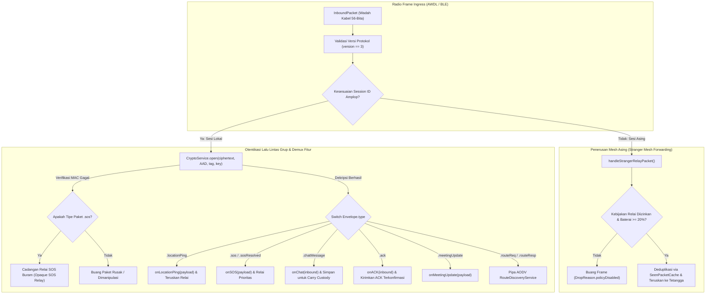
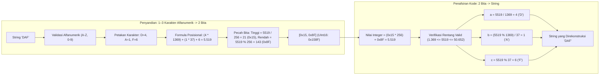

# Volume 05: Distribusi Pesan, Outbox Prioritas & Codec Inisial (Meepo)

## Ringkasan Eksekutif & Gambaran Umum Tingkat Tinggi

Volume 05 merinci pipa distribusi (*dispatch pipeline*) lapisan aplikasi, antrean transmisi berprioritas (*prioritized transmission queuing*), *codec* kabel ringkas, dan konfigurasi pewaktuan logis dari tumpukan jaringan *mesh* Meepo. Sementara lapisan yang lebih rendah mengelola tautan radio fisik (Volume 03) dan jalur perutean *multi-hop* (Volume 04), lapisan pesan dan *codec* ini berada tepat di perbatasan antara bita kabel mentah dan pengendali fitur yang menghadap pengguna. Lapisan ini menerjemahkan aliran berkelanjutan dari datagram terenkripsi menjadi muatan *domain* bertipe ketat, menengahi akses spektrum radio keluar melalui tingkatan prioritas yang ketat, dan meniadakan *overhead handshake* radio melalui *codec* padat bit berkepadatan tinggi.

Arsitektur pertukaran pesan beroperasi di atas tiga pilar fungsional mendasar:
1. **Demultipleksing & Distribusi Masuk Terpusat (`PacketRouter`):** Beroperasi di bawah isolasi `@MainActor` untuk menjamin keamanan utas UI (*UI thread safety*), `PacketRouter` bertindak sebagai gerbang masuk tunggal untuk semua *frame* radio yang masuk. Berkas ini memvalidasi versi protokol, memeriksa jumlah *hop*, dan menegakkan cakupan sesi kriptografis. Untuk lalu lintas grup yang terotentikasi, router mengeksekusi dekripsi AEAD ChaCha20-Poly1305 dan mendemultiplekskan muatan langsung ke *closure* fitur tingkat tinggi (`onLocationPing`, `onSOS`, `onSOSResolved`, `onACK`, `onMeetingUpdate`, `onChat`), sembari mendelegasikan *frame* perutean ke `RouteDiscoveryService`. *Frame* asing (*stranger*) yang tidak terautentikasi langsung diarahkan secara mulus ke rutinitas *relay* komunal *mesh*.
2. **Antrean Prioritas Bertingkat & Penggabungan Koordinat (`PriorityOutboxQueue`):** Lebar pita transmisi radio di lingkungan *peer-to-peer* yang padat sangat terbatas. `PriorityOutboxQueue` mengimplementasikan hierarki penjadwalan empat jalur:
   - **Jalur Darurat / Urgent Lane (FIFO, maks 16 paket):** Suar SOS penyelamat nyawa berprioritas tinggi, ACK pengiriman, dan pembaruan titik pertemuan.
   - **Jalur Obrolan Lokal / Local Chat Lane (FIFO, maks 16 paket):** Pesan obrolan 20 karakter yang dibuat oleh pengguna lokal.
   - **Jalur Relai Asing / Stranger Relay Lane (Ring Buffer FIFO, maks 32 paket):** Penerusan komunal *mesh* dengan pengeluaran *overflow* berbasis *drop-head* (membuang paket terlama di depan antrean).
   - **Jalur Normal Tergabung / Normal Coalesced Lane (Peta Kamus):** *Ping* lokasi GPS periodik rutin. *Ping* yang belum terkirim untuk tujuan tertentu akan langsung ditimpa oleh koordinat GPS baru yang masuk, mencegah banjir koordinat usang dan menghemat baterai radio.
3. **Codec Inisial Posisional Berkepadatan Tinggi (`InitialsCodec`):** Untuk menghindari pengiriman *header string* UTF-8 yang boros ruang atau eksekusi *handshake* radio multi-putaran untuk menyelesaikan nama panggilan anggota, Meepo memadatkan 1 hingga 3 karakter alfanumerik huruf besar menjadi tepat 2 bita *big-endian* (16 bit) menggunakan penyandian posisional Base-37 ($(a \times 1369) + (b \times 37) + c$). Ini memungkinkan tampilan identitas instan pada saat penerimaan paket tunggal tanpa latensi *handshake*.

---

### Gambaran Sederhana (ELI5): Pusat Distribusi Taktis & Kotak Keluar Berprioritas

Bayangkan pusat komunikasi tanggap darurat bencana yang beroperasi di Pos Komando Insiden Depan di kota yang mengalami pemadaman listrik total:

1. **Penjaga Gerbang Taktis (`PacketRouter`):** Paket radio *ad-hoc* tiba terus-menerus melalui tautan *mesh peer-to-peer*. Petugas komunikasi memeriksa *header* perutean teks-jelas (*cleartext*) terluar. Jika ID sesi 24-bit milik regu penyelamat lain, petugas memeriksa anggaran penerusan komunal dan aturan *relay*, lalu meneruskan paket ke lompatan *mesh* berikutnya tanpa mencoba mendekripsinya. Jika ID sesi cocok dengan regu pencari lokal, petugas membuka kunci muatan menggunakan kunci simetris 256-bit milik regu (`CryptoService`), memvalidasi segel segel utuh Poly1305 MAC, dan merutekan isinya langsung ke layanan taktis yang tepat: peringatan penyelamatan jiwa ke mesin SOS, instruksi mikro ke obrolan regu, dan *ping* koordinat ke radar pencarian taktis.
2. **Sidik Jari Kode Batang (`PacketKey`):** Setiap datagram memiliki kunci invarian 7-byte ringkas (ID sesi + nomor urut) yang dicap pada *header*-nya. Tidak peduli berapa banyak *node relay* di reruntuhan yang meneruskan kapsul atau berapa kali jumlah *hop* bertambah, sidik jari ini tetap konstan. Mesin perutean memeriksa sidik jari ini terhadap *cache* deduplikasi sehingga tidak pernah memproses atau menyiarkan ulang paket yang sama dua kali.
3. **Landasan Pacu Prioritas Empat Jalur (`PriorityOutboxQueue`):** Saat menyiapkan transmisi keluar melalui gelombang radio yang terbatas, datagram mengantre di empat jalur berprioritas ketat:
   - *Jalur 1 (Merah Berkedip - Keselamatan Jiwa):* Suar darurat SOS, ACK triase korban, dan instruksi titik kumpul ditransmisikan secara instan mendahului semua lalu lintas lainnya.
   - *Jalur 2 (Biru - Instruksi Taktis):* Pesan mikro lapangan operasional ("REGU 4 MENUJU LOKASI", "BUTUH TANDU") mengantre di urutan kedua.
   - *Jalur 3 (Kuning - Relai Komunal):* Paket *multi-hop* yang dibawa untuk unit sipil atau tim penyelamat tetangga mengantre di urutan ketiga, diatur oleh pembatas laju penerusan untuk melindungi baterai perangkat.
   - *Jalur 4 (Hijau - Telemetri Regu):* Pembaruan lokasi GPS periodik rutin mengantre terakhir. Jika koordinat baru pukul 15:05 tiba saat koordinat pukul 15:00 masih menunggu di antrean, sistem langsung menggabungkannya, membuang koordinat lama demi menghemat spektrum radio yang berharga.
4. **Tag Panggilan 2-Bita (`InitialsCodec`):** Petugas lapangan mengidentifikasi diri mereka pada peta taktis menggunakan tanda panggilan 3 karakter (misalnya "SAR" atau "MED"). Alih-alih mentransmisikan 3 bita ASCII mentah ditambah pembatas, *codec* memetakan karakter ke dalam bilangan pokok berbasis 37 (*radix base-37*), memadatkan seluruh tanda panggilan ke dalam bilangan bulat 2-bita tanpa tanda yang sangat efisien.

---

## Berkas Sumber yang Disertakan

Tabel berikut merinci setiap berkas kode sumber yang ditetapkan untuk Volume 05. Setiap jalur berkas ditautkan relatif terhadap dokumen ini, disertai dengan kategorinya, jumlah baris terverifikasi (`wc -l`), dan peran arsitektural tunggalnya:

| Jalur Berkas | Kategori | Jumlah Baris (`wc -l`) | Tujuan & Tanggung Jawab Arsitektural |
| :--- | :--- | :---: | :--- |
| [PacketRouter.swift](../../Teekum/Teekum/Core/Mesh/PacketRouter.swift) | Router | 184 | *Router* paket *main-thread* yang mengotentikasi lalu lintas masuk, memvalidasi ID sesi, dan mendistribusikan ke penangan fitur. |
| [PacketKey.swift](../../Teekum/Teekum/Core/Mesh/PacketKey.swift) | Model | 55 | Kunci *hashable* komposit (ID sesi + nomor urut + tipe paket) yang mengidentifikasi paket kabel secara unik di seluruh lompatan *relay*. |
| [MeshClock.swift](../../Teekum/Teekum/Core/Mesh/MeshClock.swift) | Clock | 13 | Kontrak protokol yang mendeklarasikan jam *mesh* monotonik dan operasi stempel waktu logis untuk pengujian deterministik. |
| [SystemMeshClock.swift](../../Teekum/Teekum/Core/Mesh/SystemMeshClock.swift) | Clock | 14 | Jam *mesh* sistem bawaan yang mematuhi `MeshClock` menggunakan tanggal jam perangkat keras sistem. |
| [MeshTimingConfiguration.swift](../../Teekum/Teekum/Core/Mesh/MeshTimingConfiguration.swift) | Konfigurasi | 164 | Model parameter pewaktuan terpusat yang mendeklarasikan interval penerbitan, ambang batas tautan lemah, dan batas waktu percobaan ulang. |
| [PriorityOutboxQueue.swift](../../Teekum/Teekum/Core/Transport/PriorityOutboxQueue.swift) | Antrean | 303 | Antrean transmisi prioritas multi-jalur yang menjamin preseden tinggi untuk SOS darurat, FIFO obrolan, dan *ping* GPS tergabung (*coalesced*). |
| [QueueDepth.swift](../../Teekum/Teekum/Core/Transport/QueueDepth.swift) | Antrean | 30 | Struktur *snapshot* yang melaporkan keterisian antrean saat ini di seluruh jalur darurat, obrolan, relai, dan normal tergabung. |
| [InitialsCodec.swift](../../Teekum/Teekum/Core/Session/InitialsCodec.swift) | Codec | 128 | *Encoder/decoder* inisial Base-37 ringkas yang memadatkan 1 hingga 3 karakter alfanumerik menjadi 2 bita *big-endian*. |
| **Total Artefak Volume 05** | **8 Berkas** | **891** | **100% Akuntansi Basis Kode Volume 05** |

---

## Arsitektur Pipa Outbox & Codec

Diagram berikut mengilustrasikan pipa distribusi paket terpusat, model antrean *outbox* berprioritas bertingkat, dan pipa penyandian aritmetika inisial Base-37.

### 1. Pipa Masuk (Ingress), Dekripsi AEAD & Distribusi



### 2. Antrean Outbox Prioritas Bertingkat & Hierarki Penggabungan (Coalescing)

```
+========================================================================================+
|                        Hierarki Dequeue PriorityOutboxQueue                            |
+========================================================================================+
|                                                                                        |
|  [ TINGKAT 1: JALUR DARURAT / URGENT (FIFO - Kapasitas: 16 paket) ]                    |
|  Preseden: Ke-1 (Selalu dikosongkan paling pertama)                                    |
|  Isi: Sirene darurat SOS, ACK pengiriman, Pembaruan titik kumpul, Resolusi SOS         |
|  Kebijakan Buang: Melempar TransportError.queueFull jika penuh                         |
|  +----------------------------------------------------------------------------------+  |
|  | [ Darurat 1 ] -> [ Darurat 2 ] -> [ Darurat 3 ] ...                               |  |
|  +----------------------------------------------------------------------------------+  |
|                                                                                        |
|  [ TINGKAT 2: JALUR OBROLAN LOKAL (FIFO - Kapasitas: 16 paket) ]                       |
|  Preseden: Ke-2 (Dikosongkan saat Tingkat 1 kosong)                                    |
|  Isi: Pesan obrolan pengguna lokal (frame muatan 20-bita)                              |
|  Kebijakan Buang: Melempar TransportError.queueFull jika penuh                         |
|  +----------------------------------------------------------------------------------+  |
|  | [ Obrolan 1 ] -> [ Obrolan 2 ] -> [ Obrolan 3 ] ...                               |  |
|  +----------------------------------------------------------------------------------+  |
|                                                                                        |
|  [ TINGKAT 3: JALUR RELAI ASING (Ring Buffer FIFO - Kapasitas: 32 paket) ]             |
|  Preseden: Ke-3 (Dikosongkan saat Tingkat 1 & 2 kosong)                                 |
|  Isi: Paket relai mesh komunal yang diteruskan untuk unit tanggap bencana tetangga     |
|  Kebijakan Buang: Drop-head saat penuh (paket terlama dibuang untuk menerima terbaru)  |
|  +----------------------------------------------------------------------------------+  |
|  | [ Relai 1 ] -> [ Relai 2 ] -> [ Relai 3 ] ...                                      |  |
|  +----------------------------------------------------------------------------------+  |
|                                                                                        |
|  [ TINGKAT 4: JALUR NORMAL TERGABUNG (Peta Kamus per Tujuan) ]                         |
|  Preseden: Ke-4 (Dikosongkan saat Tingkat 1, 2 & 3 kosong)                             |
|  Isi: Ping lokasi GPS periodik rutin                                                   |
|  Penggabungan: Titik GPS baru langsung menimpa titik lama yang belum terkirim          |
|  +----------------------------------------------------------------------------------+  |
|  | Kunci: "" (Siaran)  -> [ Ping GPS Terbaru ] (Ping lama belum terkirim ditimpa)     |  |
|  | Kunci: "Peer-Bob"   -> [ Ping Unicast Terbaru ]                                    |  |
|  +----------------------------------------------------------------------------------+  |
+========================================================================================+
```

### 3. Pipa Codec Inisial Ringkas Base-37



---

## Pembahasan Mendalam Berkas demi Berkas

---

## 1. Teekum/Teekum/Core/Mesh/PacketRouter.swift

- **Tautan Relatif Repositori:** [`../../Teekum/Teekum/Core/Mesh/PacketRouter.swift`](../../Teekum/Teekum/Core/Mesh/PacketRouter.swift)
- **Jumlah Baris:** 184 baris
- **Domain Konkurensi:** Kelas terikat utas utama (*main-thread bound class*) (`@MainActor public final class PacketRouter`)
- **Semantik Tipe:** Tipe referensi dengan isolasi `@MainActor` yang mengoordinasikan distribusi paket antara aliran radio latar belakang dan penangan fitur yang terikat ke antarmuka pengguna (UI).

### Fungsi Berkas Ini
`PacketRouter.swift` berfungsi sebagai pengontrol distribusi paket masuk terpusat dan gerbang otentikasi untuk aplikasi Meepo. Beroperasi pada `@MainActor`, berkas ini memeriksa paket kabel yang masuk, memvalidasi versi protokol 4-bit, dan menegakkan batasan batas *hop*. Berkas ini menentukan apakah sebuah *frame* milik sesi aktif lokal (memulai dekripsi AEAD ChaCha20-Poly1305 dan merutekan ke penangan fitur spesifik seperti Lokasi, SOS, ACK, Pertemuan, Penemuan Rute, atau Obrolan) atau mewakili lalu lintas *mesh* komunal pihak asing (mendistribusikan ke `handleStrangerRelayPacket` untuk penerusan radio buta).

### Analogi Sederhana (ELI5)
Bayangkan perwira perutean komunikasi di pusat operasi bencana depan. Setiap kali ada paket radio masuk yang tiba melalui *mesh ad-hoc*:
1. Jika paket membawa ID sesi regu lain, perwira tidak pernah mencoba mendekripsinya; mereka memverifikasi anggaran penerusan komunal dan aturan *relay*, menaikkan jumlah *hop*, dan meneruskannya ke tautan *peer* tetangga sehingga unit pencari lainnya dapat menerimanya.
2. Jika paket cocok dengan ID sesi regu lokal, perwira menggunakan kunci simetris 256-bit milik regu (`CryptoService`) untuk memvalidasi segel antipengrusakan Poly1305. Jika valid, perwira merutekan pesan langsung ke bagian yang dituju: alarm bahaya darurat ke pengelola SOS, instruksi taktis ke obrolan regu, dan koordinat posisi ke peta radar taktis.

### Istilah Teknis
- **Distribusi Paket (*Packet Dispatching*):** Pola arsitektural di mana datagram jaringan termultipleks yang masuk diperiksa, diotentikasi, dan dirutekan ke penangan subsistem terpisah berdasarkan kode operasi (*opcode*) tipe paket.
- **Cakupan Sesi (*Session Scoping*):** Memvalidasi bahwa ID sesi 24-bit dari paket masuk cocok dengan `session.sessionId`, memastikan isolasi kriptografis penuh antara kelompok penyelamat atau korban yang berbeda.
- **Cadangan Relai Asing (*Stranger Relay Fallback*):** Meneruskan paket 56-byte buram (*opaque*) melalui tautan *peer* fisik tanpa mendekripsi muatan ketika ID sesi tidak cocok dengan grup lokal.
- **Relai SOS Buram (*Opaque SOS Relay*):** Fitur ketahanan protokol di mana paket SOS yang tidak terotentikasi yang memiliki ID sesi lokal yang sama tetapi ditandatangani dengan kunci yang berbeda tetap diteruskan melalui *mesh* untuk memastikan sinyal bahaya tidak pernah dibuang karena ketidakcocokan kunci.

### Penjelasan Kode Baris demi Baris

#### Baris 1–56: Deklarasi Kelas, Dependensi, dan Siklus Hidup
```swift
//
//  PacketRouter.swift
//  Teekum
//
//  Created by DIMAS DAFFA ERNANDA on 11/11/26.
//

import Foundation
import CryptoKit

/// Authenticates group traffic and owns forwarding; feature handlers receive accepted inputs.
@MainActor
public final class PacketRouter {
    private let cryptoService: any CryptoServiceProtocol
    private let peerTransport: any PeerTransport & MeshTransport
    private let relayPolicyManager: RelayPolicyManager
    private let routeDiscoveryService: RouteDiscoveryService
    private let seenPacketCache: SeenPacketCache
    private let onLocationPing: (LocationPingPayload, InboundPacket) -> Void
    private let onSOS: (SOSPayload, InboundPacket) async -> Void
    private let onSOSResolved: (SOSResolvedPayload) async -> Void
    private let onACK: (InboundPacket) async -> Void
    private let onMeetingUpdate: (MeetingUpdatePayload) -> Void
    private let onChat: (InboundPacket) async -> Void
    private var isActive = true

    public init(
        cryptoService: any CryptoServiceProtocol,
        peerTransport: any PeerTransport & MeshTransport,
        relayPolicyManager: RelayPolicyManager,
        routeDiscoveryService: RouteDiscoveryService,
        seenPacketCache: SeenPacketCache,
        onLocationPing: @escaping (LocationPingPayload, InboundPacket) -> Void,
        onSOS: @escaping (SOSPayload, InboundPacket) async -> Void,
        onACK: @escaping (InboundPacket) async -> Void,
        onMeetingUpdate: @escaping (MeetingUpdatePayload) -> Void,
        onChat: @escaping (InboundPacket) async -> Void,
        onSOSResolved: @escaping (SOSResolvedPayload) async -> Void = { _ in }
    ) {
        self.cryptoService = cryptoService
        self.peerTransport = peerTransport
        self.relayPolicyManager = relayPolicyManager
        self.routeDiscoveryService = routeDiscoveryService
        self.seenPacketCache = seenPacketCache
        self.onLocationPing = onLocationPing
        self.onSOS = onSOS
        self.onSOSResolved = onSOSResolved
        self.onACK = onACK
        self.onMeetingUpdate = onMeetingUpdate
        self.onChat = onChat
    }

    public func stop() {
        isActive = false
    }
```
- **Baris 12–26:** Mendeklarasikan `@MainActor public final class PacketRouter`. Menyuntikkan layanan (`CryptoServiceProtocol`, `PeerTransport & MeshTransport`, `RelayPolicyManager`, `RouteDiscoveryService`, `SeenPacketCache`) dan *closure callback* untuk distribusi fitur. Melacak bendera siklus hidup `isActive`.
- **Baris 27–51:** *Initializer* mengikat dependensi dan menyimpan *closure*.
- **Baris 53–55:** `stop()` menyetel `isActive = false` untuk segera menghentikan pemrosesan paket masuk selama pembubaran sesi (*session teardown*).

#### Baris 57–78: Validasi Paket dan Dekripsi AEAD
```swift
    public func routeInboundPacket(_ inbound: InboundPacket, for session: GroupSession) async {
        guard isActive else { return }
        let raw = inbound.rawPacket
        let envelope = raw.envelope
        guard envelope.version == PacketConstants.protocolVersion, envelope.hopCount <= envelope.hopLimit else { return }
        guard envelope.sessionId == session.sessionId else {
            await handleStrangerRelayPacket(inbound)
            return
        }

        guard let decrypted = try? await cryptoService.open(
            ciphertext: raw.ciphertext,
            envelope: envelope,
            authTag: raw.authTag,
            using: SymmetricKey(data: session.symmetricKeyData)
        ) else {
            // Prototype fallback: a same-SID SOS with a different key can still travel opaquely.
            if envelope.type == .sos { await relayMeshPacketIfNeeded(inbound, for: session) }
            return
        }
        guard isActive else { return }
```
- **Baris 57–61:** Memvalidasi `isActive`, mengonfirmasi `envelope.version == 3`, dan memastikan `hopCount <= hopLimit`.
- **Baris 62–65:** Membandingkan `envelope.sessionId == session.sessionId`. Jika tidak cocok, merutekan langsung ke `handleStrangerRelayPacket(inbound)` untuk penerusan buta pihak asing.
- **Baris 67–76:** Mencoba dekripsi AEAD via `cryptoService.open()`. Jika verifikasi MAC gagal (muatan dirusak atau kunci salah), memeriksa apakah `envelope.type == .sos`; jika ya, meneruskan *frame* SOS secara buram (*opaquely*) melalui *mesh* sebelum kembali.

#### Baris 79–140: Distribusi Opcode ke Subsistem
```swift
        switch envelope.type {
        case .ack:
            guard let ack = try? ACKPayload.deserialize(from: decrypted),
                  abs(Date().timeIntervalSince(ack.ackTimestamp)) <= CarryMessageStore.retention,
                  ack.responderInitials != session.localInitials else { return }
            await onACK(inbound)
            guard isActive else { return }
            await peerTransport.retainReceivedForCarry(raw, excludingPeerId: inbound.sourcePeerId)
            await relayMeshPacketIfNeeded(inbound, for: session)

        case .sos:
            guard let payload = try? SOSPayload.deserialize(from: decrypted),
                  payload.senderInitials != session.localInitials else { return }
            await onSOS(payload, inbound)
            await relayMeshPacketIfNeeded(inbound, for: session)

        case .sosResolved:
            guard let resolution = try? SOSResolvedPayload.deserialize(from: decrypted),
                  resolution.senderInitials != session.localInitials,
                  envelope.memberSlot == MemberID.fromInitials(resolution.senderInitials).memberSlot else { return }
            let duplicate = await seenPacketCache.isDuplicateAndRecord(PacketKey(wirePacket: raw))
            guard !duplicate, isActive else { return }
            await onSOSResolved(resolution)
            guard isActive else { return }
            await peerTransport.retainReceivedForCarry(raw, excludingPeerId: inbound.sourcePeerId)
            await relayMeshPacketIfNeeded(inbound, for: session, skipSeenCheck: true)

        case .locationPing:
            guard let ping = try? LocationPingPayload.deserialize(from: decrypted),
                  ping.senderInitials != session.localInitials else { return }
            onLocationPing(ping, inbound)
            await relayMeshPacketIfNeeded(inbound, for: session)

        case .meetingUpdate:
            guard let update = try? MeetingUpdatePayload.deserialize(from: decrypted) else { return }
            let duplicate = await seenPacketCache.isDuplicateAndRecord(PacketKey(wirePacket: raw))
            guard !duplicate, isActive else { return }
            onMeetingUpdate(update)
            await relayMeshPacketIfNeeded(inbound, for: session, skipSeenCheck: true)

        case .routeReq:
            guard let wireData = try? raw.toWireData() else { return }
            _ = try? await routeDiscoveryService.handleInboundRouteReq(
                wireData: wireData, fromPeerId: inbound.sourcePeerId, session: session
            )

        case .routeResp:
            guard let wireData = try? raw.toWireData() else { return }
            _ = try? await routeDiscoveryService.handleInboundRouteResp(
                wireData: wireData, fromPeerId: inbound.sourcePeerId, session: session
            )

        case .chatMessage:
            guard let chat = try? ChatMessagePayload.deserialize(from: decrypted),
                  abs(Date().timeIntervalSince(chat.timestamp)) <= CarryMessageStore.retention,
                  chat.senderInitials != session.localInitials else { return }
            await peerTransport.retainReceivedForCarry(raw, excludingPeerId: inbound.sourcePeerId)
            guard isActive else { return }
            await onChat(inbound)
            await relayMeshPacketIfNeeded(inbound, for: session)
        }
    }
```
- **Baris 80–88 (`.ack`):** Menseserialisasi `ACKPayload`, memverifikasi kesegaran stempel waktu terhadap `CarryMessageStore.retention` (600 detik), mengabaikan ACK yang berasal dari diri sendiri, mengirimkan `onACK`, menyimpannya untuk penanganan simpan-dan-teruskan (*store-and-forward carry custody*), dan meneruskannya via `relayMeshPacketIfNeeded`.
- **Baris 89–94 (`.sos`):** Menseserialisasi `SOSPayload`, mencegah siaran diri sendiri, mengirimkan `onSOS`, dan merelai ke seluruh *mesh*.
- **Baris 95–105 (`.sosResolved`):** Memverifikasi `memberSlot` amplop cocok dengan inisial pengirim, memeriksa `seenPacketCache`, memanggil `onSOSResolved`, menyimpan dalam *carry custody*, dan merelai.
- **Baris 106–111 (`.locationPing`):** Menseserialisasi `LocationPingPayload`, mengirimkan `onLocationPing`, dan merelai.
- **Baris 112–118 (`.meetingUpdate`):** Mendeduplikasi via `seenPacketCache`, mengirimkan `onMeetingUpdate`, dan merelai.
- **Baris 119–129 (`.routeReq` / `.routeResp`):** Menyandikan data paket mentah dan mendelegasikan langsung ke `routeDiscoveryService.handleInboundRouteReq` dan `handleInboundRouteResp`.
- **Baris 131–139 (`.chatMessage`):** Menseserialisasi `ChatMessagePayload`, memverifikasi jendela retensi, menyimpan dalam *carry custody*, mengirimkan `onChat`, dan merelai.

#### Baris 142–183: Rutinitas Penerusan dan Relai Asing
```swift
    public func relayMeshPacketIfNeeded(_ inbound: InboundPacket, for session: GroupSession, skipSeenCheck: Bool = false) async {
        let envelope = inbound.rawPacket.envelope
        guard isActive, envelope.hopCount < envelope.hopLimit,
              envelope.memberSlot != session.memberSlot else { return }
        if !skipSeenCheck {
            let duplicate = await seenPacketCache.isDuplicateAndRecord(PacketKey(wirePacket: inbound.rawPacket))
            guard !duplicate, isActive else { return }
        }
        var packet = inbound.rawPacket
        packet.envelope.hopCount += 1
        guard let data = try? packet.toWireData() else { return }
        try? await peerTransport.broadcastPacket(data)
    }

    public func handleStrangerRelayPacket(_ inbound: InboundPacket) async {
        guard isActive else { return }
        let policy = await relayPolicyManager.currentState()
        guard policy.isRelayPermitted, isActive else {
            await relayPolicyManager.recordDropEvent(reason: .policyDisabled)
            return
        }
        let packet = inbound.rawPacket
        guard packet.envelope.hopCount < packet.envelope.hopLimit else {
            await relayPolicyManager.recordDropEvent(reason: .hopLimitExceeded)
            return
        }
        await peerTransport.retainReceivedForCarry(packet, excludingPeerId: inbound.sourcePeerId)
        guard isActive else { return }
        let duplicate = await seenPacketCache.isDuplicateAndRecord(PacketKey(wirePacket: packet))
        guard !duplicate, isActive else {
            if duplicate { await relayPolicyManager.recordDropEvent(reason: .duplicate) }
            return
        }
        guard let data = try? packet.toWireData() else { return }
        let neighbors = await peerTransport.activeNeighbors()
        var forwarded = false
        for peer in neighbors where peer.id != inbound.sourcePeerId {
            guard isActive else { return }
            if (try? await peerTransport.forwardFrame(data, to: peer.id)) != nil { forwarded = true }
        }
        if forwarded { await relayPolicyManager.recordForwardEvent(type: packet.envelope.type) }
    }
}
```
- **Baris 142–154:** `relayMeshPacketIfNeeded`: Memeriksa `hopCount < hopLimit`, mengonfirmasi *node* lokal bukan pengirim asli (`envelope.memberSlot != session.memberSlot`), memeriksa `seenPacketCache`, menaikkan `hopCount += 1`, dan menyiarkan melalui tautan radio.
- **Baris 156–183:** `handleStrangerRelayPacket`: Mengevaluasi `relayPolicyManager.currentState()`. Membuang jika kebijakan dinonaktifkan atau dibatasi baterai. Memverifikasi batas *hop*, menyimpannya untuk penanganan *carry* fisik oportunistik, memeriksa *cache* duplikat, mengubah jumlah *hop*, dan meneruskan ke semua tetangga aktif kecuali `inbound.sourcePeerId`, memperbarui penghitung telemetri anonim.

### Pertimbangan Rekayasa dan Kasus Khusus
- **Isolasi MainActor untuk Keamanan UI:** Karena penangan *callback* (`onLocationPing`, `onMeetingUpdate`) menggerakkan tampilan SwiftUI dan hamparan kanvas peta, mengeksekusi *router* pada `@MainActor` menghilangkan *jitter* pertukaran utas dan kondisi balapan (*race condition*) saat memperbarui status tampilan.
- **Penerusan SOS Buram (*Opaque SOS Forwarding*):** Dalam situasi keselamatan jiwa, jika dua kelompok penyelamat mengalami tabrakan *hash* ID sesi atau jika *frame* SOS disegel dengan kredensial alternatif, membuang suar darurat tidak dapat diterima. *Router* mengizinkan paket SOS sesi yang sama untuk melakukan perjalanan secara buram bahkan jika dekripsi lokal gagal.

---

## 2. Teekum/Teekum/Core/Mesh/PacketKey.swift

- **Tautan Relatif Repositori:** [`../../Teekum/Teekum/Core/Mesh/PacketKey.swift`](../../Teekum/Teekum/Core/Mesh/PacketKey.swift)
- **Jumlah Baris:** 55 baris
- **Domain Konkurensi:** Swift `struct` (`public struct PacketKey: Hashable, Sendable, CustomStringConvertible`)
- **Semantik Tipe:** Tipe nilai ringkas dan tidak dapat diubah yang mematuhi `Hashable` dan `Sendable` yang menyediakan identitas paket kanonikal untuk *cache* deduplikasi.

### Fungsi Berkas Ini
`PacketKey.swift` mendefinisikan struktur identitas 7-byte kanonikal untuk paket *mesh*. Berkas ini mengidentifikasi secara unik transmisi kabel yang tidak dapat diubah dengan menggabungkan pengidentifikasi sesi 24-bit (`sessionId`) dan penghitung urutan tujuan 32-bit (`sequenceNumber`), dengan diskriminator `PacketType` opsional. Yang terpenting, berkas ini secara sengaja mengecualikan `hopCount` dan `hopLimit`, memastikan bahwa ketika paket melintasi *node relay multi-hop* perantara dan mengubah jumlah *hop*-nya, kunci identitasnya tetap sepenuhnya konstan (*invariant*).

### Analogi Sederhana (ELI5)
Bayangkan pengiriman darurat taktis yang dicap dengan kode identifikasi permanen: "Regu #104, Urutan #551". Saat paket berpindah melintasi reruntuhan dari penolong ke penolong, setiap *node* perantara menaikkan penghitung *hop* pada label perutean luar. Kode identifikasi inti di bagian depan tidak pernah berubah. Pemindai deduplikasi sebuah *node* hanya memeriksa pengidentifikasi 7-byte ini untuk memverifikasi apakah kiriman yang sama persis ini telah diproses sebelumnya, mengabaikan perubahan jumlah *hop*.

### Istilah Teknis
- **Kunci Paket Invarian (*Invariant Packet Key*):** Kunci yang dapat di-*hash* yang disusun secara eksklusif dari bidang paket yang tidak dapat diubah, tetap konstan di seluruh relai jaringan meskipun *header* transport bermutasi.
- **Penyamaran Sesi 24-Bit (*sessionIdMask*):** Menyamarkan bilangan bulat tak bertanda 32-bit dengan `0x00FFFFFF` untuk membatasi pengidentifikasi tepat 3 bita (16.777.215 kemungkinan sesi), menghemat memori sambil mempertahankan ketahanan terhadap tabrakan (*collision resistance*).
- **Pemuatan Big-Endian Tidak Selaras (*Unaligned Big-Endian Loading*):** Membaca bilangan bulat multi-bita dengan aman dari *offset* bita biner acak menggunakan `loadUnaligned(as: UInt32.self).bigEndian` tanpa memicu pengecualian penyelarasan memori CPU.

### Penjelasan Kode Baris demi Baris

#### Baris 1–28: Deklarasi Struct, Properti, dan Initializer Memberwise
```swift
//
//  PacketKey.swift
//  Teekum
//
//  Created by Nicho on 06/11/26.
//

import Foundation

/// Canonical compact 7-byte packet identity used for duplicate suppression and routing cache keys.
///
/// Computed from:
/// - `sessionId` (24-bit / 3 bytes, 16.7M combinations)
/// - `sequenceNumber` (32-bit / 4 bytes, memberSlot + counter)
///
/// Note: `hopCount` is explicitly excluded so packet identity remains identical across all hops.
/// With 16,777,215 session IDs, cross-group collision is virtually impossible while keeping RAM minimal.
public struct PacketKey: Hashable, Sendable, CustomStringConvertible {
    public let sessionId: UInt32        // 24-bit value (0x000000...0xFFFFFF)
    public let sequenceNumber: UInt32   // 32-bit sequence counter
    public let type: PacketType?        // Optional packet type discriminator
    
    public init(sessionId: UInt32, sequenceNumber: UInt32, type: PacketType? = nil) {
        self.sessionId = sessionId & PacketConstants.sessionIdMask
        self.sequenceNumber = sequenceNumber
        self.type = type
    }
```
- **Baris 10–18:** Dokumentasi menjelaskan formula identitas 7-byte dan mengapa `hopCount` dikecualikan.
- **Baris 19–21:** Menyimpan `sessionId` (UInt32 yang disamarkan ke 24 bit), `sequenceNumber` (UInt32), dan `type` opsional (`PacketType?`).
- **Baris 23–27:** *Initializer memberwise* menegakkan `sessionId & PacketConstants.sessionIdMask`.

#### Baris 29–55: Initializer dari Tipe Kabel dan Pemformatan String
```swift
    public init(wirePacket: RawWirePacket) {
        self.sessionId = wirePacket.envelope.sessionId & PacketConstants.sessionIdMask
        self.sequenceNumber = wirePacket.envelope.sequenceNumber
        self.type = wirePacket.envelope.type
    }
    
    public init?(wireData: Data) {
        guard wireData.count >= 10 else { return nil }
        let typeRaw = wireData[wireData.startIndex] & 0x0F
        let pType = PacketType(rawValue: typeRaw)
        let b3 = UInt32(wireData[wireData.startIndex + 3])
        let b4 = UInt32(wireData[wireData.startIndex + 4])
        let b5 = UInt32(wireData[wireData.startIndex + 5])
        let sid = (b3 << 16) | (b4 << 8) | b5
        let seq = wireData.subdata(in: (wireData.startIndex + 6)..<(wireData.startIndex + 10)).withUnsafeBytes {
            $0.loadUnaligned(as: UInt32.self).bigEndian
        }
        self.sessionId = sid
        self.sequenceNumber = seq
        self.type = pType
    }
    
    public var description: String {
        let typeStr = type.map { "\($0)" } ?? "any"
        return "PacketKey(sid: 0x\(PacketConstants.formatSessionId(sessionId)), seq: \(sequenceNumber), type: \(typeStr))"
    }
}
```
- **Baris 29–33:** *Initializer* kemudahan yang mengekstrak bidang secara langsung dari `RawWirePacket` terstruktur.
- **Baris 35–49:** Parser biner mentah yang aman dari kegagalan `init?(wireData:)`. Membaca *nibble* rendah Byte 0 untuk `PacketType`, menggeser Bita 3, 4, 5 menjadi bilangan bulat 24-bit untuk `sessionId`, dan mendekode Bita 6–9 sebagai UInt32 *big-endian* untuk `sequenceNumber`.
- **Baris 51–54:** `description` memformat string yang mudah dibaca untuk log diagnostik (misalnya, `PacketKey(sid: 0x1A2B3C, seq: 42, type: locationPing)`).

### Pertimbangan Rekayasa dan Kasus Khusus
- **Kunci Hash Bebas Alokasi (*Zero-Allocation Hash Key*):** Karena `PacketKey` seluruhnya tersusun dari bilangan bulat primitif, sintesis implementasi `Hashable` Swift menghitung *hash* SipHash 64-bit yang cepat tanpa alokasi *heap*, memungkinkan `SeenPacketCache` mengevaluasi ribuan pencarian per detik.
- **Menangani Potongan Kabel yang Rusak:** `init?(wireData:)` menjaga `wireData.count >= 10`, mengembalikan `nil` dengan aman jika potongan *frame* yang terpotong tiba dari tautan radio yang terdegradasi.

---

## 3. Teekum/Teekum/Core/Mesh/MeshClock.swift

- **Tautan Relatif Repositori:** [`../../Teekum/Teekum/Core/Mesh/MeshClock.swift`](../../Teekum/Teekum/Core/Mesh/MeshClock.swift)
- **Jumlah Baris:** 13 baris
- **Domain Konkurensi:** Swift `protocol` (`public protocol MeshClock: Sendable`)
- **Semantik Tipe:** Abstraksi protokol yang mendefinisikan antarmuka pengukuran waktu untuk semua layanan jaringan *mesh*.

### Fungsi Berkas Ini
`MeshClock.swift` mendefinisikan kontrak protokol untuk penyedia waktu di seluruh tumpukan jaringan *mesh* Meepo. Membutuhkan metode tunggal (`nonisolated func now() -> Date`), protokol ini memungkinkan kode produksi membaca waktu perangkat keras nyata sembari memungkinkan pengujian unit otomatis menyuntikkan jam tiruan (*mock clock*) deterministik yang maju seketika tanpa jeda asinkron atau penundaan utas (*sleeping threads*).

### Analogi Sederhana (ELI5)
Bayangkan jam operasional utama di pusat komando pencarian dan penyelamatan. Selama operasi langsung, petugas membaca waktu jam dinding standar. Namun selama latihan simulasi triase bencana dan pengujian integrasi otomatis, komandan uji coba dapat menjeda jam virtual, memajukan waktu 45 detik untuk memicu pemulihan *peer* yang basi, atau memajukan 10 menit untuk memverifikasi kedaluwarsa pesan, menjalankan skenario jaringan multi-jam yang kompleks secara deterministik dalam hitungan milidetik tanpa memanggil fungsi tidur sistem.

### Istilah Teknis
- **Abstraksi Waktu Berorientasi Protokol (*Protocol-Oriented Time Abstraction*):** Memisahkan pengukuran waktu dari `Date()` atau `DispatchTime.now()` sehingga komponen bergantung pada antarmuka abstrak, memungkinkan simulasi batas waktu jaringan dan kedaluwarsa TTL yang deterministik.
- **Sendable Clock:** Tipe yang dapat diteruskan dengan aman melintasi batas konkurensi Swift tanpa menciptakan balapan data (*data races*).

### Penjelasan Kode Baris demi Baris

#### Baris 1–13: Deklarasi Protokol Lengkap
```swift
//
//  MeshClock.swift
//  Teekum
//
//  Created by Nicho on 06/11/26.
//

import Foundation

/// Testable clock protocol allowing deterministic advancement of time in unit and integration tests.
public protocol MeshClock: Sendable {
    nonisolated func now() -> Date
}
```
- **Baris 10–13:** Mendeklarasikan `public protocol MeshClock: Sendable` dengan persyaratan tunggal: `nonisolated func now() -> Date`.

### Pertimbangan Rekayasa dan Kasus Khusus
- **Menghilangkan Waktu Tidur Utas dalam Pengujian:** Pengujian unit untuk kedaluwarsa *cache* 300 detik, sesi berbatas waktu 30 menit, atau rute balik AODV 15 detik dapat memajukan `MeshClock` tiruan sebesar 300 detik hanya dalam 1 milidetik waktu CPU, mencapai cakupan pengujian 100% tanpa latensi eksekusi.

---

## 4. Teekum/Teekum/Core/Mesh/SystemMeshClock.swift

- **Tautan Relatif Repositori:** [`../../Teekum/Teekum/Core/Mesh/SystemMeshClock.swift`](../../Teekum/Teekum/Core/Mesh/SystemMeshClock.swift)
- **Jumlah Baris:** 14 baris
- **Domain Konkurensi:** Swift `struct` (`public struct SystemMeshClock: MeshClock`)
- **Semantik Tipe:** Tipe nilai berukuran nol (*zero-sized value type*) yang tidak dapat diubah yang mematuhi `MeshClock`.

### Fungsi Berkas Ini
`SystemMeshClock.swift` menyediakan implementasi produksi standar dari `MeshClock`. Mematuhi `MeshClock`, metode `now()`-nya menanyakan `Date()` dari Foundation, mengembalikan stempel waktu jam dinding perangkat keras sistem saat ini.

### Analogi Sederhana (ELI5)
Ini adalah jam tangan standar di dunia nyata yang berdetik detik demi detik sesuai dengan waktu sebenarnya.

### Istilah Teknis
- **Tipe Berukuran Nol (*Zero-Sized Type*):** Sebuah *struct* tanpa properti yang disimpan. Di Swift, instans tipe berukuran nol tidak menimbulkan alokasi memori *heap* atau *stack*.

### Penjelasan Kode Baris demi Baris

#### Baris 1–14: Implementasi Struct Lengkap
```swift
//
//  SystemMeshClock.swift
//  Teekum
//
//  Created by Nicho on 06/11/26.
//

import Foundation

/// Standard system clock returning the current hardware date.
public struct SystemMeshClock: MeshClock {
    nonisolated public init() {}
    nonisolated public func now() -> Date { Date() }
}
```
- **Baris 10–14:** Mendeklarasikan `SystemMeshClock` yang mematuhi `MeshClock`. Baik `init()` maupun `now()` ditandai `nonisolated`. `now()` mengembalikan `Date()`.

### Pertimbangan Rekayasa dan Kasus Khusus
- **Nilai Parameter Bawaan:** Digunakan sebagai argumen bawaan di seluruh *initializer* (misalnya, `init(clock: MeshClock = SystemMeshClock())`), memastikan tidak ada *boilerplate* dalam kode produksi sembari mempertahankan dukungan injeksi dependensi penuh.

---

## 5. Teekum/Teekum/Core/Mesh/MeshTimingConfiguration.swift

- **Tautan Relatif Repositori:** [`../../Teekum/Teekum/Core/Mesh/MeshTimingConfiguration.swift`](../../Teekum/Teekum/Core/Mesh/MeshTimingConfiguration.swift)
- **Jumlah Baris:** 164 baris
- **Domain Konkurensi:** Swift `struct` (`nonisolated public struct MeshTimingConfiguration: Equatable, Sendable`)
- **Semantik Tipe:** Tipe nilai yang mematuhi `Equatable` dan `Sendable` yang menyimpan ritme jaringan dan parameter percobaan ulang terpusat.

### Fungsi Berkas Ini
`MeshTimingConfiguration.swift` mendefinisikan model konfigurasi terpusat untuk semua interval pewaktuan, ritme transmisi (*cadence*), ambang batas degradasi tautan, dan kebijakan percobaan ulang di seluruh tumpukan jaringan *mesh* Meepo. Berkas ini mengatur ritme penerbitan lokasi GPS adaptif (mempercepat hingga 2,0 detik untuk *peer* yang jauh, 4,0 detik saat bergerak, dan melambat hingga 20,0 detik saat diam atau 60,0 detik dalam mode bertahan hidup), ambang batas radio jauh (-75 dBm RSSI, 30m GPS), anggaran pembatas laju (2 paket/detik biasa, 4 paket/detik SOS), waktu jeda percobaan ulang obrolan grup, dan pengujian pemulihan *peer* yang basi dua tahap.

### Analogi Sederhana (ELI5)
Bayangkan perwira komunikasi taktis yang mengatur tempo transmisi radio di seluruh zona bencana berdasarkan kondisi lapangan:
- Ketika tim pencari diam di pos pemeriksaan triase, ritme melambat menjadi 20-30 detik untuk menghemat baterai.
- Ketika seorang petugas aktif bergerak melewati reruntuhan atau redaman sinyal menyebabkan penerimaan yang lemah, ritme dipercepat menjadi 2 detik sehingga pencari tetangga mempertahankan pelacakan waktu nyata.
- Ketika pemadaman listrik darurat meluas melewati 24 jam dan baterai petugas turun di bawah 20%, sistem menurunkan siaran yang tidak penting ke interval bertahan hidup 60 detik untuk melindungi cadangan SOS penyelamat nyawa.

### Istilah Teknis
- **Ritme Adaptif (*Adaptive Cadence*):** Memodifikasi frekuensi penyiaran secara dinamis berdasarkan pergerakan fisik, level baterai, dan kualitas tautan radio *peer*.
- **Pemulihan Basi Dua Tahap (*Two-Stage Stale Recovery*):** Protokol pemulihan di mana anggota yang tidak responsif (tidak terlihat selama 30 detik) terlebih dahulu diuji pada ritme dipercepat 2,0 detik (Tahap 1), diikuti 15 detik kemudian oleh siaran permintaan rute AODV *multi-hop* aktif (Tahap 2) sebelum kehabisan waktu pada 90 detik.
- **Jitter ACK Teracak (*Randomized ACK Jitter*):** Memperkenalkan penundaan acak kecil (0 hingga 0,35 detik) sebelum mentransmisikan *frame* pengakuan (*acknowledgment*) untuk mencegah tabrakan paket radio simultan ketika beberapa *peer* menerima siaran pada milidetik yang sama persis.

### Penjelasan Kode Baris demi Baris

#### Baris 1–61: Waktu Ritme, Ambang Sinyal, dan Batas Laju
```swift
//
//  MeshTimingConfiguration.swift
//  Teekum
//
//  Created by Nicho on 08/11/26.
//

import Foundation

/// Centralized, easily adjustable timing, cadence, and retry configuration
/// for TeeKum multi-hop mesh networking and peer broadcasting.
///
/// Easily tune these variables in code to optimize broadcasting intervals,
/// link degradation thresholds, and distant relay retry policies.
nonisolated public struct MeshTimingConfiguration: Equatable, Sendable {
    
    // MARK: - 1. Broadcast Cadence Timings (Seconds)
    
    /// Publishing interval when one or more peers are distant or signal is weak (recommended: 2.0s).
    /// Speeds up broadcasting from 20s down to 2s to maintain relay responsiveness across distant links.
    public var distantPeerInterval: TimeInterval
    
    /// Publishing interval while user is actively moving with nearby peers (recommended: 4.0s).
    public var movingInterval: TimeInterval
    
    /// Publishing interval while stationary with strong nearby peers (recommended: 20.0s).
    public var stationaryInterval: TimeInterval
    
    /// Throttled publishing interval in survival mode (<20% battery) to conserve power (recommended: 60.0s).
    public var survivalInterval: TimeInterval
    
    // MARK: - 2. Distant Link & Weak Signal Thresholds
    
    /// RSSI threshold (dBm) below which a peer link is classified as distant or weak (recommended: -75 dBm).
    /// Links with RSSI <= this threshold trigger the `distantPeerInterval`.
    public var distantRSSIThreshold: Int8
    
    /// GPS distance threshold (meters) beyond which a peer is classified as distant (recommended: 30.0m).
    /// Peers farther than this distance trigger the `distantPeerInterval`.
    public var distantDistanceThresholdMeters: Double
    
    // MARK: - 3. Distant Link Retry & Priority Policies
    
    /// Maximum transmission retries for relay packets or packets sent over distant/degraded links (recommended: 2).
    public var distantLinkMaxRetries: Int
    
    /// Backoff delay (seconds) between successive retries over distant or lossy links (recommended: 0.5s).
    public var distantLinkRetryDelay: TimeInterval
    
    // MARK: - 4. Rate Limiter Budgets & Token Buckets
    
    /// Maximum ordinary relay forwarding rate (packets per second, recommended: 2.0).
    public var ordinaryRelayRateLimit: Double
    
    /// Burst capacity for ordinary relay token bucket (recommended: 4.0).
    public var ordinaryRelayBurstCapacity: Double
    
    /// Maximum urgent SOS forwarding rate (packets per second, recommended: 4.0).
    public var urgentSOSRateLimit: Double
```
- **Baris 17–31:** Mendeklarasikan empat ritme penerbitan lokasi utama: `distantPeerInterval` (2,0 detik), `movingInterval` (4,0 detik), `stationaryInterval` (20,0 detik), dan `survivalInterval` (60,0 detik).
- **Baris 32–41:** Mengonfigurasi deteksi tautan lemah: `distantRSSIThreshold` (-75 dBm) dan `distantDistanceThresholdMeters` (30,0m).
- **Baris 42–49:** Mengonfigurasi percobaan ulang tautan jauh: `distantLinkMaxRetries` (2) dan `distantLinkRetryDelay` (0,5 detik).
- **Baris 50–60:** Mengonfigurasi tingkat *token bucket*: laju relai biasa (2,0 paket/detik) dan kapasitas lonjakan (4,0), serta laju SOS darurat (4,0 paket/detik).

#### Baris 62–110: Waktu Mesin Obrolan, Pemulihan Basi, dan Lonjakan Respons
```swift
    // MARK: - 5. Group Chat Engine Timings
    
    /// Enforced client-side cooldown between outgoing user chat messages (recommended: 3.0s).
    public var chatUserCooldown: TimeInterval
    
    /// Maximum radio transmission retries for chat messages (recommended: 2 retries, 3 total attempts).
    public var chatMaxRetries: Int
    
    /// Initial retry backoff delay for chat messages (recommended: 0.5s).
    public var chatRetryBackoff: TimeInterval
    
    /// Multi-peer delivery ACK confirmation timeout window (recommended: 15.0s).
    public var chatAckTimeout: TimeInterval
    
    /// Maximum randomized jitter delay before transmitting ACKs to avoid collisions (recommended: 0.35s).
    public var chatAckJitterMax: TimeInterval
    
    // MARK: - 5. Stale Peer Accelerated Cadence & Two-Tier Probe Timings
    
    /// Elapsed duration (seconds) since last contact after which a group member is classified as stale (recommended: 30.0s).
    /// Upon crossing this threshold, Stage 1 accelerated probing begins at `staleRecoveryInterval`.
    public var stalePeerThreshold: TimeInterval
    
    /// Accelerated publishing interval (seconds) while probing for stale peers (recommended: 2.0s).
    /// Drives high-cadence local pings across the mesh to refresh link state and wake sleeping relays.
    public var staleRecoveryInterval: TimeInterval
    
    /// Additional elapsed time (seconds) of continuous staleness before initiating Stage 2 on-demand AODV route discovery (recommended: 15.0s).
    /// Total elapsed time since last seen = `stalePeerThreshold + staleRouteReqDelay` (30s + 15s = 45s).
    public var staleRouteReqDelay: TimeInterval
    
    /// Maximum duration (seconds) to sustain accelerated probing for an unresponsive stale peer (recommended: 60.0s).
    /// If the peer remains missing beyond `stalePeerThreshold + staleRecoveryTimeout` (30s + 60s = 90s),
    /// the probe window expires and publishing cadence backs off to conserve battery.
    public var staleRecoveryTimeout: TimeInterval
    
    // MARK: - 6. One-to-Many Multi-Peer Staggering & Response Burst
    
    /// Spacing delay (seconds) between sequential AODV route requests when multiple group members are stale (recommended: 2.5s).
    /// Prevents radio flooding and adheres to the 2 pkts/sec token bucket rate limiter in one-to-many topologies.
    public var staleRouteReqStaggerInterval: TimeInterval
    
    /// Number of rapid location pings published by a stale peer upon receiving a ROUTE_REQ probe (recommended: 3).
    /// Ensures fresh coordinates punch through intermediate relays to reach all group members.
    public var staleResponseBurstCount: Int
    
    /// Cadence interval (seconds) between each ping in the stale response burst (recommended: 2.0s).
    public var staleResponseBurstInterval: TimeInterval
```
- **Baris 63–77:** Parameter mesin obrolan: jeda klien (3,0 detik), percobaan ulang (2), jeda awal mundur (0,5 detik), batas waktu ACK (15,0 detik), dan *jitter* ACK maksimum (0,35 detik).
- **Baris 80–96:** Pelacakan *peer* basi: anggota ditandai basi setelah 30,0 detik (`stalePeerThreshold`), pengujian dipercepat berjalan pada 2,0 detik (`staleRecoveryInterval`), Tahap 2 AODV terpicu setelah penundaan tambahan 15,0 detik (`staleRouteReqDelay`, total 45 detik), dan jendela pengujian berakhir setelah 60,0 detik (`staleRecoveryTimeout`, total 90 detik).
- **Baris 99–109:** Penyelarasan jeda dan lonjakan: penjarakan RREQ berurutan (2,5 detik), jumlah lonjakan respons lokasi *peer* basi (3 *ping* lokasi), dan jarak antarlonjakan (2,0 detik).

#### Baris 111–164: Initializer dan Default Bersama
```swift
    // MARK: - Initialization & Shared Default
    
    public init(
        distantPeerInterval: TimeInterval = MeepoConfiguration.Timing.distantPeerInterval,
        movingInterval: TimeInterval = MeepoConfiguration.Timing.locationMovingInterval,
        stationaryInterval: TimeInterval = MeepoConfiguration.Timing.locationStationaryInterval,
        survivalInterval: TimeInterval = MeepoConfiguration.Timing.survivalInterval,
        distantRSSIThreshold: Int8 = MeepoConfiguration.Timing.distantRSSIThreshold,
        distantDistanceThresholdMeters: Double = MeepoConfiguration.Timing.distantDistanceThresholdMeters,
        distantLinkMaxRetries: Int = 2,
        distantLinkRetryDelay: TimeInterval = 0.5,
        ordinaryRelayRateLimit: Double = MeepoConfiguration.Timing.ordinaryRelayRateLimit,
        ordinaryRelayBurstCapacity: Double = MeepoConfiguration.Timing.ordinaryRelayBurstCapacity,
        urgentSOSRateLimit: Double = MeepoConfiguration.Timing.urgentSOSRateLimit,
        chatUserCooldown: TimeInterval = MeepoConfiguration.Chat.cooldownDuration,
        chatMaxRetries: Int = MeepoConfiguration.Chat.maxRetries,
        chatRetryBackoff: TimeInterval = MeepoConfiguration.Chat.backoffInitialDelay,
        chatAckTimeout: TimeInterval = MeepoConfiguration.Chat.deliveryTimeout,
        chatAckJitterMax: TimeInterval = 0.35,
        stalePeerThreshold: TimeInterval = MeepoConfiguration.Timing.stalePeerThreshold,
        staleRecoveryInterval: TimeInterval = 2.0,
        staleRouteReqDelay: TimeInterval = 15.0,
        staleRecoveryTimeout: TimeInterval = 60.0,
        staleRouteReqStaggerInterval: TimeInterval = 2.5,
        staleResponseBurstCount: Int = 3,
        staleResponseBurstInterval: TimeInterval = 2.0
    ) {
        self.distantPeerInterval = distantPeerInterval
        self.movingInterval = movingInterval
        self.stationaryInterval = stationaryInterval
        self.survivalInterval = survivalInterval
        self.distantRSSIThreshold = distantRSSIThreshold
        self.distantDistanceThresholdMeters = distantDistanceThresholdMeters
        self.distantLinkMaxRetries = distantLinkMaxRetries
        self.distantLinkRetryDelay = distantLinkRetryDelay
        self.ordinaryRelayRateLimit = ordinaryRelayRateLimit
        self.ordinaryRelayBurstCapacity = ordinaryRelayBurstCapacity
        self.urgentSOSRateLimit = urgentSOSRateLimit
        self.chatUserCooldown = chatUserCooldown
        self.chatMaxRetries = chatMaxRetries
        self.chatRetryBackoff = chatRetryBackoff
        self.chatAckTimeout = chatAckTimeout
        self.chatAckJitterMax = chatAckJitterMax
        self.stalePeerThreshold = stalePeerThreshold
        self.staleRecoveryInterval = staleRecoveryInterval
        self.staleRouteReqDelay = staleRouteReqDelay
        self.staleRecoveryTimeout = staleRecoveryTimeout
        self.staleRouteReqStaggerInterval = staleRouteReqStaggerInterval
        self.staleResponseBurstCount = staleResponseBurstCount
        self.staleResponseBurstInterval = staleResponseBurstInterval
    }
    
    /// Global shared timing configuration. Modify this instance to tune network timing app-wide.
    public static let `default` = MeshTimingConfiguration()
}
```
- **Baris 112–160:** *Initializer memberwise* komprehensif dengan nilai bawaan yang bersumber dari `MeepoConfiguration`.
- **Baris 163:** `public static let default = MeshTimingConfiguration()` menyediakan sumber kebenaran tunggal bersama untuk pewaktuan jaringan global.

### Pertimbangan Rekayasa dan Kasus Khusus
- **Manajemen Parameter Terpusat:** Alih-alih menyebarkan angka ajaib (*magic numbers*) di seluruh layanan transport, pembatas laju, dan antrean *outbox*, `MeshTimingConfiguration` memusatkan semua parameter pewaktuan ke dalam satu *struct*, menyederhanakan penyesuaian lapangan selama pengujian operasional bencana langsung.
---

## 6. Teekum/Teekum/Core/Transport/PriorityOutboxQueue.swift

- **Tautan Relatif Repositori:** [`../../Teekum/Teekum/Core/Transport/PriorityOutboxQueue.swift`](../../Teekum/Teekum/Core/Transport/PriorityOutboxQueue.swift)
- **Jumlah Baris:** 303 baris
- **Domain Konkurensi:** Kelas Swift (`nonisolated public final class PriorityOutboxQueue: @unchecked Sendable`)
- **Semantik Tipe:** Tipe referensi dengan sinkronisasi internal yang mengelola penyanggaan paket multi-jalur berprioritas.

### Fungsi Berkas Ini
`PriorityOutboxQueue.swift` mengimplementasikan mesin antrean transmisi radio untuk Meepo. Berkas ini membangun hierarki transmisi multi-jalur yang menegakkan preseden ketat:
1. **Jalur Darurat / Urgent Lane (FIFO, Kapasitas 16):** Preseden tertinggi yang terjamin untuk suar darurat SOS, ACK pengiriman, perubahan titik pertemuan, dan pemberitahuan resolusi SOS.
2. **Jalur Obrolan Lokal / Local Chat Lane (FIFO, Kapasitas 16):** Preseden tinggi untuk pesan obrolan pengguna lokal.
3. **Jalur Relai Asing / Stranger Relay Lane (Ring Buffer FIFO, Kapasitas 32):** Jalur penerusan *mesh* komunal dengan pengeluaran luapan berbasis *drop-head* (membuang paket terlama di depan antrean).
4. **Jalur Normal Tergabung / Normal Coalesced Lane (Peta Kamus):** *Ping* lokasi GPS periodik rutin yang digabungkan per tujuan sehingga koordinat GPS baru langsung menimpa koordinat lama yang belum terkirim, mencegah transmisi koordinat usang dan kejenuhan radio.

### Analogi Sederhana (ELI5)
Bayangkan landasan pacu prioritas pengiriman taktis empat jalur di area pementasan bencana darurat:
1. **Jalur 1 (Merah - Keselamatan Jiwa):** Suar bahaya darurat SOS dan ACK triase korban ditransmisikan pertama kali dengan latensi antrean nol.
2. **Jalur 2 (Biru - Instruksi Taktis):** Pesan mikro lapangan operasional ("REGU 4 MENUJU LOKASI", "BUTUH TANDU") ditransmisikan kedua.
3. **Jalur 3 (Kuning - Bantuan Komunal):** Paket relai *multi-hop* yang dibawa untuk tim penyelamat lain ditransmisikan ketiga; jika penyangga 32-paket penuh, paket terlama yang menunggu dibuang untuk memberi ruang bagi lalu lintas relai yang lebih baru.
4. **Jalur 4 (Hijau - Telemetri Regu):** *Ping* lokasi GPS periodik ditransmisikan terakhir. Jika pembaruan lokasi baru tiba saat *ping* lama masih menunggu, antrean secara otomatis menggabungkan entri tersebut, membuang koordinat basi sehingga lebar pita radio tidak pernah terbuang untuk posisi usang.

### Istilah Teknis
- **Preemption Prioritas (*Priority Preemption*):** Perilaku arsitektural di mana paket berprioritas tinggi (SOS, ACK) dikeluarkan dari antrean (*dequeued*) dan ditransmisikan mendahului paket berprioritas lebih rendah terlepas dari urutan kedatangan.
- **Penggabungan Paket (*Packet Coalescing*):** Mengganti paket tertunda yang belum terkirim dengan versi yang lebih baru dari tipe data yang sama untuk tujuan yang sama, meniadakan transmisi mubazir.
- **Buffer Cincin Drop-Head (*Drop-Head Ring Buffer*):** Antrean FIFO berkapasitas tetap di mana menambahkan elemen baru saat penuh menyebabkan elemen terlama yang belum terlayani di bagian kepala antrean dibuang.
- **Pengantrean Ulang Preemptif (*Preemptive Requeuing*):** Menyisipkan kembali paket yang gagal pada indeks 0 (`insert(item, at: 0)`) dari jalurnya saat terjadi kegagalan transmisi sementara sehingga segera dicoba kembali mendahului entri baru.

### Penjelasan Kode Baris demi Baris

#### Baris 1–43: Deklarasi Model `OutboxItem`
```swift
//
//  PriorityOutboxQueue.swift
//  TeeKum Prototype
//
//  Created by Nicho on 27/10/26.
//

import Foundation

/// An item queued in the radio transmission outbox.
nonisolated public struct OutboxItem: Identifiable, Sendable {
    public let id: UUID
    public let packetData: Data
    public let packetType: PacketType
    public let destinationPeerId: String? // nil means broadcast to all direct peers
    public let createdAt: Date
    public var attemptCount: Int
    public let maxRetries: Int
    public let isUrgent: Bool
    public let isRelay: Bool
    
    public nonisolated init(
        id: UUID = UUID(),
        packetData: Data,
        packetType: PacketType,
        destinationPeerId: String? = nil,
        createdAt: Date = Date(),
        attemptCount: Int = 0,
        maxRetries: Int = 2,
        isUrgent: Bool,
        isRelay: Bool = false
    ) {
        self.id = id
        self.packetData = packetData
        self.packetType = packetType
        self.destinationPeerId = destinationPeerId
        self.createdAt = createdAt
        self.attemptCount = attemptCount
        self.maxRetries = maxRetries
        self.isUrgent = isUrgent
        self.isRelay = isRelay
    }
}
```
- **Baris 11–21:** Mendeklarasikan `OutboxItem` yang mematuhi `Identifiable` dan `Sendable`. Menyimpan `packetData` 56-byte, `packetType`, `destinationPeerId` opsional (`nil` = siaran), `createdAt`, `attemptCount` yang dapat bermutasi, `maxRetries`, `isUrgent`, dan `isRelay`.
- **Baris 23–42:** *Initializer* mengikat properti dengan nilai bawaan yang masuk akal (`maxRetries = 2`, `isRelay = false`).

#### Baris 45–130: Deklarasi `PriorityOutboxQueue`, Kapasitas, dan Status
```swift
/// A prioritized multi-lane transmission queue that:
/// 1. Prioritizes urgent packets (SOS emergency sirens, delivery ACKs, meeting point changes).
/// 2. Coalesces normal periodic location pings so that newer GPS fixes immediately overwrite
///    older, unsent fixes, preventing radio saturation and obsolete coordinate flooding.
/// 3. Manages a bounded ring buffer FIFO lane for stranger mesh relay packets (Decision 7: 32 pkts max).
/// 4. Enforces bounded capacity limits to prevent out-of-memory under network congestion.
nonisolated public final class PriorityOutboxQueue: @unchecked Sendable {
    /// Bounded capacity for the high-priority urgent lane (Decision 7: 16 packets).
    public let maxUrgentCapacity: Int
    
    /// Bounded capacity for stranger blind relaying (Decision 7: 32 packets ring buffer).
    public let maxRelayCapacity: Int
    
    /// Bounded capacity for local group chat FIFO lane (Decision D17: 16 packets).
    public let maxChatCapacity: Int
    
    /// High-priority FIFO queue (SOS, ACK, Meeting updates).
    private var urgentLane: [OutboxItem] = []
    
    /// Dedicated local group chat FIFO queue (Decision D17: 20-character chat messages).
    private var localChatLane: [OutboxItem] = []
    
    /// Normal lane keyed by destination peer ID (`nil` key represented as empty string for broadcast).
    /// Holds strictly the freshest single location ping per destination.
    private var normalCoalescedLane: [String: OutboxItem] = [:]
    
    /// Stranger relay ring buffer queue (Decision 7: 32 packets, drop-head on overflow).
    private var strangerRelayLane: [OutboxItem] = []
    
    /// Counter tracking obsolete location pings coalesced and discarded before transmission.
    public private(set) var obsoletePingsCoalesced: Int = 0
    
    /// Counter tracking stranger relay packets dropped due to ring buffer overflow.
    public private(set) var relayPacketsDroppedOverflow: Int = 0
    
    /// Counter tracking urgent packets dropped due to urgent lane capacity overflow.
    public private(set) var urgentPacketsDroppedOverflow: Int = 0
    
    /// Counter tracking local chat packets dropped due to chat lane capacity overflow.
    public private(set) var chatPacketsDroppedOverflow: Int = 0
    
    /// Total packets dropped across all lanes due to queue saturation.
    public var totalQueueSaturationDrops: Int {
        relayPacketsDroppedOverflow + urgentPacketsDroppedOverflow + chatPacketsDroppedOverflow
    }
    
    public init(maxUrgentCapacity: Int = 16, maxRelayCapacity: Int = 32, maxChatCapacity: Int = 16) {
        self.maxUrgentCapacity = maxUrgentCapacity
        self.maxRelayCapacity = maxRelayCapacity
        self.maxChatCapacity = maxChatCapacity
    }
    
    /// Total count of items currently waiting in the outbox across all lanes.
    public var totalQueuedCount: Int {
        urgentLane.count + localChatLane.count + normalCoalescedLane.count + strangerRelayLane.count
    }
    
    /// True when there are no items waiting to be sent across any lane.
    public var isEmpty: Bool {
        urgentLane.isEmpty && localChatLane.isEmpty && normalCoalescedLane.isEmpty && strangerRelayLane.isEmpty
    }
    
    /// Current count of pending urgent packets.
    public var urgentCount: Int {
        urgentLane.count
    }
    
    /// Current count of pending local chat packets.
    public var chatCount: Int {
        localChatLane.count
    }
    
    /// Current count of pending stranger relay packets.
    public var relayCount: Int {
        strangerRelayLane.count
    }
    
    /// Snapshot of current queue depth across all lanes.
    public var queueDepth: QueueDepth {
        QueueDepth(
            urgentCount: urgentLane.count,
            normalCount: normalCoalescedLane.count,
            relayCount: strangerRelayLane.count,
            chatCount: localChatLane.count
        )
    }
```
- **Baris 51–60:** Mendeklarasikan `PriorityOutboxQueue` yang ditandai `@unchecked Sendable`. Kapasitas mematuhi Keputusan Arsitektural 7 dan D17: `maxUrgentCapacity = 16`, `maxRelayCapacity = 32`, `maxChatCapacity = 16`.
- **Baris 62–72:** Empat penyangga penyimpanan yang berbeda: `urgentLane`, `localChatLane`, `normalCoalescedLane` (kamus `[String: OutboxItem]`), dan `strangerRelayLane`.
- **Baris 74–89:** Penghitung telemetri kejenuhan dan pembuangan paket.
- **Baris 98–130:** Kueri status antrean (`totalQueuedCount`, `isEmpty`, `urgentCount`, `chatCount`, `relayCount`, dan `queueDepth`).

#### Baris 132–235: Operasi Pemasukan Antrean (`enqueue`)
```swift
    /// Enqueues a packet for transmission.
    ///
    /// - Parameters:
    ///   - data: Exactly 56 bytes of binary wire data.
    ///   - destinationPeerId: Destination peer ID or nil for broadcast.
    ///   - isRelay: True if forwarding a stranger's opaque packet on the communal mesh.
    /// - Returns: The created `OutboxItem`.
    /// - Throws: `TransportError.invalidPacketSize` or `TransportError.queueFull`.
    @discardableResult
    public func enqueue(
        data: Data,
        destinationPeerId: String? = nil,
        isRelay: Bool = false
    ) throws -> OutboxItem {
        guard data.count == PacketConstants.wirePacketSize else {
            throw TransportError.invalidPacketSize
        }
        
        let byte0 = data[data.startIndex]
        let typeRaw = byte0 & 0x0F
        guard let packetType = PacketType(rawValue: typeRaw) else {
            throw TransportError.sendFailed("Unrecognized packet type in Byte 0: \(typeRaw)")
        }
        
        // Reliable foreign traffic keeps its packet priority. Group membership must
        // not demote an ACK/SOS behind routine foreign location traffic.
        if isRelay && ![.sos, .ack, .chatMessage, .sosResolved].contains(packetType) {
            // Communal Stranger Relay Lane (Ring buffer FIFO: 32 max)
            if strangerRelayLane.count >= maxRelayCapacity {
                // Drop oldest unforwarded packet (drop-head)
                strangerRelayLane.removeFirst()
                relayPacketsDroppedOverflow += 1
            }
            
            let item = OutboxItem(
                packetData: data,
                packetType: packetType,
                destinationPeerId: destinationPeerId,
                attemptCount: 0,
                maxRetries: MeshTimingConfiguration.default.distantLinkMaxRetries,
                isUrgent: false,
                isRelay: true
            )
            strangerRelayLane.append(item)
            return item
        }
        
        let isUrgent = [.sos, .ack, .meetingUpdate, .sosResolved].contains(packetType)
        
        if isUrgent {
            guard urgentLane.count < maxUrgentCapacity else {
                urgentPacketsDroppedOverflow += 1
                throw TransportError.queueFull("Urgent outbox queue is full (\(urgentLane.count)/\(maxUrgentCapacity) items).")
            }
            
            let item = OutboxItem(
                packetData: data,
                packetType: packetType,
                destinationPeerId: destinationPeerId,
                attemptCount: 0,
                maxRetries: isRelay ? MeshTimingConfiguration.default.distantLinkMaxRetries : 2,
                isUrgent: true,
                isRelay: isRelay
            )
            urgentLane.append(item)
            return item
        } else if packetType == .chatMessage {
            // Tier 3: Local Group Chat FIFO Lane (Cap: 16)
            guard localChatLane.count < maxChatCapacity else {
                chatPacketsDroppedOverflow += 1
                throw TransportError.queueFull("Chat outbox queue is full (\(localChatLane.count)/\(maxChatCapacity) items).")
            }
            
            let item = OutboxItem(
                packetData: data,
                packetType: packetType,
                destinationPeerId: destinationPeerId,
                attemptCount: 0,
                maxRetries: isRelay ? MeshTimingConfiguration.default.distantLinkMaxRetries : MeshTimingConfiguration.default.chatMaxRetries,
                isUrgent: false,
                isRelay: isRelay
            )
            localChatLane.append(item)
            return item
        } else {
            // Normal Location Ping lane: Coalesce per destination
            let destKey = destinationPeerId ?? ""
            if normalCoalescedLane[destKey] != nil {
                obsoletePingsCoalesced += 1
            }
            
            let item = OutboxItem(
                packetData: data,
                packetType: packetType,
                destinationPeerId: destinationPeerId,
                attemptCount: 0,
                maxRetries: 0, // Stale location pings are not retried on failure
                isUrgent: false,
                isRelay: false
            )
            normalCoalescedLane[destKey] = item
            return item
        }
    }
```
- **Baris 146–154:** Memvalidasi panjang kabel 56-byte dan mendekode `PacketType` dari *nibble* rendah Byte 0.
- **Baris 158–177:** Paket relai rutin asing masuk ke `strangerRelayLane`. Jika penuh (`>= 32`), mengeksekusi *drop-head* (`strangerRelayLane.removeFirst()`) dan menambah `relayPacketsDroppedOverflow`.
- **Baris 179–197:** Jika `packetType` adalah `.sos`, `.ack`, `.meetingUpdate`, atau `.sosResolved`, paket ditandai darurat. Melempar `TransportError.queueFull` jika penuh (`>= 16`); jika tidak, menambahkannya ke `urgentLane`.
- **Baris 198–215:** Jika `packetType == .chatMessage`, memvalidasi kapasitas jalur obrolan (`< 16`) dan menambahkannya ke `localChatLane`.
- **Baris 216–234:** *Ping* lokasi rutin: diberi kunci `destKey = destinationPeerId ?? ""`. Jika *ping* yang belum terkirim sudah ada di `normalCoalescedLane[destKey]`, menambah `obsoletePingsCoalesced` dan menimpanya langsung di tempat dengan *ping* baru (`maxRetries = 0`).

#### Baris 237–303: Pengambilan Antrean, Pengantrean Ulang, dan Pengosongan Antrean
```swift
    /// Pops the next highest-priority item for transmission.
    /// Priority order:
    /// 1. Urgent lane (SOS, ACK, Meeting updates).
    /// 2. Local chat lane (local user chat messages FIFO, max 16).
    /// 3. Stranger relay lane (communal mesh packets forwarded for other devices).
    /// 4. Normal coalesced lane (local routine location pings).
    public func dequeue() -> OutboxItem? {
        if !urgentLane.isEmpty {
            return urgentLane.removeFirst()
        }
        
        if !localChatLane.isEmpty {
            return localChatLane.removeFirst()
        }
        
        if !strangerRelayLane.isEmpty {
            return strangerRelayLane.removeFirst()
        }
        
        if let (key, item) = normalCoalescedLane.first {
            normalCoalescedLane.removeValue(forKey: key)
            return item
        }
        
        return nil
    }
    
    /// Re-queues an item that encountered a transient transmission failure, if retries remain.
    public func requeueForRetry(_ item: OutboxItem) -> Bool {
        guard item.attemptCount < item.maxRetries else {
            return false
        }
        
        var retryItem = item
        retryItem.attemptCount += 1
        
        if item.isUrgent {
            urgentLane.insert(retryItem, at: 0) // Preempt back to front of urgent lane
            return true
        } else if item.packetType == .chatMessage {
            localChatLane.insert(retryItem, at: 0) // Preempt back to front of local chat lane
            return true
        } else if item.isRelay {
            strangerRelayLane.insert(retryItem, at: 0) // Preempt back to front of stranger relay lane
            return true
        } else {
            let destKey = item.destinationPeerId ?? ""
            normalCoalescedLane[destKey] = retryItem
            return true
        }
    }
    
    /// Clears only pending stranger relay packets (e.g. when relay participation is disabled).
    public func clearRelayQueue() {
        strangerRelayLane.removeAll()
        urgentLane.removeAll { $0.isRelay }
        localChatLane.removeAll { $0.isRelay }
    }
    
    /// Clears all pending packets across all lanes.
    public func clear() {
        urgentLane.removeAll()
        localChatLane.removeAll()
        normalCoalescedLane.removeAll()
        strangerRelayLane.removeAll()
    }
}
```
- **Baris 243–262:** `dequeue()` secara ketat memberlakukan hierarki transmisi: mengosongkan `urgentLane` terlebih dahulu, lalu `localChatLane`, lalu `strangerRelayLane`, dan akhirnya `normalCoalescedLane`.
- **Baris 265–287:** `requeueForRetry` menaikkan `attemptCount` dan menyisipkan item di indeks 0 pada jalurnya, memberikan prioritas percobaan ulang langsung kepada *frame* yang gagal mendahului item yang baru tiba.
- **Baris 290–302:** `clearRelayQueue()` membersihkan paket orang asing ketika kebijakan relai dimatikan; `clear()` membersihkan semua antrean saat pengaturan ulang sesi.

### Pertimbangan Rekayasa dan Kasus Khusus
- **Mengapa Menggabungkan Ping Lokasi (*Why Coalesce Location Pings*):** Sebuah ponsel cerdas yang menyiarkan koordinat GPS setiap 4 detik dapat menumpuk beberapa *ping* jika tautan radio mengalami pemudaran sementara. Mentransmisikan lima titik GPS historis yang sudah basi saat tautan pulih membuang-buang spektrum radio dan baterai; penggabungan menjamin bahwa hanya satu titik lokasi paling baru yang ditransmisikan.
- **Prioritas Lalu Lintas Asing yang Andal:** Baris 158–177 secara eksplisit menegakkan bahwa paket SOS dan ACK darurat dari luar grup tetap mempertahankan prioritas darurat, memastikan lalu lintas keselamatan jiwa tidak pernah diturunkan di bawah penerusan *mesh* rutin.

---

## 7. Teekum/Teekum/Core/Transport/QueueDepth.swift

- **Tautan Relatif Repositori:** [`../../Teekum/Teekum/Core/Transport/QueueDepth.swift`](../../Teekum/Teekum/Core/Transport/QueueDepth.swift)
- **Jumlah Baris:** 30 baris
- **Domain Konkurensi:** Swift `struct` (`nonisolated public struct QueueDepth: Sendable, Equatable`)
- **Semantik Tipe:** Tipe nilai yang mematuhi `Sendable` dan `Equatable` yang menangkap potret kedalaman antrean seketika (*instantaneous queue depth snapshots*).

### Fungsi Berkas Ini
`QueueDepth.swift` merepresentasikan keterisian seketika dari `PriorityOutboxQueue` di seluruh empat jalur prioritas. Berkas ini mengekspos jumlah untuk paket darurat (`urgentCount`), *ping* lokasi tergabung (`normalCount`), paket relai asing (`relayCount`), dan pesan obrolan lokal (`chatCount`), bersama dengan properti terhitung `total`.

### Analogi Sederhana (ELI5)
Bayangkan indikator papan pengiriman pada konsol komunikasi darurat yang menampilkan antrean paket per jalur: "Darurat: 0, Obrolan: 2, Relai: 5, Lokasi: 1. Total Menunggu: 8."

### Istilah Teknis
- **Potret Kedalaman Antrean (*Queue Depth Snapshot*):** Pengukuran titik waktu yang tidak dapat diubah dari kongesti antrean yang digunakan oleh lembar diagnostik dan pengontrol transmisi adaptif.

### Penjelasan Kode Baris demi Baris

#### Baris 1–30: Deklarasi Struct Lengkap
```swift
//
//  QueueDepth.swift
//  Teekum
//
//  Created by Nicho on 06/11/26.
//

import Foundation

/// Instantaneous queue depth across priority lanes.
nonisolated public struct QueueDepth: Sendable, Equatable {
    public let urgentCount: Int
    public let normalCount: Int
    public let relayCount: Int
    public let chatCount: Int
    
    public var total: Int { urgentCount + normalCount + relayCount + chatCount }
    
    public nonisolated init(
        urgentCount: Int = 0,
        normalCount: Int = 0,
        relayCount: Int = 0,
        chatCount: Int = 0
    ) {
        self.urgentCount = urgentCount
        self.normalCount = normalCount
        self.relayCount = relayCount
        self.chatCount = chatCount
    }
}
```
- **Baris 11–17:** Mendeklarasikan jumlah yang disimpan dan properti terhitung `total`.
- **Baris 19–29:** *Initializer non-isolated* dengan nilai bawaan nol.

### Pertimbangan Rekayasa dan Kasus Khusus
- **Observabilitas Ringan (*Lightweight Observability*):** Karena `QueueDepth` adalah *struct* nilai kecil, layanan telemetri dapat mengambil sampel kesehatan antrean secara sering tanpa alokasi memori atau perebutan kunci (*locking contention*).

---

## 8. Teekum/Teekum/Core/Session/InitialsCodec.swift

- **Tautan Relatif Repositori:** [`../../Teekum/Teekum/Core/Session/InitialsCodec.swift`](../../Teekum/Teekum/Core/Session/InitialsCodec.swift)
- **Jumlah Baris:** 128 baris
- **Domain Konkurensi:** Swift `enum` (`nonisolated public enum InitialsCodec`)
- **Semantik Tipe:** Enumerasi utilitas tanpa status (*stateless utility enumeration*) yang menyediakan fungsi murni statis untuk penyandian dan penafsiran kode (*pure static encoding and decoding functions*).

### Fungsi Berkas Ini
`InitialsCodec.swift` mengimplementasikan *codec* inisial anggota yang ringkas untuk sistem Meepo. Untuk menghindari pemborosan ruang muatan biner yang langka pada *string* UTF-8 dengan panjang variabel atau keharusan menjalankan *handshake* radio dua arah untuk bertukar nama, `InitialsCodec` memadatkan 1 hingga 3 karakter alfanumerik huruf besar (A–Z dan 0–9) menjadi tepat 2 bita *big-endian* (16 bit) menggunakan penyandian posisional Base-37. Berkas ini menyediakan fungsi untuk menyandikan ke `[UInt8]` atau `UInt16`, menafsirkan kembali ke *string*, membersihkan masukan mentah (*sanitizing*), dan memvalidasi aturan format.

### Analogi Sederhana (ELI5)
Bayangkan mencap inisial tanda panggilan taktis seorang petugas (misalnya, "SAR" atau "MED") ke pelat logam miniatur 2-byte. Alih-alih menulis tiga karakter ASCII (yang akan menghabiskan 3 bita ditambah pembatas *null*), Anda memetakan setiap karakter (A-Z, 0-9) ke bilangan pokok berbasis 37:
- "A" bernilai 1, "B" bernilai 2 ... "Z" bernilai 26, "0" bernilai 27 ... "9" bernilai 36.
- Kalikan karakter pertama dengan 1.369 ($37^2$), karakter kedua dengan 37, dan tambahkan karakter ketiga.
- Angka ini memadatkan 3 karakter alfanumerik ke dalam bilangan bulat 16-bit ringkas (0..46.655), yang muat dalam 2 bita pada kabel transmisi. Ketika orang lain membaca kuncinya, mereka membalikkan rumus matematika tersebut untuk mendapatkan kembali "DAF" secara instan!

### Istilah Teknis
- **Penyandian Posisional Base-37 (*Base-37 Positional Encoding*):** Sistem penomoran berbasis 37 di mana bilangan pokok (*radix*) sesuai dengan 36 karakter valid (26 huruf + 10 digit) ditambah penanda sentinel kosong (0). Bobot posisionalnya adalah $37^2 = 1.369$ untuk karakter pertama, $37^1 = 37$ untuk karakter kedua, dan $37^0 = 1$ untuk karakter ketiga.
- **Akar Base-27 Klasik vs. Evolusi Base-37 (*Classical Base-27 Root vs. Base-37 Evolution*):** Dalam desain alfabet murni (A–Z), Base-27 menggunakan $(a \times 729) + (b \times 27) + c$ dengan $27^2 = 729$. Basis kode produksi Meepo memperluas konsep ini ke Base-37 $(a \times 1369) + (b \times 37) + c$, mengakomodasi angka dalam tanda panggilan (misalnya "K9", "A1") sembari tetap berada jauh di bawah batas maksimum 65.535 dari bilangan bulat 2-bita ($50.652 \le 65.535$).
- **Pemotongan Bita Big-Endian (*Big-Endian Byte Slicing*):** Memisahkan bilangan bulat menjadi bita tinggi dan rendah: `highByte = UInt8(number / 256)` dan `lowByte = UInt8(number % 256)`.

### Penjelasan Kode Baris demi Baris

#### Baris 1–41: Operasi Penyandian (`encode`, `encodeToUInt16`)
```swift
//
//  InitialsCodec.swift
//  Teekum
//
//  Created by Nicho on 05/11/26.
//

import Foundation

nonisolated public enum InitialsCodec {
    
    // MARK: - Encode
    public static func encode(_ initials: String) -> [UInt8]? {
        let chars = Array(initials.uppercased().utf8)
        
        // Must be 1 to 3 alphanumeric characters: A–Z (ASCII 65..90) or 0–9 (ASCII 48..57)
        guard chars.count >= 1 && chars.count <= 3,
              chars.allSatisfy({ isAlphanumeric($0) }) else {
            return nil
        }
        
        // Convert to numbers: A=1..Z=26, 0=27..9=36, empty=0
        guard let a = charToValue(chars[0]) else { return nil }
        let b = chars.count >= 2 ? (charToValue(chars[1]) ?? 0) : 0
        let c = chars.count >= 3 ? (charToValue(chars[2]) ?? 0) : 0
        
        // Base-37 positional formula: (a * 1369) + (b * 37) + c
        let number = (a * 1369) + (b * 37) + c
        
        // Split into 2 bytes (big-endian)
        let highByte = UInt8(number / 256)
        let lowByte = UInt8(number % 256)
        
        return [highByte, lowByte]
    }
    
    public static func encodeToUInt16(_ initials: String) -> UInt16? {
        guard let bytes = encode(initials) else { return nil }
        return (UInt16(bytes[0]) << 8) | UInt16(bytes[1])
    }
```
- **Baris 13–20:** Mengonversi masukan ke bita UTF-8 huruf besar dan menegakkan aturan 1 hingga 3 karakter alfanumerik (`isAlphanumeric`).
- **Baris 22–25:** Memetakan karakter ke nilai numerik menggunakan `charToValue`: A=1..Z=26, 0=27..9=36. Karakter ekor yang tidak ada bernilai 0.
- **Baris 27–28:** Menghitung formula posisional Base-37: `number = (a * 1369) + (b * 37) + c`. Untuk *string* 1 karakter "A", `number = 1 * 1369 + 0 + 0 = 1.369`. Untuk "ZZZ", `number = (26 * 1369) + (26 * 37) + 26 = 36.582`. Untuk alfanumerik maksimum "999", `number = (36 * 1369) + (36 * 37) + 36 = 50.652`.
- **Baris 30–34:** Memotong menjadi bita *big-endian*: `highByte = UInt8(number / 256)` dan `lowByte = UInt8(number % 256)`.
- **Baris 37–40:** `encodeToUInt16` menggabungkan bita tinggi dan rendah menjadi satu `UInt16`.

#### Baris 42–87: Operasi Penafsiran Kode (`decode`, `decodeFromUInt16`)
```swift
    // MARK: - Decode
    public static func decode(_ bytes: [UInt8]) -> String? {
        guard bytes.count == 2 else {
            return nil
        }
        
        let number = (Int(bytes[0]) * 256) + Int(bytes[1])
        
        // Valid range: minimum is "A" (1 * 1369 = 1,369), maximum is "999" (36 * 1369 + 36 * 37 + 36 = 50,652)
        guard number >= 1369 && number <= 50652 else {
            return nil
        }
        
        let a = number / 1369
        let b = (number % 1369) / 37
        let c = number % 37
        
        // Range validation
        guard a >= 1 && a <= 36, b <= 36, c <= 36 else {
            return nil
        }
        
        // Structural validation: cannot have c > 0 if b == 0 (no character 3 without character 2)
        guard !(b == 0 && c > 0) else {
            return nil
        }
        
        guard let firstChar = valueToChar(a) else { return nil }
        var charBytes: [UInt8] = [firstChar]
        if b > 0 {
            guard let secondChar = valueToChar(b) else { return nil }
            charBytes.append(secondChar)
        }
        if c > 0 {
            guard let thirdChar = valueToChar(c) else { return nil }
            charBytes.append(thirdChar)
        }
        
        return String(bytes: charBytes, encoding: .utf8)
    }
    
    public static func decodeFromUInt16(_ value: UInt16) -> String? {
        let high = UInt8((value >> 8) & 0xFF)
        let low = UInt8(value & 0xFF)
        return decode([high, low])
    }
```
- **Baris 44–53:** Merekonstruksi bilangan bulat 16-bit: `number = (Int(bytes[0]) * 256) + Int(bytes[1])`. Memvalidasi batas rentang: minimum adalah 1.369 ("A"), maksimum adalah 50.652 ("999").
- **Baris 55–57:** Mengekstrak digit karakter melalui pembagian integer dan modulus: `a = number / 1369`, `b = (number % 1369) / 37`, `c = number % 37`.
- **Baris 59–67:** Memvalidasi rentang ($1 \le a \le 36, b \le 36, c \le 36$) dan menegakkan tata bahasa struktural: `guard !(b == 0 && c > 0)` menolak *string* tidak valid yang memiliki karakter ke-3 tanpa adanya karakter ke-2.
- **Baris 69–80:** Mengonversi angka kembali ke karakter ASCII via `valueToChar` dan menginisialisasi String UTF-8.

#### Baris 89–128: Sanitasi dan Fungsi Bantu Pencarian
```swift
    public static func sanitize(_ input: String) -> String {
        let chars = input.uppercased().filter { ($0 >= "A" && $0 <= "Z") || ($0 >= "0" && $0 <= "9") }
        if chars.isEmpty {
            return "A"
        }
        return String(chars.prefix(3))
    }

    public static func isValid(_ initials: String) -> Bool {
        let trimmed = initials.trimmingCharacters(in: .whitespacesAndNewlines).uppercased()
        guard trimmed.count >= 1 && trimmed.count <= 3 else { return false }
        return trimmed.allSatisfy { ($0 >= "A" && $0 <= "Z") || ($0 >= "0" && $0 <= "9") }
    }

    // MARK: - Helpers

    private static func isAlphanumeric(_ byte: UInt8) -> Bool {
        (byte >= 65 && byte <= 90) || (byte >= 48 && byte <= 57)
    }

    private static func charToValue(_ byte: UInt8) -> Int? {
        if byte >= 65 && byte <= 90 {
            return Int(byte) - 64 // 1..26 for 'A'..'Z'
        }
        if byte >= 48 && byte <= 57 {
            return Int(byte) - 48 + 27 // 27..36 for '0'..'9'
        }
        return nil
    }

    private static func valueToChar(_ value: Int) -> UInt8? {
        if value >= 1 && value <= 26 {
            return UInt8(value + 64) // 'A'..'Z'
        }
        if value >= 27 && value <= 36 {
            return UInt8(value - 27 + 48) // '0'..'9'
        }
        return nil
    }
}
```
- **Baris 89–95:** `sanitize(_:)` menyaring karakter non-alfanumerik, mengubah ke huruf besar, memberikan nilai cadangan "A" pada masukan kosong, dan memotong masukan menjadi maksimal 3 karakter.
- **Baris 97–101:** `isValid(_:)` memverifikasi keberadaan 1–3 karakter alfanumerik.
- **Baris 105–127:** Fungsi bantu privat `charToValue` dan `valueToChar` memetakan rentang bita ASCII ke bilangan bulat 1..36.

### Pertimbangan Rekayasa dan Kasus Khusus
- **Mengapa Meniadakan Handshake Radio (*Why Eliminate Radio Handshakes*):** Dalam jaringan *mesh off-grid*, mentransmisikan kueri pencarian nama panggilan dinamis memerlukan transmisi bolak-balik, menghabiskan kapasitas saluran. Dengan menanamkan inisial 2-byte ringkas langsung ke dalam setiap muatan 30-byte (`LocationPingPayload`, `SOSPayload`, `ChatMessagePayload`), penerima menampilkan inisial pengirim secara instan pada saat penerimaan paket tanpa *overhead handshake* bolak-balik.
- **Pertahanan Integritas Struktural:** Memeriksa `guard !(b == 0 && c > 0)` mencegah dekode biner yang rusak menghasilkan *string* tidak valid seperti `"A C"`.

---

## Navigasi Catatan Kaki (Footer Navigation)

| Target Navigasi | Jalur |
| :--- | :--- |
| **Volume Sebelumnya** | [Volume 04: Mesin Perutean Mesh, Forwarding & AODV](04_mesh_routing_engine.md) |
| **Indeks Utama** | [Volume 00: Indeks dan Arsitektur Sistem](00_index_and_architecture.md) |
| **Volume Berikutnya** | [Volume 06: Layanan Lokasi, Perangkat Keras Adaptif & Live Activity](06_location_and_live_activity.md) |

---
