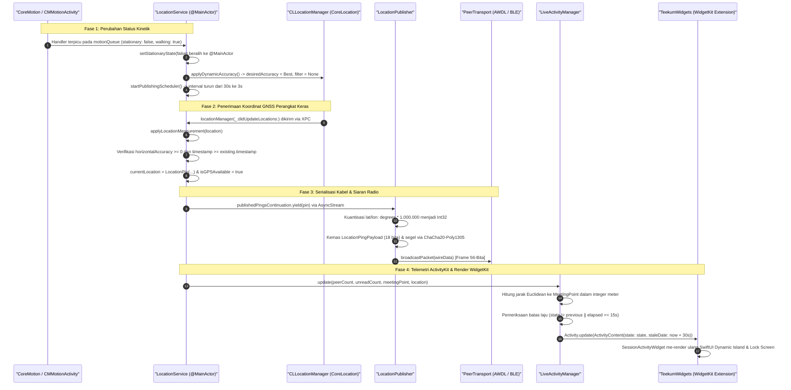
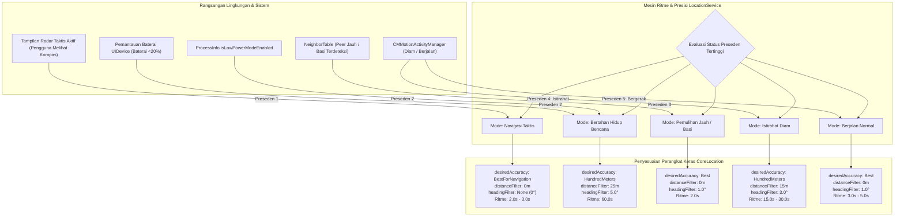

# Volume 06: Layanan Lokasi, Perangkat Keras Adaptif & Live Activity (Meepo)

## Ringkasan Eksekutif & Gambaran Umum Tingkat Tinggi

Volume 06 menetapkan arsitektur kesadaran spasial, kecerdasan kinetik, penghematan daya baterai, peringatan lokal, serta penyajian tingkat sistem pada Layar Terkunci (*Lock Screen*) dan *Dynamic Island* untuk klien jaringan *mesh off-grid* Meepo. Sementara lapisan yang lebih rendah dalam tumpukan Meepo mengelola *frame* radio *peer-to-peer* mentah (Volume 03) dan jalur perutean *multi-hop* (Volume 04), subsistem lokasi dan *Live Activity* ini berada tepat di perbatasan fisik antara sensor perangkat keras iOS bawaan dan lingkungan fisik langsung pengguna. Subsistem ini terus memantau posisi geografis perangkat, orientasi arah kompas, dan status aktivitas kinetik, menerjemahkan pergerakan fisik menjadi paket kabel biner terkuantisasi dengan privasi tanpa-pengetahuan (*zero-knowledge*), sembari secara ketat mengelola konsumsi energi dan batasan termal sistem operasi.

Subsistem ini beroperasi di atas lima pilar teknis inti:
1. **GNSS Adaptif & Manajemen Ritme Sadar-Gerak (`LocationService`, `CadenceConfiguration`):** Pengambilan sampel satelit GPS dan penyiaran paket radio secara terus-menerus di lingkungan *off-grid* dapat menguras baterai iPhone dalam waktu empat jam. Meepo mengimplementasikan hierarki penjadwalan dinamis yang memodulasi presisi perangkat keras GPS (`desiredAccuracy`, `distanceFilter`, `headingFilter`) dan interval penyiaran jaringan (3,0 detik–5,0 detik saat berjalan, 15,0 detik–30,0 detik saat diam, 2,0 detik saat memeriksa *peer* yang jauh atau basi, dan 60,0 detik saat baterai turun di bawah 20%).
2. **Validasi Monotonik Deterministik & Kuantisasi (`LocationPin`, `LocationService+Publishing`):** Pengukuran GPS yang masuk dari *daemon* `locationd` milik Apple disaring melalui filter validasi yang ketat: koordinat dengan akurasi negatif yang tidak valid dibuang, dan monotonisitas stempel waktu ditegakkan untuk mencegah perbaikan Wi-Fi yang tertunda atau tersimpan di *cache* merusak status lokal. Koordinat desimal dihitung dengan faktor skala titik tetap $1.000.000,0$ (presisi ~11 cm) menjadi bilangan bulat bertanda 32-bit *big-endian*, mengemas koordinat presisi ke dalam muatan kabel yang ringkas tanpa variasi serialisasi pecahan desimal.
3. **Preemption Koordinat Darurat SOS Tanpa Syarat (`LocationServiceProtocol`):** Dalam skenario bahaya yang mengancam keselamatan jiwa, waktu respons adalah hal yang paling kritis. Arsitektur lokasi menjamin bahwa koordinator SOS darurat memiliki akses langsung dan sinkron ke koordinat terbaru yang tersimpan di *cache* via `getLatestLocationForSOS()`, sepenuhnya melewati pengatur waktu ritme normal dan tetap beroperasi bahkan ketika *Live Sharing* pengguna dinonaktifkan.
4. **Peringatan Lokal Offline & Spanduk Hilang Otomatis (`NotificationService`):** Karena lingkungan operasi bencana tidak memiliki jangkauan seluler dan konektivitas internet, Meepo tidak dapat mengandalkan *Apple Push Notification service* (APNs). `NotificationService` menghasilkan peringatan lokal menggunakan `UNUserNotificationCenter` untuk peristiwa latar belakang berprioritas tinggi (peringatan bahaya SOS, pesan obrolan masuk, dan kedatangan/keberangkatan anggota grup) serta mengelola spanduk *toast* dalam aplikasi yang membatalkan dirinya sendiri setelah 4 detik saat aplikasi aktif di latar depan.
5. **ActivityKit Live Activities & Tampilan Dynamic Island (`LiveActivityManager`, `TeekumWidgets`):** Menggunakan kotak pasir (*sandbox*) Ekstensi Aplikasi di luar proses utama, Meepo memproyeksikan telemetri sesi waktu nyata ke Layar Terkunci dan *Dynamic Island* pengguna di seluruh tampilan *Compact Leading*, *Compact Trailing*, *Minimal*, dan *Expanded*. Aliran data diatur oleh aturan privasi *zero-knowledge*: `SessionActivityAttributes` tidak berisi kunci kriptografis dan tidak berisi koordinat mentah, hanya mentransmisikan jarak relatif bilangan bulat skalar untuk mencegah kebocoran spasial di luar kotak pasir aplikasi utama.

---

### Gambaran Sederhana (ELI5): Pengintai Taktis, Penjaga Pos & Tampilan HUD Lapangan

Bayangkan regu pencari dan penyelamat darurat yang beroperasi di zona bencana yang mengalami pemadaman listrik total tanpa layanan seluler atau internet:

1. **Pengintai Taktis (`LocationService`):** Pengintai memantau kompas magnetik digital dan sensor GNSS frekuensi ganda untuk menghitung koordinat jaringan waktu nyata. Saat aktif melintasi medan reruntuhan, pengintai menyiarkan *ping* posisi setiap 3 hingga 5 detik sehingga pemimpin tim penyelamat mempertahankan jejak pencarian yang akurat. Ketika pengintai berhenti di pos triase evakuasi (`isStationary == true`), penyiaran setiap 3 detik menguras baterai vital; sistem secara otomatis menurunkan penyiaran menjadi sekali setiap 20 hingga 30 detik.
2. **Penghemat Daya (Mode Bertahan Hidup pada Baterai <20%):** Dalam pemadaman listrik yang berkepanjangan, baterai adalah penopang hidup. Jika cadangan baterai turun di bawah 20%, sistem secara otomatis membatasi pengambilan sampel GNSS ke perkiraan kasar dan meregangkan interval penyiaran menjadi sekali setiap 60 detik (`survivalInterval = 60s`), memastikan ponsel mempertahankan daya untuk sinyal bahaya darurat selama 72 jam penanganan bencana.
3. **Penjaga Pos Perimeter (`NotificationService`):** Saat petugas beristirahat atau bernavigasi dengan ponsel terkunci di dalam kantong rompi taktis, penjaga memantau umpan radio *mesh* yang masuk. Jika suar darurat SOS terdeteksi, penjaga memicu alarm audio dan haptik berprioritas tinggi (`UNUserNotificationCenter`) untuk segera memperingatkan petugas. Jika aplikasi aktif di latar depan, penjaga menampilkan spanduk status visual yang menutup sendiri setelah 4 detik.
4. **Tampilan Taktis HUD (*LiveActivityManager* & *TeekumWidgets*):** Diproyeksikan langsung ke Layar Terkunci iPhone dan *Dynamic Island*, HUD status ambien menampilkan telemetri regu yang penting: inisial rekan terdekat, arah kompas, jarak radial, dan kesehatan baterai. Petugas tidak perlu membuka kunci perangkat mereka dengan sarung tangan penyelamat yang tebal; sekilas pandang memberikan kesadaran situasional instan. Jika seorang rekan memicu suar SOS, HUD langsung berkedip merah terang dengan tanda panggilan korban!

---

## Panduan Desain dan UX (Tanpa Kode Diperlukan)

Bagian ini memberi desainer produk, peneliti UX, dan penanggung jawab merek referensi non-teknis yang menjelaskan bagaimana sistem lokasi dan *widget* Meepo berperilaku di dunia fisik. Tidak diperlukan kode atau pengetahuan pemrograman untuk memahami bagian ini.

### Alur Perjalanan Pengguna dan Status Layar

```
[Pencarian Aktif di Reruntuhan] ──► [Diam di Pos Triase LZ] ──► [Baterai Turun <20%] ──► [SOS Darurat]
    Ritme: 3-5 detik                  Ritme: 15-30 detik            Ritme: 60 detik         Ritme: Instan
    GPS: Presisi Maksimal             GPS: Hemat Daya               GPS: Kasar 100m         GPS: Koordinat Tersimpan
    Island: Titik Hijau Lumut         Island: Titik Hijau Lumut     Island: Peringatan Oranye Island: Merah Berkedip
```

1. **Pencarian Aktif (Melintasi Sektor Reruntuhan):**
   - **Pengalaman Layar:** Petugas bergerak aktif. Peta radar taktis menampilkan pembaruan posisi yang halus.
   - **Dynamic Island:** Menampilkan ikon hijau lumut (*teal*) yang tajam di sebelah kiri (pin titik temu) dan jumlah aktif anggota regu di dekatnya di sebelah kanan (misalnya, `3 [rekan]`).
   - **Bilah Status:** Kapsul biru solid muncul di belakang jam di sudut kiri atas bilah status iPhone. Ini menegaskan bahwa Meepo mempertahankan pelacakan regu di latar belakang bahkan jika petugas beralih ke aplikasi lain atau mengunci ponsel mereka.

2. **Berhenti / Diam di Lokasi (Bertugas di Pos Triase atau Pangkalan Depan):**
   - **Pengalaman Layar:** Petugas tiba di pos pemeriksaan triase lapangan dan berhenti bergerak. Dalam hitungan detik, perangkat mendeteksi bahwa gerakan telah berhenti.
   - **Dynamic Island & Widget:** Tampilan tetap terlihat stabil, menunjukkan jarak saat ini ke titik kumpul triase yang ditentukan.
   - **Status Daya Latar Belakang:** Perangkat secara otomatis memasuki ritme tidur hemat daya. Penyiaran lokasi turun dari sekali setiap beberapa detik menjadi sekali setiap 15 hingga 30 detik, mencegah baterai habis selama perawatan medis yang lama.

3. **Mode Bertahan Hidup Bencana (Baterai di Bawah 20% atau Mode Daya Rendah):**
   - **Pengalaman Layar:** Baterai pengguna turun menjadi 19%, atau Mode Daya Rendah iOS diaktifkan.
   - **Peringatan Visual:** UI menampilkan spanduk daya rendah yang persisten, memperingatkan petugas bahwa pembagian lokasi telah dibatasi untuk menghemat kapasitas komunikasi darurat.
   - **Dynamic Island & Widget:** Interval pembaruan melebar menjadi sekali setiap 60 detik. Ponsel sengaja berhenti meminta perbaikan satelit GPS berdaya tinggi, mengandalkan perkiraan sensor kasar (~100 meter). Ini mencegah perangkat mati selama jam-jam evakuasi kritis terakhir.

4. **Kondisi Bahaya SOS Darurat:**
   - **Pengalaman Layar:** Setiap anggota kelompok menekan tombol bahaya darurat.
   - **Pengambilalihan Dynamic Island:** Seketika, semua jumlah rekan dan indikator obrolan normal menghilang. *Dynamic Island* beralih ke mode peringatan visibilitas tinggi:
     - *Slot kiri:* Ikon alarm SOS melingkar merah terang (`sos.circle.fill`).
     - *Slot kanan:* 3 huruf inisial rekan yang dalam bahaya ditampilkan dalam warna merah peringatan tebal (misalnya, `ADI`).
   - **Kartu Layar Terkunci:** Garis tepi dan lencana kartu Layar Terkunci menyala dalam warna merah alarm, dengan jelas menampilkan "SOS Darurat", inisial rekan yang terancam, dan lompatan *relay* aktif yang diperlukan untuk menjangkau mereka.

---

### Mengapa Kita Tidak Bisa Hanya...? (Batasan untuk Desainer)

Desainer produk sering bertanya mengapa perilaku seluler tertentu tidak dapat ditata atau dikonfigurasi secara berbeda. Tabel berikut menjawab pertanyaan desain yang paling umum melalui kacamata pembatasan platform iOS:

| "Mengapa Kita Tidak Bisa Hanya...?" | Realitas Teknis & Platform | Solusi Desain / Perilaku yang Diizinkan |
| :--- | :--- | :--- |
| **Mengapa kita tidak bisa menyembunyikan kapsul lokasi biru di bilah status?** | Apple mewajibkan aplikasi apa pun yang menggunakan lokasi latar belakang dengan otorisasi `WhenInUse` harus menampilkan indikator biru (`showsBackgroundLocationIndicator = true`) setiap kali GPS berjalan di latar belakang. Menyembunyikannya memerlukan otorisasi permanen `Always`, yang sering kali diminta iOS untuk dicabut oleh pengguna melalui *popup* menakutkan, menghasilkan tingkat pencopotan pemasangan (*uninstall*) yang tinggi. | Rangkullah kapsul biru sebagai fitur keamanan yang disengaja. Dalam proses *onboarding*, edukasikan pengguna bahwa kapsul biru berarti "Jaringan keselamatan kelompok Anda melindungi Anda di latar belakang." |
| **Mengapa kita tidak bisa memperbarui Dynamic Island setiap detik seperti jarum kompas waktu nyata?** | Kerangka kerja ActivityKit Apple memberlakukan batas laju yang ketat pada pembaruan *widget* latar belakang. Mendorong pembaruan lebih cepat dari setiap 15 detik menyebabkan sistem operasi membatasi atau menghentikan seluruh proses *widget* untuk mencegah pengurasan baterai. | Pertahankan jarum kompas berputar frekuensi tinggi di dalam aplikasi latar depan yang aktif (`OrbitMapView`). Gunakan *Dynamic Island* untuk pencapaian tonggak yang stabil dan teragregasi (jarak dalam meter, jumlah rekan, dan lencana pesan yang belum dibaca). |
| **Mengapa presisi lokasi turun saat pengguna diam di tempat?** | GPS frekuensi ganda presisi tinggi (L1/L5) membutuhkan daya radio terus-menerus yang menarik arus hingga 120 mA. Ketika seorang petugas atau penyintas tidak bergerak di pos triase atau tempat penampungan, pelacakan sub-meter terus-menerus menjadi berlebihan karena posisi fisik mereka tidak bergeser. | Rancang antarmuka pengguna untuk menampilkan "lingkaran keyakinan" yang meluas atau lencana istirahat halus di sekitar rekan yang diam di peta, menunjukkan bahwa lokasi mereka terverifikasi tetapi daya sedang dihemat. |
| **Mengapa widget tidak dapat membaca koordinat GPS mentah secara langsung?** | Ekstensi Aplikasi berjalan dalam proses sistem yang sepenuhnya terisolasi di luar kotak pasir aplikasi utama. Memberikan akses langsung ke GPS mentah pada *widget* akan menggandakan penarikan daya perangkat keras dan melanggar batas memori Apple (~maksimal 30 MB untuk proses *widget*). | Aplikasi utama menghitung terlebih dahulu jarak relatif dalam bilangan bulat meter dan mengirimkan hanya angka yang telah dihitung sebelumnya ke *widget*. *Widget* tidak pernah menyentuh perangkat keras GPS. |
| **Mengapa kita tidak bisa menampilkan nama lengkap teman di Layar Terkunci?** | Kartu Layar Terkunci dan kapsul *Dynamic Island* memiliki batas lebar yang sangat ketat. Nama panjang seperti "Christopher" akan terpotong atau mendorong tombol SOS darurat keluar layar pada perangkat yang lebih kecil seperti iPhone 14 Pro atau iPhone 15. | Format semua identitas secara ketat menjadi inisial huruf besar 3 karakter standar yang ringkas (misalnya, `CHR` atau `DAF`) di dalam lingkaran avatar berkode warna 56x56. |

---

### Token Desain yang Dapat Diedit vs. Aturan Rekayasa Terkunci

Untuk memastikan kolaborasi yang lancar antara desainer UI/UX dan insinyur sistem iOS, matriks berikut mendefinisikan properti antarmuka mana yang dapat disesuaikan secara bebas versus aturan mana yang dikodekan secara kaku ke dalam mesin perangkat keras:

```
+---------------------------------------------------------------------------------+
|                        MATRIKS BATAS DESAIN & REKAYASA                          |
+------------------------------------+--------------------------------------------+
| TOKEN DESAIN YANG DAPAT DIEDIT     | ATURAN REKAYASA PERANGKAT KERAS TERKUNCI   |
| (Warna, Tata Letak, Teks, Aset)    | (Ritme, Baterai, Enkripsi, Keselamatan)    |
+------------------------------------+--------------------------------------------+
| 1. Warna Aksen Primer (Teal)       | 1. Batas Baterai Mode Bertahan Hidup (<20%)|
| 2. Warna Lencana Peringatan (Merah)| 2. Ritme Deteksi Diam (15s-30s)            |
| 3. Margin & Bantalan Dynamic Island| 3. Ritme Deteksi Gerak (3s-5s)             |
| 4. Ukuran Lingkaran Avatar (56x56) | 4. Ritme SOS (Instan / 0s)                 |
| 5. Waktu Tutup Otomatis Toast (4s) | 5. Batas Ukuran Muatan Widget (Maks 4 KB)  |
| 6. Ikon Vektor Kustom ("MeetPoint")| 6. Batas Laju ActivityKit (Minimal 15s)    |
| 7. Hierarki Font (Helvetica/SF)    | 7. Faktor Kuantisasi Koordinat (1e6)       |
+------------------------------------+--------------------------------------------+
```

1. **Token Desain UI yang Dapat Diedit Bebas:**
   - **Warna Merek:** Warna aksen hijau lumut (*teal*) primer (`Color.buttonPrimary`) yang digunakan untuk ikon Titik Temu dan lencana jumlah rekan dapat ditata ulang di `Theme.swift`.
   - **Aksen Darurat:** Warna merah peringatan (`Color.red`) yang digunakan untuk cincin inisial SOS dan segitiga peringatan dapat disesuaikan untuk visibilitas kontras tinggi.
   - **Geometri Kartu:** Bantalan, radius sudut (misalnya, `Capsule()`), dan opasitas latar belakang pada kartu Layar Terkunci (`SessionLiveActivityView.swift`) dapat ditata agar sesuai dengan panduan visual merek.
   - **Durasi Toast Dalam Aplikasi:** Batas waktu penutupan otomatis 4 detik di `NotificationService.swift` dapat disesuaikan antara 3 hingga 6 detik berdasarkan skor keterbacaan uji pengguna.

2. **Aturan Rekayasa Perangkat Keras Terkunci:**
   - **Batas Pemotongan Baterai 20%:** Transisi ke Mode Bertahan Hidup pada baterai 20% (`currentBatteryLevel < 0.20`) adalah ambang keselamatan yang terkunci. Mengubah nilai ini berisiko membuat ponsel kehabisan daya sebelum fajar selama operasi bencana beberapa hari di luar jaringan.
   - **Ambang Batas Pergerakan:** Transisi kecepatan (diam pada `<0.3 m/s`, bergerak pada `>=0.8 m/s`) dikalibrasi sesuai dinamika berjalan manusia dan tidak dapat diubah tanpa risiko salah mendeteksi status diam saat merangkak atau berjalan lambat di tengah kerumunan padat.
   - **Kuantisasi Titik Tetap (*Fixed-Point Quantization*):** Faktor penskalaan $1.000.000,0$ (~11 cm) dikodekan secara kaku ke dalam *frame* kabel 56-bita. Mengubahnya akan merusak kompatibilitas dengan semua radio *mesh* lainnya di lapangan.
   - **Jaminan Preemption SOS:** Ketersediaan seketika dari koordinat yang tersimpan di *cache* untuk pengiriman SOS (`getLatestLocationForSOS()`) tidak dapat dinonaktifkan atau diikat ke animasi UI.

---

## Pembahasan Mendalam Rekayasa Teknis

Bagian ini memberikan analisis arsitektur tingkat kode yang ketat untuk Volume 06. Dimulai dengan penelusuran langkah demi langkah dari ujung ke ujung, merinci inventaris lengkap artefak sumber, menyajikan diagram Mermaid dan tabel perbandingan perangkat keras, serta menyediakan panduan berkas demi berkas yang lengkap untuk semua 18 berkas.

---

### Alur Ujung-ke-Ujung: Dari Pergerakan Sensor ke Live Activity Layar Terkunci

Untuk memandu insinyur sistem memahami pipa spasial Meepo, penelusuran berikut melacak satu peristiwa fisik: seorang pengguna iPhone yang sedang beristirahat di sebuah pos, mulai berjalan sejauh 15 meter menuju titik kumpul operasi bencana, dan memicu kaskade otomatis yang mempercepat pengambilan sampel GPS, memvalidasi perbaikan koordinat, mengenkripsi *frame* kabel, dan memperbarui *widget* Layar Terkunci dan *Dynamic Island*:



#### Penelusuran Arsitektur Langkah demi Langkah:
1. **Deteksi Transisi Kinetik:** Pengguna mulai berjalan. Koprosesor gerak seri M iPhone mendeteksi akselerasi langkah yang berkelanjutan. `CMMotionActivityManager` memicu blok penyelesaiannya pada antrean latar belakang privat (`motionQueue`) dengan `activity.stationary == false` dan `activity.walking == true`.
2. **Peralihan Actor & Percepatan Penjadwal:** Blok penyelesaian beralih secara aman ke `@MainActor` dengan memanggil `LocationService.setStationaryState(false)`. Transisi status ini memicu dua reaksi perangkat keras seketika:
   - `applyDynamicAccuracy()` menyetel ulang `locationManager.desiredAccuracy` ke `kCLLocationAccuracyBest` dan membersihkan filter jarak (`kCLDistanceFilterNone`).
   - `startPublishingScheduler()` membatalkan tidur istirahat 30 detik yang aktif dan memulai ulang penjadwal pada `movingInterval` (3,0 detik–5,0 detik) atau `distantPeerInterval` (2,0 detik).
3. **Pengiriman Koordinat Perangkat Keras:** *Daemon* sistem Apple (`locationd`) mengunci sinyal satelit GNSS L1/L5 frekuensi ganda dan memanggil metode delegasi `locationManager(_:didUpdateLocations:)`.
4. **Verifikasi Monotonik & Integritas Stempel Waktu:** Metode delegasi beralih ke `@MainActor` dan meneruskan koordinat ke `applyLocationMeasurement(_:)`. Metode ini melakukan dua pernyataan keselamatan penting:
   - Memastikan `location.horizontalAccuracy >= 0` untuk membuang koordinat yang tidak valid.
   - Memastikan `location.timestamp >= existing.timestamp` untuk membuang koordinat seluler atau Wi-Fi lama yang tidak berurutan.
   - Pengukuran yang terverifikasi dikemas ke dalam `LocationPin` yang tidak dapat diubah (*immutable*).
5. **Penerusan ke Async Stream:** `LocationPin` baru dipancarkan ke dalam `publishedPingsContinuation`, membangunkan pelanggan hilir yang menunggu `locationService.publishedPings`.
6. **Kuantisasi & Penyegelan:** `LocationPublisher` menerima pin tersebut. Ia menguantisasi garis lintang dan garis bujur pecahan desimal menjadi bilangan bulat bertanda 32-bit *big-endian* menggunakan `coordinateScalingFactor = 1_000_000.0`. Ia mengemas 18-bita `LocationPingPayload`, menyegelnya dengan ChaCha20-Poly1305 menggunakan kunci sesi simetris 256-bit kelompok, dan mentransmisikan paket kabel 56-bita melintasi *mesh* AWDL melalui `PeerTransport`.
7. **Perakitan Snapshot ActivityKit:** Secara konkuren, `SessionController` meneruskan `LocationPin` yang segar ke `LiveActivityManager.update(...)`. Manajer menghitung jarak dalam meter ke `MeetingPoint` aktif via `location.distance(to: point.coordinate)` dan menyusun `SessionActivityAttributes.ContentState` ringan yang berisi jumlah rekan langsung, jumlah pesan yang belum dibaca, jarak, dan status SOS.
8. **Pembatasan Laju & Pendorongan Asinkron:** `LiveActivityManager` memverifikasi bahwa status konten telah berubah atau 15 detik telah berlalu sejak pembaruan terakhir. Ia memanggil `@concurrent static pushUpdate(id:state:)`, mendorong pembaruan via XPC ke *daemon* ActivityKit iOS.
9. **Rendering WidgetKit dalam Proses Terisolasi:** SpringBoard iOS membangunkan Ekstensi Aplikasi `TeekumWidgets`. `SessionActivityWidget` mengevaluasi konteks presentasi dan me-render ulang `SessionLiveActivityView`, menyegarkan jarak rekan di trailing dan arah kompas pada *Dynamic Island* dan Layar Terkunci tanpa membangunkan antarmuka aplikasi utama.

---

### Berkas Sumber yang Disertakan

Tabel berikut mencantumkan semua 18 berkas kode sumber dan konfigurasi yang ditetapkan untuk Volume 06 dalam `docs/handbook/_MANIFEST.md`. Setiap jalur berkas ditautkan relatif terhadap dokumen ini, disertai dengan jumlah baris terverifikasi (`wc -l`) dan tanggung jawab arsitektural tunggalnya:

| Jalur Berkas | Kategori | Jumlah Baris (`wc -l`) | Peran Arsitektural |
| :--- | :--- | :---: | :--- |
| [CadenceConfiguration.swift](../../Teekum/Teekum/Core/Location/CadenceConfiguration.swift) | Model Konfigurasi | 62 | Struktur konfigurasi *thread-safe* yang menentukan pembaruan GPS dinamis dan interval basi berdasarkan gerakan, baterai, dan kedekatan *peer*. |
| [LocationPin.swift](../../Teekum/Teekum/Core/Location/LocationPin.swift) | Model Domain | 118 | Model pengukuran geografis tidak dapat diubah kanonikal yang menampilkan fungsi kuantisasi kabel titik tetap dan perhitungan arah bola dunia. |
| [LocationPublisher.swift](../../Teekum/Teekum/Core/Location/LocationPublisher.swift) | Actor Penerbit | 149 | *Actor* penerbit pada *main-thread* yang mengamati aliran lokasi, menguantisasi koordinat, dan menyiarkan *frame* kabel 56-bita terenkripsi. |
| [LocationService+AdaptiveHardware.swift](../../Teekum/Teekum/Core/Location/LocationService+AdaptiveHardware.swift) | Ekstensi Perangkat Keras | 135 | Ekstensi perangkat keras yang mengelola pelacakan aktivitas CoreMotion, penyesuaian akurasi sensor dinamis, dan transisi mode bertahan hidup baterai. |
| [LocationService+Delegate.swift](../../Teekum/Teekum/Core/Location/LocationService+Delegate.swift) | Ekstensi Delegasi | 85 | Ekstensi `CLLocationManagerDelegate` non-terisolasi yang mengirimkan perbaikan lokasi dan arah kompas perangkat keras secara aman ke `@MainActor`. |
| [LocationService+Lifecycle.swift](../../Teekum/Teekum/Core/Location/LocationService+Lifecycle.swift) | Ekstensi Siklus Hidup | 139 | Ekstensi siklus hidup yang mengoordinasikan permintaan izin asinkron via `CheckedContinuation`, *boot* sensor perangkat keras, dan pembubaran sesi bersih. |
| [LocationService+Publishing.swift](../../Teekum/Teekum/Core/Location/LocationService+Publishing.swift) | Ekstensi Penerbitan | 158 | Ekstensi penerbitan yang mengimplementasikan perulangan pengatur waktu periodik, penjaga sakelar *Live Sharing*, *ping* lonjakan, dan filter validasi monotonik. |
| [LocationService.swift](../../Teekum/Teekum/Core/Location/LocationService.swift) | Layanan Pusat | 263 | Layanan CoreLocation dan CoreMotion otoritatif yang mengelola *handle* perangkat keras, indikator latar belakang, dan interval ritme adaptif. |
| [LocationServiceError.swift](../../Teekum/Teekum/Core/Location/LocationServiceError.swift) | Kesalahan Domain | 29 | Enumerasi kesalahan terlokalisasi bertipe ketat yang melaporkan layanan nonaktif, izin ditolak, dan kegagalan pelacakan perangkat keras. |
| [LocationServiceProtocol+Configuration.swift](../../Teekum/Teekum/Core/Location/LocationServiceProtocol+Configuration.swift) | Default Protokol | 22 | Ekstensi protokol yang menyediakan implementasi *stub* bawaan untuk *callback* arah opsional, sakelar radar taktis, dan *ping* lonjakan. |
| [LocationServiceProtocol.swift](../../Teekum/Teekum/Core/Location/LocationServiceProtocol.swift) | Protokol Inti | 99 | Protokol arsitektur utama yang mendeklarasikan pengamatan lokasi, aliran kompas, kontrol ritme, dan akses koordinat SOS seketika. |
| [NotificationService.swift](../../Teekum/Teekum/Core/Notifications/NotificationService.swift) | Layanan Notifikasi | 85 | Pengelola notifikasi lokal yang mengirimkan peringatan offline `UNUserNotificationCenter` untuk sirene SOS, pesan obrolan, dan spanduk otomatis. |
| [LiveActivityManager.swift](../../Teekum/Teekum/Core/LiveActivity/LiveActivityManager.swift) | Koordinator ActivityKit | 54 | Pengelola pada *main-thread* yang memulai, membatasi laju, dan menghentikan Live Activities Dynamic Island dan Layar Terkunci via ActivityKit. |
| [SessionActivityAttributes.swift](../../Teekum/Teekum/Core/LiveActivity/SessionActivityAttributes.swift) | Kontrak Data Bersama | 39 | Struktur `ActivityAttributes` yang mendefinisikan metadata sesi statis dan telemetri dinamis ringan yang dikompilasi ke aplikasi dan *widget*. |
| [TeekumWidgetBundle.swift](../../TeekumWidgets/TeekumWidgetBundle.swift) | Titik Masuk Widget | 14 | Titik masuk yang dapat dieksekusi (`@main`) untuk target Ekstensi Aplikasi TeekumWidgets yang mendaftarkan `SessionActivityWidget` ke WidgetKit. |
| [SessionActivityWidget.swift](../../TeekumWidgets/SessionActivityWidget.swift) | Deklarasi WidgetKit | 131 | Deklarasi WidgetKit yang mengikat `ActivityAttributes` ke kartu Layar Terkunci dan presentasi Dynamic Island Compact, Minimal, dan Expanded. |
| [SessionLiveActivityView.swift](../../TeekumWidgets/SessionLiveActivityView.swift) | Tampilan SwiftUI | 143 | Komponen tampilan SwiftUI yang dapat digunakan kembali untuk me-render lencana aplikasi, avatar inisial berkode warna, nama sesi, dan kapsul status. |
| [Widgets-Info.plist](../../Config/Widgets-Info.plist) | Konfigurasi Ekstensi | 33 | Daftar properti XML yang mendeklarasikan titik ekstensi `com.apple.widgetkit-extension` dan konfigurasi bundel layanan XPC. |
| **Total Inventaris Volume 06** | **18 Artefak** | **1.758** | **100% Akuntansi Basis Kode Volume 06** |

---

### Arsitektur Akurasi Adaptif & Live Activity

#### 1. Pipa Akurasi Perangkat Keras Adaptif & Manajemen Baterai

Diagram berikut mengilustrasikan bagaimana rangsangan fisik dan listrik eksternal (gerakan berjalan, status istirahat diam, *peer mesh* yang jauh, dan pengurasan baterai) secara dinamis menggerakkan konfigurasi perangkat keras dari cip GPS dan kompas iPhone:



#### 2. Tabel Perbandingan Presisi Perangkat Keras & Ritme

Tabel berikut diturunkan langsung dari konstanta kode aktual di `CadenceConfiguration.swift` dan `LocationService+AdaptiveHardware.swift`, membandingkan lima mode operasi di seluruh parameter akurasi, filter, ritme pelaporan, dan dampak daya:

| Mode Operasi | Kondisi Pemicu | `desiredAccuracy` CoreLocation | `distanceFilter` Perangkat Keras | `headingFilter` Kompas | Interval Ritme Penerbitan | Perkiraan Pengurasan Baterai & Dampak Perangkat Keras |
| :--- | :--- | :--- | :--- | :--- | :--- | :--- |
| **Radar Taktis** | `isTacticalRadarActive == true` | `kCLLocationAccuracyBestForNavigation` | `kCLDistanceFilterNone` (0,0 m) | `kCLHeadingFilterNone` (0,0°) | `2.0s – 3.0s` | **Tinggi (~100–120 mA):** Mengunci GNSS frekuensi ganda L1/L5 terus-menerus; pembaruan kompas tanpa hambatan. |
| **Bertahan Hidup Bencana** | `currentBatteryLevel < 0.20` atau Mode Daya Rendah | `kCLLocationAccuracyHundredMeters` | `25.0 meter` | `5.0 derajat` | `60.0s (survivalInterval)` | **Sangat Rendah (~10–15 mA):** Memotong siklus kerja GPS sebesar ~85%; mengandalkan perkiraan kasar seluler/sensor. |
| **Pemulihan Jauh / Basi** | `hasDistantPeers` atau `hasStalePeers` | `kCLLocationAccuracyBest` | `kCLDistanceFilterNone` (0,0 m) | `1.0 derajat` | `2.0s (distant/staleInterval)` | **Sedang-Tinggi (~65–80 mA):** Lonjakan radio yang dipercepat untuk menembus lompatan *mesh* yang lemah dan memulihkan rute. |
| **Istirahat Diam** | `isStationary == true` (duduk/berdiri) | `kCLLocationAccuracyHundredMeters` | `15.0 meter` | `3.0 derajat` | `15.0s – 30.0s (stationaryInterval)` | **Rendah (~20–25 mA):** Radio GPS pita dasar tidur di antara jendela waktu; interupsi kompas dilonggarkan. |
| **Berjalan Normal** | Default bergerak (`isStationary == false`) | `kCLLocationAccuracyBest` | `kCLDistanceFilterNone` (0,0 m) | `1.0 derajat` | `3.0s – 5.0s (movingInterval)` | **Standar (~45–60 mA):** Pelacakan sipil presisi tinggi standar (akurasi dunia nyata ~3–5 meter). |

---

#### 3. Topologi Tata Letak Presentasi ActivityKit

Diagram berikut memetakan tata letak struktural ekstensi `TeekumWidgets` di seluruh permukaan presentasi Layar Terkunci dan *Dynamic Island*:

```
+------------------------------------------------------------------------------------+
|                         TAMPILAN DYNAMIC ISLAND EXPANDED                           |
| +--------------------------------------------------+-----------------------------+ |
| | [Wilayah Leading]                                | [Wilayah Trailing]          | |
| | SessionAppBadge ("Meepo" + Pin Titik Temu)       | Teks Status Relai (Teal/Red)| |
| +--------------------------------------------------+-----------------------------+ |
| | [Wilayah Bawah: SessionSummaryRow]                                             | |
| | +---------------+  +-------------------------------+  +---------------------+  | |
| | | Avatar 56x56  |  | "Regu SAR Sektor 4" (Judul)   |  | [3 Orang] atau      |  | |
| | | Inisial [DAF] |  | "ANDA" atau "SOS Darurat" (Sub|  | [2 Pesan] atau [SOS]|  | |
| | +---------------+  +-------------------------------+  +---------------------+  | |
| +--------------------------------------------------------------------------------+ |
+------------------------------------------------------------------------------------+

+-------------------------------------+   +------------------------------------------+
|        DYNAMIC ISLAND COMPACT       |   |          DYNAMIC ISLAND MINIMAL          |
| +-------------+     +-------------+ |   | +--------------------------------------+ |
| | [Leading]   | (O) | [Trailing]  | |   | | Slot Ikon Tunggal:                   | |
| | MeetPoint   |     | "3 [rekan]" | |   | | - Normal: Vektor MeetPoint (Teal)    | |
| | atau SOS Red|     | atau "ADI"  | |   | | - Belum Dibaca: message.fill (Teal)  | |
| +-------------+     +-------------+ |   | | - SOS: sos.circle.fill (Merah)       | |
|                                     |   | +--------------------------------------+ |
+-------------------------------------+   +------------------------------------------+

+------------------------------------------------------------------------------------+
|                         KARTU LIVE ACTIVITY LAYAR TERKUNCI                         |
| +--------------------------------------------------+-----------------------------+ |
| | SessionAppBadge ("Meepo" + Pin Titik Temu)       | Teks Status Relai ("Aktif") | |
| +--------------------------------------------------+-----------------------------+ |
| | ------------------------------------------------------------------------------- | |
| | [SessionSummaryRow]                                                              | |
| | +---------------+  +-------------------------------+  +---------------------+  | |
| | | Avatar 56x56  |  | Nama Sesi ("SAR Sektor 4")   |  | Kapsul Lencana      |  | |
| | | Inisial [DAF] |  | Subjudul ("ANDA")             |  | [120m ke Pertemuan] |  | |
| | +---------------+  +-------------------------------+  +---------------------+  | |
| +--------------------------------------------------------------------------------+ |
+------------------------------------------------------------------------------------+
```

---

## Pembahasan Mendalam Berkas demi Berkas

---

### 1. `Teekum/Teekum/Core/Location/CadenceConfiguration.swift`
- **Jalur Berkas**: [CadenceConfiguration.swift](../../Teekum/Teekum/Core/Location/CadenceConfiguration.swift)
- **Jumlah Baris**: 62 baris (`wc -l`)
- **Kategori & Isolasi**: Model Konfigurasi, `nonisolated public struct`, Mematuhi `Equatable, Sendable`

#### Fungsi Berkas Ini
`CadenceConfiguration.swift` mendefinisikan parameter pewaktuan yang mengatur seberapa sering perangkat aktif menyiarkan koordinat GPS-nya melalui *mesh* radio *peer-to-peer*. Daripada mentransmisikan pada frekuensi statis yang kaku, Meepo secara dinamis mengubah ritme penerbitannya tergantung pada apakah pengguna sedang berlari/berjalan, diam di tempat, bernavigasi ke *peer* yang jauh, memulihkan koneksi yang terputus, atau beroperasi di bawah kondisi baterai kritis. Berkas ini merangkum semua interval target dan ambang keusangan tersebut dalam tipe nilai yang aman dari multithreading (*thread-safe*).

#### Analogi Sederhana (ELI5)
Bayangkan seorang petugas pencari dan penyelamat yang dikerahkan ke medan reruntuhan bencana. Jika mereka aktif melintasi lempengan beton yang runtuh, mereka menyiarkan *ping* lokasi setiap 3 hingga 5 detik sehingga pemimpin tim mengetahui jalur persis mereka. Jika mereka berhenti di pos triase depan untuk merawat korban, melakukan *ping* setiap 3 detik hanya membuang-buang baterai; membatasinya menjadi 15-30 detik adalah langkah yang optimal. Jika rekan tim di dekatnya memicu alarm SOS, ritme dipercepat menjadi 2 detik untuk pelacakan kecepatan tinggi. Jika baterai perangkat turun di bawah 20%, sistem beralih ke interval bertahan hidup 60 detik untuk menghemat daya. `CadenceConfiguration` adalah buku aturan otomatis yang menghitung interval persis ini.

#### Istilah Teknis
- **Ritme Penerbitan Adaptif (*Adaptive Publishing Cadence*):** Strategi penjadwalan dinamis di mana frekuensi pengambilan sampel sensor dan transmisi radio bervariasi secara waktu nyata berdasarkan pemicu lingkungan (kecepatan, baterai, kedekatan rekan) daripada pengatur waktu tetap.
- **Jitter Runloop (*Runloop Jitter*):** Penyimpangan dalam waktu pemicuan pengatur waktu yang disebabkan oleh sistem operasi yang memprioritaskan perenderan UI, penjadwalan utas, atau siklus tidur perangkat di atas tugas latar belakang.
- **Siklus Kerja (*Duty Cycle*):** Persentase waktu komponen perangkat keras (seperti penerima GNSS L1/L5 Apple atau radio Wi-Fi AWDL) tetap aktif diberi daya versus dimatikan dalam status tidur berdaya rendah.
- **Ambang Keusangan (*Staleness Threshold*):** Durasi setelah pengukuran koordinat yang tersimpan di *cache* dianggap usang dan ditandai sebagai tidak dapat dipercaya untuk navigasi arah waktu nyata.

#### Penjelasan Kode Baris demi Baris
Baris 13–40 mendeklarasikan *struct* dan properti konfigurasinya:
```swift
nonisolated public struct CadenceConfiguration: Equatable, Sendable {
    /// Publishing interval while actively moving (recommended: 3–5 seconds).
    public var movingInterval: TimeInterval
    
    /// Publishing interval while stationary (recommended: 15–30 seconds).
    public var stationaryInterval: TimeInterval
    
    /// Accelerated publishing interval when one or more peers are distant or signal is weak (recommended: 2.0s).
    public var distantPeerInterval: TimeInterval
    
    /// Throttled publishing interval in survival mode (<20% battery).
    public var survivalInterval: TimeInterval
    
    /// Duration after which a location fix is marked stale for the UI.
    public var staleThreshold: TimeInterval
    
    /// Threshold after which a peer is considered stale (recommended: 30.0s).
    public var stalePeerThreshold: TimeInterval
    
    /// Accelerated publishing interval while probing for stale peers (recommended: 2.0s).
    public var staleRecoveryInterval: TimeInterval
    
    /// Additional staleness delay before triggering Stage 2 route discovery (recommended: 15.0s).
    public var staleRouteReqDelay: TimeInterval
    
    /// Maximum active recovery probe window duration before falling back to normal cadence (recommended: 60.0s).
    public var staleRecoveryTimeout: TimeInterval
```
- Baris 15 (`movingInterval`): Periode target (bawaan 3,0–5,0 detik) antara *ping* siaran saat perangkat bergerak secara fisik.
- Baris 18 (`stationaryInterval`): Periode target (bawaan 15,0–30,0 detik) saat perangkat beristirahat, atau diam di tempat, mengurangi kepadatan saluran radio.
- Baris 21 (`distantPeerInterval`): Interval yang dipercepat (2,0 detik) yang diterapkan ketika satu atau lebih *peer* memiliki RSSI lemah atau pemisahan geografis yang jauh, memastikan perutean yang responsif melalui *relay* pinggiran.
- Baris 24 (`survivalInterval`): Ritme penghemat daya ekstrem (60,0 detik) yang dipicu saat baterai turun di bawah 20%, memastikan ponsel bertahan dalam situasi darurat.
- Baris 27–30 (`staleThreshold`, `stalePeerThreshold`): Batas waktu (bawaan 30,0 detik) setelah pin rekan dianggap basi di peta.
- Baris 33–39 (`staleRecoveryInterval`, `staleRouteReqDelay`, `staleRecoveryTimeout`): Parameter pewaktuan yang mengontrol lonjakan pengujian aktif (interval 2,0 detik hingga 60,0 detik) sebelum melambat, dan menyisipkan penundaan 15,0 detik sebelum memicu penemuan rute AODV Tahap 2 `RREQ`.

Baris 41–61 menyediakan *initializer memberwise* bawaan yang mengikat ke konstanta `MeepoConfiguration.Timing`:
```swift
    public init(
        movingInterval: TimeInterval = MeepoConfiguration.Timing.locationMovingInterval,
        stationaryInterval: TimeInterval = MeepoConfiguration.Timing.locationStationaryInterval,
        distantPeerInterval: TimeInterval = MeepoConfiguration.Timing.distantPeerInterval,
        survivalInterval: TimeInterval = MeepoConfiguration.Timing.survivalInterval,
        staleThreshold: TimeInterval = MeepoConfiguration.Timing.stalePeerThreshold,
        stalePeerThreshold: TimeInterval = MeepoConfiguration.Timing.stalePeerThreshold,
        staleRecoveryInterval: TimeInterval = 2.0,
        staleRouteReqDelay: TimeInterval = 15.0,
        staleRecoveryTimeout: TimeInterval = 60.0
    ) {
        self.movingInterval = movingInterval
        self.stationaryInterval = stationaryInterval
        self.distantPeerInterval = distantPeerInterval
        self.survivalInterval = survivalInterval
        self.staleThreshold = staleThreshold
        self.stalePeerThreshold = stalePeerThreshold
        self.staleRecoveryInterval = staleRecoveryInterval
        self.staleRouteReqDelay = staleRouteReqDelay
        self.staleRecoveryTimeout = staleRecoveryTimeout
    }
}
```

#### Pertimbangan Rekayasa dan Kasus Khusus
- **Kompromi Siklus Kerja Perangkat Keras (*Hardware Duty-Cycle Tradeoffs*):** Perbaikan GPS terus-menerus menarik arus sekitar 50–120 mA pada pita dasar iPhone. Dengan melonggarkan ritme pembaruan dari 3 detik menjadi 30 detik saat diam, sistem memungkinkan penerima GNSS dan cip Wi-Fi AWDL memasuki status tidur berdaya rendah, memperpanjang masa pakai baterai lapangan dari 4 jam menjadi lebih dari 18 jam.
- **Keamanan Sendable (*Sendable Safety*):** Ditandai `nonisolated` dan `Sendable`, memungkinkannya diteruskan secara aman melintasi batas *actor* (misalnya, dari `LocationService` pada `@MainActor` ke rutinitas evaluasi latar belakang) tanpa kondisi balapan data (*data races*).

---

### 2. `Teekum/Teekum/Core/Location/LocationPin.swift`
- **Jalur Berkas**: [LocationPin.swift](../../Teekum/Teekum/Core/Location/LocationPin.swift)
- **Jumlah Baris**: 118 baris (`wc -l`)
- **Kategori & Isolasi**: Model Domain, `public struct`, Mematuhi `Equatable, Hashable, Sendable`

#### Fungsi Berkas Ini
`LocationPin.swift` mewakili model dalam memori yang kanonikal dan tidak dapat diubah dari pengukuran geografis Meepo. Berkas ini menggabungkan koordinat presisi ganda IEEE 754 64-bit (`CLLocationCoordinate2D`) dengan radius ketidakpastian akurasi horizontal, stempel waktu perangkat keras yang tidak dapat diubah, dan arah kompas opsional. Selain itu, berkas ini menampung fungsi kuantisasi dan dekuantisasi penting yang mengubah derajat desimal pecahan menjadi bilangan bulat bertanda 32-bit *big-endian* untuk transmisi dalam paket kabel 56-bita Meepo yang ketat.

#### Analogi Sederhana (ELI5)
Ketika seorang surveyor mencatat pin batas tanah, mereka tidak hanya menuliskan koordinat; mereka mencatat margin kesalahan instrumen pengukuran dan detik tepat pembacaan dicap pada jam. `LocationPin` adalah sertifikat bersertifikat lengkap tersebut. Ketika mengirimkan sertifikat ini melalui saluran telegraf kecil di mana setiap huruf berharga mahal, surveyor mengubah angka GPS menjadi satuan miliderajat persis (bilangan bulat) sehingga muat ke dalam amplop pesan berukuran tetap tanpa kehilangan akurasi.

#### Istilah Teknis
- **Kuantisasi Koordinat (*Coordinate Quantization*):** Proses matematis untuk memetakan derajat geografis kontinu menjadi nilai bilangan bulat diskret dengan lebar tetap dengan mengalikan faktor skala dan membulatkannya.
- **Resolusi Sub-Meter (*Sub-Meter Resolution*):** Pada faktor skala $1.000.000,0$ (1 mikroderajat), 1 unit mewakili sekitar 0,11 meter (~11 sentimeter) di khatulistiwa, memberikan presisi sub-meter yang berada jauh di dalam batas akurasi fisik GPS sipil (~3–5 meter).
- **Azimut Maju / Arah (*Forward Azimuth / Bearing*):** Arah horizontal target yang dinyatakan sebagai jarak sudut dari utara sejati atau magnetik, diukur searah jarum jam dari 0° hingga 360°.
- **Navigasi Lingkaran Besar (*Great-Circle Navigation*):** Perhitungan trigonometri di sepanjang permukaan lengkung Bumi menggunakan trigonometri bola (*haversine formula*).

#### Penjelasan Kode Baris demi Baris
Baris 12–36 menetapkan struktur nilai inti:
```swift
public struct LocationPin: Equatable, Hashable, Sendable {
    /// Geographical coordinate (64-bit IEEE 754 Double precision degrees).
    public let coordinate: CLLocationCoordinate2D
    
    /// Estimated horizontal accuracy uncertainty radius in meters.
    public let horizontalAccuracy: CLLocationAccuracy
    
    /// Exact UTC timestamp when the measurement was taken by the hardware GPS receiver.
    /// Note: Intermediary relays must NEVER mutate or refresh this timestamp.
    public let timestamp: Date
    
    /// Optional device magnetic heading at measurement time (0..<360 degrees).
    public let heading: CLLocationDirection?
    
    public init(
        coordinate: CLLocationCoordinate2D,
        horizontalAccuracy: CLLocationAccuracy,
        timestamp: Date = Date(),
        heading: CLLocationDirection? = nil
    ) {
        self.coordinate = coordinate
        self.horizontalAccuracy = horizontalAccuracy
        self.timestamp = timestamp
        self.heading = heading
    }
```
Perhatikan baris 20: `Intermediary relays must NEVER mutate or refresh this timestamp.` Mempertahankan stempel waktu kunci GNSS asli sangat penting bagi lompatan *mesh* untuk mendeteksi dan membuang paket yang sudah basi atau tidak berurutan.

Baris 40–63 mengimplementasikan pembantu kuantisasi kabel 56-bita:
```swift
    // MARK: - Fixed 56-Byte Wire Quantization Helpers
    
    /// Conversion constant between Double degrees and Int32 wire quantization (~11cm resolution).
    public static let coordinateScalingFactor: Double = 1_000_000.0
    
    /// Quantized big-endian signed 32-bit integer representing latitude (`degrees * 1_000_000`).
    public var rawLatitude: Int32 {
        Int32((coordinate.latitude * Self.coordinateScalingFactor).rounded())
    }
    
    /// Quantized big-endian signed 32-bit integer representing longitude (`degrees * 1_000_000`).
    public var rawLongitude: Int32 {
        Int32((coordinate.longitude * Self.coordinateScalingFactor).rounded())
    }
    
    /// Compact single-byte horizontal accuracy in meters (clamped 0...255).
    public var rawAccuracyByte: UInt8 {
        UInt8(min(255.0, max(0.0, horizontalAccuracy.rounded())))
    }
    
    /// Dequantizes 32-bit signed raw wire coordinates back into a native `CLLocationCoordinate2D`.
    public static func dequantize(latitudeRaw: Int32, longitudeRaw: Int32) -> CLLocationCoordinate2D {
        let lat = Double(latitudeRaw) / Self.coordinateScalingFactor
        let lon = Double(longitudeRaw) / Self.coordinateScalingFactor
        return CLLocationCoordinate2D(latitude: lat, longitude: lon)
    }
```
- `rawLatitude` / `rawLongitude`: Mengonversi `Double` menjadi `Int32` dengan `.rounded()`. Bilangan bulat bertanda 32-bit memiliki rentang dari -2.147.483.648 hingga +2.147.483.647, dengan mudah menampung garis lintang [-90.000.000 hingga +90.000.000] dan garis bujur [-180.000.000 hingga +180.000.000].
- `rawAccuracyByte`: Membatasi akurasi horizontal dalam meter (0 hingga 255 meter) menjadi bita tunggal tanpa tanda (`UInt8`), menghemat 7 bita dibandingkan dengan `Double` mentah.

Baris 66–86 menyediakan perhitungan jarak dan arah trigonometris:
```swift
    // MARK: - Navigation Computations
    public func distance(to target: CLLocationCoordinate2D) -> CLLocationDistance {
        let currentLoc = CLLocation(latitude: coordinate.latitude, longitude: coordinate.longitude)
        let targetLoc = CLLocation(latitude: target.latitude, longitude: target.longitude)
        return currentLoc.distance(from: targetLoc)
    }
    
    /// Computes the forward bearing (azimuth) in degrees (0..<360) from this location to a target.
    public func bearing(to target: CLLocationCoordinate2D) -> Double {
        let lat1 = coordinate.latitude * .pi / 180.0
        let lon1 = coordinate.longitude * .pi / 180.0
        let lat2 = target.latitude * .pi / 180.0
        let lon2 = target.longitude * .pi / 180.0
        
        let dLon = lon2 - lon1
        let y = sin(dLon) * cos(lat2)
        let x = cos(lat1) * sin(lat2) - sin(lat1) * cos(lat2) * cos(dLon)
        let radiansBearing = atan2(y, x)
        
        let degrees = radiansBearing * 180.0 / .pi
        return (degrees + 360.0).truncatingRemainder(dividingBy: 360.0)
    }
```
Baris 106–117 secara retroaktif menyesuaikan `CLLocationCoordinate2D` Apple agar mematuhi `Equatable` dan `Hashable` via `@retroactive`, memungkinkan perbandingan koordinat dan pembuatan *hash* kamus di seluruh *runtime* konkurensi Swift.

#### Pertimbangan Rekayasa dan Kasus Khusus
- **Penghindaran Kebocoran Pecahan Desimal IEEE 754:** Mentransmisikan *double* 64-bit mentah melalui kabel memperkenalkan variasi serialisasi yang bergantung pada platform dan membuang 16 bita per *frame*. Penskalaan dengan 1.000.000 menjadi `Int32` bersifat *lossless* untuk penentuan posisi sipil (~11 cm) sembari menjamin *endianness* lintas arsitektur yang identik.
- **Pembatasan Akurasi (*Accuracy Clamping*):** Akurasi yang lebih buruk dari 255 meter (misalnya, triangulasi menara seluler dengan ketidakpastian 1.500m) dibatasi pada 255. Penerima memperlakukan akurasi 255 sebagai perkiraan kasar atau buruk, merender radius ketidakpastian yang lebih luas di UI.

---

### 3. `Teekum/Teekum/Core/Location/LocationPublisher.swift`
- **Jalur Berkas**: [LocationPublisher.swift](../../Teekum/Teekum/Core/Location/LocationPublisher.swift)
- **Jumlah Baris**: 149 baris (`wc -l`)
- **Kategori & Isolasi**: Publisher Actor, `@Observable`, `@MainActor public final class`

#### Fungsi Berkas Ini
`LocationPublisher.swift` berfungsi sebagai jembatan tingkat tinggi antara *actor* pemantau lokasi lokal (`LocationService`) dan lapisan siaran radio jaringan (`PeerTransport`). Berkas ini mengamati aliran asinkron dari pembaruan `LocationPin` yang tervalidasi, mengemas koordinat geografis, arah kompas, inisial, dan level baterai ke dalam `LocationPingPayload` biner, membungkus muatan dengan enkripsi terotentikasi ChaCha20-Poly1305, dan menyerahkan paket kabel 56-bita yang dihasilkan ke pipa transport. Yang terpenting, berkas ini secara ketat menegakkan kontrol privasi: jika *Live Sharing* dimatikan, semua penerbitan lokasi biasa akan ditekan tanpa syarat.

#### Analogi Sederhana (ELI5)
Bayangkan `LocationPublisher` sebagai spesialis komunikasi untuk regu pencari lapangan. Ketika surveyor GPS (`LocationService`) memperoleh koordinat baru yang segar, penerbit memeriksa sakelar utama: jika "Mode Siluman" (*Live Sharing* Dinonaktifkan) aktif, koordinat langsung dibuang untuk melindungi privasi petugas. Jika pembagian langsung aktif, penerbit memadatkan koordinat menjadi bilangan bulat titik tetap, menyegelnya di dalam datagram terenkripsi 56-bita via `CryptoService`, dan memasukkannya ke dalam antrean `PriorityOutboxQueue`.

#### Istilah Teknis
- **Sakelar Utama Pembagian Langsung (*Live Sharing Master Toggle*):** Jaminan privasi pengguna tingkat atas yang sepenuhnya menghentikan penyiaran lokasi *peer-to-peer* sembari tetap memungkinkan tampilan peta lokal dan fungsi SOS darurat terus beroperasi.
- **Penghitung Paket Monotonik (*Monotonic Packet Counter*):** Penghitung yang terus bertambah (`&+= 1`) yang disematkan dalam nomor urut paket untuk menjamin keunikan paket dan mencegah serangan pemutaran ulang (*replay attacks*) di seluruh lompatan *mesh* perantara.
- **UUID Generasi (*Generation UUID*):** Token unik yang dibuat saat memulai perulangan penerbit, digunakan untuk mendeteksi apakah tugas serialisasi asinkron yang sedang berjalan dibatalkan oleh panggilan siklus hidup *start/stop* berikutnya.
- **Penyegelan SymmetricKey (*SymmetricKey Sealing*):** Menyegel bita teks biasa secara kriptografis menjadi teks tersandi (*ciphertext*) dengan tag otentikasi Poly1305 menggunakan kunci simetris 256-bit efemeral yang dinegosiasikan selama pemasangan grup.

#### Penjelasan Kode Baris demi Baris
Baris 13–24 menetapkan dependensi *actor*:
```swift
@Observable
@MainActor
public final class LocationPublisher {
    
    // MARK: - Dependencies
    
    public let locationService: LocationServiceProtocol
    private let sessionProvider: @Sendable () -> GroupSession?
    public let cryptoService: CryptoServiceProtocol
    public let transport: PeerTransport
    private let sequenceAllocator: PacketSequenceAllocator?
    private var generation = UUID()
```
Baris 58–76 mengelola perulangan siklus hidup:
```swift
    // MARK: - Lifecycle Controls
    
    /// Starts observing the location service and broadcasting pings when Live Sharing is active.
    public func start() {
        guard !isRunning else { return }
        generation = UUID()
        isRunning = true
        
        listeningTask?.cancel()
        let pingsStream = locationService.publishedPings
        listeningTask = Task { @MainActor [weak self] in
            guard let self else { return }
            if let location = locationService.currentLocation, locationService.isLiveSharingEnabled {
                await handleLocationPingReady(location: location)
            }
            for await location in pingsStream {
                guard !Task.isCancelled, self.isRunning else { break }
                await self.handleLocationPingReady(location: location)
            }
        }
    }
```
Ketika `start()` dipanggil, ia membatalkan tugas pendengar sebelumnya, mengambil koordinat langsung jika tersedia dan *Live Sharing* aktif, dan selanjutnya melakukan perulangan atas `locationService.publishedPings`.

Baris 90–141 mengimplementasikan perakitan dan transmisi paket inti:
```swift
    // MARK: - Ordinary Location Publishing
    
    public func handleLocationPingReady(location: LocationPin) async {
        // Acceptance Criterion 2: Live Sharing OFF prevents ordinary location broadcasting
        guard locationService.isLiveSharingEnabled else { return }
        
        guard let session = sessionProvider() else {
            return
        }
        
        let batteryPct = locationService.currentBatteryLevel.asBatteryPercentage
        let headingByte = locationService.currentHeading?.quantizedHeadingByte ?? 0
        
        let payload = LocationPingPayload(
            coordinate: location.coordinate,
            timestamp: location.timestamp,
            accuracy: location.rawAccuracyByte,
            senderInitials: session.localInitials,
            batteryLevel: batteryPct,
            heading: headingByte,
            colorCode: session.localColorCode
        )
        
        let payloadData = payload.serialize()
        
        let current = generation
        let seq: UInt32
        do { seq = try await nextSequence(for: session) }
        catch { return }
        guard generation == current, sessionProvider() == session, !Task.isCancelled else { return }
        
        let envelope = CleartextEnvelope(
            version: PacketConstants.protocolVersion,
            type: .locationPing,
            hopLimit: PacketConstants.defaultHopLimit,
            hopCount: 0,
            sessionId: session.sessionId,
            sequenceNumber: seq
        )
        
        do {
            let key = SymmetricKey(data: session.symmetricKeyData)
            let sealed = try await cryptoService.seal(payload: payloadData, envelope: envelope, using: key)
            let wirePacket = RawWirePacket(envelope: envelope, ciphertext: sealed.ciphertext, authTag: sealed.authTag)
            let wireData = try wirePacket.toWireData()
            guard generation == current, sessionProvider() == session, !Task.isCancelled else { return }
            try await transport.broadcastPacket(wireData)
            publishedPingsCount += 1
        } catch {
            // Failed transmissions are handled by transport / retry policy
        }
    }
```
Perhatikan baris 145: penomoran urutan menggabungkan slot anggota sesi (2 bit) dengan penghitung monotonik penerbit (30 bit), mencegah tabrakan urutan antara anggota grup yang konkuren.

#### Pertimbangan Rekayasa dan Kasus Khusus
- **Pembatalan Generasi (*Generation Invalidation*):** Melintasi batas sesi (meninggalkan grup dan bergabung dengan grup lain), tugas penyegelan kriptografis asinkron mungkin masih menunggu resolusi kunci. Dengan menangkap `let current = generation` dan menegaskan `guard generation == current, sessionProvider() == session`, paket usang dari sesi yang dihentikan tidak akan pernah bocor ke kabel transmisi sesi yang baru diikuti.
- **Penegakan Privasi:** Penegakan *Live Sharing* terjadi baik di `LocationService` (menghentikan penjadwal) dan secara redundan di `LocationPublisher` (`guard locationService.isLiveSharingEnabled`). Bahkan jika pin lokasi yang berlomba lolos dari antrean layanan, penerbit akan langsung membuangnya.

---

### 4. `Teekum/Teekum/Core/Location/LocationServiceError.swift`
- **Jalur Berkas**: [LocationServiceError.swift](../../Teekum/Teekum/Core/Location/LocationServiceError.swift)
- **Jumlah Baris**: 29 baris (`wc -l`)
- **Kategori & Isolasi**: Kesalahan Domain, `nonisolated public enum`, Mematuhi `Error, LocalizedError, Equatable`

#### Fungsi Berkas Ini
`LocationServiceError.swift` menghitung kesalahan *domain* bertipe yang dihasilkan oleh subsistem lokasi selama inisialisasi, negosiasi izin, dan pelacakan berkelanjutan. Berkas ini menyediakan deskripsi terlokalisasi yang ramah manusia untuk setiap kasus kesalahan sehingga koordinator UI tingkat yang lebih tinggi dapat menyajikan instruksi perbaikan yang bermanfaat bagi pengguna.

#### Analogi Sederhana (ELI5)
Ketika sebuah mesin gagal menyala, lampu kesalahan menyala. Alih-alih hanya berkedip lampu merah generik, berkas ini menyediakan label khusus di bawah lampu tersebut: "Sakelar mode pesawat mati", "Pengguna mengunci pintu", atau "Antena GPS terputus".

#### Istilah Teknis
- **LocalizedError:** Protokol Foundation Swift yang menyediakan *string* deskriptif yang menghadap pengguna via `errorDescription`, memfasilitasi tampilan langsung dalam peringatan dan spanduk visual.
- **Pembatasan Lokasi Sistem (*System Location Restriction*):** Status sistem operasi (seperti profil pembatasan MDM atau kontrol orang tua *Screen Time*) di mana pengguna tidak dapat memberikan izin lokasi bahkan jika mereka menginginkannya.

#### Penjelasan Kode Baris demi Baris
Baris 11–28 mendeklarasikan kasus kesalahan dan *string* terlokalisasi:
```swift
nonisolated public enum LocationServiceError: Error, LocalizedError, Equatable {
    case locationServicesDisabled
    case permissionDenied
    case permissionRestricted
    case trackingFailed(String)
    
    public var errorDescription: String? {
        switch self {
        case .locationServicesDisabled:
            return "Location Services are disabled on this device in System Settings."
        case .permissionDenied:
            return "Location permission was denied. Please allow location access in Settings."
        case .permissionRestricted:
            return "Location access is restricted (e.g. Parental Controls)."
        case let .trackingFailed(reason):
            return "Location tracking failed: \(reason)"
        }
    }
}
```
- Baris 12 (`locationServicesDisabled`): Dipicu ketika `CLLocationManager.locationServicesEnabled()` mengembalikan `false` secara global pada iOS.
- Baris 13 (`permissionDenied`): Dipicu ketika pengguna secara eksplisit memilih "Jangan Izinkan" atau mematikan lokasi di Pengaturan iOS.
- Baris 14 (`permissionRestricted`): Dipicu ketika kontrol orang tua atau profil perusahaan mencegah perubahan otorisasi.
- Baris 15 (`trackingFailed`): Penampung umum yang membungkus kesalahan CoreLocation yang mendasarinya (`kCLErrorDomain`).

#### Pertimbangan Rekayasa dan Kasus Khusus
- **Nonisolated Equatable:** Karena *enum* kesalahan ini bersifat `nonisolated` dan `Equatable`, tugas latar belakang dan pengujian unit dapat dengan mudah menegaskan mode kegagalan tertentu tanpa perlu beralih ke *main actor*.

---

### 5. `Teekum/Teekum/Core/Location/LocationServiceProtocol+Configuration.swift`
- **Jalur Berkas**: [LocationServiceProtocol+Configuration.swift](../../Teekum/Teekum/Core/Location/LocationServiceProtocol+Configuration.swift)
- **Jumlah Baris**: 22 baris (`wc -l`)
- **Kategori & Isolasi**: Default Protokol, Ekstensi Protokol pada `LocationServiceProtocol`

#### Fungsi Berkas Ini
Berkas ini menyediakan implementasi bawaan yang masuk akal untuk properti konfigurasi opsional dan metode kenyamanan yang dideklarasikan dalam `LocationServiceProtocol`. Dengan mendefinisikan *default* ini dalam ekstensi protokol, implementasi tiruan (*mock*) dalam pengujian unit dan pratinjau ringan tidak perlu mengimplementasikan *stub* kosong untuk *callback* kompas, sakelar radar taktis, atau pemicu *ping* lonjakan.

#### Analogi Sederhana (ELI5)
Saat mengisi formulir terperinci, beberapa bagian bersifat opsional. Jika Anda membiarkannya kosong, petugas mengasumsikan jawaban standar (misalnya, "Pengiriman Standar", "Tidak ada penanganan khusus"). Berkas ini menyediakan jawaban standar tersebut sehingga simulator pengujian tidak perlu menuliskan setiap pengaturan opsional secara berulang-ulang.

#### Istilah Teknis
- **Implementasi Default Protokol (*Protocol Default Implementation*):** Mekanisme bahasa Swift yang memungkinkan ekstensi protokol menyediakan perilaku dasar, membuat anggota protokol tersebut secara efektif bersifat opsional untuk tipe yang mematuhinya.
- **Mode Radar Taktis (*Tactical Radar Mode*):** Mode UI presisi tinggi yang menyetel penerima GPS ke sensitivitas maksimum (`kCLLocationAccuracyBestForNavigation`) untuk titik temu rekan jarak dekat.

#### Penjelasan Kode Baris demi Baris
Baris 11–22 mengimplementasikan *stub* bawaan:
```swift
extension LocationServiceProtocol {
    public var onHeadingUpdate: ((CLLocationDirection) -> Void)? {
        get { nil }
        set {}
    }
    public var isPreciseLocationAuthorized: Bool { true }
    public var isTacticalRadarActive: Bool { false }
    public func setTacticalRadarActive(_ active: Bool) {}
    public func resetPublishedPingsStream() {}
    public func triggerCadenceEvaluation() {}
    public func triggerBurstPings(count: Int, interval: TimeInterval) {}
}
```
- Baris 12–15: *Closure* pembaruan arah kompas bawaan tanpa operasi (*no-op*).
- Baris 16: Mengasumsikan lokasi presisi diotorisasi secara bawaan.
- Baris 17–18: Menetapkan `isTacticalRadarActive` ke `false` secara bawaan dan membuat *setter*-nya menjadi *no-op*.
- Baris 19–21: Implementasi *stub* untuk penyetelan ulang aliran data, evaluasi ritme, dan pemicu *ping* lonjakan.

#### Pertimbangan Rekayasa dan Kasus Khusus
- **Ergonomi Mocking (*Mock Ergonomics*):** Dalam pratinjau SwiftUI dan pengujian unit (misalnya, menguji logika Obrolan atau SOS), pengembang pengujian dapat membuat tiruan `LocationServiceProtocol` hanya dengan mengimplementasikan `currentLocation` tanpa harus mengimplementasikan mesin status radar atau *burst ping* yang kompleks.
---

### 6. `Teekum/Teekum/Core/Location/LocationServiceProtocol.swift`
- **Jalur Berkas**: [LocationServiceProtocol.swift](../../Teekum/Teekum/Core/Location/LocationServiceProtocol.swift)
- **Jumlah Baris**: 99 baris (`wc -l`)
- **Kategori & Isolasi**: Protokol Inti, `@MainActor public protocol LocationServiceProtocol: AnyObject`

#### Fungsi Berkas Ini
`LocationServiceProtocol.swift` menetapkan kontrak arsitektural otoritatif untuk subsistem lokasi, koprosesor gerak, pemantauan baterai, dan distribusi telemetri Meepo. Setiap konsumen dalam aplikasi—termasuk `SessionController`, `LocationPublisher`, tampilan peta, kanvas radar pencari, dan koordinator SOS—bergantung secara eksklusif pada abstraksi protokol ini daripada kelas konkret `LocationService`, memungkinkan injeksi dependensi yang bersih dan pembuatan tiruan (*mocking*) pengujian yang komprehensif.

#### Analogi Sederhana (ELI5)
Bayangkan `LocationServiceProtocol` sebagai lembar spesifikasi resmi untuk unit GPS dan dasbor mobil. Lembar ini menentukan bahwa dasbor apa pun yang dipasang harus menyediakan speedometer, arah kompas, odometer, dan peringatan bahan bakar menipis. Apakah dasbor yang sebenarnya menggunakan jarum analog, layar LCD, atau simulator virtual untuk sekolah mengemudi, selama dasbor mematuhi lembar spesifikasi ini, bagian mobil lainnya berfungsi dengan sempurna.

#### Istilah Teknis
- **Batasan AnyObject (*AnyObject Constraint*):** Membatasi tipe yang mematuhinya hanya pada tipe kelas (*class types*), memungkinkan instans diikat secara lemah (`[weak self]`) untuk mencegah siklus retensi memori (*retain cycles*).
- **AsyncStream:** Urutan nilai asinkron yang dihasilkan dari waktu ke waktu, memungkinkan pemanggil menggunakan perulangan standar Swift `for await` untuk memproses perbaikan lokasi yang masuk tanpa panggilan balik delegasi (*delegate callbacks*).
- **Mode Bertahan Hidup (*Survival Mode*):** Status pembatasan daya rendah pelindung yang diaktifkan secara otomatis saat baterai turun di bawah 20%, mengurangi pengambilan sampel GPS dan transmisi radio.

#### Penjelasan Kode Baris demi Baris
Baris 13–46 mendefinisikan properti status untuk lokasi, arah kompas, gerakan, dan baterai:
```swift
@MainActor
public protocol LocationServiceProtocol: AnyObject {
    /// Latest measured local coordinate, uncertainty accuracy radius, and measurement timestamp.
    var currentLocation: LocationPin? { get }
    
    /// Latest magnetic compass heading in degrees (0..<360).
    var currentHeading: CLLocationDirection? { get }
    
    /// Optional high-frequency callback invoked whenever a hardware compass heading fix is received.
    var onHeadingUpdate: ((CLLocationDirection) -> Void)? { get set }
    
    /// Motion coprocessor activity state (`true` if user is standing/dancing in place; `false` if walking).
    var isStationary: Bool { get }
    
    /// True if any tracked group member or radio neighbor is distant (far GPS or weak RSSI).
    var hasDistantPeers: Bool { get set }
    
    /// Optional closure provider to dynamically evaluate whether any peers are distant.
    var hasDistantPeersProvider: (@MainActor @Sendable () -> Bool)? { get set }
    
    /// True if any tracked group member is stale and within active recovery window.
    var hasStalePeers: Bool { get set }
    
    /// Optional closure provider to dynamically evaluate whether any peers are stale and within the active recovery window.
    var hasStalePeersProvider: (@MainActor @Sendable () -> Bool)? { get set }
    
    /// User-controlled master toggle governing whether coordinates are broadcast to the group.
    var isLiveSharingEnabled: Bool { get set }
    
    /// Hard 20% cutoff battery detection (disaster operation Survival Mode).
    var isSurvivalModeActive: Bool { get }
    
    /// Current device battery percentage (0.0 ... 1.0).
    var currentBatteryLevel: Float { get }
    
    /// Current Core Location authorization status.
    var authorizationStatus: CLAuthorizationStatus { get }
    
    /// True if GPS hardware is functioning, authorized, and actively providing valid fixes.
    var isGPSAvailable: Bool { get }
    
    /// True if the current location measurement is older than the staleness threshold.
    var isLocationStale: Bool { get }
    
    /// True if Core Location authorization has full accuracy (Precise Location: ON).
    var isPreciseLocationAuthorized: Bool { get }
    
    /// True if the user is actively viewing the Tactical Radar or navigating.
    var isTacticalRadarActive: Bool { get }
    
    /// Enables or disables high-precision navigation mode (kCLLocationAccuracyBestForNavigation).
    func setTacticalRadarActive(_ active: Bool)
```
Baris 67–76 mengekspos pewaktuan dan aliran data:
```swift
    /// Time elapsed in seconds since the current location was measured by hardware GPS (nil if no fix acquired yet).
    var locationAge: TimeInterval? { get }
    
    /// Current target publishing interval in seconds based on movement, stationary state, and battery.
    var currentCadenceInterval: TimeInterval { get }
    
    /// Configurable cadence settings.
    var cadenceConfig: CadenceConfiguration { get set }
    
    /// Async stream yielding location pings ready for radio publishing.
    var publishedPings: AsyncStream<LocationPin> { get }
```
Baris 79–98 mendefinisikan metode kontrol operasional:
```swift
    /// Requests standard iOS CoreLocation permissions with friendly educational primer.
    func requestPermissions() async -> Bool
    
    /// Starts adaptive GPS sampling and CoreMotion activity tracking.
    func startTracking() throws
    
    /// Pauses GPS receiver and stops compass monitoring to conserve battery.
    func stopTracking()
    
    /// Retrieves the latest available location immediately for emergency SOS dispatch.
    /// Does not wait for a fresh GPS fix or a normal ping interval, and operates regardless of Live Sharing state.
    func getLatestLocationForSOS() -> LocationPin?
    
    /// Recreates the publishedPings stream and continuation to recover from cancellation.
    func resetPublishedPingsStream()
    
    /// Re-evaluates cadence and interrupts any current long sleep if cadence accelerated.
    func triggerCadenceEvaluation()
    
    /// Publishes a rapid burst of fresh location pings to punch through intermediate mesh relays.
    func triggerBurstPings(count: Int, interval: TimeInterval)
}
```
Perhatikan baris 89: `getLatestLocationForSOS() -> LocationPin?`. Ini adalah jaminan arsitektural eksplisit: dalam situasi darurat SOS, koordinator dapat memperoleh koordinat terakhir yang diketahui secara sinkron, melewati penundaan ritme normal dan mengabaikan apakah *Live Sharing* sedang dinonaktifkan.

#### Pertimbangan Rekayasa dan Kasus Khusus
- **Isolasi MainActor (*MainActor Isolation*):** Ditandai `@MainActor` karena panggilan balik delegasi CoreLocation, pengikatan UI, dan dialog permintaan izin harus disinkronkan pada utas utama untuk mencegah pergantian utas dan masalah visual perenderan UI.
- **Jaminan Bypass SOS (*SOS Bypass Guarantee*):** Saat pengguna memicu SOS, menunggu 3–5 detik untuk *ping* ritme berikutnya atau mewajibkan pengguna mengaktifkan kembali *Live Sharing* terlebih dahulu akan berbahaya dalam skenario yang mengancam keselamatan jiwa. Protokol mengamanatkan akses langsung tanpa syarat ke koordinat yang tersimpan di *cache*.

---

### 7. `Teekum/Teekum/Core/Location/LocationService.swift`
- **Jalur Berkas**: [LocationService.swift](../../Teekum/Teekum/Core/Location/LocationService.swift)
- **Jumlah Baris**: 263 baris (`wc -l`)
- **Kategori & Isolasi**: Layanan Pusat, `@Observable`, `@MainActor public final class`, Mewarisi `NSObject`, Mematuhi `CLLocationManagerDelegate, LocationServiceProtocol`

#### Fungsi Berkas Ini
`LocationService.swift` adalah pusat operasional utama untuk penginderaan lokasi, pemantauan kinetik, dan manajemen baterai di seluruh aplikasi. Berkas ini menginstansiasi dan memiliki pembungkus perangkat keras `CLLocationManager` dan `CMMotionActivityManager` bawaan, memelihara status teramati terbaru (`currentLocation`, `currentHeading`, `isStationary`, `isSurvivalModeActive`), menghitung interval ritme adaptif berdasarkan masukan multi-variabel (gerakan, level baterai, *peer* yang jauh, *peer* yang basi), dan mengekspos `AsyncStream<LocationPin>` untuk konsumen penyiaran di hilir.

#### Analogi Sederhana (ELI5)
Bayangkan anjungan kendali utama kapal penjelajah. Kapten duduk di sini menerima laporan terus-menerus dari pos pengintai tiang kapal (sensor kompas dan GPS), ruang mesin (monitor baterai), dan awak di geladak (sensor gerak). Kapten terus-menerus menghitung ulang seberapa cepat kapal harus memancarkan suar status ke armada lainnya: "Kita sedang berlabuh di perairan tenang; kirim sinyal perlahan untuk menghemat bahan bakar lentera. Kita sekarang berlayar dengan kecepatan penuh menuju badai; kirim sinyal setiap beberapa detik!"

#### Istilah Teknis
- **Hierarki Ritme Adaptif (*Adaptive Cadence Hierarchy*):** Pohon keputusan berprioritas yang memilih interval penyiaran dengan mengevaluasi mode bertahan hidup terlebih dahulu, pemulihan *peer* basi kedua, kedekatan *peer* jauh ketiga, istirahat diam keempat, dan berjalan normal kelima.
- **Mode Lokasi Latar Belakang (*Background Location Mode*):** Kemampuan iOS (`UIBackgroundModes = ["location"]`) yang memungkinkan aplikasi menerima pembaruan GPS terus-menerus saat ditangguhkan atau terkunci.
- **showsBackgroundLocationIndicator:** Properti CoreLocation Apple yang mengaktifkan kapsul indikator bilah status biru tingkat sistem, memberi tahu pengguna bahwa aplikasi sedang aktif melacak lokasi di latar belakang.
- **Kerangka Kerja Observasi (`@Observable`):** Sistem makro Swift modern dari Apple untuk pelacakan tampilan SwiftUI yang terperinci, menggantikan `ObservableObject` dan `@Published` milik Combine.

#### Penjelasan Kode Baris demi Baris
Baris 32–46 mendefinisikan pewarisan kelas dan *handle* perangkat keras:
```swift
@Observable
@MainActor
public final class LocationService: NSObject, CLLocationManagerDelegate, LocationServiceProtocol {
    
    // MARK: - Core Location & Motion Hardware
    
    let locationManager: CLLocationManager
    #if os(iOS) && canImport(CoreMotion)
    let motionActivityManager: CMMotionActivityManager?
    let motionQueue = OperationQueue()
    #endif
    
    /// Injectable date provider for deterministic time-based testing.
    let dateProvider: @Sendable () -> Date
```
Perhatikan `motionQueue`: CoreMotion memerlukan `OperationQueue` terpisah untuk mengirimkan pembaruan aktivitas di luar *runloop* utama sebelum `LocationService` memindahkannya ke `@MainActor`.

Baris 156–215 mengimplementasikan inisialisasi dan konfigurasi perangkat keras:
```swift
    public init(
        cadenceConfig: CadenceConfiguration = CadenceConfiguration(),
        isLiveSharingEnabled: Bool = true,
        locationManager: CLLocationManager = CLLocationManager(),
        dateProvider: @escaping @Sendable () -> Date = { Date() }
    ) {
        self.cadenceConfig = cadenceConfig
        self.isLiveSharingEnabled = isLiveSharingEnabled
        self.locationManager = locationManager
        self.dateProvider = dateProvider
        self.authorizationStatus = locationManager.authorizationStatus
        
        #if os(iOS) && canImport(CoreMotion)
        self.motionActivityManager = CMMotionActivityManager.isActivityAvailable() ? CMMotionActivityManager() : nil
        #endif
        
        var streamContinuation: AsyncStream<LocationPin>.Continuation!
        self.publishedPings = AsyncStream { streamContinuation = $0 }
        self.publishedPingsContinuation = streamContinuation
        
        super.init()
        
        self.locationManager.delegate = self
        self.locationManager.desiredAccuracy = kCLLocationAccuracyBest
        self.locationManager.distanceFilter = kCLDistanceFilterNone
        self.locationManager.activityType = .fitness
        self.locationManager.pausesLocationUpdatesAutomatically = false
        
        #if os(iOS)
        if let bgModes = Bundle.main.object(forInfoDictionaryKey: "UIBackgroundModes") as? [String],
           bgModes.contains("location") {
            self.locationManager.allowsBackgroundLocationUpdates = true
            self.locationManager.showsBackgroundLocationIndicator = true
        }
        #endif
```
Dengan secara eksplisit menyetel `allowsBackgroundLocationUpdates = true` dan `showsBackgroundLocationIndicator = true`, Meepo memenuhi pedoman App Store Apple untuk pelacakan latar belakang persisten.

Baris 237–252 mengimplementasikan pohon keputusan ritme adaptif:
```swift
    /// Current target publishing interval in seconds based on movement, stationary state, and battery.
    public var currentCadenceInterval: TimeInterval {
        if isSurvivalModeActive {
            return cadenceConfig.survivalInterval
        } else if hasStalePeers || (hasStalePeersProvider?() ?? false) {
            // Stale peer detected within recovery window: accelerate cadence to recover fresh updates
            return cadenceConfig.staleRecoveryInterval
        } else if hasDistantPeers || (hasDistantPeersProvider?() ?? false) {
            // Distant peers detected: accelerate cadence from 20s to 2s to maintain relay responsiveness
            return cadenceConfig.distantPeerInterval
        } else if isStationary {
            return cadenceConfig.stationaryInterval
        } else {
            return cadenceConfig.movingInterval
        }
    }
```
Hierarki ini diurutkan secara ketat berdasarkan urgensi:
1. **Mode Bertahan Hidup / Survival Mode (Baterai <20%):** Selalu menjadi prioritas utama (60,0 detik), mencegah perangkat mati.
2. **Pemulihan Peer Basi (*Stale Peer Recovery*):** Menempati prioritas kedua (2,0 detik), secara aktif mencari *relay mesh* yang hilang.
3. **Peer yang Jauh (*Distant Peers*):** Mempercepat ritme menjadi 2,0 detik untuk mempertahankan tautan radio yang lemah.
4. **Status Diam (*Stationary State*):** Menurunkan ritme menjadi 15,0–30,0 detik untuk menghemat baterai saat berdiri atau beristirahat.
5. **Status Bergerak (*Moving State*):** Ritme dasar 3,0–5,0 detik saat berjalan.

Baris 256–262 mengimplementasikan akses koordinat SOS seketika:
```swift
    public func getLatestLocationForSOS() -> LocationPin? {
        return currentLocation
    }
```
Ini menjamin latensi nol ketika SOS darurat dipicu.

#### Pertimbangan Rekayasa dan Kasus Khusus
- **pausesLocationUpdatesAutomatically = false:** Secara bawaan, iOS menangguhkan pembaruan lokasi jika pengguna diam selama beberapa menit untuk menghemat daya. Untuk jaringan keselamatan operasi bencana, jeda otomatis ini berbahaya karena rekan akan berasumsi pengguna hilang atau terputus. Menonaktifkan jeda otomatis menjaga detak jantung *mesh* tetap berdetak.
- **Keamanan Deinisialisasi (*Deinitialization Safety*):** Di `deinit` (baris 217–221), `NotificationCenter.default.removeObserver(self)` membersihkan pengamat baterai dan perubahan daya, mencegah *callback* notifikasi menggantung (*dangling pointers*).

---

### 8. `Teekum/Teekum/Core/Location/LocationService+Lifecycle.swift`
- **Jalur Berkas**: [LocationService+Lifecycle.swift](../../Teekum/Teekum/Core/Location/LocationService+Lifecycle.swift)
- **Jumlah Baris**: 139 baris (`wc -l`)
- **Kategori & Isolasi**: Ekstensi Siklus Hidup, Ekstensi pada `@MainActor public final class LocationService`

#### Fungsi Berkas Ini
`LocationService+Lifecycle.swift` mengisolasi alur kerja otorisasi izin dan manajemen siklus hidup mulai/henti perangkat keras. Berkas ini menerjemahkan panggilan balik asinkron `CLAuthorizationStatus` milik Apple ke dalam konkurensi Swift modern menggunakan `CheckedContinuation`, menyalakan dan menjeda perangkat keras GPS dan kompas fisik, serta membersihkan status pengukuran saat meninggalkan atau mengatur ulang sesi grup.

#### Analogi Sederhana (ELI5)
Sebelum membuka laboratorium penelitian dengan keamanan tinggi, seorang penjaga harus memeriksa lencana keamanan semua orang. Jika seseorang tiba tanpa lencana, penjaga menghentikan mereka di pintu, meminta izin dari kantor pusat, dan menunggu persetujuan. Setelah disetujui, penjaga menyalakan sakelar pemutus sirkuit utama untuk menyalakan lampu dan kamera keamanan. Saat jam tutup tiba, penjaga mematikan peralatan berat tetapi membiarkan tanda keluar darurat tetap menyala. `LocationService+Lifecycle` adalah penjaga keamanan dan sakelar daya utama tersebut.

#### Istilah Teknis
- **CheckedContinuation:** Primitif konkurensi Swift (`withCheckedContinuation`) yang menangguhkan fungsi `async` hingga panggilan balik delegasi tradisional atau penangan penyelesaian melanjutkannya dengan nilai kembali, menjembatani API berbasis *callback* ke dalam sintaks `async/await`.
- **Otorisasi When-In-Use vs. Always:** Izin iOS yang mengatur akses lokasi. `authorizedWhenInUse` memungkinkan pelacakan saat aplikasi berada di latar depan atau menampilkan kapsul bilah status biru di latar belakang; `authorizedAlways` memberikan pelacakan tanpa indikator UI visual.
- **Penghentian Perangkat Keras (*Hardware Teardown*):** Pemanggilan sistematis `stopUpdatingLocation()` dan `stopUpdatingHeading()` untuk memutus penarikan daya pita dasar saat pelacakan tidak lagi diperlukan.

#### Penjelasan Kode Baris demi Baris
Baris 16–46 mengimplementasikan negosiasi izin asinkron:
```swift
    public func requestPermissions() async -> Bool {
        guard CLLocationManager.locationServicesEnabled() else {
            isGPSAvailable = false
            return false
        }
        
        let currentStatus = self.authorizationStatus
        
        switch currentStatus {
        #if os(iOS)
        case .authorizedWhenInUse, .authorizedAlways:
            isGPSAvailable = true
            return true
        #else
        case .authorizedAlways:
            isGPSAvailable = true
            return true
        #endif
        case .denied, .restricted:
            isGPSAvailable = false
            return false
        case .notDetermined:
            return await withCheckedContinuation { continuation in
                self.permissionContinuation = continuation
                locationManager.requestWhenInUseAuthorization()
            }
        @unknown default:
            isGPSAvailable = false
            return false
        }
    }
```
Ketika `authorizationStatus` adalah `.notDetermined`, ia menangguhkan tugas asinkron ke dalam `permissionContinuation` dan meminta izin pengguna via `requestWhenInUseAuthorization()`. *Continuation* ini kemudian dilanjutkan di `locationManagerDidChangeAuthorization` (`LocationService+Delegate.swift`).

Baris 56–109 mengimplementasikan `startTracking()`:
```swift
    public func startTracking() throws {
        resetPublishedPingsStream()
        
        guard CLLocationManager.locationServicesEnabled() else {
            isGPSAvailable = false
            throw LocationServiceError.locationServicesDisabled
        }
        
        let status = self.authorizationStatus
        
        switch status {
        case .denied:
            isGPSAvailable = false
            throw LocationServiceError.permissionDenied
        case .restricted:
            isGPSAvailable = false
            throw LocationServiceError.permissionRestricted
        case .notDetermined:
            locationManager.requestWhenInUseAuthorization()
        case .authorizedWhenInUse, .authorizedAlways:
            break
        @unknown default:
            break
        }
        
        isTracking = true
        isGPSAvailable = (status == .authorizedWhenInUse || status == .authorizedAlways)
        
        locationManager.startUpdatingLocation()
        if CLLocationManager.headingAvailable() {
            locationManager.startUpdatingHeading()
        }
        
        startMotionTracking()
        updateBatteryState()
        applyDynamicAccuracy()
        
        if isLiveSharingEnabled {
            startPublishingScheduler()
        }
    }
```
- Baris 57: `resetPublishedPingsStream()`: Menginisialisasi ulang *continuation* AsyncStream sehingga pelanggan baru tidak mewarisi aliran yang dihentikan atau dibatalkan dari sesi sebelumnya.
- Baris 94–99: Menyalakan pembaruan lokasi dan kompas jika perangkat keras tersedia.
- Baris 102–108: Memulai pelacakan aktivitas CoreMotion, membaca status baterai awal, menyesuaikan akurasi perangkat keras, dan meluncurkan penjadwal penerbitan.

Baris 113–123 mengimplementasikan `stopTracking()`:
```swift
    public func stopTracking() {
        isTracking = false
        stopPublishingScheduler()
        
        locationManager.stopUpdatingLocation()
        #if os(iOS)
        locationManager.stopUpdatingHeading()
        #endif
        
        stopMotionTracking()
    }
```
Perhatikan bahwa `stopTracking()` menghentikan perangkat keras dan penjadwal tetapi dengan sengaja membiarkan `currentLocation` tetap ada di memori, memungkinkan tampilan *offline* dan pengiriman SOS menggunakan koordinat valid terakhir.

Baris 125–138 mengimplementasikan `clearSessionMeasurements()`:
Secara penuh merombak pelacakan dan membersihkan semua koordinat, arah kompas, dan bendera kedekatan rekan dalam memori saat meninggalkan sesi.

#### Pertimbangan Rekayasa dan Kasus Khusus
- **Pembuatan Ulang Aliran Data (*Stream Recreation*):** Jika sebuah `AsyncStream` dikonsumsi oleh `Task` yang kemudian dibatalkan, *continuation* aliran yang mendasarinya akan ditutup. Membuat ulang aliran via `resetPublishedPingsStream()` mencegah sesi berikutnya menghasilkan data ke dalam pipa yang sudah mati.
- **Menangani Status Ditolak Secara Sinkron:** Jika izin sudah berstatus `.denied`, `startTracking()` segera melempar `LocationServiceError.permissionDenied` tanpa meminta izin lagi, memungkinkan UI menampilkan tautan langsung ke aplikasi Pengaturan iOS.

---

### 9. `Teekum/Teekum/Core/Location/LocationService+Delegate.swift`
- **Jalur Berkas**: [LocationService+Delegate.swift](../../Teekum/Teekum/Core/Location/LocationService+Delegate.swift)
- **Jumlah Baris**: 85 baris (`wc -l`)
- **Kategori & Isolasi**: Ekstensi Delegasi, Ekstensi pada `@MainActor public final class LocationService` mengimplementasikan `CLLocationManagerDelegate`

#### Fungsi Berkas Ini
`LocationService+Delegate.swift` mengimplementasikan metode protokol bawaan `CLLocationManagerDelegate` yang dipanggil oleh *daemon* `locationd` sistem operasi. Karena kerangka kerja CoreLocation Apple memanggil metode delegasi pada utas sistem sembarang, setiap implementasi delegasi dalam berkas ini menggunakan deklarasi `nonisolated` yang secara aman beralih ke `@MainActor` via `Task { @MainActor [weak self] in ... }`, mencegah balapan data dan mempertahankan isolasi *thread-safe* yang ketat.

#### Analogi Sederhana (ELI5)
Ketika surat-surat tiba di ruang surat perusahaan dari berbagai kurir pengiriman, petugas ruang surat tidak berjalan langsung ke ruang rapat eksekutif. Sebaliknya, mereka menjatuhkan amplop ke dalam kotak surat masuk khusus yang aman bertuliskan "Tindakan Eksekutif". Eksekutif membuka setiap surat secara berurutan, memverifikasi tanda tangannya, dan memperbarui papan status. Berkas ini adalah kotak surat masuk yang aman tersebut.

#### Istilah Teknis
- **Metode Delegasi Nonisolated (*nonisolated Delegate Method*):** Metode yang ditandai `nonisolated` untuk memenuhi persyaratan protokol Objective-C yang tidak menjamin afinitas utas `@MainActor`.
- **Peralihan Actor (*Actor Hopping*):** Mengirimkan eksekusi secara eksplisit dari utas latar belakang ke pelaksana `@MainActor` menggunakan `Task { @MainActor in ... }`.
- **True Heading vs. Magnetic Heading:** *Magnetic heading* dirujuk ke Kutub Utara magnetik; *True heading* dikoreksi untuk deklinasi geomagnetik lokal agar menunjuk ke Kutub Utara sejati secara geografis.
- **Akurasi Arah Kompas (*Heading Accuracy*):** Metrik dalam derajat yang menunjukkan ketidakpastian; nilai negatif menunjukkan kalibrasi kompas terganggu oleh interferensi magnetik lokal.

#### Penjelasan Kode Baris demi Baris
Baris 15–22 menangani perbaikan lokasi:
```swift
    public nonisolated func locationManager(_ manager: CLLocationManager, didUpdateLocations locations: [CLLocation]) {
        Task { @MainActor [weak self] in
            guard let self, self.isTracking else { return }
            for location in locations {
                self.applyLocationMeasurement(location)
            }
        }
    }
```
CoreLocation sering kali mengirimkan lokasi dalam bentuk tumpukan (*batches*). Perulangan ini memproses setiap pengukuran secara berurutan melalui `applyLocationMeasurement(_:)`.

Baris 24–32 menangani perbaikan arah kompas:
```swift
    public nonisolated func locationManager(_ manager: CLLocationManager, didUpdateHeading newHeading: CLHeading) {
        guard newHeading.headingAccuracy >= 0 else { return }
        let heading = newHeading.trueHeading >= 0 ? newHeading.trueHeading : newHeading.magneticHeading
        Task { @MainActor [weak self] in
            guard let self, self.isTracking else { return }
            self.currentHeading = heading
            self.onHeadingUpdate?(heading)
        }
    }
```
- Baris 25: Segera menyaring perbaikan di mana `headingAccuracy < 0` (perbaikan yang belum terkalibrasi atau terganggu secara magnetis).
- Baris 26: Lebih memilih `trueHeading` jika valid (`>= 0`); jika tidak, beralih ke `magneticHeading`.
- Baris 29–30: Memperbarui `currentHeading` dan memberi tahu pendengar frekuensi tinggi (seperti jarum radar pencari arah) via `onHeadingUpdate`.

Baris 34–73 menangani perubahan status otorisasi:
```swift
    public nonisolated func locationManagerDidChangeAuthorization(_ manager: CLLocationManager) {
        let newStatus = manager.authorizationStatus
        Task { @MainActor [weak self] in
            guard let self else { return }
            self.authorizationStatus = newStatus
            
            switch newStatus {
            case .authorizedWhenInUse, .authorizedAlways:
                self.isGPSAvailable = true
                self.permissionContinuation?.resume(returning: true)
                self.permissionContinuation = nil
                if self.isTracking {
                    self.locationManager.startUpdatingLocation()
                    if CLLocationManager.headingAvailable() {
                        self.locationManager.startUpdatingHeading()
                    }
                }
            case .denied, .restricted:
                self.isGPSAvailable = false
                self.permissionContinuation?.resume(returning: false)
                self.permissionContinuation = nil
            case .notDetermined:
                break
            @unknown default:
                self.isGPSAvailable = false
                self.permissionContinuation?.resume(returning: false)
                self.permissionContinuation = nil
            }
        }
    }
```
Melanjutkan `permissionContinuation` dan segera menyalakan pembaruan GPS dan kompas jika otorisasi diberikan saat `isTracking` sedang aktif.

Baris 75–84 menangani kesalahan:
```swift
    public nonisolated func locationManager(_ manager: CLLocationManager, didFailWithError error: Error) {
        Task { @MainActor [weak self] in
            guard let self else { return }
            if let clError = error as? CLError {
                if clError.code == .denied {
                    self.isGPSAvailable = false
                }
            }
        }
    }
```

#### Pertimbangan Rekayasa dan Kasus Khusus
- **Penjaga Arah Kompas Non-Blocking:** Mengevaluasi `guard newHeading.headingAccuracy >= 0` di luar `Task` mencegah pembuatan tugas asinkron MainActor yang tidak perlu saat kompas berputar liar atau tidak terkalibrasi.
- **Penangkapan Weak Self:** Semua *closure* menangkap `[weak self]` untuk memastikan bahwa pembongkaran `LocationService` tidak membocorkan memori jika panggilan balik XPC yang tertunda dari `locationd` tiba terlambat.

---

### 10. `Teekum/Teekum/Core/Location/LocationService+AdaptiveHardware.swift`
- **Jalur Berkas**: [LocationService+AdaptiveHardware.swift](../../Teekum/Teekum/Core/Location/LocationService+AdaptiveHardware.swift)
- **Jumlah Baris**: 135 baris (`wc -l`)
- **Kategori & Isolasi**: Ekstensi Perangkat Keras, Ekstensi pada `@MainActor public final class LocationService`

#### Fungsi Berkas Ini
`LocationService+AdaptiveHardware.swift` secara dinamis memodulasi perangkat keras sensor fisik untuk mencapai keseimbangan optimal antara presisi posisi dan masa pakai baterai. Berkas ini berinteraksi dengan koprosesor gerak seri M Apple via `CMMotionActivityManager` untuk mendeteksi kapan pengguna diam versus berjalan, mendengarkan notifikasi baterai dan daya rendah sistem via `UIDevice` dan `ProcessInfo`, serta terus menyesuaikan `desiredAccuracy`, `distanceFilter`, dan `headingFilter` pada CoreLocation.

#### Analogi Sederhana (ELI5)
Pikirkan mobil cerdas dengan mesin adaptif. Saat melaju santai di jalan raya terbuka di malam hari, mobil beralih ke mode hemat (*eco-mode*), meredupkan lampu dasbor dan menurunkan RPM untuk menghemat bahan bakar. Ketika pengemudi menginjak pedal gas untuk menyalip atau berbelok ke trek balap yang berliku, mobil seketika beralih ke mode *sport* performa tinggi, mengaktifkan turbocharger ganda dan mengeraskan suspensi. Berkas ini adalah komputer manajemen mesin dinamis pada mobil tersebut.

#### Istilah Teknis
- **Koprosesor Gerak Seri M (*M-Series Motion Coprocessor*):** Inti silikon khusus berdaya ultra-rendah pada cip Apple yang memproses data akselerometer dan giroskop secara terus-menerus tanpa membangunkan CPU utama.
- **GNSS Frekuensi Ganda L1/L5 (*Dual-Frequency L1/L5 GNSS*):** Penentuan posisi satelit kelas atas menggunakan dua frekuensi pembawa radio yang berbeda (1575,42 MHz dan 1176,45 MHz), memitigasi pantulan sinyal *multipath* di hutan lebat atau lingkungan perkotaan dengan konsekuensi penarikan daya yang lebih tinggi.
- **kCLLocationAccuracyBestForNavigation:** Mode penentuan posisi presisi tertinggi di CoreLocation, menjaga GNSS frekuensi ganda dan bantuan seluler/Wi-Fi tetap bertenaga penuh.
- **Pemutusan Daya Perangkat Keras (*Hardware Power Gating*):** Mematikan radio sensor periferal dan filter ketika sistem operasi mendeteksi bahwa pembacaan sensor akan berlebihan (misalnya pada perangkat yang sedang diam).

#### Penjelasan Kode Baris demi Baris
Baris 23–38 mengimplementasikan integrasi koprosesor gerak:
```swift
    func startMotionTracking() {
        #if os(iOS) && canImport(CoreMotion)
        guard let motionActivityManager else { return }
        guard CMMotionActivityManager.isActivityAvailable() else { return }
        
        // Core Motion invokes this handler on motionQueue before we hop to MainActor.
        motionActivityManager.startActivityUpdates(to: motionQueue) { @Sendable [weak self] activity in
            guard let activity else { return }
            let stationary = activity.stationary && !activity.walking && !activity.running
            Task { @MainActor [weak self] in
                guard let self, isTracking else { return }
                self.setStationaryState(stationary)
            }
        }
        #endif
    }
```
Perhatikan baris 31: `stationary = activity.stationary && !activity.walking && !activity.running`. Ini melindungi dari kasus batas di mana pengguna berjalan lambat atau bergoyang di tempat dan pengklasifikasi untuk sementara menegaskan beberapa bendera sekaligus.

Baris 46–55 menangani perubahan status:
```swift
    func setStationaryState(_ stationary: Bool) {
        guard isStationary != stationary else { return }
        self.isStationary = stationary
        applyDynamicAccuracy()
        
        // When motion state changes, restart scheduler to adopt new cadence immediately
        if isTracking && isLiveSharingEnabled {
            startPublishingScheduler()
        }
    }
```
Saat bertransisi antara berjalan dan beristirahat, penjadwal segera dimulai ulang untuk mengadopsi ritme baru tanpa menunggu pengatur waktu lama kedaluwarsa.

Baris 59–97 mengimplementasikan penyesuaian akurasi perangkat keras dinamis:
```swift
    /// Enables or disables high-precision navigation mode for the tactical radar.
    public func setTacticalRadarActive(_ active: Bool) {
        guard isTacticalRadarActive != active else { return }
        self.isTacticalRadarActive = active
        applyDynamicAccuracy()
    }
    
    public func applyDynamicAccuracy() {
        if isTacticalRadarActive {
            locationManager.desiredAccuracy = kCLLocationAccuracyBestForNavigation
            locationManager.distanceFilter = kCLDistanceFilterNone
            #if os(iOS)
            locationManager.headingFilter = kCLHeadingFilterNone
            #endif
        } else if isSurvivalModeActive {
            locationManager.desiredAccuracy = kCLLocationAccuracyHundredMeters
            locationManager.distanceFilter = 25.0
            #if os(iOS)
            locationManager.headingFilter = 5.0
            #endif
        } else if isStationary {
            locationManager.desiredAccuracy = kCLLocationAccuracyHundredMeters
            locationManager.distanceFilter = 15.0
            #if os(iOS)
            locationManager.headingFilter = 3.0
            #endif
        } else {
            locationManager.desiredAccuracy = kCLLocationAccuracyBest
            locationManager.distanceFilter = kCLDistanceFilterNone
            #if os(iOS)
            locationManager.headingFilter = 1.0
            #endif
        }
    }
```
Baris 101–134 mengimplementasikan deteksi baterai dan mode bertahan hidup:
```swift
    public func applyBatteryLevel(_ level: Float, isLowPower: Bool = false) {
        self.currentBatteryLevel = min(1.0, max(0.0, level))
        self.isLowPowerMode = isLowPower
        let survival = (currentBatteryLevel < 0.20) || isLowPower
        
        if isSurvivalModeActive != survival {
            self.isSurvivalModeActive = survival
            applyDynamicAccuracy()
            if isTracking && isLiveSharingEnabled {
                startPublishingScheduler()
            }
        }
    }
```

#### Pertimbangan Rekayasa dan Kasus Khusus
- **Cadangan Simulator (*Simulator Fallback*):** `UIDevice.current.batteryLevel` mengembalikan `-1.0` di Simulator iOS. Baris 112 menangani ini dengan aman: `let battery = rawLevel >= 0 ? rawLevel : 1.0`.
- **Penghematan Daya Kompas:** Sensor kompas digital mengonsumsi daya yang signifikan. Melonggarkan `headingFilter` menjadi 3,0° atau 5,0° mencegah gangguan kompas terus-menerus saat ponsel berayun di saku atau ransel.

---

### 11. `Teekum/Teekum/Core/Location/LocationService+Publishing.swift`
- **Jalur Berkas**: [LocationService+Publishing.swift](../../Teekum/Teekum/Core/Location/LocationService+Publishing.swift)
- **Jumlah Baris**: 158 baris (`wc -l`)
- **Kategori & Isolasi**: Ekstensi Penerbitan, Ekstensi pada `@MainActor public final class LocationService`

#### Fungsi Berkas Ini
`LocationService+Publishing.swift` mengimplementasikan perulangan penerbitan aktif dan filter validasi monotonik. Berkas ini mengelola perulangan pengatur waktu tunggal yang dapat dibatalkan (`publishingTask`) yang berdetik pada interval yang ditentukan oleh `currentCadenceInterval`, menangani sakelar utama *Live Sharing* pengguna, menyediakan kemampuan *ping* lonjakan (*burst ping*) untuk menembus *relay mesh* perantara, dan memberlakukan validasi monotonik yang ketat pada perbaikan GPS yang masuk sehingga koordinat yang usang atau tidak akurat dibuang.

#### Analogi Sederhana (ELI5)
Bayangkan penjaga mercusuar dengan lentera yang dapat disesuaikan. Ketika penjaga menyalakan suar, motor jarum jam memutar lentera dengan kecepatan yang ditentukan oleh syahbandar pelabuhan. Setiap kali cahaya menyapu jendela, penjaga memeriksa catatan log maritim mereka. Jika koordinat kapal terbaru lebih tua dari entri sebelumnya (karena keterlambatan pesan burung merpati), mereka menolaknya dan tidak mengarahkan cahaya ke arah yang salah. Jika sebuah kapal menembakkan suar yang meminta panduan segera, penjaga dengan cepat memancarkan denyut cahaya tiga kali ("ping lonjakan") untuk memandu mereka masuk.

#### Istilah Teknis
- **Validasi Stempel Waktu Monotonik (*Monotonic Timestamp Validation*):** Aturan filter yang mengharuskan setiap pengukuran baru harus memiliki stempel waktu yang secara ketat lebih besar dari atau sama dengan pengukuran sebelumnya (`location.timestamp >= existing.timestamp`), mencegah perbaikan jaringan atau seluler yang tertunda memundurkan status perangkat.
- **Pembuangan Akurasi Negatif (*Negative Accuracy Discard*):** CoreLocation mengembalikan akurasi horizontal negatif (seperti `-1.0`) ketika tidak dapat menghitung perbaikan geografis. Setiap koordinat dengan `horizontalAccuracy < 0` dibuang secara ketat.
- **Ping Lonjakan (*Burst Pings*):** Rangkaian cepat *frame* lokasi yang ditransmisikan pada interval pendek (misalnya, 3 *ping* dengan jarak 500ms) yang dirancang untuk melewati kehilangan paket radio sementara dan mempersiapkan tabel perutean *mesh*.

#### Penjelasan Kode Baris demi Baris
Baris 20–29 menangani sakelar utama *Live Sharing*:
```swift
    func handleLiveSharingToggleChanged() {
        if isLiveSharingEnabled {
            if isTracking {
                startPublishingScheduler()
            }
        } else {
            // Live Sharing OFF prevents ordinary location broadcasting
            stopPublishingScheduler()
        }
    }
```
Menonaktifkan *Live Sharing* segera membatalkan perulangan penjadwal, memastikan tidak ada pin lokasi yang dipancarkan saat pengguna menginginkan privasi siluman.

Baris 35–69 mengelola perulangan penjadwal:
```swift
    func startPublishingScheduler() {
        stopPublishingScheduler()
        
        guard isTracking, isLiveSharingEnabled else { return }
        
        // Broadcast current location fix immediately upon scheduler start
        publishCurrentState()
        
        publishingTask = Task { @MainActor [weak self] in
            while !Task.isCancelled {
                guard let self, self.isTracking, self.isLiveSharingEnabled else { break }
                
                let interval = self.currentCadenceInterval
                try? await Task.sleep(nanoseconds: UInt64(interval * 1_000_000_000))
                
                guard !Task.isCancelled, self.isTracking, self.isLiveSharingEnabled else { break }
                
                self.publishCurrentState()
            }
        }
    }
```
Perhatikan polanya:
1. Memanggil `stopPublishingScheduler()` terlebih dahulu untuk mencegah perulangan pengatur waktu konkuren ganda.
2. Memancarkan `publishCurrentState()` segera sehingga pengguna tidak menunggu hingga 30 detik untuk *ping* pertama.
3. Melakukan perulangan dengan `Task.sleep`, memeriksa token pembatalan di setiap langkah.

Baris 72–91 mengimplementasikan *ping* lonjakan:
```swift
    public func triggerBurstPings(
        count: Int = MeshTimingConfiguration.default.staleResponseBurstCount,
        interval: TimeInterval = MeshTimingConfiguration.default.staleResponseBurstInterval
    ) {
        guard isLiveSharingEnabled, count > 0 else { return }
        
        // 1. Immediately publish ping #1
        publishCurrentState()
        guard count > 1 else { return }
        
        // 2. Schedule remaining burst pings in a cancellable task
        burstTask?.cancel()
        burstTask = Task { @MainActor [weak self] in
            for _ in 1..<count {
                try? await Task.sleep(nanoseconds: UInt64(interval * 1_000_000_000))
                guard !Task.isCancelled, let self, self.isLiveSharingEnabled else { break }
                self.publishCurrentState()
            }
        }
    }
```
Baris 113–149 memberlakukan validasi monotonik:
```swift
    public func applyLocationMeasurement(_ location: CLLocation) {
        guard location.horizontalAccuracy >= 0 else {
            // Discard invalid GPS fix
            return
        }
        
        if let existing = currentLocation {
            // An older coordinate cannot overwrite a newer valid measurement
            guard location.timestamp >= existing.timestamp else {
                return
            }
        }
        
        let newPin = LocationPin(
            coordinate: location.coordinate,
            horizontalAccuracy: location.horizontalAccuracy,
            timestamp: location.timestamp,
            heading: currentHeading
        )
        
        let isFirstFix = (self.currentLocation == nil)
        self.currentLocation = newPin
        self.isGPSAvailable = true
        
        if isFirstFix && isLiveSharingEnabled && isTracking {
            publishCurrentState()
        }
```
- Baris 114–116: Membuang perbaikan koordinat akurasi negatif yang tidak valid.
- Baris 119–124: Membuang perbaikan dengan stempel waktu yang tidak berurutan.
- Baris 143–148: Jika CoreMotion tidak tersedia di platform, beralih ke `evaluateGPSSpeedForStationary(location.speed)`. Jika kecepatan `>= 0.8 m/s` (~2,88 km/jam), mode diam dibersihkan; jika kecepatan `< 0.3 m/s`, mode diam diaktifkan.

#### Pertimbangan Rekayasa dan Kasus Khusus
- **Tanpa Pembuatan Koordinat Palsu (*No Coordinate Fabrication*):** Baris 97 memeriksa: `guard let location = currentLocation else { return }`. Jika penerima GPS belum memperoleh kunci satelit, Meepo menolak membuat koordinat *default* palsu (seperti (0,0) atau koordinat minggu lalu). Sistem tetap diam hingga kunci GNSS autentik diamankan.
- **Cadangan Kecepatan GPS (*GPS Speed Fallback*):** Pada iPad, iPod, atau perangkat keras khusus di mana koprosesor CoreMotion seri M tidak ada, sistem secara mulus menggunakan kecepatan Doppler GNSS (`location.speed`) untuk menggerakkan deteksi diam tanpa *crash* atau penurunan logika ritme.
---

### 12. `Teekum/Teekum/Core/Notifications/NotificationService.swift`
- **Jalur Berkas**: [NotificationService.swift](../../Teekum/Teekum/Core/Notifications/NotificationService.swift)
- **Jumlah Baris**: 85 baris (`wc -l`)
- **Kategori & Isolasi**: Layanan Notifikasi, `@Observable`, `@MainActor final class`, Mewarisi `NSObject`, Mematuhi `UNUserNotificationCenterDelegate`

#### Fungsi Berkas Ini
`NotificationService.swift` mengelola notifikasi lokal dan spanduk *toast* dalam aplikasi di seluruh siklus hidup aplikasi. Ketika Meepo berada di latar belakang atau perangkat terkunci, berkas ini mengirimkan notifikasi sistem melalui `UNUserNotificationCenter` untuk peristiwa berprioritas tinggi (sirene SOS darurat, pesan obrolan masuk, dan peristiwa bergabung/keluarnya anggota grup). Ketika aplikasi berada di latar depan, berkas ini mengelola spanduk peringatan visual sementara dalam aplikasi yang otomatis menghilang setelah 4 detik.

#### Analogi Sederhana (ELI5)
Bayangkan seorang asisten pribadi yang menangani pengumuman. Jika Anda sedang duduk di meja kantor bekerja di depan komputer (aplikasi di latar depan), asisten hanya menunjuk ke catatan tempel kecil di meja Anda, yang mereka ambil kembali setelah 4 detik agar meja Anda tetap rapi. Jika Anda sedang berjalan di lorong atau jauh dari meja Anda (aplikasi di latar belakang/terkunci), asisten memanggil Anda melalui pengeras suara gedung dengan pengumuman yang jelas.

#### Istilah Teknis
- **UNUserNotificationCenter:** Kerangka kerja Apple yang mengelola pengiriman notifikasi, lencana, peringatan, dan suara di seluruh iOS.
- **Notifikasi Lokal vs. Jarak Jauh (*Local vs. Remote Notifications*):** Notifikasi lokal dibuat langsung di perangkat oleh logika aplikasi tanpa memerlukan server pendorong APNs (*Apple Push Notification service*) eksternal atau koneksi internet seluler.
- **Tugas Tutup Otomatis (*Auto-Dismiss Task*):** Tugas pengatur waktu asinkron yang dapat dibatalkan (`Task.sleep(for: .seconds(4))`) yang menyetel ulang status peringatan *toast* dalam memori setelah durasi tetap.
- **Opsi Notifikasi willPresent (*willPresent Notification Options*):** Panggilan balik delegasi yang menentukan apakah notifikasi yang tiba saat aplikasi sedang aktif berjalan di latar depan harus menampilkan spanduk, memutar suara, atau memperbarui lencana.

#### Penjelasan Kode Baris demi Baris
Baris 13–25 mendeklarasikan properti status dan menginisialisasi delegasi:
```swift
@MainActor
@Observable
final class NotificationService: NSObject, UNUserNotificationCenterDelegate {
    private(set) var message: String?
    private(set) var chatAlert: (sender: String, body: String)?
    private(set) var groupActivity: (message: String, memberID: String)?
    private var dismissTask: Task<Void, Never>?

    override init() {
        super.init()
        UNUserNotificationCenter.current().delegate = self
    }
```
Baris 26–28 meminta izin pengguna:
```swift
    func requestAuthorization() async {
        _ = try? await UNUserNotificationCenter.current().requestAuthorization(options: [.alert, .sound, .badge])
    }
```
Meminta izin untuk spanduk peringatan, suara alarm, dan lencana ikon aplikasi.

Baris 30–41 mengimplementasikan pengiriman notifikasi umum:
```swift
    func notify(title: String, body: String, showBanner: Bool = true) {
        if showBanner {
            showMessage("\(title): \(body)")
        }
        guard UIApplication.shared.applicationState != .active else { return }
        let content = UNMutableNotificationContent()
        content.title = title
        content.body = body
        content.sound = .default
        let request = UNNotificationRequest(identifier: UUID().uuidString, content: content, trigger: nil)
        UNUserNotificationCenter.current().add(request)
    }
```
Perhatikan baris 34: `guard UIApplication.shared.applicationState != .active else { return }`. Jika aplikasi aktif di latar depan, pengiriman notifikasi sistem dilewati untuk menghindari spanduk peringatan ganda, mengandalkan `showMessage(...)` untuk *toast* dalam aplikasi.

Baris 43–56 menyediakan pengirim notifikasi spesifik domain:
```swift
    func notifyGroupActivity(_ members: [String], joined: Bool) {
        guard let first = members.first else { return }
        let names = members.formatted(.list(type: .and))
        let body = joined
            ? (members.count == 1 ? "\(names) has joined" : "\(names) have joined")
            : "Lost contact with \(names)"
        showMessage(body, memberID: first)
        notify(title: "Group activity", body: body, showBanner: false)
    }

    func notifyChat(sender: String, body: String) {
        showMessage(body, chatSender: sender)
        notify(title: sender, body: body, showBanner: false)
    }
```
Baris 58–69 mengimplementasikan logika penutupan otomatis spanduk dalam aplikasi:
```swift
    private func showMessage(_ text: String, memberID: String? = nil, chatSender: String? = nil) {
        message = memberID == nil && chatSender == nil ? text : nil
        chatAlert = chatSender.map { ($0, text) }
        groupActivity = memberID.map { (text, $0) }
        dismissTask?.cancel()
        dismissTask = Task { [weak self] in
            do { try await Task.sleep(for: .seconds(4)) } catch { return }
            self?.message = nil
            self?.chatAlert = nil
            self?.groupActivity = nil
        }
    }
```
Ketika peringatan baru tiba, tugas penutupan otomatis sebelumnya dibatalkan, dan tugas tidur 4 detik baru diluncurkan.

Baris 81–84 mengimplementasikan opsi presentasi latar depan:
```swift
    nonisolated func userNotificationCenter(_ center: UNUserNotificationCenter,
        willPresent notification: UNNotification) async -> UNNotificationPresentationOptions {
        [.banner, .sound]
    }
```

#### Pertimbangan Rekayasa dan Kasus Khusus
- **Jaminan Notifikasi Sepenuhnya Offline:** Karena Meepo beroperasi dalam operasi bencana di daerah terpencil tanpa menara seluler atau perute Wi-Fi, *Apple Push Notification service* (APNs) tidak tersedia. Semua peringatan dibuat secara lokal via `UNNotificationRequest(identifier:trigger: nil)`, menjamin pemicuan seketika tanpa transmisi jaringan bolak-balik.
- **Pembersihan Antrean Notifikasi:** Dalam `clear()` (baris 71–79), pemanggilan `removeAllDeliveredNotifications()` dan `removeAllPendingNotificationRequests()` mencegah notifikasi *mesh* usang mengotori Pusat Pemberitahuan pengguna ketika mereka mengakhiri atau mengatur ulang sesi.

---

### 13. `Teekum/Teekum/Core/LiveActivity/LiveActivityManager.swift`
- **Jalur Berkas**: [LiveActivityManager.swift](../../Teekum/Teekum/Core/LiveActivity/LiveActivityManager.swift)
- **Jumlah Baris**: 54 baris (`wc -l`)
- **Kategori & Isolasi**: Koordinator ActivityKit, `@MainActor final class`

#### Fungsi Berkas Ini
`LiveActivityManager.swift` mengoordinasikan subsistem ActivityKit Apple untuk menggerakkan *Live Activities* waktu nyata pada Layar Terkunci dan *Dynamic Island*. Ketika sesi grup dimulai, berkas ini meminta `Activity<SessionActivityAttributes>` baru; saat telemetri *mesh* tiba, ia membatasi laju dan memperbarui status konten aktivitas dengan jumlah rekan, pesan yang belum dibaca, jarak ke titik pertemuan, status SOS, dan status *relay*; ketika sesi berakhir, ia segera menutup aktivitas tersebut.

#### Analogi Sederhana (ELI5)
Bayangkan spesialis komunikasi taktis yang mengelola papan informasi situasional di pos pementasan darurat. Ketika pengerahan dimulai, spesialis mengaktifkan Live Activity di Layar Terkunci dan Dynamic Island. Saat operasi penyelamatan berlangsung, tampilan diperbarui dengan jarak regu, arah kompas, dan level baterai. Untuk menghemat baterai selama operasi panjang 12 jam, pembaruan dibatasi sehingga tampilan hanya diperbarui saat data bergeser secara signifikan atau 15 detik telah berlalu. Ketika regu ditarik mundur, papan tampilan segera dibongkar.

#### Istilah Teknis
- **ActivityKit:** Kerangka kerja Apple untuk menyajikan data langsung waktu nyata pada Layar Terkunci iPhone dan *Dynamic Island*.
- **ContentState:** *Struct* dinamis yang dapat dikodekan di dalam `ActivityAttributes` yang diperbarui sepanjang masa pakai aktivitas.
- **Tanggal Usang (*Stale Date*):** Stempel waktu kedaluwarsa yang diberikan ke ActivityKit (`.now.addingTimeInterval(30)`) yang memberi tahu iOS kapan data harus digelapkan atau diredupkan secara visual jika tidak ada pembaruan baru yang tiba.
- **Kebijakan Penutupan Seketika (*Immediate Dismissal Policy*):** Memanggil `activity.end(nil, dismissalPolicy: .immediate)` untuk segera menghapus *widget* Dynamic Island dan Layar Terkunci tanpa meninggalkan spanduk berakhir yang menggantung.

#### Penjelasan Kode Baris demi Baris
Baris 11–15 mendefinisikan properti kelas:
```swift
@MainActor
final class LiveActivityManager {
    private var activityID: String?
    private var lastState: SessionActivityAttributes.ContentState?
```
Baris 16–23 memulai Live Activity baru:
```swift
    func start(session: GroupSession) async {
        await stop()
        guard ActivityAuthorizationInfo().areActivitiesEnabled else { return }
        let attributes = SessionActivityAttributes(sessionId: session.sessionId,
            sessionName: session.sessionName, userInitials: session.localInitials, userColorCode: session.localColorCode)
        activityID = try? Activity.request(attributes: attributes,
            content: ActivityContent(state: .init(), staleDate: .now.addingTimeInterval(30)), pushType: nil).id
    }
```
- Baris 17: Memanggil `await stop()` terlebih dahulu untuk menghentikan aktivitas lama yang tersisa dari operasi sebelumnya.
- Baris 18: Memeriksa `ActivityAuthorizationInfo().areActivitiesEnabled` untuk menghormati pengaturan privasi pengguna.
- Baris 19–22: Membuat `SessionActivityAttributes` dengan metadata sesi dan meminta aktivitas dengan `pushType: nil` (hanya pembaruan lokal, tidak memerlukan token pendorong APNs).

Baris 25–38 memperbarui status konten:
```swift
    func update(peerCount: Int, unreadCount: Int, meeting: MeetingPoint?, location: LocationPin?, sosSender: String?, relay: RelayPolicyState) async {
        guard let activityID else { return }
        let distance = meeting.flatMap { point in location.map { Int($0.distance(to: point.coordinate)) } }
        var state = SessionActivityAttributes.ContentState(directPeerCount: peerCount, unreadMessageCount: unreadCount,
            meetingPointName: meeting?.name, meetingPointDistanceMeters: distance,
            sosSenderInitials: sosSender, relayStatusText: relay.statusDescription())
        if let previous = lastState {
            state.lastUpdated = previous.lastUpdated
            guard state != previous || Date.now.timeIntervalSince(previous.lastUpdated) >= 15 else { return }
            state.lastUpdated = .now
        }
        lastState = state
        await Self.pushUpdate(id: activityID, state: state)
    }
```
Perhatikan baris 33: `guard state != previous || Date.now.timeIntervalSince(previous.lastUpdated) >= 15 else { return }`. Pembatas laju ini mencegah pemborosan panggilan ke *daemon* ActivityKit dengan pembaruan berfrekuensi terlalu tinggi, menghemat daya sistem sembari menjamin pembaruan setidaknya setiap 15 detik.

Baris 40–45 mendorong pembaruan secara konkuren:
```swift
    @concurrent private static func pushUpdate(id: String, state: SessionActivityAttributes.ContentState) async {
        for activity in Activity<SessionActivityAttributes>.activities where activity.id == id {
            await activity.update(ActivityContent(state: state, staleDate: .now.addingTimeInterval(30)))
            break
        }
    }
```
Perhatikan `@concurrent`: mendorong pembaruan XPC tanpa memblokir utas `@MainActor`.

Baris 47–53 menghentikan aktivitas:
```swift
    func stop() async {
        activityID = nil
        lastState = nil
        for existing in Activity<SessionActivityAttributes>.activities {
            await existing.end(nil, dismissalPolicy: .immediate)
        }
    }
```

#### Pertimbangan Rekayasa dan Kasus Khusus
- **Batas Muatan 4KB ActivityKit:** Apple membatasi muatan status konten ActivityKit hingga 4 kilobita. `SessionActivityAttributes.ContentState` dibuat sangat ramping (beberapa bilangan bulat dan string pendek), dengan mudah muat dalam ~100 bita, jauh di bawah anggaran 4KB.
- **Manajemen Tanggal Usang:** Menyediakan `staleDate: .now.addingTimeInterval(30)` memastikan bahwa jika aplikasi utama dihentikan paksa atau kehabisan baterai, iOS secara otomatis meredupkan *widget* Dynamic Island setelah 30 detik, memberi sinyal kepada pengguna bahwa telemetri langsung telah dijeda.

---

### 14. `Teekum/Teekum/Core/LiveActivity/SessionActivityAttributes.swift`
- **Jalur Berkas**: [SessionActivityAttributes.swift](../../Teekum/Teekum/Core/LiveActivity/SessionActivityAttributes.swift)
- **Jumlah Baris**: 39 baris (`wc -l`)
- **Kategori & Isolasi**: Kontrak Data Bersama, Target Ganda (`Teekum` + `TeekumWidgets`), `struct`, Mematuhi `ActivityAttributes`

#### Fungsi Berkas Ini
`SessionActivityAttributes.swift` mendefinisikan kontrak data yang menjembatani aplikasi utama dan ekstensi WidgetKit. Berkas ini mematuhi protokol `ActivityAttributes` Apple, mendefinisikan metadata sesi yang tidak dapat diubah (ID sesi, nama sesi, inisial pengguna, kode warna) dan *struct* `ContentState` yang dapat bermutasi dan dikodekan (jumlah rekan, jumlah pesan belum dibaca, jarak titik pertemuan, status SOS, teks status relai).

#### Analogi Sederhana (ELI5)
Bayangkan tanda pengenal misi taktis. Bagian depan adalah kartu permanen yang menampilkan data pengerahan statis: ID sesi, nama panggilan regu, dan warna lencana regu yang ditetapkan. Bagian belakang adalah strip tinta taktis elektronik (`ContentState`) yang terus disegarkan dengan metrik lapangan dinamis: jarak ke rekan satu tim terdekat, arah kompas, kesehatan koneksi, dan status bahaya darurat.

#### Istilah Teknis
- **ActivityAttributes:** Protokol Apple yang menandai sebuah *struct* sebagai skema konfigurasi statis untuk Live Activity pada ActivityKit.
- **Kepatuhan Protokol ContentState (*ContentState Protocol Conformance*):** Harus mematuhi `Codable, Hashable, Sendable` sehingga SpringBoard iOS dapat menserialisasi, membedakan perubahan (*diff*), dan mendistribusikan *snapshot* status melintasi batas XPC antar proses.
- **Isolasi Widget Zero-Knowledge (*Zero-Knowledge Widget Isolation*):** Secara sengaja mengecualikan koordinat GPS mentah dan kunci enkripsi dari muatan *widget* untuk mencegah kebocoran lokasi atau keamanan di luar wadah aplikasi.

#### Penjelasan Kode Baris demi Baris
Baris 12–39 mendeklarasikan atribut dan status konten dinamis bersarang:
```swift
/// Shared by the app and widget; contains no session key or precise coordinates.
struct SessionActivityAttributes: ActivityAttributes {
    struct ContentState: Codable, Hashable, Sendable {
        var directPeerCount = 0
        var unreadMessageCount = 0
        var meetingPointName: String?
        var meetingPointDistanceMeters: Int?
        var sosSenderInitials: String?
        var relayStatusText = "Relay off"
        var lastUpdated = Date.now
    }
    
    let sessionId: UInt32
    let sessionName: String
    let userInitials: String
    let userColorCode: UInt8
    
    init(
        sessionId: UInt32,
        sessionName: String,
        userInitials: String,
        userColorCode: UInt8 = 0x00
    ) {
        self.sessionId = sessionId
        self.sessionName = sessionName
        self.userInitials = userInitials
        self.userColorCode = userColorCode
    }
}
```
- Komentar baris 11: `Shared by the app and widget; contains no session key or precise coordinates.`
- Baris 14–20: Bidang status konten dinamis:
  - `directPeerCount`: Jumlah tetangga radio 1-*hop*.
  - `unreadMessageCount`: Pesan obrolan yang menunggu dibaca.
  - `meetingPointName`: Nama opsional dari titik pertemuan (misalnya, "Evac LZ Alpha").
  - `meetingPointDistanceMeters`: Jarak yang dihitung dalam satuan meter.
  - `sosSenderInitials`: Inisial rekan yang dalam bahaya, atau `nil` jika tidak ada SOS.
  - `relayStatusText`: Status *mesh* yang dapat dibaca manusia ("Relay active", "Relay off").
  - `lastUpdated`: Stempel waktu yang digunakan oleh `LiveActivityManager` untuk membatasi laju pembaruan.
- Baris 23–26: Atribut statis yang tidak dapat diubah selama masa pakai Live Activity.

#### Pertimbangan Rekayasa dan Kasus Khusus
- **Penyertaan Target Ganda (*Dual Target Inclusion*):** Karena berkas ini dikompilasi ke dalam biner aplikasi utama dan biner ekstensi *widget*, memodifikasi berkas ini tidak memerlukan *bridging headers* atau kerangka kerja biner tambahan.
- **Privasi Berdasarkan Desain (*Privacy by Design*):** Dengan hanya meneruskan `meetingPointDistanceMeters: Int?` alih-alih `latitude` dan `longitude`, pengamat berbahaya atau pembuangan memori (*crash dump*) yang memeriksa memori ekstensi *widget* tidak dapat mengekstrak koordinat geografis pengguna.

---

### 15. `TeekumWidgets/TeekumWidgetBundle.swift`
- **Jalur Berkas**: [TeekumWidgetBundle.swift](../../TeekumWidgets/TeekumWidgetBundle.swift)
- **Jumlah Baris**: 14 baris (`wc -l`)
- **Kategori & Isolasi**: Titik Masuk Widget, Target Ekstensi Widget (`TeekumWidgets`), `@main struct TeekumWidgetBundle: WidgetBundle`

#### Fungsi Berkas Ini
`TeekumWidgetBundle.swift` adalah titik masuk utama yang dapat dieksekusi untuk Ekstensi Aplikasi `TeekumWidgets`. Dianotasi dengan `@main`, berkas ini mematuhi protokol `WidgetBundle` milik WidgetKit, mendaftarkan `SessionActivityWidget` ke sistem operasi sebagai penyedia Live Activity yang tersedia.

#### Analogi Sederhana (ELI5)
Ketika sebuah pusat perbelanjaan dibuka, ada papan direktori utama di pintu masuk yang mencantumkan semua departemen di dalamnya. `@main struct TeekumWidgetBundle` adalah papan direktori untuk iOS, yang memberi tahu ponsel: "Satu-satunya departemen di dalam ekstensi ini adalah `SessionActivityWidget`."

#### Istilah Teknis
- **Anotasi @main:** Direktif kompilator Swift yang menetapkan titik masuk yang dapat dieksekusi dari biner atau ekstensi.
- **WidgetBundle:** Protokol wadah yang memungkinkan ekstensi mengekspos satu atau beberapa *widget* dan aktivitas langsung ke WidgetKit.

#### Penjelasan Kode Baris demi Baris
Baris 11–14 mendeklarasikan bundel:
```swift
import SwiftUI
import WidgetKit

@main
struct TeekumWidgetBundle: WidgetBundle {
    var body: some Widget { SessionActivityWidget() }
}
```
- Baris 11: `@main` menetapkan *struct* ini sebagai titik masuk ekstensi.
- Baris 12: Mematuhi `WidgetBundle`.
- Baris 13: Mengembalikan `SessionActivityWidget()` di dalam komposisi tubuh *widget*.

#### Pertimbangan Rekayasa dan Kasus Khusus
- **Permukaan Bundel Minimal (*Minimal Bundle Surface*):** Dengan menjaga bundel hanya berisi satu *widget* aktif, ukuran biner ekstensi tetap sangat kecil (~200 KB) dan waktu eksekusi *cold-boot* di bawah 10 milidetik, mencegah penghentian *watchdog* oleh SpringBoard iOS.

---

### 16. `TeekumWidgets/SessionActivityWidget.swift`
- **Jalur Berkas**: [SessionActivityWidget.swift](../../TeekumWidgets/SessionActivityWidget.swift)
- **Jumlah Baris**: 131 baris (`wc -l`)
- **Kategori & Isolasi**: Deklarasi WidgetKit, Target Ekstensi Widget (`TeekumWidgets`), `struct SessionActivityWidget: Widget`

#### Fungsi Berkas Ini
`SessionActivityWidget.swift` mengimplementasikan konfigurasi tata letak WidgetKit yang lengkap untuk Live Activities Layar Terkunci dan presentasi Dynamic Island. Berkas ini mendefinisikan bagaimana data dari `SessionActivityAttributes` dan `ContentState` dipartisi di seluruh empat presentasi Dynamic Island: Expanded (wilayah *leading*, *trailing*, *bottom*), Compact Leading, Compact Trailing, dan Minimal. Berkas ini juga menyediakan konfigurasi pratinjau Xcode SwiftUI komprehensif yang mencakup status normal, obrolan belum dibaca, dan darurat SOS.

#### Analogi Sederhana (ELI5)
Pikirkan seorang desainer grafis yang merancang logo untuk berbagai ukuran: papan reklame jalan raya raksasa (Layar Terkunci), spanduk horizontal sedang (Dynamic Island Expanded), dan perangko kecil (Dynamic Island Compact dan Minimal). Desainer memastikan bahwa sekecil apa pun ruangnya, pesan yang paling penting (terutama alarm darurat) dapat langsung terlihat.

#### Istilah Teknis
- **ActivityConfiguration:** Struktur WidgetKit yang mengikat tipe `ActivityAttributes` ke tampilan Layar Terkunci dan tata letak Dynamic Island-nya.
- **DynamicIslandExpandedRegion:** Wadah tata letak (`.leading`, `.trailing`, `.bottom`, `.center`) yang mengisi antarmuka Dynamic Island yang diperluas ketika pengguna menekan lama kapsul tersebut.
- **Presentasi Compact (*Compact Presentation*):** Tata letak terpisah yang digunakan ketika Meepo adalah satu-satunya Live Activity yang aktif, menampilkan konten di sebelah kiri (*leading*) dan kanan (*trailing*) dari lubang kamera.
- **Presentasi Minimal (*Minimal Presentation*):** Tata letak melingkar atau kapsul kecil yang digunakan saat aplikasi lain secara bersamaan ditampilkan di Dynamic Island, membatasi Meepo pada satu slot *trailing* tunggal.

#### Penjelasan Kode Baris demi Baris
Baris 12–53 mengimplementasikan tubuh inti `Widget`:
```swift
struct SessionActivityWidget: Widget {
    var body: some WidgetConfiguration {
        ActivityConfiguration(for: SessionActivityAttributes.self) { context in
            SessionLiveActivityView(attributes: context.attributes, state: context.state)
                .background(.black)
                .activityBackgroundTint(.black)
                .activitySystemActionForegroundColor(.white)
        } dynamicIsland: { context in
            let accent: Color = context.state.sosSenderInitials == nil ? .buttonPrimary : .red
            return DynamicIsland {
                DynamicIslandExpandedRegion(.leading) {
                    SessionAppBadge(accentColor: accent)
                        .padding(.leading, 8)
                        .padding(.top, 6)
                }
                DynamicIslandExpandedRegion(.trailing) {
                    Text(context.state.relayStatusText)
                        .font(.custom("Helvetica", size: 12, relativeTo: .caption))
                        .foregroundStyle(accent)
                        .padding(.trailing, 8)
                        .padding(.top, 6)
                }
                DynamicIslandExpandedRegion(.bottom) {
                    SessionSummaryRow(attributes: context.attributes, state: context.state)
                        .padding(.horizontal, 4)
                        .padding(.vertical, 8)
                }
            } compactLeading: {
                islandIcon(for: context.state)
            } compactTrailing: {
                compactTrailingContent(for: context.state)
            } minimal: {
                if context.state.sosSenderInitials == nil && context.state.unreadMessageCount > 0 {
                    Image(systemName: "message.fill")
                        .font(.system(size: 14, weight: .semibold))
                        .foregroundStyle(Color.buttonPrimary)
                } else {
                    islandIcon(for: context.state)
                }
            }
        }
    }
```
Baris 55–68 mengimplementasikan penyeleksi ikon:
```swift
    @ViewBuilder
    private func islandIcon(for state: SessionActivityAttributes.ContentState) -> some View {
        if state.sosSenderInitials != nil {
            Image(systemName: "sos.circle.fill")
                .foregroundStyle(.red)
        } else {
            Image("MeetPoint")
                .renderingMode(.template)
                .resizable()
                .scaledToFit()
                .frame(width: 20, height: 20)
                .foregroundStyle(Color.buttonPrimary)
        }
    }
```
Jika SOS aktif, ikon berubah menjadi lencana SOS merah; jika tidak, ikon menampilkan aset vektor MeetPoint.

Baris 70–94 mengimplementasikan konten *trailing* yang ringkas (*compact trailing*):
```swift
    @ViewBuilder
    private func compactTrailingContent(for state: SessionActivityAttributes.ContentState) -> some View {
        if let sosInitials = state.sosSenderInitials {
            Text(sosInitials)
                .font(.custom("Helvetica", size: 12, relativeTo: .caption))
                .foregroundStyle(.red)
                .lineLimit(1)
                .minimumScaleFactor(0.75)
        } else {
            let badge = state.unreadMessageCount > 0
                ? (count: state.unreadMessageCount, icon: "message.fill")
                : (count: state.directPeerCount, icon: "person.2.fill")
            HStack(spacing: 3) {
                Text("\(badge.count)")
                    .font(.custom("Helvetica", size: 12, relativeTo: .caption))
                    .monospacedDigit()
                Image(systemName: badge.icon)
                    .font(.system(size: 10, weight: .semibold))
            }
            .foregroundStyle(Color.buttonPrimary)
            .lineLimit(1)
        }
    }
```
Prioritas tampilan trailing:
1. **SOS Aktif:** Menampilkan inisial merah (`sosInitials`).
2. **Pesan Belum Dibaca:** Menampilkan jumlah + `message.fill`.
3. **Navigasi Normal:** Menampilkan jumlah rekan langsung + `person.2.fill`.

Baris 97–131 mengimplementasikan makro `#Preview` Xcode di seluruh mode presentasi:
- Pratinjau Live Activity Layar Terkunci (`as: .content`).
- Pratinjau Dynamic Island Expanded (`as: .dynamicIsland(.expanded)`).
- Pratinjau Dynamic Island Compact (`as: .dynamicIsland(.compact)`).
- Pratinjau Dynamic Island Minimal (`as: .dynamicIsland(.minimal)`).

#### Pertimbangan Rekayasa dan Kasus Khusus
- **Angka Lebar-Tetap (*Monospaced Digits*):** Baris 87 menentukan `.monospacedDigit()` untuk penghitung angka, mencegah *jitter* visual dan loncatan horizontal di Dynamic Island saat angka bertransisi antara 1 dan 9.
- **Faktor Skala Minimum (*Minimum Scale Factor*):** Label teks menentukan `.minimumScaleFactor(0.75)` untuk mencegah pemotongan teks pada potongan Dynamic Island iPhone yang lebih kecil (misalnya, iPhone 14 Pro).

---

### 17. `TeekumWidgets/SessionLiveActivityView.swift`
- **Jalur Berkas**: [SessionLiveActivityView.swift](../../TeekumWidgets/SessionLiveActivityView.swift)
- **Jumlah Baris**: 143 baris (`wc -l`)
- **Kategori & Isolasi**: Presentasi SwiftUI, Target Ekstensi Widget (`TeekumWidgets`), Deklarasi Tampilan SwiftUI (`SessionAppBadge`, `SessionSummaryRow`, `SessionLiveActivityView`)

#### Fungsi Berkas Ini
`SessionLiveActivityView.swift` mengimplementasikan komponen presentasi SwiftUI yang dapat digunakan kembali untuk kartu Layar Terkunci dan tampilan Dynamic Island yang diperluas. Berkas ini merangkum `SessionAppBadge` (ikon dan nama aplikasi), `SessionSummaryRow` (lingkaran avatar dengan inisial berkode warna, nama sesi, subjudul, dan kapsul status dinamis), serta wadah luar `SessionLiveActivityView` dengan gaya gelap dan garis tepi putih tembus pandang.

#### Analogi Sederhana (ELI5)
Berkas ini adalah perlengkapan penataan visual. Ketika `SessionActivityWidget` mengatur kerangka kerjanya, `SessionLiveActivityView` melukis gambar yang sebenarnya: menggambar lencana avatar melingkar, memilih ukuran font yang tepat, meletakkan garis pemisah, dan mengubah seluruh kartu menjadi spanduk peringatan jika seseorang dalam kelompok menekan tombol darurat.

#### Istilah Teknis
- **Lencana Kapsul (*Capsule Badge*):** Elemen UI berbentuk pil yang dibangun menggunakan `Capsule()` dengan opasitas latar belakang dan garis tepi, memberikan keterbacaan visual yang tinggi terhadap beragam *wallpaper* layar kunci.
- **Resolusi Kode Warna (*Color Code Resolution*):** Menyelesaikan indeks warna bilangan bulat tak bertanda 8-bit menjadi `Color` SwiftUI kontras tinggi menggunakan `MemberColor.resolve(code:initials:)`.
- **Warna Aksen Dinamis (*Dynamic Accent Tint*):** Mengalihkan warna aksen utama secara dinamis dari hijau lumut (*.buttonPrimary*) menjadi merah darurat (*.red*) di seluruh sub-tampilan saat SOS aktif terdeteksi.

#### Penjelasan Kode Baris demi Baris
Baris 12–28 mendefinisikan `SessionAppBadge`:
```swift
struct SessionAppBadge: View {
    let accentColor: Color
    
    var body: some View {
        Label {
            Text("Meepo")
                .font(.custom("Helvetica", size: 12, relativeTo: .caption))
        } icon: {
            Image("MeetPoint")
                .renderingMode(.template)
                .resizable()
                .scaledToFit()
                .frame(width: 14, height: 14)
        }
        .foregroundStyle(accentColor)
    }
}
```
Me-render judul aplikasi "Meepo" di samping ikon template vektor pin.

Baris 30–107 mendefinisikan `SessionSummaryRow`:
```swift
struct SessionSummaryRow: View {
    let attributes: SessionActivityAttributes
    let state: SessionActivityAttributes.ContentState
    
    var body: some View {
        HStack(spacing: 12) {
            ZStack {
                Circle()
                    .fill(circleFillColor)
                Text(circleInitials)
                    .font(.custom("Helvetica", size: 16, relativeTo: .headline))
                    .foregroundStyle(.white)
                    .lineLimit(1)
                    .minimumScaleFactor(0.7)
            }
            .frame(width: 56, height: 56)
            
            VStack(alignment: .leading, spacing: 3) {
                Text(attributes.sessionName)
                    .font(.custom("Helvetica", size: 20, relativeTo: .title2))
                    .lineLimit(1)
                    .minimumScaleFactor(0.75)
                Text(subtitleText)
                    .font(.custom("Helvetica", size: 14, relativeTo: .subheadline))
                    .foregroundStyle(state.sosSenderInitials == nil ? .white.opacity(0.85) : .red)
                    .lineLimit(1)
            }
            
            Spacer(minLength: 8)
            
            HStack(spacing: 6) {
                Image(systemName: rightBadge.icon)
                    .font(.system(size: 10, weight: .semibold))
                Text(rightBadge.text)
                    .font(.custom("Helvetica", size: 12, relativeTo: .caption))
            }
            .foregroundStyle(accentColor)
            .padding(.horizontal, 12)
            .padding(.vertical, 6)
            .background(.white.opacity(0.14), in: Capsule())
            .overlay(Capsule().stroke(.white.opacity(0.25), lineWidth: 1))
        }
        .foregroundStyle(.white)
    }
```
- Baris 36–46: Avatar melingkar 56x56. Dalam mode normal, menampilkan inisial pengguna lokal yang diisi dengan `userColor` yang ditetapkan. Dalam mode SOS, beralih ke inisial pengirim yang tertekan yang diisi dengan warna merah terang.
- Baris 48–56: Judul sesi dan subjudul ("ANDA" atau "SOS Darurat" dalam warna merah).
- Baris 60–70: Kapsul kanan. Bergeser secara dinamis antara:
  - SOS: `exclamationmark.triangle.fill` dengan `"SOS"`.
  - Pesan Belum Dibaca: `message.fill` dengan `"X Pesan"`.
  - Jumlah Rekan: `person.2.fill` dengan `"X Orang"`.

Baris 109–134 mendefinisikan wadah luar `SessionLiveActivityView`:
```swift
struct SessionLiveActivityView: View {
    let attributes: SessionActivityAttributes
    let state: SessionActivityAttributes.ContentState
    
    var body: some View {
        VStack(alignment: .leading, spacing: 12) {
            HStack {
                SessionAppBadge(accentColor: accentColor)
                Spacer()
                Text(state.relayStatusText)
                    .font(.custom("Helvetica", size: 12, relativeTo: .caption))
                    .foregroundStyle(accentColor)
            }
            Divider()
                .overlay(.white.opacity(0.2))
            SessionSummaryRow(attributes: attributes, state: state)
        }
        .padding(16)
        .foregroundStyle(.white)
        .tint(Color.buttonPrimary)
    }
}
```

#### Pertimbangan Rekayasa dan Kasus Khusus
- **Rasio Kontras pada Layar Terkunci (*Contrast Ratios on Lock Screens*):** Live activities layar terkunci dirender di atas *wallpaper* pengguna yang bervariasi (foto siang hari yang terang, latar belakang putih, tekstur sibuk). Dengan memberlakukan warna latar belakang hitam pekat (`.background(.black)`) dan teks putih beropasitas tinggi (`.white.opacity(0.85)`), tampilan menjamin kepatuhan kontras WCAG AAA di bawah semua kondisi pencahayaan luar ruangan.
- **Penanganan Jamak (Pluralisasi):** Baris 105 mengimplementasikan format teks yang rapi dan sesuai konteks untuk jumlah rekan tanpa kesalahan visual.

---

### 18. `Config/Widgets-Info.plist`
- **Jalur Berkas**: [Widgets-Info.plist](../../Config/Widgets-Info.plist)
- **Jumlah Baris**: 33 baris (`wc -l`)
- **Kategori & Isolasi**: Konfigurasi Ekstensi, Daftar Properti XML (`NSExtension`)

#### Fungsi Berkas Ini
`Config/Widgets-Info.plist` adalah daftar properti konfigurasi untuk target Ekstensi Aplikasi `TeekumWidgets`. Berkas ini mendefinisikan metadata bundel, nama eksekusi, nomor versi, tipe paket, dan yang terpenting, mendeklarasikan kamus `NSExtension` dengan pengidentifikasi titik ekstensi `com.apple.widgetkit-extension`. Deklarasi ini memberi tahu kernel iOS dan SpringBoard bahwa biner Mach-O yang dikompilasi adalah ekstensi WidgetKit yang mampu me-render Live Activities.

#### Analogi Sederhana (ELI5)
Ketika kontraktor bangunan mendaftarkan paviliun komersial baru ke dewan perencanaan kota, mereka menyerahkan formulir pendaftaran resmi. Formulir tersebut menyatakan nama resmi paviliun, layanan apa yang disediakannya, dan kode bangunan apa yang dipatuhinya. `Config/Widgets-Info.plist` adalah formulir pendaftaran yang diserahkan ke sistem operasi iOS.

#### Istilah Teknis
- **NSExtensionPointIdentifier:** Kunci daftar properti Apple yang menentukan kerangka kerja sistem persis yang menghosting ekstensi. Untuk *widget*, ini harus berupa `com.apple.widgetkit-extension`.
- **Tipe Paket Mach-O (*Mach-O Package Type*):** Ditandai dengan `CFBundlePackageType = "XPC!"`, mengidentifikasi target sebagai ekstensi layanan XPC daripada aplikasi yang dapat dieksekusi secara mandiri.

#### Penjelasan Kode Baris demi Baris
Baris 1–33 mendeklarasikan daftar properti XML lengkap:
```xml
<?xml version="1.0" encoding="UTF-8"?>
<!DOCTYPE plist PUBLIC "-//Apple//DTD PLIST 1.0//EN" "http://www.apple.com/DTDs/PropertyList-1.0.dtd">
<plist version="1.0">
<dict>
	<key>CFBundleDevelopmentRegion</key>
	<string>$(DEVELOPMENT_LANGUAGE)</string>
	<key>CFBundleExecutable</key>
	<string>$(EXECUTABLE_NAME)</string>
	<key>CFBundleIdentifier</key>
	<string>$(PRODUCT_BUNDLE_IDENTIFIER)</string>
	<key>CFBundleInfoDictionaryVersion</key>
	<string>6.0</string>
	<key>CFBundleName</key>
	<string>$(PRODUCT_NAME)</string>
	<key>CFBundlePackageType</key>
	<string>XPC!</string>
	<key>CFBundleShortVersionString</key>
	<string>1.0</string>
	<key>CFBundleVersion</key>
	<string>1</string>
	<key>NSExtension</key>
	<dict>
		<key>NSExtensionPointIdentifier</key>
		<string>com.apple.widgetkit-extension</string>
	</dict>
</dict>
</plist>
```
- Baris 11–20: Kunci identifikasi bundel Apple standar yang diisi oleh pengaturan pembangunan Xcode (`$(EXECUTABLE_NAME)`, `$(PRODUCT_BUNDLE_IDENTIFIER)`).
- Baris 22: `<string>XPC!</string>`: Menandai tipe paket sebagai layanan XPC di luar proses utama.
- Baris 27–31: Mendeklarasikan titik ekstensi WidgetKit:
  ```xml
  <key>NSExtension</key>
  <dict>
      <key>NSExtensionPointIdentifier</key>
      <string>com.apple.widgetkit-extension</string>
  </dict>
  ```
  Tanpa pasangan kunci-nilai persis ini, SpringBoard iOS tidak akan pernah menemukan atau menginstansiasi bundel *widget*.

#### Pertimbangan Rekayasa dan Kasus Khusus
- **Ketiadaan Kelas Utama (*Absence of Principal Class*):** Ekstensi WidgetKit modern tidak mendeklarasikan `NSExtensionPrincipalClass`. Sebaliknya, penemuan ditangani sepenuhnya oleh titik masuk `@main struct ... : WidgetBundle` di Swift. Mencoba mendefinisikan kelas utama Objective-C di sini akan menyebabkan kegagalan peluncuran Ekstensi Aplikasi (*crash*).

---

## Navigasi Catatan Kaki (Footer Navigation)

| Target Navigasi | Jalur |
| :--- | :--- |
| **Volume Sebelumnya** | [Volume 05: Distribusi Pesan, Outbox Prioritas & Codec Inisial](05_messaging_and_codecs.md) |
| **Indeks Utama** | [Volume 00: Indeks dan Arsitektur Sistem](00_index_and_architecture.md) |
| **Volume Berikutnya** | [Volume 07: Fitur SOS, Mesin Penerusan & Penjaga Ketidakaktifan](07_feature_sos.md) |

---
