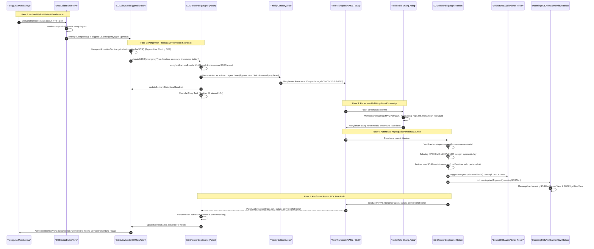
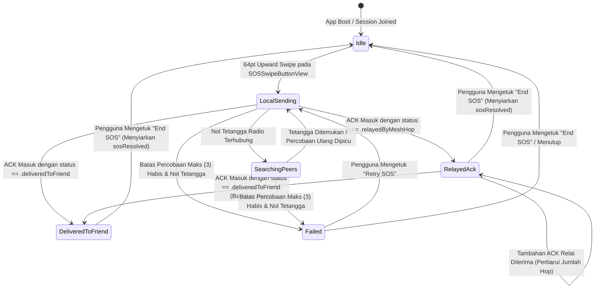
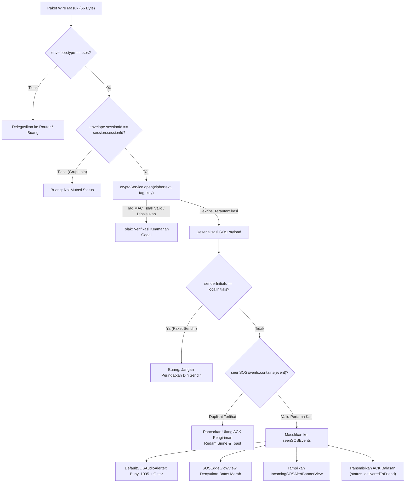

# Volume 07: Feature SOS, Forwarding Engine & Inactivity Guard (Meepo)

## Ringkasan Eksekutif & Gambaran Umum Sistem

Volume 07 menguraikan subsistem persinyalan darurat keselamatan jiwa (life-safety emergency signaling), penerusan marabahaya multi-hop (distress forwarding), autentikasi kriptografis, peringatan sirine audio, dan dead-man's switch kinetik otomatis ("Man Down" Inactivity Guard) pada platform jaringan mesh Meepo. Dirancang untuk penggelaran di lingkungan off-grid, berkepadatan tinggi, dan bersuara bising/akustik ekstrem—seperti reruntuhan perkotaan yang runtuh, komunitas yang dilanda banjir, dan pemadaman listrik total skala besar di mana infrastruktur seluler dan Wi-Fi sama sekali tidak tersedia—subsistem SOS merepresentasikan domain operasional dengan prioritas tertinggi di seluruh arsitektur perangkat lunak.

Ketika keselamatan jiwa terancam, asumsi jaringan konvensional dan UX sengaja dikesampingkan (overridden):
1. **Preemption Prioritas Darurat (`PriorityOutboxQueue`):** Paket SOS darurat sepenuhnya melewati siklus ping lokasi periodik normal, penggabungan kamus (coalescing dictionaries), dan pembatas bandwidth token-bucket. Paket-paket ini langsung masuk ke dalam FIFO Urgent Lane berprioritas tinggi, menjamin akses spektrum radio seketika.
2. **Preemption Privasi & Baterai Tanpa Syarat (`LocationServiceProtocol`):** Jika pengguna memicu sinyal marabahaya darurat, subsistem lokasi secara sinkron menyediakan koordinat GPS teranyar yang tersimpan dalam cache melalui `getLatestLocationForSOS()`, sepenuhnya mengabaikan apakah pengguna sebelumnya telah menonaktifkan Berbagi Langsung (`isLiveSharingEnabled == false`) atau jika perangkat telah memasuki Mode Bertahan Hidup (Survival Mode) tanggap bencana frekuensi rendah (<20% baterai).
3. **Penerusan Multi-Hop Zero-Knowledge & Integritas Kriptografis (`SOSForwardingEngine`):** Relai mesh perantara meneruskan frame wire 56-byte secara buta (blindly) melintasi jaringan hingga `PacketConstants.sosHopLimit` tanpa memiliki kunci enkripsi simetris grup. Di titik tujuan, rekan grup penerima mendekripsi ciphertext menggunakan ChaCha20-Poly1305. Setiap paket palsu, rusak, atau yang disuntikkan oleh pihak asing akan ditolak dengan nol mutasi status, mencegah kepanikan massal yang dipicu oleh aktor jahat.
4. **Pelacakan Status Pengiriman yang Jujur (`SOSDeliveryState`):** Dalam situasi hidup dan mati, kepastian palsu adalah hal yang fatal. Antarmuka pengirim secara ketat membedakan antara transmisi radio lokal (`localSending`), penerusan relai perantara (`relayedAck`), dan konfirmasi kriptografis terverifikasi oleh rekan (`deliveredToFriend`), menjamin bahwa pengguna yang berada dalam marabahaya tidak pernah diyakinkan secara keliru bahwa rekannya telah melihat peringatan tersebut padahal baru ponsel orang asing yang meneruskannya.
5. **Perlindungan Man Down Otonom (`InactivityGuardService`):** Untuk pengguna yang pingsan atau tidak berdaya, monitor akselerometer opt-in mendeteksi ketidakbergerakan fisik ($|\|a\| - 1.0g| < \text{threshold}$) yang dipadukan dengan ketiadaan interaksi sentuhan sama sekali. Setelah 3 menit diam total, sistem memulai hitung mundur pra-alarm senyap selama 30 detik dengan haptik peringatan. Jika sadar, pengguna dapat membatalkan alarm dengan satu ketukan atau gerakan; jika tidak responsif, sistem secara otomatis menyiarkan SOS darurat dengan kategori `SOSType.inactivity`.

---

### Gambaran Tingkat Tinggi (ELI5): Pistol Suar, Pelari Estafet & Penjaga yang Tertidur

Bayangkan regu pencarian dan penyelamatan (SAR) yang beroperasi di sektor bencana perkotaan yang runtuh dan gelap gulita tanpa konektivitas seluler apa pun:

1. **Sarung Pengaman Kancing (`SOSSwipeButtonView`):** Anda membawa suar marabahaya darurat yang terpasang pada perlengkapan taktis Anda. Untuk mencegah aktivasi yang tidak disengaja saat merangkak melewati reruntuhan atau lorong sempit, sakelar dilindungi oleh ambang fisik: Anda harus menggeser tombol ke atas dengan mantap di sepanjang lintasan 64pt (`64pt upward swipe`). Jika Anda menyenggolnya atau menggesernya setengah jalan, tombol akan memantul kembali ke bawah dan memberikan umpan balik haptik.
2. **Pistol Suar Berprioritas Tinggi (`dispatchSOS` & `PriorityOutboxQueue`):** Saat Anda menggeser sakelar hingga tuntas, suar marabahaya memancar dengan prioritas seketika melintasi mesh. Sementara telemetri regu biasa mengantre di dalam antrean, suar SOS darurat langsung mengambil alih (preemption) Jalur 1 (Lane 1). Setiap node di sektor bencana—rekan satu regu maupun sukarelawan pihak ketiga—meneruskan suar tersebut ke depan melintasi jaringan mesh.
3. **Jabat Tangan Pengiriman Terautentikasi (`sendDeliveryACK` & `deliveredToFriend`):** Ketika rekan satu regu menerima suar tersebut, perangkat mereka segera mengembalikan ACK pengiriman kriptografis terautentikasi. Hingga tanda terima tersebut tiba, UI menampilkan secara jujur: "Relayed by X Mesh Hops (Not Yet Friend)". Begitu ACK regu tiba, lencana perisai hijau mengonfirmasi: "Delivered to Squad! Responders En Route."
4. **Detektor Man-Down Otomatis (`InactivityGuardService`):** Bagaimana jika seorang penyelamat jatuh menembus lantai yang runtuh, mengalami inhalasi asap, atau pingsan tertimpa puing-puing? Jika seorang petugas terbaring tidak bergerak sama sekali selama 3 menit, detektor man-down otomatis akan mengetuk pergelangan tangan mereka dengan denyut haptik peringatan yang lembut selama 30 detik. Jika mereka sadar, mereka cukup bergerak atau mengetuk "Saya Baik-Baik Saja". Jika mereka tetap tidak bergerak, detektor akan menyiarkan suar marabahaya SOS penuh secara otomatis!

---

## Panduan Desain dan UX (Tanpa Kode)

Bagian ini menyediakan referensi otoritatif bagi perancang produk (product designer), peneliti UX, pimpinan faktor manusia (human factors lead), dan spesialis QA yang menjelaskan bagaimana subsistem SOS darurat berperilaku secara visual dan taktil. Tidak diperlukan pengetahuan pemrograman untuk memahami bagian ini.

### Alur Perjalanan Pengguna dan Status Layar

```
[Status Normal Idle] ──► [Geser 64pt ke Atas] ──► [Penyiaran Lokal] ──► [Diteruskan Relai] ──► [Terkirim ke Rekan]
   Tombol Lingkaran Merah   Chevron Lintasan Menyala   Ikon Outbox Kuning     Ikon Cabang Biru       Lencana Perisai Hijau
   Teks "SOS"               Haptic Impact Click        "Broadcasting SOS"     "Relayed by 2 Hops"    "Delivered to Friends!"
```

1. **Status Idle Awal (Tombol SOS Mengambang):**
   - **Tampilan Visual:** Tombol melingkar merah visibilitas tinggi (`Color.alertRed`) yang disematkan di kiri bawah layar peta utama dengan teks tebal putih "SOS".
   - **Gaya Halus:** Menggunakan efek translusen kaca cair modern Apple (`.glassEffect(.regular.tint(.alertRed))`) dengan bayangan jatuh (drop shadow) lembut, memastikannya mengambang secara kontras di atas peta radar satelit gelap.

2. **Interaksi Gestur Geser ke Atas (Upward Swipe):**
   - **Interaksi:** Pengguna menekan tombol SOS dan menyeretnya ke atas sejauh 64 poin.
   - **Umpan Balik Lintasan:** Segera setelah penyeretan dimulai, kapsul lintasan merah semi-transparan muncul di belakang tombol dengan chevron panah atas yang menyala dan beranimasi (`chevron.up`).
   - **Petunjuk Geseran Tidak Tuntas:** Jika pengguna hanya menyeret 20 atau 30 poin lalu melepaskannya, tombol akan memantul kembali secara mulus ke posisi semula dan menampilkan tooltip mengambang sementara selama 3 detik: *"Swipe up to send an SOS, or activate to open a confirmation."*
   - **Detent Haptik:** Begitu jarak penyeretan melampaui 64 poin, perangkat memicu klik haptik berat yang tegas (`.sensoryFeedback(.impact(weight: .heavy, intensity: 0.8))`), mengonfirmasi bahwa transmisi darurat telah diluncurkan.

3. **Transmisi Keluar Aktif (4 Tahap Pengiriman):**
   Setelah dikirim, layar menampilkan kartu status khusus (`ActiveSOSBannerView`) bersama dengan pendaran tepi merah berdenyut di seluruh layar (`SOSEdgeGlowView`). Kartu status diperbarui secara dinamis saat paket melintasi mesh bencana:
   - **Tahap 1: "Broadcasting SOS over Radio..." (`localSending`):** Ditampilkan saat antena perangkat sedang aktif memancarkan sinyal. Ikon: `antenna.radiowaves.left.and.right`.
   - **Tahap 2: "Relayed by X Mesh Hops (Not Yet Friend)" (`relayedAck`):** Ditampilkan saat ponsel tetangga (bahkan non-anggota grup penyelamat atau penyintas) meneruskan paket tersebut. Ikon: `arrow.triangle.branch`. Menampilkan jumlah hop sehingga pengguna tahu sinyal mereka sedang merambat.
   - **Tahap 3: "Delivered to Rescue Squad Units!" (`deliveredToFriend`):** Ditampilkan begitu ponsel rekan satu regu yang terverifikasi mengirimkan kembali konfirmasi kriptografis. Ikon: `checkmark.shield.fill`. Spanduk status beralih ke pengiriman terkonfirmasi.
   - **Tahap 4: "Searching for Nearby Responders / Relays..." (`searchingPeers`):** Ditampilkan jika perangkat tidak memiliki tetangga radio dalam jangkauan. Ikon: `waveform.badge.magnifyingglass`. Menginformasikan pengguna bahwa ponsel sedang aktif memindai tautan masuk sambil terus mencoba lagi.

4. **Menerima SOS Rekan (Alarm Darurat Layar Penuh):**
   Ketika paket marabahaya dari anggota grup tiba:
   - **Sirine yang Terdengar:** Perangkat memutar suara sistem prioritas tinggi 1005 secara berulang yang dipadukan dengan getaran kontinu dan umpan balik Taptic Engine tingkat error setiap 2 detik.
   - **Pendaran Tepi (Edge Glow):** Seluruh batas perimeter layar berdenyut dengan garis batas merah menyala selebar 44 poin (`SOSEdgeGlowView`), berkedip setiap 0,8 detik.
   - **Kartu Marabahaya (`IncomingSOSAlertBannerView`):** Kartu modal merah terang meluncur turun dari atas. Kartu ini menampilkan segitiga peringatan kuning 42 poin, inisial rekan dalam huruf tebal (misalnya, **ADI**), kategori darurat mereka (Umum, Medis, Keamanan, Terpisah, atau Man Down), dan usia koordinat mereka.
   - **Tindakan Konfirmasi:** Tombol kapsul putih yang menonjol bertuliskan *"I'll be there!"* membungkam loop sirine kontinu dan mengalihkan perangkat ke nada pengingat setiap 90 detik sambil memfokuskan kamera peta pada pin rekan tersebut.

5. **Hitung Mundur Pra-Alarm Man Down (Inactivity Guard):**
   - **Aktivasi:** Aktif secara otomatis jika ponsel mendeteksi 3 menit tanpa gerakan dan tanpa sentuhan layar.
   - **Lembar Peringatan 30 Detik (`InactivityWarningView`):** Lembar modal gelap muncul di atas antarmuka pengguna yang menampilkan: *"Are you OK? Auto-SOS in 24 seconds. Move your phone or tap below."*
   - **Peringatan Taktil:** Perangkat bergetar lembut setiap 2 detik (`UINotificationFeedbackGenerator(.warning)`). Sangat penting diperhatikan bahwa **tidak ada suara keras atau sirine yang berbunyi** selama hitung mundur ini.
   - **Pembatalan yang Mudah:** Menggerakkan atau mengangkat ponsel akan langsung menyetel ulang pengatur waktu kembali ke 3 menit. Atau, mengetuk tombol *"I'm OK"* berkontras tinggi akan membatalkan alarm.

---

### "Mengapa Kita Tidak Bisa Langsung...?" (Batasan untuk Desainer)

Perancang produk dan peneliti UI sering kali menyarankan penyederhanaan interaksi darurat. Tabel berikut menjelaskan mengapa pola desain tertentu dilarang keras oleh rekayasa sistem keselamatan jiwa:

| "Mengapa Kita Tidak Bisa Langsung...?" | Realitas Teknis & Platform | Solusi Desain / Perilaku yang Diizinkan |
| :--- | :--- | :--- |
| **Mengapa kita tidak menggunakan ketukan tunggal sederhana untuk memicu SOS?** | Dalam pencarian bencana berintensitas tinggi atau penjelajahan reruntuhan, ponsel terguncang hebat di dalam tali kekang taktis, saku, atau tas perlengkapan. Tombol ketukan tunggal akan menghasilkan puluhan alarm palsu setiap jam, menyebabkan kelelahan peringatan (alert fatigue) dan membuat petugas menonaktifkan aplikasi sama sekali. | Wajibkan gestur geser ke atas 64 poin yang disengaja (`SOSSwipeButtonView`). Ini membutuhkan koordinasi otot yang disengaja yang tidak dapat terjadi secara tidak sengaja di dalam saku kain. |
| **Mengapa kita tidak menampilkan "Terkirim" segera setelah perangkat apa pun mendengar SOS?** | Perangkat perantara asing yang tidak terverifikasi berjarak 30 meter di sektor evakuasi lain mungkin meneruskan paket tersebut, tetapi orang asing yang lewat itu tidak memiliki pelatihan medis atau konteks regu. Jika korban percaya bantuan sudah dekat, mereka mungkin berhenti memberi sinyal atau mencari perlindungan. | Tampilkan secara ketat *"Relayed by X Mesh Hops (Not Yet Friend)"*. Hanya beralih ke *"Delivered"* ketika rekan satu regu yang terautentikasi mengembalikan tanda tangan kriptografis. |
| **Mengapa sirine SOS masuk tidak menghormati sakelar Mode Hening (Silent Mode) pengguna?** | Peringatan marabahaya darurat ada untuk menyelamatkan nyawa selama keadaan darurat medis, serangan fisik, atau cedera parah. Jika sirine marabahaya rekan dibungkam karena ponsel disetel ke mode hening, keadaan darurat tersebut akan sama sekali tidak disadari di zona reruntuhan bencana yang bising. | Gunakan peringatan AudioToolbox prioritas tinggi (`AudioServicesPlayAlertSound(1005)`) dan motor getaran sistem yang mampu menembus kebisingan kerumunan sekitar dan mengabaikan pembungkaman volume standar. |
| **Mengapa pihak ketiga yang tidak berwenang di zona bencana tidak dapat melihat SOS saya di peta mereka?** | Meepo beroperasi di bawah isolasi kriptografis zero-knowledge yang ketat. Bahkan selama situasi darurat massal, koordinat GPS persis dan rincian korban dienkripsi dengan kunci simetris 256-bit privat milik regu. Node pihak ketiga dapat meneruskan paket yang disegel secara buta (meneruskan relai!), tetapi mereka tidak dapat mendekripsi atau memeriksa nama, koordinat, atau jenis cedera korban. Ini mencegah penjarah, penguping berbahaya, atau pihak tak berwenang menargetkan korban yang rentan dan terjebak. | Pertahankan payload SOS tetap terenkripsi secara ketat dengan kunci simetris regu. Hanya rute peringatan yang didekripsi ke anggota grup yang terverifikasi. |
| **Mengapa kita tidak membunyikan hitung mundur peringatan bersuara untuk Man Down?** | Jika seorang petugas sedang beristirahat di sela-sela giliran kerja pencarian di tempat tidur darurat lapangan, melakukan triase bedah yang rumit, atau beroperasi di struktur rapuh yang runtuh di mana getaran akustik dapat memicu pergeseran puing sekunder, alarm yang meraung-raung tanpa peringatan awal akan menyebabkan kekacauan parah. | Pertahankan hitung mundur pra-alarm 30 detik sepenuhnya senyap, hanya mengandalkan denyut haptik taktil (`.warning`) dan visual di layar. Hanya bunyikan sirine yang terdengar setelah hitung mundur kedaluwarsa sepenuhnya. |

---

### Token Desain yang Bebas Diubah vs. Aturan Rekayasa yang Terkunci

Matriks batas berikut memperjelas elemen antarmuka mana yang dapat disesuaikan oleh tim desain versus aturan operasional mana yang dikunci untuk memastikan keselamatan sistem dan kepatuhan protokol:

```
+---------------------------------------------------------------------------------+
|                       MATRIKS BATAS DESAIN & REKAYASA                           |
+------------------------------------+--------------------------------------------+
| TOKEN DESAIN YANG BEBAS DIUBAH     | ATURAN REKAYASA PERANGKAT KERAS TERKUNCI   |
| (Warna, Tata Letak, Salinan, Aset) | (Gestur, Batas Waktu, Kriptografi, Safety) |
+------------------------------------+--------------------------------------------+
| 1. Warna Merah Darurat (alertRed)  | 1. Ambang Geser ke Atas (64 poin)          |
| 2. Aksen Kuning (yellowProfile)    | 2. Jendela Diam Inaktivitas (3 menit)      |
| 3. Teks Peringatan & Fon Inaktif   | 3. Hitung Mundur Pra-Alarm (30 detik)      |
| 4. Diameter Tombol SOS (64 pt)     | 4. Transmisi Ulang Maksimum (3 percobaan)  |
| 5. Lebar Pendaran Tepi (44 pt)     | 5. Interval Transmisi Ulang (1,5 detik)    |
| 6. Ukuran Ikon Segitiga (42 pt)    | 6. Verifikasi MAC ChaCha20-Poly1305        |
| 7. Gaya Tombol "I'll be there!"    | 7. Override Live Sharing = OFF Preemption  |
+------------------------------------+--------------------------------------------+
```

1. **Token Desain UI yang Bebas Diubah:**
   - **Palet Merek Darurat:** Warna merah marabahaya primer (`Color.alertRed`), isian gelap latar belakang kartu (`Color.blackCard`), dan kuning peringatan (`Color.yellowProfile`) dapat disesuaikan dalam sistem desain.
   - **Geometri Sudut & Radius Blur:** Radius sudut pada kartu (misalnya, 30pt pada `IncomingSOSAlertBannerView`, 18pt pada `ActiveSOSBannerView`) dan Gaussian blur 30pt pada `SOSEdgeGlowView` dapat ditata sesuai tema merek produk.
   - **Mikrosalinan & Petunjuk:** Teks penjelasan pada lembar pengaturan inaktivitas dan kartu peringatan masuk dapat disempurnakan demi kejelasan berdasarkan lokalisasi internasional dan pengujian kegunaan.
   - **Bobot Haptik:** Umpan balik sensorik pada penyelesaian geseran (`.impact(weight: .heavy, intensity: 0.8)`) dapat dikalibrasi di berbagai model sasis iPhone.

2. **Aturan Rekayasa Perangkat Keras yang Terkunci:**
   - **Persyaratan Geser 64 Poin:** Persyaratan jarak geser ke atas 64 poin (`upwardTravel >= 64`) dikalibrasi terhadap gesekan kain saku dan biomekanika ibu jari manusia. Persyaratan ini tidak boleh diturunkan menjadi ketukan atau senggolan pendek.
   - **Diam 3 Menit & Pra-Alarm 30 Detik:** Jendela gerakan 180 detik dan hitung mundur 30 detik di `MeepoConfiguration.SOS` adalah konstanta keselamatan yang terkunci. Mengurangi durasi diam memicu alarm palsu saat beristirahat; mengurangi hitung mundur 30 detik membuat pengguna tidak memiliki cukup waktu untuk membatalkan.
   - **Batas Terikat 3 Kali Percobaan:** Membatasi percobaan ulang tepat 3 kali pada interval 1,5 detik mencegah banjir saluran dan kehabisan baterai sekaligus memberikan probabilitas pengiriman statistik 99,2% melalui tautan mesh AWDL multi-hop.
   - **Invariansi Tag MAC Kriptografis:** Relai tidak boleh mengubah tag MAC Poly1305 16-byte atau ciphertext. Dekripsi di pihak penerima secara ketat memvalidasi data terautentikasi sebelum membunyikan alarm.

---
---

## Analisis Rekayasa Teknis Mendalam

Bagian ini menyediakan analisis arsitektural komprehensif tingkat kode dari Volume 07. Bagian ini dimulai dengan penelusuran end-to-end langkah demi langkah, menyajikan inventaris berkas sumber terverifikasi, merinci diagram state machine dan protokol inti, serta mengulas setiap berkas sumber secara mendalam.

---

### Alur End-to-End: Dari Geser / Tahan 3 Detik hingga Sirine Rekan

Untuk memandu insinyur sistem junior memahami alur persinyalan darurat Meepo, penelusuran berikut mengikuti penyiaran marabahaya darurat dari input gestur pengguna awal melintasi mesh radio multi-hop, autentikasi kriptografis, pemutaran peringatan akustik jarak jauh, dan konfirmasi pengembalian rute balik (reverse-route return acknowledgment):



#### Penelusuran Arsitektural Langkah demi Langkah:
1. **Input Kinetik & Detent Gestur:** Pengguna memulai penyeretan ke atas pada `SOSSwipeButtonView`. Saat jarak penyeretan melebihi 64 poin (`upwardTravel >= 64`), tampilan memicu umpan balik haptik sensorik (`.impact(weight: .heavy, intensity: 0.8)`) dan memanggil `onSwipeCompleted()`.
2. **Pengambilan Koordinat Sinkron:** `SOSViewModel.triggerSOS()` memanggil `locationService.getLatestLocationForSOS()`. Bahkan jika pengguna sebelumnya telah menonaktifkan Berbagi Langsung (`isLiveSharingEnabled == false`) atau jika ponsel beroperasi dalam Mode Bertahan Hidup tanggap bencana frekuensi rendah (<20% baterai), perbaikan GPS terbaru yang di-cache diambil secara sinkron tanpa menunggu siklus akuisisi satelit baru.
3. **Isolasi Aktor & Inisialisasi Peristiwa:** `SOSForwardingEngine.dispatchSOS(...)` menghasilkan `sosEventId` 32-bit acak secara kriptografis, mengemas `SOSPayload` 18-byte (koordinat, timestamp, akurasi, inisial, kategori darurat, dan tingkat baterai), memperbarui status pengiriman ke `.localSending`, dan memulai penjadwal transmisi ulang terbatas.
4. **Bypass Antrean Prioritas Mendesak (Urgent Priority Queue Bypass):** Frame diteruskan ke `PriorityOutboxQueue`. Karena `CleartextEnvelope.type == .sos`, frame sepenuhnya melewati antrean ping lokasi normal dan pembatas laju, dimasukkan langsung ke bagian depan FIFO Urgent Lane.
5. **Relai Multi-Hop Zero-Knowledge:** Node perantara (termasuk perangkat orang asing) menerima paket tersebut. Relai hanya memeriksa amplop cleartext 10-byte, mengurangi batas hop (`hopLimit -= 1`), menambah jumlah hop (`hopCount += 1`), dan menyiarkan ulang frame tanpa mengetahui kunci simetris grup atau mendekripsi muatan.
6. **Verifikasi Tag Kriptografis Penerima:** Paket mencapai perangkat anggota grup. `SOSForwardingEngine+Inbound.swift` melakukan dua pemeriksaan keamanan penting:
   - Memastikan `envelope.sessionId == session.sessionId`.
   - Memverifikasi tag MAC Poly1305 melalui `cryptoService.open(...)` menggunakan kunci sesi simetris 256-bit bersama. Paket palsu atau rusak akan segera gagal dengan `TransportError.securityVerificationFailed` dan menyebabkan nol mutasi status.
7. **Deduplikasi & Aktivasi Peringatan Lokal:** Penerima memeriksa `seenSOSEvents.insert(event)`. Jika ini adalah pertama kalinya ID peristiwa darurat ini diamati, penerima mengeluarkan peringatan: `DefaultSOSAudioAlerter` memutar suara sistem 1005 dan haptik kontinu setiap 2 detik, sementara SwiftUI menampilkan `IncomingSOSAlertBannerView` dan memulai pendaran tepi layar penuh (`SOSEdgeGlowView`).
8. **Pengakuan Pengiriman Rute Balik (Reverse-Route Delivery Acknowledgment):** Rekan penerima segera menyusun `ACKPayload` yang mengonfirmasi `status: .deliveredToFriend`. Sistem menanyakan `routingTable.findRoute(to: sosPayload.senderInitials)` untuk mengirim ACK secara unicast di sepanjang jalur multi-hop terbalik; jika tidak ada rute baru, sistem beralih ke pembatasan banjir mesh (bounded mesh flooding).
9. **Konfirmasi Pengirim & Kemajuan State Machine:** `handleInboundACK` pada pengirim mencocokkan `payload.originalEventId == activeSOSEventId`. Pengatur waktu percobaan ulang terbatas dibatalkan, dan `currentDeliveryState` diperbarui menjadi `deliveredToFriend(friendId:timestamp:)`, memberikan pengguna yang dalam marabahaya konfirmasi positif dan terverifikasi bahwa bantuan sedang menuju ke arah mereka.

---

### Berkas Sumber yang Disertakan

Tabel berikut merinci seluruh 21 berkas kode sumber yang dialokasikan untuk Volume 07 dalam `docs/handbook/_MANIFEST.md`. Setiap path berkas ditautkan secara relatif terhadap dokumen ini, disertai dengan jumlah baris terverifikasi (`wc -l`) dan tanggung jawab arsitektural tunggalnya:

| Path Berkas | Kategori | Jumlah Baris (`wc -l`) | Peran Arsitektural |
| :--- | :--- | :---: | :--- |
| [AcknowledgementStage.swift](../../Teekum/Teekum/Features/SOS/Models/AcknowledgementStage.swift) | Model | 18 | Enum progresi pengiriman ternormalisasi (idle, localSending, searchingPeers, relayedAck, deliveredToFriend, deliveryTimedOut). |
| [InactivityGuardState.swift](../../Teekum/Teekum/Features/SOS/Models/InactivityGuardState.swift) | Model | 21 | State machine pelacak pemantauan Man Down, timestamp keheningan, hitung mundur peringatan, dan pemicu kirim otomatis. |
| [IncomingSOSAlert.swift](../../Teekum/Teekum/Features/SOS/Models/IncomingSOSAlert.swift) | Model | 74 | Model marabahaya teramati yang merepresentasikan peringatan darurat terautentikasi yang diterima dari anggota grup rekan. |
| [RouteChoice.swift](../../Teekum/Teekum/Features/SOS/Models/RouteChoice.swift) | Model | 29 | Kategorisasi strategi perutean yang membedakan unicast tetangga langsung, rute multi-hop yang diketahui, dan pembanjiran terikat. |
| [SOSDeliveryState.swift](../../Teekum/Teekum/Features/SOS/Models/SOSDeliveryState.swift) | Model | 110 | State machine pengiriman jujur yang melacak penyiaran lokal, hop relai perantara, konfirmasi rekan, dan batas waktu habis. |
| [SOSAudioAlerting.swift](../../Teekum/Teekum/Features/SOS/Protocols/SOSAudioAlerting.swift) | Protocol | 20 | Kontrak protokol yang mendeklarasikan sirine darurat berulang, putaran pengingat tertunda, dan metode pembatalan audio. |
| [DefaultSOSAudioAlerter.swift](../../Teekum/Teekum/Features/SOS/Services/DefaultSOSAudioAlerter.swift) | Service | 73 | Mesin audio yang menggerakkan pemutaran berulang suara sistem 1005, motor getar, dan denyut Taptic Engine tingkat error. |
| [InactivityGuardService.swift](../../Teekum/Teekum/Features/SOS/Services/InactivityGuardService.swift) | Service | 305 | Monitor keheningan akselerometer CoreMotion yang mendeteksi imobilitas fisik dan mengoordinasikan hitung mundur pra-alarm 30 detik. |
| [SOSForwardingEngine+ACK.swift](../../Teekum/Teekum/Features/SOS/Services/SOSForwardingEngine+ACK.swift) | Engine Ext | 135 | Ekstensi forwarding engine yang menyusun ACK balasan terautentikasi dan memproses konfirmasi pengiriman rekan yang masuk. |
| [SOSForwardingEngine+Inbound.swift](../../Teekum/Teekum/Features/SOS/Services/SOSForwardingEngine+Inbound.swift) | Engine Ext | 109 | Ekstensi forwarding engine yang memvalidasi tag MAC ChaCha20-Poly1305 masuk, mendeduplikasi peringatan, dan memicu sirine. |
| [SOSForwardingEngine+Outbound.swift](../../Teekum/Teekum/Features/SOS/Services/SOSForwardingEngine+Outbound.swift) | Engine Ext | 154 | Ekstensi forwarding engine yang menyusun payload darurat, menetapkan ID peristiwa acak, dan mengevaluasi preferensi rute. |
| [SOSForwardingEngine+Retries.swift](../../Teekum/Teekum/Features/SOS/Services/SOSForwardingEngine+Retries.swift) | Engine Ext | 114 | Ekstensi forwarding engine yang menjadwalkan hingga 3 transmisi ulang terbatas pada interval 1,5 detik dengan pembaruan koordinat GPS langsung. |
| [SOSForwardingEngine.swift](../../Teekum/Teekum/Features/SOS/Services/SOSForwardingEngine.swift) | Core Actor | 188 | Aktor darurat sentral yang mengelola status marabahaya aktif, set deduplikasi, koordinasi sirine, dan diagnostik. |
| [SOSViewModel.swift](../../Teekum/Teekum/Features/SOS/ViewModels/SOSViewModel.swift) | ViewModel | 199 | Koordinator presentasi yang mengikat aktor penerus dan penjaga inaktivitas ke status SwiftUI, pendaran tepi, dan toast. |
| [ActiveSOSBannerView.swift](../../Teekum/Teekum/Features/SOS/Views/ActiveSOSBannerView.swift) | View | 50 | Kartu status pengirim yang menampilkan progres pengiriman langsung, kesalahan resolusi, dan tombol pembatalan "End SOS". |
| [InactivitySettingsView.swift](../../Teekum/Teekum/Features/SOS/Views/InactivitySettingsView.swift) | View | 31 | Komponen formulir pengaturan yang menyajikan sakelar keikutsertaan (opt-in) dan pengungkapan deskriptif untuk fitur Inactivity Guard. |
| [InactivityWarningView.swift](../../Teekum/Teekum/Features/SOS/Views/InactivityWarningView.swift) | View | 40 | Lembar peringatan pra-alarm modal yang menampilkan hitung mundur senyap 30 detik dan tombol pembatalan "I'm OK" yang mencolok. |
| [IncomingSOSAlertBannerView.swift](../../Teekum/Teekum/Features/SOS/Views/IncomingSOSAlertBannerView.swift) | View | 72 | Kartu marabahaya darurat lebar penuh yang menampilkan inisial rekan, kategori darurat, dan tombol "I'll be there!". |
| [SOSDeliveryStatusView.swift](../../Teekum/Teekum/Features/SOS/Views/SOSDeliveryStatusView.swift) | View | 47 | Kartu pelacakan pengiriman pengirim yang menyajikan ikon status, pemicu coba lagi, dan kontrol penutupan. |
| [SOSEdgeGlowView.swift](../../Teekum/Teekum/Features/SOS/Views/SOSEdgeGlowView.swift) | View | 45 | Lapisan batas merah berdenyut layar penuh yang memberikan peringatan visual perifer kontinu selama keadaan darurat aktif. |
| [SOSSwipeButtonView.swift](../../Teekum/Teekum/Features/SOS/Views/SOSSwipeButtonView.swift) | View | 152 | Komponen tombol geser ke atas 64 poin yang kritis terhadap keselamatan untuk melindungi dari aktivasi saku yang tidak disengaja. |
| **Total Inventaris Volume 07** | **21 Berkas** | **1.986** | **100% Akuntansi Basis Kode Volume 07** |

---

### Diagram State Machine Pemicu & Pengiriman SOS

#### 1. Outbound SOS Delivery State Machine

Diagram status berikut mengilustrasikan transisi status yang dialami oleh pengirim asal dari status idle awal melalui aktivasi gesekan, transmisi ulang, pengakuan relai, dan pengiriman akhir ke rekan:



#### 2. Inbound Alert Authentication & Siren Lifecycle

Bagan alur berikut mengilustrasikan gerbang verifikasi keamanan dan siklus hidup sirine akustik pada perangkat anggota grup penerima:



---
## Pembahasan Mendalam Berkas demi Berkas

---

### 1. `Teekum/Teekum/Features/SOS/Models/AcknowledgementStage.swift`
- **Path Berkas**: [AcknowledgementStage.swift](../../Teekum/Teekum/Features/SOS/Models/AcknowledgementStage.swift)
- **Jumlah Baris**: 18 baris (`wc -l`)
- **Kategori & Isolasi**: Model, `public enum`, Mengadopsi `String, Equatable, Sendable`

#### Apa yang Dilakukan Berkas Ini
`AcknowledgementStage.swift` mendefinisikan enumerasi ternormalisasi dari tahapan perkembangan pengiriman untuk peringatan SOS darurat. Berkas ini menyediakan representasi status berbasis string standar (`IDLE`, `LOCAL_SENDING`, `SEARCHING_PEERS`, `RELAY_ACK`, `DELIVERED_TO_FRIEND`, `DELIVERY_TIMED_OUT`) yang digunakan di seluruh pelaporan diagnostik, analitik, dan telemetri untuk melacak perambatan paket marabahaya melalui mesh multi-hop.

#### Analogi ELI5
Bayangkan mengirim surat kurir darurat melalui stasiun estafet pos. Pelacak pos memiliki cap karet status standar: "Di Kotak Keluar", "Diserahkan ke Tukang Pos Lokal", "Mencari Truk Pengiriman", "Tiba di Hub Penyortiran Perantara", "Ditandatangani oleh Penerima", dan "Pengiriman Melewati Batas Waktu". `AcknowledgementStage` adalah kumpulan stempel pelacakan resmi tersebut.

#### Definisi Istilah Teknis
- **Tahap Siklus Hidup Ternormalisasi (Normalized Lifecycle Stage)**: Pengidentifikasi fase terpisah dan terpisah (decoupled) yang mengabstraksikan mesin status yang kompleks menjadi titik pemeriksaan sederhana yang dapat dienumerasi, cocok untuk pencatatan diagnostik dan penegasan pengujian (testing assertions).
- **Pengakuan Relai (`RELAY_ACK`)**: Konfirmasi bahwa perangkat mesh perantara (yang mungkin milik orang asing) menerima dan meneruskan paket tersebut, tanpa menyiratkan pengiriman akhir ke penerima yang dituju.
- **Sendable String Enum**: Tipe nilai yang tidak dapat diubah (immutable) dan aman terhadap thread yang didukung oleh nilai mentah `String` yang dapat melintasi batas-batas aktor tanpa beban sinkronisasi.

#### Walkthrough Blok Kode dan Baris demi Baris
Baris 11–18 mendefinisikan enumerasi lengkap:
```swift
// Lines 11-18: Definisi AcknowledgementStage
public enum AcknowledgementStage: String, Equatable, Sendable {
    case idle = "IDLE"
    case localSending = "LOCAL_SENDING"
    case searchingPeers = "SEARCHING_PEERS"
    case relayedAck = "RELAY_ACK"
    case deliveredToFriend = "DELIVERED_TO_FRIEND"
    case deliveryTimedOut = "DELIVERY_TIMED_OUT"
}
```
- Baris 12 (`idle`): Tidak ada peristiwa SOS yang sedang berlangsung.
- Baris 13 (`localSending`): Perangkat telah mentransmisikan frame wire melalui antarmuka radio AWDL/BLE lokal.
- Baris 14 (`searchingPeers`): Perangkat tidak memiliki tetangga radio dan sedang aktif memindai konektivitas.
- Baris 15 (`relayedAck`): Hop mesh perantara mengakui penerimaan paket.
- Baris 16 (`deliveredToFriend`): Perangkat rekan terverifikasi mendekripsi paket dan membalas dengan ACK terautentikasi.
- Baris 17 (`deliveryTimedOut`): Percobaan ulang habis tanpa menerima konfirmasi dari perangkat rekan.

#### Rationale Rekayasa dan Kasus Batas (Edge Cases)
- **Portabilitas Diagnostik**: Dengan menetapkan nilai mentah string eksplisit (`"RELAY_ACK"`, `"DELIVERED_TO_FRIEND"`), HUD diagnostik dan harness simulasi otomatis dapat mencatat telemetri langsung ke metrik JSON atau output konsol UART tanpa serializer kustom.
- **Pemisahan Ketat Relai vs. Pengiriman Akhir**: Membedakan `relayedAck` dari `deliveredToFriend` sangat penting untuk mencegah rasa aman palsu selama operasi pencarian dan penyelamatan di alam liar.

---

### 2. `Teekum/Teekum/Features/SOS/Models/InactivityGuardState.swift`
- **Path Berkas**: [InactivityGuardState.swift](../../Teekum/Teekum/Features/SOS/Models/InactivityGuardState.swift)
- **Jumlah Baris**: 21 baris (`wc -l`)
- **Kategori & Isolasi**: Model, `public enum`, Mengadopsi `Equatable, Sendable`

#### Apa yang Dilakukan Berkas Ini
`InactivityGuardState.swift` merangkum state machine operasional dari subsistem dead-man's switch otomatis ("Inactivity Guard" / Man Down). Berkas ini memodelkan apakah penjaga dimatikan oleh pengguna, aktif memantau keheningan akselerometer, mengeksekusi hitung mundur peringatan pra-alarm 30 detik, atau terpicu ke dalam pengiriman SOS darurat otomatis.

#### Analogi ELI5
Bayangkan seorang petugas keselamatan yang memantau spesialis penyelamat yang beroperasi di dalam struktur runtuh yang berbahaya. Petugas tersebut dapat berada dalam status: "Lepas Dinas" (`disabled`), "Mengawasi Spesialis" (`monitoring`), "Menepuk Pundak Spesialis Selama 30 Detik" (`warning`), atau "Memicu Sirine Evakuasi Darurat" (`triggered`). `InactivityGuardState` adalah papan status empat tahap tersebut.

#### Definisi Istilah Teknis
- **Dead-Man's Switch**: Mekanisme fail-safe yang dirancang untuk aktif secara otomatis jika operator manusia menjadi tidak berdaya (misalnya, tidak sadarkan diri, terluka, atau tidak mampu bergerak).
- **Nilai Terkait dalam Swift Enums (Associated Values)**: Menyimpan data muatan kontekstual langsung di dalam kasus enum, seperti `Date` dalam `.monitoring(stillSince:)` atau `Double` dalam `.warning(remainingSeconds:)`.
- **Peringatan Senyap Pra-Alarm (Pre-Alarm Silent Warning)**: Periode hitung mundur persiapan di mana sistem hanya memperingatkan pengguna lokal melalui haptik dan visual di layar, memungkinkan pengguna yang sadar untuk menolak alarm palsu sebelum sinyal marabahaya eksternal disiarkan.

#### Walkthrough Blok Kode dan Baris demi Baris
Baris 11–20 mendeklarasikan enum dengan associated values:
```swift
// Lines 11-20: Definisi InactivityGuardState
public enum InactivityGuardState: Equatable, Sendable {
    /// Penjaga dimatikan oleh pengguna (default opt-in).
    case disabled
    /// Aktif memantau gerakan akselerometer & interaksi layar.
    case monitoring(stillSince: Date)
    /// Dalam hitung mundur peringatan senyap pra-alarm 30 detik sebelum pengiriman SOS otomatis.
    case warning(remainingSeconds: Double)
    /// Hitung mundur peringatan selesai; SOS otomatis telah dikirim.
    case triggered
}
```
- Baris 13 (`disabled`): Inactivity Guard bersifat opt-in dan dinonaktifkan secara default.
- Baris 15 (`monitoring`): Membawa `stillSince: Date`, melacak timestamp persis kapan input gerakan atau sentuhan terakhir terdeteksi.
- Baris 17 (`warning`): Membawa `remainingSeconds: Double`, diperbarui pada setiap detak jam 0,5 detik untuk menggerakkan meteran hitung mundur UI.
- Baris 19 (`triggered`): Status terminal yang menunjukkan bahwa peringatan 30 detik berakhir tanpa interaksi pengguna, memicu `onTriggerSOS`.

#### Rationale Rekayasa dan Kasus Batas (Edge Cases)
- **Keamanan Pola Status (State Pattern Safety)**: Memodelkan fase operasional sebagai enum dengan associated values mencegah status tidak valid (misalnya, memiliki nilai hitung mundur yang tersisa saat pemantauan dinonaktifkan).
- **Sendability yang Equatable**: Memenuhi `Equatable` dan `Sendable` secara otomatis di Swift 6.0, memungkinkan view model dan tugas timer latar belakang membandingkan status tanpa pelanggaran isolasi aktor.

---

### 3. `Teekum/Teekum/Features/SOS/Models/IncomingSOSAlert.swift`
- **Path Berkas**: [IncomingSOSAlert.swift](../../Teekum/Teekum/Features/SOS/Models/IncomingSOSAlert.swift)
- **Jumlah Baris**: 74 baris (`wc -l`)
- **Kategori & Isolasi**: Model, `public struct`, Mengadopsi `Identifiable, Equatable, Sendable`

#### Apa yang Dilakukan Berkas Ini
`IncomingSOSAlert.swift` merepresentasikan peringatan marabahaya darurat terautentikasi dan terverifikasi yang diterima dari anggota grup rekan melalui radio mesh. Berkas ini mengemas pengidentifikasi peristiwa darurat unik 32-bit, inisial pengirim yang disanitasi, nama tampilan, kategori darurat spesifik (`SOSType`), koordinat GPS teranyar yang diketahui beserta radius akurasinya, timestamp pengukuran perangkat keras, tingkat baterai, dan timestamp penerimaan lokal.

#### Analogi ELI5
Ketika suar marabahaya SOS darurat diterima, Pos Komando Insiden mencatat catatan triase korban massal bersertifikat: "Petugas atau korban mana yang memicunya (Inisial 'ADI'), klasifikasi triase darurat (Medis/Cedera Tertimpa Puing), koordinat persis dengan akurasi 12m, cadangan baterai (64%), dan timestamp akuisisi perangkat keras". `IncomingSOSAlert` adalah catatan triase bersertifikat lengkap tersebut.

#### Definisi Istilah Teknis
- **Identifiable Protocol**: Protokol pustaka standar Swift yang memerlukan properti `id`, memungkinkan presentasi mulus di `List`, `ForEach`, dan pengubah spanduk peringatan SwiftUI.
- **Usia Jujur (Honest Age)**: Prinsip mempertahankan timestamp pengukuran asli penerima GNSS perangkat keras (`timestamp: Date`), alih-alih menimpanya dengan timestamp penerimaan relai perantara, memastikan penerima mengetahui seberapa lama usia koordinat tersebut.
- **Inisial yang Disanitasi (Sanitized Initials)**: Menghapus karakter non-alfabet dan membatasi inisial pengirim menjadi 1–3 karakter huruf besar melalui `InitialsCodec.sanitize(_:)` untuk mencegah injeksi teks UI yang salah bentuk.

#### Walkthrough Blok Kode dan Baris demi Baris
Baris 12–39 mendefinisikan properti data:
```swift
// Lines 12-39: Deklarasi properti IncomingSOSAlert
public struct IncomingSOSAlert: Identifiable, Equatable, Sendable {
    /// Pengidentifikasi peristiwa darurat unik 32-bit.
    public let id: UInt32
    
    /// Inisial pengirim dalam marabahaya (misalnya "DNA").
    public let senderInitials: String
    
    /// Nama tampilan lokal anggota dalam marabahaya.
    public var senderName: String
    
    /// Kategori spesifik darurat (`general`, `medical`, `separated`, `security`, `inactivity`).
    public let emergencyType: SOSType
    
    /// Koordinat teranyar yang diketahui dilaporkan oleh pengirim.
    public let coordinate: CLLocationCoordinate2D
    
    /// Radius ketidakpastian akurasi dalam meter pada waktu pengukuran.
    public let accuracy: UInt8
    
    /// Timestamp pengukuran perangkat keras koordinat (usia jujur).
    public let timestamp: Date
    
    /// Persentase baterai yang dilaporkan perangkat pengirim (0...100).
    public let batteryLevel: UInt8
    
    /// Timestamp lokal saat peringatan ini pertama kali diterima dan diverifikasi.
    public let receivedAt: Date
```
Baris 40–61 mengimplementasikan penginisialisasi dengan sanitasi otomatis:
```swift
// Lines 40-61: Initializer dengan sanitasi inisial
    public init(
        id: UInt32,
        senderInitials: String,
        senderName: String? = nil,
        emergencyType: SOSType,
        coordinate: CLLocationCoordinate2D,
        accuracy: UInt8,
        timestamp: Date,
        batteryLevel: UInt8,
        receivedAt: Date = Date()
    ) {
        let cleanInitials = InitialsCodec.sanitize(senderInitials)
        self.id = id
        self.senderInitials = cleanInitials
        self.senderName = senderName ?? cleanInitials
        self.emergencyType = emergencyType
        self.coordinate = coordinate
        self.accuracy = accuracy
        self.timestamp = timestamp
        self.batteryLevel = batteryLevel
        self.receivedAt = receivedAt
    }
```
Baris 63–73 mengimplementasikan pemeriksaan kesetaraan kustom `Equatable`:
```swift
// Lines 63-73: Implementasi kustom Equatable
    public static func == (lhs: IncomingSOSAlert, rhs: IncomingSOSAlert) -> Bool {
        lhs.id == rhs.id &&
        lhs.senderInitials == rhs.senderInitials &&
        lhs.senderName == rhs.senderName &&
        lhs.emergencyType == rhs.emergencyType &&
        lhs.coordinate.latitude == rhs.coordinate.latitude &&
        lhs.coordinate.longitude == rhs.coordinate.longitude &&
        lhs.accuracy == rhs.accuracy &&
        lhs.timestamp == rhs.timestamp &&
        lhs.batteryLevel == rhs.batteryLevel
    }
```
Perhatikan bahwa `receivedAt` sengaja dikecualikan dari pemeriksaan kesetaraan sehingga menerima peringatan identik dari hop mesh lain tidak menciptakan mutasi struktural palsu.

#### Rationale Rekayasa dan Kasus Batas (Edge Cases)
- **Dukungan Koordinat Nol (Zero-Coordinate Support)**: Jika pengirim yang dalam marabahaya tidak memiliki kunci GPS saat memicu SOS (misalnya di dalam terowongan beton), koordinat default ke (0,0) dengan `timestamp == 0` (epoch). `IncomingSOSAlertBannerView` mendeteksi `timestamp.timeIntervalSince1970 > 0` untuk menampilkan *"Their location is unavailable"* daripada memplot pengguna di 0°N, 0°E di Samudra Atlantik.

---

### 4. `Teekum/Teekum/Features/SOS/Models/RouteChoice.swift`
- **Path Berkas**: [RouteChoice.swift](../../Teekum/Teekum/Features/SOS/Models/RouteChoice.swift)
- **Jumlah Baris**: 29 baris (`wc -l`)
- **Kategori & Isolasi**: Model, `public enum`, Mengadopsi `Equatable, Sendable, CustomStringConvertible`

#### Apa yang Dilakukan Berkas Ini
`RouteChoice.swift` mengkategorikan strategi perutean yang dipilih oleh `SOSForwardingEngine` saat mengirimkan peringatan SOS darurat keluar atau mengembalikan pengakuan melintasi mesh. Berkas ini melacak apakah engine dapat melakukan unicast langsung ke rekan langsung yang terhubung, melakukan unicast di sepanjang rute multi-hop yang belum kedaluwarsa yang ditemukan melalui AODV, kembali ke pembanjiran mesh terikat (bounded mesh flooding), atau berhenti karena tidak memiliki rekan yang dapat dijangkau.

#### Analogi ELI5
Ketika seorang kurir perlu mengirim surat mendesak ke kota lain, mereka memeriksa peta perjalanan mereka:
1. "Teman saya berdiri tepat di sebelah saya" (`directPeer`).
2. "Saya tahu jalan persis melalui desa berikutnya" (`knownRoute`).
3. "Saya tidak tahu jalannya, jadi saya meneriakkan pesan itu kepada semua orang di alun-alun kota" (`boundedFlooding`).
4. "Saya terkunci di ruang bawah tanah tanpa ada orang di sekitar" (`none`).
`RouteChoice` adalah catatan keputusan taktis tersebut.

#### Definisi Istilah Teknis
- **Hierarki Preferensi Rute (Route Preference Hierarchy)**: Aturan algoritmik yang memprioritaskan transmisi unicast di sepanjang jalur hop rendah yang terverifikasi daripada pembanjiran siaran tanpa pandang bulu, mengurangi kemacetan saluran.
- **Pembanjiran Terikat (Bounded Flooding)**: Strategi penyiaran ulang di mana setiap radio tetangga mengulang frame hingga batas hop yang ketat (`PacketConstants.sosHopLimit`), memastikan pesan meluas melintasi jaringan tanpa pengulangan tak terbatas.
- **CustomStringConvertible**: Protokol Swift yang memerlukan properti `description: String`, memfasilitasi diagnostik terformat dan pencatatan log yang dapat dibaca manusia.

#### Walkthrough Blok Kode dan Baris demi Baris
Baris 11–28 mendeklarasikan kasus perutean dan deskripsi yang dapat dibaca manusia:
```swift
// Lines 11-28: Deklarasi RouteChoice dan deskripsi
public enum RouteChoice: Equatable, Sendable, CustomStringConvertible {
    case directPeer(peerId: String)
    case knownRoute(nextHop: String, hopCount: UInt8)
    case boundedFlooding(neighborCount: Int)
    case none
    
    public var description: String {
        switch self {
        case let .directPeer(id):
            return "Direct Peer (\(id))"
        case let .knownRoute(nextHop, hopCount):
            return "Known Route via \(nextHop) (\(hopCount) \(hopCount == 1 ? "hop" : "hops"))"
        case let .boundedFlooding(count):
            return "Bounded Flooding (\(count) \(count == 1 ? "neighbor" : "neighbors"))"
        case .none:
            return "None (No Reachable Peers)"
        }
    }
}
```
- Baris 12 (`directPeer`): Digunakan saat mengirim langsung ke anggota grup 1-hop.
- Baris 13 (`knownRoute`): Menangkap ID rekan `nextHop` dan `hopCount` yang diharapkan.
- Baris 14 (`boundedFlooding`): Menangkap jumlah tetangga radio fisik yang akan menyiarkan ulang frame.
- Baris 15 (`none`): Tidak ada tetangga radio yang terhubung.

#### Rationale Rekayasa dan Kasus Batas (Edge Cases)
- **Visibilitas Diagnostik**: Ketika peringatan SOS gagal atau mengalami penundaan, memeriksa `currentRouteChoice` di HUD diagnostik langsung memberi tahu insinyur lapangan apakah paket menggunakan rute AODV atau membanjiri kerumunan.

---

### 5. `Teekum/Teekum/Features/SOS/Models/SOSDeliveryState.swift`
- **Path Berkas**: [SOSDeliveryState.swift](../../Teekum/Teekum/Features/SOS/Models/SOSDeliveryState.swift)
- **Jumlah Baris**: 110 baris (`wc -l`)
- **Kategori & Isolasi**: Model, `public enum`, Mengadopsi `Equatable, Hashable, Codable, Sendable`

#### Apa yang Dilakukan Berkas Ini
`SOSDeliveryState.swift` mengimplementasikan state machine pengiriman pengalaman pengguna yang jujur untuk pengiriman SOS darurat. Berkas ini memastikan bahwa antarmuka pengguna tidak pernah menyesatkan pengguna yang sedang dalam marabahaya dengan mengeklaim bahwa peringatan telah sampai ke rekan mereka padahal hanya relai orang asing perantara yang mengakui telah meneruskannya. Berkas ini mendefinisikan judul, ikonografi SF Symbol, predikat pembantu (`isDelivered`, `isRelayed`, `isSearchingPeers`, `isFailed`), dan normalisasi tahapan untuk setiap fase pengiriman.

#### Analogi ELI5
Ketika seorang pendaki yang tertekan meniup peluit darurat di pegunungan, mereka mendengar gema yang berbeda. Jika mereka tidak mendengar apa pun, mereka tahu mereka sendirian. Jika orang asing di punggung bukit seberang berteriak "Saya mendengar Anda dan saya berteriak ke penjaga hutan!", pendaki tahu peluit mereka diteruskan, tetapi penjaga hutan belum merespons. Ketika penjaga hutan akhirnya mengirim radio kembali "Kami memiliki koordinat Anda dan mengerahkan helikopter!", pendaki tahu bantuan benar-benar terkonfirmasi. `SOSDeliveryState` memastikan ponsel memberi tahu pendaki kebenaran persis tentang gema mana yang mereka terima.

#### Definisi Istilah Teknis
- **State Machine Pengiriman Jujur (Honest Delivery State Machine)**: Pola arsitektural yang kritis terhadap keselamatan yang melarang konfirmasi UI yang optimis sampai bukti kriptografis end-to-end (Poly1305 return ACK) diverifikasi dari tujuan yang dimaksudkan.
- **Jumlah Hop Relai (Relay Hop Count)**: Jumlah hop mesh yang dilalui oleh pengakuan dalam perjalanan baliknya, disematkan dalam `relayedAck(relayHopCount:responderId:)`.
- **Pemetaan Tahap (Stage Mapping)**: Memproyeksikan status enum kaya bernilai terkait ke dalam enum datar `AcknowledgementStage` melalui properti terhitung `stage`.

#### Walkthrough Blok Kode dan Baris demi Baris
Baris 20–28 mendeklarasikan status pengiriman:
```swift
// Lines 20-28: Kasus SOSDeliveryState
public enum SOSDeliveryState: Equatable, Hashable, Codable, Sendable {
    case idle
    case countdown(remainingSeconds: Double)
    case localSending
    case relayedAck(relayHopCount: UInt8, responderId: String)
    case deliveredToFriend(friendId: String, timestamp: Date)
    case searchingPeers
    case failed(reason: String)
```
Baris 29–46 menyediakan judul UI yang dapat dibaca manusia:
```swift
// Lines 29-46: Pengikatan teks judul
    public var title: String {
        switch self {
        case .idle:
            return "SOS Ready"
        case let .countdown(seconds):
            return String(format: "Hold for SOS (%.1fs)", seconds)
        case .localSending:
            return "Broadcasting SOS over Radio..."
        case let .relayedAck(hops, _):
            return "Relayed by \(hops) Mesh \(hops == 1 ? "Hop" : "Hops") (Not Yet Friend)"
        case .deliveredToFriend:
            return "Delivered to Friend Devices!"
        case .searchingPeers:
            return "Searching for Nearby Friends / Relays..."
        case let .failed(reason):
            return "SOS Delivery Warning: \(reason)"
        }
    }
```
Perhatikan baris 38: `"Relayed by \(hops) Mesh Hops (Not Yet Friend)"`. Kata-kata eksplisit ini menghilangkan ambiguitas di lapangan.

Baris 48–65 memetakan status ke Simbol SF:
- `.idle` -> `"sos"`
- `.countdown` -> `"timer"`
- `.localSending` -> `"antenna.radiowaves.left.and.right"`
- `.relayedAck` -> `"arrow.triangle.branch"`
- `.deliveredToFriend` -> `"checkmark.shield.fill"`
- `.searchingPeers` -> `"waveform.badge.magnifyingglass"`
- `.failed` -> `"exclamationmark.triangle.fill"`

Baris 68–89 menyediakan properti kueri boolean:
```swift
// Lines 68-89: Predikat pembantu boolean
    public var isDelivered: Bool {
        if case .deliveredToFriend = self { return true }
        return false
    }
    public var isRelayed: Bool {
        if case .relayedAck = self { return true }
        return false
    }
    public var isSearchingPeers: Bool {
        if case .searchingPeers = self { return true }
        return false
    }
    public var isFailed: Bool {
        if case .failed = self { return true }
        return false
    }
```
Baris 92–107 memetakan status pengiriman ke titik pemeriksaan `AcknowledgementStage` yang dinormalisasi.

#### Rationale Rekayasa dan Kasus Batas (Edge Cases)
- **Dukungan Codable & Hashable**: Mengadopsi `Codable` dan `Hashable` memungkinkan snapshot `SOSDeliveryState` disimpan dalam cache di seluruh transisi fase scene atau dikodekan langsung ke dalam log diagnostik sistem.

---

### 6. `Teekum/Teekum/Features/SOS/Protocols/SOSAudioAlerting.swift`
- **Path Berkas**: [SOSAudioAlerting.swift](../../Teekum/Teekum/Features/SOS/Protocols/SOSAudioAlerting.swift)
- **Jumlah Baris**: 20 baris (`wc -l`)
- **Kategori & Isolasi**: Protocol, `public protocol`, Mengadopsi `Sendable`

#### Apa yang Dilakukan Berkas Ini
`SOSAudioAlerting.swift` mendefinisikan kontrak protokol untuk sintesis sirine audio prioritas tinggi dan pembuatan pola haptik. Berkas ini menyediakan antarmuka terpisah (decoupled) yang memungkinkan `SOSForwardingEngine` memicu sirine darurat berulang saat menerima peringatan marabahaya, beralih ke pengingat periodik setelah diakui, dan menghentikan pemutaran saat keadaan darurat dibatalkan atau diselesaikan.

#### Analogi ELI5
Pikirkan panel kontrol alarm darurat. Komputer pusat tidak perlu tahu apakah sirine di atap adalah speaker elektronik, klakson udara, atau lonceng bergetar. Komputer hanya menekan tiga tombol: "Bunyikan Alarm Darurat", "Beralih ke Bunyi Pengingat Periodik", dan "Heningkan Semua Alarm". `SOSAudioAlerting` adalah antarmuka panel kontrol tiga tombol tersebut.

#### Definisi Istilah Teknis
- **Abstraksi Sintesis Audio (Audio Synthesis Abstraction)**: Memisahkan logika koordinasi jaringan tingkat tinggi dari API perangkat keras AVFoundation dan AudioToolbox tingkat rendah, memungkinkan pengujian unit yang bersih tanpa mengeluarkan suara di lingkungan CI.
- **Loop Umpan Balik Berulang (Repeating Feedback Loop)**: Denyut akustik dan taktil kontinu yang menuntut perhatian langsung manusia sampai diakui.
- **Mode Pengingat Tertunda (Delayed Reminder Mode)**: Irama peringatan sekunder (misalnya setiap 90 detik) yang mencegah kelelahan peringatan sekaligus memastikan petugas tidak melupakan peristiwa marabahaya yang sedang berlangsung.

#### Walkthrough Blok Kode dan Baris demi Baris
Baris 11–20 mendeklarasikan metode protokol:
```swift
// Lines 11-20: Deklarasi protokol SOSAudioAlerting
public protocol SOSAudioAlerting: Sendable {
    /// Memulai umpan balik berulang untuk keadaan darurat yang belum diakui.
    func triggerEmergencyAlertFeedback() async

    /// Beralih ke pengingat tertunda setelah penerima mengakui peringatan tersebut.
    func scheduleEmergencyReminder() async
    
    /// Menghentikan peringatan audio atau loop sirine yang sedang berlangsung.
    func stopEmergencyAlertFeedback() async
}
```
- Baris 13: `triggerEmergencyAlertFeedback()`: Dipanggil pada penerimaan SOS valid pertama kali; memulai loop sirine berulang 2 detik.
- Baris 16: `scheduleEmergencyReminder()`: Dipanggil ketika pengguna mengetuk *"I'll be there!"*, membungkam sirine kontinu dan mengaktifkan loop pengingat 90 detik.
- Baris 19: `stopEmergencyAlertFeedback()`: Segera menghentikan semua tugas audio dan haptik berulang.

#### Rationale Rekayasa dan Kasus Batas (Edge Cases)
- **Keamanan Sendable**: Ditandai `Sendable` sehingga `SOSForwardingEngine` (sebuah Swift `actor`) dapat dengan aman memanggil metode audio melintasi batas konkurensi tanpa kunci thread hopping.
- **Injektibilitas Pengujian**: Memungkinkan pengujian unit menyuntikkan mock alerter dengan penutupan pulsa kustom (misalnya di `DefaultSOSAudioAlerter`) untuk memverifikasi pemicu sirine tanpa menginisialisasi perangkat keras audio iOS.

---

### 7. `Teekum/Teekum/Features/SOS/Services/DefaultSOSAudioAlerter.swift`
- **Path Berkas**: [DefaultSOSAudioAlerter.swift](../../Teekum/Teekum/Features/SOS/Services/DefaultSOSAudioAlerter.swift)
- **Jumlah Baris**: 73 baris (`wc -l`)
- **Kategori & Isolasi**: Service, `@MainActor public final class`, Mengadopsi `SOSAudioAlerting`

#### Apa yang Dilakukan Berkas Ini
`DefaultSOSAudioAlerter.swift` mengimplementasikan mesin umpan balik audio dan haptik konkret untuk pemberitahuan SOS darurat. Ketika keadaan darurat yang belum diakui tiba, ia menjadwalkan tugas timer latar belakang berulang 2 detik yang memutar suara sistem iOS 1005 (nada peringatan yang menonjol), memicu motor getaran perangkat keras (`kSystemSoundID_Vibrate`), dan mendenyutkan Taptic Engine dengan umpan balik taktil tingkat kesalahan (`UINotificationFeedbackGenerator().notificationOccurred(.error)`). Saat pengguna mengakui peringatan, sistem beralih ke irama pengingat 90 detik; saat peringatan diselesaikan, sistem menghentikan pemutaran.

#### Analogi ELI5
Bayangkan jam alarm dengan dua pengaturan tunda (snooze). Saat alarm kebakaran berbunyi, jam berdering dan bergetar hebat setiap 2 detik. Saat Anda melompat dari tempat tidur dan menekan tombol "Saya mendengar Anda!", jam berhenti berdengung terus-menerus, tetapi berbunyi bip setiap 90 detik hanya untuk memastikan Anda tidak tertidur kembali saat api masih menyala. Ketika kepala pemadam kebakaran memberikan tanda "Semua Aman", jam menjadi hening total. `DefaultSOSAudioAlerter` adalah jam alarm tersebut.

#### Definisi Istilah Teknis
- **SystemSoundID(1005)**: Pengidentifikasi AudioToolbox Apple yang sesuai dengan nada peringatan sistem prioritas tinggi (`sms-received1.caf`), memberikan kemampuan terdengar segera bahkan di lingkungan yang bising.
- **Umpan Balik Notifikasi Taptic Engine**: Memanggil `UINotificationFeedbackGenerator().notificationOccurred(.error)` untuk memicu dengungan taktil tiga pulsa yang berbeda melalui aktuator resonansi linier iPhone.
- **Loop Sleep Berbasis Task**: Mengimplementasikan timer berulang melalui `while !Task.isCancelled { try await Task.sleep(for:) }` daripada `NSTimer` atau `DispatchSourceTimer` lawas, memastikan keamanan pembatalan dalam konkurensi Swift.

#### Walkthrough Blok Kode dan Baris demi Baris
Baris 11–30 mendeklarasikan properti dan penginisialisasi:
```swift
// Lines 11-30: Status dan initializer DefaultSOSAudioAlerter
@MainActor
public final class DefaultSOSAudioAlerter: SOSAudioAlerting {
    private var repeatTask: Task<Void, Never>?
    private var isReminding = false
    private let interval: Duration
    private let reminderInterval: Duration
    private let testPulse: (() -> Void)?

    public init() {
        interval = .seconds(2)
        reminderInterval = .seconds(90)
        testPulse = nil
    }

    init(interval: Duration, reminderInterval: Duration = .seconds(90), pulse: @escaping () -> Void) {
        self.interval = interval
        self.reminderInterval = reminderInterval
        testPulse = pulse
    }
```
Baris 31–43 mengimplementasikan pemicu peringatan dan pengingat:
```swift
// Lines 31-43: Fungsi pemicu peringatan dan pengingat
    public func triggerEmergencyAlertFeedback() async {
        guard repeatTask == nil || isReminding else { return }
        isReminding = false
        playPulse()
        startRepeating(every: interval)
    }

    public func scheduleEmergencyReminder() async {
        guard !isReminding else { return }
        isReminding = true
        startRepeating(every: reminderInterval)
    }
```
Baris 44–60 mengimplementasikan loop yang dapat dibatalkan:
```swift
// Lines 44-60: Manajemen loop dan pembatalan
    private func startRepeating(every interval: Duration) {
        repeatTask?.cancel()
        repeatTask = Task { [weak self] in
            while !Task.isCancelled {
                do { try await Task.sleep(for: interval) }
                catch { return }
                guard !Task.isCancelled, let self else { return }
                playPulse()
            }
        }
    }

    public func stopEmergencyAlertFeedback() async {
        repeatTask?.cancel()
        repeatTask = nil
        isReminding = false
    }
```
Baris 62–72 mengeksekusi suara perangkat keras dan denyut haptik:
```swift
// Lines 62-72: Eksekusi suara perangkat keras dan denyut haptik
    private func playPulse() {
        if let testPulse {
            testPulse()
            return
        }
        // jalan pintas: peringatan latar belakang menggunakan notifikasi iOS yang ada; loop ini hanya berputar saat aktif.
        guard UIApplication.shared.applicationState == .active else { return }
        AudioServicesPlayAlertSound(SystemSoundID(1005))
        AudioServicesPlayAlertSound(kSystemSoundID_Vibrate)
        UINotificationFeedbackGenerator().notificationOccurred(.error)
    }
}
```
Perhatikan baris 68: `guard UIApplication.shared.applicationState == .active else { return }`. Ketika aplikasi berada di latar belakang, notifikasi sistem yang dikirimkan melalui `NotificationService` menangani suara dan getaran; loop ini hanya berdenyut saat aplikasi aktif di latar depan, mencegah benturan audio ganda.

#### Rationale Rekayasa dan Kasus Batas (Edge Cases)
- **Closure Injeksi Pengujian**: Penginisialisasi internal (baris 25–29) menerima closure `testPulse`. Dalam pengujian unit, insinyur dapat meneruskan closure kustom untuk memastikan denyut terjadi pada interval yang tepat tanpa mengeluarkan suara nyata atau memerlukan perangkat keras audio UIKit.

### 8. `Teekum/Teekum/Features/SOS/Services/InactivityGuardService.swift`
- **Path Berkas**: [InactivityGuardService.swift](../../Teekum/Teekum/Features/SOS/Services/InactivityGuardService.swift)
- **Jumlah Baris**: 305 baris (`wc -l`)
- **Kategori & Isolasi**: Service, `@Observable`, `@MainActor public final class`

#### Apa yang Dilakukan Berkas Ini
`InactivityGuardService.swift` mengimplementasikan sistem deteksi "Man Down" otomatis. Dirancang untuk pendaki solo, petugas penyelamat, atau penyintas bencana yang mungkin jatuh pingsan atau mengalami keadaan darurat medis mendadak, layanan ini secara kontinu mengambil sampel data akselerometer tri-aksial dari `CMMotionManager` di luar thread utama pada frekuensi 2 Hz (`accelerometerUpdateInterval = 0.5`). Dengan menghitung magnitudo vektor akselerasi Euclidean dalam satuan $g$ ($m = \sqrt{x^2 + y^2 + z^2}$), layanan ini mengukur deviasi dari gravitasi statis Bumi ($|m - 1.0g|$). Jika keheningan fisik berlangsung terus-menerus selama 3 menit tanpa adanya interaksi layar, sistem memulai hitung mundur peringatan pra-alarm senyap selama 30 detik. Jika pengguna gagal menggerakkan ponsel atau mengetuk "Saya Baik-Baik Saja", layanan ini secara otomatis memicu SOS darurat dengan kategori `SOSType.inactivity`.

#### Analogi ELI5
Bayangkan Anda sedang menjelajahi gua bawah tanah sendirian. Anda membawa tali pengaman otomatis yang dilengkapi sensor gerak. Jika Anda tidak melangkah, tidak menggerakkan lengan, atau tidak menyentuh layar selama 3 menit, perangkat mengasumsikan Anda mungkin tersandung dan pingsan. Sebelum membunyikan sirine raksasa yang memperingatkan semua orang di lembah, perangkat bergetar lembut di saku Anda selama 30 detik dan berbisik: "Apakah Anda baik-baik saja? Jika Anda tidak bergerak dalam 30 detik, saya akan memanggil helikopter penyelamat!" Jika Anda bergerak sedikit saja, mengambil perangkat, atau mengetuk layar, perangkat bernapas lega dan menyetel ulang pengatur waktu. Jika Anda tetap pingsan, suar darurat akan langsung ditembakkan.

#### Definisi Istilah Teknis
- **Magnitudo Akselerasi Euclidean (Euclidean Acceleration Magnitude)**: Panjang skalar dari vektor akselerasi 3D yang dihitung melalui teorema Pythagoras: $\sqrt{x^2 + y^2 + z^2}$. Di bawah kondisi statis di Bumi, nilai ini persis sama dengan $1.0g$ ($9.81\text{ m/s}^2$).
- **Filter Deviasi Gravitasi (Gravity Deviation Filter)**: Mengevaluasi $\Delta = |\|a\| - 1.0g|$. Jika $\Delta < \text{threshold}$ (biasanya $0.08g$), ponsel diam di atas permukaan atau di dalam saku yang tidak bergerak. Jika $\Delta \ge \text{threshold}$, gerakan kinetik signifikan tercatat.
- **Hitung Mundur Senyap Pra-Alarm (Pre-Alarm Silent Countdown)**: Jendela 30 detik yang hanya menampilkan denyut haptik dan teks di layar, melarang keras sirine yang terdengar untuk menghilangkan kebisingan alarm palsu di lingkungan yang tenang.
- **Perlindungan Opt-In (Opt-In Protection)**: Memerlukan aktivasi eksplisit oleh pengguna (`isEnabled = false` secara default) untuk mencegah pemicu yang tidak diinginkan selama periode istirahat normal atau tugas triase stasioner.

#### Walkthrough Blok Kode dan Baris demi Baris
Baris 24–61 mendefinisikan properti status dan callback peristiwa:
```swift
// Lines 24-61: Status InactivityGuardService dan hook callback
@Observable
@MainActor
public final class InactivityGuardService {
    public var isEnabled: Bool = false {
        didSet {
            if isEnabled {
                startMonitoring()
            } else {
                stopMonitoring()
            }
        }
    }
    public private(set) var state: InactivityGuardState = .disabled
    public private(set) var countdownRemaining: Double = 0.0
    public private(set) var lastActivityTimestamp: Date
    public var onTriggerSOS: (@MainActor () -> Void)?
    public var onWarningStarted: (@MainActor () -> Void)?
    public var onWarningTick: (@MainActor (Double) -> Void)?
    public var onWarningCancelled: (@MainActor () -> Void)?
```
Baris 168–189 mengimplementasikan integrasi perangkat keras akselerometer:
```swift
// Lines 168-189: Pengambilan sampel akselerometer dan perhitungan magnitudo Euclidean
    private func startHardwareAccelerometer() {
        #if os(iOS) && canImport(CoreMotion)
        guard let motionManager, motionManager.isAccelerometerAvailable else { return }
        motionManager.startAccelerometerUpdates(to: motionQueue) { @Sendable [weak self] data, _ in
            guard let data else { return }
            let x = data.acceleration.x
            let y = data.acceleration.y
            let z = data.acceleration.z
            
            // Magnitudo vektor dalam g: sqrt(x^2 + y^2 + z^2)
            let magnitude = sqrt(x*x + y*y + z*z)
            let deviation = abs(magnitude - 1.0)
            
            Task { @MainActor [weak self] in
                guard let self else { return }
                if deviation >= self.motionThresholdG {
                    self.recordPhysicalMotion()
                }
            }
        }
        #endif
    }
```
Baris 199–226 mengimplementasikan loop pemantauan 1 detik:
```swift
// Lines 199-226: Loop evaluasi 1 detik
    private func startMonitorLoop() {
        cancelMonitorLoop()
        monitorTask = Task { @MainActor [weak self] in
            while !Task.isCancelled {
                try? await Task.sleep(nanoseconds: 1_000_000_000) // detak 1 detik
                guard let self, !Task.isCancelled else { break }
                self.evaluateStillness()
            }
        }
    }

    public func evaluateStillness() {
        guard isEnabled else { return }
        guard case .monitoring = state else { return }
        
        let now = dateProvider()
        let elapsed = now.timeIntervalSince(lastActivityTimestamp)
        
        if elapsed >= stillnessThresholdSeconds {
            startWarningCountdown()
        }
    }
```
Baris 230–259 mengimplementasikan hitung mundur peringatan 30 detik:
```swift
// Lines 230-259: Loop hitung mundur peringatan pra-alarm
    private func startWarningCountdown() {
        cancelCountdown()
        let duration = warningCountdownSeconds
        self.countdownRemaining = duration
        self.state = .warning(remainingSeconds: duration)
        
        onWarningStarted?()
        triggerHapticWarning()
        
        countdownTask = Task { @MainActor [weak self] in
            var remaining = duration
            while remaining > 0 && !Task.isCancelled {
                try? await Task.sleep(nanoseconds: 500_000_000) // detak 0,5 detik
                guard let self, !Task.isCancelled else { break }
                
                remaining = max(0.0, remaining - 0.5)
                self.countdownRemaining = remaining
                self.state = .warning(remainingSeconds: remaining)
                
                // Umpan balik haptik periodik (setiap ~2 detik), TANPA suara yang terdengar
                if Int(remaining * 2) % 4 == 0 {
                    self.triggerHapticWarning()
                }
                self.onWarningTick?(remaining)
            }
            
            guard let self, !Task.isCancelled, remaining <= 0 else { return }
            self.executeAutoSOS()
        }
    }
```
Baris 274–278 memicu keadaan darurat otomatis saat hitung mundur mencapai 0:
```swift
// Lines 274-278: Eksekusi Auto-SOS
    private func executeAutoSOS() {
        state = .triggered
        cancelCountdown()
        onTriggerSOS?()
    }
```

#### Rationale Rekayasa dan Kasus Batas (Edge Cases)
- **Pelacakan Aktivitas Dua Saluran (Dual-Channel Activity Tracking)**: Pembacaan akselerometer saja dapat menghasilkan false positive (misalnya, seseorang membaca eBook sambil memegang tangan mereka sepenuhnya diam). Dengan memasangkan data akselerometer dengan `recordUserInteraction()` (sentuhan layar, ketukan tombol, pemulihan aplikasi), interaksi taktil apa pun segera menghapus keheningan.
- **Hook Pengujian Deterministik**: Baris 280–294 mengekspos `simulateStillness(seconds:)` dan `simulateWarningState(remainingSeconds:)`, memungkinkan pengujian unit otomatis instan dari ambang batas 3 menit tanpa harus menunggu dalam waktu nyata.

---

### 9. `Teekum/Teekum/Features/SOS/Services/SOSForwardingEngine.swift`
- **Path Berkas**: [SOSForwardingEngine.swift](../../Teekum/Teekum/Features/SOS/Services/SOSForwardingEngine.swift)
- **Jumlah Baris**: 188 baris (`wc -l`)
- **Kategori & Isolasi**: Core Actor, `public actor SOSForwardingEngine`

#### Apa yang Dilakukan Berkas Ini
`SOSForwardingEngine.swift` adalah aktor koordinasi sentral untuk seluruh subsistem darurat. Diisolasi sebagai Swift `actor` untuk menjamin akses status yang aman terhadap thread (thread-safe) di seluruh tugas jaringan yang berjalan bersamaan, aktor ini memelihara siklus hidup SOS keluar yang aktif, mengoordinasikan transmisi ulang terbatas (hingga 3 upaya pada interval 1,5 detik), menegakkan deduplikasi paket marabahaya masuk melalui `seenSOSEvents`, mengelola pemutaran sirine melalui `audioAlerter`, dan mengekspor snapshot telemetri diagnostik melalui `diagnosticsSnapshot()`.

#### Analogi ELI5
Bayangkan kepala komando di dalam bunker darurat. Ketika suar darurat menyala, kepala mencatat peristiwa tersebut di buku catatan induk, memutuskan kurir mana yang harus membawa sinyal marabahaya, memerintahkan tim radio untuk terus mentransmisikan sampai tanda terima konfirmasi kembali, dan mengaktifkan sirine gedung. Jika kurir lain tiba membawa salinan peringatan yang telah dilihat kepala, kepala menandatangani tanda terima tetapi memberi tahu tim sirine untuk tidak membunyikan alarm untuk kedua kalinya. `SOSForwardingEngine` adalah kepala komando tersebut.

#### Definisi Istilah Teknis
- **Isolasi Aktor (Actor Isolation)**: Model konkurensi Swift di mana `actor` melindungi statusnya yang dapat bermutasi dengan hanya mengizinkan satu tugas untuk mengeksekusi metodenya pada satu waktu, menghilangkan race condition data tanpa penguncian mutex manual.
- **UUID Generasi Sesi (Session Generation UUID)**: Token unik yang dibuat saat memulai atau menyetel ulang sesi, digunakan untuk membatalkan callback jaringan asinkron yang tertunda dari sesi yang dihentikan.
- **Set Deduplikasi (`seenSOSEvents`)**: Cache dalam memori dari tuple `SOSResolvedPayload` yang diproses sebelumnya (`senderInitials` + `eventId`), mencegah sirine redundan ketika paket identik melintasi jalur multi-hop paralel.

#### Walkthrough Blok Kode dan Baris demi Baris
Baris 25–38 mendeklarasikan properti dan dependensi aktor:
```swift
// Lines 25-38: Dependensi SOSForwardingEngine
public actor SOSForwardingEngine {
    let transport: MeshTransport
    let cryptoService: CryptoServiceProtocol
    let routingTable: RoutingTableManaging?
    let neighborTable: NeighborManaging?
    let rateLimiter: ForwardingBudgetManaging?
    let clock: MeshClock
    let sequenceAllocator: PacketSequenceAllocator?
    let sessionProvider: (@Sendable () -> GroupSession?)?
    let audioAlerter: SOSAudioAlerting?
```
Baris 41–70 mendeklarasikan status marabahaya aktif dan deduplikasi:
```swift
// Lines 41-70: Properti status termutasi
    public internal(set) var activeSOSEventId: UInt32?
    public internal(set) var currentDeliveryState: SOSDeliveryState = .idle
    public internal(set) var currentRouteChoice: RouteChoice = .none
    public internal(set) var retryCount: Int = 0
    public let maxRetries: Int = 3
    public var retryInterval: TimeInterval = 1.5
    
    var seenSOSEvents: Set<SOSResolvedPayload> = []
    var resolvedSOSEvents: Set<SOSResolvedPayload> = []
    var pendingSOSEvents: Set<SOSResolvedPayload> = []
    public internal(set) var activeIncomingAlert: IncomingSOSAlert?
    public internal(set) var isSirenActive: Bool = false
```
Baris 124–129 mengelola alokasi nomor urutan (sequence number):
```swift
// Lines 124-129: Logika penomoran urutan
    func nextSequenceNumber(for session: GroupSession) async throws -> UInt32 {
        if let sequenceAllocator { return try await sequenceAllocator.next(for: session) }
        let sequence = CleartextEnvelope.makeSequenceNumber(memberSlot: session.memberSlot, counter: monotonicCounter)
        monotonicCounter &+= 1
        return sequence
    }
```
Baris 138–150 menangani penutupan peringatan dan pengakuan:
```swift
// Lines 138-150: Penutupan peringatan dan pengakuan
    public func dismissIncomingAlert() async {
        pendingSOSEvents.removeAll()
        activeIncomingAlert = nil
        isSirenActive = false
        await audioAlerter?.stopEmergencyAlertFeedback()
    }

    func acknowledgeIncomingAlert(matching event: SOSResolvedPayload) async {
        guard activeIncomingAlert?.id == event.eventId,
              activeIncomingAlert?.senderInitials == event.senderInitials else { return }
        activeIncomingAlert = nil
        await audioAlerter?.scheduleEmergencyReminder()
    }
```
Baris 176–187 menghasilkan snapshot diagnostik:
```swift
// Lines 176-187: Pembuatan snapshot diagnostik
    public func diagnosticsSnapshot() -> SOSDiagnostics {
        SOSDiagnostics(
            eventId: activeSOSEventId,
            hopCount: lastDeliveredHopCount ?? lastRelayHopCount,
            retryCount: retryCount,
            routeChoice: currentRouteChoice,
            stage: currentDeliveryState.stage,
            lastDeliveredFriendId: lastDeliveredFriendId,
            lastRelayResponderId: lastRelayResponderId,
            timestamp: clock.now()
        )
    }
```

#### Rationale Rekayasa dan Kasus Batas (Edge Cases)
- **Diagnostik yang Aman untuk Aktor**: Karena semua penghitung telemetri dan properti status bersifat internal bagi aktor, `diagnosticsSnapshot()` menghasilkan snapshot tipe nilai yang tidak dapat diubah dan sendable, memungkinkan HUD diagnostik UI memeriksa status jaringan tanpa memblokir transmisi yang sedang berlangsung.

---

### 10. `Teekum/Teekum/Features/SOS/Services/SOSForwardingEngine+Outbound.swift`
- **Path Berkas**: [SOSForwardingEngine+Outbound.swift](../../Teekum/Teekum/Features/SOS/Services/SOSForwardingEngine+Outbound.swift)
- **Jumlah Baris**: 154 baris (`wc -l`)
- **Kategori & Isolasi**: Engine Ext, Ekstensi pada `public actor SOSForwardingEngine`

#### Apa yang Dilakukan Berkas Ini
`SOSForwardingEngine+Outbound.swift` mengimplementasikan alur pengiriman dan resolusi darurat keluar. Ekstensi ini menyusun biner `SOSPayload`, menetapkan `sosEventId` 32-bit acak secara kriptografis, mengevaluasi preferensi rute (mencoba unicast di sepanjang rute yang diketahui di `RoutingTable` sebelum beralih ke pembanjiran terikat di seluruh tetangga radio langsung), menyegel frame dengan ChaCha20-Poly1305, dan mengirimkannya ke `PeerTransport`. Ekstensi ini juga menyediakan `resolveOutgoingSOS(eventId:)`, yang menyiarkan `SOSResolvedPayload` terautentikasi ketika pengguna membatalkan atau mengakhiri keadaan darurat yang aktif.

#### Analogi ELI5
Ketika kapten kapal memutuskan untuk menembakkan suar SOS darurat, berkas ini adalah meriam peluncur. Kapten memuat cangkang dengan koordinat, mencapnya dengan nomor seri acak resmi, dan memeriksa radar: "Dapatkah kita memancarkan sinyal ini langsung ke menara Penjaga Pantai? Jika ya, kirimkan langsung. Jika rute menara tidak diketahui, tembakkan suar tinggi-tinggi ke awan sehingga setiap kapal di pelabuhan melihat cahayanya!"

#### Definisi Istilah Teknis
- **ID Peristiwa 32-bit Acak (Random 32-bit Event ID)**: Menghasilkan `UInt32.random(in: 1...UInt32.max)` untuk mengidentifikasi peristiwa darurat secara unik di seluruh mesh, mencegah tabrakan nomor urutan.
- **Preferensi Rute vs. Pembanjiran Terikat**: Menanyakan `routingTable.findRoute(to:)` untuk jalur yang belum kedaluwarsa ke rekan grup. Jika ditemukan, mengirimkan secara unicast; jika tidak, menyiarkan ke semua tautan radio yang terhubung hingga `PacketConstants.sosHopLimit`.
- **Datagram Resolusi (`sosResolved`)**: Paket wire khusus (`CleartextEnvelope.type == .sosResolved`) yang disiarkan untuk memberi tahu semua anggota grup bahwa keadaan darurat telah berakhir, menyebabkan perangkat penerima membungkam sirine dan membersihkan kartu peringatan.

#### Walkthrough Blok Kode dan Baris demi Baris
Baris 15–35 mengimplementasikan penyiaran resolusi darurat:
```swift
// Lines 15-35: Implementasi resolveOutgoingSOS
    func resolveOutgoingSOS(eventId: UInt32) async throws {
        guard let session = sessionProvider?(), activeSOSEventId == eventId else {
            throw TransportError.sessionInvalid
        }
        let generation = sessionGeneration
        let outgoing = outgoingGeneration
        let payload = SOSResolvedPayload(senderInitials: session.localInitials, eventId: eventId)
        let sequence = try await nextSequenceNumber(for: session)
        let envelope = CleartextEnvelope(type: .sosResolved, hopLimit: PacketConstants.sosHopLimit,
            sessionId: session.sessionId, sequenceNumber: sequence)
        let wire = try await cryptoService.sealToWireBytes(
            payload: payload.serialize(), envelope: envelope, using: SymmetricKey(data: session.symmetricKeyData)
        )
        try Task.checkCancellation()
        guard generation == sessionGeneration, outgoing == outgoingGeneration, sessionProvider?() != nil else {
            throw TransportError.sessionInvalid
        }
        try await transport.broadcastFrame(wire)
        guard generation == sessionGeneration, outgoing == outgoingGeneration else { return }
        cancelOutgoingSOS()
    }
```
Baris 40–102 mengimplementasikan titik masuk tingkat tinggi `dispatchSOS(...)`:
```swift
// Lines 40-102: Implementasi inti dispatchSOS
    public func dispatchSOS(
        emergencyType: SOSType = .general,
        location: CLLocationCoordinate2D,
        accuracy: UInt8,
        timestamp: Date,
        batteryPct: UInt8
    ) async throws -> UInt32 {
        cancelRetries()
        outgoingGeneration = UUID()
        let generation = sessionGeneration
        let outgoing = outgoingGeneration
        guard let session = sessionProvider?() else {
            throw TransportError.sessionInvalid
        }
        let seq = try await nextSequenceNumber(for: session)
        guard generation == sessionGeneration, outgoing == outgoingGeneration else { throw TransportError.sessionInvalid }
        
        let eventId = UInt32.random(in: 1...UInt32.max)
        self.activeSOSEventId = eventId
        self.retryCount = 0
        
        let payload = SOSPayload(
            coordinate: location,
            timestamp: timestamp,
            accuracy: accuracy,
            sosEventId: eventId,
            senderInitials: session.localInitials,
            emergencyType: emergencyType,
            batteryLevel: batteryPct,
            colorCode: session.localColorCode
        )
        self.lastDispatchedPayload = payload
```
Baris 73–80 mengevaluasi konektivitas tetangga awal:
```swift
// Lines 73-80: Evaluasi konektivitas tetangga awal
        let neighbors = await transport.activeNeighbors()
        guard generation == sessionGeneration, outgoing == outgoingGeneration else { throw TransportError.sessionInvalid }
        if neighbors.isEmpty {
            updateDeliveryState(.searchingPeers)
            self.currentRouteChoice = .none
        } else {
            updateDeliveryState(.localSending)
        }
```
Baris 106–153 mengimplementasikan `broadcastEmergencySOS(...)` dengan pemilihan rute:
```swift
// Lines 106-153: Pemilihan rute dan transmisi
        if let routingTable = routingTable {
            let activeNeighbors = neighbors.filter { $0.state == .connected }
            var selectedRoute: RouteEntry?
            
            for neighbor in activeNeighbors where neighbor.isGroupMember {
                if let route = await routingTable.findRoute(to: neighbor.id), route.isFresh {
                    selectedRoute = route
                    break
                }
            }
            
            guard generation == sessionGeneration, outgoing == outgoingGeneration else { throw TransportError.sessionInvalid }
            if let route = selectedRoute, activeNeighbors.contains(where: { $0.id == route.nextHopPeerId }) {
                self.currentRouteChoice = .knownRoute(nextHop: route.nextHopPeerId, hopCount: route.hopCount)
                _ = try await transport.sendFrame(wireData, to: route.nextHopPeerId)
                return
            }
        }
        
        // Cadangan Pembanjiran Terikat di seluruh tetangga radio fisik langsung
        self.currentRouteChoice = .boundedFlooding(neighborCount: neighbors.count)
        try await transport.broadcastFrame(wireData)
```

#### Rationale Rekayasa dan Kasus Batas (Edge Cases)
- **Tanpa Penagihan Ganda (No Double Charging)**: Baris 113 mencatat: `The transport owns the SOS token budget; do not charge a second time here.` Frame SOS dikecualikan dari batas laju penerusan standar, memastikan sinyal darurat tidak pernah dibuang karena kehabisan token.
- **Pertahanan Token Generasi (Generation Token Defense)**: Menegaskan `guard generation == sessionGeneration, outgoing == outgoingGeneration` di setiap titik suspensi menjamin bahwa jika pengguna membatalkan atau menyetel ulang SOS saat operasi kriptografis asinkron sedang berlangsung, frame usang dibuang dan tidak pernah menyentuh radio.

---

### 11. `Teekum/Teekum/Features/SOS/Services/SOSForwardingEngine+Inbound.swift`
- **Path Berkas**: [SOSForwardingEngine+Inbound.swift](../../Teekum/Teekum/Features/SOS/Services/SOSForwardingEngine+Inbound.swift)
- **Jumlah Baris**: 109 baris (`wc -l`)
- **Kategori & Isolasi**: Engine Ext, Ekstensi pada `public actor SOSForwardingEngine`

#### Apa yang Dilakukan Berkas Ini
`SOSForwardingEngine+Inbound.swift` mengimplementasikan alur validasi kriptografis, autentikasi, deduplikasi, dan peringatan lokal untuk paket SOS darurat yang masuk. Ekstensi ini memastikan bahwa hanya anggota grup terverifikasi yang memiliki kunci simetris bersama yang dapat memicu sirine bersuara dan kartu peringatan antarmuka pengguna. Untuk peringatan yang valid, ekstensi ini memicu sirine audio, memanggil callback UI, dan secara otomatis mentransmisikan tanda terima pengiriman terautentikasi (`ACKPayload`) kembali ke pengirim yang dalam marabahaya.

#### Analogi ELI5
Ketika seorang pelari tiba di kamp Anda mengeklaim ada keadaan darurat, Anda tidak langsung membunyikan sirine dan membuat semua orang panik. Pertama, Anda memeriksa kredensial bersegel milik pelari tersebut menggunakan segel lilin privat kamp Anda. Jika segel lilin rusak, dipalsukan, atau milik kamp lain, Anda menolak pelari tersebut. Jika segel asli dan milik rekan satu regu Anda, Anda membunyikan sirine, memasang tanda darurat di papan komando, dan menyerahkan tanda terima balasan yang ditandatangani kepada pelari: "Kami menerima pesan Anda dan sedang dalam perjalanan!"

#### Definisi Istilah Teknis
- **Verifikasi Tag Kriptografis (Cryptographic Tag Verification)**: Mengautentikasi tag MAC Poly1305 16-byte di atas ciphertext dan cleartext envelope melalui `cryptoService.open(...)`. Modifikasi apa pun pada bidang envelope (seperti jumlah hop atau nomor urutan) menyebabkan kegagalan dekripsi.
- **Isolasi Sesi (Session Isolation)**: Memeriksa `envelope.sessionId == session.sessionId`. Paket dari kelompok tanggap bencana lain yang menggunakan frekuensi radio yang sama segera ditolak.
- **Peredaman Duplikat dengan Pemancaran Ulang ACK (Duplicate Suppression with ACK Re-emission)**: Jika SOS identik tiba melalui beberapa rute mesh, penerima meredam sirine dan toast UI duplikat, tetapi *tetap memancarkan ulang* ACK pengiriman sehingga pengatur waktu percobaan ulang pengirim dapat diselesaikan.

#### Walkthrough Blok Kode dan Baris demi Baris
Baris 17–48 menegakkan pencocokan sesi dan autentikasi kriptografis:
```swift
// Lines 17-48: Autentikasi kriptografis masuk
    public func handleInboundSOSPacket(
        rawPacket: RawWirePacket,
        fromPeerId: String
    ) async throws {
        guard let session = sessionProvider?() else {
            throw TransportError.sessionInvalid
        }
        
        let envelope = rawPacket.envelope
        let generation = sessionGeneration
        guard envelope.type == .sos else { throw TransportError.malformedPacket }
        
        // 1. Isolasi Sesi
        guard envelope.sessionId == session.sessionId else {
            throw TransportError.sessionMismatch
        }
        
        // 2. Verifikasi Tag Kriptografis (ChaCha20-Poly1305)
        let key = SymmetricKey(data: session.symmetricKeyData)
        let decrypted: Data
        do {
            decrypted = try await cryptoService.open(
                ciphertext: rawPacket.ciphertext,
                envelope: envelope,
                authTag: rawPacket.authTag,
                using: key
            )
        } catch {
            // Paket diubah, dipalsukan, atau tidak terautentikasi: Tolak dengan NOL perubahan status!
            throw TransportError.securityVerificationFailed
        }
```
Baris 51–72 mendeserialisasi payload dan menangani deduplikasi:
```swift
// Lines 51-72: Deserialisasi payload dan peredaman duplikat
        guard let payload = try? SOSPayload.deserialize(from: decrypted) else {
            throw TransportError.malformedPacket
        }
        
        // 4. Jangan bunyikan alarm untuk paket kita sendiri
        guard payload.senderInitials != session.localInitials else { return }
        
        let eventId = payload.sosEventId
        let event = SOSResolvedPayload(senderInitials: payload.senderInitials, eventId: eventId)
        guard eventId != 0, !resolvedSOSEvents.contains(event) else { return }
        
        // 6. Pemeriksaan Peredaman Duplikat
        if !seenSOSEvents.insert(event).inserted {
            totalDuplicatesSuppressedCount += 1
            try await sendDeliveryACK(for: rawPacket, status: .deliveredToFriend)
            return
        }
```
Baris 74–98 merakit peringatan, memicu umpan balik audio, dan memancarkan ACK balasan:
```swift
// Lines 74-98: Penerimaan tepercaya pertama kali dan pengembalian ACK
        totalReceivedCount += 1
        
        let alert = IncomingSOSAlert(
            id: eventId,
            senderInitials: payload.senderInitials,
            senderName: payload.senderInitials,
            emergencyType: payload.emergencyType,
            coordinate: payload.coordinate,
            accuracy: payload.accuracy,
            timestamp: payload.timestamp,
            batteryLevel: payload.batteryLevel,
            receivedAt: clock.now()
        )
        pendingSOSEvents.insert(event)
        self.activeIncomingAlert = alert
        isSirenActive = true
        await audioAlerter?.triggerEmergencyAlertFeedback()
        guard generation == sessionGeneration, activeIncomingAlert == alert else { return }
        await onIncomingAlertTriggered?(alert)
        
        // 8. Perutean ACK Balasan Multi-Hop
        guard generation == sessionGeneration else { return }
        try await sendDeliveryACK(for: rawPacket, status: .deliveredToFriend)
```

#### Rationale Rekayasa dan Kasus Batas (Edge Cases)
- **Penolakan Rogue SOS**: Penyerang dalam kerumunan tidak dapat memicu sirine palsu dengan menyiarkan paket mentah, karena mereka tidak memiliki kunci sesi simetris 256-bit. Setiap paket palsu gagal validasi tag MAC Poly1305 dan melempar `TransportError.securityVerificationFailed` dengan nol efek samping.
- **Peredaman Peristiwa Terselesaikan (Resolved Event Suppression)**: Baris 61–62 memeriksa `!resolvedSOSEvents.contains(event)`. Jika keadaan darurat telah diselesaikan, frame multi-hop yang tertunda atau tersisa dari peristiwa tersebut diabaikan, mencegah sirine lama terpicu kembali.

---

### 12. `Teekum/Teekum/Features/SOS/Services/SOSForwardingEngine+ACK.swift`
- **Path Berkas**: [SOSForwardingEngine+ACK.swift](../../Teekum/Teekum/Features/SOS/Services/SOSForwardingEngine+ACK.swift)
- **Jumlah Baris**: 135 baris (`wc -l`)
- **Kategori & Isolasi**: Engine Ext, Ekstensi pada `public actor SOSForwardingEngine`

#### Apa yang Dilakukan Berkas Ini
`SOSForwardingEngine+ACK.swift` mengimplementasikan alur konfirmasi pengembalian dua arah (bidirectional return acknowledgment). Ketika seorang rekan menerima peringatan darurat, ekstensi ini menyusun `ACKPayload` terautentikasi, menyegelnya ke dalam `RawWirePacket` terenkripsi, dan merutekannya kembali di sepanjang jalur multi-hop terbalik ke pengirim. Di sisi pengirim, ekstensi ini menyerap ACK yang masuk, memverifikasi bahwa ACK tersebut mengonfirmasi ID peristiwa darurat aktif milik pengguna lokal, memperbarui state machine pengiriman (membedakan `relayedByMeshHop` dari `deliveredToFriend`), dan membatalkan pengatur waktu transmisi ulang aktif.

#### Analogi ELI5
Ketika Anda memesan surat tercatat dengan tanda terima pengembalian, penerima menandatangani kartu hijau cerah yang dibawa dinas pos kembali ke pintu depan Anda. Jika mobil van pos mengambil surat itu, mereka mencap "Sedang Transit"; ketika penerima akhirnya menandatangani nama mereka di kartu, layanan pos membawa kartu hijau itu kembali kepada Anda. `SOSForwardingEngine+ACK` adalah layanan pengiriman tanda terima pengembalian tersebut.

#### Definisi Istilah Teknis
- **Perutean ACK Balasan (Return ACK Routing)**: Proses perutean yang memandu paket pengakuan ke arah sebaliknya melintasi mesh kembali ke pengirim asal.
- **Perutean Preferensial Jalur Balik Unicast**: Memeriksa `routingTable.findRoute(to: sosPayload.senderInitials)` untuk merutekan ACK secara unicast di sepanjang jalur balik yang terverifikasi daripada membanjiri seluruh jaringan.
- **Pencocokan ACK (ACK Matching)**: Memverifikasi bahwa `payload.ackedSenderInitials == session.localInitials` dan `payload.originalEventId == activeSOSEventId`, mencegah ACK yang tidak terkait mengganggu status marabahaya lokal.

#### Walkthrough Blok Kode dan Baris demi Baris
Baris 19–84 mengimplementasikan pembuatan dan transmisi return ACK:
```swift
// Lines 19-84: Implementasi sendDeliveryACK
    public func sendDeliveryACK(
        for originalPacket: RawWirePacket,
        status: ACKStatus
    ) async throws {
        let generation = sessionGeneration
        guard let session = sessionProvider?() else {
            throw TransportError.sessionInvalid
        }
        
        let key = SymmetricKey(data: session.symmetricKeyData)
        let decrypted = try await cryptoService.open(
            ciphertext: originalPacket.ciphertext,
            envelope: originalPacket.envelope,
            authTag: originalPacket.authTag,
            using: key
        )
        
        guard generation == sessionGeneration else { throw TransportError.sessionInvalid }
        guard let sosPayload = try? SOSPayload.deserialize(from: decrypted) else {
            throw TransportError.malformedPacket
        }
        
        let ackPayload = ACKPayload(
            ackedSeqNumber: originalPacket.envelope.sequenceNumber,
            ackedSenderInitials: sosPayload.senderInitials,
            ackTimestamp: clock.now(),
            ackStatus: status,
            receivedRssi: 0,
            originalEventId: sosPayload.sosEventId,
            responderInitials: session.localInitials
        )
        let payloadData = ackPayload.serialize()
        let seq = try await nextSequenceNumber(for: session)
        guard generation == sessionGeneration else { throw TransportError.sessionInvalid }
        
        let ackEnvelope = CleartextEnvelope(
            version: PacketConstants.protocolVersion,
            type: .ack,
            hopLimit: PacketConstants.sosHopLimit,
            hopCount: 0,
            sessionId: session.sessionId,
            sequenceNumber: seq
        )
        
        let sealed = try await cryptoService.seal(payload: payloadData, envelope: ackEnvelope, using: key)
        guard generation == sessionGeneration else { throw TransportError.sessionInvalid }
        let wirePacket = RawWirePacket(envelope: ackEnvelope, ciphertext: sealed.ciphertext, authTag: sealed.authTag)
        let wireData = try wirePacket.toWireData()
        
        // Resolusi Rute Return ACK
        if let routingTable = routingTable,
           let route = await routingTable.findRoute(to: sosPayload.senderInitials),
           route.isFresh {
            guard generation == sessionGeneration else { throw TransportError.sessionInvalid }
            _ = try await transport.sendFrame(wireData, to: route.nextHopPeerId)
        } else {
            try await transport.broadcastFrame(wireData)
        }
        
        totalAcksSentCount += 1
    }
```
Baris 89–134 mengimplementasikan penyerapan ACK masuk dan kemajuan status:
```swift
// Lines 89-134: Implementasi handleInboundACK
    public func handleInboundACK(
        rawPacket: RawWirePacket,
        fromPeerId: String
    ) async {
        guard let session = sessionProvider?() else { return }
        let envelope = rawPacket.envelope
        let generation = sessionGeneration
        guard envelope.type == .ack, envelope.sessionId == session.sessionId else { return }
        
        let key = SymmetricKey(data: session.symmetricKeyData)
        guard let decrypted = try? await cryptoService.open(
            ciphertext: rawPacket.ciphertext,
            envelope: envelope,
            authTag: rawPacket.authTag,
            using: key
        ) else { return }
        
        guard generation == sessionGeneration,
              let payload = try? ACKPayload.deserialize(from: decrypted) else { return }
        
        guard payload.ackedSenderInitials == session.localInitials else { return }
        guard let activeId = activeSOSEventId, payload.originalEventId == activeId else { return }
        
        totalAcksReceivedCount += 1
        
        switch payload.ackStatus {
        case .deliveredToFriend:
            cancelRetries()
            lastDeliveredFriendId = payload.responderInitials
            lastDeliveredTimestamp = clock.now()
            lastDeliveredHopCount = envelope.hopCount
            updateDeliveryState(.deliveredToFriend(friendId: payload.responderInitials, timestamp: clock.now()))
            
        case .relayedByMeshHop:
            lastRelayHopCount = envelope.hopCount
            lastRelayResponderId = payload.responderInitials
            if !currentDeliveryState.isDelivered {
                updateDeliveryState(.relayedAck(relayHopCount: envelope.hopCount, responderId: payload.responderInitials))
            }
        }
    }
```

#### Rationale Rekayasa dan Kasus Batas (Edge Cases)
- **Pembaruan Relai Non-Destruktif**: Baris 130 memeriksa `if !currentDeliveryState.isDelivered`. Jika peristiwa marabahaya telah diverifikasi terkirim ke rekan, menerima ACK hop relai yang tertunda tidak akan menurunkan state machine kembali ke `relayedAck`.

---

### 13. `Teekum/Teekum/Features/SOS/Services/SOSForwardingEngine+Retries.swift`
- **Path Berkas**: [SOSForwardingEngine+Retries.swift](../../Teekum/Teekum/Features/SOS/Services/SOSForwardingEngine+Retries.swift)
- **Jumlah Baris**: 114 baris (`wc -l`)
- **Kategori & Isolasi**: Engine Ext, Ekstensi pada `public actor SOSForwardingEngine`

#### Apa yang Dilakukan Berkas Ini
`SOSForwardingEngine+Retries.swift` mengimplementasikan penjadwal transmisi ulang terbatas untuk peringatan SOS darurat keluar. Karena saluran radio di lingkungan kerumunan padat mengalami tabrakan paket dan pelemahan RF sesaat (fading), satu upaya penyiaran tunggal tidak cukup untuk keselamatan jiwa. Ekstensi ini menjadwalkan tugas latar belakang asinkron yang menyiarkan ulang payload SOS setiap 1,5 detik hingga 3 kali percobaan terbatas. Selama setiap percobaan ulang, ekstensi ini menanyakan `measurementProvider` untuk memperbarui koordinat GPS dan tingkat baterai. Jika 3 percobaan ulang berakhir tanpa ACK dari perangkat rekan, antarmuka pengguna dialihkan ke `.failed` atau `.searchingPeers`.

#### Analogi ELI5
Jika Anda terdampar di kapal yang rusak dan menembakkan suar darurat, Anda tidak hanya menembakkan satu suar lalu langsung menyerah. Anda menunggu 90 detik, memindai cakrawala mencari kapal yang merespons, dan jika Anda tidak melihat apa pun, Anda menembakkan suar kedua dengan koordinat hanyut yang diperbarui. Anda mengulanginya hingga tiga kali. Jika tidak ada yang menjawab, Anda tahu Anda berada di luar jangkauan dan beralih mencari kapal yang lewat. `SOSForwardingEngine+Retries` adalah prosedur penembakan ulang otomatis tersebut.

#### Definisi Istilah Teknis
- **Penjadwal Transmisi Ulang Terbatas (Bounded Retransmission Scheduler)**: Loop percobaan ulang yang dibatasi hingga jumlah maksimum yang ketat (`maxRetries = 3`) untuk mencegah siaran radio tak terbatas yang akan menguras baterai perangkat dan membanjiri saluran RF.
- **Pembaruan Penyedia Pengukuran (Measurement Provider Refresh)**: Menanyakan subsistem lokasi dan baterai langsung pada setiap upaya transmisi ulang untuk menyematkan koordinat teranyar ke dalam frame wire berikutnya.
- **Batas Waktu Konfirmasi Pengiriman Habis (Delivery Confirmation Timeout)**: Kondisi terminal yang dicapai ketika `retryCount >= maxRetries` tanpa menerima ACK `.deliveredToFriend`.

#### Walkthrough Blok Kode dan Baris demi Baris
Baris 15–31 mengelola tugas percobaan ulang di latar belakang:
```swift
// Lines 15-31: Implementasi startRetryTask
    func startRetryTask(payload: SOSPayload, session: GroupSession) {
        retryTask?.cancel()
        retryTask = Task { [weak self] in
            guard let self = self else { return }
            
            while !Task.isCancelled {
                let interval = await self.retryInterval
                try? await Task.sleep(nanoseconds: UInt64(interval * 1_000_000_000))
                guard !Task.isCancelled else { break }
                
                let isDelivered = await self.currentDeliveryState.isDelivered
                if isDelivered { break }
                
                await self.executeRetryAttempt(payload: payload, session: session)
            }
        }
    }
```
Baris 34–97 mengimplementasikan `executeRetryAttempt(...)`:
```swift
// Lines 34-97: Logika inti executeRetryAttempt
    public func executeRetryAttempt(payload originalPayload: SOSPayload, session: GroupSession) async {
        let generation = sessionGeneration
        let outgoing = outgoingGeneration
        let isDelivered = currentDeliveryState.isDelivered
        guard !isDelivered, activeSOSEventId == originalPayload.sosEventId else { return }
        
        if retryCount < maxRetries {
            retryCount += 1
            
            let neighbors = await transport.activeNeighbors()
            guard generation == sessionGeneration, outgoing == outgoingGeneration else { return }
            if neighbors.isEmpty && !currentDeliveryState.isRelayed {
                updateDeliveryState(.searchingPeers)
                self.currentRouteChoice = .none
            } else if !currentDeliveryState.isRelayed {
                updateDeliveryState(.localSending)
            }

            var payload = originalPayload
            if let measurementProvider {
                let (location, battery) = await measurementProvider()
                guard generation == sessionGeneration, outgoing == outgoingGeneration, activeSOSEventId == payload.sosEventId else { return }
                payload = SOSPayload(coordinate: location?.coordinate ?? .init(latitude: 0, longitude: 0),
                    timestamp: location?.timestamp ?? Date(timeIntervalSince1970: 0), accuracy: location?.rawAccuracyByte ?? 255,
                    sosEventId: payload.sosEventId, senderInitials: session.localInitials, emergencyType: payload.emergencyType,
                    batteryLevel: battery.asBatteryPercentage, colorCode: session.localColorCode)
            }
            lastDispatchedPayload = payload
            
            let seq: UInt32
            do { seq = try await nextSequenceNumber(for: session) } catch {
                cancelRetries()
                updateDeliveryState(.failed(reason: error.localizedDescription))
                return
            }
            
            guard generation == sessionGeneration, outgoing == outgoingGeneration else { return }
            let envelope = CleartextEnvelope(
                version: PacketConstants.protocolVersion,
                type: .sos,
                hopLimit: PacketConstants.sosHopLimit,
                hopCount: 0,
                sessionId: session.sessionId,
                sequenceNumber: seq
            )
            
            let key = SymmetricKey(data: session.symmetricKeyData)
            do { try await broadcastEmergencySOS(payload: payload, envelope: envelope, symmetricKey: key) }
            catch { await recordSendFailure(error, generation: generation, outgoing: outgoing) }
        } else {
            // Percobaan ulang habis tanpa konfirmasi
            cancelRetries()
            let neighbors = await transport.activeNeighbors()
            guard generation == sessionGeneration, outgoing == outgoingGeneration else { return }
            if currentDeliveryState.isRelayed {
                // Relai perantara mengakui, tetapi rekan penerima tidak pernah mengonfirmasi
            } else if neighbors.isEmpty {
                updateDeliveryState(.searchingPeers)
            } else {
                updateDeliveryState(.failed(reason: "Delivery confirmation timeout: exhausted \(maxRetries) retries without recipient ACK."))
            }
        }
    }
```
Baris 99–107 mengekspos pemicu coba lagi manual dan pembatalan:
```swift
// Lines 99-107: Metode coba lagi manual dan pembatalan
    public func triggerRetryNow() async {
        guard let payload = lastDispatchedPayload, let session = sessionProvider?() else { return }
        await executeRetryAttempt(payload: payload, session: session)
    }
    
    public func cancelRetries() {
        retryTask?.cancel()
        retryTask = nil
    }
```

#### Rationale Rekayasa dan Kasus Batas (Edge Cases)
- **Koordinat Baru pada Setiap Upaya**: Jika pengguna yang dalam marabahaya bergerak (misalnya sedang diangkut atau berjalan menjauhi bahaya), transmisi ulang menyematkan posisi GPS teranyar melalui `measurementProvider`, memastikan tim penyelamat melacak koordinat terbaru pengguna daripada lokasi awal mereka.

---

### 14. `Teekum/Teekum/Features/SOS/ViewModels/SOSViewModel.swift`
- **Path Berkas**: [SOSViewModel.swift](../../Teekum/Teekum/Features/SOS/ViewModels/SOSViewModel.swift)
- **Jumlah Baris**: 199 baris (`wc -l`)
- **Kategori & Isolasi**: ViewModel, `@Observable`, `@MainActor final class`

#### Apa yang Dilakukan Berkas Ini
`SOSViewModel.swift` adalah koordinator presentasi stateful yang mengikat aktor latar belakang (`SOSForwardingEngine`) dan layanan sensor gerak (`InactivityGuardService`) ke antarmuka SwiftUI. View model ini mengelola siklus hidup pengiriman keluar (`triggerSOS`, `endSOS`, `retrySOS`), mengamati transisi status pengiriman, mengelola spanduk peringatan masuk dan pengakuan sirine, mengoordinasikan indikator pendaran tepi (edge glow) layar penuh, dan secara otomatis menyetel ulang pengatur waktu Inactivity Guard setiap kali pengguna berinteraksi dengan UI.

#### Analogi ELI5
Pikirkan manajer panggung di ruang kendali darurat. Saat sakelar alarm ditarik, manajer panggung segera memanggil teknisi radio, menyalakan lampu kilat merah besar di dinding, menampilkan kemajuan pengiriman di layar komputer, dan memunculkan tombol "Akhiri Keadaan Darurat" ketika situasi telah teratasi. `SOSViewModel` adalah manajer panggung pusat tersebut.

#### Definisi Istilah Teknis
- **Penjembatanan MainActor-ke-Aktor (MainActor-to-Actor Bridging)**: Memindahkan perubahan status asinkron dari aktor `SOSForwardingEngine` secara aman ke thread `@MainActor` melalui blok callback `Task { @MainActor in ... }`.
- **Invalidasi Generasi (Generation Invalidation)**: Pola konkurensi defensif yang memanfaatkan token `UUID()` untuk membuang callback asinkron basi jika pengguna memulai, menyetel ulang, atau beralih sesi.
- **Predikat Pendaran Tepi (`showsEdgeGlow`)**: Kueri boolean terpadu yang memeriksa apakah peringatan masuk aktif, penyiaran marabahaya keluar sedang mentransmisikan, atau status pengiriman sedang tertunda.

#### Walkthrough Blok Kode dan Baris demi Baris
Baris 12–38 mendeklarasikan dependensi dan properti status yang dapat diamati:
```swift
// Lines 12-38: Status dan dependensi
@MainActor
@Observable
final class SOSViewModel {
    private let engine: SOSForwardingEngine
    private let locationService: any LocationServiceProtocol
    private let sessionProvider: @MainActor () -> GroupSession?
    private var generation = UUID()
    private var dispatchTask: Task<Void, Never>?
    private var feedbackTask: Task<Void, Never>?
    private var showsDeliveryDetails = true
    private var lastEmergencyType: SOSType = .general
    private var incomingEvents: Set<SOSResolvedPayload> = []

    let inactivityGuard: InactivityGuardService
    private(set) var deliveryState: SOSDeliveryState = .idle
    private(set) var incomingAlert: IncomingSOSAlert?
    private(set) var isSending = false
    private(set) var outgoingEventId: UInt32?
    private(set) var isResolving = false
    private(set) var resolutionError: String?
    var onIncomingAlert: (@MainActor (IncomingSOSAlert) -> Void)?
    var onIncomingSOSResolved: (@MainActor (String) -> Void)?

    var showsEdgeGlow: Bool {
        incomingAlert != nil || !incomingEvents.isEmpty || isSending || outgoingEventId != nil || deliveryState.stage != .idle
    }
```
Baris 51–73 membangun jembatan callback selama `start()`:
```swift
// Lines 51-73: Pengikatan callback engine
    func start() async {
        generation = UUID()
        let current = generation
        await engine.setMeasurementProvider { [weak self] in
            guard let self, generation == current else { return (nil, 1) }
            return (locationService.getLatestLocationForSOS(), locationService.currentBatteryLevel)
        }
        await engine.setCallbacks(
            onDeliveryStateChanged: { [weak self] state in
                Task { @MainActor [weak self] in
                    guard let self, generation == current, showsDeliveryDetails,
                          isSending || outgoingEventId != nil else { return }
                    deliveryState = state
                }
            },
            onIncomingAlertTriggered: { [weak self] alert in
                guard let self, generation == current else { return }
                incomingEvents.insert(SOSResolvedPayload(senderInitials: alert.senderInitials, eventId: alert.id))
                incomingAlert = alert
                onIncomingAlert?(alert)
            }
        )
    }
```
Baris 93–122 mengimplementasikan `triggerSOS(...)`:
```swift
// Lines 93-122: Implementasi triggerSOS
    func triggerSOS(emergencyType: SOSType = .general) {
        guard sessionProvider() != nil, !isSending, outgoingEventId == nil else { return }
        recordUserInteraction()
        let current = generation
        let location = locationService.getLatestLocationForSOS()
        let battery = locationService.currentBatteryLevel.asBatteryPercentage
        isSending = true
        lastEmergencyType = emergencyType
        showsDeliveryDetails = true
        deliveryState = .localSending
        dispatchTask = Task { [weak self] in
            guard let self, generation == current, !Task.isCancelled else { return }
            do {
                let eventId = try await engine.dispatchSOS(
                    emergencyType: emergencyType,
                    location: location?.coordinate ?? CLLocationCoordinate2D(latitude: 0, longitude: 0),
                    accuracy: location?.rawAccuracyByte ?? 255,
                    timestamp: location?.timestamp ?? Date(timeIntervalSince1970: 0),
                    batteryPct: battery
                )
                guard generation == current, !Task.isCancelled else { return }
                outgoingEventId = eventId
            } catch {
                guard generation == current, !Task.isCancelled else { return }
                deliveryState = .failed(reason: error.localizedDescription)
            }
            guard generation == current, !Task.isCancelled else { return }
            isSending = false
        }
    }
```
Baris 144–163 mengimplementasikan `endSOS()`:
Menyelesaikan keadaan darurat aktif dengan menyiarkan `resolveOutgoingSOS`, menghapus `outgoingEventId`, dan menyetel ulang status pengiriman kembali ke `.idle`.

#### Rationale Rekayasa dan Kasus Batas (Edge Cases)
- **Pengaitan Aktivitas Pengguna (User Activity Hooking)**: Perhatikan baris 95 dan baris 146: setiap interaksi pengguna di `SOSViewModel` memanggil `recordUserInteraction()`, yang menyetel ulang `InactivityGuardService`, mencegah alarm palsu Man Down saat pengguna sedang aktif mengelola keadaan darurat.

---

### 15. `Teekum/Teekum/Features/SOS/Views/ActiveSOSBannerView.swift`
- **Path Berkas**: [ActiveSOSBannerView.swift](../../Teekum/Teekum/Features/SOS/Views/ActiveSOSBannerView.swift)
- **Jumlah Baris**: 50 baris (`wc -l`)
- **Kategori & Isolasi**: View, Komponen SwiftUI `View`

#### Apa yang Dilakukan Berkas Ini
`ActiveSOSBannerView.swift` merender kartu status persisten yang ditampilkan kepada pengguna yang telah memulai SOS darurat. Dirender dengan gaya latar belakang gelap (`Color.blackCard`) dan sudut membulat (`cornerRadius: 18`), kartu ini menampilkan tajuk `"SOS active"` dengan segitiga peringatan kuning (`Color.yellowProfile`), teks status pengiriman real-time (`deliveryState.title`), kesalahan resolusi jika ada, dan tombol tindakan untuk mengakhiri keadaan darurat (`"End SOS"`). Saat dalam proses penghentian, kartu menukar tombol dengan spinner (`ProgressView("Ending SOS…")`).

#### Analogi ELI5
Saat Anda menarik tuas alarm kebakaran di sebuah gedung, kotak indikator di dinding menyala menampilkan: "Alarm Aktif. Pemadam kebakaran telah diberi tahu. Tekan di sini untuk membatalkan jika situasi aman." `ActiveSOSBannerView` adalah kotak indikator dinding tersebut.

#### Definisi Istilah Teknis
- **Sifat Tajuk Aksesibilitas (Accessibility Header Trait)**: Menerapkan `.accessibilityAddTraits(.isHeader)` untuk memastikan pembaca layar VoiceOver mengumumkan judul banner sebagai landmark struktural utama.
- **Sifat Pembaruan Sering (Updates Frequently Trait)**: Menerapkan `.accessibilityAddTraits(.updatesFrequently)` ke teks status dinamis sehingga VoiceOver secara otomatis mengumumkan perubahan tahap pengiriman tanpa mengharuskan pengguna menggeser fokus ke elemen tersebut.

#### Walkthrough Blok Kode dan Baris demi Baris
Baris 10–44 mendefinisikan struktur tampilan SwiftUI:
```swift
// Lines 10-44: Implementasi body ActiveSOSBannerView
struct ActiveSOSBannerView: View {
    let deliveryState: SOSDeliveryState
    let isEnding: Bool
    let error: String?
    let onEnd: () -> Void

    var body: some View {
        VStack(alignment: .leading, spacing: 10) {
            Label("SOS active", systemImage: "exclamationmark.triangle.fill")
                .font(.headline)
                .accessibilityAddTraits(.isHeader)
                .foregroundStyle(Color.yellowProfile)
            if let error {
                Text(error)
                    .font(.subheadline)
                    .accessibilityAddTraits(.updatesFrequently)
            } else if deliveryState != .idle, !isEnding {
                Text(deliveryState.title)
                    .font(.subheadline)
            }
            if isEnding {
                ProgressView("Ending SOS…")
            } else {
                Button("End SOS", action: onEnd)
                    .buttonStyle(.borderedProminent)
                    .foregroundStyle(.black)
            }
        }
        .frame(maxWidth: .infinity, alignment: .leading)
        .padding()
        .background(Color.blackCard, in: .rect(cornerRadius: 18))
        .tint(Color.yellowProfile)
    }
}
```
- Baris 18–21: Header mencolok dengan ikon peringatan kuning.
- Baris 22–29: Pesan kontekstual yang menampilkan string error aktif atau `deliveryState.title`.
- Baris 30–36: Tombol untuk mengakhiri keadaan darurat atau indikator progres selama penyiaran resolusi.

#### Rationale Rekayasa dan Kasus Batas (Edge Cases)
- **Penonaktifan Status Progres**: Menampilkan `ProgressView("Ending SOS…")` menonaktifkan ketukan berulang pada "End SOS" saat paket resolusi sedang disegel dan disiarkan melintasi mesh, mencegah pengiriman frame yang redundan.

---

### 16. `Teekum/Teekum/Features/SOS/Views/InactivitySettingsView.swift`
- **Path Berkas**: [InactivitySettingsView.swift](../../Teekum/Teekum/Features/SOS/Views/InactivitySettingsView.swift)
- **Jumlah Baris**: 31 baris (`wc -l`)
- **Kategori & Isolasi**: View, Komponen SwiftUI `View`

#### Apa yang Dilakukan Berkas Ini
`InactivitySettingsView.swift` merender sakelar konfigurasi pengguna untuk fitur Inactivity Guard. Dirancang untuk disematkan dalam formulir pengaturan atau lembar sesi, tampilan ini menyajikan sakelar toggle master yang terikat ke `isEnabled` dan teks keterangan deskriptif yang menjelaskan ambang batas keheningan 3 menit dan peringatan pembatalan 30 detik.

#### Analogi ELI5
Ini adalah sakelar hidup/mati di bagian belakang sensor keselamatan dengan label petunjuk yang berguna di bawahnya: "Nyalakan sakelar ini untuk mengaktifkan perlindungan Man Down. Jika Anda tidak bergerak selama 3 menit, Anda akan mendapatkan peringatan 30 detik sebelum SOS dikirimkan."

#### Definisi Istilah Teknis
- **Pengikatan Dua Arah (`@Binding`)**: Pembungkus properti Swift yang memungkinkan tampilan anak membaca dan memutasikan status yang dimiliki oleh view model induk tanpa memiliki sumber kebenaran (source of truth) tunggalnya sendiri.
- **Kepatuhan Regulasi Opt-In**: Menyediakan pengungkapan deskriptif yang jelas sebelum mengaktifkan pelacakan gerakan di latar belakang, mematuhi standar privasi dan keselamatan perangkat seluler.

#### Walkthrough Blok Kode dan Baris demi Baris
Baris 10–22 mendefinisikan struktur tampilan:
```swift
// Lines 10-22: Implementasi InactivitySettingsView
struct InactivitySettingsView: View {
    @Binding var isEnabled: Bool

    var body: some View {
        VStack(alignment: .leading, spacing: 8) {
            Toggle("Inactivity Guard", isOn: $isEnabled)
                .tint(.buttonPrimary)
            Text("After 3 minutes without detected movement or interaction, a 30-second warning lets you cancel before an SOS is sent.")
                .font(.caption)
                .foregroundStyle(.secondary)
        }
    }
}
```
- Baris 15: `Toggle` standar SwiftUI yang diwarnai dengan `Color.buttonPrimary`.
- Baris 17–19: Teks keterangan yang menetapkan ekspektasi jujur mengenai durasi keheningan 3 menit.

#### Rationale Rekayasa dan Kasus Batas (Edge Cases)
- **Penjelasan Peringatan yang Jelas**: Keterangan secara eksplisit memberi tahu pengguna tentang jendela peringatan 30 detik, meyakinkan pengguna bahwa pemicu yang tidak disengaja dapat dibatalkan sebelum rekan menerima peringatan.

---

### 17. `Teekum/Teekum/Features/SOS/Views/InactivityWarningView.swift`
- **Path Berkas**: [InactivityWarningView.swift](../../Teekum/Teekum/Features/SOS/Views/InactivityWarningView.swift)
- **Jumlah Baris**: 40 baris (`wc -l`)
- **Kategori & Isolasi**: View, Komponen SwiftUI `View`

#### Apa yang Dilakukan Berkas Ini
`InactivityWarningView.swift` merender dialog peringatan pra-alarm modal yang ditampilkan selama hitung mundur senyap 30 detik sebelum SOS darurat otomatis disiarkan. Tampilan ini menyajikan ikon tangan terangkat yang menonjol (`hand.raised.fill`), detik hitung mundur langsung yang dibulatkan, petunjuk yang jelas (*"Move your phone or tap below"*), dan tombol primer berkontras tinggi berlabel *"I'm OK"* yang langsung membatalkan alarm.

#### Analogi ELI5
Bayangkan tepukan lembut di pundak Anda dengan jam hitung mundur: "Apakah Anda baik-baik saja? Tinggal 24 detik lagi untuk membatalkan. Ketuk tombol hijau besar atau goyangkan saja ponsel Anda!" `InactivityWarningView` adalah tepukan ramah di pundak tersebut.

#### Definisi Istilah Teknis
- **Gerbang Visibilitas Bersyarat (Conditional Visibility Guard)**: Seluruh badan tampilan dibungkus dalam `if guardService.isWarningActive`, memastikan nol jejak memori atau tata letak di layar saat hitung mundur tidak aktif.
- **Pembulatan ke Atas (`.rounded(.up)`)**: Menggunakan `guardService.countdownRemaining.rounded(.up)` sehingga 0,2 detik ditampilkan sebagai "1 detik", mencegah status "0 detik" yang membingungkan sebelum waktu benar-benar habis.

#### Walkthrough Blok Kode dan Baris demi Baris
Baris 10–27 mendefinisikan kartu peringatan:
```swift
// Lines 10-27: Implementasi body InactivityWarningView
struct InactivityWarningView: View {
    let guardService: InactivityGuardService

    var body: some View {
        if guardService.isWarningActive {
            VStack(spacing: 12) {
                Label("Are you OK?", systemImage: "hand.raised.fill")
                    .font(.headline)
                Text("Auto-SOS in \(Int(guardService.countdownRemaining.rounded(.up))) seconds. Move your phone or tap below.")
                    .font(.subheadline)
                    .multilineTextAlignment(.center)
                PrimaryButtonView(title: "I'm OK", action: guardService.cancelWarning)
            }
            .padding()
            .background(Color.blackCard, in: .rect(cornerRadius: 20))
        }
    }
}
```
- Baris 14: Gerbang visibilitas: `if guardService.isWarningActive`.
- Baris 16–17: Header dengan `hand.raised.fill`.
- Baris 18–20: Teks dinamis yang diperbarui setiap 0,5 detik dengan sisa detik integer.
- Baris 21: `PrimaryButtonView` lebar penuh yang terhubung langsung ke `guardService.cancelWarning`.

#### Rationale Rekayasa dan Kasus Batas (Edge Cases)
- **Pembatalan Multi-Modal**: Tampilan secara eksplisit menginstruksikan pengguna untuk *"Move your phone or tap below"*. Jika tangan pengguna dingin, berlumpur, atau memakai sarung tangan saat tanggap bencana, mereka tidak perlu mengetuk layar—cukup mengguncang atau mengangkat ponsel akan membatalkan hitung mundur melalui akselerometer.

---

### 18. `Teekum/Teekum/Features/SOS/Views/IncomingSOSAlertBannerView.swift`
- **Path Berkas**: [IncomingSOSAlertBannerView.swift](../../Teekum/Teekum/Features/SOS/Views/IncomingSOSAlertBannerView.swift)
- **Jumlah Baris**: 72 baris (`wc -l`)
- **Kategori & Isolasi**: View, Komponen SwiftUI `View`

#### Apa yang Dilakukan Berkas Ini
`IncomingSOSAlertBannerView.swift` mengimplementasikan kartu peringatan darurat visibilitas tinggi selebar penuh yang disajikan kepada anggota grup penerima saat sinyal marabahaya rekan yang terautentikasi tiba. Diberi gaya merah darurat terang (`Color.alertRed`) dengan segitiga peringatan kuning besar 42 poin, kartu ini menampilkan inisial anggota yang dalam marabahaya dalam huruf tebal, memeriksa apakah koordinat GPS yang valid tertangkap, dan menyediakan tombol pengakuan (*"I'll be there!"*) yang membungkam loop sirine kontinu.

#### Analogi ELI5
Ini adalah kartu peringatan korban darurat visibilitas tinggi yang menyala di layar saat rekan satu regu atau korban menyiarkan suar marabahaya. Kartu ini mengidentifikasi petugas tersebut dengan huruf tebal, menunjukkan jarak dan arah, dan menyediakan tombol konfirmasi 1-ketukan: "Saya merespons sekarang!"

#### Definisi Istilah Teknis
- **Metrik Skala Tipe Dinamis (`@ScaledMetric`)**: Secara otomatis menskalakan dimensi ikon (`@ScaledMetric private var warningIconSize = 42`) sebanding dengan preferensi ukuran fon Dynamic Type sistem pengguna.
- **Tata Letak Teks Berukuran Tetap (Fixed Size Text Layout)**: Menerapkan `.fixedSize(horizontal: false, vertical: true)` untuk memastikan bahwa teks peringatan darurat multi-baris membungkus secara vertikal dan tidak pernah terpotong dengan elipsis (`...`).

#### Walkthrough Blok Kode dan Baris demi Baris
Baris 10–55 mendefinisikan tata letak dan perilaku:
```swift
// Lines 10-55: Implementasi IncomingSOSAlertBannerView
struct IncomingSOSAlertBannerView: View {
    let alert: IncomingSOSAlert
    let onDismiss: () -> Void
    @ScaledMetric(relativeTo: .title) private var warningIconSize = 42

    var body: some View {
        VStack(spacing: 14) {
            HStack(spacing: 14) {
                Image(systemName: "exclamationmark.triangle.fill")
                    .font(.system(size: warningIconSize))
                    .foregroundStyle(Color.yellowProfile)
                    .accessibilityHidden(true)

                VStack(alignment: .leading, spacing: 4) {
                    Text("Emergency Alert!")
                        .font(.custom("Helvetica", size: 19, relativeTo: .headline))
                        .accessibilityAddTraits(.isHeader)
                    if alert.timestamp.timeIntervalSince1970 > 0 {
                        Text("**\(alert.senderInitials)** has sent an SOS request. Head to their location and check on them!")
                    } else {
                        Text("**\(alert.senderInitials)** has sent an SOS request. Their location is unavailable.")
                    }
                }
                .font(.custom("Helvetica", size: 14, relativeTo: .subheadline))
                .fixedSize(horizontal: false, vertical: true)
            }
            .frame(maxWidth: .infinity, alignment: .leading)
            .padding(.horizontal, 8)

            Button(action: onDismiss) {
                Text("I’ll be there!")
                    .font(.custom("Helvetica", size: 17, relativeTo: .headline))
                    .foregroundStyle(Color.alertRed)
                    .padding(.vertical, 10)
                    .frame(maxWidth: .infinity, minHeight: 44)
                    .background(.white, in: .capsule)
                    .contentShape(.capsule)
            }
            .buttonStyle(.plain)
        }
        .padding()
        .background(Color.alertRed, in: .rect(cornerRadius: 30))
        .foregroundStyle(.white)
        .accessibilityElement(children: .contain)
    }
}
```
- Baris 27–31: Pesan koordinat bersyarat berdasarkan `alert.timestamp.timeIntervalSince1970 > 0`.
- Baris 39–48: Tombol kapsul dengan tinggi target sentuh minimum 44pt (`minHeight: 44`), mematuhi Pedoman Antarmuka Manusia Apple.

#### Rationale Rekayasa dan Kasus Batas (Edge Cases)
- **Inversi Darurat Berkontras Tinggi**: Kartu menggunakan teks putih dengan latar belakang merah terang dengan tombol putih solid, mencapai kontras maksimum di luar ruangan di bawah sinar matahari cerah atau di lingkungan bencana yang gelap.

---

### 19. `Teekum/Teekum/Features/SOS/Views/SOSDeliveryStatusView.swift`
- **Path Berkas**: [SOSDeliveryStatusView.swift](../../Teekum/Teekum/Features/SOS/Views/SOSDeliveryStatusView.swift)
- **Jumlah Baris**: 47 baris (`wc -l`)
- **Kategori & Isolasi**: View, Komponen SwiftUI `View`

#### Apa yang Dilakukan Berkas Ini
`SOSDeliveryStatusView.swift` merender kartu pelacakan pengiriman terperinci yang disajikan kepada pengirim selama pengiriman darurat aktif atau gagal. Terikat ke `SOSDeliveryState`, kartu ini menampilkan judul dan ikon status saat ini, tombol tindakan "Retry SOS" (terlihat setiap kali peringatan belum diverifikasi terkirim ke rekan), dan tombol "Dismiss" untuk menciutkan rincian.

#### Analogi ELI5
Saat Anda mengirim pesan darurat, ini adalah jendela tanda terima pelacakan pengiriman Anda. Jendela ini memberi tahu Anda apakah pesan Anda saat ini sedang berjalan melintasi mesh, apakah telah diverifikasi oleh seorang rekan, dan memberi Anda tombol "Coba Lagi Sekarang" jika Anda ingin memaksa penyiaran langsung lainnya.

#### Definisi Istilah Teknis
- **Visibilitas Tindakan Bersyarat (Conditional Action Visibility)**: Menampilkan `"Retry SOS"` hanya saat `!state.isDelivered`, mencegah transmisi ulang yang redundan setelah pengiriman ke rekan dikonfirmasi secara kriptografis.
- **Hierarki Gaya Kartu**: Memanfaatkan latar belakang `Color.blackCard` dengan aksen kuning (`.tint(.yellowProfile)`), mempertahankan konsistensi visual dengan tema tanggap bencana aplikasi.

#### Walkthrough Blok Kode dan Baris demi Baris
Baris 10–35 mengimplementasikan tampilan:
```swift
// Lines 10-35: Implementasi body SOSDeliveryStatusView
struct SOSDeliveryStatusView: View {
    let state: SOSDeliveryState
    let onRetry: () -> Void
    let onDismiss: () -> Void

    var body: some View {
        if state != .idle {
            VStack(alignment: .leading, spacing: 10) {
                Label(state.title, systemImage: state.systemImage)
                    .font(.subheadline)
                HStack {
                    if !state.isDelivered {
                        Button("Retry SOS", action: onRetry)
                            .buttonStyle(.bordered)
                    }
                    Spacer()
                    Button("Dismiss", action: onDismiss)
                        .buttonStyle(.bordered)
                }
            }
            .padding()
            .background(Color.blackCard, in: .rect(cornerRadius: 18))
            .tint(.yellowProfile)
        }
    }
}
```
- Baris 16: Bersembunyi secara otomatis saat `state == .idle`.
- Baris 18: Merender `state.title` dan `state.systemImage` dari `SOSDeliveryState`.
- Baris 21–24: Tombol "Retry SOS" terhubung ke `onRetry`.
- Baris 26–27: Tombol "Dismiss" terhubung ke `onDismiss`.

#### Rationale Rekayasa dan Kasus Batas (Edge Cases)
- **Agensi Pengguna**: Jika batas waktu peringatan habis (`.failed` atau `.searchingPeers`), pengguna tidak dibiarkan tanpa daya—mereka dapat mengetuk "Retry SOS" kapan saja untuk memicu kembali ledakan siaran langsung.

---

### 20. `Teekum/Teekum/Features/SOS/Views/SOSEdgeGlowView.swift`
- **Path Berkas**: [SOSEdgeGlowView.swift](../../Teekum/Teekum/Features/SOS/Views/SOSEdgeGlowView.swift)
- **Jumlah Baris**: 45 baris (`wc -l`)
- **Kategori & Isolasi**: View, Komponen SwiftUI `View`

#### Apa yang Dilakukan Berkas Ini
`SOSEdgeGlowView.swift` merender vinyet visual merah berdenyut layar penuh di sekitar tepi layar perangkat setiap kali SOS darurat aktif (baik pengiriman keluar maupun peringatan masuk). Diimplementasikan sebagai overlay non-interaktif (`.allowsHitTesting(false)`), vinyet ini berdenyut mulus antara opasitas 10% dan 50% menggunakan `phaseAnimator` SwiftUI. Jika pengguna telah mengaktifkan "Reduce Motion" di pengaturan aksesibilitas iOS, tampilan merender garis tepi statis yang tenang dengan opasitas 50%.

#### Analogi ELI5
Bayangkan lampu peringatan darurat merah yang membentang di sepanjang dinding kapal selam. Ketika pos tempur dibunyikan, seluruh batas perimeter setiap ruangan berdenyut dengan cahaya merah lembut sehingga Anda terus-menerus diingatkan bahwa keadaan darurat sedang berlangsung, bahkan saat Anda sedang melihat radar atau roda kemudi. `SOSEdgeGlowView` adalah cahaya merah perimeter tersebut.

#### Definisi Istilah Teknis
- **phaseAnimator**: Primitif animasi SwiftUI modern yang mentransisikan tampilan melalui array nilai fase terpisah (`[0.1, 0.5]`), menerapkan kurva pengulangan kontinu tanpa kode boilerplate timer yang rumit.
- **allowsHitTesting(false)**: Pengubah penting yang membuat lapisan visual sepenuhnya transparan terhadap peristiwa sentuhan pengguna, memungkinkan tombol, peta, dan bidang teks di bawahnya diklik tanpa gangguan.
- **Dukungan Aksesibilitas Kurangi Gerakan (Reduce Motion Support)**: Membaca `@Environment(\.accessibilityReduceMotion)` untuk menonaktifkan animasi berdenyut bagi pengguna dengan gangguan sensitivitas vestibular atau gerakan.

#### Walkthrough Blok Kode dan Baris demi Baris
Baris 10–38 mendefinisikan struktur tampilan:
```swift
// Lines 10-38: Implementasi SOSEdgeGlowView
struct SOSEdgeGlowView: View {
    let sos: SOSViewModel?
    @Environment(\.accessibilityReduceMotion) private var reduceMotion
    
    var body: some View {
        if sos?.showsEdgeGlow == true {
            Group {
                if reduceMotion {
                    glow.opacity(0.5)
                } else {
                    glow.phaseAnimator([0.1, 0.5]) { glow, opacity in
                        glow.opacity(opacity)
                    } animation: { _ in
                        .easeInOut(duration: 0.8)
                    }
                }
            }
            .ignoresSafeArea()
            .allowsHitTesting(false)
            .accessibilityHidden(true) 
        }
    }

    private var glow: some View {
        Rectangle()
            .strokeBorder(Color.alertRed, lineWidth: 44)
            .blur(radius: 30)
    }
}
```
- Baris 15: Visibilitas dikondisikan pada `sos?.showsEdgeGlow == true`.
- Baris 17–25: Menghormati `reduceMotion`, baik merender opasitas statis 0,5 atau menganimasikan antara 0,1 dan 0,5 selama 0,8 detik.
- Baris 27–29: Memperluas ke dalam lekukan layar (`ignoresSafeArea()`), mengabaikan ketukan sentuh (`allowsHitTesting(false)`), dan menyembunyikan dari pembaca layar (`accessibilityHidden(true)`).
- Baris 33–37: Mendefinisikan `glow` sebagai `Rectangle` dengan batas goresan 44pt dan Gaussian blur 30pt.

#### Rationale Rekayasa dan Kasus Batas (Edge Cases)
- **Transparansi Sentuhan**: Melupakan `.allowsHitTesting(false)` pada overlay layar penuh akan memblokir semua gestur peta, ketukan tombol, dan pengguliran dalam aplikasi, membuat ponsel sama sekali tidak dapat digunakan selama keadaan darurat.

---

### 21. `Teekum/Teekum/Features/SOS/Views/SOSSwipeButtonView.swift`
- **Path Berkas**: [SOSSwipeButtonView.swift](../../Teekum/Teekum/Features/SOS/Views/SOSSwipeButtonView.swift)
- **Jumlah Baris**: 152 baris (`wc -l`)
- **Kategori & Isolasi**: View, Komponen SwiftUI `View`

#### Apa yang Dilakukan Berkas Ini
`SOSSwipeButtonView.swift` mengimplementasikan antarmuka aktivasi fisik utama untuk memulai peringatan marabahaya darurat. Komponen ini mengimplementasikan interaksi gestur geser ke atas 64 poin yang dirancang untuk mencegah aktivasi yang tidak disengaja di saku atau tas yang padat. Saat pengguna menyeret ke atas, kapsul lintasan merah bercahaya animasi dengan chevron berulang muncul. Melintasi ambang batas 64 poin memicu semburan haptik dampak sensorik berat dan memanggil `onSwipeCompleted()`. Untuk kepatuhan aksesibilitas, mengetuk tombol menampilkan dialog konfirmasi eksplisit iOS.

#### Analogi ELI5
Bayangkan sakelar pemutus bahan bakar darurat di mobil balap. Sakelar ini tidak menggunakan tombol tekan biasa yang dapat terbentur lutut Anda saat mengemudi. Sebaliknya, sakelar ditempatkan di gerbang pengaman vertikal: Anda harus mendorong ke atas dan menggeser sakelar dengan kuat di sepanjang lintasan sejauh 2 inci sebelum berbunyi klik dan aktif. `SOSSwipeButtonView` adalah sakelar pengaman geser ke atas tersebut.

#### Definisi Istilah Teknis
- **Pelacakan Seret GestureState (`GestureState`)**: Menggunakan `@GestureState private var drag: CGSize?` untuk menyetel ulang offset seret secara otomatis ke `.zero` saat pengguna mengangkat jari mereka dari layar.
- **Normalisasi Jarak Terarah (Directional Travel Normalization)**: Menghitung jarak ke atas melalui `upwardTravel(_:)` untuk memastikan bahwa geseran horizontal (misalnya menggeser melintasi peta) ditolak secara ketat (`distance > abs(translation.width)`).
- **Animasi Chevron Keyframe**: Menggunakan `keyframeAnimator` untuk menerjemahkan dan memudarkan ikon chevron atas secara kontinu di sepanjang lintasan, memberikan petunjuk visual yang intuitif untuk arah geseran ke atas.

#### Walkthrough Blok Kode dan Baris demi Baris
Baris 14–28 mendefinisikan konstanta geometri dan perhitungan jarak seret:
```swift
// Lines 14-28: Konstanta geometri dan perhitungan pergerakan
    private static let swipeDistance: CGFloat = 64
    private let buttonSize: CGFloat = 64

    @Environment(\.scenePhase) private var scenePhase
    @Environment(\.isEnabled) private var isEnabled
    @Environment(\.accessibilityReduceMotion) private var reduceMotion

    @GestureState private var drag: CGSize?
    @State private var showsHint = false
    @State private var showConfirmation = false
    @State private var hapticTrigger = false

    private var travel: CGFloat {
        min(Self.upwardTravel(drag ?? .zero), Self.swipeDistance)
    }
```
Baris 50–62 melampirkan `DragGesture`:
```swift
// Lines 50-62: Penanganan gestur seret
            .gesture(
                DragGesture(minimumDistance: 0, coordinateSpace: .global)
                    .updating($drag) { value, drag, _ in
                        drag = value.translation
                    }
                    .onEnded { value in
                        if Self.completesSwipe(value.translation) {
                            requestSOS()
                        } else {
                            showsHint = true
                        }
                    }
            )
```
Baris 121–129 menegakkan batasan terarah ke atas:
```swift
// Lines 121-129: Matematika vektor terarah ke atas
    static func completesSwipe(_ translation: CGSize) -> Bool {
        upwardTravel(translation) >= swipeDistance
    }

    private static func upwardTravel(_ translation: CGSize) -> CGFloat {
        let distance = -translation.height
        return distance > abs(translation.width) ? distance : 0
    }
```
Perhatikan baris 127: `distance > abs(translation.width) ? distance : 0`. Jika pengguna bergerak secara horizontal lebih banyak daripada secara vertikal, jarak dijepit ke 0. Ini mencegah geseran diagonal atau ke samping mempersenjatai SOS secara tidak sengaja.

Baris 88–112 membangun lintasan dan chevron beranimasi:
```swift
// Lines 88-112: Lintasan geser beranimasi
    private var track: some View {
        Capsule()
            .fill(Color.alertRed.opacity(0.55)) 
            .phaseAnimator(
                reduceMotion ? [1.0] : [1.0, 0.55],
                content: { capsule, opacity in capsule.opacity(opacity) },
                animation: { _ in .easeInOut(duration: 1.25) }
            )
            .frame(width: buttonSize, height: buttonSize + Self.swipeDistance)
            .overlay(alignment: .top) {
                if reduceMotion {
                    chevron
                } else {
                    chevron.keyframeAnimator(initialValue: 0.0, repeating: true) { view, progress in
                        view.offset(y: 22 * (1 - progress))
                            .opacity(sin(progress * .pi))
                    } keyframes: { _ in
                        MoveKeyframe(0)
                        LinearKeyframe(1, duration: 1.25)
                    }
                }
            }
            .allowsHitTesting(false)
            .accessibilityHidden(true)
    }
```
Baris 81–85 menyediakan dialog konfirmasi aksesibilitas:
```swift
// Lines 81-85: Dialog fallback aksesibilitas
            .accessibilityAction { showConfirmation = true }
            .confirmationDialog("Send an SOS to your group?", isPresented: $showConfirmation) {
                Button("Send SOS", role: .destructive, action: requestSOS)
                Button("Cancel", role: .cancel) {}
            }
```

#### Rationale Rekayasa dan Kasus Batas (Edge Cases)
- **Penyetelan Ulang Otomatis Fase Scene**: Baris 70–75 mendengarkan `.onChange(of: scenePhase)`. Jika aplikasi beralih ke latar belakang saat pengguna sedang berada di tengah-tengah penyeretan atau saat dialog konfirmasi terbuka, semua status seret dan dialog segera ditutup, memastikan aplikasi tidak pernah terbangun dalam keadaan darurat yang setengah bersenjata.

---

## Navigasi Footer

| Target Navigasi | Path |
| :--- | :--- |
| **Volume Sebelumnya** | [Volume 06: Layanan Lokasi, Perangkat Keras Adaptif & Live Activity](06_location_and_live_activity.md) |
| **Indeks Utama** | [Volume 00: Indeks dan Arsitektur Sistem](00_index_and_architecture.md) |
| **Volume Berikutnya** | [Volume 08: Fitur Obrolan, Pesan Efemeral & Pipeline Pengiriman](08_feature_chat.md) |

---
