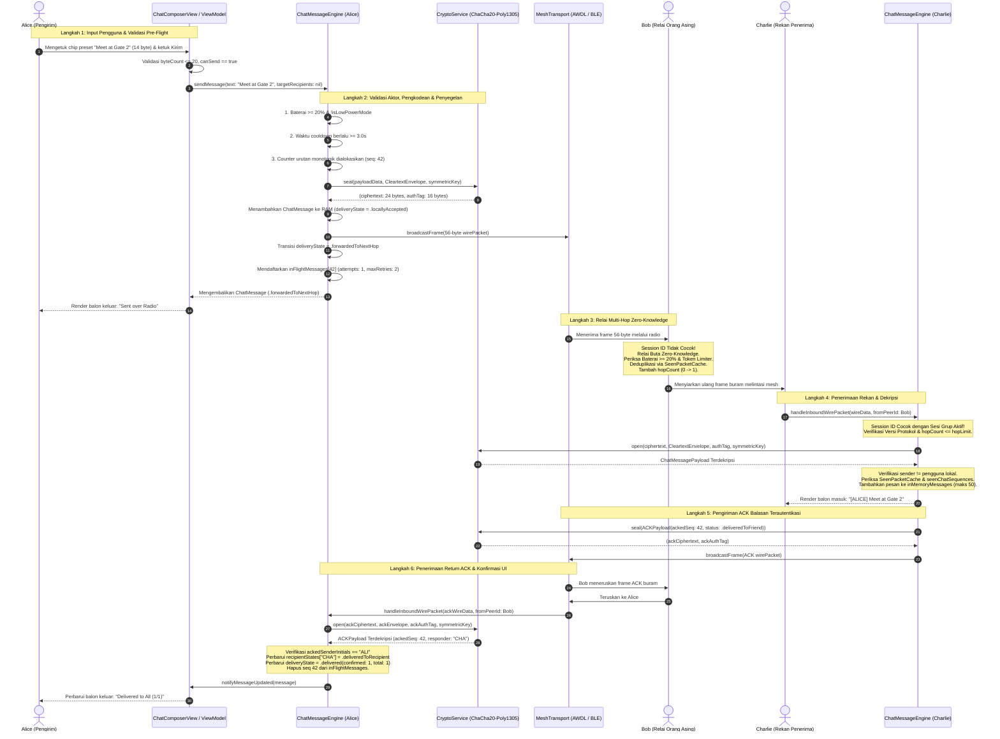

# Volume 08: Feature Chat, Ephemeral Messaging & Delivery Pipeline (Meepo)

## Ringkasan Eksekutif & Gambaran Umum Sistem

Volume 08 mendokumentasikan subsistem perpesanan grup efemeral ber-bandwidth rendah, pengkodean payload wire, konfirmasi pengiriman per penerima, dan presentasi SwiftUI pada platform jaringan mesh Meepo. Dirancang untuk lingkungan operasional bencana off-grid dan pertemuan di alam liar terpencil—di mana stasiun pangkalan seluler dan jaringan Wi-Fi kelebihan beban atau sama sekali tidak ada—engine obrolan menyediakan komunikasi tekstual peer-to-peer antar rekan dekat melintasi mesh multi-hop Apple Wireless Direct Link (AWDL) dan Bluetooth Low Energy (BLE).

Tidak seperti aplikasi obrolan internet tradisional (misalnya Apple Messages, Signal, atau WhatsApp) yang mengandalkan basis data cloud terpusat, koneksi WebSocket persisten, dan alokasi payload berukuran megabyte, engine obrolan Meepo beroperasi di bawah batasan fisik yang sangat ketat:
1. **Batas Muatan Wire 20-Byte yang Ketat:** Untuk menjamin transmisi deterministik melalui tautan nirkabel peer-to-peer dan muat dalam frame paket wire biner 56-byte universal Meepo (`PacketConstants.wirePacketSize`), pesan obrolan dibatasi secara keras (hard-capped) pada 20 byte UTF-8. Sistem menegakkan batasan ini melalui pengukuran karakter langsung (live character-metering), pemotongan batas byte proaktif (proactive byte-boundary clamping), dan validasi sebelum terbang (pre-flight validation).
2. **Efemeralitas Eksklusif di RAM (RAM-Only Ephemerality):** Privasi dan keamanan di zona reruntuhan bencana berkepadatan tinggi menuntut agar komunikasi tidak meninggalkan jejak forensik apa pun. Engine obrolan memelihara riwayat pesan secara eksklusif dalam ring buffer heap 50 pesan yang volatil di dalam `ChatMessageEngine`. Tidak ada teks biasa (plaintext), ciphertext, atau metadata yang ditulis ke CoreData, SwiftData, SQLite, atau UserDefaults. Ketika pengguna menghentikan aplikasi atau keluar dari sesi grup, seluruh riwayat percakapan menguap seketika.
3. **Perkembangan Pengiriman Multi-Penerima yang Jujur:** Dalam mesh radio multi-hop terdistribusi, node perantara yang meneruskan paket tidak menyiratkan bahwa penerima yang dituju telah menerimanya. Meepo secara ketat membedakan antara transmisi radio yang belum dikonfirmasi (`locallyAccepted`, `forwardedToNextHop`), relai orang asing perantara (`relayedByMesh`), dan konfirmasi pengiriman yang ditandatangani secara kriptografis dari rekan yang terverifikasi (`deliveredToRecipient`).
4. **Penerusan Relai Orang Asing Zero-Knowledge (Zero-Knowledge Blind Stranger Relaying):** Untuk mempertahankan jangkauan jaringan di seluruh zona bencana yang luas, perangkat meneruskan paket obrolan terenkripsi milik sesi grup asing (`relayedStranger`) tanpa memiliki kunci dekripsi. Node relai menambah jumlah hop hingga 8 hop sambil mempertahankan integritas MAC ChaCha20-Poly1305 end-to-end melalui masking AAD.
5. **Perlindungan Daya Mode Bertahan Hidup Bencana (<20% Baterai):** Obrolan lokal non-esensial dibatasi (throttled) dan dinonaktifkan setiap kali baterai perangkat turun di bawah 20% atau memasuki Mode Daya Rendah (Low Power Mode) sistem. Ini menjaga kapasitas baterai kritis untuk persinyalan SOS Darurat Tingkat 1, yang tetap 100% beroperasi.
6. **Pembatasan Laju & Perlindungan Cooldown:** Untuk mencegah badai siaran (broadcast storms) dan kehabisan spektrum radio, jeda pendinginan (cooldown) 3,0 detik diberlakukan di antara transmisi berturut-turut. Pesan keluar melakukan hingga 2 transmisi ulang (total 3 upaya) pada jeda backoff 0,5 detik, yang diawasi oleh jendela batas waktu pengiriman 15 detik.

---

### Gambaran Tingkat Tinggi (ELI5): Kartu Indeks 20 Huruf, Barisan Ember Kerumunan & Tanda Terima Bertanda Tangan

Bayangkan regu pencarian dan penyelamatan yang dikerahkan di zona reruntuhan gempa bumi di mana semua menara seluler, gardu listrik, dan jaringan serat optik telah mati total. Petugas tersebar di beberapa blok kota:

1. **Kartu Indeks 20 Huruf (Batas 20 Byte):** Alih-alih mengetik esai panjang, Anda membawa kartu indeks kecil yang memiliki ruang untuk tepat 20 blok huruf kecil (`20 byte UTF-8`). Anda menulis catatan singkat dan kritis: *"Meet at Gate 2"* (14 huruf) atau mengetuk stiker pracetak seperti *"Need water"*. Jika Anda mencoba menggambar emoji yang rumit, emoji tersebut menghabiskan 4 blok huruf sekaligus karena simbol-simbol mewah membutuhkan lebih banyak blok tinta dalam UTF-8.
2. **Segel Lilin Lapis Baja (Enkripsi ChaCha20-Poly1305):** Sebelum kartu indeks meninggalkan tangan Anda, ponsel Anda memasukkannya ke dalam kapsul titanium yang terkunci dengan kunci grup rahasia kamp Anda. Orang asing di kerumunan tidak dapat membuka kapsul, melihat apa yang Anda tulis, atau mengetahui kamp mana yang Anda miliki.
3. **Barisan Ember Kerumunan (Penerusan Relai Orang Asing Buta):** Anda menyerahkan kapsul tersebut kepada orang yang berdiri di sebelah Anda. Meskipun orang asing itu tidak mengenal Anda dan tidak dapat membuka kunci kapsul, ponsel mereka melihat cap penghitung hop di luar, mencapnya dengan "+1 Hop", dan meneruskannya kepada orang lain. Barisan estafet ember ini berulang melintasi kerumunan sampai kapsul mencapai rekan Anda yang berjarak 300 meter.
4. **Stempel Status yang Jujur (Terkirim vs. Diteruskan vs. Sampai):** Saat kapsul melintasi kerumunan, ponsel Anda menampilkan: *"Relayed by 2 Hops (Unconfirmed)"*. Ponsel Anda menolak untuk berbohong kepada Anda dan tidak akan pernah mengatakan *"Delivered"* hanya karena orang asing telah meneruskannya. Hanya ketika ponsel rekan Anda membuka kunci kapsul dengan kunci kamp yang cocok dan mengirim kembali tanda terima kriptografis yang ditandatangani, ponsel Anda berubah menjadi hijau dan menunjukkan: *"Delivered to All (1/1)"*.
5. **Papan Tulis yang Menghilang (Efemeralitas Khusus RAM):** Ketika Anda meninggalkan operasi bencana dan menutup sesi kamp, seseorang mengambil spons basah dan menyeka papan hingga bersih total. Tidak ada pesan yang disimpan ke memori penyimpanan ponsel Anda. Seolah-olah percakapan itu tidak pernah terjadi.

---

## Panduan Desain dan UX (Tanpa Kode)

Fitur obrolan grup Meepo dibangun dengan disiplin ekstrem untuk menghindari membingungkan pengguna atau membuat janji keselamatan palsu di lingkungan operasional bencana yang tidak bersahabat. Pengalaman pengguna menyeimbangkan operasi satu tangan yang cepat dengan umpan balik yang jujur dan tidak ambigu.

### Alur Perjalanan Pengguna dan Status Layar

```
+-------------------------------------------------------------------------------+
|                       PERJALANAN PENGGUNA FITUR OBROLAN                       |
+-------------------------------------------------------------------------------+
|                                                                               |
|  [Ketuk Chip Preset] ---> [Meter Byte Langsung] ---> [Ketuk Panah Kirim]      |
|  "Meet at Gate 2"         14/20 byte                 Kunci Cooldown (Tunggu 3s|
|                                                                               |
|                                  |                                            |
|                                  v                                            |
|                                                                               |
|  [Mengirim...] ---------> [Terkirim via Radio] ----> [Diteruskan Mesh]        |
|  Diterima di memori       Keluar antena lokal        Orang asing meneruskan   |
|                                                                               |
|                                  |                                            |
|                                  v                                            |
|                                                                               |
|  [Terkirim ke Semua] <--- [Perluas Rincian] <------- [Batas Waktu Habis]      |
|  Dikonfirmasi rekan       Centang per anggota        Jendela 15s kedaluwarsa  |
|                                                                               |
+-------------------------------------------------------------------------------+
```

Pengguna berinteraksi dengan obrolan melalui lima status layar yang berbeda:

1. **Status 1: Chip Preset Balasan Cepat (Quick-Reply Preset Chips):**
   - **Tampilan Visual:** Ditempatkan secara horizontal tepat di atas bilah input teks adalah korsel tombol pil bergaya kaca yang dapat digulir (`ChatPresetChipsView`).
   - **Pustaka Preset:** Pesan mikro taktis standar: *"SQUAD EN ROUTE"*, *"TRIAGE CLEAR"*, *"NEED STRETCHER"*, *"HAZARD SECTOR B"*, *"AT EVAC LZ"*, *"WATER ACTIVE"*.
   - **Interaksi:** Mengetuk preset apa pun secara otomatis mengisi bidang input pesan dengan teks preset dan segera menutup keyboard perangkat lunak.

2. **Status 2: Meteran Byte Real-Time & Input Komposer:**
   - **Tampilan Visual:** Bilah input yang bersih dan membulat (`ChatComposerView`) dengan tombol panah kirim yang mengarah ke atas. Tepat di bawah bidang input, label monospace menampilkan `X/20 bytes`.
   - **Umpan Balik Dinamis:** Saat pengguna mengetik, meteran diperbarui seketika: `0/20 bytes`, `12/20 bytes`, `20/20 bytes`.
   - **Pemotongan Otomatis (Auto-Clamping):** Jika pengguna menempelkan kalimat panjang atau mengetik lebih dari 20 byte, bidang secara otomatis terpotong pada batas 20 byte tanpa crash atau menampilkan kode kesalahan kriptografi yang membingungkan.
   - **Penjaga Tombol Kirim:** Panah kirim tetap dinonaktifkan jika bidang input kosong, hanya berisi spasi, atau jika perangkat saat ini berada dalam status cooldown.

3. **Status 3: Hitung Mundur Cooldown 3,0 Detik:**
   - **Pemicu:** Dimulai pada milidetik yang tepat saat pengguna mengetuk panah kirim.
   - **Tampilan Visual:** Tombol kirim menjadi nonaktif, dan label di sebelah meteran byte berubah menjadi hitung mundur langsung: `Wait 3s` -> `Wait 2s` -> `Wait 1s`.
   - **Tujuan Desain:** Mencegah pengguna yang gugup atau frustrasi melakukan spam pada tombol kirim di tengah kerumunan yang padat, melindungi saluran radio bersama dari tabrakan paket.

4. **Status 4: Perkembangan Pengiriman Balon Pesan yang Jujur:**
   - **Penempatan Balon:** Pesan terkirim rata kanan dalam kartu bundar gelap (`ChatMessageBubbleView`); pesan masuk dari rekan rata kiri, ditandai dengan inisial rekan dan warna profil khas mereka.
   - **Subjudul Status Dinamis:** Pesan keluar lokal menampilkan subjudul status real-time yang jujur:
     - *"Sending..."* - Paket sedang diantrekan di memori perangkat.
     - *"Sent over Radio"* - Paket telah disiarkan melalui antena lokal.
     - *"Relayed by X Hops (Unconfirmed)"* - Orang asing perantara atau hop mesh telah meneruskan paket melintasi kerumunan, tetapi rekan belum mengonfirmasinya.
     - *"Delivered X/Y"* - Konfirmasi pengiriman parsial (misalnya, 2 dari 3 rekan telah mengonfirmasi).
     - *"Delivered to All (X/Y)"* - Semua anggota grup yang dituju memverifikasi tanda terima.
     - *"Delivered X/Y (Timed Out)"* atau *"Delivery Timed Out"* - Jendela pengiriman 15 detik berakhir sebelum rekan yang tersisa mengonfirmasi.
   - **Pengungkapan Rincian Pengiriman:** Balon keluar menampilkan menu yang dapat diciutkan *"Delivery details"* (`ChatRecipientStatusView`). Mengetuknya akan membuka rincian per penerima yang menunjukkan inisial setiap rekan dan tonggak pengiriman spesifik mereka (*"Delivered"*, *"Relayed; unconfirmed"*, atau *"Timed out"*).

5. **Status 5: Mode Bertahan Hidup Bencana (<20% Baterai atau Mode Daya Rendah):**
   - **Tampilan Visual:** Bidang input teks dan chip preset dinonaktifkan dan berwarna abu-abu. Pemberitahuan yang jelas dan meyakinkan muncul di bagian atas komposer:
     > *"Chat paused in Low Power Mode or below 20% battery."*
   - **Dampak Keselamatan:** Menenangkan pengguna bahwa meskipun obrolan sosial ditangguhkan sementara untuk menghemat cadangan baterai, siaran SOS Darurat Tingkat 1 tetap 100% beroperasi.

---

### "Mengapa Kita Tidak Bisa Langsung...?" (Batasan untuk Desainer)

Perancang produk dan peneliti UI sering kali menyarankan peningkatan pengalaman obrolan dengan fitur yang umum di aplikasi perpesanan internet modern. Tabel berikut menjelaskan mengapa pola-pola ini dilarang keras oleh rekayasa sistem mesh off-grid:

| "Mengapa Kita Tidak Bisa Langsung...?" | Realitas Teknis & Platform | Perilaku Desain yang Diizinkan |
| :--- | :--- | :--- |
| **Mengapa kita tidak mengizinkan 140 atau 256 karakter seperti SMS atau Twitter?** | Meepo menggunakan paket wire 56-byte tetap (`PacketConstants.wirePacketSize`) di seluruh BLE dan AWDL. Frame berukuran tetap menghilangkan fragmentasi paket, kompleksitas penyusunan ulang buffer, dan kerentanan penurunan multi-paket melintasi mesh radio peer-to-peer yang bising. Mengurangi header, nomor urutan, timestamp, dan tag MAC ChaCha20-Poly1305 menyisakan tepat 20 byte untuk teks. | Batasi pesan secara ketat pada 20 byte UTF-8. Sediakan chip preset balasan cepat untuk komunikasi darurat taktis yang umum. |
| **Mengapa satu emoji dihitung sebagai 4 karakter pada meteran byte?** | Meteran byte mengukur byte UTF-8 mentah, bukan glif Unicode yang terlihat. Karakter ASCII dasar (`A-Z`, `0-9`) membutuhkan 1 byte masing-masing. Huruf beraksen membutuhkan 2 byte. Emoji kompleks (misalnya, simbol bahaya, wajah, bendera) memerlukan 3 hingga 4 byte masing-masing. Batas 20 byte memuat 20 huruf biasa, tetapi hanya 5 emoji. | Tampilkan `X/20 bytes` alih-alih `X/20 characters` untuk mendidik pengguna tentang konsumsi byte, dan secara otomatis memotong teks pada batas titik kode UTF-8 yang valid. |
| **Mengapa kita tidak bisa menyimpan riwayat obrolan agar pengguna dapat membaca pesan lama nanti?** | Tim pencarian dan penyelamatan serta korban bencana sipil menghargai efemeralitas mutlak dan perlindungan data. Menyimpan teks biasa obrolan di penyimpanan flash berisiko membocorkan informasi medis korban atau lokasi pertemuan jika perangkat hilang, rusak, atau disita di lapangan. Selain itu, menulis ke penyimpanan flash menghabiskan baterai ekstra selama pemadaman listrik. | Pertahankan pesan secara ketat di RAM heap yang volatil (maks 50 pesan). Hapus semua riwayat secara instan saat sesi dihentikan atau aplikasi ditutup. |
| **Mengapa kita tidak bisa menghapus pengatur waktu cooldown 3 detik?** | Spektrum frekuensi radio di zona darurat bencana adalah media bersama yang tidak terkoordinasi. Jika beberapa petugas mentransmisikan secara bersamaan, tingkat tabrakan paket melonjak tinggi, menyebabkan CSMA backoff dan runtuhnya mesh. | Terapkan jeda cooldown 3,0 detik di antara pengiriman keluar dengan label hitung mundur monospace yang bersih. |
| **Mengapa kita tidak bisa menampilkan "Terkirim" saat orang asing di dekatnya meneruskan pesan?** | Perangkat perantara asing yang berjarak 30 meter di sektor evakuasi lain mungkin meneruskan paket tersebut, tetapi relai itu tidak dapat membaca pesan atau menjamin pengiriman ke petugas medis regu yang dituju. Mengeklaim "Terkirim" padahal hanya node perantara yang meneruskannya menciptakan kepastian palsu yang berbahaya. | Tampilkan *"Relayed by X Hops (Unconfirmed)"*. Hanya tampilkan *"Delivered"* ketika ACK ChaCha20-Poly1305 yang terautentikasi tiba dari perangkat penerima. |

---

### Token Desain yang Bebas Diubah vs. Aturan Rekayasa yang Terkunci

Untuk menjaga integritas arsitektural jaringan mesh sambil memberi desainer produk fleksibilitas untuk menyempurnakan pengalaman pengguna, parameter desain diklasifikasikan secara ketat menjadi token yang dapat diedit dan aturan rekayasa yang terkunci:

```
+-------------------------------------------------------------------------------+
|                       TOKEN DESAIN VS. ATURAN REKAYASA                        |
+-------------------------------------------------------------------------------+
|  TOKEN DESAIN YANG BEBAS DIUBAH (Aman Disesuaikan)                            |
|  - String Teks Chip Preset (Harus muat <= 20 byte UTF-8)                      |
|  - Radius Sudut Balon Pesan (Default: 18pt) & Inset (Default: 14pt)           |
|  - Palet Warna Inisial Profil Anggota (MemberColor.swiftUIColor)              |
|  - Ikon Status Kosong & Salinan Panduan ("bubble.left.and.bubble.right")       |
|  - Gaya Fon Monospace untuk Meteran Byte & Cooldown                           |
+-------------------------------------------------------------------------------+
|  ATURAN REKAYASA TERKUNCI (Dilarang Diubah Tanpa Izin Arsitek Sistem)         |
|  - Batas Teks Keras 20-Byte Wire (ChatMessagePayload.maxTextBytes = 20)       |
|  - Buffer Cincin Heap Volatil 50-Pesan (ChatMessageEngine.maxHistoryCount=50) |
|  - Cooldown Radio Anti-Spam 3,0 Detik (MeshTimingConfiguration)               |
|  - Batas Baterai 20% & Mode Daya Rendah (Mode Bertahan Hidup Bencana)         |
|  - Bingkai Wire Biner Tetap 56-Byte (PacketConstants.wirePacketSize = 56)     |
|  - Penyegelan Kunci Simetris ChaCha20-Poly1305 & Invariansi Masking AAD       |
|  - Pembedaan Antara Relay ACK (0x02) dan Delivery ACK (0x01)                  |
+-------------------------------------------------------------------------------+
```

---

## Analisis Rekayasa Teknis Mendalam

Bagian ini menyediakan analisis arsitektural komprehensif tingkat kode dari Volume 08. Bagian ini dimulai dengan penelusuran end-to-end langkah demi langkah, menyajikan inventaris berkas sumber terverifikasi, merinci diagram state machine dan protokol inti, serta mengulas setiap berkas sumber secara mendalam.

---

### Alur End-to-End: Dari Ketukan Preset hingga Balon Obrolan Rekan dan Tanda Terima

Diagram urutan dan penelusuran berikut mengikuti siklus hidup teknis lengkap dari pesan obrolan grup darurat bencana:



---

### Berkas Sumber yang Disertakan

Sebanyak 17 berkas sumber Swift berikut merupakan implementasi lengkap dari Volume 08:

| # | Tautan Berkas Relatif | Jumlah Baris Persis (`wc -l`) | Target / Kategori | Tujuan & Tanggung Jawab Arsitektural |
| :-: | :--- | :-: | :--- | :--- |
| 1 | [`ChatDeliveryState.swift`](../../Teekum/Teekum/Features/Chat/Models/ChatDeliveryState.swift) | 44 | Main App / Model | Status pengiriman makro teragregasi yang melacak progres keseluruhan dan peringkat prioritas monotonik. |
| 2 | [`ChatEngineError.swift`](../../Teekum/Teekum/Features/Chat/Models/ChatEngineError.swift) | 49 | Main App / Model | Enum kesalahan domain dengan deskripsi terlokalisasi dan menenangkan untuk kesalahan daya dan validasi. |
| 3 | [`ChatMessage.swift`](../../Teekum/Teekum/Features/Chat/Models/ChatMessage.swift) | 84 | Main App / Model | Model memori murni yang merepresentasikan pesan obrolan dengan pelacakan per penerima dan ringkasan jujur. |
| 4 | [`InFlightMessage.swift`](../../Teekum/Teekum/Features/Chat/Models/InFlightMessage.swift) | 19 | Main App / Model | Struktur pelacakan internal yang mengelola paket aktif yang belum diakui, jumlah percobaan ulang, dan data kawat pra-serialisasi. |
| 5 | [`InboundChatOutcome.swift`](../../Teekum/Teekum/Features/Chat/Models/InboundChatOutcome.swift) | 34 | Main App / Model | Enumerasi klasifikasi hasil untuk paket wire masuk yang diproses. |
| 6 | [`RecipientDeliveryState.swift`](../../Teekum/Teekum/Features/Chat/Models/RecipientDeliveryState.swift) | 44 | Main App / Model | Pelacakan status pengiriman diskrit untuk masing-masing penerima grup yang dituju. |
| 7 | [`ChatMessagingService.swift`](../../Teekum/Teekum/Features/Chat/Protocols/ChatMessagingService.swift) | 41 | Main App / Protocol | Protokol formal yang dibatasi aktor untuk mengisolasi logika bisnis perpesanan dari ViewModel UI. |
| 8 | [`ChatMessageEngine+Delivery.swift`](../../Teekum/Teekum/Features/Chat/Services/ChatMessageEngine+Delivery.swift) | 278 | Main App / Service | Ekstensi engine obrolan yang mengelola ACK balasan, pengawas percobaan ulang, batas waktu 15 detik, dan pembersihan riwayat RAM. |
| 9 | [`ChatMessageEngine+Inbound.swift`](../../Teekum/Teekum/Features/Chat/Services/ChatMessageEngine+Inbound.swift) | 212 | Main App / Service | Ekstensi engine obrolan yang menangani validasi kawat, relai buta orang asing, dekripsi, dan ACK ulang duplikat. |
| 10 | [`ChatMessageEngine+Outbound.swift`](../../Teekum/Teekum/Features/Chat/Services/ChatMessageEngine+Outbound.swift) | 164 | Main App / Service | Ekstensi engine obrolan yang mengeksekusi validasi pra-terbang, alokasi urutan, enkripsi, dan pengiriman. |
| 11 | [`ChatMessageEngine.swift`](../../Teekum/Teekum/Features/Chat/Services/ChatMessageEngine.swift) | 193 | Main App / Service | Aktor koordinasi sentral yang memelihara buffer cincin RAM volatil 50 pesan dan kebijakan baterai. |
| 12 | [`ChatViewModel.swift`](../../Teekum/Teekum/Features/Chat/ViewModels/ChatViewModel.swift) | 131 | Main App / ViewModel | View model presentasi yang dapat diamati yang mengelola draf, pengukuran byte UTF-8, pendinginan, dan jumlah belum dibaca. |
| 13 | [`ChatComposerView.swift`](../../Teekum/Teekum/Features/Chat/Views/ChatComposerView.swift) | 71 | Main App / View | Komponen bilah input bawah SwiftUI dengan meteran jumlah byte langsung, label pendinginan, dan tombol kirim. |
| 14 | [`ChatMessageBubbleView.swift`](../../Teekum/Teekum/Features/Chat/Views/ChatMessageBubbleView.swift) | 54 | Main App / View | Komponen balon pesan SwiftUI dengan inisial pengirim, warna profil, timestamp, dan ringkasan pengiriman. |
| 15 | [`ChatPresetChipsView.swift`](../../Teekum/Teekum/Features/Chat/Views/ChatPresetChipsView.swift) | 32 | Main App / View | Korsel pengguliran horizontal SwiftUI untuk tombol-tombol preset balasan cepat. |
| 16 | [`ChatRecipientStatusView.swift`](../../Teekum/Teekum/Features/Chat/Views/ChatRecipientStatusView.swift) | 53 | Main App / View | Grup pengungkapan yang dapat diciutkan SwiftUI yang menunjukkan tonggak pengiriman masing-masing anggota. |
| 17 | [`ChatSheetView.swift`](../../Teekum/Teekum/Features/Chat/Views/ChatSheetView.swift) | 104 | Main App / View | Lembar navigasi modal tingkat atas yang menyematkan status kosong, gulir pesan berlabuh bawah, dan komposer. |
| **Total** | **Semua Berkas Volume 08** | **1.607** | **17 Berkas Sumber Swift** | **Cakupan Komprehensif 100%** |

---

### Diagram Muatan Obrolan & State Machine Pengiriman

#### 1. Pembingkaian Paket Wire Biner 56-Byte Tetap
Diagram di bawah mengilustrasikan bagaimana pesan obrolan 20 byte pas dengan rapi ke dalam paket kawat 56-byte universal Meepo:

```
+---------------------------------------------------------------------------------------+
|                       BINGKAI PAKET WIRE OBROLAN 56-BYTE TEEKUM                       |
+-------------------+-------------------------------+-----------------------------------+
|  Cleartext Envelope (16 Bytes)                    |  Encrypted Payload + Auth (40B)   |
+----+----+----+----+----+----+----+----+----+------+-------------------+---------------+
|Ver |Type|Hop |Hop |  Session ID  |Sequence Number| Ciphertext (24B)  | Poly1305 Auth |
|0x01|0x03|Lmt |Cnt |   (4 Bytes)  |   (4 Bytes)   | (Data Terenkripsi)| Tag (16 Bytes)|
|1B  |1B  |1B  |1B  |              |               |                   |               |
+----+----+----+----+------------------+------------+-------------------+---------------+
                                                    | ChatMessagePayload (24 Bytes)     |
                                                    +--------+----------+---------------+
                                                    |Initials|Timestamp |Text (1..20 B) |
                                                    | (3B)   | (8 Bytes)| UTF-8 Encoded |
                                                    +--------+----------+---------------+
```

#### 2. Matriks Transisi Status Pengiriman Multi-Penerima
Diagram di bawah merinci perkembangan monotonik dari status pengiriman individu dan teragregasi:

```
+---------------------------------------------------------------------------------------+
|                    DELIVERY STATE MACHINE & MONOTONIC PROMOTION                       |
+---------------------------------------------------------------------------------------+
|                                                                                       |
|   +-------------------+                                                               |
|   |  locallyAccepted  | (Peringkat Prioritas 0: Disimpan di RAM aktor lokal)          |
|   +---------+---------+                                                               |
|             | [Siaran Radio]                                                          |
|             v                                                                         |
|   +-------------------+                                                               |
|   | forwardedToNextHop| (Peringkat Prioritas 1: Ditransmisikan melalui antena lokal)  |
|   +---------+---------+                                                               |
|             | [Menerima Relay ACK (0x02)]                                             |
|             v                                                                         |
|   +-------------------+                                                               |
|   |   relayedByMesh   | (Peringkat Prioritas 2: Orang asing perantara meneruskan)     |
|   +---------+---------+                                                               |
|             |                                                                         |
|             |----------------------------------+                                      |
|             | [ACK Pengiriman Rekan (0x01)]    | [Batas Waktu 15s Habis]              |
|             v                                  v                                      |
|   +-------------------+              +-------------------+                            |
|   |    delivered      |              | deliveryTimedOut  |                            |
|   | (Peringkat 3: Akhir)             | (Peringkat 3: Akhir)                           |
|   +-------------------+              +-------------------+                            |
|                                                                                       |
+---------------------------------------------------------------------------------------+
```

---

## Pembahasan Mendalam Berkas demi Berkas (Tanpa Berkas yang Terlewat)

### 1. `Teekum/Teekum/Features/Chat/Models/ChatDeliveryState.swift`
- **Path Berkas**: [`../../Teekum/Teekum/Features/Chat/Models/ChatDeliveryState.swift`](../../Teekum/Teekum/Features/Chat/Models/ChatDeliveryState.swift)
- **Jumlah Baris**: 44 baris (`wc -l`)
- **Konkurensi & Domain Target**: Target Aplikasi Utama (`Teekum`), `nonisolated public enum`, Mengadopsi `Equatable, Sendable`

#### Apa yang Dilakukan Berkas Ini
`ChatDeliveryState.swift` menetapkan status siklus hidup pengiriman tingkat makro yang teragregasi untuk seluruh pesan obrolan di semua penerima targetnya. Berkas ini memodelkan perkembangan operasional paket keluar dari antrean lokal di memori aktor melalui pengiriman antena radio, relai mesh perantara oleh node pihak ketiga yang tidak terautentikasi, konfirmasi terautentikasi oleh perangkat rekan, dan kondisi batas waktu atau kegagalan.

#### Analogi ELI5
Bayangkan mengirim pesanan pasokan medis darurat ke tim lapangan di seluruh zona bencana banjir. Tanda terima pelacakan menampilkan kemajuan: "Pesanan Dicatat di Pengiriman" (`locallyAccepted`), "Diserahkan ke Kurir Lapangan" (`forwardedToNextHop`), "Diteruskan Melewati Pos Pemeriksaan Sektor 2" (`relayedByMesh`), "Terkirim dan Dikonfirmasi oleh 3 dari 4 Petugas Medis Regu" (`delivered`), atau "Pengiriman Melewati Batas Waktu" (`deliveryTimedOut`). `ChatDeliveryState` adalah tanda terima status pengiriman tingkat makro tersebut.

#### Definisi Istilah Teknis
- **Status Pengiriman Teragregasi (Aggregated Delivery State)**: State machine tingkat tinggi yang merepresentasikan kemajuan pengiriman kolektif dari pesan multi-penerima, disintesis dari status ACK per penerima individu.
- **Relai Mesh Perantara (`relayedByMesh`)**: Konfirmasi bahwa perangkat relai mesh perantara (yang bisa jadi milik orang asing) meneruskan paket, tanpa menjamin bahwa rekan yang dituju telah menerima atau mendekripsinya.
- **Peringkat Prioritas (Priority Rank)**: Bilangan bulat ordinal (`0` hingga `3`) yang menegakkan perkembangan monotonik dalam pembaruan status pengiriman, memastikan pemberitahuan relai yang datang terlambat atau tidak berurutan tidak pernah menurunkan pesan yang sudah terkirim.

#### Walkthrough Blok Kode dan Baris demi Baris
Baris 11–43 mendeklarasikan kasus enumerasi, pembantu kueri, dan peringkat prioritas monotonik:
```swift
// Lines 11-20: Definisi ChatDeliveryState
nonisolated public enum ChatDeliveryState: Equatable, Sendable {
    case locallyAccepted
    case forwardedToNextHop
    case relayedByMesh(hopCount: UInt8)
    case delivered(confirmedCount: Int, totalRecipients: Int)
    case deliveryTimedOut
    case failed(reason: String)
```
- Baris 12 (`locallyAccepted`): Payload pesan telah lulus validasi panjang byte dan diantrekan di dalam `ChatMessageEngine`.
- Baris 13 (`forwardedToNextHop`): Frame wire 56-byte telah ditransmisikan melalui antena radio lokal (`MeshTransport.broadcastFrame`).
- Baris 14 (`relayedByMesh(hopCount:)`): Node perantara telah menyiarkan ulang paket melintasi mesh, membawa jarak hop.
- Baris 15 (`delivered(confirmedCount:totalRecipients:)`): Satu atau beberapa penerima yang dituju telah mendekripsi muatan dan mengirimkan kembali ACK ChaCha20-Poly1305 yang terautentikasi.
- Baris 16–17 (`deliveryTimedOut`, `failed`): Status kegagalan terminal atau batas waktu habis ketika jendela ACK 15 detik berlalu atau terjadi kegagalan radio.

```swift
// Lines 21-33: Helper Boolean inspeksi
    public var isDelivered: Bool {
        if case .delivered = self { return true }
        return false
    }
    
    public var isRelayed: Bool {
        if case .relayedByMesh = self { return true }
        return false
    }
    
    public var isTimedOut: Bool {
        if case .deliveryTimedOut = self { return true }
        return false
    }
```
- Baris 21–33: Kueri Boolean non-isolated yang praktis untuk tampilan SwiftUI guna menggerakkan gaya visual, indikator chevron pengungkapan, dan label aksesibilitas tanpa pencocokan pola.

```swift
// Lines 35-43: Pemeringkatan prioritas untuk kemajuan status monotonik
    public var priorityRank: Int {
        switch self {
        case .locallyAccepted: return 0
        case .forwardedToNextHop: return 1
        case .relayedByMesh: return 2
        case .delivered: return 3
        case .deliveryTimedOut: return 3
        case .failed: return 3
        }
    }
}
```
- Baris 35–43: Menetapkan peringkat prioritas bilangan bulat untuk setiap status. Ini menjamin bahwa ACK relai yang masuk (`priorityRank == 2`) tidak akan pernah menimpa atau menurunkan pesan yang telah mencapai `.delivered` (`priorityRank == 3`).

#### Rationale Rekayasa dan Kasus Batas (Edge Cases)
- **Desain Umpan Balik yang Jujur**: Tidak seperti protokol obrolan konvensional yang memperlakukan pengiriman pembawa radio sebagai "Terkirim" dan tanda terima relai sebagai "Sampai", Meepo secara eksplisit memisahkan `.relayedByMesh` dari `.delivered`. Di alam liar atau mesh operasional bencana, node perantara yang meneruskan paket tidak berarti ponsel penerima aktif, dalam jangkauan, atau mampu mendekripsi paket.
- **Isolasi Nilai Sendable**: Mengadopsi `Sendable` dan ditandai `nonisolated` memungkinkan status-status ini berpindah secara mulus melintasi `ChatMessageEngine` (sebuah aktor), `ChatViewModel` (pada `@MainActor`), dan loop rendering tampilan SwiftUI tanpa penguncian thread atau penyalinan memori.

---

### 2. `Teekum/Teekum/Features/Chat/Models/ChatEngineError.swift`
- **Path Berkas**: [`../../Teekum/Teekum/Features/Chat/Models/ChatEngineError.swift`](../../Teekum/Teekum/Features/Chat/Models/ChatEngineError.swift)
- **Jumlah Baris**: 49 baris (`wc -l`)
- **Konkurensi & Domain Target**: Target Aplikasi Utama (`Teekum`), `nonisolated public enum`, Mengadopsi `Error, LocalizedError, Equatable, Sendable`

#### Apa yang Dilakukan Berkas Ini
`ChatEngineError.swift` menetapkan taksonomi kesalahan khusus domain untuk seluruh subsistem obrolan. Berkas ini mengkategorikan setiap kondisi kegagalan yang dapat terjadi selama penyusunan draf pesan, validasi, pembatasan daya perangkat keras, jeda pendinginan laju radio, penyegelan/pembukaan kriptografi, antrean kotak keluar, dan pembongkaran sesi.

#### Analogi ELI5
Bayangkan seorang pengawas keselamatan berdiri di sebelah stasiun tabung pneumatik di pabrik industri. Jika Anda menyerahkan tabung yang terlalu berat, jika tabung sedang pendinginan, jika pabrik beroperasi dengan daya generator darurat, atau jika segel rahasia rusak, pengawas memberi Anda kartu pemberitahuan merah khusus yang menjelaskan persis mengapa tabung tidak dapat diluncurkan sekarang. `ChatEngineError` adalah kumpulan kartu penolakan khusus tersebut.

#### Definisi Istilah Teknis
- **Taksonomi Kesalahan Domain (Domain Error Taxonomy)**: Hierarki kesalahan bertipe yang terperinci dan disesuaikan dengan subsistem tertentu, memungkinkan penanganan kesalahan terprogram serta deskripsi terlokalisasi yang dapat dibaca manusia.
- **Pembatasan Daya Perangkat Keras (Hardware Power Throttling)**: Kebijakan perlindungan yang memutus transmisi nirkabel non-esensial saat kapasitas baterai turun di bawah margin keselamatan (20%) atau memasuki Mode Daya Rendah sistem.
- **Kunci Pendinginan Radio (Radio Cooldown Lock)**: Penundaan pembatasan laju di sisi klien (3,0 detik) yang mencegah kejenuhan saluran dan tabrakan paket di frekuensi radio bersama.

#### Walkthrough Blok Kode dan Baris demi Baris
Baris 11–48 mendeklarasikan kasus kesalahan bertipe dan penjelasan UI yang terlokalisasi:
```swift
// Lines 11-23: Definisi enum ChatEngineError
nonisolated public enum ChatEngineError: Error, LocalizedError, Equatable, Sendable {
    case invalidTextLength(Int)
    case cooldownActive(remainingSeconds: Double)
    case batteryThrottled(batteryLevel: Float)
    case survivalModeActive
    case noActiveSession
    case queueFull(String)
    case serializationFailed
    case encryptionFailed(String)
    case decryptionFailed(String)
    case duplicateMessage(UInt32)
    case sessionTerminated
```
- Baris 12 (`invalidTextLength(Int)`): Dipicu jika jumlah byte UTF-8 adalah 0 atau melebihi 20 byte.
- Baris 13 (`cooldownActive(remainingSeconds:)`): Dipicu jika pengguna mencoba mengirim dalam waktu 3,0 detik dari pesan sebelumnya.
- Baris 14–15 (`batteryThrottled`, `survivalModeActive`): Dipicu ketika tingkat baterai perangkat di bawah 0,20 atau Mode Daya Rendah aktif.
- Baris 16 (`noActiveSession`): Dipicu jika pengiriman dicoba tanpa kunci sesi grup yang mapan.
- Baris 17 (`queueFull(String)`): Dipicu jika buffer kotak keluar tidak dapat menerima paket tambahan.
- Baris 18–20 (`serializationFailed`, `encryptionFailed`, `decryptionFailed`): Kesalahan pengkodean format kawat dan kriptografi.
- Baris 21 (`duplicateMessage(UInt32)`): Nomor urutan masuk sudah dicatat dalam cache deduplikasi.
- Baris 22 (`sessionTerminated`): Sesi grup ditutup atau dihentikan selama transit.

```swift
// Lines 25-48: Pemformatan deskripsi LocalizedError
    public var errorDescription: String? {
        switch self {
        case .invalidTextLength(let count):
            return "Message length is invalid (\(count) bytes). Must be between 1 and 20 UTF-8 bytes."
        case .cooldownActive(let remaining):
            return String(format: "Chat cooldown active. Please wait %.1f seconds.", remaining)
        case .batteryThrottled(let level):
            return String(format: "Chat disabled below 20%% battery (current: %.0f%%). Emergency SOS remains active.", level * 100)
        case .survivalModeActive:
            return "Chat disabled in disaster operational Survival Mode (<20% battery). Emergency SOS remains active."
        case .noActiveSession:
            return "Cannot send chat message without an active group session."
        case .queueFull(let msg):
            return "Chat queue is full: \(msg)"
        case .serializationFailed:
            return "Failed to serialize chat message payload."
        case .encryptionFailed(let msg):
            return "Failed to encrypt chat message: \(msg)"
        case .decryptionFailed(let msg):
            return "Failed to decrypt chat message: \(msg)"
        case .duplicateMessage(let seq):
            return "Duplicate chat message dropped (sequence \(seq))."
        case .sessionTerminated:
            return "Active session was terminated."
        }
    }
}
```
- Baris 25–48: Memformat string teks yang jelas dan menenangkan pengguna. Perhatikan bahwa untuk `batteryThrottled` dan `survivalModeActive`, pesan kesalahan secara eksplisit mencatat: *"Emergency SOS remains active."*, mencegah petugas penyelamat dan penyintas panik tentang keselamatan jiwa.

#### Rationale Rekayasa dan Kasus Batas (Edge Cases)
- **Equatability untuk Pengujian Unit Deterministik**: Dengan mengadopsi `Equatable`, pengujian unit dapat menegaskan kasus kesalahan persis (misalnya, `XCTAssertEqual(error, ChatEngineError.invalidTextLength(24))`) tanpa pencocokan string.
- **Kepastian Keselamatan dalam String UI**: Sistem darurat membutuhkan kejelasan psikologis yang eksplisit. Mengingatkan pengguna bahwa SOS beroperasi bahkan ketika obrolan dibatasi mencegah kebingungan selama skenario baterai lemah.

---

### 3. `Teekum/Teekum/Features/Chat/Models/ChatMessage.swift`
- **Path Berkas**: [`../../Teekum/Teekum/Features/Chat/Models/ChatMessage.swift`](../../Teekum/Teekum/Features/Chat/Models/ChatMessage.swift)
- **Jumlah Baris**: 84 baris (`wc -l`)
- **Konkurensi & Domain Target**: Target Aplikasi Utama (`Teekum`), `nonisolated public struct`, Mengadopsi `Identifiable, Equatable, Sendable`

#### Apa yang Dilakukan Berkas Ini
`ChatMessage.swift` mendefinisikan model domain dalam memori inti untuk pesan obrolan grup yang dikirim dan diterima. Model ini menggabungkan pengidentifikasi pesan unik, counter urutan, inisial pengirim, payload teks, timestamp pengiriman, status pengiriman per penerima, perkembangan pengiriman teragregasi, dan flag lokalitas pengirim. Model ini menyediakan properti terhitung yang memformat ringkasan status pengiriman yang jujur dan dapat dibaca manusia untuk UI.

#### Analogi ELI5
Bayangkan kartu indeks yang digunakan untuk melacak pengumuman yang dibuat ke kamp operasional bencana Anda. Di bagian depan adalah teks pesan, siapa yang mengatakannya, dan jam berapa dikatakan. Di bagian belakang terdapat daftar periksa semua nama rekan kamp Anda dengan tanda centang yang menunjukkan apakah pesan telah diserahkan kepada kurir, terlihat lewat, atau benar-benar diakui oleh masing-masing teman. `ChatMessage` adalah kartu indeks tersebut.

#### Definisi Istilah Teknis
- **Efemeralitas Dalam-Memori (In-Memory Ephemerality)**: Menyimpan rekaman secara eksklusif dalam memori heap yang volatil tanpa dukungan disk, memastikan penguapan total saat aplikasi dihentikan atau pengguna menutup sesi grup.
- **Pelacakan ACK Multi-Penerima**: Pola manajemen status di mana pesan grup keluar melacak status pengiriman untuk setiap penerima yang dituju secara independen daripada mengasumsikan penerimaan siaran.
- **Ringkasan Pengiriman Jujur (Honest Delivery Summary)**: String UI dinamis yang diturunkan secara ketat dari pengakuan penerima yang diverifikasi daripada status transmisi spekulatif.

#### Walkthrough Blok Kode dan Baris demi Baris
Baris 16–47 mendeklarasikan properti struktur dan penginisialisasi:
```swift
// Lines 16-26: Definisi properti ChatMessage
nonisolated public struct ChatMessage: Identifiable, Equatable, Sendable {
    public let id: UUID
    public let sequenceNumber: UInt32
    public let senderInitials: String
    public let text: String
    public let timestamp: Date
    public var confirmedResponders: Set<String>
    public var recipientStates: [String: RecipientDeliveryState]
    public var deliveryState: ChatDeliveryState
    public let isLocalSender: Bool
```
- Baris 17 (`id`): UUID unik untuk iterasi `ForEach` SwiftUI dan rendering daftar.
- Baris 18 (`sequenceNumber`): Nomor urutan monotonik yang mengalokasikan deduplikasi wire dan pencocokan ACK.
- Baris 19 (`senderInitials`): Inisial pengirim 2 hingga 3 karakter yang disanitasi (misalnya `"ALI"`).
- Baris 20 (`text`): Payload teks 1 hingga 20 byte UTF-8 terverifikasi.
- Baris 22 (`confirmedResponders`): Kumpulan inisial anggota yang telah mengirim kembali ACK pengiriman terautentikasi.
- Baris 23 (`recipientStates`): Kamus yang memetakan inisial penerima ke `RecipientDeliveryState` individu mereka.
- Baris 24 (`deliveryState`): Status pengiriman makro teragregasi di semua penerima.
- Baris 25 (`isLocalSender`): Flag Boolean yang membedakan pesan yang disusun secara lokal dari pesan rekan yang diterima.

```swift
// Lines 50-57: Helper penghitungan penerima
    public var confirmedRecipientCount: Int {
        recipientStates.values.filter { $0.isDelivered }.count
    }
    
    public var totalRecipientCount: Int {
        max(1, recipientStates.count)
    }
```
- Baris 50–57: Menghitung jumlah pengiriman penerima yang diverifikasi terhadap total daftar penerima.

```swift
// Lines 60-83: Penurunan ringkasan pengiriman jujur
    public var deliverySummaryText: String {
        switch deliveryState {
        case .locallyAccepted:
            return "Sending..."
        case .forwardedToNextHop:
            return "Sent over Radio"
        case .relayedByMesh(let hops):
            return "Relayed by \(hops) \(hops == 1 ? "Hop" : "Hops") (Unconfirmed)"
        case .delivered(let confirmed, let total):
            if confirmed >= total {
                return "Delivered to All (\(confirmed)/\(total))"
            } else {
                return "Delivered \(confirmed)/\(total)"
            }
        case .deliveryTimedOut:
            if confirmedRecipientCount > 0 {
                return "Delivered \(confirmedRecipientCount)/\(totalRecipientCount) (Timed Out)"
            } else {
                return "Delivery Timed Out"
            }
        case .failed(let reason):
            return "Failed: \(reason)"
        }
    }
}
```
- Baris 60–83: Menghasilkan string status jujur yang ditampilkan di bawah balon obrolan keluar. Perhatikan umpan balik batas waktu yang bernuansa: jika 2 dari 3 rekan mengonfirmasi sebelum batas waktu habis, sistem dengan jujur menyatakan `"Delivered 2/3 (Timed Out)"`, memberikan pengirim kesadaran situasional yang dapat ditindaklanjuti.

#### Rationale Rekayasa dan Kasus Batas (Edge Cases)
- **Sanitasi Inisial dalam Penginisialisasi**: Baris 40 memanggil `InitialsCodec.sanitize(senderInitials)`, menghapus spasi dan menormalkan karakter huruf besar saat pembuatan.
- **Jaminan Nol Persistensi Disk**: Struktur ini sengaja tidak mengadopsi `Codable` untuk mencegah serialisasi tidak disengaja ke `UserDefaults` atau `FileManager`, menegakkan kontrak efemeralitas.

---

### 4. `Teekum/Teekum/Features/Chat/Models/InFlightMessage.swift`
- **Path Berkas**: [`../../Teekum/Teekum/Features/Chat/Models/InFlightMessage.swift`](../../Teekum/Teekum/Features/Chat/Models/InFlightMessage.swift)
- **Jumlah Baris**: 19 baris (`wc -l`)
- **Konkurensi & Domain Target**: Target Aplikasi Utama (`Teekum`), `struct`, Lingkup Paket/Internal

#### Apa yang Dilakukan Berkas Ini
`InFlightMessage.swift` mendefinisikan struktur pembukuan internal yang digunakan oleh `ChatMessageEngine` untuk melacak paket obrolan keluar yang telah ditransmisikan melalui radio dan sedang aktif menunggu ACK pengiriman penerima atau batas waktu percobaan transmisi ulang.

#### Analogi ELI5
Bayangkan papan klip di meja petugas pengiriman tempat setiap surat keluar yang belum ditandatangani disematkan. Petugas mencatat: surat asli, amplop kemasan yang siap dikirim ulang jika diperlukan, berapa kali mereka sudah mencoba mengirimkannya, jumlah maksimum upaya yang diizinkan, dan detik persis saat terakhir kali diluncurkan. `InFlightMessage` adalah lembar pelacakan petugas tersebut.

#### Definisi Istilah Teknis
- **Pelacakan Dalam Penerbangan (In-Flight Tracking)**: Memelihara referensi aktif ke paket yang dikirim hingga konfirmasi terminal (semua ACK diterima) atau kedaluwarsa (jendela waktu habis).
- **Data Wire Pra-Serialisasi (Pre-Serialized Wire Data)**: Menyimpan muatan biner `Data` 56-byte mentah secara langsung dalam struktur pelacakan sehingga transmisi ulang tidak menimbulkan beban CPU untuk serialisasi ulang atau enkripsi ulang.
- **Transmisi Ulang Terbatas (Bounded Retransmissions)**: Membatasi upaya transmisi ulang (default maks 2 percobaan, 3 total upaya) untuk mencegah pengurasan baterai dan badai siaran radio.

#### Walkthrough Blok Kode dan Baris demi Baris
Seluruh isi berkas 19 baris disusun sebagai berikut:
```swift
// Lines 1-19: Definisi lengkap InFlightMessage
import Foundation

struct InFlightMessage {
    var message: ChatMessage
    var rawWirePacket: RawWirePacket
    var wireData: Data
    var attemptCount: Int
    var maxRetries: Int
    var lastSentAt: Date
    var retryTask: Task<Void, Never>?
    var timeoutTask: Task<Void, Never>?
}
```
- Baris 11 (`message: ChatMessage`): Salinan kerja pesan yang status pengirimannya diperbarui saat ACK balasan tiba.
- Baris 12 (`rawWirePacket: RawWirePacket`): Amplop yang diurai, ciphertext, dan tag MAC Poly1305.
- Baris 13 (`wireData: Data`): Data biner wire 56-byte yang telah dihitung sebelumnya, siap untuk siaran ulang radio langsung.
- Baris 14 (`attemptCount: Int`): Jumlah upaya transmisi yang telah dilakukan (dimulai dari 1).
- Baris 15 (`maxRetries: Int`): Upaya coba lagi maksimum yang diizinkan (dikonfigurasi melalui `MeshTimingConfiguration.chatMaxRetries`, default 2).
- Baris 16 (`lastSentAt: Date`): Timestamp persis dari transmisi radio terbaru, digunakan untuk mengevaluasi pengatur waktu backoff 0,5 detik.
- Baris 17–18 (`retryTask`, `timeoutTask`): Handle tugas opsional untuk pembatalan tugas asinkron yang terperinci.

#### Rationale Rekayasa dan Kasus Batas (Edge Cases)
- **Visibilitas Internal**: Karena `InFlightMessage` mengelola internal transmisi ulang radio, cakupannya internal ke modul fitur, mencegah kebocoran ke ViewModel atau lapisan presentasi.
- **Nol Overhead Enkripsi Ulang**: Menyimpan `wireData: Data` memastikan bahwa ketika pengawas coba lagi latar belakang memutuskan untuk mentransmisikan ulang, ia melewati operasi kunci ChaCha20-Poly1305, menghemat siklus CPU pada perangkat keras seluler yang dibatasi sumber daya.

---

### 5. `Teekum/Teekum/Features/Chat/Models/InboundChatOutcome.swift`
- **Path Berkas**: [`../../Teekum/Teekum/Features/Chat/Models/InboundChatOutcome.swift`](../../Teekum/Teekum/Features/Chat/Models/InboundChatOutcome.swift)
- **Jumlah Baris**: 34 baris (`wc -l`)
- **Konkurensi & Domain Target**: Target Aplikasi Utama (`Teekum`), `nonisolated public enum`, Mengadopsi `Equatable, Sendable`

#### Apa yang Dilakukan Berkas Ini
`InboundChatOutcome.swift` mendefinisikan enumerasi hasil terklasifikasi yang dikembalikan oleh `ChatMessageEngine` setiap kali paket kawat masuk diserap dari jaringan mesh. Berkas ini membedakan antara pengiriman pesan grup lokal, penerusan buta orang asing multi-hop, pemrosesan ACK balasan, dan berbagai kondisi pembuangan paket (urutan duplikat, kegagalan kriptografi, pembatasan kebijakan baterai, atau batas hop terlampaui).

#### Analogi ELI5
Bayangkan mesin penyortir otomatis di stasiun pos. Ketika sebuah paket jatuh ke dalam saluran, penyortir memeriksanya dan menyortirnya ke salah satu dari beberapa tempat sampah: "Terkirim ke Kamp Lokal" (`deliveredLocally`), "Terkirim ke Lokal dan Diteruskan ke Teman Lebih Jauh" (`deliveredLocallyAndRelayed`), "Tanda Terima Ditandatangani Teman" (`ackProcessed`), "Diteruskan untuk Orang Asing Tanpa Melihat ke Dalam" (`relayedStranger`), atau "Dihancurkan Karena Duplikat atau Palsu" (`droppedDuplicate`, `droppedSecurityFailed`). `InboundChatOutcome` adalah klasifikasi penyortiran tersebut.

#### Definisi Istilah Teknis
- **Klasifikasi Hasil (Outcome Classification)**: Mengembalikan enumerasi kaya yang mendeskripsikan efek operasional dari pemrosesan paket jaringan, memungkinkan penegasan deterministik dalam rangkaian pengujian dan pencatatan terstruktur di HUD diagnostik.
- **Relai Buta Zero-Knowledge (`relayedStranger`)**: Hasil di mana paket milik sesi grup asing diteruskan melintasi mesh tanpa node relai memiliki kunci kriptografi yang diperlukan untuk mendekripsi atau memeriksa muatan.
- **Klasifikasi Pembuangan (Drop Classification)**: Membedakan pembuangan jinak (misalnya, nomor urutan duplikat yang sudah diterima) dari pembuangan akibat permusuhan atau kerusakan (misalnya, kegagalan verifikasi tag MAC ChaCha20-Poly1305).

#### Walkthrough Blok Kode dan Baris demi Baris
Baris 11–33 mendeklarasikan kasus enumerasi dan helper pembungkus:
```swift
// Lines 11-23: Definisi InboundChatOutcome
nonisolated public enum InboundChatOutcome: Equatable, Sendable {
    case deliveredLocally(message: ChatMessage)
    case deliveredLocallyAndRelayed(message: ChatMessage, nextHopCount: UInt8)
    case ackProcessed(sequenceNumber: UInt32, responderInitials: String, isDelivered: Bool)
    case relayedStranger(sessionId: UInt32, hopCount: UInt8)
    case droppedDuplicate(sequenceNumber: UInt32)
    case droppedSecurityFailed
    case droppedPolicyDisabled
    case droppedHopLimitExceeded
    case droppedSelfEcho
    case droppedMalformed
```
- Baris 12 (`deliveredLocally`): Pesan milik grup kita, berhasil didekripsi, disimpan di RAM, dan mencapai batas hop (tidak ada relai lebih lanjut).
- Baris 13 (`deliveredLocallyAndRelayed`): Didekripsi dan ditampilkan secara lokal, DAN diteruskan ke rekan tetangga karena `hopCount < hopLimit`.
- Baris 14 (`ackProcessed`): ACK balasan didekripsi dan dicocokkan dengan pesan aktif yang sedang dalam penerbangan.
- Baris 15 (`relayedStranger`): Paket memiliki `sessionId` asing; paket diteruskan secara buta tanpa dekripsi.
- Baris 16–22 (`dropped...`): Klasifikasi pembuangan eksplisit untuk duplikat, kegagalan kriptografi, pembatasan mode bertahan hidup baterai, batas hop (> 8), pantulan diri sendiri, atau pembingkaian kawat yang rusak.

```swift
// Lines 24-33: Properti helper
    public var deliveredMessage: ChatMessage? {
        switch self {
        case .deliveredLocally(let message), .deliveredLocallyAndRelayed(let message, _):
            return message
        default:
            return nil
        }
    }
    
    public var isDeliveredLocally: Bool {
        deliveredMessage != nil
    }
}
```
- Baris 24–33: Menyediakan akses ergonomis ke `ChatMessage` yang didekodekan saat paket menghasilkan pengiriman lokal, memungkinkan pemanggil menangani pesan masuk tanpa pencocokan pola yang melelahkan.

#### Rationale Rekayasa dan Kasus Batas (Edge Cases)
- **Verifikasi Pengujian Lengkap**: Dengan kasus pembuangan yang berbeda seperti `droppedSelfEcho` dan `droppedHopLimitExceeded`, pengujian unit dapat memverifikasi kasus batas persis daripada mengandalkan pengembalian nil generik.
- **Pelacakan Sesi Orang Asing**: `.relayedStranger(sessionId:hopCount:)` membawa ID sesi asing dan jumlah hop yang dimutasi, memungkinkan HUD metrik mesh menghitung kontribusi relai orang asing tanpa melanggar privasi kriptografis.

---

### 6. `Teekum/Teekum/Features/Chat/Models/RecipientDeliveryState.swift`
- **Path Berkas**: [`../../Teekum/Teekum/Features/Chat/Models/RecipientDeliveryState.swift`](../../Teekum/Teekum/Features/Chat/Models/RecipientDeliveryState.swift)
- **Jumlah Baris**: 44 baris (`wc -l`)
- **Konkurensi & Domain Target**: Target Aplikasi Utama (`Teekum`), `nonisolated public enum`, Mengadopsi `Equatable, Sendable`

#### Apa yang Dilakukan Berkas Ini
`RecipientDeliveryState.swift` memodelkan perkembangan pengiriman diskrit untuk masing-masing penerima pesan obrolan multi-cast. Sementara `ChatDeliveryState` memodelkan status makro dari seluruh pesan, `RecipientDeliveryState` melacak apakah setiap rekan tertentu dalam daftar anggota grup telah menerima, mengonfirmasi, atau mengalami batas waktu pengiriman pesan.

#### Analogi ELI5
Jika Anda mengirim pesan grup ke Alice, Bob, dan Charlie, `RecipientDeliveryState` adalah baris pelacakan individu untuk Bob: apakah ponsel Bob telah menerima pesan, apakah pesan telah melewati orang asing perantara di dekat Bob, apakah ponsel Bob telah mengirim kembali konfirmasi bertanda tangan, atau apakah ponsel Bob tetap offline sampai pengatur waktu habis?

#### Definisi Istilah Teknis
- **Granularitas Per Penerima (Per-Recipient Granularity)**: Melacak konfirmasi pengiriman di tingkat anggota individu, memungkinkan antarmuka pengguna menunjukkan dengan tepat anggota grup mana yang menerima komunikasi.
- **ID Peer Relai (Relay Peer ID)**: Pengidentifikasi node opsional yang menunjukkan node radio tetangga mana yang meneruskan konfirmasi relai.
- **Metrik RSSI (RSSI Metric)**: Indikator Kekuatan Sinyal yang Diterima (dalam dBm) yang dilaporkan oleh radio penerima saat penerimaan paket, memberikan umpan balik kedekatan fisik.

#### Walkthrough Blok Kode dan Baris demi Baris
Baris 11–43 mendeklarasikan kasus enum, helper status, dan nilai peringkat monotonik:
```swift
// Lines 11-20: Definisi RecipientDeliveryState
nonisolated public enum RecipientDeliveryState: Equatable, Sendable {
    case locallyAccepted
    case forwardedToNextHop
    case relayedByMesh(hops: UInt8, relayPeerId: String?)
    case deliveredToRecipient(timestamp: Date, rssi: Int8?)
    case deliveryTimedOut
    case failed(reason: String)
```
- Baris 12 (`locallyAccepted`): Pesan lokal diantrekan untuk penerima ini.
- Baris 13 (`forwardedToNextHop`): Paket ditransmisikan melalui antena radio menuju penerima ini.
- Baris 14 (`relayedByMesh(hops:relayPeerId:)`): Node perantara melaporkan penerusan menuju penerima ini.
- Baris 15 (`deliveredToRecipient(timestamp:rssi:)`): Ponsel penerima berhasil mendekripsi pesan dan membalas dengan ACK terverifikasi.
- Baris 16–17 (`deliveryTimedOut`, `failed`): Penerima gagal mengonfirmasi dalam waktu 15 detik atau mengalami kegagalan transmisi.

```swift
// Lines 21-43: Helper dan Peringkat Prioritas Monotonik
    public var isDelivered: Bool {
        if case .deliveredToRecipient = self { return true }
        return false
    }
    
    public var isRelayed: Bool {
        if case .relayedByMesh = self { return true }
        return false
    }
    
    public var isTimedOut: Bool {
        if case .deliveryTimedOut = self { return true }
        return false
    }
    
    public var priorityRank: Int {
        switch self {
        case .locallyAccepted: return 0
        case .forwardedToNextHop: return 1
        case .relayedByMesh: return 2
        case .deliveredToRecipient: return 3
        case .deliveryTimedOut: return 3
        case .failed: return 3
        }
    }
}
```
- Baris 33–42: `priorityRank` memastikan bahwa jika paket relai di luar urutan (`rank 2`) tiba setelah ACK pengiriman langsung (`rank 3`) telah diterima untuk penerima tersebut, engine menolak untuk menimpa pengiriman yang telah dikonfirmasi.

#### Rationale Rekayasa dan Kasus Batas (Edge Cases)
- **Topologi Multi-Hop Asimetris**: Dalam lingkungan operasional bencana nyata, Rekan A mungkin berjarak 1 hop langsung dan mengonfirmasi dalam 100ms, sementara Rekan B berjarak 3 hop melintasi kerumunan bising dan membutuhkan waktu 4 detik, dan Rekan C mungkin telah berjalan ke ruang bawah tanah berpelindung Faraday. Memodelkan status per penerima mencegah seluruh pesan ditandai "Gagal" jika hanya satu anggota yang berada di luar jangkauan.

---

### 7. `Teekum/Teekum/Features/Chat/Protocols/ChatMessagingService.swift`
- **Path Berkas**: [`../../Teekum/Teekum/Features/Chat/Protocols/ChatMessagingService.swift`](../../Teekum/Teekum/Features/Chat/Protocols/ChatMessagingService.swift)
- **Jumlah Baris**: 41 baris (`wc -l`)
- **Konkurensi & Domain Target**: Target Aplikasi Utama (`Teekum`), `public protocol ChatMessagingService: Actor`

#### Apa yang Dilakukan Berkas Ini
`ChatMessagingService.swift` mendefinisikan protokol aktor asinkron formal yang mengatur engine obrolan grup. Berkas ini menetapkan batas arsitektural yang bersih antara logika bisnis perpesanan (penyegelan kriptografis, antrean kotak keluar, transmisi radio multi-hop, pemrosesan ACK, relai orang asing, dan penyimpanan RAM efemeral) dan lapisan presentasi (`ChatViewModel` dan tampilan SwiftUI).

#### Analogi ELI5
Bayangkan kontrak yang ditandatangani antara direktur komunikasi darurat bencana dan operator telegraf radio. Kontrak tersebut menetapkan: operator telegraf harus menerima pesan keluar, mengembalikan daftar pesan aktif, memberi tahu direktur saat tanda terima pesan tiba, menghapus semua catatan saat kamp dikemas, dan melaporkan tingkat baterai. Direktur tidak perlu tahu cara kerja kunci Morse; mereka hanya berinteraksi dengan kontrak ini. `ChatMessagingService` adalah kontrak tersebut.

#### Definisi Istilah Teknis
- **Protokol Terikat Aktor (Actor-Constrained Protocol)**: Protokol yang mendeklarasikan kesesuaian `Actor` (`protocol ChatMessagingService: Actor`), memastikan bahwa semua implementasi yang sesuai berjalan dalam domain konkurensi terisolasi dan memerlukan pemanggilan asinkron (`await`) dari pemanggil.
- **Batas Layanan Terpisah (Decoupled Service Boundary)**: Memisahkan manajemen status antarmuka pengguna dari jaringan, kriptografi, dan API perangkat keras yang mendasarinya untuk memungkinkan implementasi tiruan (mock) untuk pratinjau SwiftUI dan pengujian unit deterministik.
- **Hook Callback Reaktif**: Penutupan yang lolos (`@Sendable (ChatMessage) -> Void`) yang memungkinkan aktor latar belakang mendorong perubahan status ke UI tanpa polling.

#### Walkthrough Blok Kode dan Baris demi Baris
Protokol lengkap dan kesesuaian engine didefinisikan sebagai berikut:
```swift
// Lines 1-41: Deklarasi protokol lengkap ChatMessagingService
import Foundation

public protocol ChatMessagingService: Actor {
    /// Menerima, memvalidasi, mengkodekan, mengenkripsi, dan menyiarkan pesan obrolan 20 byte.
    @discardableResult
    func sendMessage(text: String, targetRecipients: [String]?) async throws -> ChatMessage
    
    /// Mengembalikan riwayat pesan dalam memori efemeral aktif (maks 50 pesan).
    func activeMessages() async -> [ChatMessage]
    
    /// Hook callback langsung untuk pembaruan pesan reaktif.
    func setOnMessageUpdated(_ handler: (@Sendable (ChatMessage) -> Void)?) async
    
    /// Menghapus semua riwayat obrolan efemeral dan pelacakan in-flight saat sesi grup dibongkar.
    func clearHistory() async
    
    /// Status daya perangkat keras.
    var currentBatteryLevel: Float { get async }
    var isLowPowerMode: Bool { get async }
    var isSurvivalMode: Bool { get async }
    
    /// Parameter konfigurasi pewaktuan aktif.
    var timingConfig: MeshTimingConfiguration { get async }
    
    /// Memperbarui metrik daya perangkat keras.
    func setBatteryLevel(_ level: Float, isLowPowerMode: Bool) async
}

// Menyesuaikan ChatMessageEngine ke ChatMessagingService
extension ChatMessageEngine: ChatMessagingService {}
```
- Baris 18–19 (`sendMessage`): Titik masuk keluar primer; menerima teks dan penerima opsional, mengembalikan `ChatMessage` yang dikirim.
- Baris 22 (`activeMessages`): Mengambil riwayat dalam memori saat ini (terikat hingga 50).
- Baris 25 (`setOnMessageUpdated`): Menyuntikkan pendengar reaktif untuk pemberitahuan push ke ViewModel `@MainActor`.
- Baris 28 (`clearHistory`): Membersihkan memori saat pembongkaran sesi.
- Baris 31–36: Pengakses properti daya dan pewaktuan perangkat keras.
- Baris 41: Mengikat secara formal `ChatMessageEngine` ke protokol melalui ekstensi.

#### Rationale Rekayasa dan Kasus Batas (Edge Cases)
- **Penegakan Isolasi Aktor**: Karena protokol memperluas `Actor`, tipe yang mengadopsinya tidak dapat mengekspos status yang dapat diubah secara non-isolated, menjamin keamanan data race di bawah konkurensi ketat Swift 6.0.
- **Dukungan Pratinjau**: Kesesuaian dengan protokol memungkinkan `ChatPreviewService` (di `ChatSheetView.swift`) menyediakan pesan sampel untuk pratinjau kanvas Xcode tanpa menginisialisasi radio Bluetooth atau kunci kriptografis.

---

### 8. `Teekum/Teekum/Features/Chat/Services/ChatMessageEngine+Delivery.swift`
- **Path Berkas**: [`../../Teekum/Teekum/Features/Chat/Services/ChatMessageEngine+Delivery.swift`](../../Teekum/Teekum/Features/Chat/Services/ChatMessageEngine+Delivery.swift)
- **Jumlah Baris**: 278 baris (`wc -l`)
- **Konkurensi & Domain Target**: Target Aplikasi Utama (`Teekum`), `extension ChatMessageEngine`, Terisolasi ke `actor ChatMessageEngine`

#### Apa yang Dilakukan Berkas Ini
`ChatMessageEngine+Delivery.swift` mengimplementasikan alur pengakuan pengiriman (delivery acknowledgement) dan pengawasan transmisi ulang (retry supervision) untuk engine obrolan grup. Berkas ini bertanggung jawab untuk menghasilkan ACK balasan terautentikasi saat menerima pesan rekan, mentransmisikan konfirmasi relai perantara, menyerap ACK yang masuk, memperbarui status pengiriman per penerima dan teragregasi, mengawasi transmisi ulang backoff, menegakkan jendela batas waktu pengiriman 15 detik, dan membersihkan riwayat RAM efemeral secara aman saat sesi dibongkar.

#### Analogi ELI5
Bayangkan departemen pelacakan pengiriman dan layanan pelanggan dari perusahaan kurir khusus. Ketika kurir mengantarkan paket ke teman Anda, teman itu menandatangani tanda terima dan menyerahkannya kepada kurir pengembalian. Ketika kurir pengembalian membawa tanda terima kembali, departemen ini mencap catatan pelacakan Anda: "Alice mengonfirmasi!" Jika seseorang belum mengonfirmasi dan 0,5 detik telah berlalu, mereka mengirim paket duplikat. Jika 15 detik berlalu dan tidak ada tanda terima yang tiba, mereka menandai paket sebagai "Melewati Batas Waktu" sehingga Anda tahu Alice tidak pernah mendapatkannya. `ChatMessageEngine+Delivery` adalah departemen tersebut.

#### Definisi Istilah Teknis
- **ACK Balasan Terautentikasi (`ACKPayload`)**: Tanda terima kriptografis yang ditandatangani dengan ChaCha20-Poly1305 yang membuktikan bahwa penerima yang dituju berhasil menerima dan mendekripsi nomor urutan pesan tertentu.
- **Relay ACK Perantara (`0x02` `relayedByMeshHop`)**: Pengakuan yang ditransmisikan oleh node mesh penerus yang menunjukkan bahwa paket telah diteruskan melalui hop radio lain, secara ketat dibedakan dari pengiriman penerima akhir (`0x01` `deliveredToFriend`).
- **Pengawas Percobaan Ulang Periodik (Periodic Retry Supervisor)**: Loop latar belakang asinkron yang mengevaluasi paket dalam penerbangan setiap 1,0 detik, memicu transmisi ulang terbatas (hingga 2 percobaan ulang pada jeda backoff 0,5 detik) dan menghentikan pengiriman yang tidak diakui pada batas waktu 15 detik.

#### Walkthrough Blok Kode dan Baris demi Baris
Baris 18–66 mengimplementasikan pembuatan return ACK keluar:
```swift
// Lines 18-36: Menyusun return delivery ACK terautentikasi
    public func sendDeliveryACK(
        for originalPacket: RawWirePacket,
        senderInitials: String,
        receivedRssi: Int8
    ) async throws {
        let generation = sessionGeneration
        guard let session = sessionProvider?() else { return }
        let now = clock.now()
        
        let ackPayload = ACKPayload(
            ackedSeqNumber: originalPacket.envelope.sequenceNumber,
            ackedSenderInitials: senderInitials,
            ackTimestamp: now,
            ackStatus: .deliveredToFriend,
            receivedRssi: receivedRssi,
            originalEventId: originalPacket.envelope.sequenceNumber,
            responderInitials: session.localInitials
        )
        let payloadData = ackPayload.serialize()
```
- Baris 18–37: Mengekstrak nomor urutan asli dan inisial pengirim, menyetel `ackStatus = .deliveredToFriend`, melampirkan RSSI lokal, dan menserialisasi `ACKPayload` 18-byte.

```swift
// Lines 38-66: Menyegel dan menyiarkan return ACK
        let ackSeq = try await nextSequenceNumber(for: session)
        guard generation == sessionGeneration else { throw ChatEngineError.noActiveSession }
        
        let envelope = CleartextEnvelope(
            version: PacketConstants.protocolVersion,
            type: .ack,
            hopLimit: PacketConstants.chatHopLimit,
            hopCount: 0,
            sessionId: session.sessionId,
            sequenceNumber: ackSeq
        )
        
        let key = SymmetricKey(data: session.symmetricKeyData)
        let (ciphertext, authTag) = try await cryptoService.seal(
            payload: payloadData,
            envelope: envelope,
            using: key
        )
        guard generation == sessionGeneration else { throw ChatEngineError.noActiveSession }
        let rawAck = RawWirePacket(
            envelope: envelope,
            ciphertext: ciphertext,
            authTag: authTag
        )
        let wireData = try rawAck.toWireData()
        
        // Menyiarkan ACK melintasi tetangga langsung untuk menemukan rute kembali ke pengirim asal
        try await transport.broadcastFrame(wireData)
    }
```
- Baris 38–66: Mengalokasikan counter urutan baru untuk amplop ACK, menyegelnya di bawah kunci sesi grup 256-bit melalui `cryptoService.seal`, dan menyiarkan paket kawat 56-byte melintasi udara radio lokal.

Baris 122–202 mengimplementasikan penyerapan ACK masuk dan perkembangan status yang jujur:
```swift
// Lines 154-177: Menangani intermediary relay ACK
        if ack.ackStatus == .relayedByMeshHop {
            // Hop Relai Mesh Perantara Dikonfirmasi!
            // Syarat 7: Jangan pernah memperlakukan relay ACK sebagai pengiriman penerima akhir!
            if message.deliveryState == .locallyAccepted || message.deliveryState == .forwardedToNextHop {
                message.deliveryState = .relayedByMesh(hopCount: rawPacket.envelope.hopCount)
            }
            
            // Tandai status penerima individu sebagai diteruskan oleh mesh tanpa menandai terkirim
            if let current = message.recipientStates[responder], !current.isDelivered {
                message.recipientStates[responder] = .relayedByMesh(hops: rawPacket.envelope.hopCount, relayPeerId: fromPeerId)
            } else if message.recipientStates[responder] == nil {
                for (rec, state) in message.recipientStates where !state.isDelivered {
                    message.recipientStates[rec] = .relayedByMesh(hops: rawPacket.envelope.hopCount, relayPeerId: fromPeerId)
                }
            }
            
            inMemoryMessages[idx] = message
            if var inFlight = inFlightMessages[seq] {
                inFlight.message = message
                inFlightMessages[seq] = inFlight
            }
            notifyMessageUpdated(message)
            return true
```
- Baris 154–177: Ketika `ackStatus == .relayedByMeshHop`, memperbarui pesan dan status per penerima ke `.relayedByMesh`. Perhatikan bahwa sistem secara ketat menolak untuk menandai `isDelivered = true`.

```swift
// Lines 178-201: Menangani ACK pengiriman penerima autentik
        } else if ack.ackStatus == .deliveredToFriend {
            // Penerima Akhir yang Dituju Mengonfirmasi Pengiriman!
            message.confirmedResponders.insert(responder)
            message.recipientStates[responder] = .deliveredToRecipient(
                timestamp: ack.ackTimestamp,
                rssi: ack.receivedRssi
            )
            
            let total = message.totalRecipientCount
            let confirmed = message.confirmedRecipientCount
            message.deliveryState = .delivered(confirmedCount: confirmed, totalRecipients: total)
            
            inMemoryMessages[idx] = message
            if confirmed >= total {
                // Semua penerima telah mengonfirmasi pengiriman
                inFlightMessages.removeValue(forKey: seq)
            } else if var inFlight = inFlightMessages[seq] {
                inFlight.message = message
                inFlightMessages[seq] = inFlight
            }
            notifyMessageUpdated(message)
            return true
        }
```
- Baris 178–201: Ketika `ackStatus == .deliveredToFriend`, memasukkan inisial rekan ke dalam `confirmedResponders`, menetapkan `recipientStates[responder] = .deliveredToRecipient`, memperbarui `deliveryState = .delivered`, dan jika semua penerima telah mengonfirmasi, menghapus paket dari `inFlightMessages` untuk menghentikan transmisi ulang lebih lanjut.

Baris 209–252 mengimplementasikan pengawas percobaan ulang dan batas waktu:
```swift
// Lines 209-252: Evaluasi batas waktu dan loop transmisi ulang
    public func evaluateTimeoutsAndRetries() async {
        let now = clock.now()
        
        for (seq, var inFlight) in inFlightMessages {
            let unconfirmedRecipients = inFlight.message.recipientStates.filter { !$0.value.isDelivered }
            if inFlight.message.recipientStates.isEmpty && inFlight.message.deliveryState.isDelivered {
                inFlightMessages.removeValue(forKey: seq)
                continue
            }
            
            // 2. Periksa Jendela Batas Waktu Pengiriman 15 Detik (Syarat 8)
            if now.timeIntervalSince(inFlight.message.timestamp) >= timingConfig.chatAckTimeout {
                var message = inFlight.message
                for (rec, state) in message.recipientStates where !state.isDelivered {
                    message.recipientStates[rec] = .deliveryTimedOut
                }
                
                if message.confirmedRecipientCount == 0 {
                    message.deliveryState = .deliveryTimedOut
                } else if message.confirmedRecipientCount < message.totalRecipientCount {
                    message.deliveryState = .deliveryTimedOut
                }
                
                updateMessage(message)
                inFlightMessages.removeValue(forKey: seq)
                continue
            }
            
            // 3. Periksa Percobaan Transmisi Ulang (Maks 2 retries, 3 total attempts, 0.5s backoff)
            if unconfirmedRecipients.count > 0 || inFlight.message.recipientStates.isEmpty {
                if inFlight.attemptCount < inFlight.maxRetries + 1 {
                    if now.timeIntervalSince(inFlight.lastSentAt) >= timingConfig.chatRetryBackoff {
                        inFlight.attemptCount += 1
                        inFlight.lastSentAt = now
                        inFlightMessages[seq] = inFlight
                        
                        // Siarkan ulang frame melintasi radio
                        try? await transport.broadcastFrame(inFlight.wireData)
                    }
                }
            }
        }
    }
```
- Baris 220–236: Jika 15 detik berlalu (`chatAckTimeout`), penerima yang belum dikonfirmasi beralih ke `.deliveryTimedOut` dan pelacakan in-flight dibatalkan.
- Baris 238–250: Jika penerima yang belum dikonfirmasi tetap ada dan `attemptCount < 3`, memeriksa apakah 0,5 detik (`chatRetryBackoff`) telah berlalu sejak `lastSentAt`, menambah jumlah percobaan, dan menyiarkan ulang `wireData` yang disimpan di cache.

#### Rationale Rekayasa dan Kasus Batas (Edge Cases)
- **Penjagaan Generasi Sesi**: Di seluruh langkah asinkron, `guard generation == sessionGeneration else { return }` memverifikasi bahwa sesi grup tidak dibongkar saat menunggu penyegelan kriptografis atau I/O jaringan.
- **Injeksi Jam Pengujian Deterministik**: `evaluateTimeoutsAndRetries()` mengambil timestamp dari `clock: MeshClock` yang disuntikkan. Pengujian unit dapat memajukan jam tiruan sebesar 15,0 detik dan segera memanggil fungsi ini tanpa menunggu penundaan jam dinding dunia nyata.

---

### 9. `Teekum/Teekum/Features/Chat/Services/ChatMessageEngine+Inbound.swift`
- **Path Berkas**: [`../../Teekum/Teekum/Features/Chat/Services/ChatMessageEngine+Inbound.swift`](../../Teekum/Teekum/Features/Chat/Services/ChatMessageEngine+Inbound.swift)
- **Jumlah Baris**: 212 baris (`wc -l`)
- **Konkurensi & Domain Target**: Target Aplikasi Utama (`Teekum`), `extension ChatMessageEngine`, Terisolasi ke `actor ChatMessageEngine`

#### Apa yang Dilakukan Berkas Ini
`ChatMessageEngine+Inbound.swift` mengatur alur penyerapan paket masuk lengkap untuk engine obrolan. Berkas ini memvalidasi panjang byte mentah, menegakkan batas hop, mengeksekusi penerusan buta zero-knowledge untuk lalu lintas mesh orang asing (`relayedStranger`), mengautentikasi dan mendekripsi komunikasi grup lokal dengan ChaCha20-Poly1305, meredam paket duplikat, menambahkan pesan autentik ke dalam memori RAM volatil, segera mengirimkan ACK pengiriman balasan terautentikasi, dan meneruskan paket multi-hop ke node rekan.

#### Analogi ELI5
Bayangkan gerbang keamanan dan ruang surat di kompleks apartemen. Setiap paket yang tiba melalui slot harus tepat 56 gram. Jika amplop memiliki nomor apartemen dari gedung yang berbeda di seberang jalan, ruang surat tidak membukanya; sebaliknya, jika gedung memiliki daya cadangan dan kurir pos tersedia, mereka meneruskannya melalui pintu belakang menuju gedung lain (`relayedStranger`). Jika amplop milik gedung ini, penjaga keamanan membuka segel lilin kriptografis, memverifikasi tanda tangan, menampilkan surat di papan lobi, mengirim kembali tanda terima bertanda tangan, dan meneruskan salinan ke lorong. `ChatMessageEngine+Inbound` adalah ruang surat yang aman tersebut.

#### Definisi Istilah Teknis
- **Penerusan Relai Orang Asing Zero-Knowledge (Zero-Knowledge Blind Relaying)**: Meneruskan paket mesh terenkripsi yang `sessionId`-nya tidak cocok dengan sesi aktif perangkat lokal, menambah jumlah hop sambil mempertahankan tag autentikasi Poly1305 melalui masking AAD, tanpa memiliki kunci dekripsi sesi.
- **Deduplikasi Dua Lapisan (Dual-Layer Deduplication)**: Memeriksa `SeenPacketCache` (bloom-filter/set terikat waktu) dan `seenChatSequences` (set urutan dalam memori) untuk menghilangkan transmisi duplikat di seluruh mesh multi-hop yang padat.
- **Pengakuan Ulang Duplikat yang Dibuang (Re-Acknowledging Dropped Duplicates)**: Jika paket pesan duplikat tiba, engine menolak menambahkan balon duplikat ke UI, tetapi sengaja mentransmisikan ulang ACK pengiriman terautentikasi. Ini menangani kasus batas kritis di mana pengirim mentransmisikan ulang karena ACK balasan pertama penerima hilang di udara radio.

#### Walkthrough Blok Kode dan Baris demi Baris
Baris 21–60 menangani ukuran frame mentah dan deserialisasi paket wire:
```swift
// Lines 21-39: Pemeriksaan ukuran wire mentah dan deserialisasi
    public func handleInboundWirePacket(
        _ wireData: Data,
        fromPeerId: String,
        receivedRssi: Int8? = nil
    ) async throws -> InboundChatOutcome {
        // 1. Pemeriksaan ukuran yang ketat
        guard wireData.count == PacketConstants.wirePacketSize else {
            return .droppedMalformed
        }
        
        let rawPacket: RawWirePacket
        do {
            rawPacket = try RawWirePacket.fromWireData(wireData)
        } catch {
            return .droppedMalformed
        }
```
- Baris 23–25: Menegakkan ukuran paket 56-byte yang ketat. Setiap fragmen atau paket berlebih ditolak sebagai `.droppedMalformed`.

Baris 76–109 mengimplementasikan penerusan relai orang asing zero-knowledge:
```swift
// Lines 76-109: Penerusan buta untuk sesi grup asing
        if let session = activeSession, envelope.sessionId != session.sessionId {
            guard envelope.hopCount < envelope.hopLimit else { return .droppedHopLimitExceeded }
            // Paket orang asing! Verifikasi kebijakan relai dan batas baterai (<20%)
            guard currentBatteryLevel >= 0.20 && !isLowPowerMode && !isSurvivalMode else {
                return .droppedPolicyDisabled
            }
            
            // Pemeriksaan rate limiter untuk lalu lintas relai biasa
            if let limiter = rateLimiter {
                let permitted = await limiter.consumeOrdinaryToken()
                guard permitted else {
                    return .droppedPolicyDisabled
                }
            }
            
            guard generation == sessionGeneration else { return .droppedSecurityFailed }

            // Peredaman deduplikasi (Syarat 4)
            let packetKey = PacketKey(wirePacket: rawPacket)
            let isDuplicate = await seenPacketCache.isDuplicateAndRecord(packetKey, now: clock.now())
            guard generation == sessionGeneration else { return .droppedSecurityFailed }
            if isDuplicate {
                return .droppedDuplicate(sequenceNumber: envelope.sequenceNumber)
            }
            
            // Mutasi hopCount (+1) mempertahankan tag MAC Poly1305 via AAD masking
            var mutatedData = wireData
            mutatedData[mutatedData.startIndex + 2] = envelope.hopCount + 1
            
            // Teruskan secara buta melintasi mesh (jangan pernah dekripsi atau tampilkan)
            try await forwardOpaquePacket(mutatedData, exceptPeerId: fromPeerId)
            return .relayedStranger(sessionId: envelope.sessionId, hopCount: envelope.hopCount + 1)
        }
```
- Baris 77: Memeriksa apakah `envelope.sessionId != session.sessionId`.
- Baris 80–82: Menegakkan penjaga baterai Mode Bertahan Hidup: paket orang asing tidak pernah diteruskan jika baterai di bawah 20% atau Mode Daya Rendah aktif.
- Baris 85–90: Memeriksa pembatas laju token bucket untuk lalu lintas relai biasa.
- Baris 95–100: Mendeduplikasi melalui `seenPacketCache`.
- Baris 103–108: Memutasikan indeks byte 2 (`hopCount + 1`) dan menyiarkan secara buram ke node rekan tetangga, mengembalikan `.relayedStranger`.

Baris 137–211 menangani penyerapan sesi grup lokal yang autentik:
```swift
// Lines 137-165: Dekripsi dan penolakan pantulan diri sendiri
        let symmetricKey = SymmetricKey(data: session.symmetricKeyData)
        let decrypted: Data
        do {
            decrypted = try await cryptoService.open(
                ciphertext: rawPacket.ciphertext,
                envelope: envelope,
                authTag: rawPacket.authTag,
                using: symmetricKey
            )
        } catch {
            return .droppedSecurityFailed
        }
        
        guard generation == sessionGeneration else { return .droppedSecurityFailed }

        guard let payload = try? ChatMessagePayload.deserialize(from: decrypted) else {
            return .droppedMalformed
        }
        
        guard payload.senderInitials != session.localInitials else {
            return .droppedSelfEcho
        }
        
        guard abs(clock.now().timeIntervalSince(payload.timestamp)) <= CarryMessageStore.retention else {
            return .droppedMalformed
        }
```
- Baris 137–149: Membuka ciphertext ChaCha20-Poly1305 menggunakan kunci simetris grup. Mengembalikan `.droppedSecurityFailed` jika tag tidak cocok.
- Baris 158–160: Menolak refleksi siaran sendiri (`.droppedSelfEcho`).
- Baris 162–164: Menolak paket basi yang lebih tua dari 300 detik (`CarryMessageStore.retention`).

```swift
// Lines 167-200: Penanganan duplikat dan pengiriman return ACK
        let packetKey = PacketKey(wirePacket: rawPacket)
        let isDuplicate = await seenPacketCache.isDuplicateAndRecord(packetKey, now: clock.now())
        guard generation == sessionGeneration else { return .droppedSecurityFailed }
        if isDuplicate || seenChatSequences.contains(envelope.sequenceNumber) {
            try await sendDeliveryACK(for: rawPacket, senderInitials: payload.senderInitials,
                receivedRssi: receivedRssi ?? -70)
            return .droppedDuplicate(sequenceNumber: envelope.sequenceNumber)
        }
        seenChatSequences.insert(envelope.sequenceNumber)
        if seenChatSequences.count > 1000 { seenChatSequences.removeAll() }

        let message = ChatMessage(
            sequenceNumber: envelope.sequenceNumber,
            senderInitials: payload.senderInitials,
            text: payload.text,
            timestamp: payload.timestamp,
            confirmedResponders: [session.localInitials],
            recipientStates: [:],
            deliveryState: .delivered(confirmedCount: 1, totalRecipients: 1),
            isLocalSender: false
        )
        appendMessage(message)
        
        try await sendDeliveryACK(
            for: rawPacket,
            senderInitials: payload.senderInitials,
            receivedRssi: receivedRssi ?? -70
        )
```
- Baris 170–176: Mekanisme ketahanan yang krusial: jika paket adalah duplikat, engine mengirim ulang ACK pengiriman dan membuang paket tersebut. Ini memastikan UI pengirim akan menerima ACK-nya bahkan jika ACK pertama bertabrakan pada media nirkabel.
- Baris 183–200: Menginisialisasi `ChatMessage` yang diterima, menambahkannya ke riwayat dalam memori, dan segera mengirimkan return ACK.

#### Rationale Rekayasa dan Kasus Batas (Edge Cases)
- **Masking AAD untuk Mutasi Jumlah Hop**: Byte kedua dalam `CleartextEnvelope` adalah jumlah hop. Karena jumlah hop dimaskir selama konstruksi data terautentikasi tambahan (AAD) ChaCha20-Poly1305 AEAD di Volume 02/03, node perantara dapat memutasikan `hopCount = hopCount + 1` tanpa membatalkan tag MAC kriptografis end-to-end.
- **Pembatasan Buffer Cincin**: `seenChatSequences` dibersihkan setelah melebihi 1.000 entri (baris 178), membatasi penggunaan memori bahkan selama penyebaran bencana multi-hari.

---

### 10. `Teekum/Teekum/Features/Chat/Services/ChatMessageEngine+Outbound.swift`
- **Path Berkas**: [`../../Teekum/Teekum/Features/Chat/Services/ChatMessageEngine+Outbound.swift`](../../Teekum/Teekum/Features/Chat/Services/ChatMessageEngine+Outbound.swift)
- **Jumlah Baris**: 164 baris (`wc -l`)
- **Konkurensi & Domain Target**: Target Aplikasi Utama (`Teekum`), `extension ChatMessageEngine`, Terisolasi ke `actor ChatMessageEngine`

#### Apa yang Dilakukan Berkas Ini
`ChatMessageEngine+Outbound.swift` mengimplementasikan alur transmisi keluar lengkap untuk pesan obrolan grup. Berkas ini melakukan lima pemeriksaan pra-terbang berurutan (validitas sesi, ambang batas baterai/mode bertahan hidup, cooldown pengguna 3,0 detik, batas panjang byte UTF-8, dan resolusi penerima target), menetapkan nomor urutan monotonik, menserialisasi dan menyegel secara kriptografis paket wire 56-byte, menambahkan pesan ke penyimpanan dalam memori, menyiarkan frame melintasi transport radio, dan mendaftarkan entri pelacakan in-flight untuk pengawasan ACK.

#### Analogi ELI5
Bayangkan loket pengiriman keluar di kantor kurir yang aman. Saat Anda menyerahkan catatan tertulis di loket, petugas menjalankan lima pemeriksaan ketat: "Apakah keanggotaan Anda aktif? Apakah baterai Anda di atas 20%? Apakah sudah 3 detik sejak pesan terakhir Anda? Apakah pesan Anda 20 byte atau kurang? Siapa saja di grup Anda yang kita lacak?" Jika kelimanya lulus, petugas memberikan nomor pelacakan, memasukkan catatan ke dalam amplop lapis baja, menguncinya dengan kunci rahasia kamp Anda, meneriakkan pesan itu melalui gelombang radio, dan menyematkan salinan ke papan pelacakan in-flight. `ChatMessageEngine+Outbound` adalah petugas pengiriman tersebut.

#### Definisi Istilah Teknis
- **Alur Validasi Pra-Terbang (Pre-Flight Validation Pipeline)**: Urutan pemeriksaan non-destruktif yang dijalankan secara disiplin sebelum mengaktifkan operasi perangkat keras kriptografi atau radio yang mahal.
- **Batasan Panjang Byte UTF-8**: Mengukur panjang teks melalui `Array(text.utf8).count` daripada `String.count`, memastikan kepatuhan terhadap batas muatan tetap 20 byte dalam paket kawat 56-byte.
- **Counter Urutan Paket Monotonik**: Bilangan bulat 32-bit yang dihasilkan dengan menggabungkan slot anggota dan counter monotonik, mengidentifikasi paket secara unik di seluruh jaringan mesh.

#### Walkthrough Blok Kode dan Baris demi Baris
Baris 23–63 mengeksekusi validasi pra-terbang yang ketat:
```swift
// Lines 23-63: Alur validasi pra-terbang berurutan
    @discardableResult
    public func sendMessage(
        text: String,
        targetRecipients: [String]? = nil
    ) async throws -> ChatMessage {
        let generation = sessionGeneration
        // 1. Verifikasi sesi
        guard let session = sessionProvider?() else {
            throw ChatEngineError.noActiveSession
        }
        
        // 2. Verifikasi Baterai & Mode Bertahan Hidup (Syarat 10)
        guard currentBatteryLevel >= 0.20 && !isLowPowerMode && !isSurvivalMode else {
            throw ChatEngineError.batteryThrottled(batteryLevel: currentBatteryLevel)
        }
        
        // 3. Verifikasi Cooldown 3 Detik (Syarat 5)
        let now = clock.now()
        let elapsedSinceLast = now.timeIntervalSince(lastSentTimestamp)
        if elapsedSinceLast < timingConfig.chatUserCooldown {
            let remaining = timingConfig.chatUserCooldown - elapsedSinceLast
            throw ChatEngineError.cooldownActive(remainingSeconds: remaining)
        }
        
        // 4. Validasi teks (1..20 byte UTF-8)
        let rawUtf8 = Array(text.utf8)
        guard !rawUtf8.isEmpty && rawUtf8.count <= ChatMessagePayload.maxTextBytes else {
            throw ChatEngineError.invalidTextLength(rawUtf8.count)
        }
        
        // 5. Resolusi Penerima yang Dituju (Syarat 6)
        let resolvedRecipients: [String]
        if let explicit = targetRecipients {
            resolvedRecipients = explicit.map { InitialsCodec.sanitize($0) }.filter { $0 != session.localInitials }
        } else if let provider = recipientsProvider {
            let recipients = await provider()
            resolvedRecipients = recipients.map { InitialsCodec.sanitize($0) }.filter { $0 != session.localInitials }
        } else {
            resolvedRecipients = []
        }
```
- Baris 28–31: Memverifikasi keberadaan sesi.
- Baris 33–36: Menegakkan baterai >= 20% dan mode non-survival.
- Baris 38–44: Menegakkan cooldown 3,0 detik (`chatUserCooldown`).
- Baris 46–50: Memvalidasi bahwa byte UTF-8 berada di antara 1 dan 20.
- Baris 52–61: Menyelesaikan inisial penerima, menghapus inisial pengguna lokal itu sendiri.

Baris 65–113 menangani alokasi urutan, pengkodean muatan, dan penyegelan kriptografis:
```swift
// Lines 65-113: Alokasi urutan, serialisasi muatan, dan penyegelan ChaCha20-Poly1305
        let seq = try await nextSequenceNumber(for: session)
        guard generation == sessionGeneration else { throw ChatEngineError.noActiveSession }
        
        let payload = ChatMessagePayload(
            senderInitials: session.localInitials,
            timestamp: now,
            text: text
        )
        guard let payloadData = try? payload.serialize() else {
            throw ChatEngineError.serializationFailed
        }
        
        let envelope = CleartextEnvelope(
            version: PacketConstants.protocolVersion,
            type: .chatMessage,
            hopLimit: PacketConstants.chatHopLimit,
            hopCount: 0,
            sessionId: session.sessionId,
            sequenceNumber: seq
        )
        
        let symmetricKey = SymmetricKey(data: session.symmetricKeyData)
        let (ciphertext, authTag): (Data, Data)
        do {
            (ciphertext, authTag) = try await cryptoService.seal(
                payload: payloadData,
                envelope: envelope,
                using: symmetricKey
            )
        } catch {
            throw ChatEngineError.encryptionFailed(error.localizedDescription)
        }
        
        let rawWirePacket = RawWirePacket(
            envelope: envelope,
            ciphertext: ciphertext,
            authTag: authTag
        )
        
        let wireData: Data
        do {
            wireData = try rawWirePacket.toWireData()
        } catch {
            throw ChatEngineError.serializationFailed
        }
```
- Baris 66–96: Menghasilkan nomor urutan, menserialisasi `ChatMessagePayload`, membangun `CleartextEnvelope` (`type: .chatMessage`, `hopLimit: 8`, `hopCount: 0`), dan menyegelnya secara kriptografis dengan ChaCha20-Poly1305.
- Baris 101–112: Mengemas amplop, ciphertext, dan tag auth Poly1305 ke dalam `RawWirePacket` 56-byte.

Baris 116–163 menginisialisasi model, mengirimkan frame, dan mendaftarkan pelacakan in-flight:
```swift
// Lines 116-163: Pembuatan model, siaran radio, dan pendaftaran in-flight
        var initialRecipientStates: [String: RecipientDeliveryState] = [:]
        for recipient in resolvedRecipients {
            initialRecipientStates[recipient] = .locallyAccepted
        }
        
        var message = ChatMessage(
            id: UUID(),
            sequenceNumber: seq,
            senderInitials: session.localInitials,
            text: text,
            timestamp: now,
            confirmedResponders: [],
            recipientStates: initialRecipientStates,
            deliveryState: .locallyAccepted,
            isLocalSender: true
        )
        
        appendMessage(message)
        lastSentTimestamp = now
        
        message.deliveryState = .forwardedToNextHop
        for recipient in resolvedRecipients {
            initialRecipientStates[recipient] = .forwardedToNextHop
        }
        message.recipientStates = initialRecipientStates
        updateMessage(message)
        
        try await transport.broadcastFrame(wireData)
        
        guard generation == sessionGeneration else { throw ChatEngineError.noActiveSession }

        let inFlight = InFlightMessage(
            message: message,
            rawWirePacket: rawWirePacket,
            wireData: wireData,
            attemptCount: 1,
            maxRetries: timingConfig.chatMaxRetries,
            lastSentAt: now
        )
        inFlightMessages[seq] = inFlight
        
        return message
    }
```
- Baris 117–137: Menambahkan pesan ke RAM volatil dalam status `.locallyAccepted`, menetapkan `lastSentTimestamp = now`.
- Baris 139–147: Memajukan status ke `.forwardedToNextHop`, memperbarui UI, dan menyiarkan frame melalui `MeshTransport`.
- Baris 152–160: Menyimpan paket dalam `inFlightMessages` untuk memantau return ACK.

#### Rationale Rekayasa dan Kasus Batas (Edge Cases)
- **Transisi Status Dua Tahap Atomik**: Mencatat `.locallyAccepted` sebelum `.forwardedToNextHop` memastikan bahwa bahkan jika transmisi radio gagal, pesan ditangkap dalam memori sebagai gagal daripada hilang dalam status yang tidak terdefinisi.
- **Pengecualian Inisial Lokal**: Baris 55 dan 58 menyaring `session.localInitials`, memastikan pengirim lokal tidak pernah mengharapkan ACK dari perangkat mereka sendiri.

---

### 11. `Teekum/Teekum/Features/Chat/Services/ChatMessageEngine.swift`
- **Path Berkas**: [`../../Teekum/Teekum/Features/Chat/Services/ChatMessageEngine.swift`](../../Teekum/Teekum/Features/Chat/Services/ChatMessageEngine.swift)
- **Jumlah Baris**: 193 baris (`wc -l`)
- **Konkurensi & Domain Target**: Target Aplikasi Utama (`Teekum`), `public actor ChatMessageEngine`, Mengadopsi `ChatMessagingService`

#### Apa yang Dilakukan Berkas Ini
`ChatMessageEngine.swift` adalah aktor inti otoritatif yang mengoordinasikan semua operasi obrolan grup darurat bencana. Aktor ini mengelola dependensi internal (transport, kriptografi, perutean, tabel tetangga, pembatas laju, cache paket terlihat, dan alokator urutan), memelihara riwayat pesan dalam memori yang volatil (dibatasi secara ketat hingga 50 item), melacak metrik daya perangkat keras, mengawasi tugas latar belakang coba lagi periodik, dan mengelola penerusan paket mesh buram.

#### Analogi ELI5
Bayangkan pusat komando layanan kurir darurat bencana. Di dalam ruang komando terdapat lemari arsip berisi 50 surat terakhir, monitor baterai yang terhubung ke generator gedung, jam di dinding, dan operator radio. Komandan duduk di tengah: memastikan surat-surat dicap secara berurutan, memastikan surat-surat lama di atas 50 dihancurkan, menjeda pengiriman kurir jika generator turun di bawah 20%, dan menjadwalkan pemeriksaan setiap detik untuk melihat apakah kurir perlu mengirim ulang sesuatu. `ChatMessageEngine` adalah komandan tersebut.

#### Definisi Istilah Teknis
- **Konkurensi Aktor Swift (Swift Actor Concurrency)**: Tipe referensi yang melindungi statusnya yang dapat berubah melalui isolasi data, memastikan hanya satu tugas yang dapat mengeksekusi kode pada properti terisolasinya pada waktu tertentu dan mencegah race condition data di bawah konkurensi ketat Swift 6.0.
- **Buffer Cincin Volatil (Volatile Ring Buffer)**: Koleksi dalam memori yang dibatasi pada kapasitas tetap (`maxHistoryCount = 50`) di mana elemen yang baru ditambahkan menggusur elemen tertua setelah kapasitas tercapai.
- **Token Generasi Sesi (`sessionGeneration = UUID()`)**: UUID unik yang dibuat ulang setiap kali sesi grup dikonfigurasi ulang atau dibongkar, digunakan di seluruh titik penangguhan asinkron (`await`) untuk membuang operasi basi milik sesi sebelumnya.

#### Walkthrough Blok Kode dan Baris demi Baris
Baris 27–68 mendeklarasikan status aktor, dependensi yang disuntikkan, dan parameter konfigurasi:
```swift
// Lines 27-68: Status aktor, dependensi, dan konfigurasi
public actor ChatMessageEngine {
    
    // MARK: - Dependensi
    let transport: MeshTransport
    let cryptoService: CryptoServiceProtocol
    let routingTable: RoutingTableManaging?
    let neighborTable: NeighborManaging?
    let rateLimiter: ForwardingBudgetManaging?
    let seenPacketCache: SeenPacketCache
    let clock: MeshClock
    let sequenceAllocator: PacketSequenceAllocator?
    var sessionProvider: (@Sendable () -> GroupSession?)?
    var recipientsProvider: (@MainActor @Sendable () -> [String])?
    
    // MARK: - Konfigurasi & Variabel Penyetelan
    public var timingConfig: MeshTimingConfiguration
    public let maxHistoryCount: Int = 50
    
    // MARK: - Status Ephemeral Dalam Memori
    var inMemoryMessages: [ChatMessage] = []
    var lastSentTimestamp: Date = .distantPast
    var monotonicCounter: UInt32 = 1
    
    // Pelacakan baterai & mode bertahan hidup perangkat keras
    public private(set) var currentBatteryLevel: Float = 1.0
    public private(set) var isLowPowerMode: Bool = false
    public private(set) var isSurvivalMode: Bool = false
    
    var inFlightMessages: [UInt32: InFlightMessage] = [:]
    var seenChatSequences: Set<UInt32> = []
    var onMessageUpdated: (@Sendable (ChatMessage) -> Void)?
    var retrySupervisorTask: Task<Void, Never>?
    var sessionGeneration = UUID()
```
- Baris 31–40: Protokol yang disuntikkan memungkinkan injeksi dependensi penuh dan tiruan pengujian.
- Baris 45: `maxHistoryCount = 50` mendefinisikan batas memori yang keras.
- Baris 49: `inMemoryMessages` disimpan secara ketat di RAM heap yang volatil.
- Baris 67: `sessionGeneration = UUID()` menjamin isolasi sesi di seluruh rekoneksi.

Baris 105–125 mengimplementasikan konfigurasi sesi dan tugas pengawas periodik:
```swift
// Lines 105-125: Konfigurasi sesi dan pengawas percobaan ulang periodik
    public func configure(
        sessionProvider: (@Sendable () -> GroupSession?)?,
        recipientsProvider: (@MainActor @Sendable () -> [String])? = nil
    ) {
        sessionGeneration = UUID()
        self.sessionProvider = sessionProvider
        self.recipientsProvider = recipientsProvider
        
        retrySupervisorTask?.cancel()
        if sessionProvider != nil {
            retrySupervisorTask = Task { [weak self] in
                while !Task.isCancelled {
                    try? await Task.sleep(nanoseconds: 1_000_000_000)
                    guard !Task.isCancelled else { break }
                    await self?.evaluateTimeoutsAndRetries()
                }
            }
        } else {
            retrySupervisorTask = nil
        }
    }
```
- Baris 108–109: Menghasilkan UUID `sessionGeneration` baru dan membatalkan tugas coba lagi yang sudah ada sebelumnya.
- Baris 114–122: Meluncurkan tugas latar belakang asinkron yang berjalan setiap 1.000.000.000 nanodetik (1,0 detik), memanggil `evaluateTimeoutsAndRetries()` untuk memeriksa pesan in-flight.

Baris 138–163 mengimplementasikan kebijakan baterai dan penggusuran buffer cincin:
```swift
// Lines 138-163: Kebijakan baterai dan penggusuran buffer cincin
    public func setBatteryLevel(_ level: Float, isLowPowerMode: Bool = false) {
        self.currentBatteryLevel = level
        self.isLowPowerMode = isLowPowerMode
        self.isSurvivalMode = (level < 0.20) || isLowPowerMode
    }
    
    func appendMessage(_ message: ChatMessage) {
        inMemoryMessages.append(message)
        if inMemoryMessages.count > maxHistoryCount {
            inMemoryMessages.removeFirst(inMemoryMessages.count - maxHistoryCount)
        }
        notifyMessageUpdated(message)
    }
```
- Baris 138–142: Mengevaluasi `isSurvivalMode = (level < 0.20) || isLowPowerMode`.
- Baris 146–152: Menambahkan pesan ke RAM. Jika `inMemoryMessages.count > 50`, menghapus elemen tertua, mempertahankan batas heap yang ketat.

Baris 178–191 mengimplementasikan penerusan tetangga yang buram:
```swift
// Lines 178-191: Penerusan tetangga yang buram
    func forwardOpaquePacket(_ wireData: Data, exceptPeerId: String?) async throws {
        let generation = sessionGeneration
        if let neighbors = neighborTable {
            let active = await neighbors.activeNeighbors()
            guard generation == sessionGeneration else { return }
            let targets = active.filter { $0.id != exceptPeerId }
            for peer in targets {
                guard generation == sessionGeneration else { return }
                _ = try? await transport.sendFrame(wireData, to: peer.id)
            }
        } else {
            try await transport.broadcastFrame(wireData)
        }
    }
}
```
- Baris 178–191: Meneruskan data kawat langsung ke tetangga radio aktif sambil melewatkan node dari mana paket diterima (`filter { $0.id != exceptPeerId }`). Jika tidak ada tabel tetangga, beralih ke penyiaran melalui `MeshTransport`.

#### Rationale Rekayasa dan Kasus Batas (Edge Cases)
- **Isolasi Aktor yang Ketat untuk Pertahanan Terhadap Ancaman**: Dengan merangkum semua status pesan di dalam aktor Swift, tidak ada thread atau view model eksternal yang dapat mengakses atau memutasikan pesan secara bersamaan, menghilangkan race condition selama lonjakan kedatangan paket bervolume tinggi.
- **Pembongkaran Sesi Anti-Bocor**: Setelah penghentian sesi, `clearHistory()` (di `+Delivery`) membersihkan semua array, membatalkan tugas pengawas, dan menghapus cache deduplikasi, tidak meninggalkan jejak kriptografis pada penyimpanan perangkat.

---

### 12. `Teekum/Teekum/Features/Chat/ViewModels/ChatViewModel.swift`
- **Path Berkas**: [`../../Teekum/Teekum/Features/Chat/ViewModels/ChatViewModel.swift`](../../Teekum/Teekum/Features/Chat/ViewModels/ChatViewModel.swift)
- **Jumlah Baris**: 131 baris (`wc -l`)
- **Konkurensi & Domain Target**: Target Aplikasi Utama (`Teekum`), `@MainActor @Observable final class ChatViewModel`

#### Apa yang Dilakukan Berkas Ini
`ChatViewModel.swift` adalah view model presentasi teramati yang menggerakkan seluruh fitur obrolan. Berkas ini menjembatani antara layanan aktor latar belakang (`ChatMessagingService`) dan hierarki tampilan SwiftUI. View model ini mengelola daftar umpan pesan, melacak penghitung pesan yang belum dibaca, menghitung jumlah meteran byte UTF-8 secara real-time, mengeksekusi pemotongan otomatis di sisi klien, menggerakkan pengatur waktu pendinginan 3,0 detik, melacak status daya mode bertahan hidup, dan menangani pengiriman asinkron.

#### Analogi ELI5
Bayangkan operator komunikasi taktis di Pos Komando Insiden. Di satu sisi, operator berkoordinasi dengan ruang radio ad-hoc (`ChatMessagingService`). Di sisi lain, operator memperbarui tampilan situasional taktis yang dipantau oleh petugas (`ChatSheetView`). Ketika seorang petugas menyusun draf pesan mikro, operator memverifikasi batas muatan 20 byte, menegakkan jeda pendinginan 3 detik anti-tabrakan, dan memicu indikator belum dibaca (`unreadCount`) setiap kali perintah taktis baru tiba saat panel obrolan diminimalkan. `ChatViewModel` adalah operator komunikasi taktis tersebut.

#### Definisi Istilah Teknis
- **Kerangka Kerja Observasi (`@Observable`)**: Pola reaktif berbasis makro Swift 5.9+ yang menggantikan `ObservableObject` dan `@Published`, memungkinkan pembaruan tampilan tingkat properti yang terperinci tanpa boilerplate Combine.
- **Isolasi MainActor (`@MainActor`)**: Menegakkan bahwa semua properti dan metode view model dieksekusi secara ketat pada thread UI utama, mencegah inkonsistensi rendering tampilan dan race condition thread.
- **Pelacakan Generasi Sesi (`generation = UUID()`)**: Token pembatalan lokal yang digunakan untuk membatalkan tugas asinkron yang tertunda (`sendTask`, `cooldownTask`) jika view model dimulai, dihentikan, atau disetel ulang.

#### Walkthrough Blok Kode dan Baris demi Baris
Baris 11–38 mendeklarasikan properti, observabel, dan inisialisasi:
```swift
// Lines 11-38: Definisi properti dan status teramati
@MainActor
@Observable
final class ChatViewModel {
    private let service: any ChatMessagingService
    private let sessionProvider: @MainActor () -> GroupSession?
    private var generation = UUID()
    private var sendTask: Task<Void, Never>?
    private var cooldownTask: Task<Void, Never>?

    private(set) var messages: [ChatMessage] = []
    var draftText = ""
    private(set) var unreadCount = 0
    var isChatSheetPresented = false {
        didSet { if isChatSheetPresented { unreadCount = 0 } }
    }
    private(set) var isSending = false
    private(set) var cooldownRemaining: TimeInterval = 0
    private(set) var isSurvivalMode = false
    var errorMessage: String?

    init(service: any ChatMessagingService, sessionProvider: @escaping @MainActor () -> GroupSession?) {
        self.service = service
        self.sessionProvider = sessionProvider
    }
```
- Baris 18–26: Mendeklarasikan status presentasi. Perhatikan bahwa `isChatSheetPresented` memiliki pengamat `didSet` yang segera menyetel ulang `unreadCount = 0` setiap kali lembar modal terbuka.
- Baris 25: `cooldownRemaining` menyimpan detik fraksional yang menggerakkan pengatur waktu hitung mundur langsung.

Baris 40–46 mendeklarasikan penghitungan byte dan predikat otorisasi pengiriman:
```swift
// Lines 40-46: Penghitungan byte dan otorisasi pengiriman
    var byteCount: Int { draftText.utf8.count }
    var canSend: Bool {
        sessionProvider() != nil && !isSending && !isSurvivalMode && cooldownRemaining <= 0
            && !draftText.trimmingCharacters(in: .whitespacesAndNewlines).isEmpty
            && byteCount <= ChatMessagePayload.maxTextBytes
    }
```
- Baris 40: `byteCount` secara langsung menanyakan `draftText.utf8.count`, memastikan karakter Unicode multi-byte diukur secara akurat terhadap batas wire 20 byte.
- Baris 41–45: `canSend` mensintesis enam prasyarat berbeda: sesi aktif, saat ini tidak sedang mengirim, tidak dalam mode bertahan hidup, pendinginan telah kedaluwarsa, teks tidak kosong setelah dipangkas spasi, dan jumlah byte $\le 20$.

Baris 48–78 mengelola siklus hidup dan pemotongan otomatis:
```swift
// Lines 48-78: Manajemen siklus hidup dan pemotongan otomatis
    func start() async {
        generation = UUID()
        let current = generation
        await service.setOnMessageUpdated { [weak self] message in
            Task { @MainActor [weak self] in
                guard let self, self.generation == current else { return }
                self.receive(message)
            }
        }
        let initial = await service.activeMessages()
        guard generation == current else { return }
        messages = initial
    }

    func stop() async {
        generation = UUID()
        sendTask?.cancel()
        sendTask = nil
        cooldownTask?.cancel()
        cooldownTask = nil
        messages.removeAll()
        draftText = ""
        unreadCount = 0
        cooldownRemaining = 0
        isSending = false
        isChatSheetPresented = false
        errorMessage = nil
        await service.setOnMessageUpdated(nil)
    }

    func updateDraft(_ text: String) {
        draftText = ChatMessagePayload.clampTo20Bytes(text)
    }
```
- Baris 48–60: Terhubung ke `service.setOnMessageUpdated`, melompat kembali ke `@MainActor` untuk menyerap pembaruan langsung.
- Baris 62–74: Membersihkan semua tugas dan status saat pembongkaran.
- Baris 76–78: Memanggil `ChatMessagePayload.clampTo20Bytes(text)` setiap kali pengguna mengetik atau menempelkan teks.

Baris 84–130 mengeksekusi pengiriman keluar, penyerapan terdeduplikasi, dan animasi pendinginan:
```swift
// Lines 84-130: Eksekusi pengiriman, penerimaan terdeduplikasi, dan loop timer pendinginan
    func sendDraft() {
        guard canSend else { return }
        let text = draftText
        let current = generation
        isSending = true
        errorMessage = nil
        sendTask = Task { [weak self] in
            guard let self else { return }
            do {
                let message = try await service.sendMessage(text: text, targetRecipients: nil)
                guard !Task.isCancelled, generation == current else { return }
                receive(message)
                draftText = ""
                isSending = false
                let duration = await service.timingConfig.chatUserCooldown
                guard generation == current else { return }
                startCooldown(duration: duration)
            } catch {
                guard !Task.isCancelled, generation == current else { return }
                isSending = false
                errorMessage = error.localizedDescription
            }
        }
    }

    private func receive(_ message: ChatMessage) {
        if let index = messages.firstIndex(where: {
            $0.sequenceNumber == message.sequenceNumber && $0.senderInitials == message.senderInitials
        }) {
            messages[index] = message
        } else {
            messages.append(message)
            if messages.count > 50 { messages.removeFirst(messages.count - 50) }
            if !message.isLocalSender && !isChatSheetPresented { unreadCount += 1 }
        }
    }

    private func startCooldown(duration: TimeInterval) {
        cooldownTask?.cancel()
        cooldownRemaining = duration
        let deadline = Date.now.addingTimeInterval(duration)
        cooldownTask = Task { [weak self] in
            while !Task.isCancelled {
                do { try await Task.sleep(for: .milliseconds(100)) } catch { break }
                guard let self else { return }
                cooldownRemaining = max(0, deadline.timeIntervalSinceNow)
                if cooldownRemaining == 0 { break }
            }
        }
    }
```
- Baris 84–106: Mengirimkan pesan keluar melalui aktor layanan, menangkap pesan ke dalam umpan, membersihkan draf, dan memulai pendinginan.
- Baris 108–117: Mendeduplikasi pembaruan masuk: jika pesan dengan `(sequenceNumber, senderInitials)` yang cocok ada, memutasikannya di tempat (memperbarui status pengiriman); jika tidak, menambahkannya, membatasi riwayat hingga 50, dan menambah `unreadCount` jika lembar ditutup.
- Baris 119–130: Detak frekuensi tinggi 100ms memperbarui `cooldownRemaining` secara halus hingga kedaluwarsa.

#### Rationale Rekayasa dan Kasus Batas (Edge Cases)
- **Pembersihan Draf Atomik**: `draftText = ""` dieksekusi hanya setelah `service.sendMessage` berhasil kembali. Jika enkripsi atau serialisasi melempar kesalahan, draf pengguna dipertahankan di kotak input bersama dengan banner kesalahan yang terlokalisasi, mencegah hilangnya upaya pengguna.
- **Penangkapan Weak Self dalam Tugas Asinkron**: Semua tugas latar belakang menangkap `[weak self]` dan memverifikasi `generation == current`, sepenuhnya mencegah siklus retensi atau mutasi status zombi setelah penutupan lembar.

---

### 13. `Teekum/Teekum/Features/Chat/Views/ChatComposerView.swift`
- **Path Berkas**: [`../../Teekum/Teekum/Features/Chat/Views/ChatComposerView.swift`](../../Teekum/Teekum/Features/Chat/Views/ChatComposerView.swift)
- **Jumlah Baris**: 71 baris (`wc -l`)
- **Konkurensi & Domain Target**: Target Aplikasi Utama (`Teekum`), `struct ChatComposerView: View`, `@MainActor`

#### Apa yang Dilakukan Berkas Ini
`ChatComposerView.swift` mengimplementasikan komponen bilah input bawah antarmuka obrolan. Berkas ini menyediakan bidang input teks multi-baris yang dapat diperluas, tombol kirim primer, indikator meteran byte UTF-8 real-time, label hitung mundur pendinginan aktif, spanduk peringatan Mode Bertahan Hidup perangkat keras, dan tampilan pesan kesalahan.

#### Analogi ELI5
Bayangkan dasbor fisik pada walkie-talkie darurat bencana tempat Anda mengetik pesan teks. Ini memiliki layar untuk teks Anda, tombol kirim yang menyala dengan panah ke atas, meteran yang menunjukkan berapa banyak huruf yang tersisa dari 20 huruf, jam hitung mundur yang menunjukkan berapa detik Anda harus menunggu sebelum mentransmisikan lagi, dan lampu peringatan merah yang menyala jika baterai Anda hampir habis. `ChatComposerView` adalah dasbor tersebut.

#### Definisi Istilah Teknis
- **Integrasi Terikat Teramati (`@Bindable`)**: Pembungkus properti Swift 5.9+ yang memungkinkan pengikatan dua arah (misalnya, `$viewModel.draftText`) ke properti pada kelas `@Observable` tanpa memerlukan pembungkus `@Binding` eksplisit.
- **Pemotongan Teks Dinamis saat Berubah**: Mencegat peristiwa input melalui `.onChange(of: draftText)` untuk segera menegakkan batas muatan UTF-8 20-byte sebelum tata letak teks terjadi.
- **Tipografi Digit Monospace (`.font(.caption.monospacedDigit())`)**: Menegakkan lebar karakter yang sama untuk label numerik sehingga penghitung waktu mundur (misalnya `"Wait 3s"` $
\rightarrow$ `"Wait 2s"`) tidak menyebabkan pergeseran tata letak atau getaran tampilan.

#### Walkthrough Blok Kode dan Baris demi Baris
Baris 10–23 mengimplementasikan banner status untuk mode bertahan hidup dan kesalahan:
```swift
// Lines 10-23: Deklarasi ChatComposerView dan spanduk status
struct ChatComposerView: View {
    @Bindable var viewModel: ChatViewModel
    let isFocused: FocusState<Bool>.Binding

    var body: some View {
        VStack(alignment: .leading, spacing: 8) {
            if viewModel.isSurvivalMode {
                Text("Chat paused in Low Power Mode or below 20% battery.")
                    .foregroundStyle(.secondary)
                    .font(.caption)
            }
            if let error = viewModel.errorMessage {
                Text(error).foregroundStyle(Color.redProfile).font(.caption)
            }
```
- Baris 11: Menggunakan `@Bindable` untuk mengikat kontrol SwiftUI langsung ke `ChatViewModel`.
- Baris 16–20: Menampilkan pemberitahuan Mode Bertahan Hidup saat baterai turun di bawah 20%.
- Baris 21–23: Merender pesan kesalahan dalam warna merah berkontras tinggi (`Color.redProfile`).

Baris 24–40 mengimplementasikan bidang input dan tombol kirim:
```swift
// Lines 24-40: Tata letak bidang teks dan tombol kirim
            HStack(alignment: .bottom, spacing: 12) {
                TextField("Message", text: $viewModel.draftText, axis: .vertical)
                    .focused(isFocused)
                    .lineLimit(1...3)
                    .textFieldStyle(.plain)
                    .padding(12)
                    .background(Color.blackCard, in: .rect(cornerRadius: 16))
                    .onChange(of: viewModel.draftText) { _, text in viewModel.updateDraft(text) }
                    .onSubmit(viewModel.sendDraft)
                Button("Send", systemImage: "arrow.up", action: viewModel.sendDraft)
                    .labelStyle(.iconOnly)
                    .buttonStyle(.borderedProminent)
                    .tint(.buttonPrimary)
                    .foregroundStyle(.black)
                    .disabled(!viewModel.canSend)
                    .frame(minWidth: 44, minHeight: 44)
            }
```
- Baris 25–32: `TextField` sumbu vertikal yang memungkinkan 1 hingga 3 baris teks, ditata dengan latar belakang kartu bundar gelap (`Color.blackCard`, radius sudut 16). Pada setiap penekanan tombol, `.onChange` memicu `viewModel.updateDraft(text)`.
- Baris 33–39: Tombol kirim dengan panah ke atas (`arrow.up`), ditata dengan warna merek yang menonjol (`.buttonPrimary`), dinonaktifkan ketika `!viewModel.canSend`, memenuhi target sentuh minimum 44x44 poin Apple.

Baris 41–59 mengimplementasikan meteran byte langsung dan penutupan ketukan latar belakang:
```swift
// Lines 41-59: Pengukur byte, penghitung cooldown, dan gestur ketuk untuk menutup
            HStack {
                Text("\(viewModel.byteCount)/20 bytes")
                Spacer()
                if viewModel.cooldownRemaining > 0 {
                    Text("Wait \(Int(viewModel.cooldownRemaining.rounded(.up)))s")
                }
            }
            .font(.caption.monospacedDigit())
            .foregroundStyle(.secondary)
            .contentShape(.rect)
            .onTapGesture { isFocused.wrappedValue = false }
        }
        .padding()
        .background {
            Color.clear
                .contentShape(.rect)
                .onTapGesture { isFocused.wrappedValue = false }
        }
    }
}
```
- Baris 42–47: Menampilkan meteran `"X/20 bytes"` langsung dan indikator pendinginan `"Wait Xs"`.
- Baris 50–58: Menutup fokus keyboard saat mengetuk di luar bidang teks.

#### Rationale Rekayasa dan Kasus Batas (Edge Cases)
- **Dukungan Keyboard Perangkat Keras melalui `.onSubmit`**: Baris 32 melampirkan `.onSubmit(viewModel.sendDraft)`, memungkinkan pengguna dengan keyboard Bluetooth eksternal menekan Return untuk mengirim pesan seketika tanpa mengetuk layar.
- **Tata Letak Bebas Getaran dengan Pembulatan ke Atas**: Baris 45 menggunakan `viewModel.cooldownRemaining.rounded(.up)`, memastikan pengguna melihat `"Wait 3s"` hingga `"Wait 1s"` dengan rapi tanpa desimal pecahan yang melompat di layar.

---

### 14. `Teekum/Teekum/Features/Chat/Views/ChatMessageBubbleView.swift`
- **Path Berkas**: [`../../Teekum/Teekum/Features/Chat/Views/ChatMessageBubbleView.swift`](../../Teekum/Teekum/Features/Chat/Views/ChatMessageBubbleView.swift)
- **Jumlah Baris**: 54 baris (`wc -l`)
- **Konkurensi & Domain Target**: Target Aplikasi Utama (`Teekum`), `struct ChatMessageBubbleView: View`, `@MainActor`

#### Apa yang Dilakukan Berkas Ini
`ChatMessageBubbleView.swift` merender balon pesan obrolan individual yang dikirim dan diterima dalam umpan pesan percakapan. Balon diposisikan secara dinamis berdasarkan lokalitas pengirim (meratakan pesan lokal ke tepi kanan dan pesan jarak jauh ke tepi kiri), merender inisial anggota dengan warna profil yang dipersonalisasi, menampilkan timestamp relatif, serta menyematkan teks status pengiriman yang jujur dan pengungkapan pengiriman per penerima yang dapat diperluas untuk pesan keluar.

#### Analogi ELI5
Bayangkan balon ucapan dalam novel grafis. Jika Anda yang berbicara, balon muncul di sisi kanan halaman, menunjukkan teks Anda, waktu Anda berbicara, dan tanda terima kecil yang menunjukkan siapa saja teman Anda yang mendengar Anda. Jika orang lain yang berbicara, balon muncul di sebelah kiri, menunjukkan inisial berwarna mereka dan apa yang mereka katakan. `ChatMessageBubbleView` adalah balon ucapan tersebut.

#### Definisi Istilah Teknis
- **Perataan Balon Berdasarkan Lokalitas**: Meratakan pesan keluar lokal ke tepi kanan menggunakan spacer awal (`Spacer(minLength: 24)`) dan pesan masuk jarak jauh ke tepi kiri menggunakan spacer akhir.
- **Pewarnaan Profil Dinamis (`profileColor(initials)`)**: Menyelesaikan warna aksen yang konsisten dan deterministik untuk setiap anggota grup dari `SessionStore` untuk membedakan pembicara secara visual dalam grup yang ramai.
- **Subtampilan Pengiriman Tersemat**: Menyematkan `ChatRecipientStatusView` langsung di dalam balon keluar sehingga pengirim dapat mengaudit kemajuan pengiriman tanpa meninggalkan aliran percakapan.

#### Walkthrough Blok Kode dan Baris demi Baris
Implementasi tampilan lengkap dideklarasikan sebagai berikut:
```swift
// Lines 10-39: Implementasi lengkap ChatMessageBubbleView
struct ChatMessageBubbleView: View {
    let message: ChatMessage
    let profileColor: @MainActor (String) -> MemberColor

    var body: some View {
        HStack(alignment: .bottom) {
            if message.isLocalSender { Spacer(minLength: 24) }
            VStack(alignment: .leading, spacing: 6) {
                Text(message.senderInitials)
                    .font(.caption.bold())
                    .foregroundStyle(profileColor(message.senderInitials).swiftUIColor)
                Text(message.text).font(.body)
                Text(message.timestamp, style: .time)
                    .font(.caption2)
                    .foregroundStyle(.secondary)
                if message.isLocalSender {
                    Text(message.deliverySummaryText)
                        .font(.caption)
                        .foregroundStyle(.secondary)
                    if !message.recipientStates.isEmpty {
                        ChatRecipientStatusView(states: message.recipientStates, profileColor: profileColor)
                    }
                }
            }
            .padding(14)
            .background(Color.blackCard, in: .rect(cornerRadius: 18))
            if !message.isLocalSender { Spacer(minLength: 24) }
        }
    }
}
```
- Baris 16: Ketika `message.isLocalSender == true`, menyisipkan `Spacer(minLength: 24)` di sebelah kiri, mendorong balon ke kanan.
- Baris 18–20: Merender inisial pengirim dalam tipografi keterangan tebal dengan warna profil mereka (`MemberColor.swiftUIColor`).
- Baris 21: Merender teks 20 byte dalam fon `.body` standar.
- Baris 22–24: Memformat timestamp menggunakan gaya `.time` relatif bawaan SwiftUI.
- Baris 25–32: Untuk pesan lokal, merender `deliverySummaryText` yang jujur (misalnya `"Delivered to All (3/3)"`) dan menyematkan `ChatRecipientStatusView` jika penerima dilacak.
- Baris 35: Merangkum konten dalam kartu gelap membulat (`cornerRadius: 18`, `Color.blackCard`).
- Baris 36: Untuk pesan jarak jauh, menyisipkan `Spacer(minLength: 24)` di sebelah kanan.

#### Rationale Rekayasa dan Kasus Batas (Edge Cases)
- **Asimetri Mandiri**: Dengan menyematkan logika spacer awal/akhir secara langsung di dalam `ChatMessageBubbleView`, `LazyVStack` milik `ChatSheetView` tidak memerlukan percabangan yang rumit atau tipe sel yang bergantian.
- **Pemformatan Waktu Sistem**: Menggunakan `Text(message.timestamp, style: .time)` mendelegasikan pemformatan waktu 12j/24j yang sadar lokal langsung ke sistem operasi iOS tanpa formatter tanggal manual.

---

### 15. `Teekum/Teekum/Features/Chat/Views/ChatPresetChipsView.swift`
- **Path Berkas**: [`../../Teekum/Teekum/Features/Chat/Views/ChatPresetChipsView.swift`](../../Teekum/Teekum/Features/Chat/Views/ChatPresetChipsView.swift)
- **Jumlah Baris**: 32 baris (`wc -l`)
- **Konkurensi & Domain Target**: Target Aplikasi Utama (`Teekum`), `struct ChatPresetChipsView: View`, `@MainActor`

#### Apa yang Dilakukan Berkas Ini
`ChatPresetChipsView.swift` mengimplementasikan pemilih preset balasan cepat horizontal yang diposisikan tepat di atas komposer obrolan. Berkas ini menyajikan korsel chip status bencana operasional standar yang telah disusun sebelumnya yang bersumber dari `ChatMessagePayload.standardPresets`, memungkinkan pengisian draf dengan satu ketukan dalam kondisi kerumunan yang bergerak cepat dan penuh tekanan.

#### Analogi ELI5
Bayangkan tombol taktis panggilan cepat pada radio lapangan yang kokoh. Alih-alih mengetik "SQUAD EN ROUTE" huruf demi huruf saat memanjat puing-puing dalam kegelapan total, seorang petugas mengetuk tombol pil taktis menyala bertuliskan "SQUAD EN ROUTE", yang langsung mengisi komposer untuk pengiriman 1-ketukan seketika. `ChatPresetChipsView` adalah kumpulan chip preset taktis tersebut.

#### Definisi Istilah Teknis
- **Preset Balasan Cepat (Preset Quick Replies)**: Frasa terkurasi dan spesifik konteks yang dijamin muat dalam batas kawat 20 byte, meminimalkan gesekan pengetikan pada keyboard seluler.
- **Gaya Tombol Kaca (`.buttonStyle(.glass)`)**: Gaya tombol glassmorphic tembus cahaya kustom yang memberikan kontras visual terhadap peta gelap dan latar belakang obrolan.
- **Callback Pemilihan Terpisah (`let onSelect: (String) -> Void`)**: Meneruskan closure sederhana kembali ke tampilan induk untuk menangani pemilihan, menjaga komponen chip tetap murni bersifat presentasional.

#### Walkthrough Blok Kode dan Baris demi Baris
Seluruh berkas 32 baris disusun sebagai berikut:
```swift
// Lines 10-26: Implementasi lengkap ChatPresetChipsView
struct ChatPresetChipsView: View {
    let onSelect: (String) -> Void

    var body: some View {
        ScrollView(.horizontal) {
            HStack {
                ForEach(ChatMessagePayload.standardPresets, id: \.self) { preset in
                    Button(preset) { onSelect(preset) }
                        .buttonStyle(.glass)
                }
            }
            .padding(.horizontal)
        }
        .scrollIndicators(.hidden)
        .padding(.vertical, 8)
    }
}
```
- Baris 11: Closure `onSelect` menerima string teks preset yang dipilih.
- Baris 14: Wadah bergulir horizontal (`ScrollView(.horizontal)`).
- Baris 16–19: Mengulang `ChatMessagePayload.standardPresets` (misalnya *"Meet at Gate 2"*, *"On my way"*, *"Need water"*).
- Baris 18: Menerapkan `.buttonStyle(.glass)` untuk gaya visual glassmorphic.
- Baris 23: `.scrollIndicators(.hidden)` memastikan presentasi UI yang bersih tanpa bilah gulir persisten.

#### Rationale Rekayasa dan Kasus Batas (Edge Cases)
- **Preset Tanpa Alokasi**: Mengambil preset langsung dari `ChatMessagePayload.standardPresets` (didefinisikan di Volume 02/05) memastikan bahwa semua string preset telah diverifikasi pada waktu kompilasi berukuran $\le 20$ byte UTF-8, menghilangkan kegagalan validasi saat pengguna memilih preset.

---

### 16. `Teekum/Teekum/Features/Chat/Views/ChatRecipientStatusView.swift`
- **Path Berkas**: [`../../Teekum/Teekum/Features/Chat/Views/ChatRecipientStatusView.swift`](../../Teekum/Teekum/Features/Chat/Views/ChatRecipientStatusView.swift)
- **Jumlah Baris**: 53 baris (`wc -l`)
- **Konkurensi & Domain Target**: Target Aplikasi Utama (`Teekum`), `struct ChatRecipientStatusView: View`, `@MainActor`

#### Apa yang Dilakukan Berkas Ini
`ChatRecipientStatusView.swift` merender tampilan pengungkapan konfirmasi pengiriman per penerima yang terperinci yang disematkan di dalam balon obrolan keluar. Saat diperluas, tampilan ini mencantumkan inisial setiap penerima yang dituju dengan gaya warna profil mereka di samping status konfirmasi pengiriman individu mereka ("Sending", "Sent over radio", "Relayed; unconfirmed", "Delivered", "Timed out", atau "Failed").

#### Analogi ELI5
Bayangkan slip tanda terima yang ditempelkan pada paket pengiriman keluar. Jika Anda mengetuk "Delivery details", slip akan terbuka untuk menampilkan tabel: "Alice: Delivered", "Bob: Relayed by mesh; unconfirmed", "Charlie: Timed out". Anda dapat melihat sekilas persis siapa yang menerima pesan dan siapa yang belum. `ChatRecipientStatusView` adalah slip tanda terima tersebut.

#### Definisi Istilah Teknis
- **Grup Pengungkapan SwiftUI (`DisclosureGroup`)**: Tampilan wadah yang dapat diciutkan yang mengalihkan visibilitas konten hierarkis terperinci di balik chevron pengungkapan yang dapat diperluas.
- **Pengurutan Kunci Deterministik (`states.keys.sorted()`)**: Mengurutkan inisial anggota berdasarkan abjad untuk menjamin urutan visual yang stabil di seluruh re-render UI dan mutasi status pengiriman.
- **Sumber Daya String Terlokalisasi (`LocalizedStringResource`)**: Representasi string yang aman terhadap tipe yang mendukung lokalisasi sistem iOS dan pembaca layar aksesibilitas.

#### Walkthrough Blok Kode dan Baris demi Baris
Baris 10–30 mengimplementasikan grup pengungkapan dan baris anggota:
```swift
// Lines 10-30: Tata letak DisclosureGroup dan baris anggota terurut
struct ChatRecipientStatusView: View {
    let states: [String: RecipientDeliveryState]
    let profileColor: @MainActor (String) -> MemberColor

    var body: some View {
        DisclosureGroup("Delivery details") {
            ForEach(states.keys.sorted(), id: \.self) { initials in
                if let state = states[initials] {
                    HStack {
                        Text(initials)
                            .foregroundStyle(profileColor(initials).swiftUIColor)
                        Spacer()
                        Text(title(for: state))
                    }
                    .font(.caption)
                }
            }
        }
        .font(.caption)
        .tint(.buttonPrimary)
    }
```
- Baris 11: Menerima kamus `states: [String: RecipientDeliveryState]` yang memetakan inisial penerima ke status pengiriman mereka.
- Baris 15: Membungkus konten dalam `DisclosureGroup` dengan label `"Delivery details"`.
- Baris 16: Mengurutkan kunci penerima secara alfabetis melalui `states.keys.sorted()`.
- Baris 18–24: Menampilkan inisial penerima di tepi awal dengan `MemberColor` yang ditetapkan, dan judul status di tepi akhir.

Baris 32–42 mengimplementasikan pemetaan judul status terlokalisasi:
```swift
// Lines 32-42: Pemetaan judul status terlokalisasi
    private func title(for state: RecipientDeliveryState) -> LocalizedStringResource {
        switch state {
        case .locallyAccepted: "Sending"
        case .forwardedToNextHop: "Sent over radio"
        case .relayedByMesh: "Relayed; unconfirmed"
        case .deliveredToRecipient: "Delivered"
        case .deliveryTimedOut: "Timed out"
        case .failed: "Failed"
        }
    }
}
```
- Baris 32–42: Menerjemahkan `RecipientDeliveryState` menjadi frasa status yang jelas dan tidak ambigu. Perhatikan bahwa `.relayedByMesh` dipetakan ke `"Relayed; unconfirmed"`, secara ketat mencegah keyakinan palsu.

#### Rationale Rekayasa dan Kasus Batas (Edge Cases)
- **Jejak yang Dapat Diciutkan**: Dengan defaulting ke grup pengungkapan yang diciutkan, balon obrolan keluar mempertahankan jejak vertikal yang kompak dalam umpan obrolan, memungkinkan pengguna untuk memeriksa detail pengiriman individu hanya saat diinginkan.
- **Kustomisasi Tint**: Baris 29 menetapkan `.tint(.buttonPrimary)`, memastikan chevron dan judul pengungkapan selaras dengan tema visual merek Meepo.

---

### 17. `Teekum/Teekum/Features/Chat/Views/ChatSheetView.swift`
- **Path Berkas**: [`../../Teekum/Teekum/Features/Chat/Views/ChatSheetView.swift`](../../Teekum/Teekum/Features/Chat/Views/ChatSheetView.swift)
- **Jumlah Baris**: 104 baris (`wc -l`)
- **Konkurensi & Domain Target**: Target Aplikasi Utama (`Teekum`), `struct ChatSheetView: View`, `@MainActor`

#### Apa yang Dilakukan Berkas Ini
`ChatSheetView.swift` adalah lembar modal wadah tingkat atas yang menyajikan pengalaman obrolan grup efemeral lengkap. Tampilan ini mengatur seluruh hierarki tampilan: menyematkan bilah navigasi dengan tindakan penutupan modal, placeholder status kosong (`ContentUnavailableView`), daftar pesan bergulir otomatis (`ScrollView` dengan `defaultScrollAnchor(.bottom)`), chip preset balasan cepat (`ChatPresetChipsView`), dan komposer bawah (`ChatComposerView`). Tampilan ini juga mencakup harness tiruan pratinjau (`ChatPreviewService`) untuk pratinjau kanvas Xcode.

#### Analogi ELI5
Bayangkan jendela obrolan grup penuh yang meluncur ke atas dari bagian bawah layar ponsel Anda saat Anda mengetuk ikon pengiriman mikro pada peta operasi taktis. Jendela ini memiliki bilah judul bertuliskan "Group chat" dengan tombol tutup di sudut, daftar bergulir dari semua pesan terbaru yang secara otomatis tetap tergulir ke pesan terbaru di bagian bawah, pil balasan cepat di atas keyboard, dan kotak pengetikan pesan di bagian paling bawah. `ChatSheetView` adalah jendela geser lengkap tersebut.

#### Definisi Istilah Teknis
- **Penjangkaran Gulir Bawah (`.defaultScrollAnchor(.bottom)`)**: Pengubah SwiftUI iOS 17+ yang secara otomatis menjaga `ScrollView` tetap tertambat ke konten paling bawah saat pesan baru tiba, menghilangkan solusi perbaikan `ScrollViewReader` manual.
- **Penutupan Keyboard Interaktif (`.scrollDismissesKeyboard(.interactively)`)**: Menutup keyboard perangkat lunak secara interaktif saat pengguna menyeret jari mereka melintasi daftar pesan, mencerminkan gestur asli iMessage iOS.
- **Cadangan Konten Tidak Tersedia (`ContentUnavailableView`)**: Tampilan asli iOS 17 yang menyajikan ikon dan deskripsi saat koleksi data kosong.

#### Walkthrough Blok Kode dan Baris demi Baris
Baris 10–55 membangun tata letak wadah lengkap:
```swift
// Lines 10-55: Tata letak dan hierarki ChatSheetView
struct ChatSheetView: View {
    let viewModel: ChatViewModel
    let sessionStore: SessionStore
    @Environment(\.dismiss) private var dismiss
    @FocusState private var isComposerFocused: Bool

    var body: some View {
        NavigationStack {
            VStack(spacing: 0) {
                Group {
                    if viewModel.messages.isEmpty {
                        ContentUnavailableView("Group chat", systemImage: "bubble.left.and.bubble.right", description: Text("Send a short message to your group."))
                    } else {
                        ScrollView {
                            LazyVStack(spacing: 16) {
                                ForEach(viewModel.messages) { message in
                                    ChatMessageBubbleView(message: message, profileColor: sessionStore.profileColor)
                                }
                            }
                            .padding()
                        }
                        .defaultScrollAnchor(.bottom)
                        .scrollDismissesKeyboard(.interactively)
                    }
                }
                .frame(maxWidth: .infinity, maxHeight: .infinity)
                .contentShape(.rect)
                .simultaneousGesture(TapGesture().onEnded { isComposerFocused = false })

                ChatPresetChipsView { text in
                    viewModel.updateDraft(text)
                    isComposerFocused = false
                }
                ChatComposerView(viewModel: viewModel, isFocused: $isComposerFocused)
            }
            .background(.black)
            .navigationTitle("Group chat")
            .navigationBarTitleDisplayMode(.inline)
            .toolbar {
                ToolbarItem(placement: .cancellationAction) {
                    Button("Close", systemImage: "xmark", action: dismiss.callAsFunction)
                }
            }
        }
        .preferredColorScheme(.dark)
    }
}
```
- Baris 18–20: Menampilkan `ContentUnavailableView` ketika `viewModel.messages.isEmpty`.
- Baris 21–32: Merender `ScrollView` dengan `LazyVStack(spacing: 16)`. Perhatikan `.defaultScrollAnchor(.bottom)` yang memastikan pesan baru muncul di bagian bawah tanpa melompat.
- Baris 36: Mengetuk di mana saja di area gulir pesan akan menutup fokus keyboard melalui `isComposerFocused = false`.
- Baris 38–42: Menyematkan `ChatPresetChipsView` dan `ChatComposerView`.
- Baris 46–50: Toolbar navigasi dengan tombol tutup standar yang memanggil `dismiss()`.

Baris 57–103 mengimplementasikan tiruan pratinjau untuk pratinjau Xcode:
```swift
// Lines 57-103: Layanan tiruan pratinjau Xcode
#if DEBUG
#Preview("Group conversation") {
    @Previewable @State var viewModel = ChatViewModel.preview()

    ChatSheetView(viewModel: viewModel, sessionStore: .preview)
        .task { await viewModel.start() }
}

extension ChatViewModel {
    static func preview(draft: String = "") -> ChatViewModel {
        let session = SessionStore.preview.activeSession
        let viewModel = ChatViewModel(service: ChatPreviewService(), sessionProvider: { session })
        viewModel.draftText = draft
        return viewModel
    }
}

actor ChatPreviewService: ChatMessagingService {
    static let sampleMessages = [
        ChatMessage(sequenceNumber: 1, senderInitials: "ADI", text: "Meet at Gate 2", isLocalSender: false),
        ChatMessage(sequenceNumber: 2, senderInitials: "DAF", text: "On my way",
            recipientStates: [
                "ADI": .deliveredToRecipient(timestamp: .now, rssi: nil),
                "HAS": .relayedByMesh(hops: 1, relayPeerId: "NIC")
            ],
            deliveryState: .relayedByMesh(hopCount: 1), isLocalSender: true)
    ]

    let currentBatteryLevel: Float = 1
    let isLowPowerMode = false
    let isSurvivalMode = false
    let timingConfig = MeshTimingConfiguration()
    private var messages = ChatPreviewService.sampleMessages

    func sendMessage(text: String, targetRecipients: [String]?) -> ChatMessage {
        let message = ChatMessage(sequenceNumber: UInt32(messages.count + 1),
            senderInitials: "DAF", text: text, deliveryState: .forwardedToNextHop, isLocalSender: true)
        messages.append(message)
        return message
    }

    func activeMessages() -> [ChatMessage] { messages }
    func clearHistory() { messages.removeAll() }
    func setOnMessageUpdated(_ handler: (@Sendable (ChatMessage) -> Void)?) {}
    func setBatteryLevel(_ level: Float, isLowPowerMode: Bool) {}
}
#endif
```
- Baris 73–103: Mendefinisikan `ChatPreviewService: ChatMessagingService`, menyediakan pesan sampel dan mensimulasikan pengiriman keluar tanpa perangkat keras radio, memungkinkan pembuatan prototipe SwiftUI cepat di kanvas Xcode.

#### Rationale Rekayasa dan Kasus Batas (Edge Cases)
- **Tampilan Gelap Paksa (Forced Dark Appearance)**: Baris 53 menetapkan `.preferredColorScheme(.dark)`, menjaga penglihatan malam bagi petugas penyelamat dan penyintas di area reruntuhan gelap dan lingkungan bencana.
- **Koordinasi Penutupan Keyboard**: Status fokus `$isComposerFocused` terikat antara `ChatComposerView`, `ChatPresetChipsView`, dan gestur ketuk latar belakang di `ChatSheetView`, memastikan penutupan keyboard yang mulus di semua interaksi pengguna.

---

## Navigasi Footer

| Target Navigasi | Path |
| :--- | :--- |
| **Volume Sebelumnya** | [Volume 07: Fitur SOS, Forwarding Engine & Inactivity Guard](07_feature_sos.md) |
| **Indeks Utama** | [Volume 00: Indeks dan Arsitektur Sistem](00_index_and_architecture.md) |
| **Volume Berikutnya** | [Volume 09: Fitur Peta, Proyeksi Spasial & Radar Kompas](09_feature_map.md) |

---
