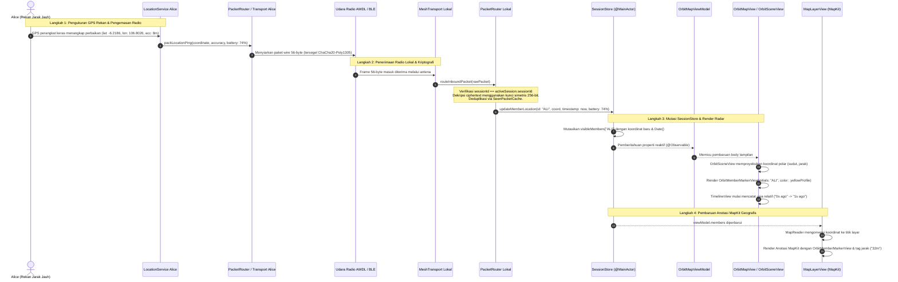

# Volume 09: Feature Map, Orbit Canvas & Geographic Overlays (Meepo)

## Ringkasan Eksekutif & Gambaran Umum Sistem

Volume 09 merinci subsistem kesadaran spasial, overlay geografis real-time, kanvas radar Orbit interaktif, inspeksi daftar anggota, negosiasi koordinat titik pertemuan MapKit, dan pengaturan diagnostik jaringan pada platform jaringan mesh Meepo. Dirancang untuk zona bencana off-grid dan ekspedisi alam liar terpencil—di mana menara seluler komersial, daya kota, dan tile peta berbasis web tradisional telah gagal total—subsistem peta menyajikan dua model spasial yang berbeda dan saling melengkapi bagi petugas penyelamat dan penyintas:

1. **Kanvas Radar Orbit Relatif (`OrbitMapView`, `OrbitSceneView`, `OrbitUserMarkerView`, `OrbitMemberMarkerView`):** Radar kompas relatif true-black AMOLED yang memetakan rekan sebagai vektor koordinat sudut relatif terhadap posisi fisik dan arah hadap (heading) pengguna saat ini. Alih-alih memerlukan unduhan tile vektor yang berat melalui jaringan seluler, radar Orbit memproyeksikan rekan ke cincin jarak konsentris menggunakan ping lokasi radio peer-to-peer yang diterima secara lokal.
2. **Overlay MapKit Geografis (`MainMapView`, `MapLayerView`, `MapPointPinView`):** Antarmuka Apple MapKit standar yang dikonfigurasi untuk koordinasi titik pertemuan (rendezvous) kelompok darurat. Ini memungkinkan pembuat grup dan anggota untuk mengusulkan, meninjau, dan mengonfirmasi titik pertemuan fisik (misalnya "Gate 2" atau "Sound Booth") melalui interaksi peta tekan lama (long-press), memberikan konteks geografis dan citra satelit yang di-cache secara offline jika tersedia.

Beroperasi tanpa server cloud atau infrastruktur stasiun pangkalan memerlukan disiplin perangkat keras dan baterai yang ketat:
- **Penghematan Daya True-Black AMOLED:** Kanvas dasar dirender dalam `#000000`, mematikan piksel OLED dan mengurangi konsumsi daya layar hingga 60%.
- **Degradasi Pin yang Jujur (Honest Pin Degradation):** Daripada menginterpolasi atau mengarang koordinat palsu ketika radio rekan berada di luar jangkauan, pin terdegradasi secara jujur melintasi ambang waktu terverifikasi: segar (<60 detik), basi (1–5 menit), dan kontak hilang (>5 menit).
- **Detak Garis Waktu Independen Sub-Detik:** Label usia relatif (`"25s ago"`, `"2m ago"`) digerakkan oleh wadah `TimelineView` SwiftUI yang terisolasi, memisahkan pembaruan UI 1 detik dari loop rendering kanvas peta utama.
- **Perlindungan Tekan Lama Stasioner 0,7 Detik:** Menjatuhkan pin pertemuan memerlukan penahanan berkelanjutan selama 0,7 detik dengan umpan balik haptik, mencegah gestur geser (pan) memindahkan titik pertemuan secara tidak sengaja.

---

### Gambaran Tingkat Tinggi (ELI5): Radar Pencarian Taktis & Titik Kumpul Triase

Bayangkan regu pencarian dan penyelamatan perkotaan yang menavigasi zona bencana yang gelap gulita dan dipenuhi debu di mana bangunan telah runtuh dan infrastruktur seluler mati:

1. **Radar Night-Vision AMOLED (Layar Orbit):** Saat Anda melihat ponsel Anda, layarnya benar-benar hitam pekat seperti kacamata night-vision taktis (`AMOLED #000000`) untuk melindungi penglihatan yang beradaptasi dengan kegelapan dan menghemat daya. Di tengahnya terdapat titik bercahaya dengan kerucut arah yang menunjukkan orientasi hadap Anda (`OrbitUserMarkerView`). Diposisikan pada cincin jarak konsentris (15m, 30m, 45m, 60m) adalah titik tanda panggilan berkode warna yang mewakili anggota regu Anda.
2. **Jam Tangan yang Jujur (Kebasian Pin & Memudar):** Di bawah penanda tanda panggilan Alice terdapat label waktu yang telah berlalu: *"12s ago"*. Selama perangkatnya mentransmisikan telemetri radio, penandanya menyala terang. Jika Alice memasuki ruang bawah tanah beton yang runtuh dan sinyalnya memudar, penandanya tidak menghilang, begitu pula ponsel Anda tidak mengarang jejak hantu. Penandanya memudar lembut hingga opasitas 70%, dan pengatur waktu berdetak: *"2m ago"*, *"4m ago"*. Jika 5 menit berlalu tanpa sinyal, sebuah peringatan memberi tahu Anda: *"Lost radio contact with ALI"*. Sistem tidak pernah menampilkan posisi yang dikarang.
3. **Bendera Kumpul Triase (Peta Pertemuan):** Ketika Komandan Insiden menetapkan titik kumpul darurat atau rumah sakit lapangan, mereka mengetuk tombol peta satelit (`MainMapView`). Menekan lama pada zona pendaratan helikopter terbuka selama hampir satu detik memicu ketukan haptik yang tegas. Bendera titik arah kuning berkontras tinggi muncul berlabel *"Evac LZ Alpha"*. Permintaan konfirmasi muncul di perangkat tim: *"Rendezvous Set by DAF! Confirm attendance?"*. Mengetuk *"Confirm"* menambatkan titik arah emas pada kanvas radar taktis semua orang.

---

## Panduan Desain dan UX (Tanpa Kode)

Pengalaman peta dan radar Meepo menyeimbangkan keterbacaan visual langsung di bawah sinar matahari cerah dengan konservasi baterai yang ketat. Aturan desain berikut memandu semua presentasi spasial dan overlay:

### Alur Perjalanan Pengguna dan Status Layar

```
+-------------------------------------------------------------------------------+
|                       PERJALANAN PENGGUNA PETA & RADAR                        |
+-------------------------------------------------------------------------------+
|                                                                               |
|  [Kanvas Radar Orbit] ----> [Target Rekan] --------> [Radar Pencari Rekan]    |
|  Hitam Pekat AMOLED         Perluas Kerucut Visi     Kompas Arah              |
|                                                                               |
|            |                                              |                   |
|            v                                              v                   |
|                                                                               |
|  [Tarik Pegangan Atas] ---> [Lembar Daftar Rekan] -> [Kontak Anggota Hilang]  |
|  Pegangan Crest (176pt)     Kisi Pencarian Inisial   "Lost contact with NIC"  |
|                                                                               |
|            |                                                                  |
|            v                                                                  |
|                                                                               |
|  [Ketuk Ikon Peta] -------> [Peta Titik Kumpul] ---> [Tahan 0,7s Taruh Pin]   |
|  Tombol Header Atas         Satelit / Hibrida        Bendera Emas Rapat       |
|                                                                               |
+-------------------------------------------------------------------------------+
```

Pengguna berinteraksi dengan subsistem peta di lima status layar operasional utama:

1. **Status 1: Kanvas Orbit Relatif (Pengalaman Default):**
   - **Tampilan Visual:** Seluruh latar belakang dirender dalam warna hitam pekat (`#000000`), menonaktifkan sepenuhnya piksel tampilan organik pada layar OLED iPhone.
   - **Retikel Pengguna Tengah:** Cakram melingkar 30 poin dalam warna identitas pribadi pengguna, dilapisi dengan panah kompas terarah yang berputar mulus agar sesuai dengan orientasi perangkat.
   - **Cincin Pin Rekan:** Rekan diposisikan secara polar-radial pada cincin jarak konsentris (misalnya 25m, 50m, 100m). Pin menampilkan inisial rekan, warna identitas, dan kilau denyut opsional.
   - **Kunci Target:** Mengetuk pin rekan atau titik pertemuan mana pun akan mengunci target. Kerucut hadap pengguna mengembang dari 90 poin menjadi 120 poin, secara visual mengorientasikan pengguna di sepanjang garis bantalan langsung.

2. **Status 2: Berbagi Langsung AKTIF vs. NONAKTIF ("Mode Hantu"):**
   - **Berbagi Langsung = AKTIF:** Pengguna lokal menyiarkan ping lokasi setiap 5 hingga 60 detik (diatur oleh kecepatan adaptif dan status baterai, Volume 06). Rekan grup melihat pin pengguna bergerak mulus di layar mereka.
   - **Berbagi Langsung = NONAKTIF ("Mode Hantu"):** Dapat dikonfigurasi di `OrbitSettingsView`. Saat dimatikan, perangkat pengguna berhenti mentransmisikan ping lokasi keluar. Namun, radio **terus mendengarkan ping masuk dari rekan**. Pengguna masih dapat melihat semua anggota grup di radar mereka, sementara mereka sendiri muncul sebagai pin yang memudar atau offline di layar rekan-rekan mereka.
   - **Override Darurat:** Jika pengguna memicu SOS Darurat, Berbagi Langsung **seketika diabaikan (bypassed)**; koordinat GPS teranyar segera disiarkan ke rekan penyelamat.

3. **Status 3: Pin Segar vs. Basi vs. Offline ("Degradasi Pin yang Jujur"):**
   - **Segar (< 60s):** Opasitas penuh 100%, goresan identitas yang cerah (`MemberColor.swiftUIColor`), penghitung waktu detik langsung (`"14s ago"`).
   - **Basi (1m hingga 5m):** Opasitas turun menjadi 70%, pengatur waktu relatif bergeser ke menit (`"2m ago"`, `"4m ago"`), memperingatkan pengguna bahwa rekan mungkin telah bergerak sejak paket terakhir diterima.
   - **Kontak Hilang / Offline (> 5m):** Jika tidak ada paket yang tiba selama 5 menit, pin berubah menjadi abu-abu. Pil pemberitahuan sistem muncul di bagian atas radar: `"Lost contact with [INITIALS]"`, dan peristiwa bertanda waktu dicatat dalam log aktivitas grup.

4. **Status 4: Lembar Geser Daftar Anggota:**
   - **Interaksi Pegangan:** Mengetuk atau menggeser ke atas pada pegangan lengkung bawah (`OrbitPanelShape`) akan membuka daftar regu (`FriendListSheet`).
   - **Pencarian Inisial & Tambah Rekan:** Menyertakan bilah pencarian langsung yang mencocokkan inisial yang diketik (misalnya, `"DA"` cocok dengan `"DAF"`) dan tombol pintasan untuk menampilkan kode QR pemasangan kamp.
   - **Lencana Anggota:** Menampilkan kisi adaptif avatar melingkar 60 poin. Mengetuk avatar apa pun akan menutup lembar dan memusatkan radar pada rekan tersebut.

5. **Status 5: Overlay Titik Kumpul MapKit:**
   - **Navigasi:** Mengetuk tombol peta di bilah navigasi atas akan membuka peta geografis layar penuh (`MainMapView`).
   - **Lapisan Peta:** Mendukung peta jalan vektor 2D standar dan citra satelit udara resolusi tinggi (`.hybrid(elevation: .flat)`).
   - **Menaruh Pin:** Menekan dan menahan tanpa bergerak pada landmark mana pun selama 0,7 detik akan menaruh pin titik pertemuan berwarna emas (`MapPointPinView`), meminta anggota grup untuk melakukan konfirmasi RSVP kehadiran.

---

### "Mengapa Kita Tidak Bisa Langsung...?" (Batasan untuk Desainer)

Perancang produk dan peneliti UI sering kali menyarankan perilaku peta konsumen yang sudah dikenal. Tabel berikut menjelaskan mengapa pola-pola ini dilarang keras oleh rekayasa sistem mesh off-grid:

| "Mengapa Kita Tidak Bisa Langsung...?" | Realitas Teknis & Platform | Perilaku Desain yang Diizinkan |
| :--- | :--- | :--- |
| **Mengapa kita tidak menginterpolasi atau menganimasikan rekan yang berjalan mulus di antara ping?** | Ping radio di sektor bencana yang kacau tiba secara tidak teratur (setiap 5 hingga 60 detik) karena atenuasi struktural. Mengarang jalur berjalan mulus menciptakan "jejak hantu" di mana petugas penyelamat mungkin bernavigasi menuju posisi terinterpolasi hanya untuk menabrak dinding yang runtuh atau lubang runtuhan dalam. Dalam keadaan darurat, perkiraan lokasi yang salah bisa berakibat fatal. | Pertahankan pin terpaku secara ketat pada koordinat GPS fisik terakhir yang diverifikasi. Pudarkan opasitas pin menjadi 70% setelah 60 detik dan tampilkan label usia relatif yang jujur (`"2m ago"`). |
| **Mengapa kita tidak menggunakan latar belakang abu-abu gelap (`#1C1C1E`) daripada hitam pekat (`#000000`)?** | iPhone modern menggunakan layar Super Retina OLED di mana piksel individu memancarkan cahayanya sendiri. Piksel abu-abu gelap masih menarik daya baterai yang signifikan. Hitam pekat (`#000000`) secara fisik mematikan LED organik, memangkas konsumsi daya layar hingga 60% di bawah sinar matahari luar ruangan yang terang. | Render latar belakang fondasi secara ketat dalam `#000000` (`Color.black.ignoresSafeArea()`). Gunakan kartu abu-abu halus (`Color.blackCard`) hanya untuk kontrol mengambang interaktif. |
| **Mengapa ketukan tunggal tidak bisa menjatuhkan titik pertemuan di peta?** | Petugas penyelamat luar ruangan dan penyintas menggeser, mencubit, dan memperbesar peta dengan jari basah atau berkeringat saat berjalan melewati kerumunan. Penempatan pin ketukan tunggal menghasilkan lusinan pergeseran titik temu yang tidak disengaja, membanjiri radio grup dengan paket pembaruan yang tidak perlu. | Wajibkan penahanan diam selama 0,7 detik secara terus-menerus (`LongPressGesture(minimumDuration: 0.7)`) disertai dengan denyut haptik sedang sebelum menjatuhkan pin kandidat. |
| **Mengapa Berbagi Langsung = NONAKTIF tidak mematikan sepenuhnya semua layanan GPS dan radio?** | Jika mematikan berbagi lokasi membunuh penerimaan radio, pengguna akan kehilangan kemampuan untuk melihat rekan mereka atau menerima peringatan SOS darurat. Selain itu, mematikan warm-start GPS mencegah penangkapan lokasi cepat jika terjadi keadaan darurat tiba-tiba. | "Mode Hantu" menghentikan ping lokasi keluar sambil mempertahankan penerimaan radio masuk dan cache GPS latar belakang tetap hangat. SOS Darurat segera mengesampingkan Mode Hantu. |

---

### Token Desain yang Bebas Diubah vs. Aturan Rekayasa yang Terkunci

Untuk mempertahankan integritas arsitektural jaringan mesh sambil memberi desainer produk fleksibilitas visual, parameter diklasifikasikan secara ketat menjadi token yang dapat diedit dan aturan rekayasa yang terkunci:

```
+-------------------------------------------------------------------------------+
|                       TOKEN DESAIN VS. ATURAN REKAYASA                        |
+-------------------------------------------------------------------------------+
|  TOKEN DESAIN YANG BEBAS DIUBAH (Aman Disesuaikan)                            |
|  - Palet Warna Inisial Profil Anggota (MemberColor.swiftUIColor)              |
|  - Parameter Lengkung Crest Kustom (OrbitPanelShape radius, crestHeight/Width)|
|  - Ikon & Warna Tint Pin Titik Pertemuan (MapPointPinView Color.buttonPrimary)|
|  - Ukuran Tombol Aksi Mengambang (Kapsul kaca melingkar 48x48pt)              |
|  - Tipografi Judul Header Atas (Helvetica tebal 20pt)                         |
+-------------------------------------------------------------------------------+
|  ATURAN REKAYASA TERKUNCI (Dilarang Diubah Tanpa Izin Arsitek Sistem)         |
|  - Persyaratan Latar Belakang Hitam Pekat AMOLED (Color.black.ignoresSafeArea)|
|  - Ambang Batas 60s Basi & 5 Menit Kontak Hilang (Degradasi Pin yang Jujur)   |
|  - Ambang Penahanan Diam 0,7 Detik untuk Penempatan Pin MapKit                |
|  - Isolasi TimelineView Sub-Detik (Nol invalidasi tampilan global)            |
|  - Pengabaian Tanpa Syarat SOS Darurat terhadap Pengaturan Berbagi Langsung   |
|  - Sifat Saling Eksklusif Lembar Modal melalui Enum OrbitModal                |
+-------------------------------------------------------------------------------+
```

---

## Analisis Rekayasa Teknis Mendalam

Bagian ini menyediakan analisis arsitektural komprehensif tingkat kode dari Volume 09. Bagian ini dimulai dengan penelusuran end-to-end langkah demi langkah, menyajikan inventaris berkas sumber terverifikasi, merinci diagram state machine dan protokol spasial inti, serta mengulas setiap berkas sumber secara mendalam.

---

### Alur End-to-End: Dari Ping Radio Rekan hingga Pin Peta & Kerucut Visi

Diagram urutan dan penelusuran berikut mengikuti siklus hidup teknis lengkap dari pembaruan lokasi: dari pengukuran satelit GPS fisik pada ponsel rekan, melintasi mesh radio, hingga rendering visual pada radar Orbit pengguna lokal dan lapisan MapKit geografis:



---

### Berkas Sumber yang Disertakan

Sebanyak 16 berkas sumber Swift berikut merupakan implementasi lengkap dari Volume 09:

| # | Tautan Berkas Relatif | Jumlah Baris Persis (`wc -l`) | Target / Kategori | Tujuan & Tanggung Jawab Arsitektural |
| :-: | :--- | :-: | :--- | :--- |
| 1 | [`OrbitModal.swift`](../../Teekum/Teekum/Features/OrbitMap/Models/Enums/OrbitModal.swift) | 16 | Main App / Model | Enum status presentasi modal untuk layar Orbit (friends, mapPoint, settings, invite, finder). |
| 2 | [`FriendListViewModel.swift`](../../Teekum/Teekum/Features/OrbitMap/ViewModels/FriendListViewModel.swift) | 40 | Main App / ViewModel | ViewModel teramati yang mengelola daftar anggota, penyaringan pencarian, dan pemformatan usia lokasi relatif. |
| 3 | [`OrbitMapViewModel.swift`](../../Teekum/Teekum/Features/OrbitMap/ViewModels/OrbitMapViewModel.swift) | 34 | Main App / ViewModel | ViewModel teramati yang menggerakkan judul layar Orbit, resolusi warna profil identitas, dan delegasi pembongkaran. |
| 4 | [`FriendListMemberView.swift`](../../Teekum/Teekum/Features/OrbitMap/Views/Components/FriendListMemberView.swift) | 95 | Main App / View | Komponen baris daftar yang menampilkan inisial rekan, warna identitas, denyut darurat, dan usia TimelineView terisolasi. |
| 5 | [`OrbitControlsView.swift`](../../Teekum/Teekum/Features/OrbitMap/Views/Components/OrbitControlsView.swift) | 99 | Main App / View | Dok kontrol bawah mengambang yang menampilkan pemicu geser SOS, pegangan seret crest, dan tombol obrolan kaca dengan lencana. |
| 6 | [`OrbitHeaderView.swift`](../../Teekum/Teekum/Features/OrbitMap/Views/Components/OrbitHeaderView.swift) | 51 | Main App / View | Bilah navigasi atas yang menyajikan nama sesi grup, pintasan roda gigi pengaturan, dan tombol peta pertemuan. |
| 7 | [`OrbitMarkerMemberView.swift`](../../Teekum/Teekum/Features/OrbitMap/Views/Components/OrbitMarkerMemberView.swift) | 82 | Main App / View | Pin kanvas yang merender warna rekan, bayangan mekar (bloom), tooltip inisial, dan lencana persentase baterai lemah. |
| 8 | [`OrbitPanelShape.swift`](../../Teekum/Teekum/Features/OrbitMap/Views/Components/OrbitPanelShape.swift) | 106 | Main App / Shape | Shape vektor 2D matematis kustom yang menggambar panel latar belakang area bencana melengkung dengan kubah Bezier kubik tengah. |
| 9 | [`OrbitUserMarkerView.swift`](../../Teekum/Teekum/Features/OrbitMap/Views/Components/OrbitUserMarkerView.swift) | 62 | Main App / View | Penanda lokasi pengguna lokal pada kanvas Orbit yang merender kerucut visi hadap kompas dinamis dan lencana "YOU". |
| 10 | [`FriendListSheet.swift`](../../Teekum/Teekum/Features/OrbitMap/Views/FriendListSheet.swift) | 194 | Main App / View | Lembar bawah modal yang menampilkan kisi avatar anggota adaptif, bilah pencarian inisial, dan tindakan Keluar Grup. |
| 11 | [`OrbitFeedbackView.swift`](../../Teekum/Teekum/Features/OrbitMap/Views/OrbitFeedbackView.swift) | 80 | Main App / View | Tumpukan spanduk pemberitahuan mengambang yang menyajikan peringatan SOS masuk, peringatan Man Down, dan toast obrolan. |
| 12 | [`OrbitMapView.swift`](../../Teekum/Teekum/Features/OrbitMap/Views/OrbitMapView.swift) | 294 | Main App / View | Tampilan wadah area bencana primer yang menampung kanvas hitam pekat, pemandangan radar, header, kontrol mengambang, dan modal. |
| 13 | [`OrbitSettingsView.swift`](../../Teekum/Teekum/Features/OrbitMap/Views/OrbitSettingsView.swift) | 214 | Main App / View | Lembar kokpit diagnostik yang menampilkan sakelar Berbagi Langsung, mode relai, riwayat kontak hilang, dan log paket langsung. |
| 14 | [`MainMapView.swift`](../../Teekum/Teekum/Features/MeetingPoint/Views/MainMapView.swift) | 105 | Main App / View | Lembar MapKit layar penuh yang menampung penempatan titik pertemuan, peringatan tinjauan, konfirmasi berhenti, dan dialog RSVP anggota. |
| 15 | [`MapLayerView.swift`](../../Teekum/Teekum/Features/MeetingPoint/Views/Components/MapLayerView.swift) | 197 | Main App / View | Lapisan MapKit yang merender pin penyelamat, tag jarak, pengalih satelit, dan penempatan pin tahan diam 0,7 detik. |
| 16 | [`MapPointPinView.swift`](../../Teekum/Teekum/Features/MeetingPoint/Views/Components/MapPointPinView.swift) | 51 | Main App / View | Pin anotasi MapKit kustom yang merender penanda lokasi titik pertemuan dengan kapsul judul emas dan jangkar tanah. |
| **Total** | **Semua Berkas Volume 09** | **1.720** | **16 Berkas Sumber Swift** | **Cakupan Komprehensif 100%** |

---

### Diagram Status Peta & Rendering Spasial

#### 1. Arsitektur Presentasi Spasial Ganda
Diagram di bawah merinci pembagian kerja sama antara mesin radar Orbit relatif dan pemetaan MapKit geografis:

```
+---------------------------------------------------------------------------------------+
|                       ARSITEKTUR PRESENTASI SPASIAL GANDA                             |
+-------------------------------------------+-------------------------------------------+
|  RADAR ORBIT RELATIF (OrbitMapView)       |  MAPKIT GEOGRAFIS (MainMapView)           |
+-------------------------------------------+-------------------------------------------+
| - Kanvas Daya Hitam Pekat AMOLED #000000  | - iOS 17 MapKit (Map + MapReader)         |
| - Cincin Jarak Koordinat Polar            | - Standar 2D Datar & Hibrida Satelit      |
| - Nol Beban Tile Peta Jaringan Seluler    | - Garis Lintang/Bujur Dunia Nyata Geografis|
| - Kerucut Visi Arah Dinamis (CoreMotion)  | - Label Jarak Lingkaran Besar (e.g. 48m)  |
| - Pelacakan Rekan Frekuensi Tinggi (Off)  | - Penempatan Pin Tekan Lama 0,7 Detik     |
+-------------------------------------------+-------------------------------------------+
                     |                                           |
                     +---------------------+---------------------+
                                           v
                       +---------------------------------------+
                       | SessionStore (@MainActor / Singleton) |
                       | - visibleMembers: [Member]            |
                       | - activeMeetingPoint: MeetingPoint?   |
                       | - memberContactLog: [ContactLoss]     |
                       +---------------------------------------+
```

#### 2. Mesin Status Presentasi Modal
Diagram status di bawah merinci bagaimana enum `OrbitModal` secara ketat mengatur overlay layar:

```
+---------------------------------------------------------------------------------------+
|                    MESIN STATUS PRESENTASI MODAL ORBIT                                |
+---------------------------------------------------------------------------------------+
|                                                                                       |
|                               +------------------+                                    |
|                               |  activeModal =   |                                    |
|                               |       nil        | <---+                              |
|                               +--------+---------+     |                              |
|                                        |               |                              |
|         +-----------------+------------+-----------+---+----------------+             |
|         |                 |                        |                    |             |
|         v                 v                        v                    v             |
|   +-----------+     +-----------+            +-----------+        +-----------+       |
|   |  .friends |     | .mapPoint |            | .settings |        |  .invite  |       |
|   | (Lembar   |     | (Lembar   |            | (Relai &  |        | (Kode QR  |       |
|   |  Daftar)  |     |  MapKit)  |            |  Paket)   |        |   Kamp)   |       |
|   +-----+-----+     +-----+-----+            +-----+-----+        +-----+-----+       |
|         |                 |                        |                    |             |
|         +-----------------+------------+-----------+--------------------+             |
|                                        v                                              |
|                               +------------------+                                    |
|                               |   .finder(id)    |                                    |
|                               | (Radar Kompas)   |                                    |
|                               +------------------+                                    |
|                                                                                       |
+---------------------------------------------------------------------------------------+
```

---

## Pembahasan Mendalam Berkas demi Berkas (Tanpa Berkas yang Terlewat)

### 1. `Teekum/Teekum/Features/OrbitMap/Models/Enums/OrbitModal.swift`
- **Path Berkas**: [`../../Teekum/Teekum/Features/OrbitMap/Models/Enums/OrbitModal.swift`](../../Teekum/Teekum/Features/OrbitMap/Models/Enums/OrbitModal.swift)
- **Jumlah Baris**: 16 baris (`wc -l`)
- **Konkurensi & Domain Target**: Target Aplikasi Utama (`Teekum`), `enum OrbitModal: Identifiable, Hashable`

#### Apa yang Dilakukan Berkas Ini
`OrbitModal.swift` mendefinisikan state machine presentasi modal terpadu untuk layar peta area bencana Orbit utama. Berkas ini memodelkan lima tujuan lembar dan layar penuh yang saling eksklusif yang dapat disajikan di atas kanvas radar langsung: lembar daftar rekan (`.friends`), pemilih titik pertemuan MapKit (`.mapPoint`), pengaturan sistem dan kokpit diagnostik (`.settings`), lembar undangan kode QR grup (`.invite`), dan radar kompas pencari rekan (`.finder(String)`).

#### Analogi ELI5
Bayangkan konsol operasi utama pada kendaraan pencarian dan penyelamatan. Operator memiliki lima panel pop-up taktis: satu membuka daftar nama regu (`friends`), satu membuka peta evakuasi satelit dan triase (`mapPoint`), satu membuka diagnostik komunikasi (`settings`), satu membuka kredensial penempatan regu (`invite`), dan satu membuka radar terarah presisi tinggi yang terkunci pada petugas yang hilang tertentu (`finder`). Hanya satu panel yang dapat aktif pada satu waktu untuk mencegah menutupi peta taktis. `OrbitModal` adalah sakelar pemilihan 5 panel tersebut.

#### Definisi Istilah Teknis
- **Status Modal Teridentifikasi (Identifiable Modal State)**: Mengadopsi `Identifiable` dengan `var id: Self { self }` memungkinkan integrasi mulus dengan pengubah `.sheet(item:)` dan `.fullScreenCover(item:)` SwiftUI, menjamin bahwa transisi modal didorong secara deterministik oleh status alih-alih beberapa Boolean yang terpisah.
- **Navigasi Nilai Terkait (`.finder(String)`)**: Menyimpan pengidentifikasi target kontekstual (ID anggota rekan) secara langsung di dalam kasus enum, memastikan deep-linking langsung ke tampilan yang ditargetkan tanpa kebocoran status global.
- **Presentasi Saling Eksklusif (Mutually Exclusive Presentation)**: Membatasi overlay UI ke satu kasus aktif tunggal, mencegah lonjakan memori dan konflik rendering dari tumpukan lembar tembus cahaya di atas loop radar frekuensi tinggi.

#### Walkthrough Blok Kode dan Baris demi Baris
Seluruh berkas 16 baris disusun sebagai berikut:
```swift
// Lines 1-16: Definisi lengkap OrbitModal
//
//  OrbitModal.swift
//  Teekum
//
//  Created by DIMAS DAFFA ERNANDA on 08/11/26.
//

enum OrbitModal: Identifiable, Hashable {
    case friends
    case mapPoint
    case settings
    case invite
    case finder(String)

    var id: Self { self }
}
```
- Baris 8: Mendeklarasikan `OrbitModal` yang mengadopsi `Identifiable` dan `Hashable`.
- Baris 9 (`friends`): Menyajikan `FriendListSheet`, menampilkan daftar anggota, riwayat kehilangan kontak, dan bilah pencarian.
- Baris 10 (`mapPoint`): Menyajikan `MainMapView`, lapisan MapKit layar penuh untuk penempatan titik pertemuan.
- Baris 11 (`settings`): Menyajikan `OrbitSettingsView`, lembar diagnostik yang berisi sakelar Berbagi Langsung, mode relai, dan log paket.
- Baris 12 (`invite`): Menyajikan `GroupQRCodeView`, memungkinkan rekan di sekitar memindai kode QR grup.
- Baris 13 (`finder(String)`): Membawa string ID rekan target, menyajikan radar kompas layar penuh `FriendFinderView`.
- Baris 15 (`var id: Self { self }`): Memenuhi persyaratan protokol `Identifiable` dengan mengembalikan dirinya sendiri, memungkinkan SwiftUI mengidentifikasi perubahan modal secara unik.

#### Rationale Rekayasa dan Kasus Batas (Edge Cases)
- **Eliminasi Ledakan Status Boolean**: Pada prototipe awal, setiap modal dilacak melalui Boolean independen (`@State var showFriends = false`, `@State var showSettings = false`). Hal ini sering menyebabkan race condition presentasi di mana menutup satu modal saat membuka modal lain menyebabkan crash presentasi UIKit iOS. Enum menjamin bahwa tepat nol atau satu modal yang ditampilkan.
- **Perutean Tautan Dalam (Deep Link Routing)**: Di `OrbitMapView.swift`, deep link yang tiba dari widget Layar Terkunci atau peringatan push (misalnya, `teekum://sos?id=NIC`) secara langsung menetapkan `activeModal = .finder("NIC")` atau `activeModal = .mapPoint`, merutekan pengguna dalam satu penugasan atomik.

---

### 2. `Teekum/Teekum/Features/OrbitMap/ViewModels/FriendListViewModel.swift`
- **Path Berkas**: [`../../Teekum/Teekum/Features/OrbitMap/ViewModels/FriendListViewModel.swift`](../../Teekum/Teekum/Features/OrbitMap/ViewModels/FriendListViewModel.swift)
- **Jumlah Baris**: 40 baris (`wc -l`)
- **Konkurensi & Domain Target**: Target Aplikasi Utama (`Teekum`), `@MainActor @Observable final class FriendListViewModel`

#### Apa yang Dilakukan Berkas Ini
`FriendListViewModel.swift` mengelola presentasi dan status penyaringan pencarian untuk lembar daftar anggota kelompok area bencana (`FriendListSheet`). Berkas ini mengikat langsung ke `SessionStore` untuk mengekstrak anggota kelompok yang terlihat, menerapkan pemfilteran inisial yang tidak peka huruf besar-kecil terhadap input pencarian pengguna, dan menyediakan pemformat statis terpusat yang tahan kerusakan untuk menghitung string usia lokasi yang dapat dibaca manusia (`"14s ago"`, `"3m ago"`).

#### Analogi ELI5
Bayangkan petugas logistik regu pencari memegang papan daftar taktis aktif. Ketika pemimpin regu bertanya, "Bagaimana status Petugas Medis Nic?", daftar memfilter ke tanda panggilan "NIC", menunjukkan jarak, cadangan baterai, dan timestamp terakhir terlihat ("Melihat suar 20s yang lalu"). Jika perbaikan GPS basi atau rusak, sistem menampilkan "Unavailable" daripada menyesatkan tim pencari dengan perkiraan yang dibuat-buat. `FriendListViewModel` adalah manajer daftar taktis tersebut.

#### Definisi Istilah Teknis
- **Kerangka Kerja Observasi (`@Observable`)**: Makro observasi Swift 5.9+ yang mendaftarkan pembacaan properti selama evaluasi tampilan SwiftUI, memicu pembaruan tampilan hanya ketika properti yang diakses (`searchQuery`, `filteredMembers`) bermutasi.
- **Penyaringan Substring Case-Insensitive (`localizedCaseInsensitiveContains`)**: Mencocokkan kueri pencarian pengguna dengan inisial anggota terlepas dari input keyboard huruf besar atau huruf kecil (misalnya, mengetik `"da"` cocok dengan `"DAF"`).
- **Penjagaan Interval Waktu (`age.isFinite, age >= 0, age < Double(Int.max)`)**: Pemeriksaan matematis defensif yang melindungi dari timestamp NaN, tak terbatas, negatif (clock-skew), atau overflow sebelum melakukan casting ke bilangan bulat detik.

#### Walkthrough Blok Kode dan Baris demi Baris
Baris 11–26 mendeklarasikan kelas, properti yang dapat diamati, dan perhitungan anggota yang difilter:
```swift
// Lines 11-26: Deklarasi FriendListViewModel dan penyaringan pencarian
@MainActor
@Observable
final class FriendListViewModel {
    private let sessionStore: SessionStore
    var searchQuery = ""

    var filteredMembers: [Member] {
        let search = searchQuery.trimmingCharacters(in: .whitespacesAndNewlines)
        let members = sessionStore.visibleMembers
        return search.isEmpty ? members : members.filter {
            $0.initials.localizedCaseInsensitiveContains(search)
        }
    }

    init(sessionStore: SessionStore) {
        self.sessionStore = sessionStore
    }
```
- Baris 11: Isolasi `@MainActor` menjamin bahwa mutasi input pencarian dan perhitungan ulang daftar anggota terjadi secara eksklusif pada thread UI utama.
- Baris 15: `var searchQuery = ""` menyimpan teks langsung yang dimasukkan di bilah pencarian.
- Baris 17–22: `filteredMembers` memangkas spasi dan melakukan pemeriksaan case-insensitive terhadap `member.initials`. Jika kueri kosong, mengembalikan semua `visibleMembers`.

Baris 28–39 mengimplementasikan logika pemformatan usia relatif yang kokoh:
```swift
// Lines 28-39: Perhitungan dan pemformatan usia lokasi
    static func locationAgeLabel(from date: Date, relativeTo now: Date) -> LocalizedStringResource {
        let age = now.timeIntervalSince(date)
        guard age.isFinite, age >= 0, age < Double(Int.max) else {
            return "Unavailable"
        }

        if age < 60 {
            return "\(Int(age))s ago"
        }
        return "\(Int(age / 60))m ago"
    }
}
```
- Baris 28–32: Menghitung `age = now.timeIntervalSince(date)`. Pernyataan `guard` memvalidasi bahwa `age` berhingga, non-negatif, dan cocok dalam batas integer; jika tidak, mengembalikan `"Unavailable"`.
- Baris 34–37: Memformat timestamp yang lebih muda dari 60 detik sebagai `X s ago` (misalnya `"14s ago"`) dan timestamp yang lebih lama sebagai `X m ago` (misalnya `"3m ago"`).

#### Rationale Rekayasa dan Kasus Batas (Edge Cases)
- **Pertahanan Kemiringan Jam dalam P2P Multi-Hop**: Di mesh off-grid, jam sistem perangkat tidak terkoordinasi dan dapat berbeda beberapa detik. Jika perangkat rekan memiliki jam yang diatur 5 detik di masa depan, `now.timeIntervalSince(date)` menghasilkan angka negatif (`-5.0`). Pemeriksaan `guard age >= 0` menangkap anomali ini dan menampilkan `"Unavailable"` daripada label yang tidak masuk akal seperti `"-5s ago"`.
- **Desain Pemformat Tanpa Status (Stateless Formatter)**: Dengan mengimplementasikan `locationAgeLabel` sebagai fungsi statis murni, fungsi ini dapat dipanggil dengan aman di dalam penutupan `TimelineView` tanpa menangkap siklus referensi view model atau menyebabkan masalah re-entrancy.

---

### 3. `Teekum/Teekum/Features/OrbitMap/ViewModels/OrbitMapViewModel.swift`
- **Path Berkas**: [`../../Teekum/Teekum/Features/OrbitMap/ViewModels/OrbitMapViewModel.swift`](../../Teekum/Teekum/Features/OrbitMap/ViewModels/OrbitMapViewModel.swift)
- **Jumlah Baris**: 34 baris (`wc -l`)
- **Konkurensi & Domain Target**: Target Aplikasi Utama (`Teekum`), `@MainActor @Observable final class OrbitMapViewModel`

#### Apa yang Dilakukan Berkas Ini
`OrbitMapViewModel.swift` adalah view model presentasi yang menggerakkan layar peta area bencana Orbit utama (`OrbitMapView`). Berkas ini menyediakan akses ke nama sesi grup aktif, menyelesaikan warna identitas profil khas pengguna lokal dari `SessionStore`, dan mengelola alur kerja pembongkaran grup saat pengguna memilih untuk keluar dari grup.

#### Analogi ELI5
Bayangkan kartu identifikasi misi taktis untuk regu pencarian dan penyelamatan Anda. Kartu ini menampilkan penetapan regu operasional (misalnya "Sector 4 SAR") dan warna tanda panggilan taktis pribadi Anda sehingga Anda tahu bagaimana penanda Anda dirender pada peta regu. Kartu ini juga dilengkapi tombol demobilisasi misi: mengetuknya akan mengatur ulang sesi penempatan Anda dengan bersih, menghapus kunci kriptografi lokal dari Keychain, dan mengembalikan perangkat ke layar pemasangan siaga. `OrbitMapViewModel` adalah kartu identifikasi taktis tersebut.

#### Definisi Istilah Teknis
- **Resolusi Warna Profil**: Mengekstrak warna anggota deterministik (`MemberColor`) berdasarkan inisial lokal pengguna dari sesi kriptografi aktif.
- **Nilai Standar Visual Cadangan**: Menyediakan token cadangan yang aman (misalnya `"Group Name"` dan `.sandrift`) saat tidak ada sesi aktif yang dimuat, mencegah kerusakan pratinjau kanvas SwiftUI.
- **Delegasi Callback Pembongkaran (`onLeaveGroup`)**: Memisahkan view model dari koordinator aplikasi yang mendasarinya dengan menerima penutupan opsional yang mengeksekusi reset sesi dan pop navigasi.

#### Walkthrough Blok Kode dan Baris demi Baris
Seluruh berkas 34 baris disusun sebagai berikut:
```swift
// Lines 1-34: Deklarasi lengkap OrbitMapViewModel
import Foundation
import Observation

@MainActor
@Observable
final class OrbitMapViewModel {
    let sessionStore: SessionStore
    private let onLeaveGroup: () -> Void

    var groupName: String {
        sessionStore.activeSession?.sessionName ?? "Group Name"
    }

    var localProfileColor: MemberColor {
        guard let session = sessionStore.activeSession else { return .sandrift }
        return sessionStore.profileColor(for: session.localInitials)
    }

    init(sessionStore: SessionStore, onLeaveGroup: (() -> Void)? = nil) {
        self.sessionStore = sessionStore
        self.onLeaveGroup = onLeaveGroup ?? sessionStore.resetSessionState
    }

    func leaveGroup() {
        onLeaveGroup()
    }
}
```
- Baris 7: `@MainActor @Observable final class OrbitMapViewModel` menandai kelas sebagai teramati dan terbatas pada thread utama.
- Baris 8: `let sessionStore: SessionStore` menyimpan dependensi session store yang disuntikkan.
- Baris 9: `private let onLeaveGroup: () -> Void` menyimpan penutupan pembongkaran.
- Baris 11–13 (`groupName`): Mengembalikan nama sesi aktif, atau `"Group Name"` jika nil.
- Baris 15–18 (`localProfileColor`): Menanyakan `sessionStore.profileColor(for: session.localInitials)`, kembali ke `.sandrift` jika belum dikonfigurasi.
- Baris 20–23 (`init`): Menginisialisasi dependensi, secara default `onLeaveGroup` ke `sessionStore.resetSessionState` jika tidak ada yang diberikan.
- Baris 25–27 (`leaveGroup`): Pemicu publik yang memanggil `onLeaveGroup()`.

#### Rationale Rekayasa dan Kasus Batas (Edge Cases)
- **Pemisahan Perhatian yang Ketat**: `OrbitMapViewModel` sengaja menghindari pengelolaan pembaruan lokasi, arah kompas, atau koneksi Bluetooth secara langsung. Tanggung jawab tersebut milik `LocationService` (Volume 06) dan `MeshTransport` (Volume 03). Menjaga view model ini sangat ringan (34 baris) mencegah riam rendering ulang tampilan pada pembaruan kompas frekuensi tinggi.
- **Stabilitas Pratinjau**: Menetapkan `localProfileColor` secara default ke `.sandrift` memastikan bahwa pratinjau SwiftUI di kanvas Xcode dapat merender `OrbitMapView` tanpa membuat sesi kriptografi langsung.

---

### 4. `Teekum/Teekum/Features/OrbitMap/Views/Components/FriendListMemberView.swift`
- **Path Berkas**: [`../../Teekum/Teekum/Features/OrbitMap/Views/Components/FriendListMemberView.swift`](../../Teekum/Teekum/Features/OrbitMap/Views/Components/FriendListMemberView.swift)
- **Jumlah Baris**: 95 baris (`wc -l`)
- **Konkurensi & Domain Target**: Target Aplikasi Utama (`Teekum`), `struct FriendListMemberView: View`, `@MainActor`

#### Apa yang Dilakukan Berkas Ini
`FriendListMemberView.swift` merender sel avatar anggota individual dalam kisi daftar kelompok area bencana (`FriendListSheet`). Sel ini menampilkan inisial anggota yang disanitasi dalam tipografi tebal yang terbungkus dalam cincin identitas melingkar berwarna, mengeksekusi fase cahaya berdenyut merah animasi selama peristiwa marabahaya darurat aktif, dan memanfaatkan `TimelineView` SwiftUI untuk mencatat timestamp relatif usia lokasi (`"25s ago"`, `"2m ago"`) setiap detik tanpa me-render ulang lembar induk.

#### Analogi ELI5
Bayangkan label nama melingkar yang dikenakan oleh masing-masing teman Anda di area bencana. Dalam kondisi normal, tag memiliki inisial mereka yang dicetak di tengah dan diuraikan dengan warna kamp yang ditetapkan untuk mereka. Jika teman Anda tersesat atau terluka dan menekan SOS, label nama mereka mulai berkedip merah terang seperti suar darurat mini. Di bawah label, jam digital kecil menghitung detik sejak ponsel mereka terakhir kali check-in dengan kamp Anda. `FriendListMemberView` adalah label nama tersebut.

#### Definisi Istilah Teknis
- **Pencatatan Garis Waktu Independen Sub-Detik (`TimelineView(.periodic)`)**: Wadah SwiftUI khusus yang mengevaluasi ulang penutupan anaknya sendiri secara ketat pada interval 1 detik berdasarkan jadwal periodik, sepenuhnya mengisolasi pembaruan timestamp frekuensi tinggi dari sisa hierarki tampilan.
- **Penskalaan Tipe Dinamis (`@ScaledMetric`)**: Menskalakan dimensi UI secara otomatis (seperti diameter avatar 60 poin) sebagai respons terhadap pengaturan ukuran teks Tipe Dinamis aksesibilitas iOS pengguna.
- **Sensitivitas Gerakan yang Dapat Diakses (`@Environment(\.accessibilityReduceMotion)`)**: Memeriksa pengaturan aksesibilitas sistem untuk menggantikan denyut opasitas animasi fase kontinu dengan batas darurat visibilitas tinggi statis saat pengguna mengaktifkan sensitivitas gerakan.

#### Walkthrough Blok Kode dan Baris demi Baris
Baris 10–61 membangun avatar, animasi darurat, dan label timeline periodik:
```swift
// Lines 10-44: Deklarasi FriendListMemberView dan penataan avatar
struct FriendListMemberView: View {
    let member: Member
    let color: Color
    @Environment(\.accessibilityReduceMotion) private var reduceMotion

    @ScaledMetric(relativeTo: .title2)
    private var avatarSize = 60

    var body: some View {
        VStack(spacing: 4) {
            Text(member.initials)
                .font(.custom("Helvetica-Bold", size: 22, relativeTo: .title2))
                .foregroundStyle(.white)
                .lineLimit(1)
                .minimumScaleFactor(0.6)
                .frame(width: avatarSize, height: avatarSize)
                .background {
                    if member.isEmergency {
                        if reduceMotion {
                            emergencyAvatar
                        } else {
                            emergencyAvatar.phaseAnimator([1.0, 0.55]) { avatar, opacity in
                                avatar.opacity(opacity)
                            } animation: { _ in .easeInOut(duration: 0.8) }
                        }
                    } else {
                        Circle().strokeBorder(color, lineWidth: 1)
                    }
                }
                .accessibilityValue(member.isEmergency ? Text("SOS active") : Text(""))
```
- Baris 18–25: Merender inisial tebal 22pt berwarna putih, diskalakan ke `avatarSize` (60pt).
- Baris 26–39: Jika `member.isEmergency`, memeriksa `reduceMotion`. Jika false, menggunakan `phaseAnimator` untuk mendenyutkan opasitas antara 1.0 dan 0.55 setiap 0,8 detik (`.easeInOut(duration: 0.8)`). Dalam kondisi normal, menggambar goresan melingkar berwarna 1pt yang bersih.

Baris 42–60 menyematkan `TimelineView` langsung:
```swift
// Lines 42-60: TimelineView efisiensi tinggi untuk usia lokasi
            if let date = member.measurementTimestamp {
                TimelineView(.periodic(from: date, by: 1)) { timeline in
                    let label = FriendListViewModel.locationAgeLabel(from: date, relativeTo: timeline.date)

                    Text(label)
                        .font(.caption2)
                        .foregroundStyle(.white)
                        .accessibilityLabel("Location age")
                        .accessibilityValue(Text(label))
                }
            }
        }
        .frame(maxWidth: .infinity)
        .accessibilityElement(children: .combine)
    }

    private var emergencyAvatar: some View {
        Circle()
            .inset(by: 3)
            .fill(Color.alertRed)
            .overlay {
                Circle().strokeBorder(Color.alertRed, lineWidth: 2)
            }
    }
}
```
- Baris 42–52: Jika `measurementTimestamp` ada, menjadwalkan `TimelineView(.periodic(from: date, by: 1))`. Pada setiap detak detik, memanggil `FriendListViewModel.locationAgeLabel`, memperbarui `"25s ago"` $\rightarrow$ `"26s ago"` tanpa overhead CPU pada tampilan induk.
- Baris 56–61: `emergencyAvatar` mengisi lingkaran dengan `Color.alertRed` padat yang dimasukkan sebesar 3pt, dilapisi dengan batas goresan merah darurat 2pt.

#### Rationale Rekayasa dan Kasus Batas (Edge Cases)
- **Optimalisasi Baterai melalui Invalidasi Terlokalisasi**: Pada implementasi awal, pengatur waktu global 1 detik pada `FriendListViewModel` memperbarui `@Published var currentTime = Date()`. Dalam kisi 12 anggota area bencana, hal ini memaksa seluruh kisi, bilah pencarian, dan lembar modal untuk menghitung ulang tata letak setiap detik, membuang-buang daya GPU dan baterai. Memindahkan detak ke dalam penutupan `TimelineView` yang terisolasi membatasi penggambaran ulang tampilan secara ketat pada label `Text` kecil.
- **Elemen Aksesibilitas Gabungan**: Baris 54 menerapkan `.accessibilityElement(children: .combine)`. VoiceOver membaca inisial anggota, status darurat, dan usia lokasi sebagai satu kalimat yang koheren (misalnya *"NIC, SOS active, Location age 25 seconds ago"*).

---

### 5. `Teekum/Teekum/Features/OrbitMap/Views/Components/OrbitControlsView.swift`
- **Path Berkas**: [`../../Teekum/Teekum/Features/OrbitMap/Views/Components/OrbitControlsView.swift`](../../Teekum/Teekum/Features/OrbitMap/Views/Components/OrbitControlsView.swift)
- **Jumlah Baris**: 99 baris (`wc -l`)
- **Konkurensi & Domain Target**: Target Aplikasi Utama (`Teekum`), `struct OrbitControlsView: View`, `@MainActor`

#### Apa yang Dilakukan Berkas Ini
`OrbitControlsView.swift` mengimplementasikan bilah kontrol bawah mengambang untuk layar utama area bencana. Komponen ini menyediakan tata letak kontrol horizontal tiga arah: di tepi depan, tombol SOS gesek ke atas yang disengaja (`SOSSwipeButtonView`); di tengah, pegangan geser berbentuk lambang crest (`OrbitPanelShape`) untuk memperluas lembar daftar rekan; dan di tepi belakang, tombol obrolan kaca bundar yang menampilkan lencana penghitung pesan belum dibaca secara real-time.

#### Analogi ELI5
Bayangkan konsol roda kemudi pada buggy off-road. Di paling kiri adalah klakson marabahaya darurat merah terang dengan kait pengaman geser. Tepat di tengah adalah pegangan dasbor melengkung yang dapat Anda tarik ke atas untuk memeriksa manifes penumpang kru Anda. Di paling kanan adalah tombol walkie-talkie dua arah dengan layar digital kecil yang menunjukkan berapa banyak pesan suara belum dibaca yang menunggu Anda. `OrbitControlsView` adalah dasbor bawah tersebut.

#### Definisi Istilah Teknis
- **Perlindungan Prioritas Tata Letak (`.layoutPriority(1)`)**: Menginstruksikan mesin tata letak SwiftUI untuk mengalokasikan ruang ke pegangan crest tengah terlebih dahulu, mencegah tombol tepi atau penskalaan tipe dinamis memampatkan atau mendistorsi zona interaksi tengah.
- **Ambang Batas Gestur Geser ke Atas**: Memerlukan translasi ke atas minimal 36 poin (`upwardDistance >= 36`) dan memverifikasi bahwa translasi vertikal melebihi translasi horizontal, mencegah gestur geser diagonal membuka lembar secara tidak sengaja.
- **Penataan Tombol Glassmorphic (`.buttonStyle(.glass)`)**: Menerapkan material kabur tembus cahaya (`.glassEffect`) ke kontrol interaktif melingkar, mempertahankan kontras di atas latar belakang peta yang bergerak sambil meminimalkan obstruksi layar.

#### Walkthrough Blok Kode dan Baris demi Baris
Baris 20–35 mengimplementasikan tombol pemicu SOS tepi depan:
```swift
// Lines 20-35: Pemicu SOS di tepi depan
        HStack(alignment: .bottom) {
            if isSOSActive {
                Text("SOS")
                    .font(.custom("Helvetica", size: 25, relativeTo: .title2).bold())
                    .foregroundStyle(.white)
                    .frame(width: 64, height: 64)
                    .background(Color.alertRed, in: .circle)
                    .glassEffect(.regular.tint(.alertRed), in: .circle)
                    .accessibilityLabel("SOS active")
            } else {
                SOSSwipeButtonView(onSwipeCompleted: onSOS)
                    .zIndex(1)
            }
        
            Spacer()
```
- Baris 21–28: Jika `isSOSActive == true`, merender lingkaran merah 64x64 bercahaya yang menampilkan teks `"SOS"`.
- Baris 29–32: Jika tidak, menyematkan `SOSSwipeButtonView`, membutuhkan gesekan ke atas 64pt yang disengaja untuk memicu marabahaya darurat.

Baris 36–68 mengimplementasikan pegangan panel crest tengah yang dapat diperluas:
```swift
// Lines 36-68: Pegangan lambang crest tengah yang dapat diperluas
            Button(action: onExpand) {
                Image(systemName: "chevron.up")
                    .font(.system(size: 30, weight: .semibold))
                    .offset(y:15)
                    .foregroundStyle(.secondary)
                    .frame(maxWidth: 176)
                    .frame(height: friendsPanelHeight)
                    .background {
                        OrbitPanelShape(
                            cornerRadius: 0,
                            crestHeight: nil,
                            crestWidth: 176
                        )
                        .fill(Color.blackCard)
                        .ignoresSafeArea(.container, edges: .bottom)
                        .allowsHitTesting(false)
                    }
                    .contentShape(.rect)
            }
            .buttonStyle(.plain)
            .layoutPriority(1)
            .accessibilityLabel("Open friends")
            .simultaneousGesture(
                DragGesture(minimumDistance: 20)
                    .onEnded { value in
                        let upwardDistance = -value.translation.height
                        if upwardDistance >= 36, upwardDistance > abs(value.translation.width) {
                            onExpand()
                        }
                    }
            )
            
            Spacer()
```
- Baris 36–54: Chevron panah atas (`chevron.up`) dibungkus dalam `OrbitPanelShape` yang diisi dengan `Color.blackCard`, mencakup lebar maksimum 176 poin.
- Baris 56–66: Menetapkan `.layoutPriority(1)`. Melampirkan `DragGesture(minimumDistance: 20)` yang memicu `onExpand()` saat `upwardDistance >= 36` dan pergerakan vertikal mendominasi pergerakan horizontal.

Baris 70–89 mengimplementasikan tombol obrolan grup tepi belakang dengan lencana belum dibaca:
```swift
// Lines 70-89: Tombol obrolan belakang dengan lencana jumlah belum dibaca
            Button(action: onChat) {
                Image(systemName: "message.fill")
                    .font(.system(size: 30, weight: .semibold))
            }
            .buttonStyle(.glass)
            .buttonBorderShape(.circle)
            .controlSize(.large)
            .accessibilityLabel("Open Group Chat")
            .accessibilityValue("\(unreadCount) unread messages")
            .overlay(alignment: .topTrailing) {
                if unreadCount > 0 {
                    Text("\(unreadCount)")
                        .font(.caption2.bold())
                        .padding(5)
                        .background(Color.alertRed, in: .circle)
                        .accessibilityHidden(true)
                }
            }
        }
```
- Baris 70–79: Tombol kaca bundar dengan ikon `message.fill`.
- Baris 80–88: Jika `unreadCount > 0`, melapisi jumlah tebal putih yang terbungkus dalam kapsul melingkar `Color.alertRed` di sudut kanan atas.

#### Rationale Rekayasa dan Kasus Batas (Edge Cases)
- **Pengenalan Ketukan dan Geseran Simultan**: Pegangan tengah mendukung ketukan sederhana (`Button(action: onExpand)`) dan jentikan ke atas fisik yang alami (`DragGesture`). Menggunakan `.simultaneousGesture` memastikan tidak ada gestur yang memblokir gestur lainnya.
- **Penjagaan Geseran Tidak Sengaja**: Baris 62 memeriksa `upwardDistance > abs(value.translation.width)`. Di lingkungan area bencana yang padat, geseran diagonal yang tidak disengaja di bagian bawah layar tidak akan membuka lembar teman secara keliru.

---

### 6. `Teekum/Teekum/Features/OrbitMap/Views/Components/OrbitHeaderView.swift`
- **Path Berkas**: [`../../Teekum/Teekum/Features/OrbitMap/Views/Components/OrbitHeaderView.swift`](../../Teekum/Teekum/Features/OrbitMap/Views/Components/OrbitHeaderView.swift)
- **Jumlah Baris**: 51 baris (`wc -l`)
- **Konkurensi & Domain Target**: Target Aplikasi Utama (`Teekum`), `struct OrbitHeaderView: View`, `@MainActor`

#### Apa yang Dilakukan Berkas Ini
`OrbitHeaderView.swift` mengimplementasikan bilah navigasi atas dari layar area bencana. Komponen ini menyediakan akses cepat ke pengaturan sistem dan diagnostik jaringan di tepi depan (`gearshape.fill`), menampilkan nama kelompok area bencana aktif dalam tipografi tebal di tengah, dan menyediakan pintasan langsung ke peta titik temu MapKit di tepi belakang (`map.fill`).

#### Analogi ELI5
Bayangkan bilah pelindung matahari di bagian atas kaca depan mobil Anda. Di sebelah kiri adalah tombol untuk membuka pengaturan kendaraan dan catatan diagnostik. Di tengah adalah label tim perjalanan Anda. Di sebelah kanan adalah tombol yang membuka peta jalan besar yang menunjukkan di mana semua orang setuju untuk bertemu. `OrbitHeaderView` adalah bilah pelindung atas tersebut.

#### Definisi Istilah Teknis
- **Jarak Tetap Bilah Atas (`HStack` dengan `Spacer()`)**: Menyeimbangkan secara simetris tombol tindakan belakang dan depan di sekitar string judul yang berada di tengah dan dipotong tanpa memerlukan perhitungan frame yang rumit.
- **Pemotongan Baris Tunggal (`.lineLimit(1)`)**: Menegakkan batasan teks baris tunggal yang ketat pada nama grup yang dibuat pengguna, mencegah nama panjang membungkus dan mendorong tombol navigasi keluar layar.
- **Tombol Melingkar Glassmorphic (`.buttonStyle(.glass)`, `.buttonBorderShape(.circle)`)**: Menstandardisasi tombol target sentuh minimum 44x44 melingkar dengan translusensi kaca kabur di seluruh aplikasi.

#### Walkthrough Blok Kode dan Baris demi Baris
Seluruh berkas 51 baris disusun sebagai berikut:
```swift
// Lines 10-47: Deklarasi lengkap OrbitHeaderView
struct OrbitHeaderView: View {
    let groupName: String
    let onOpenMap: () -> Void
    var onSettings: () -> Void = {}

    var body: some View {
        HStack {
            Button(action: onSettings) {
                Image(systemName: "gearshape.fill")
                    .font(.system(size: 30, weight: .semibold))
            }
            .buttonStyle(.glass)
            .buttonBorderShape(.circle)
            .controlSize(.large)
            .accessibilityLabel("Settings")
            
            Spacer()
            
            Text(groupName)
                .bold()
                .font(.custom("Helvetica", size: 20, relativeTo: .title2))
                .lineLimit(1)
            
            Spacer()
            
            Button(action: onOpenMap) {
                Image(systemName: "map.fill")
                    .font(.system(size: 30, weight: .semibold))
            }
            .buttonStyle(.glass)
            .buttonBorderShape(.circle)
            .controlSize(.large)
            .accessibilityLabel("Open meeting point map")
        }
    }
}
```
- Baris 11: `let groupName: String` menerima nama sesi dinamis.
- Baris 12–13: Closure callback untuk membuka lembar peta dan pengaturan.
- Baris 17–26: Tombol pengaturan depan dengan `gearshape.fill`, label aksesibilitas `"Settings"`.
- Baris 29–32: Nama grup tengah dirender dalam Helvetica tebal 20pt, terikat pada `lineLimit(1)`.
- Baris 36–45: Tombol peta belakang dengan `map.fill`, label aksesibilitas `"Open meeting point map"`.

#### Rationale Rekayasa dan Kasus Batas (Edge Cases)
- **Perlindungan Batas Tipe Dinamis**: Baris 31 menentukan `.font(.custom("Helvetica", size: 20, relativeTo: .title2))`. Dengan mengikat font kustom ke gaya teks dynamic type `.title2`, header menskalakan dengan anggun saat pengguna memperbesar font sistem sementara `.lineLimit(1)` mencegah luapan horizontal.

---

### 7. `Teekum/Teekum/Features/OrbitMap/Views/Components/OrbitMarkerMemberView.swift`
- **Path Berkas**: [`../../Teekum/Teekum/Features/OrbitMap/Views/Components/OrbitMarkerMemberView.swift`](../../Teekum/Teekum/Features/OrbitMap/Views/Components/OrbitMarkerMemberView.swift)
- **Jumlah Baris**: 82 baris (`wc -l`)
- **Konkurensi & Domain Target**: Target Aplikasi Utama (`Teekum`), `struct OrbitMemberMarkerView: View`, `@MainActor`

#### Apa yang Dilakukan Berkas Ini
`OrbitMarkerMemberView.swift` (dideklarasikan sebagai `OrbitMemberMarkerView` dalam kode) mengimplementasikan penanda pin visual yang mewakili rekan kelompok pada kanvas radar Orbit relatif dan overlay MapKit geografis. Komponen ini merender cakram warna profil rekan yang ditetapkan, bayangan mekar (bloom) Gaussian opsional, cincin goresan darurat luar selama peristiwa SOS aktif, dan tooltip atas tertambat yang berisi inisial anggota, lencana peringatan baterai lemah, dan segitiga penunjuk ke bawah.

#### Analogi ELI5
Bayangkan pin payung berwarna yang ditancapkan ke peta area bencana Anda. Kepala pin dicat dengan warna pribadi teman Anda. Jika mereka dalam masalah, lingkaran merah bercahaya mengelilingi pin tersebut. Di atas pin ada bendera kertas kecil yang menunjukkan inisial mereka (misalnya, "AYU"). Jika baterai ponsel mereka turun di bawah 20%, petir kecil dan persentase baterai muncul di bendera mereka sehingga Anda tahu ponsel mereka hampir mati. `OrbitMemberMarkerView` adalah pin payung yang mendetail tersebut.

#### Definisi Istilah Teknis
- **Bayangan Mekar Gaussian (`showsBloom`)**: Bayangan blur 10 poin yang cocok dengan warna profil anggota pada opasitas 70%, yang secara visual menunjukkan penerimaan paket radio aktif.
- **Panduan Penyelarasan Tertambat (`.alignmentGuide(.top)`)**: Menyesuaikan panduan penyelarasan tata letak SwiftUI untuk memposisikan balon tooltip tepat di atas titik pin melingkar tanpa offset frame hard-coded manual.
- **Penandaan Telemetri Baterai Lemah (`lowBatteryPercentage`)**: Menampilkan persentase baterai rekan (misalnya `"12%"`) langsung pada pin peta ketika rekan turun di bawah ambang batas Mode Bertahan Hidup 20%.

#### Walkthrough Blok Kode dan Baris demi Baris
Baris 10–34 mendeklarasikan properti dan penataan pin melingkar:
```swift
// Lines 10-34: Deklarasi OrbitMemberMarkerView dan penataan titik melingkar
struct OrbitMemberMarkerView: View {
    let initials: String
    let color: Color
    var isSelected = false
    var isEmergency = false
    var size: CGFloat = 30
    var showsBloom = false
    var lowBatteryPercentage: String?

    private var showsPointer: Bool { isEmergency || isSelected || lowBatteryPercentage != nil }
    private var bubbleColor: Color { isEmergency ? .alertRed : (isSelected ? .buttonPrimary : .black) }
    
    var body: some View {
        Circle()
            .fill(color)
            .frame(width: size, height: size)
            .blur(radius: showsBloom ? 4 : 0)
            .shadow(color: showsBloom ? color.opacity(0.7) : .clear, radius: 10)
            .overlay {
                if isSelected || isEmergency {
                    Circle()
                        .strokeBorder(isEmergency ? Color.alertRed : Color.buttonPrimary, lineWidth: 2)
                        .padding(-4)
                }
            }
```
- Baris 19–20: `showsPointer` menampilkan penunjuk segitiga jika anggota dipilih, dalam keadaan darurat, atau memiliki baterai lemah. `bubbleColor` bergeser antara merah darurat, kuning merek, dan hitam.
- Baris 23–27: Merender `Circle()` berdiameter `size` (default 30pt), menerapkan bayangan Gaussian 10pt jika `showsBloom` bernilai true.
- Baris 28–34: Jika dipilih atau dalam keadaan darurat, menambahkan cincin batas goresan luar 2pt yang diperluas.

Baris 35–64 mengimplementasikan tooltip tertambat atas:
```swift
// Lines 35-64: Tooltip tertambat atas dengan telemetri baterai
            .overlay(alignment: .top) {
                VStack(spacing: -2) {
                    VStack(spacing: 1) {
                        Text(initials)
                            .font(.custom("Helvetica", size: isSelected ? 16 : 13, relativeTo: .caption))
                            .foregroundStyle(isSelected && !isEmergency ? .black : .white)
                        if let lowBatteryPercentage {
                            Label(lowBatteryPercentage, systemImage: "bolt.fill")
                                .font(.caption2.weight(.semibold))
                                .foregroundStyle(isSelected && !isEmergency ? .black : .buttonPrimary)
                        }
                    }
                    .padding(.horizontal, isSelected ? 14 : 10)
                    .padding(.vertical, isSelected ? 8 : 6)
                    .background(bubbleColor, in: .rect(cornerRadius: isSelected ? 8 : 6))
                    
                    if showsPointer {
                        Image(systemName: "triangle.fill")
                            .font(.system(size: isSelected ? 13 : 10))
                            .rotationEffect(.degrees(180))
                            .foregroundStyle(bubbleColor)
                    }
                }
                .fixedSize()
                .alignmentGuide(.top) { $0[.bottom] + (showsPointer ? 2 : 12) }
            }
            .accessibilityElement(children: .ignore)
            .accessibilityLabel("Member \(initials)")
    }
}
```
- Baris 38–46: Merender inisial dan label baterai opsional `bolt.fill`.
- Baris 51–56: Merender segitiga terbalik ke bawah (`triangle.fill` diputar 180 derajat).
- Baris 58–59: `.fixedSize()` mencegah tooltip membungkus. `.alignmentGuide(.top)` menggeser seluruh tooltip ke atas lingkaran pin.

#### Rationale Rekayasa dan Kasus Batas (Edge Cases)
- **Inversi Kontras Dinamis**: Perhatikan baris 40 dan 44: ketika `isSelected` bernilai true dan bukan keadaan darurat, latar belakang tooltip berubah menjadi kuning merek (`.buttonPrimary`), dan teks latar depan secara otomatis bergeser ke `.black`, memastikan kontras aksesibilitas WCAG AAA.
- **Geometri Bersama Lintas 2D & MapKit**: Tampilan persis ini digunakan kembali di dalam `MapLayerView.swift` sebagai tampilan anak MapKit `Annotation`, menjamin paritas identitas visual antara radar polar Orbit dan peta MapKit geografis.

---

### 8. `Teekum/Teekum/Features/OrbitMap/Views/Components/OrbitPanelShape.swift`
- **Path Berkas**: [`../../Teekum/Teekum/Features/OrbitMap/Views/Components/OrbitPanelShape.swift`](../../Teekum/Teekum/Features/OrbitMap/Views/Components/OrbitPanelShape.swift)
- **Jumlah Baris**: 106 baris (`wc -l`)
- **Konkurensi & Domain Target**: Target Aplikasi Utama (`Teekum`), `struct OrbitPanelShape: Shape`

#### Apa yang Dilakukan Berkas Ini
`OrbitPanelShape.swift` adalah `Shape` vektor 2D matematis kustom yang membangun geometri latar belakang khas Meepo: siluet kartu terbalik yang menampilkan bahu luar membulat, dinding samping vertikal, garis dasar datar, dan kubah lengkung Bezier kubik "crest" yang halus di tengah. Ini berfungsi sebagai bingkai fisik untuk pegangan teman yang diciutkan di `OrbitControlsView` dan lembar modal yang diperluas.

#### Analogi ELI5
Bayangkan memotong sandaran kepala kayu kustom untuk tempat tidur. Bagian bawahnya rata di lantai, sudut kiri dan kanannya membulat lembut seperti kapsul, dan tepat di tengah tepi atasnya terdapat lengkungan dekoratif melengkung lembut ("crest") yang naik seperti kubah tempat perlindungan darurat. `OrbitPanelShape` adalah cetak biru matematis yang menggambar garis tepi sandaran kepala melengkung tersebut.

#### Definisi Istilah Teknis
- **Kurva Spline Bezier Kubik (`addCurve`)**: Kurva parametrik matematis yang ditentukan oleh titik awal, titik akhir, dan dua titik kontrol di luar kurva (`control1`, `control2`), menciptakan kelengkungan kontinu tanpa sudut tajam.
- **Fillet Bahu Kuadratik (`addQuadCurve`)**: Kurva titik kontrol tunggal yang digunakan untuk membulatkan transisi antara dinding samping vertikal dan bahu panel horizontal.
- **Penjepitan Geometri Ternormalisasi**: Menjepit parameter input (`cornerRadius`, `crestHeight`, `crestWidth`) terhadap dimensi persegi panjang pembatas untuk mencegah persimpangan sendiri bentuk atau inversi jalur pada layar kompak.

#### Walkthrough Blok Kode dan Baris demi Baris
Baris 10–78 mengimplementasikan pembuatan jalur vektor matematis:
```swift
// Lines 10-28: Deklarasi OrbitPanelShape dan normalisasi parameter
struct OrbitPanelShape: Shape {
    var cornerRadius: CGFloat = 40
    var crestHeight: CGFloat? = 44
    var crestWidth: CGFloat = 144

    func path(in rect: CGRect) -> Path {
        let crest = min(crestHeight ?? rect.height, rect.height)
        let radius = min(
            cornerRadius,
            rect.width / 2,
            (rect.height - crest) / 2
        )
        let halfCrest = min(
            crestWidth / 2,
            max(0, rect.width / 2 - radius)
        )
        let mid = rect.midX
        let shoulderY = rect.minY + crest
```
- Baris 11–13: Parameter yang dapat dikonfigurasi: `cornerRadius` (default 40pt), `crestHeight` (default 44pt), dan `crestWidth` (default 144pt).
- Baris 16–28: Menjepit `radius` dan `halfCrest` untuk memastikan keduanya tidak pernah melebihi batas kotak pembatas. Menghitung `shoulderY = rect.minY + crest`.

Baris 29–76 menelusuri jalur vektor tertutup:
```swift
// Lines 29-76: Menelusuri jalur vektor dengan Bezier dan quad
        return Path { path in
            path.move(to: CGPoint(x: rect.minX, y: rect.maxY))
            path.addLine(to: CGPoint(x: rect.minX, y: shoulderY + radius))
            path.addQuadCurve(
                to: CGPoint(x: rect.minX + radius, y: shoulderY),
                control: CGPoint(x: rect.minX, y: shoulderY)
            )

            path.addLine(to: CGPoint(x: mid - halfCrest, y: shoulderY))
            path.addCurve(
                to: CGPoint(x: mid, y: rect.minY),
                control1: CGPoint(x: mid - halfCrest * 0.7, y: shoulderY),
                control2: CGPoint(x: mid - halfCrest * 0.65, y: rect.minY)
            )
            path.addCurve(
                to: CGPoint(x: mid + halfCrest, y: shoulderY),
                control1: CGPoint(x: mid + halfCrest * 0.65, y: rect.minY),
                control2: CGPoint(x: mid + halfCrest * 0.7, y: shoulderY)
            )

            path.addLine(to: CGPoint(x: rect.maxX - radius, y: shoulderY))
            path.addQuadCurve(
                to: CGPoint(x: rect.maxX, y: shoulderY + radius),
                control: CGPoint(x: rect.maxX, y: shoulderY)
            )
            path.addLine(to: CGPoint(x: rect.maxX, y: rect.maxY))
            path.closeSubpath()
        }
    }
}
```
- Baris 30: Mulai dari sudut kiri bawah (`rect.minX, rect.maxY`).
- Baris 31–37: Menggambar garis vertikal ke bahu kiri, membulatkan sudut dengan `addQuadCurve`.
- Baris 39–63: Menghubungkan ke dasar kiri crest, menggambar kurva Bezier kubik naik ke puncak crest (`mid, rect.minY`), kemudian kurva Bezier kubik turun kembali ke bahu kanan.
- Baris 65–75: Menghubungkan ke bahu kanan, membulatkan sudut luar, menggambar garis vertikal ke kanan bawah, dan menutup jalur.

#### Rationale Rekayasa dan Kasus Batas (Edge Cases)
- **Rendering Bebas Resolusi**: Karena `OrbitPanelShape` mengadopsi SwiftUI `Shape`, bentuk ini dirasterisasi oleh CoreGraphics pada GPU pada skala tampilan perangkat asli, sepenuhnya menghilangkan artefak pikselasi raster pada layar Super Retina DPI tinggi.
- **Pembobotan Titik Kontrol Dinamis**: Perhatikan rasio titik kontrol `0.7` dan `0.65` pada baris 46–47. Konstanta empiris ini menciptakan kurva "squircle" fluida yang mencerminkan sudut membulat iOS asli Apple daripada busur matematis yang kaku.

---

### 9. `Teekum/Teekum/Features/OrbitMap/Views/Components/OrbitUserMarkerView.swift`
- **Path Berkas**: [`../../Teekum/Teekum/Features/OrbitMap/Views/Components/OrbitUserMarkerView.swift`](../../Teekum/Teekum/Features/OrbitMap/Views/Components/OrbitUserMarkerView.swift)
- **Jumlah Baris**: 62 baris (`wc -l`)
- **Konkurensi & Domain Target**: Target Aplikasi Utama (`Teekum`), `struct OrbitUserMarkerView: View`, `@MainActor`

#### Apa yang Dilakukan Berkas Ini
`OrbitUserMarkerView.swift` merender indikator posisi pengguna lokal di tengah kanvas radar Orbit relatif. Komponen ini menampilkan cakram melingkar 30 poin yang diisi dengan warna profil pengguna, panah kerucut visi terarah yang dilapiskan (`location.north.fill`) yang diputar secara dinamis ke arah kompas fisik, retikel penargetan yang diperluas selama pelacakan target, dan lencana bawah tertambat yang memberi label pada pengguna sebagai `"YOU"`.

#### Analogi ELI5
Bayangkan ikon pemain dalam video game area bencana. Anda diwakili oleh lingkaran kuning cerah di tengah layar radar Anda. Sebuah panah menunjuk ke arah yang tepat yang dihadapi dada Anda saat Anda berbalik di tengah kerumunan. Di bawah titik Anda ada label kecil bertuliskan "YOU" sehingga Anda tidak pernah salah mengira diri Anda sebagai teman Anda. Jika Anda memilih seorang teman untuk menemukannya, panah arah Anda tumbuh lebih besar dan bersinar lebih terang untuk memandu langkah Anda. `OrbitUserMarkerView` adalah ikon pemain tersebut.

#### Definisi Istilah Teknis
- **Azimut Arah Kompas (`heading: Angle?`)**: Sudut bantalan utara magnetik atau sejati yang diturunkan dari magnetometer tri-aksial perangkat keras, memutar panah arah secara real time.
- **Ekspansi Retikel pada Pemilihan Target (`isTargetSelected`)**: Menskalakan bingkai kerucut arah secara dinamis dari 90x90 poin menjadi 120x120 poin dan ukuran ikon dari 20pt menjadi 30pt untuk memperkuat secara visual bahwa navigasi kompas terkunci pada target.
- **Penambatan Lencana Ukuran Tetap (`.fixedSize()`, `.offset(y: 40)`)**: Mencegah pemotongan horizontal lencana `"YOU"` sambil menambatkannya 40 poin di bawah koordinat tengah.

#### Walkthrough Blok Kode dan Baris demi Baris
Implementasi tampilan lengkap dideklarasikan sebagai berikut:
```swift
// Lines 10-54: Tata letak OrbitUserMarkerView dan rotasi panah terarah
struct OrbitUserMarkerView: View {
    let color: Color
    var heading: Angle? = nil
    var isEmergency = false
    var isTargetSelected = false

    var body: some View {
        Circle()
            .fill(isEmergency ? Color.alertRed : color)
            .frame(width: 30, height: 30)
            .overlay {
                if let heading {
                    Image(systemName: "location.north.fill")
                        .font(.system(size: isTargetSelected ? 30 : 20, weight: .bold))
                        .foregroundStyle(.white)
                        .frame(
                            width: isTargetSelected ? 120 : 90,
                            height: isTargetSelected ? 120 : 90,
                            alignment: .top
                        )
                        .rotationEffect(heading)
                }
            }
            .overlay(alignment: .bottom) {
                Text("YOU")
                    .font(.custom("Helvetica", size: 13, relativeTo: .caption))
                    .fontWeight(.semibold)
                    .foregroundStyle(.white)
                    .padding(.horizontal, 10)
                    .padding(.vertical, 6)
                    .background(isEmergency ? Color.alertRed : .black, in: .rect(cornerRadius: 6))
                    .fixedSize()
                    .offset(y: 40)
            }
            .accessibilityElement(children: .ignore)
            .accessibilityLabel("Your position")
            .accessibilityValue(
                isEmergency ? "SOS active" : (heading == nil ? "Direction unavailable" : "Direction available")
            )
    }
}
```
- Baris 16: Lingkaran tengah 30x30 diisi dengan warna profil pengguna, atau `Color.alertRed` jika `isEmergency` aktif.
- Baris 17–31: Jika `heading: Angle` non-nil, merender `location.north.fill`, menerapkan `.rotationEffect(heading)`. Perhatikan bahwa jika `isTargetSelected` bernilai true, ukuran font meluas dari 20pt ke 30pt dan frame meluas dari 90pt ke 120pt.
- Baris 32–42: Hamparan bawah merender `"YOU"` dalam kartu hitam membulat (atau kartu merah darurat saat darurat) yang diimbangi sebesar 40pt.
- Baris 43–47: Metadata aksesibilitas yang memberi tahu VoiceOver tentang ketersediaan posisi dan kompas.

#### Rationale Rekayasa dan Kasus Batas (Edge Cases)
- **Degradasi Arah Anggun (Graceful Heading Degradation)**: Baris 18 memeriksa `if let heading`. Jika kalibrasi magnetometer hilang (misalnya di dalam panggung area bencana baja atau di dekat magnet subwoofer besar), `heading` bernilai nil, dan panah terarah disembunyikan dengan bersih tanpa mendistorsi titik pengguna tengah.
- **Penyelarasan Atas di Dalam Bingkai**: Baris 27 menetapkan `alignment: .top` pada bingkai yang berputar. Ini memastikan bahwa panah berputar di sekitar bagian tengah titik pengguna daripada berayun di sekitar orbit liar.

---

### 10. `Teekum/Teekum/Features/OrbitMap/Views/FriendListSheet.swift`
- **Path Berkas**: [`../../Teekum/Teekum/Features/OrbitMap/Views/FriendListSheet.swift`](../../Teekum/Teekum/Features/OrbitMap/Views/FriendListSheet.swift)
- **Jumlah Baris**: 194 baris (`wc -l`)
- **Konkurensi & Domain Target**: Target Aplikasi Utama (`Teekum`), `struct FriendListSheet: View`, `@MainActor`

#### Apa yang Dilakukan Berkas Ini
`FriendListSheet.swift` adalah lembar bawah modal yang menyajikan daftar regu penyelamat yang lengkap. Tampilan ini menampung pegangan lambang crest penutup ke bawah, bidang input pencarian langsung untuk memfilter inisial anggota, tombol pintasan "Add friend" yang membuka kartu undangan QR, kisi multi-kolom adaptif avatar `FriendListMemberView`, delegasi pemilihan anggota untuk memfokuskan radar pada rekan tertentu, dan dialog konfirmasi destruktif "Leave Group" yang memulai pembongkaran kelompok.

#### Analogi ELI5
Bayangkan menarik papan klip besar dari bagian bawah layar Anda. Di bagian atas adalah kotak pencarian tempat Anda dapat mengetik inisial teman Anda. Di bawahnya terdapat kisi lencana melingkar untuk semua orang di kelompok Anda. Mengetuk lencana teman mana pun akan menutup lembar dan memusatkan radar Anda pada mereka sehingga Anda dapat melihat ke mana mereka berjalan. Di bagian paling bawah adalah tombol merah untuk mengemasi tenda Anda dan meninggalkan kelompok area bencana. `FriendListSheet` adalah papan klip tersebut.

#### Definisi Istilah Teknis
- **Tata Letak Kisi Adaptif (`LazyVGrid(columns: [GridItem(.adaptive(minimum:))])`)**: Tata letak kisi dinamis yang secara otomatis memuat sebanyak mungkin sel avatar anggota per baris sesuai lebar layar, memastikan presentasi yang konsisten di seluruh iPhone standar, perangkat Pro Max, dan mode layar terbagi.
- **Gestur Penutupan Geser ke Bawah**: Melampirkan `DragGesture` ke pegangan panah atas yang mendeteksi gesekan ke bawah lebih dari 50 poin (`value.translation.height > 50`) di mana translasi vertikal melebihi pergerakan horizontal, menutup lembar tanpa memerlukan ketukan tombol yang tepat.
- **Konfirmasi Pembongkaran Destruktif**: Memicu peringatan konfirmasi dua langkah sebelum mengeksekusi `onLeaveGroup()`, mencegah sentuhan tidak disengaja di zona reruntuhan bencana yang berguncang menghapus kunci sesi aktif.

#### Walkthrough Blok Kode dan Baris demi Baris
Baris 10–55 mengimplementasikan properti tampilan, penginisialisasi, dan pegangan seret:
```swift
// Lines 10-55: Deklarasi FriendListSheet dan pegangan seret atas
struct FriendListSheet: View {
    let onAddFriend: () -> Void
    let onSelectMember: (Member) -> Void
    let onLeaveGroup: () -> Void
    
    @Environment(\.dismiss) private var dismiss
    @State private var viewModel: FriendListViewModel
    @State private var confirmLeave = false
    @FocusState private var isSearchFocused: Bool
    
    @ScaledMetric(relativeTo: .title2)
    private var cellWidth = 66
    
    init(
        sessionStore: SessionStore,
        onAddFriend: @escaping () -> Void,
        onSelectMember: @escaping (Member) -> Void,
        onLeaveGroup: @escaping () -> Void
    ) {
        _viewModel = State(initialValue: FriendListViewModel(sessionStore: sessionStore))
        self.onAddFriend = onAddFriend
        self.onSelectMember = onSelectMember
        self.onLeaveGroup = onLeaveGroup
    }
```
- Baris 19–20: `@ScaledMetric` menetapkan lebar sel dasar ke 66pt, secara otomatis menskalakan dengan Dynamic Type.
- Baris 36–54: Tombol panah ke bawah dengan `DragGesture` yang menutup lembar ketika terjemahan ke bawah melebihi 50 poin.

Baris 56–92 mengimplementasikan bilah pencarian dan tombol Add Friend:
```swift
// Lines 56-92: Input pencarian dan tombol Add Friend
            HStack(spacing: 12) {
                HStack {
                    TextField("Search initials…", text: $viewModel.searchQuery)
                        .focused($isSearchFocused)
                        .submitLabel(.done)
                        .onSubmit { isSearchFocused = false }
                        .textInputAutocapitalization(.characters)
                        .autocorrectionDisabled()
                    
                    Image(systemName: "magnifyingglass")
                        .foregroundStyle(.secondary)
                        .accessibilityHidden(true)
                }
                .padding(.horizontal, 18)
                .frame(minHeight: 54)
                .background(.white.opacity(0.1), in: .capsule)
                
                Button("Add friend", systemImage: "person.badge.plus", action: {
                    isSearchFocused = false
                    onAddFriend()
                })
                .labelStyle(.iconOnly)
                .font(.title3)
                .buttonStyle(.glass)
                .buttonBorderShape(.capsule)
                .controlSize(.large)
            }
```
- Baris 58–63: `TextField` mengkapitalkan karakter secara otomatis (`.textInputAutocapitalization(.characters)`) dan menonaktifkan koreksi otomatis, mengoptimalkan entri inisial 2 hingga 3 huruf yang cepat.
- Baris 73–84: Tombol kapsul kaca yang memicu `onAddFriend()`, yang menyajikan kode QR grup.

Baris 94–144 mengimplementasikan kisi adaptif dan tindakan keluar dari grup:
```swift
// Lines 94-144: Kisi anggota adaptif dan tombol Leave Group
            ScrollView {
                if members.isEmpty {
                    ContentUnavailableView("No friends found", systemImage: "person.2",
                        description: Text("Try another initial or add a friend."))
                } else {
                    LazyVGrid(columns: [GridItem(.adaptive(minimum: cellWidth), spacing: 16)], spacing: 24) {
                        ForEach(members) { member in
                            Button {
                                isSearchFocused = false
                                onSelectMember(member)
                            } label: {
                                FriendListMemberView(member: member, color: member.color.swiftUIColor)
                            }
                            .buttonStyle(.plain)
                            .accessibilityHint("Show this friend on the Orbit radar")
                        }
                    }
                    .padding(.horizontal, 32)
                }
            }
            
            Button("Leave Group", role: .destructive) { confirmLeave = true }
                .font(.subheadline.bold())
                .padding(.vertical, 16)
        }
        .confirmationDialog("Leave this group?", isPresented: $confirmLeave, titleVisibility: .visible) {
            Button("Leave Group", role: .destructive, action: onLeaveGroup)
            Button("Cancel", role: .cancel) {}
        }
```
- Baris 95–99: Menampilkan `ContentUnavailableView` jika pencarian menghasilkan nol hasil.
- Baris 100–118: `LazyVGrid` merender `FriendListMemberView` untuk setiap anggota. Mengetuk anggota akan menutup lembar dan memfokuskan target radar.
- Baris 123–133: Tombol "Leave Group" merah destruktif terhubung ke dialog konfirmasi.

#### Rationale Rekayasa dan Kasus Batas (Edge Cases)
- **Koordinasi Penutupan Keyboard**: Perhatikan bagaimana baris 74 dan 106 keduanya secara eksplisit menetapkan `isSearchFocused = false`. Jika pengguna mengetuk "Add friend" atau memilih anggota saat keyboard perangkat lunak aktif, keyboard segera ditutup tanpa mengganggu animasi navigasi.
- **Kolom Kisi Adaptif**: Menggunakan `.adaptive(minimum: cellWidth)` daripada jumlah kolom tetap (misalnya 4 kolom) memastikan bahwa pada iPhone SE yang kompak kisi turun menjadi 3 kolom secara anggun, sedangkan pada iPhone Pro Max kisi mengembang menjadi 5 kolom tanpa teks terpotong.

---

### 11. `Teekum/Teekum/Features/OrbitMap/Views/OrbitFeedbackView.swift`
- **Path Berkas**: [`../../Teekum/Teekum/Features/OrbitMap/Views/OrbitFeedbackView.swift`](../../Teekum/Teekum/Features/OrbitMap/Views/OrbitFeedbackView.swift)
- **Jumlah Baris**: 80 baris (`wc -l`)
- **Konkurensi & Domain Target**: Target Aplikasi Utama (`Teekum`), `struct OrbitFeedbackView: View`, `@MainActor`

#### Apa yang Dilakukan Berkas Ini
`OrbitFeedbackView.swift` mengimplementasikan tumpukan spanduk pemberitahuan dan umpan balik darurat tingkat atas. Diposisikan di bagian atas viewport di semua layar area bencana, komponen ini merender kartu peringatan SOS darurat aktif (`IncomingSOSAlertBannerView`), hitung mundur pra-alarm ketidakaktifan Man Down (`InactivityWarningView`), spanduk perkembangan pengiriman SOS keluar (`ActiveSOSBannerView` dan `SOSDeliveryStatusView`), dan toast pemberitahuan obrolan grup sementara (`chatBanner`).

#### Analogi ELI5
Bayangkan spanduk tampilan head-up (HUD) di bagian atas helm pilot. Jika rekan kru menyalakan suar darurat, spanduk alarm merah terang jatuh tepat di depan mata Anda. Jika ponsel Anda mendeteksi Anda belum bergerak dalam 3 menit, layar menampilkan pengatur waktu peringatan yang menanyakan apakah Anda baik-baik saja. Jika seseorang mengirim pesan obrolan singkat saat Anda melihat peta, pemberitahuan halus meluncur ke bawah menunjukkan siapa yang mengirimkannya dan apa yang mereka katakan. `OrbitFeedbackView` adalah spanduk HUD atas tersebut.

#### Definisi Istilah Teknis
- **Penumpukan Umpan Balik Prioritas (Priority Feedback Stacking)**: Mengatur peringatan keselamatan jiwa yang kritis (kartu marabahaya SOS, pengatur waktu Man Down) di atas pemberitahuan non-kritis (toast obrolan), menjamin bahwa sinyal darurat tidak pernah dikaburkan oleh obrolan sosial.
- **Spanduk Toast Non-Interaktif (`.allowsHitTesting(false)`)**: Menonaktifkan hit-testing sentuh pada toast pemberitahuan pasif sehingga pengguna dapat terus menggeser peta atau mengetuk kontrol di bawahnya tanpa klik spanduk yang tidak disengaja.
- **Sifat Aksesibilitas Pembaruan Sering (`.accessibilityAddTraits(.updatesFrequently)`)**: Menginformasikan pembaca layar VoiceOver bahwa teks tampilan berubah secara dinamis, memungkinkan mesin aksesibilitas mengumumkan peringatan baru secara otomatis.

#### Walkthrough Blok Kode dan Baris demi Baris
Baris 10–43 membangun hierarki spanduk umpan balik dinamis:
```swift
// Lines 10-43: Tata letak body OrbitFeedbackView
struct OrbitFeedbackView: View {
    var sos: SOSViewModel?
    var notifications: NotificationService?
    var showsChatAlert = true

    var body: some View {
        VStack(spacing: 8) {
            if let sos {
                if let alert = sos.incomingAlert {
                    IncomingSOSAlertBannerView(alert: alert) {
                        Task { await sos.acknowledgeIncomingAlert() }
                    }
                }
                InactivityWarningView(guardService: sos.inactivityGuard)
                if sos.outgoingEventId != nil {
                    ActiveSOSBannerView(deliveryState: sos.deliveryState, isEnding: sos.isResolving,
                        error: sos.resolutionError, onEnd: sos.endSOS)
                } else {
                    SOSDeliveryStatusView(state: sos.deliveryState, onRetry: sos.retrySOS, onDismiss: sos.dismissDeliveryStatus)
                }
            }
            if showsChatAlert, let alert = notifications?.chatAlert {
                Self.chatBanner(sender: alert.sender, message: alert.body)
            } else if let message = notifications?.message {
                Text(message)
                    .font(.subheadline)
                    .frame(maxWidth: .infinity, alignment: .leading)
                    .padding()
                    .background(Color.blackCard, in: .rect(cornerRadius: 16))
                    .accessibilityAddTraits(.updatesFrequently)
            }
        }
        .padding(.horizontal)
    }
```
- Baris 17–22: Prioritas teratas: jika peringatan SOS rekan masuk ada, menyajikan `IncomingSOSAlertBannerView`. Mengetuk tombol pengakuan memanggil `sos.acknowledgeIncomingAlert()`.
- Baris 23: Prioritas kedua: menyajikan `InactivityWarningView` jika hitung mundur Man Down 30 detik sedang berjalan.
- Baris 24–29: Prioritas ketiga: merender spanduk status pengiriman SOS keluar.
- Baris 31–41: Prioritas keempat: merender toast obrolan masuk atau pesan pemberitahuan umum.

Baris 45–62 mengimplementasikan spanduk toast pemberitahuan obrolan statis:
```swift
// Lines 45-62: Spanduk pemberitahuan obrolan statis
    static func chatBanner(sender: String, message: String) -> some View {
        VStack(alignment: .leading, spacing: 2) {
            Text(sender)
                .font(.title3.bold())
            Text(message)
                .font(.body.weight(.medium))
                .lineLimit(3)
        }
        .foregroundStyle(.white)
        .frame(maxWidth: .infinity, alignment: .leading)
        .padding(.horizontal, 32)
        .padding(.vertical, 18)
        .background(Color(white: 0.26), in: .rect(cornerRadius: 32))
        .accessibilityElement(children: .combine)
        .accessibilityAddTraits(.updatesFrequently)
        .allowsHitTesting(false)
    }
}
```
- Baris 47–51: Menampilkan inisial pengirim dalam font title3 tebal, diikuti oleh badan pesan yang dibatasi pada 3 baris.
- Baris 57: Kartu abu-abu gelap kontras tinggi (`Color(white: 0.26)`) dengan radius sudut 32pt.
- Baris 60: `.allowsHitTesting(false)` memastikan sentuhan melewati langsung ke peta di bawahnya.

#### Rationale Rekayasa dan Kasus Batas (Edge Cases)
- **Nol Pemblokiran Sentuhan untuk Interaksi Peta**: Dalam aplikasi navigasi, spanduk obrolan masuk sering membuat frustrasi pengguna dengan mencegat sentuhan peta atau gestur gulir. Dengan menetapkan `.allowsHitTesting(false)` pada `chatBanner`, pengguna dapat dengan bebas memanipulasi radar Orbit atau lapisan MapKit saat membaca pesan masuk.
- **Penyisipan Safe Area Atas**: Di `OrbitMapView.swift`, tampilan ini disematkan menggunakan `.safeAreaInset(edge: .top)`, memastikan spanduk mengambang secara alami menghindari Apple Dynamic Island dan takik sensor di semua model perangkat.

---

### 12. `Teekum/Teekum/Features/OrbitMap/Views/OrbitMapView.swift`
- **Path Berkas**: [`../../Teekum/Teekum/Features/OrbitMap/Views/OrbitMapView.swift`](../../Teekum/Teekum/Features/OrbitMap/Views/OrbitMapView.swift)
- **Jumlah Baris**: 294 baris (`wc -l`)
- **Konkurensi & Domain Target**: Target Aplikasi Utama (`Teekum`), `struct OrbitMapView: View`, `@MainActor`

#### Apa yang Dilakukan Berkas Ini
`OrbitMapView.swift` adalah tampilan wadah sentral dan otoritatif untuk layar area bencana utama Meepo. Komponen ini mengoordinasikan seluruh hierarki spasial dan modal: merender kanvas AMOLED hitam pekat, menyematkan adegan radar polar relatif (`OrbitSceneView`), melapisi header navigasi atas dan pil aktivitas kelompok, mengelola ringkasan pemilihan target, menyajikan kontrol mengambang bawah, mengoordinasikan lembar modal layar penuh (`OrbitModal`), dan merespons tautan dalam (deep link) widget Layar Terkunci.

#### Analogi ELI5
Bayangkan anjungan kapal komando area bencana. Jendela utama ke depan menunjukkan layar radar tempat Anda melihat semua teman Anda tersebar di padang pasir. Di atas jendela terdapat header komunikasi dan layar peringatan darurat. Di bawah jendela adalah kontrol kemudi utama Anda: tuas SOS, pintu manifes kru, dan tombol obrolan radio. Ketika Anda menarik tuas, pintu samping terbuka untuk mengungkapkan peta satelit lengkap atau pengaturan. `OrbitMapView` adalah anjungan kapal komando lengkap tersebut.

#### Definisi Istilah Teknis
- **Konservasi Daya Hitam Pekat AMOLED (`Color.black.ignoresSafeArea()`)**: Merender seluruh latar belakang dasar dalam `#000000`, mematikan piksel OLED dan mengurangi konsumsi daya tampilan hingga 60%.
- **Intersepsi Navigasi Deep Link (`pendingDeepLink`)**: Mengamati `sessionStore.pendingDeepLink` untuk bernavigasi secara otomatis ke lembar tertentu (misalnya merutekan `"meeting"` ke `.mapPoint` atau `"sos"` ke `.finder`) saat pengguna mengetuk widget Layar Terkunci atau Live Activities.
- **Status Ringkasan Pelacakan Target (`targetSummary`)**: Menampilkan spanduk HUD tertambat yang menunjukkan inisial, jarak, dan usia pengukuran relatif dari anggota yang dipilih atau titik pertemuan.

#### Walkthrough Blok Kode dan Baris demi Baris
Baris 10–48 mendeklarasikan dependensi, properti status, dan helper terhitung:
```swift
// Lines 10-48: Deklarasi properti OrbitMapView dan status
struct OrbitMapView: View {
    @State private var viewModel: OrbitMapViewModel
    @State private var activeModal: OrbitModal?
    @State private var selectedTarget: OrbitSceneView.Target?
    @State private var isLeavingGroup = false
    @State private var isShowingChat = false
    private let location: LocationService?
    private let chat: ChatViewModel?
    private let sos: SOSViewModel?
    private let meetingService: MeetingPointService?
    private let relayPolicy: RelayPolicyManager?
    private let relayState: RelayPolicyState
    private let diagnostics: @MainActor () -> TransportDiagnostics?
    private let notifications: NotificationService?

    private var meetingPoint: MeetingPoint? { viewModel.sessionStore.activeMeetingPoint }
    private var visibleMembers: [Member] { viewModel.sessionStore.visibleMembers }
    private var isSOSActive: Bool { sos?.outgoingEventId != nil }
```
- Baris 12: `activeModal: OrbitModal?` menggerakkan presentasi lembar.
- Baris 13: `selectedTarget` menyimpan anggota yang sedang difokuskan atau titik pertemuan di radar.

Baris 65–108 membangun kanvas ZStack dasar:
```swift
// Lines 65-108: Tata letak kanvas ZStack dengan header dan kontrol
    var body: some View {
        ZStack {
            Color.black.ignoresSafeArea()

            orbitScene

            VStack(alignment: .leading) {
                OrbitHeaderView(groupName: viewModel.groupName,
                    onOpenMap: { activeModal = .mapPoint }, onSettings: { activeModal = .settings })

                if let activity = notifications?.groupActivity {
                    groupActivityPill(activity.message, color: viewModel.sessionStore.profileColor(for: activity.memberID).swiftUIColor)
                }

                if location?.currentLocation == nil {
                    Label("Waiting for your location", systemImage: "location.slash")
                        .font(.caption).padding(8)
                        .background(Color.blackCard, in: .capsule)
                    if let meetingPoint, selectedTarget != .meetingPoint(meetingPoint.id) {
                        Button("Meeting point set", systemImage: "mappin.circle.fill") {
                            selectMeetingPoint(meetingPoint.id)
                        }
                        .buttonStyle(.glass)
                    }
                }

                targetSummary

                Spacer()
                OrbitControlsView(
                    onSOS: { sos?.triggerSOS() },
                    onExpand: { activeModal = .friends },
                    onChat: openChat,
                    unreadCount: chat?.unreadCount ?? 0,
                    isSOSActive: isSOSActive
                )
            }
            .padding(.horizontal)
        }
```
- Baris 67: Latar belakang hitam mematikan piksel AMOLED.
- Baris 70: `orbitScene` menyematkan `OrbitSceneView` (Volume 10).
- Baris 73–75: Header navigasi atas dengan tombol pengaturan dan peta.
- Baris 80–90: Jika perbaikan GPS tidak tersedia, merender kapsul status `"Waiting for your location"` yang tidak mengganggu.
- Baris 95–105: Dok kontrol bawah dengan tombol gesek SOS, pegangan perluas, dan tombol obrolan.

Baris 109–150 melampirkan overlay darurat, pendengar deep-link, dan lembar obrolan:
```swift
// Lines 109-150: Cahaya tepi darurat, spanduk umpan balik, dan pendengar deep link
        .overlay {
            if activeModal == nil && !isShowingChat { SOSEdgeGlowView(sos: sos) }
        }
        .overlay(alignment: .top) {
            OrbitFeedbackView(sos: sos, notifications: notifications)
        }
        .simultaneousGesture(TapGesture().onEnded { sos?.recordUserInteraction() })
        .disabled(isLeavingGroup)
        .onChange(of: viewModel.sessionStore.pendingDeepLink, initial: true) { _, url in
            guard let url else { return }
            if url.host == "meeting" { activeModal = .mapPoint }
            if url.host == "sos", let alert = sos?.incomingAlert { activeModal = .finder(alert.senderInitials) }
            viewModel.sessionStore.pendingDeepLink = nil
        }
        .sheet(isPresented: $isShowingChat, onDismiss: { chat?.isChatSheetPresented = false }) {
            if let chat {
                ChatSheetView(viewModel: chat, sessionStore: viewModel.sessionStore)
            }
        }
```
- Baris 110: `SOSEdgeGlowView` mendenyutkan batas merah saat keadaan darurat aktif.
- Baris 115: Setiap ketukan di mana saja di layar memanggil `sos?.recordUserInteraction()`, mengatur ulang hitung mundur ketidakaktifan Man Down.
- Baris 130–135: Router deep-link yang menangani ketukan widget.

Baris 152–216 mengimplementasikan pengiriman lembar modal:
```swift
// Lines 152-216: Pengiriman modal layar penuh
        .fullScreenCover(item: $activeModal, onDismiss: finishModalDismissal) { modal in
            Group { switch modal {
            case .mapPoint:
                MainMapView(sessionStore: viewModel.sessionStore, meetingService: meetingService, location: location)
            case .friends:
                GeometryReader { geometry in
                    ZStack(alignment: .bottom) {
                        Button { activeModal = nil } label: { Color.black.opacity(0.45) }
                            .buttonStyle(.plain).ignoresSafeArea()
                        FriendListSheet(sessionStore: viewModel.sessionStore,
                            onAddFriend: { activeModal = .invite },
                            onSelectMember: { member in
                                sos?.recordUserInteraction()
                                selectedTarget = .member(member.id)
                                activeModal = nil
                            },
                            onLeaveGroup: requestLeaveGroup)
                            .frame(width: geometry.size.width, height: geometry.size.height * 0.78)
                    }
                }
                .presentationBackground(.clear)
            case .settings:
                OrbitSettingsView(location: location, sos: sos, relayPolicy: relayPolicy,
                    relayState: relayState, memberContactLog: { viewModel.sessionStore.memberContactLog },
                    diagnostics: diagnostics)
            case .invite:
                NavigationStack { GroupQRCodeView(session: viewModel.sessionStore.activeSession!) }
            case .finder(let id):
                if let member = visibleMembers.first(where: { $0.id == id }) {
                    FriendFinderView(member: member, location: location)
                }
            } }
            .safeAreaInset(edge: .top) { OrbitFeedbackView(sos: sos, notifications: notifications) }
            .overlay { SOSEdgeGlowView(sos: sos) }
        }
```
- Baris 153–212: Mengirimkan ke `MainMapView`, `FriendListSheet`, `OrbitSettingsView`, `GroupQRCodeView`, atau `FriendFinderView`.
- Baris 213–214: Mempertahankan `OrbitFeedbackView` dan `SOSEdgeGlowView` di atas semua lembar modal, menjamin bahwa sirine darurat atau spanduk peringatan tidak pernah disembunyikan oleh menu yang terbuka.

#### Rationale Rekayasa dan Kasus Batas (Edge Cases)
- **Arsitektur Scrim Modal Transparan**: Baris 157–187 membungkus `FriendListSheet` dalam `GeometryReader` dengan `presentationBackground(.clear)`. Tombol hitam semi-transparan (`Color.black.opacity(0.45)`) meredupkan radar sementara mengetuk di luar lembar akan menutupnya dengan bersih.
- **Pemangkasan Target pada Kehilangan Anggota**: Baris 122–129 melampirkan `.onChange(of: visibleMembers)`. Jika seorang rekan meninggalkan grup saat sedang dipilih sebagai target radar aktif, `selectedTarget` diatur ulang ke nil segera, mencegah radar menunjuk ke arah rekan yang tidak ada.

---

### 13. `Teekum/Teekum/Features/OrbitMap/Views/OrbitSettingsView.swift`
- **Path Berkas**: [`../../Teekum/Teekum/Features/OrbitMap/Views/OrbitSettingsView.swift`](../../Teekum/Teekum/Features/OrbitMap/Views/OrbitSettingsView.swift)
- **Jumlah Baris**: 214 baris (`wc -l`)
- **Konkurensi & Domain Target**: Target Aplikasi Utama (`Teekum`), `struct OrbitSettingsView: View`, `@MainActor`

#### Apa yang Dilakukan Berkas Ini
`OrbitSettingsView.swift` menyediakan konfigurasi sistem dan kokpit diagnostik langsung untuk jaringan mesh. Disajikan sebagai lembar form gelap, komponen ini memungkinkan petugas penyelamat mengalihkan Berbagi Langsung, memeriksa ketersediaan GPS dan akurasi horizontal, mengonfigurasi mode partisipasi relai mesh komunal (Selalu, 30 menit, Nonaktif), mengelola pengaturan penjaga ketidakaktifan Man Down, meninjau peristiwa historis kehilangan kontak, dan memeriksa log paket real-time yang memfilter lalu lintas mesh.

#### Analogi ELI5
Bayangkan terminal diagnostik komunikasi yang digunakan teknisi radio di Pos Komando Insiden. Terminal ini menampilkan: "Apakah GNSS frekuensi ganda terkunci? Berapa banyak rekan mesh 1-hop langsung yang berada dalam jangkauan? Berapa banyak paket yang telah diteruskan?" Petugas penyelamat dapat mengalihkan mode senyap (menghentikan siaran posisi keluar sambil mempertahankan penerimaan masuk), mengonfigurasi mode relai komunal, atau membuka terminal paket langsung untuk memeriksa frame radio mentah. `OrbitSettingsView` adalah konsol diagnostik tersebut.

#### Definisi Istilah Teknis
- **Sakelar Berbagi Langsung (`isLiveSharingEnabled`)**: Sakelar privasi eksplisit yang memungkinkan pengguna menghentikan siaran lokasi keluar tanpa kehilangan akses ke posisi anggota kelompok.
- **Kebijakan Partisipasi Relai (`RelayParticipationMode`)**: Mengizinkan perangkat bertindak sebagai relai orang asing yang tidak diautentikasi: `.disabled` (tidak menyampaikan apa pun), `.communalRelayActive` (menyampaikan tanpa batas waktu saat baterai $\ge 20\%$), atau `.timed30Minutes` (menyampaikan selama 30 menit sebelum dinonaktifkan secara otomatis).
- **Snapshot Diagnostik Transport (`TransportDiagnostics`)**: Snapshot atomik metrik jaringan yang tidak dapat diubah (jumlah rekan langsung, jumlah paket, ping yang digabungkan, kesalahan kirim, dan peristiwa paket terbaru).
- **Penyaringan Log Paket (`PacketFilter`)**: Memfilter pemeriksa paket langsung antara Semua Paket, Obrolan & SOS saja, paket Luar Grup, atau paket yang Diteruskan (Relayed).

#### Walkthrough Blok Kode dan Baris demi Baris
Baris 28–74 mengimplementasikan tata letak Form dan bagian Lokasi/Relai:
```swift
// Lines 28-74: Tata letak form, bagian Lokasi, dan partisipasi Relai
        NavigationStack {
            Form {
                if let location {
                    @Bindable var location = location
                    Section("Location") {
                        Toggle("Live sharing", isOn: $location.isLiveSharingEnabled)
                        LabeledContent("GPS", value: location.isGPSAvailable ? "Available" : "Unavailable")
                        LabeledContent("Power", value: location.isSurvivalModeActive ? "Survival mode" : "Normal")
                        if let measured = location.currentLocation {
                            LabeledContent("Accuracy", value: "±\(Int(measured.horizontalAccuracy)) m")
                            Text("Measured \(measured.timestamp, style: .relative) ago").font(.caption)
                        }
                    }
                }
                if relayPolicy != nil {
                    Section("Relay participation") {
                        Text(relayState.statusDescription())
                        ForEach(RelayParticipationMode.allCases, id: \.self) { mode in
                            Button {
                                setRelay(mode)
                            } label: {
                                Label(title(for: mode), systemImage: relayState.mode == mode ? "checkmark.circle.fill" : "circle")
                            }
                            .disabled(changingRelay)
                        }
                        Text("Relaying pauses below 20% battery and in Low Power Mode.").font(.caption)
                    }
                }
```
- Baris 32–40: Mengekspos sakelar Berbagi Langsung, status GPS, status mode Survival, dan akurasi horizontal dalam meter (`"±8 m"`).
- Baris 43–54: Mengekspos mode kebijakan relai komunal dengan tombol radio, mencatat bahwa relai secara otomatis berhenti di bawah 20% baterai.

Baris 76–116 mengimplementasikan log aktivitas grup dan pemeriksa paket diagnostik:
```swift
// Lines 76-116: Log aktivitas grup dan log paket yang difilter
    private func groupActivity(_ losses: [SessionStore.MemberContactLoss]) -> some View {
        Section("Group activity") {
            if losses.isEmpty {
                Text("No activity yet.").foregroundStyle(.secondary)
            }
            ForEach(losses.reversed()) { loss in
                VStack(alignment: .leading, spacing: 4) {
                    Label("Lost contact with \(loss.initials)", systemImage: "wifi.slash")
                    Text(loss.timestamp, format: .dateTime.hour().minute().second())
                        .font(.caption.monospacedDigit())
                        .foregroundStyle(.secondary)
                }
                .accessibilityElement(children: .combine)
            }
        }
    }

    private func packetLog(_ packets: [TransportDiagnostics.PacketEvent]) -> some View {
        let filtered = packets.reversed().filter { packet in
            switch packetFilter {
            case .all: true
            case .chatAndSOS: packet.envelope.type == .chatMessage || packet.envelope.type == .sos
            case .outsideGroup: packet.isOutsideGroup
            case .relayed: packet.isOutsideGroup && packet.direction == .dispatched
            }
        }
        return Section("Packet log") {
            Picker("Show packets", selection: $packetFilter) {
                Text("All packets").tag(PacketFilter.all)
                Text("Chat and SOS").tag(PacketFilter.chatAndSOS)
                Text("Outside group").tag(PacketFilter.outsideGroup)
                Text("Relayed").tag(PacketFilter.relayed)
            }
```
- Baris 76–91: Merender peristiwa historis kehilangan kontak (misalnya, `"Lost contact with NIC"`) dengan timestamp persis.
- Baris 93–116: Pemeriksa paket langsung dengan pemilih filter tersegmentasi.

Baris 118–154 merender baris log paket individual:
```swift
// Lines 118-154: Baris inspeksi paket terperinci
    private func packetRow(_ packet: TransportDiagnostics.PacketEvent) -> some View {
        let received = packet.direction == .received
        let envelope = packet.envelope
        let peer = packet.peerId.hasPrefix("ble-") ? "BLE …\(packet.peerId.suffix(4))" : packet.peerId
        return VStack(alignment: .leading, spacing: 4) {
            HStack(alignment: .firstTextBaseline) {
                Label(packetTitle(envelope.type), systemImage: received ? "arrow.down.circle" : "arrow.up.circle")
                    .font(.subheadline.bold())
                Spacer()
                Text(packet.timestamp, format: .dateTime.hour().minute().second())
                    .font(.caption.monospacedDigit())
                    .foregroundStyle(.secondary)
            }
            Text(packetStatus(packet))
                .font(.caption)
                .foregroundStyle(packet.isOutsideGroup ? Color.cyan : Color.secondary)
            if received {
                Text("From \(peer) · \(envelope.hopCount)/\(envelope.hopLimit) hops · Seq \(envelope.sequenceNumber)")
                    .font(.caption).foregroundStyle(.secondary)
            } else {
                Text("To \(peer) · \(envelope.hopCount)/\(envelope.hopLimit) hops · Seq \(envelope.sequenceNumber)")
                    .font(.caption).foregroundStyle(.secondary)
            }
        }
    }
```
- Baris 118–140: Menampilkan jenis paket (misalnya Ping Lokasi, Obrolan, SOS), arah (panah atas/bawah), metrik hop (`1/8 hops`), nomor urutan, dan menyorot paket orang asing dalam warna `Color.cyan` yang mencolok.

#### Rationale Rekayasa dan Kasus Batas (Edge Cases)
- **Jaminan Privasi Paket Orang Asing**: Pada baris 128–137, perhatikan apa yang ditampilkan untuk paket orang asing: hanya ID rekan, jumlah hop, dan nomor urutan yang dicatat. Konten plaintext tidak pernah didekripsi atau diperiksa, menjunjung tinggi jaminan privasi zero-knowledge.
- **Pembaruan Kebijakan Relai Asinkron**: Baris 166 mengirimkan `Task { @MainActor in await relayPolicy.setParticipationMode(mode) }`, memperbarui aktor router latar belakang tanpa menghambat UI daftar pengaturan.

---

### 14. `Teekum/Teekum/Features/MeetingPoint/Views/MainMapView.swift`
- **Path Berkas**: [`../../Teekum/Teekum/Features/MeetingPoint/Views/MainMapView.swift`](../../Teekum/Teekum/Features/MeetingPoint/Views/MainMapView.swift)
- **Jumlah Baris**: 105 baris (`wc -l`)
- **Konkurensi & Domain Target**: Target Aplikasi Utama (`Teekum`), `public struct MainMapView: View`, `@MainActor`

#### Apa yang Dilakukan Berkas Ini
`MainMapView.swift` adalah lembar modal wadah tingkat atas yang menampung pengalaman titik temu MapKit geografis. Komponen ini melapisi tombol penutup navigasi, spanduk kesalahan, dan tiga dialog peringatan siklus hidup titik pertemuan yang kritis: peringatan proposal pembuat ("Has Everyone Joined?"), peringatan konfirmasi pembatalan ("Stop Meeting Point?"), dan peringatan keputusan RSVP anggota ("Meeting Point Set!").

#### Analogi ELI5
Bayangkan peta pengarahan taktis yang dibuka di atas meja Komando Insiden. Peta satelit menampilkan sektor operasional. Petugas penyelamat dapat menekan lama untuk menetapkan titik kumpul evakuasi atau stasiun triase depan, menetapkan batas waktu operasional, dan menyiarkan konfirmasi kedatangan di seluruh mesh. Jika pemimpin regu lain menetapkan titik kumpul, peringatan akan muncul: "Konfirmasikan kehadiran ke Titik Evakuasi Alpha?" `MainMapView` adalah peta pengarahan interaktif tersebut.

#### Definisi Istilah Teknis
- **State Machine Siklus Hidup Titik Pertemuan**: Mengelola fase proposal, konfigurasi opsi waktu, siaran aktif, pembatalan, dan konfirmasi RSVP dari koordinat titik temu kelompok bersama.
- **Pemisahan Peringatan RSVP**: Meminta anggota kelompok dengan peringatan modal yang tidak mengganggu (`isShowingRSVPAlert`) yang membawa inisial pengusul, memungkinkan pengguna untuk mengakui atau menolak proposal titik pertemuan.
- **Lingkungan Penutupan Peta (`@Environment(\.dismiss)`)**: Memanfaatkan penutupan lingkungan SwiftUI asli untuk kembali dengan bersih ke kanvas radar Orbit yang mendasarinya.

#### Walkthrough Blok Kode dan Baris demi Baris
Baris 10–55 mengimplementasikan tata letak tampilan, tombol tutup, dan hamparan kesalahan:
```swift
// Lines 10-55: Deklarasi MainMapView, tombol tutup, dan spanduk kesalahan
public struct MainMapView: View {
    @State private var viewModel: MeetingPointViewModel
    var location: LocationService? = nil
    @Environment(\.dismiss) private var dismiss

    public init(sessionStore: SessionStore, meetingService: MeetingPointService? = nil, location: LocationService? = nil) {
            _viewModel = State(initialValue: MeetingPointViewModel(sessionStore: sessionStore, meetingService: meetingService))
            self.location = location
    }
    
    public var body: some View {
        ZStack(alignment: .bottom){
            MapLayerView(viewModel: viewModel, location: location)
            
            VStack {
                HStack {
                    Button {
                        dismiss()
                    } label: {
                        Image(systemName: "xmark")
                            .font(.system(size: 16, weight: .bold))
                            .padding(12)
                            .background(Color.black.opacity(0.75))
                            .foregroundStyle(.white)
                            .clipShape(Circle())
                    }
                    .accessibilityLabel("Back to Orbit")
                    .frame(minWidth: 44, minHeight: 44)
                    .padding(.leading, 16)
                    
                    Spacer()
                }
                Spacer()
                if let error = viewModel.errorMessage {
                    Text(error)
                        .font(.footnote)
                        .padding()
                        .background(.black.opacity(0.8), in: .rect(cornerRadius: 12))
                        .padding()
                }
            }
        }
```
- Baris 16: Menyematkan `MapLayerView` sebagai peta MapKit interaktif dasar.
- Baris 19–35: Tombol melingkar mengambang kiri atas `"xmark"` yang memanggil `dismiss()` untuk kembali ke radar Orbit.
- Baris 37–44: Spanduk kesalahan bawah merender `viewModel.errorMessage` jika siaran proposal gagal.

Baris 56–101 mengimplementasikan tiga peringatan siklus hidup titik pertemuan:
```swift
// Lines 56-101: Pengaturan pembuat, penghentian, dan peringatan RSVP anggota
        // 1. Peringatan Pembuat: Tetapkan Titik Pertemuan
        .alert("Set Meeting Point", isPresented: $viewModel.isShowingSetAlert) {
            Button("Not Yet", role: .cancel) { viewModel.cancelSetMeetingPoint() }
            Button("Continue") { viewModel.isShowingTimeOptions = true }
        } message: {
            Text("Has Everyone Joined? Friends who haven't joined the group won't be able to see your meeting point.")
        }
        .sheet(isPresented: $viewModel.isShowingTimeOptions, onDismiss: viewModel.cancelSetMeetingPoint) {
            MeetingTimeOptionsView(viewModel: viewModel)
                .presentationDetents([.medium, .large])
        }
        
        // 2. Peringatan Pembuat: Hentikan Titik Pertemuan
        .alert("Stop Meeting Point?", isPresented: $viewModel.isShowingStopAlert) {
            Button("Cancel", role: .cancel) { }
            Button("Stop", role: .destructive) { viewModel.stopMeetingPoint() }
        } message: {
            Text("Are you sure you want to stop the meeting point for everyone?")
        }
        
        // 3. Peringatan Pengguna Lain: RSVP
        .alert("Meeting Point Set!", isPresented: $viewModel.isShowingRSVPAlert) {
            Button("Not Now", role: .cancel) { viewModel.respondRSVP(attending: false) }
            Button("Be Right There") { viewModel.respondRSVP(attending: true) }
        } message: {
            let proposer = viewModel.activeMapPoint?.proposerInitials ?? "Member"
            Text("There's a meeting point selected by \(proposer). Would you like to join?")
        }
    }
}
```
- Baris 57–67: Peringatan pembuat memperingatkan bahwa rekan yang belum memasangkan kunci grup tidak akan mendekripsi titik temu, melanjutkan ke `MeetingTimeOptionsView`.
- Baris 69–77: Peringatan penghentian pembuat dengan konfirmasi destruktif.
- Baris 79–89: Peringatan RSVP rekan menampilkan inisial pengusul dan mengonfirmasi kehadiran.

#### Rationale Rekayasa dan Kasus Batas (Edge Cases)
- **Peringatan Sinkronisasi Distribusi Kunci**: Dalam jaringan mesh off-grid, menetapkan titik temu mengharuskan semua anggota grup memiliki kunci sesi simetris 256-bit yang aktif. Peringatan di baris 57–64 mengedukasi pengguna sebelum menyiarkan, mencegah petugas penyelamat menetapkan titik temu sebelum seluruh kamp mereka berpasangan.
- **Konfigurasi Detent**: Baris 66 menentukan `.presentationDetents([.medium, .large])` pada `MeetingTimeOptionsView`, memungkinkan pengguna memilih preset waktu pertemuan (misalnya "Dalam 30 menit", "Saat matahari terbenam") tanpa mengaburkan peta geografis yang mendasarinya.

---

### 15. `Teekum/Teekum/Features/MeetingPoint/Views/Components/MapLayerView.swift`
- **Path Berkas**: [`../../Teekum/Teekum/Features/MeetingPoint/Views/Components/MapLayerView.swift`](../../Teekum/Teekum/Features/MeetingPoint/Views/Components/MapLayerView.swift)
- **Jumlah Baris**: 197 baris (`wc -l`)
- **Konkurensi & Domain Target**: Target Aplikasi Utama (`Teekum`), `public struct MapLayerView: View`, `@MainActor`

#### Apa yang Dilakukan Berkas Ini
`MapLayerView.swift` mengimplementasikan mesin pemetaan Apple MapKit interaktif untuk platform area bencana. Dibangun di atas API `Map` SwiftUI iOS 17 dengan `MapReader`, komponen ini merender posisi pengguna lokal (`UserAnnotation`), pin rekan dinamis (`OrbitMemberMarkerView`) dengan label jarak real-time, penanda titik temu aktif (`MapPointPinView`), dan pin kandidat penempatan. Komponen ini mendukung penempatan pin berbasis gestur melalui gestur tekan lama stasioner 0,7 detik, pengalihan gaya peta satelit/hibrida, dan pemusatan ulang kamera.

#### Analogi ELI5
Bayangkan melihat ke bawah pada peta satelit offline resolusi tinggi dari sektor bencana. Titik biru menyala menunjukkan posisi Anda. Titik taktis berwarna dengan inisial callsign menunjukkan anggota regu yang dikerahkan, diberi anotasi dengan jarak radial yang tepat (misalnya "48m"). Kontrol mengambang memusatkan kembali peta di atas posisi Anda atau beralih antara peta petak jalan dan citra udara kontras tinggi. Menekan lama pada zona pendaratan yang aman atau area triase menjatuhkan penanda titik temu taktis. `MapLayerView` adalah kanvas peta interaktif tersebut.

#### Definisi Istilah Teknis
- **MapKit SwiftUI iOS 17 (`Map(position: $cameraPosition)`)**: Antarmuka peta deklaratif modern yang menggantikan implementasi `UIViewRepresentable` / `MKMapView` lawas dengan anotasi dan pengikatan kamera SwiftUI asli.
- **Konversi Koordinat melalui `MapReader` (`proxy.convert(touch, from: .local)`)**: Mengonversi titik sentuh layar 2D fisik (`CGPoint`) menjadi koordinat lintang dan bujur geografis dunia nyata (`CLLocationCoordinate2D`).
- **Deteksi Gestur Tekan Lama Stasioner**: Menggabungkan `DragGesture` jarak nol (untuk melacak koordinat sentuh secara terus-menerus) dengan `LongPressGesture(minimumDuration: 0.7)` untuk menjatuhkan pin hanya setelah penahanan stasioner yang disengaja, mencegah gestur geser (pan) menjatuhkan pin.
- **Pemformatan Metrik Jarak (`formattedDistance()`)**: Menghitung jarak lingkaran besar geografis melalui `CLLocation.distance(to:)` dan memformatnya menjadi meter atau kilometer (misalnya `"32 m"`, `"1.4 km"`).

#### Walkthrough Blok Kode dan Baris demi Baris
Baris 11–30 mendeklarasikan properti status, pengikatan kamera, dan penala gestur:
```swift
// Lines 11-30: Properti MapLayerView, status kamera, dan durasi gestur
public struct MapLayerView: View {
    @State private var selectedMember: Member?
    @Bindable var viewModel: MeetingPointViewModel
    var location: LocationService? = nil
    
    @State private var isSatellite: Bool = false
    @State private var cameraPosition: MapCameraPosition = .camera(
        MapCamera(
            centerCoordinate: CLLocationCoordinate2D(latitude: -6.2186, longitude: 106.8026),
            distance: 400
        )
    )
    @State private var hasInitialCentered: Bool = false
    @State private var lastTouchPoint: CGPoint? = nil
    private let holdDuration: Double = 0.7
```
- Baris 17: `isSatellite: Bool` beralih antara tile standar dan satelit hibrida.
- Baris 19–24: `cameraPosition` diinisialisasi dengan ketinggian kamera pandangan mata burung 400 meter.
- Baris 27–28: `lastTouchPoint` menangkap sentuhan jari, dievaluasi terhadap `holdDuration = 0.7` detik.

Baris 32–83 mengimplementasikan `MapReader` dan hamparan anotasi:
```swift
// Lines 32-83: MapReader, anotasi, dan penataan gaya
        ZStack(alignment: .bottomTrailing){
            MapReader { proxy in
                Map(position: $cameraPosition) {
                    UserAnnotation()
                    
                    ForEach(viewModel.members) { member in
                        if let coordinate = member.coordinate {
                            Annotation("", coordinate: coordinate) {
                                OrbitMemberMarkerView(
                                    initials: member.initials,
                                    color: member.color.swiftUIColor,
                                    isSelected: selectedMember?.id == member.id,
                                    isEmergency: member.isEmergency,
                                    size: 22
                                )
                                .overlay(alignment: .bottom) {
                                    if let distance = memberDistance(for: member) {
                                        Text(distance)
                                            .font(.caption2).foregroundStyle(.white)
                                            .fixedSize()
                                            .shadow(color: .black.opacity(0.8), radius: 2)
                                            .offset(y: 18)
                                    }
                                }
                                .onTapGesture { selectedMember = member }
                            }
                            .annotationTitles(.hidden)
                        }
                    }
                    
                    if let active = viewModel.activeMapPoint {
                        Annotation(active.name, coordinate: active.coordinate) {
                            MapPointPinView(title: active.name)
                                .onTapGesture { viewModel.handlePinTapped() }
                        }
                    }
                    
                    if let candidate = viewModel.candidateCoordinate {
                        Annotation("Meeting Point", coordinate: candidate) {
                            MapPointPinView(title: "Meeting Point")
                        }
                    }
                }
                .mapStyle(isSatellite ? .hybrid(elevation: .flat) : .standard(elevation: .flat))
```
- Baris 35: `UserAnnotation()` merender indikator lokasi berdenyut bawaan asli.
- Baris 38–64: Mengulang anggota kelompok dengan koordinat yang valid, merender `OrbitMemberMarkerView` dengan subjudul jarak. Mengetuk akan membuka `FriendFinderView`.
- Baris 67–81: Merender pin titik temu aktif atau kandidat menggunakan `MapPointPinView`.
- Baris 83: Menetapkan `.mapStyle` antara `.hybrid(elevation: .flat)` dan `.standard(elevation: .flat)`.

Baris 85–104 mengimplementasikan pelacakan sentuh dan penempatan pin tekan lama:
```swift
// Lines 85-104: Pengenalan gestur seret dan tekan lama terkoordinasi
                .simultaneousGesture(
                    DragGesture(minimumDistance: 0, coordinateSpace: .local)
                        .onChanged { value in
                            lastTouchPoint = value.location
                        }
                )
                .simultaneousGesture(
                    LongPressGesture(minimumDuration: holdDuration)
                        .onEnded { _ in
                            guard let touch = lastTouchPoint,
                                  let coord = proxy.convert(touch, from: .local) else { return }
                            
                            UIImpactFeedbackGenerator(style: .medium).impactOccurred()
                            viewModel.handleMapHold(at: coord)
                        }
                )
            }
```
- Baris 86–91: `DragGesture(minimumDistance: 0)` kontinu menyimpan `value.location` ke dalam `lastTouchPoint`.
- Baris 93–102: `LongPressGesture(0.7s)` mengonversi `lastTouchPoint` menjadi koordinat geografis `coord` melalui `proxy.convert`, memainkan umpan balik haptik sedang, dan memanggil `viewModel.handleMapHold(at: coord)`.

Baris 132–179 mengimplementasikan tombol kontrol kamera mengambang:
```swift
// Lines 132-179: Tombol pusatkan ulang dan pengalih satelit
    private var mapFloatingButtons: some View {
        VStack(spacing: 12) {
            Button {
                withAnimation(.easeInOut(duration: 0.4)) {
                    let targetCoord = location?.currentLocation?.coordinate
                    ?? CLLocationCoordinate2D(latitude: -6.2186, longitude: 106.8026)
                    cameraPosition = .camera(MapCamera(centerCoordinate: targetCoord, distance: 400))
                }
            } label: {
                Image(systemName: "location.fill")
                    .font(.system(size: 18, weight: .semibold)).foregroundStyle(.white)
                    .frame(width: 48, height: 48)
                    .background(Color.black.opacity(0.65), in: .circle)
                    .overlay(Circle().stroke(Color.white.opacity(0.2), lineWidth: 1))
            }
            .accessibilityLabel("Recenter to user location")
            
            Button {
                withAnimation(.easeInOut(duration: 0.25)) { isSatellite.toggle() }
            } label: {
                Image(systemName: "globe.americas.fill")
                    .font(.system(size: 18, weight: .semibold))
                    .foregroundStyle(isSatellite ? Color.buttonPrimary : .white)
                    .frame(width: 48, height: 48)
                    .background(Color.black.opacity(0.65), in: .circle)
                    .overlay(Circle().stroke(isSatellite ? Color.buttonPrimary.opacity(0.6) : Color.white.opacity(0.2), lineWidth: 1))
            }
            .accessibilityLabel("Toggle Satellite Map")
        }
    }
```
- Baris 135–158: Tombol pemusatan ulang lokasi menganimasikan ketinggian kamera ke 400m di atas koordinat pengguna.
- Baris 160–178: Tombol sakelar satelit menyoroti kuning merek (`.buttonPrimary`) saat aktif.

#### Rationale Rekayasa dan Kasus Batas (Edge Cases)
- **Perbaikan Race Condition Pemusatan Awal**: Baris 111–124 mengimplementasikan `.onChange(of: location?.currentLocation?.coordinate)` idempoten yang dijaga oleh `hasInitialCentered: Bool`. Jika perbaikan GPS tiba 2 detik setelah presentasi tampilan, peta memusatkan kembali sekali dengan mulus tanpa mengganggu pergeseran manual pengguna berikutnya.
- **Perlindungan Penjatuhan Pin yang Tidak Sengaja**: Ketukan peta standar sering digunakan untuk menutup keyboard atau memeriksa fitur peta. Memerlukan penahanan terus-menerus selama 0,7 detik dengan konfirmasi haptik memastikan pengguna tidak pernah secara tidak sengaja memindahkan titik pertemuan kelompok saat mencoba menggulir.

---

### 16. `Teekum/Teekum/Features/MeetingPoint/Views/Components/MapPointPinView.swift`
- **Path Berkas**: [`../../Teekum/Teekum/Features/MeetingPoint/Views/Components/MapPointPinView.swift`](../../Teekum/Teekum/Features/MeetingPoint/Views/Components/MapPointPinView.swift)
- **Jumlah Baris**: 51 baris (`wc -l`)
- **Konkurensi & Domain Target**: Target Aplikasi Utama (`Teekum`), `public struct MapPointPinView: View`

#### Apa yang Dilakukan Berkas Ini
`MapPointPinView.swift` merender penanda pin visual yang mewakili titik pertemuan aktif atau kandidat pada lapisan MapKit. Penanda ini menampilkan kapsul judul atas yang berisi nama titik pertemuan (misalnya "Gate 2") dalam tipografi hitam tebal yang dibungkus dalam kapsul kuning merek, segitiga jangkar yang menunjuk ke bawah, dan ikon pin kustom bergaya (`"MeetPoint"`).

#### Analogi ELI5
Bayangkan bendera penanda taktis visibilitas tinggi yang ditancapkan di titik kumpul darurat. Di bagian atas penanda terdapat spanduk kuning berkontras tinggi yang menunjukkan "Titik Kumpul / Triase" dengan panah yang menunjuk langsung ke koordinat tanah. Setiap petugas pencari dalam regu dapat melihat pin titik arah dirender dengan jelas terhadap citra satelit. `MapPointPinView` adalah pin penanda taktis tersebut.

#### Definisi Istilah Teknis
- **Mode Rendering Templat (`.renderingMode(.template)`)**: Menginstruksikan CoreGraphics iOS untuk memperlakukan saluran alfa aset sebagai stensil, memungkinkan `.foregroundStyle(Color.buttonPrimary)` SwiftUI mewarnai aset pin kustom secara dinamis tanpa mengubah file PNG sumber.
- **Penjangkaran Titik Tanah (Ground Point Anchoring)**: Membangun tumpukan vertikal dengan spasi negatif (`VStack(spacing: -3)`) sehingga segitiga ke bawah menghubungkan kapsul judul secara mulus ke ikon pin, menempatkan jangkar koordinat fisik di dasar pin.
- **Token Konsistensi Merek**: Memanfaatkan `Color.buttonPrimary` di seluruh latar belakang kapsul, penunjuk ke bawah, dan stensil ikon untuk menjaga konsistensi identitas visual antara radar Orbit dan tampilan MapKit.

#### Walkthrough Blok Kode dan Baris demi Baris
Seluruh berkas 51 baris disusun sebagai berikut:
```swift
// Lines 1-51: Implementasi lengkap MapPointPinView
import SwiftUI

public struct MapPointPinView: View {
    public var title: String = "Meeting Point"
    
    public init(title: String = "Meeting Point") {
        self.title = title
    }
    
    public var body: some View {
        VStack(spacing: 3){
            VStack(spacing: -3) {
                // Teks Titik Pertemuan
                Text(title)
                    .font(.custom("Helvetica", size: 14).weight(.bold))
                    .foregroundStyle(.black)
                    .padding(.horizontal, 12)
                    .padding(.vertical, 5)
                    .background(Color.buttonPrimary)
                    .clipShape(Capsule())
                Image(systemName: "arrowtriangle.down.fill")
                    .font(.system(size: 16))
                    .foregroundStyle(Color.buttonPrimary)
            }
            // Pin
            Image("MeetPoint")
                .renderingMode(.template)
                .resizable()
                .scaledToFit()
                .foregroundStyle(Color.buttonPrimary)
                .frame(width: 34, height: 34)
                .shadow(color: .black.opacity(0.1), radius: 3)
        }
    }
}
```
- Baris 11: `public var title: String = "Meeting Point"` memungkinkan penyesuaian nama titik pertemuan yang ditampilkan (misalnya "Sound Booth").
- Baris 18–25: Merender teks judul Helvetica tebal 14pt berwarna hitam, diberi bantalan dan dibungkus dalam kapsul `Color.buttonPrimary`.
- Baris 26–28: Segitiga penunjuk ke bawah (`arrowtriangle.down.fill`) dalam warna kuning merek yang serasi.
- Baris 31–37: Aset gambar `"MeetPoint"` dikonfigurasi dengan `.renderingMode(.template)` dan diwarnai dengan `.foregroundStyle(Color.buttonPrimary)`, berukuran 34x34 poin.

#### Rationale Rekayasa dan Kasus Batas (Edge Cases)
- **Rasio Kontras untuk Keterbacaan Luar Ruangan**: Di bawah sinar matahari luar ruangan yang cerah, pin gelap hilang di latar belakang citra satelit tanah area bencana. Membungkus judul dengan warna kuning berkontras tinggi (`Color.buttonPrimary`) dengan teks hitam menjamin keterbacaan maksimum bahkan di bawah terik matahari siang hari.
- **Penumpukan Negatif untuk Kekakuan Visual**: Baris 17 menggunakan `VStack(spacing: -3)`. Tumpang tindih segitiga ke bawah sedikit di bawah kapsul menciptakan satu unit penunjuk visual yang kaku yang tidak terpisah ketika Dynamic Type atau skala zoom berfluktuasi.

---

## Navigasi Footer

| Target Navigasi | Path |
| :--- | :--- |
| **Volume Sebelumnya** | [Volume 08: Fitur Obrolan, Pesan Efemeral & Pipeline Pengiriman](08_feature_chat.md) |
| **Indeks Utama** | [Volume 00: Indeks dan Arsitektur Sistem](00_index_and_architecture.md) |
| **Volume Berikutnya** | [Volume 10: Fitur Pencari, Panduan Arah & Radar Kompas](10_feature_finder.md) |

---
