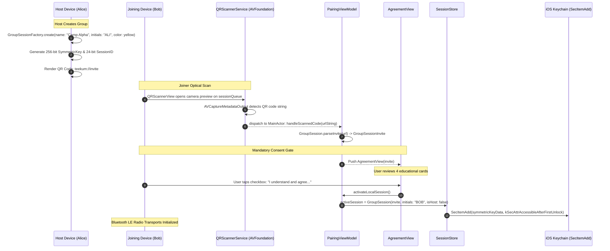
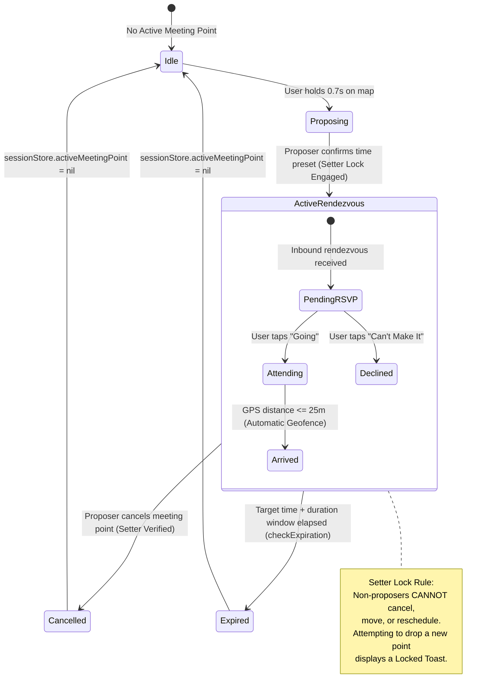

# Volume 11: Feature Group Pairing, Rendezvous & Setter Lock (Meepo)

## Ringkasan Eksekutif & Gambaran Umum Sistem

Volume 11 merinci subsistem bootstrapping sesi terdesentralisasi, pemindaian QR kamera optik, pembatasan persetujuan perjanjian mesh (mesh agreement consent gating), kustomisasi profil penolong, sinkronisasi titik temu (rendezvous) terdesentralisasi, dan arbitrasi Aturan Penguncian Setter (Setter Lock Rule) pada platform jaringan mesh Meepo. Dirancang untuk zona bencana perkotaan off-grid, struktur yang runtuh, dan operasi pencarian-dan-penyelamatan terpencil di mana konektivitas internet, jaringan seluler, dan server autentikasi pusat sama sekali tidak ada, subsistem ini membentuk ruang komunikasi pribadi yang diamankan secara kriptografis dan mengoordinasikan titik temu fisik kelompok murni melalui radio peer-to-peer.

Platform komunikasi tradisional bergantung sepenuhnya pada server cloud terpusat untuk verifikasi identitas, manajemen akun pengguna, dan koordinasi kelompok. Ketika ribuan penyintas dan personel tanggap darurat memadati area staging bencana dan menara seluler runtuh akibat tingginya kepadatan koneksi radio simultan, aplikasi klien-server tradisional gagal total. Pengguna tidak dapat masuk (sign in), mengirim undangan, atau menemukan rekan mereka.

Meepo memecahkan tantangan ini melalui arsitektur tanpa cloud (zero-cloud) yang sepenuhnya tanpa server (serverless):

1. **Pairing Kelompok Serverless & Distribusi Kunci Optik (Namespace `Pairing`):** Host grup menginisiasi sesi pada perangkat lokal mereka tanpa menghubungi server mana pun. Host menghasilkan kunci simetris 256-bit yang aman secara kriptografis (`SymmetricKey(size: .bits256)`) dan ID sesi 24-bit acak. Kredensial dienkripsi dan dikodekan ke dalam fragmen URL sisi klien (`teekum://invite#sessionName=...&sessionId=...&key=...`) dan disajikan sebagai kode QR optik kontras tinggi. Rekan yang bergabung memindai kode QR ini menggunakan pipeline kamera perangkat keras kustom `AVFoundation` (`AVCaptureSession`) atau menempelkan tautan yang disalin. Secara krusial, karena kunci berada di dalam `#fragment` URL dan bukan parameter kueri, kunci tidak pernah bocor ke server web eksternal atau log akses jaringan.
2. **Gerbang Persetujuan Kesepakatan Mesh (`AgreementView`):** Sebelum perangkat keras radio apa pun diinisialisasi atau paket disiarkan, setiap pengguna—baik host maupun anggota yang bergabung—harus meninjau dan secara eksplisit menyetujui Perjanjian Mesh (Mesh Agreement). Gerbang persetujuan operasional dan hukum wajib ini mengedukasi personel tentang relay paket komunitas, enkripsi terautentikasi ChaCha20-Poly1305, dan ambang batas kelangsungan hidup baterai 20% di mana fungsi relay dijeda untuk menghemat daya perangkat untuk keadaan darurat.
3. **Sinkronisasi Titik Temu Terdesentralisasi & Aturan Penguncian Setter (Namespace `MeetingPoint`):** Penolong dapat menetapkan satu titik temu fisik bersama di peta, memilih batas waktu titik temu ("Right Now", "In 15m", "In 30m", "In 1h", atau waktu kustom), menyiarkan konfirmasi RSVP ("Going" vs. "Can't Make It"), dan melacak status kedatangan otomatis berpagar geografis (geofenced) 25 meter. Untuk menghilangkan tabrakan koordinat yang kacau dalam jaringan mesh multi-hop yang bising, subsistem menegakkan **Aturan Penguncian Setter (Setter Lock Rule)**: hanya pengusul (setter) titik temu aktif yang memiliki wewenang untuk memindahkan, menjadwalkan ulang, atau membatalkan titik temu, sementara non-setter dibatasi secara ketat hanya pada respons RSVP kehadiran.

---

### Gambaran Umum ELI5: Penerjunan Taktis & Bendera Reli Triase Lapangan

Bayangkan Anda diterjunkan bersama regu penyelamat sukarelawan ke kota yang dilanda gempa bumi tanpa listrik, menara seluler tumbang, dan jalanan terblokir:

1. **Kunci Misi Kriptografis (Pairing Serverless):** Alih-alih memerlukan akun, server cloud, atau kata sandi, Pemimpin Regu Alice membuka Meepo dan mengetuk "Create Squad". Perangkatnya menghasilkan kunci simetris 256-bit berentropi tinggi (`CryptoKit.SymmetricKey`)—seperti menetapkan frekuensi radio terenkripsi. Perangkat Alice menampilkan kunci ini sebagai barcode pengiriman QR optik.
2. **Jabat Tangan Regu Optik (Pairing Kamera Offline):** Anda meluncurkan Meepo di perangkat Anda, memilih warna pengenal taktis (misalnya kuning amber cerah), memasukkan 3 karakter tanda panggil (misalnya `"BOB"`), dan mengarahkan kamera ke layar Alice. Perangkat Anda memindai kode QR dalam hitungan milidetik, mengimpor kunci 256-bit langsung ke Secure Keychain iOS, dan mengonfigurasi radio lokal untuk bergabung dengan mesh taktisnya.
3. **Kesepakatan Mesh (Perjanjian Persetujuan):** Sebelum menginisialisasi radio rekan, sebuah kesepakatan operasional muncul: *"Perangkat Anda akan membantu merelay paket terenkripsi untuk regu pencari, semua data dilindungi dengan enkripsi ChaCha20-Poly1305, dan penerusan mesh akan berhenti pada baterai 20% untuk menghemat daya darurat."* Mengetuk "Agree" mengaktifkan mesh.
4. **Bendera Reli Triase (Aturan Penguncian Setter):** Di zona puing-puing yang gelap, Pemimpin Regu Alice menetapkan titik penjemputan evakuasi atau stasiun triase depan. Dia menekan lama pada peta satelit, memilih "In 30m", dan menjatuhkan bendera titik temu berwarna amber. Pengiriman 30-byte merambat melintasi mesh, menempatkan titik arah (waypoint) di layar semua orang.
5. **Aturan Penguncian Setter (Invarian Titik Temu Tunggal):** Bagaimana jika Bob mencoba memindahkan bendera ke sektor lain? Meepo secara ketat menolak usulan yang bersaing: *"Meeting point locked by ALI. Only Alice can change or cancel this meeting point."* Bob hanya dapat mengetuk "Confirm" atau "Unable to Attend". Ini menghilangkan kebingungan split-brain selama evakuasi.
6. **Geofence Kedatangan 25-Meter (Kedatangan Otomatis):** Saat seorang penolong berjalan dalam jarak 25 meter dari titik triase, perangkat secara otomatis menyiarkan pembaruan kedatangan: *"Bob has arrived at LZ Alpha!"* Titik Bob berubah menjadi hijau di radar regu tanpa perlu menyentuh ponsel.

---

## Panduan Desain dan UX (Tanpa Kode)

Antarmuka pairing dan titik temu menyeimbangkan kemudahan penggunaan sosial dengan keamanan kriptografis yang ketat dan konsistensi mesh terdistribusi. Di zona bencana yang padat dan minim cahaya, desain pengalaman pengguna harus memperhitungkan kelelahan kognitif, silau layar, kebisingan keras, dan cadangan baterai yang menipis.

```
+-----------------------------------------------------------------------------------+
|                         PAIRING & RENDEZVOUS USER JOURNEY                         |
+-----------------------------------------------------------------------------------+
|                                                                                   |
|  [HOST USER FLOW]                                  [JOINER USER FLOW]             |
|  1. Enter Initials (1-3 chars)                     1. Enter Initials & Pick Color |
|  2. Select Profile Color (5 swatches)              2. Switch mode to "Join Group" |
|  3. Type Group Name                                3. Scan Host QR Viewfinder     |
|  4. Tap "Create Group" -> Preview QR                  (or paste invite from clip) |
|                                                                                   |
|           |                                                    |                  |
|           +-------------------------+--------------------------+                  |
|                                     |                                             |
|                                     v                                             |
|                         [MESH AGREEMENT COMPACT]                                  |
|                         - Community Relaying Card                                 |
|                         - ChaCha20 Encryption Card                                |
|                         - 20% Battery Survival Card                               |
|                         - Mandatory Checkbox: "I agree"                           |
|                         - Tap "Agree & Join Group"                                |
|                                     |                                             |
|                                     v                                             |
|                         [ACTIVE GROUP SESSION]                                    |
|                         (Key saved to Keychain)                                   |
|                                     |                                             |
|           +-------------------------+--------------------------+                  |
|           |                                                    |                  |
|           v                                                    v                  |
|  [PROPOSER (SETTER)]                               [NON-SETTER MEMBER]            |
|  1. Hold on Map for 0.7s                           1. Sees Golden Pin on Map      |
|  2. Select Time Preset ("In 30m")                  2. Taps Pin -> 1-Tap RSVP      |
|  3. Setter Confirms -> Pin Broadcast                  - "Going" vs "Can't Make It"|
|  4. Setter Holds -> Cancel Alert                   3. Cannot move/cancel pin      |
|                                                       (Locked Toast if attempted) |
|                                                    4. Walks within 25 meters      |
|                                                       -> Automatically "Arrived"  |
|                                                                                   |
+-----------------------------------------------------------------------------------+
```

### Perjalanan Pengguna dan Status Layar

#### 1. Membuat Grup (Status 1: Pengalaman Host)
- **Presentasi Visual:** Layar true-black AMOLED yang bersih menampilkan logo merek, avatar lingkaran 116-point, tiga kotak inisial persegi panjang membulat dengan kursor berkedip, dan bidang nama grup.
- **Kotak Input Inisial:** Penolong mengetuk tiga kotak membulat untuk mengetik hingga 3 inisial alfanumerik huruf besar (misalnya `"NIC"`). Karakter non-alfanumerik secara otomatis ditolak, dan kursor berkedip dengan mulus pada interval 500ms (dinonaktifkan jika pengguna mengaktifkan Aksesibilitas Kurangi Gerakan / Reduce Motion).
- **Palet Warna Profil:** Mengetuk ikon pensil membuka baki horizontal berisi lima contoh warna (swatch) kontras tinggi yang cerah: Kuning, Merah, Hijau, Ungu, dan Merah Muda. Batas putih menyorot pilihan aktif.
- **Bidang Nama Grup:** Bidang kapsul membulat dengan teks placeholder yang bersembunyi secara otomatis saat fokus atau diarahkan untuk mengurangi kekacauan visual.
- **Pratinjau Kode QR:** Setelah inisial dan nama grup yang valid diberikan, tombol "Create Group" menjadi aktif. Mengetuknya akan mengalihkan tampilan ke kartu undangan QR, menghasilkan kode QR optik 432x432 piksel yang tajam yang berisi kunci simetris 256-bit yang disematkan.

#### 2. Memindai Kode QR atau Membuka Tautan (Status 2: Pengalaman Anggota yang Bergabung)
- **Jendela Bidik Kamera (Camera Viewfinder):** Mengetuk tab "Join Group" mengalihkan paruh bawah layar menjadi jendela bidik kamera persegi membulat 255x255-point langsung (`AVCaptureSession`).
- **Gerbang Prasyarat Inisial:** Jika penolong yang bergabung belum memasukkan inisial mereka, jendela bidik kamera tetap gelap dan menampilkan keterangan panduan yang bermanfaat: `"Enter your initials to enable the camera."` Ini mencegah pengguna bergabung dengan grup secara anonim tanpa inisial identitas.
- **Pembingkaian Optik:** Ketika inisial ada, kamera aktif seketika tanpa stutter. Batas abu-abu tipis membingkai jendela bidik.
- **Pencadangan Papan Klip Cahaya Rendah:** Di puing-puing bencana yang gelap di mana kamera ponsel kesulitan fokus pada silau layar, penolong dapat mengetuk tombol pil yang menonjol: `"Paste link or shared message…"`. Ini memeriksa papan klip iOS, mem-parsing tautan undangan, dan mengekstrak kredensial segera.
- **Navigasi Otomatis:** Tepat pada saat barcode QR atau tautan papan klip yang valid diserap, tampilan menutup keyboard dan mendorong lembar Perjanjian Mesh.

#### 3. Modal Persetujuan Kesepakatan Mesh (Status 3: Gerbang Persetujuan Wajib)
- **Desain Visual:** Lembar gulir layar penuh yang ditata dengan gradien radial gelap (`#171717` hingga `#000000`).
- **Kartu Ringkasan Lencana:** Di bagian atas lembar, wadah membulat menampilkan:
  - Header: `"GROUP SETUP"`
  - Judul: `"Creating “Camp Alpha”"` atau `"Joining “Camp Alpha”"`
  - Subjudul Host vs. Anggota: Menjelaskan apakah pengguna membuat grup sebagai host atau bergabung sebagai anggota.
  - Kurung Inisial: Inisial pengguna yang dikurung dalam teks tebal: `[ NIC ]`, dibatasi oleh warna profil yang mereka pilih.
- **Empat Kartu Fitur Edukasi:**
  1. *Jaringan Mesh Berbasis Komunitas:* Menjelaskan bahwa perangkat yang berpartisipasi bertindak sebagai relay radio komunal untuk meneruskan paket terenkripsi bagi rekan di dekatnya.
  2. *Terenkripsi Berdasarkan Desain:* Meyakinkan penolong bahwa semua komunikasi dilindungi menggunakan enkripsi end-to-end ChaCha20-Poly1305.
  3. *Perlindungan Sadar Baterai:* Menyatakan dengan jelas bahwa aktivitas jaringan dibatasi lajunya dan relay otomatis dijeda saat baterai perangkat mencapai 20%.
  4. *Tetap Terhubung:* Merinci obrolan offline dan pelacakan layar kunci Live Activity.
- **Kotak Centang Persetujuan Wajib:** Di bagian bawah terdapat kotak centang interaktif: *"I understand and agree to the above conditions and Teekum’s Privacy Policy."*
- **Tombol Gabung Berpagar:** Tombol utama *"Agree & Join Group"* dinonaktifkan (`opacity: 0.90`) hingga kotak centang dicentang. Mengetuk tombol menyimpan sesi ke Secure Keychain, menginisialisasi transport radio, dan membuka antarmuka radar utama.

#### 4. Menetapkan Titik Temu & Aturan Penguncian Setter (Status 4: Mengusulkan Titik Temu)
- **Penempatan Tekan Lama:** Setiap anggota grup dapat menginisiasi titik temu dengan menekan dan menahan secara stasioner pada peta geografis (`MainMapView`) selama 0,7 detik. Denyut haptik tegas mengonfirmasi penjatuhan pin.
- **Lembar Preset Cepat (`MeetingTimeOptionsView`):** Lembar native menyajikan empat preset waktu sekali ketuk yang cepat:
  - *"Right Now"* (reli segera)
  - *"In 15m"*
  - *"In 30m"*
  - *"In 1h"*
  - Tombol *"Choose a time"* (membuka `DatePicker` native untuk pemilihan kalender kustom)
- **Aturan Penguncian Setter:** Setelah dikonfirmasi, ini menjadi titik temu aktif grup. **Penolong yang mengaturnya menjadi "Setter". Hanya Setter yang memiliki wewenang untuk memindahkan, menjadwalkan ulang, atau membatalkan titik ini.**

#### 5. Status Terkunci Non-Setter & Toast (Status 5: Pencegahan Tabrakan)
- **Pengalaman Non-Setter:** Ketika anggota grup lain melihat peta, mereka melihat pin pertemuan emas dengan nama Setter: `"ALI's Meeting Point"`.
- **Penolakan Proposal yang Bersaing:** Jika penolong lain mencoba menjatuhkan titik temu kedua saat yang aktif masih ada, aplikasi menolak gestur tersebut.
- **Pemberitahuan Terkunci:** Dialog peringatan native atau notifikasi toast menginformasikan pengguna: *"Meeting point locked by ALI. Only the creator can change or cancel the meeting point."* Ini sepenuhnya mencegah kekacauan koordinasi dan perang pin titik temu.

#### 6. Interaksi RSVP Sekali Ketuk (Status 6: Konfirmasi Kehadiran)
- **Membuka Lembar RSVP:** Ketika non-setter mengetuk pin pertemuan aktif, lembar kehadiran muncul (`isShowingRSVPAlert`).
- **Dua Tombol Sederhana:**
  - *"Going"* (mengatur status ke `.accepted`, menyiarkan paket konfirmasi kehadiran melintasi mesh).
  - *"Can't Make It"* (mengatur status ke `.declined`, menginformasikan kru tanpa mengacaukan obrolan).
- **Indikator Roster:** Di layar radar dan lembar roster kru, setiap baris avatar rekan menampilkan lencana kehadiran: tanda centang hijau untuk "Going", silang merah untuk "Can't Make It", atau tanda tanya untuk "Pending".

#### 7. Kedatangan Berpagar Geografis 25-Meter Otomatis (Status 7: Check-In Tanpa Sentuhan)
- **Geofence Tanpa Sentuhan:** Saat berjalan menuju titik temu, ponsel pengguna terus membandingkan posisi GPS-nya dengan koordinat titik temu.
- **Transisi Status Otomatis:** Tepat pada saat pengguna melintasi jarak 25 meter (`distance <= 25m`), status mereka secara otomatis bertransisi dari `.accepted` ke `.atMeetingPoint` (`.arrived`).
- **Nol Pemborosan Baterai:** Setelah tiba, status dikunci; getaran GPS yang berderau tidak dapat mengembalikan pengguna ke "pending", mencegah siaran paket radio redundan.

#### 8. Keluar dan Pembongkaran Sesi (Status 8: Penghapusan Efemeral)
- **Keluar dari Sesi:** Ketika seorang penolong memilih untuk keluar dari grup di Pengaturan, aplikasi mengeksekusi penghapusan kriptografis instan.
- **Pembersihan Secure Keychain:** Kunci simetris 256-bit, ID sesi 24-bit, dan metadata rekan segera dimusnahkan melalui `SecItemDelete`. Cache memori dihapus, transport radio berhenti, dan aplikasi diatur ulang secara bersih ke `GroupPairingView`.

---

### Mengapa Kita Tidak Bisa Hanya...? (Batasan untuk Perancang)

Saat merancang fitur pairing dan koordinasi, perancang sering mengusulkan pola web standar yang gagal di lingkungan off-grid. Di bawah ini adalah batasan rekayasa inti yang mengatur subsistem ini:

#### 1. Mengapa Kita Tidak Bisa Hanya Menggunakan Nama Pengguna, Kata Sandi, dan Nomor Telepon?
- **Pertanyaan Perancang:** *"Mengapa penolong tidak dapat membuat akun dengan alamat email, nomor telepon, atau ID Apple sehingga mereka tidak perlu memindai kode QR?"*
- **Realitas Rekayasa:**
  - **Infrastruktur Cloud Nol:** Di regu bencana off-grid, tidak ada sinyal seluler dan tidak ada konektivitas internet. Aplikasi yang memerlukan kontak dengan server autentikasi (seperti Firebase, Cognito, atau server ID Apple) tidak dapat masuk, mendaftar, atau mengautentikasi pengguna.
  - **Privasi & Anonimitas:** Mengharuskan nomor telepon atau email akan mengekspos informasi identitas pribadi (PII) kepada orang asing di radio mesh siaran. Meepo menggunakan inisial 3 karakter efemeral yang terlokalisasi dan kunci acak 256-bit, tanpa meninggalkan jejak digital.

#### 2. Mengapa Kita Tidak Bisa Hanya Melewati Layar Persetujuan Kesepakatan Mesh?
- **Pertanyaan Perancang:** *"Layar persetujuan menambah gesekan pada onboarding. Tidak bisakah kita melewatinya atau menerimanya secara otomatis di latar belakang?"*
- **Realitas Rekayasa:**
  - **Transparansi Hukum dan Baterai:** Meepo mengubah iPhone pengguna menjadi perute (router) radio komunal. Jika baterai penolong terkuras karena ponsel mereka merelay paket untuk lima puluh perangkat orang asing di dekatnya tanpa persetujuan eksplisit, pengguna akan merasa dikhianati dan menghapus aplikasi.
  - **Mandat Persetujuan Eksplisit:** Pengguna harus memahami bahwa perangkat mereka akan memancarkan sinyal radio dan bahwa relay dijeda pada baterai 20%. Membatasi aktivasi radio di balik kotak centang fisik melindungi kepercayaan pengguna dan mematuhi panduan privasi.

#### 3. Mengapa Rekan Tidak Bisa Menimpa Titik Temu yang Sedang Aktif?
- **Pertanyaan Perancang:** *"Jika Bob menemukan tempat yang lebih baik untuk bertemu, mengapa dia tidak bisa langsung menyeret bendera emas atau menjatuhkan yang baru?"*
- **Realitas Rekayasa:**
  - **Kekacauan Split-Brain Multi-Hop:** Dalam mesh BLE ad-hoc, paket memerlukan beberapa detik untuk merambat melintasi beberapa hop. Jika Alice memindahkan pin ke Stage 1 sementara Bob secara bersamaan memindahkannya ke Stage 2, separuh area puing bencana akan menerima pembaruan Alice terlebih dahulu, sementara separuh lainnya menerima pembaruan Bob terlebih dahulu. Kelompok terpecah menjadi dua bagian yang terputus.
  - **Invarian Penguncian Setter:** Dengan secara ketat mengunci titik temu ke pengusul asli, Meepo menegakkan konsensus terdistribusi master tunggal (single-master distributed consensus). Jika seseorang menginginkan tempat yang berbeda, mereka harus meminta Alice untuk memindahkannya, atau menunggu Alice membatalkannya.

#### 4. Mengapa Riwayat Sesi Benar-Benar Lenyap Saat Keluar?
- **Pertanyaan Perancang:** *"Mengapa tidak menyimpan pesan obrolan lama, titik temu, dan daftar anggota grup di penyimpanan lokal sehingga pengguna dapat meninjau kenangan regu bencana mereka nanti?"*
- **Realitas Rekayasa:**
  - **Keselamatan Jiwa & Penyitaan Perangkat:** Jika seorang penolong atau penyintas kehilangan ponsel mereka di tengah kerumunan, kunci enkripsi yang tersimpan, jejak rekam lokasi, atau log obrolan dapat diekstraksi.
  - **Efemeritas Nol Kepercayaan (Zero-Trust Ephemerality):** Memanggil `SecItemDelete` pada Keychain menjamin bahwa ketika seorang penolong meninggalkan regu, semua kunci kriptografis dimusnahkan secara permanen. Ponsel tidak menyimpan materi kriptografis apa pun yang mampu mendekripsi lalu lintas mesh masa lalu.

---

### Token Desain yang Dapat Diedit vs. Aturan Rekayasa Terkunci

Tabel berikut membedakan antara token desain estetika yang dapat disesuaikan secara aman oleh perancang produk dan invarian rekayasa terkunci yang tidak boleh diubah:

| Kategori Parameter | Token Desain yang Dapat Diedit | Aturan Rekayasa Terkunci | Alasan Arsitektural |
| :--- | :--- | :--- | :--- |
| **Warna Profil** | Nilai hex palet (`PairingProfileColor`) | Pengodean wire bita tunggal (`UInt8` 0–4) | Nilai hex dapat ditata, tetapi kode wire harus tetap stabil di semua versi aplikasi. |
| **Tipografi Inisial**| Keluarga font, radius batas kotak (14pt) | Panjang maks (3 karakter), filter A-Z/0-9 | Protokol wire mesh mengalokasikan tepat 3 byte untuk inisial. String yang lebih panjang merusak perataan paket. |
| **Visual Kode QR** | Dimensi upscale (432pt), padding (10pt) | Tingkat koreksi "M", skema fragmen URL | Koreksi kesalahan medium ("M") memastikan pemindaian cepat; `#fragment` mencegah pencatatan kunci sisi server. |
| **Radius Kedatangan** | Animasi denyut peta, opasitas lingkaran | Ambang batas fisik 25 meter (`arrivalRadiusMeters`)| 25m menyeimbangkan ketidakakuratan multipath GPS dalam kerumunan dengan kedekatan fisik yang tulus. |
| **Preset Titik Temu**| Label tampilan ("In 15m", "In 30m") | Menit integer mentah (0, 15, 30, 60) | Offset menit dipetakan langsung ke komputasi stempel waktu payload wire. |
| **Aturan Penguncian Setter** | Salinan dialog peringatan dan gaya toast error | Pemeriksaan ID pengusul (`point.proposerId == localId`)| Mencegah kondisi perlombaan (race conditions) mesh multi-hop dan pembajakan koordinat. |
| **Kedaluwarsa Sesi**| Teks peringatan kedaluwarsa | Pemangkasan otomatis saat `point.isExpired == true` | Titik temu yang kedaluwarsa harus dibersihkan untuk membebaskan slot pertemuan aktif tunggal. |
| **Pembongkaran Keychain** | Gaya dialog konfirmasi | `SecItemDelete` langsung saat keluar | Tidak meninggalkan sisa kriptografis di disk saat penolong meninggalkan regu penyelamat. |

---

## Pembahasan Teknis Mendalam (Technical Engineering Deep-Dive)

### Alur End-to-End: Dari Pemindaian QR & Persetujuan hingga Titik Temu Grup yang Disinkronkan

Bagi insinyur iOS junior dan pengembang sistem, melacak bagaimana bingkai video kamera fisik diterjemahkan menjadi sesi grup simetris terautentikasi dan titik temu yang disinkronkan di seluruh mesh radio ad-hoc sangatlah penting. Siklus hidup lengkap mencakup enam fase eksekusi yang berbeda:

```
+-----------------------------------------------------------------------------------+
|               END-TO-END PAIRING & RENDEZVOUS EXECUTION PIPELINE                  |
+-----------------------------------------------------------------------------------+
|                                                                                   |
|  1. OPTICAL QR CODE INGESTION (Hardware Layer)                                    |
|     - `AVCaptureSession` on serial background queue captures video frames         |
|     - `AVCaptureMetadataOutput` decodes ISO 18004 QR barcode string               |
|     - Thread-safe bridging delivers barcode string to `@MainActor`               |
|                                                                                   |
|  2. CLIENT-SIDE URL FRAGMENT DECODING (Cryptographic Layer)                       |
|     - Extract parameters: `teekum://invite#sessionName=...&sessionId=...&key=...`|
|     - Base64-decode 32-byte (256-bit) raw symmetric key                           |
|     - Validate 24-bit session ID ($1 \le \text{ID} \le 0x00FF\_FFFF$)             |
|                                                                                   |
|  3. CONSENT GATING & KEYCHAIN PERSISTENCE (Security Layer)                        |
|     - Present `AgreementView`; user explicitly checks community relay consent     |
|     - `GroupSessionFactory.join()` instantiates `GroupSession`                   |
|     - Save symmetric key to iOS Secure Keychain via `SecItemAdd`                  |
|                                                                                   |
|  4. RENDEZVOUS PROPOSAL & SETTER LOCK (Application Layer)                         |
|     - Proposer drops candidate coordinate via 0.7s map hold                       |
|     - Proposer selects time preset via `MeetingTimeOptionsView`                   |
|     - `MeetingPointService.proposeMeetingPoint()` registers local active point    |
|                                                                                   |
|  5. WIRE ENCRYPTION & BROADCAST DISPATCH (Transport Layer)                        |
|     - Serialize `MeetingUpdatePayload` (action, coordinate, targetTime, arrivalR) |
|     - Encrypt via ChaCha20-Poly1305 using session `SymmetricKey`                  |
|     - Package into `CleartextEnvelope(type: .meetingUpdate, hopLimit: 5)`         |
|     - Dispatch via BLE mesh radio transport                                      |
|                                                                                   |
|  6. INBOUND ARBITRATION & 25M ARRIVAL GEOFENCE (Consensus Layer)                  |
|     - Peers decrypt and verify payload authenticity                               |
|     - Apply Setter Lock Rule: verify sender matches active proposer on cancel     |
|     - CoreLocation monitors distance; when $\le 25\text{m}$, auto-updates Arrived  |
|                                                                                   |
+-----------------------------------------------------------------------------------+
```

#### Rincian Arsitektural Langkah-demi-Langkah Mendalam:

1. **Fase 1: Penyerapan Video Perangkat Keras & Debouncing:**
   - Pengguna membuka `QRScannerView`, yang memanggil `QRScannerService.start(onCodeScanned:)`.
   - Layanan membuat `AVCaptureSession`, mengikat `AVCaptureDeviceInput` (kamera sudut lebar yang menghadap ke belakang), dan menambahkan `AVCaptureMetadataOutput`.
   - Semua konfigurasi dan operasi awal AVFoundation berjalan secara asinkron pada antrean pengiriman serial khusus (`DispatchQueue(label: "com.teekum.pairing.camera")`).
   - Ketika kode QR terdeteksi, `metadataOutput(_:didOutput:from:)` terpicu pada antrean latar belakang. Layanan memperoleh `NSLock`, memeriksa `lastCode != code` untuk menghilangkan duplikasi bingkai (debounce), dan mengirimkan string URL yang didekodekan ke `@MainActor`.

2. **Fase 2: Pemecahan Fragmen URL Sisi Klien:**
   - URL tiba dalam format:
     `teekum://invite#sessionName=Camp%20Alpha&sessionId=1048576&key=xK8...`
   - Dalam `GroupSession.parseInvite(from:)`, parser mengekstrak substring setelah pemisah fragmen `#`.
   - **Mengapa `#fragment` bukan `?query`:** Dalam standar web (RFC 3986), komponen fragmen dari URI murni berada di sisi klien. Server web, proksi, dan layanan logging tidak pernah menerima atau mencatat bagian fragmen dalam permintaan HTTP atau header perujuk (referrer). Jika seorang penolong mengetuk tautan undangan di peramban web atau aplikasi perpesanan, kunci enkripsi 256-bit tidak pernah dikirimkan melalui internet ke server mana pun.
   - Parser mendekode string kunci Base64 menjadi `Data` mentah (tepat 32 byte) dan memvalidasi bahwa `sessionId` berada dalam rentang 1 hingga 16.777.215 (`0x00FF_FFFF`).

3. **Fase 3: Pembatasan Persetujuan Perjanjian Mesh & Aktivasi:**
   - `PairingViewModel` menerima `GroupSessionInvite` yang valid dan menyajikan `AgreementView`.
   - Anggota yang bergabung memasukkan inisial mereka, memilih warna identitas, meninjau ketentuan relay komunitas, dan mencentang kotak centang persetujuan.
   - Mengetuk "Agree & Join Group" memanggil `activateLocalSession()`.
   - `GroupSessionFactory.join()` mengonstruksi `GroupSession(isHost: false)` akhir.
   - `SessionStore` menyimpan kunci 256-bit ke Secure Keychain iOS melalui `SecItemAdd` dengan `kSecAttrAccessibleAfterFirstUnlockThisDeviceOnly`.

4. **Fase 4: Proposal Titik Temu & Penegakan Penguncian Setter:**
   - Ketika seorang penolong menekan lama pada peta, `MeetingPointViewModel.handleMapHold(at:)` menangkap koordinat.`
   - Pengguna memilih preset waktu ("In 30m"), dan mengonfirmasi titik temu.`
   - `MeetingPointService.proposeMeetingPoint()` menginstansiasi `MeetingPoint` dengan:
     - `proposerId = session.localMemberId`
     - `proposerInitials = session.localInitials`
     - `attendance = [session.localMemberId: .accepted]`
     - `arrivalRadiusMeters = 25.0`
   - Titik baru ditulis ke `sessionStore.activeMeetingPoint`.

5. **Fase 5: Enkripsi Protokol Wire & Pengiriman Siaran:**
   - `MeetingPointService.broadcastMeetingUpdate()` menyusun `MeetingUpdatePayload`:
     - Aksi 4-bit: `.propose` (0x01)
     - Kehadiran 4-bit: `.attending` (0x01)
     - Koordinat big-endian 32-bit terkuantisasi (resolusi ~11cm)
     - Stempel waktu waktu target dan waktu pembuatan 32-bit
     - Radius kedatangan bita tunggal (25)
   - Payload yang diserialkan diteruskan ke `CryptoService.sealToWireBytes()`, menghasilkan tag MAC Poly1305 16-byte dan mengenkripsi payload dengan ChaCha20.
   - Dibungkus dalam `CleartextEnvelope` dengan `hopLimit = 5`, paket disiarkan melalui transport mesh BLE.

6. **Fase 6: Verifikasi Masuk & Geofence Kedatangan Otomatis 25M:**
   - Rekan yang bergabung menerima paket terenkripsi melalui BLE. `CryptoService.openWireBytes()` mengautentikasi tag Poly1305 dan mendekripsi payload menggunakan kunci simetris 256-bit bersama mereka.
   - `MeetingPointService.applyInboundUpdate()` memeriksa pembaruan. Karena aksinya adalah `.propose`, ia menulis titik temu ke `sessionStore.activeMeetingPoint`.
   - Ketika pengguna berjalan menuju koordinat titik temu, `LocationService` meneruskan koordinat GPS yang diperbarui ke `MeetingPointService.checkArrival(userLocation:)`.
   - Ketika `user.distance(from: destination) <= 25.0`, layanan secara otomatis memperbarui kehadiran ke `.atMeetingPoint` (`.arrived`) dan menyiarkan pembaruan penerimaan di seluruh mesh.

---

## Berkas Sumber yang Disertakan

Subsistem pairing dan titik temu diimplementasikan di tepat 27 berkas sumber Swift dalam basis kode Meepo:

| Path Berkas Relatif Repositori | Jumlah Baris Tepat (`wc -l`) | Target / Domain Konkurensi | Peran Subsistem Arsitektural |
| :--- | :---: | :--- | :--- |
| [`../../Teekum/Teekum/Features/MeetingPoint/Models/MeetingTimePreset.swift`](../../Teekum/Teekum/Features/MeetingPoint/Models/MeetingTimePreset.swift) | 30 | Pure Swift Model | Discrete rendezvous time offset presets (0m, 15m, 30m, 60m). |
| [`../../Teekum/Teekum/Features/MeetingPoint/Services/MeetingPointService.swift`](../../Teekum/Teekum/Features/MeetingPoint/Services/MeetingPointService.swift) | 245 | `@MainActor` `@Observable` | Rendezvous synchronization, Setter Lock Rule arbitration, 25m geofence arrival. |
| [`../../Teekum/Teekum/Features/MeetingPoint/ViewModels/MeetingPointViewModel.swift`](../../Teekum/Teekum/Features/MeetingPoint/ViewModels/MeetingPointViewModel.swift) | 119 | `@MainActor` `@Observable` | Map coordinate holding, time selection, and native alert presentation coordinator. |
| [`../../Teekum/Teekum/Features/MeetingPoint/Views/MeetingTimeOptionsView.swift`](../../Teekum/Teekum/Features/MeetingPoint/Views/MeetingTimeOptionsView.swift) | 40 | SwiftUI View Component | Modal rendezvous time selection form with presets and DatePicker options. |
| [`../../Teekum/Teekum/Features/Pairing/Models/PairingForm.swift`](../../Teekum/Teekum/Features/Pairing/Models/PairingForm.swift) | 28 | Pure Swift Model | Transient draft form holding onboarding inputs and validation rules. |
| [`../../Teekum/Teekum/Features/Pairing/Models/Enums/PairingError.swift`](../../Teekum/Teekum/Features/Pairing/Models/Enums/PairingError.swift) | 24 | Pure Swift Model | Localized error descriptions for invalid initials, names, invites, and clipboard. |
| [`../../Teekum/Teekum/Features/Pairing/Models/Enums/PairingField.swift`](../../Teekum/Teekum/Features/Pairing/Models/Enums/PairingField.swift) | 11 | SwiftUI Focus Management | Focus targets for initials and group name text fields. |
| [`../../Teekum/Teekum/Features/Pairing/Models/Enums/PairingMode.swift`](../../Teekum/Teekum/Features/Pairing/Models/Enums/PairingMode.swift) | 11 | SwiftUI Segmented Control | Mode switch distinguishing group creation from QR joining. |
| [`../../Teekum/Teekum/Features/Pairing/Models/Enums/PairingProfileColor.swift`](../../Teekum/Teekum/Features/Pairing/Models/Enums/PairingProfileColor.swift) | 27 | SwiftUI / Wire Serialization | High-contrast identity color swatches bound to single-byte wire codes. |
| [`../../Teekum/Teekum/Features/Pairing/Services/GroupSessionFactory.swift`](../../Teekum/Teekum/Features/Pairing/Services/GroupSessionFactory.swift) | 44 | Pure Swift Crypto Factory | Cryptographic generator of 256-bit symmetric keys and 24-bit session IDs. |
| [`../../Teekum/Teekum/Features/Pairing/Services/QRCodeGenerator.swift`](../../Teekum/Teekum/Features/Pairing/Services/QRCodeGenerator.swift) | 23 | CoreImage Image Generator | Hardware-accelerated CIFilter generating 432x432 bitmap QR codes. |
| [`../../Teekum/Teekum/Features/Pairing/Services/QRScannerService.swift`](../../Teekum/Teekum/Features/Pairing/Services/QRScannerService.swift) | 107 | AVFoundation Capture Service | Thread-safe background camera capture pipeline with debouncing and UUID tokens. |
| [`../../Teekum/Teekum/Features/Pairing/ViewModels/PairingViewModel.swift`](../../Teekum/Teekum/Features/Pairing/ViewModels/PairingViewModel.swift) | 134 | `@MainActor` `@Observable` | Onboarding state machine driving form validation, QR preview, and activation. |
| [`../../Teekum/Teekum/Features/Pairing/Views/AgreementView.swift`](../../Teekum/Teekum/Features/Pairing/Views/AgreementView.swift) | 102 | SwiftUI View Component | Mesh agreement consent sheet gating radio transmission behind privacy terms. |
| [`../../Teekum/Teekum/Features/Pairing/Views/GroupPairingView.swift`](../../Teekum/Teekum/Features/Pairing/Views/GroupPairingView.swift) | 255 | SwiftUI View (`@MainActor`) | Primary onboarding root view coordinating initials, colors, camera, and links. |
| [`../../Teekum/Teekum/Features/Pairing/Views/GroupQRCodeView.swift`](../../Teekum/Teekum/Features/Pairing/Views/GroupQRCodeView.swift) | 60 | SwiftUI View Component | Group invitation card displaying QR code, key fingerprint, and ShareLink. |
| [`../../Teekum/Teekum/Features/Pairing/Views/QRScannerView.swift`](../../Teekum/Teekum/Features/Pairing/Views/QRScannerView.swift) | 80 | SwiftUI View (`@MainActor`) | Camera scanner viewfinder with permission handling and targeting frame. |
| [`../../Teekum/Teekum/Features/Pairing/Views/AgreementViewComponents/AggrementGroupSummaryView.swift`](../../Teekum/Teekum/Features/Pairing/Views/AgreementViewComponents/AggrementGroupSummaryView.swift) | 76 | SwiftUI View Component | Summary card presenting group name, host initials, and identity color. |
| [`../../Teekum/Teekum/Features/Pairing/Views/AgreementViewComponents/CardAgreement.swift`](../../Teekum/Teekum/Features/Pairing/Views/AgreementViewComponents/CardAgreement.swift) | 48 | SwiftUI View Component | Feature explanation card presenting icon, headline, and descriptive body copy. |
| [`../../Teekum/Teekum/Features/Pairing/Views/AgreementViewComponents/FooterAgreement.swift`](../../Teekum/Teekum/Features/Pairing/Views/AgreementViewComponents/FooterAgreement.swift) | 71 | SwiftUI View Component | Mandatory agreement consent checkbox, policy links, and join action button. |
| [`../../Teekum/Teekum/Features/Pairing/Views/AgreementViewComponents/HeadAgreement.swift`](../../Teekum/Teekum/Features/Pairing/Views/AgreementViewComponents/HeadAgreement.swift) | 38 | SwiftUI View Component | Header view with 80pt avatar circle and brand slogan. |
| [`../../Teekum/Teekum/Features/Pairing/Views/PairingViewComponents/CameraPreviewSurface.swift`](../../Teekum/Teekum/Features/Pairing/Views/PairingViewComponents/CameraPreviewSurface.swift) | 24 | UIKit UIView Subclass | Backing UIView overriding layerClass with AVCaptureVideoPreviewLayer. |
| [`../../Teekum/Teekum/Features/Pairing/Views/PairingViewComponents/CameraPreviewView.swift`](../../Teekum/Teekum/Features/Pairing/Views/PairingViewComponents/CameraPreviewView.swift) | 33 | SwiftUI UIViewRepresentable | Bridge hosting UIKit video layer inside SwiftUI layout with clean dismantle. |
| [`../../Teekum/Teekum/Features/Pairing/Views/PairingViewComponents/GroupNameField.swift`](../../Teekum/Teekum/Features/Pairing/Views/PairingViewComponents/GroupNameField.swift) | 54 | SwiftUI View Component | Styled text field for entering group names with placeholder dismissal. |
| [`../../Teekum/Teekum/Features/Pairing/Views/PairingViewComponents/GroupPairingInviteView.swift`](../../Teekum/Teekum/Features/Pairing/Views/PairingViewComponents/GroupPairingInviteView.swift) | 57 | SwiftUI View Component | QR barcode presentation frame with asynchronous image rendering. |
| [`../../Teekum/Teekum/Features/Pairing/Views/PairingViewComponents/GroupPairingProfileView.swift`](../../Teekum/Teekum/Features/Pairing/Views/PairingViewComponents/GroupPairingProfileView.swift) | 162 | SwiftUI View (`@MainActor`) | Three-box initials input with blinking cursor and profile color button. |
| [`../../Teekum/Teekum/Features/Pairing/Views/PairingViewComponents/ProfilePickerView.swift`](../../Teekum/Teekum/Features/Pairing/Views/PairingViewComponents/ProfilePickerView.swift) | 61 | SwiftUI View Component | Horizontal color swatch palette with 44pt touch targets and selection indicator. |
| **Total Kode Produksi** | **1.964 baris** | **Terverifikasi 100%** | **Inventaris Sumber Lengkap Volume 11** |

---

## Diagram Gerbang Pairing & Penguncian Setter

### 1. Urutan Pairing Optik dan Persetujuan Kesepakatan Mesh



### 2. Aturan Penguncian Setter dan Transisi Status Titik Temu



## Pembahasan Mendalam Berkas demi Berkas Khusus

### Kluster A: Subsistem Sinkronisasi & Arbitrasi Titik Temu

---

#### 1. `Teekum/Teekum/Features/MeetingPoint/Models/MeetingTimePreset.swift`

- **Path Lengkap Relatif Repositori:** [`../../Teekum/Teekum/Features/MeetingPoint/Models/MeetingTimePreset.swift`](../../Teekum/Teekum/Features/MeetingPoint/Models/MeetingTimePreset.swift)
- **Jumlah Baris:** Tepat 30 baris (`wc -l`)
- **Target / Domain Konkurensi:** Model Swift Murni (`Sendable`, `CaseIterable`, `Identifiable`)

##### Apa yang Dilakukan Berkas Ini
`MeetingTimePreset.swift` mendefinisikan interval waktu diskrit kanonik yang ditawarkan kepada penolong saat menetapkan titik temu kelompok. Berkas ini memetakan label offset yang ramah pengguna ("Right Now", "In 15m", "In 30m", "In 1h") ke offset menit integer, menyediakan metode perhitungan yang bersih untuk memperoleh stempel waktu `Date` target masa depan.

##### Analogi ELI5
Bayangkan membuat rencana dengan teman-teman Anda di tengah kerumunan yang bising. Daripada mengetik "Temui saya jam 14:47", Anda mengangkat tanda kardus dengan empat tombol raksasa: "Right Now", "In 15 Minutes", "In 30 Minutes", atau "In 1 Hour". Mengetuk tombol langsung menghitung waktu jam yang tepat di jam tangan semua orang tanpa kesalahan pengetikan.

##### Istilah Teknis yang Didefinisikan
- **Enumerasi Nilai Mentah (Raw-Value Enumeration):** Enum Swift di mana setiap case secara otomatis terikat pada nilai primitif yang mendasarinya (dalam hal ini, `Int` yang mewakili menit).
- **Offset TimeInterval:** Durasi floating point 64-bit yang mewakili detik (`TimeInterval(rawValue * 60)`). Menambahkan durasi ini ke `Date()` memproyeksikan batas waktu titik temu ke masa depan.
- **Kesesuaian Sendable (Sendable Conformance):** Protokol konkurensi Swift yang menjamin bahwa instance dari tipe ini aman untuk thread dan dapat diteruskan secara bebas melintasi batas aktor tanpa race condition.

##### Tipe Kunci, Bidang, Metode, Status & Invarian

```swift
// Verified verbatim from Teekum/Teekum/Features/MeetingPoint/Models/MeetingTimePreset.swift:10-30
public enum MeetingTimePreset: Int, CaseIterable, Identifiable, Sendable {
    case rightNow = 0
    case in15Mins = 15
    case in30Mins = 30
    case in1Hour  = 60
    
    public var id: Int { rawValue }
    
    public var title: String {
        switch self {
        case .rightNow: return "Right Now"
        case .in15Mins: return "In 15m"
        case .in30Mins: return "In 30m"
        case .in1Hour:  return "In 1h"
        }
    }
    
    public func targetDate(from base: Date = Date()) -> Date {
        base.addingTimeInterval(TimeInterval(rawValue * 60))
    }
}
```

###### Analisis Arsitektural Baris demi Baris:
- Baris 10–14: Mendefinisikan empat kasus diskrit dengan nilai mentah: `.rightNow = 0`, `.in15Mins = 15`, `.in30Mins = 30`, `.in1Hour = 60`. Menyesuaikan dengan `CaseIterable` (memungkinkan iterasi pemilih SwiftUI) dan `Identifiable` (menggunakan `rawValue` sebagai `id`).
- Baris 18–25: Properti `title` mengembalikan label tombol yang ramah pengguna dan terlokalisasi.
- Baris 27–29: `targetDate(from:)`: Mengalikan integer menit mentah dengan 60 detik dan menambahkannya ke `base` (default ke waktu perangkat saat ini `Date()`).

##### Kasus Batas, Mode Kegagalan & Invarian
- **Pergeseran Jam Antar Perangkat (Clock Drift):** Saat menyetel `.in15Mins`, `targetDate()` mengevaluasi terhadap jam sistem perangkat lokal. Pada jaringan mesh tanpa sinkronisasi waktu seluler, sedikit kemiringan jam (misalnya 5–10 detik) antar perangkat penolong mungkin terjadi. Paket protokol wire membuat serial stempel waktu zaman UTC absolut yang dihasilkan, memastikan bahwa semua penolong menghitung mundur menuju detik target yang sama persis terlepas dari perbedaan zona waktu lokal.

---

#### 2. `Teekum/Teekum/Features/MeetingPoint/Services/MeetingPointService.swift`

- **Path Lengkap Relatif Repositori:** [`../../Teekum/Teekum/Features/MeetingPoint/Services/MeetingPointService.swift`](../../Teekum/Teekum/Features/MeetingPoint/Services/MeetingPointService.swift)
- **Jumlah Baris:** Tepat 245 baris (`wc -l`)
- **Target / Domain Konkurensi:** Layanan Domain Inti `@MainActor` `@Observable`

##### Apa yang Dilakukan Berkas Ini
`MeetingPointService.swift` adalah layanan operasional pusat yang mengatur koordinasi titik temu kelompok. Berkas ini mengarbitrasi proposal titik temu, menegakkan **Aturan Penguncian Setter**, memproses pembaruan mesh yang masuk, mengelola kamus kehadiran RSVP penolong, memicu deteksi kedatangan geofence otomatis 25 meter, memangkas titik temu yang kedaluwarsa, dan mengoordinasikan enkripsi paket wire serta penyiaran transport.

##### Analogi ELI5
`MeetingPointService` adalah pemandu jejak resmi kelompok. Ketika seseorang mengusulkan tempat pertemuan (seperti "Pohon Besar"), pemandu menuliskannya di buku catatan utama dan mengirim pelari untuk memberi tahu semua orang di perkemahan. Jika orang lain mencoba mengubah tempat saat yang pertama masih aktif, pemandu berkata: *"Tunggu sebentar, Alice sudah menetapkan titik pertemuan ini; hanya Alice yang dapat memindahkan atau membatalkannya."* Saat rekan-rekan berjalan menuju pohon, pemandu memeriksa jarak mereka; begitu seseorang berada dalam jarak 25 meter, pemandu secara otomatis menandai mereka sebagai "Tiba" tanpa mereka harus mengucapkan sepatah kata pun.

##### Istilah Teknis yang Didefinisikan
- **Aturan Penguncian Setter (Setter Lock Rule):** Invarian arbitrasi status terdistribusi di mana hanya penolong yang mengusulkan titik temu aktif yang memiliki wewenang untuk membatalkan, merelokasi, atau menjadwalkan ulang titik tersebut. Non-pengusul dibatasi secara eksklusif pada respons kehadiran (`accept` atau `decline`).
- **Radius Kedatangan Geofence:** Batas geografis melingkar yang berpusat pada koordinat titik temu (default: 25 meter). Ketika jarak pengguna ke target berada dalam radius ini, kedatangan secara otomatis dinyatakan.
- **Idempotensi Pembaruan Masuk (Inbound Update Idempotency):** Sifat di mana menerima paket mesh duplikat atau usang tidak merusak status lokal. Ditangani melalui pencocokan ID titik pertemuan dan pemeriksaan status.
- **Pelacakan Generasi (Generation Tracking):** Token `UUID` unik (`generation`) yang diperbarui setiap kali layanan diatur ulang. Tugas siaran asinkron yang berjalan memverifikasi bahwa generasi yang mereka tangkap cocok dengan generasi saat ini, mencegah tugas basi merusak status setelah sesi ditinggalkan atau diatur ulang.

##### Tipe Kunci, Bidang, Metode, Status & Invarian

```swift
// Verified verbatim from Teekum/Teekum/Features/MeetingPoint/Services/MeetingPointService.swift:14-36
@MainActor
@Observable
public final class MeetingPointService {
    private let sessionStore: SessionStore
    private let cryptoService: (any CryptoServiceProtocol)?
    private let transport: (any PeerTransport)?
    private let sequenceAllocator: PacketSequenceAllocator?
    private var monotonicCounter: UInt32 = 1
    private var pendingSends: [UUID: Task<Void, Never>] = [:]
    private var generation = UUID()
    public private(set) var errorMessage: String?

    public init(
        sessionStore: SessionStore,
        cryptoService: (any CryptoServiceProtocol)? = nil,
        transport: (any PeerTransport)? = nil,
        sequenceAllocator: PacketSequenceAllocator? = nil
    ) {
        self.sessionStore = sessionStore
        self.cryptoService = cryptoService
        self.transport = transport
        self.sequenceAllocator = sequenceAllocator
    }
```

###### Mengusulkan Titik Temu (`baris 43-67`):

```swift
// Verified verbatim from Teekum/Teekum/Features/MeetingPoint/Services/MeetingPointService.swift:43-67
    @discardableResult
    public func proposeMeetingPoint(
        coordinate: CLLocationCoordinate2D,
        meetupTime: Date = .now,
        isRightNow: Bool = true,
        anchorToProposerGPS: Bool = false,
        arrivalRadiusMeters: Double = 25
    ) -> Bool {
        guard let session = sessionStore.activeSession,
              CLLocationCoordinate2DIsValid(coordinate) else { return false }
        let point = MeetingPoint(
            name: "\(session.localInitials)'s Meeting Point",
            coordinate: coordinate,
            targetTime: meetupTime,
            proposerId: session.localMemberId,
            proposerInitials: session.localInitials,
            attendance: [session.localMemberId: .accepted],
            isRightNow: isRightNow,
            anchorToProposerGPS: anchorToProposerGPS,
            arrivalRadiusMeters: arrivalRadiusMeters
        )
        sessionStore.activeMeetingPoint = point
        send(action: .propose, point: point, attendance: .attending)
        return true
    }
```

###### Menegakkan Aturan Penguncian Setter saat Pembatalan (`baris 78-88`):

```swift
// Verified verbatim from Teekum/Teekum/Features/MeetingPoint/Services/MeetingPointService.swift:78-88
    @discardableResult
    public func cancelMeetingPoint() -> Bool {
        guard let session = sessionStore.activeSession,
              let point = sessionStore.activeMeetingPoint,
              point.proposerId == session.localMemberId else { return false }
        sessionStore.activeMeetingPoint = nil
        let attendance = point.attendance[session.localMemberId]
            .flatMap { AttendanceStatus(rawValue: $0.rawValue) } ?? .attending
        send(action: .cancel, point: point, attendance: attendance)
        return true
    }
```

###### Deteksi Kedatangan Otomatis Geofence 25-Meter (`baris 90-101`):

```swift
// Verified verbatim from Teekum/Teekum/Features/MeetingPoint/Services/MeetingPointService.swift:90-101
    public func checkArrival(userLocation: CLLocationCoordinate2D) {
        checkExpiration()
        guard let session = sessionStore.activeSession,
              let point = sessionStore.activeMeetingPoint,
              point.attendance[session.localMemberId] != .arrived,
              CLLocationCoordinate2DIsValid(userLocation) else { return }
        let user = CLLocation(latitude: userLocation.latitude, longitude: userLocation.longitude)
        let destination = CLLocation(latitude: point.latitude, longitude: point.longitude)
        if user.distance(from: destination) <= point.arrivalRadiusMeters {
            respond(status: .atMeetingPoint)
        }
    }
```

###### Arbitrasi Pembaruan Wire Masuk (`baris 110-150`):

```swift
// Verified verbatim from Teekum/Teekum/Features/MeetingPoint/Services/MeetingPointService.swift:110-150
    @discardableResult
    public func applyInboundUpdate(_ update: MeetingUpdatePayload) -> Bool {
        guard sessionStore.activeSession != nil else { return false }
        switch update.action {
        case .propose:
            checkExpiration()
            if let existing = sessionStore.activeMeetingPoint, existing.id == update.meetingPointId {
                return false
            }
            let point = MeetingPoint(
                id: update.meetingPointId,
                name: "\(update.senderInitials)'s Meeting Point",
                coordinate: update.coordinate,
                targetTime: update.meetupTime,
                proposerId: .fromInitials(update.senderInitials),
                proposerInitials: update.senderInitials,
                attendance: [.fromInitials(update.senderInitials): MeetingAttendance(rawValue: update.attendanceStatus.rawValue) ?? .accepted],
                createdAt: update.createdAt,
                isRightNow: update.isRightNow,
                anchorToProposerGPS: update.anchorToProposerGPS,
                arrivalRadiusMeters: Double(update.arrivalRadiusMeters)
            )
            guard !point.isExpired else { return false }
            sessionStore.activeMeetingPoint = point
            return true
        case .cancel:
            guard let point = sessionStore.activeMeetingPoint,
                  point.id == update.meetingPointId,
                  point.proposerInitials == update.senderInitials else { return false }
            sessionStore.activeMeetingPoint = nil
            return true
        case .accept, .decline:
            guard var point = sessionStore.activeMeetingPoint,
                  point.id == update.meetingPointId,
                  let status = MeetingAttendance(rawValue: update.attendanceStatus.rawValue) else { return false }
            let memberId = MemberID.fromInitials(update.senderInitials)
            guard point.attendance[memberId] != status else { return false }
            point.attendance[memberId] = status
            sessionStore.activeMeetingPoint = point
            return true
        }
    }
```

##### Kasus Batas, Mode Kegagalan & Invarian
- **Invarian Aturan Penguncian Setter:** Dalam `cancelMeetingPoint()`, kondisi guard secara eksplisit memeriksa `point.proposerId == session.localMemberId`. Dalam `applyInboundUpdate()`, saat memproses tindakan `.cancel`, layanan memverifikasi `point.proposerInitials == update.senderInitials`. Rekan yang nakal atau bingung tidak dapat membatalkan titik temu aktif orang lain.
- **Monotonisitas Status Kedatangan:** Dalam `checkArrival()`, jika `point.attendance[session.localMemberId] == .arrived`, metode langsung keluar. Setelah tiba, pantulan multipath GPS yang berderau di sekitar struktur panggung tidak dapat mengubah status pengguna bolak-balik antara "attending" dan "arrived".
- **Pembersihan Kedaluwarsa:** Dalam `checkExpiration()`, jika `point.isExpired` bernilai true, titik temu aktif dihapus. Baik `canSetMeetingPoint`, `respond`, `checkArrival`, dan `applyInboundUpdate` memanggil `checkExpiration()` sebelum memproses, memastikan catatan titik temu basi dihapus secara otomatis.
- **Pembatalan Tugas & Pencegahan Race Condition:** Dalam `broadcastMeetingUpdate()`, metode memverifikasi `guard !Task.isCancelled, generation == currentGeneration, sessionStore.activeSession == session` sebelum dan sesudah penyegelan kriptografis dan transmisi paket, mencegah tugas jaringan tanpa induk menyiarkan ke sesi yang dinonaktifkan.`

---

#### 3. `Teekum/Teekum/Features/MeetingPoint/ViewModels/MeetingPointViewModel.swift`

- **Path Lengkap Relatif Repositori:** [`../../Teekum/Teekum/Features/MeetingPoint/ViewModels/MeetingPointViewModel.swift`](../../Teekum/Teekum/Features/MeetingPoint/ViewModels/MeetingPointViewModel.swift)
- **Jumlah Baris:** Tepat 119 baris (`wc -l`)
- **Target / Domain Konkurensi:** ViewModel `@MainActor` `@Observable`

##### Apa yang Dilakukan Berkas Ini
`MeetingPointViewModel.swift` bertindak sebagai koordinator presentasi antara tampilan peta interaktif dan `MeetingPointService`. Berkas ini menangkap koordinat peta kandidat yang dijatuhkan selama gestur tekan lama, mengelola status presentasi peringatan (Set Alert, Stop Alert, Locked Alert, RSVP Alert), mengikat status pemilihan waktu titik temu, dan mendelegasikan tindakan ke lapisan layanan.

##### Analogi ELI5
`MeetingPointViewModel` adalah pramugari yang berbicara langsung dengan penumpang. Saat Anda menekan dan menahan jari Anda di peta, pramugari mengangkat kartu konfirmasi yang menanyakan: *"Apakah Anda ingin menjadikan ini titik pertemuan untuk kelompok Anda?"* Jika Anda menjawab ya, pramugari memanggil kokpit (`MeetingPointService`) untuk mengeksekusi perubahan rencana penerbangan. Jika orang lain telah menetapkan titik temu, pramugari dengan sopan memberi tahu Anda bahwa titik tersebut saat ini terkunci.

##### Istilah Teknis yang Didefinisikan
- **Koordinat Kandidat (Candidate Coordinate):** `CLLocationCoordinate2D?` sementara yang mewakili lokasi di mana pengguna baru saja menjatuhkan pin, disimpan dalam memori sampai pengguna secara eksplisit mengonfirmasi atau membatalkan proposal.
- **Mesin Status Peringatan (Alert State Machine):** Rangkaian flag boolean (`isShowingSetAlert`, `isShowingStopAlert`, `isShowingLockedAlert`, `isShowingRSVPAlert`, `isShowingTimeOptions`) yang memastikan bahwa hanya satu dialog interaksi modal yang ditampilkan pada satu waktu.
- **Blok Defer:** Konstruksi bahasa Swift (`defer { cancelSetMeetingPoint() }`) yang memastikan bahwa koordinat kandidat sementara dan status peringatan dijamin akan dibersihkan saat keluar dari cakupan metode, terlepas dari apakah proposal berhasil atau melemparkan kesalahan.

##### Tipe Kunci, Bidang, Metode, Status & Invarian

```swift
// Verified verbatim from Teekum/Teekum/Features/MeetingPoint/ViewModels/MeetingPointViewModel.swift:12-35
@Observable
@MainActor
public final class MeetingPointViewModel {
    private let sessionStore: SessionStore
    private let meetingService: MeetingPointService
    @ObservationIgnored private var locationManager: CLLocationManager?

    public var activeMapPoint: MeetingPoint? { sessionStore.activeMeetingPoint }
    public private(set) var candidateCoordinate: CLLocationCoordinate2D?
    
    // State Native Alert
    public var isShowingSetAlert: Bool = false
    public var isShowingStopAlert: Bool = false
    public var isShowingLockedAlert: Bool = false //
    public var isShowingRSVPAlert: Bool = false
    public var isShowingTimeOptions = false
    public var timePreset: MeetingTimePreset = .rightNow
    public var isCustomTime = false
    public var customTime = Date.now
    
    public init(sessionStore: SessionStore, meetingService: MeetingPointService? = nil) {
        self.sessionStore = sessionStore
        self.meetingService = meetingService ?? MeetingPointService(sessionStore: sessionStore)
    }
```

###### Penanganan Gestur & Delegasi Ketukan Pin (`baris 65-115`):

```swift
// Verified verbatim from Teekum/Teekum/Features/MeetingPoint/ViewModels/MeetingPointViewModel.swift:65-115
    // 1. Saat hold di map
    public func handleMapHold(at coordinate: CLLocationCoordinate2D) {
        guard sessionStore.hasActiveSession,
              CLLocationCoordinate2DIsValid(coordinate) else { return }
        meetingService.checkExpiration()
        
        // Simpan titik sementara & alert konfirmasi
        self.candidateCoordinate = coordinate
        self.isShowingSetAlert = true
    }
    
    // 2. konfirmasi
    public func confirmSetMeetingPoint() {
        defer { cancelSetMeetingPoint() }
        guard sessionStore.hasActiveSession,
              let coord = candidateCoordinate else { return }

        meetingService.proposeMeetingPoint(coordinate: coord,
            meetupTime: isCustomTime ? customTime : timePreset.targetDate(),
            isRightNow: !isCustomTime && timePreset == .rightNow)
    }
    
    // 3. saat batal di konfirmasi
    public func cancelSetMeetingPoint() {
        self.candidateCoordinate = nil
        self.isShowingSetAlert = false
        self.isShowingTimeOptions = false
    }
    
    // 4. saat titik pin meeting poin di tap di map
    public func handlePinTapped() {
        guard hasActiveMapPoint else { return }
        
        if isCurrentUserProposer {
            self.isShowingStopAlert = true
        } else {
            self.isShowingRSVPAlert = true
        }
    }
    
    // 5. saat stop meeting point
    public func stopMeetingPoint(){
        guard meetingService.cancelMeetingPoint() else { return }
        self.candidateCoordinate = nil
        self.isShowingStopAlert = false
    }
    
    public func respondRSVP(attending: Bool){
        meetingService.respond(status: attending ? .attending : .cantMakeIt)
        self.isShowingRSVPAlert = false
    }
```

##### Kasus Batas, Mode Kegagalan & Invarian
- **Percabangan Pengusul Ketukan Pin:** Dalam `handlePinTapped()`, view model bercabang secara ketat berdasarkan `isCurrentUserProposer`. Jika pengguna saat ini membuat titik temu, mengetuknya akan memunculkan dialog konfirmasi berhenti/batal (`isShowingStopAlert = true`). Jika non-setter mengetuk pin, dialog RSVP ditampilkan (`isShowingRSVPAlert = true`), menegakkan pemisahan perhatian visual.
- **Penolakan Koordinat Tidak Valid:** `handleMapHold` menjaga terhadap koordinat GPS yang tidak valid (`CLLocationCoordinate2DIsValid(coordinate)`), mencegah nilai koordinat NaN atau di luar batas memicu peringatan.

---

#### 4. `Teekum/Teekum/Features/MeetingPoint/Views/MeetingTimeOptionsView.swift`

- **Path Lengkap Relatif Repositori:** [`../../Teekum/Teekum/Features/MeetingPoint/Views/MeetingTimeOptionsView.swift`](../../Teekum/Teekum/Features/MeetingPoint/Views/MeetingTimeOptionsView.swift)
- **Jumlah Baris:** Tepat 40 baris (`wc -l`)
- **Target / Domain Konkurensi:** Komponen Tampilan SwiftUI

##### Apa yang Dilakukan Berkas Ini
`MeetingTimeOptionsView.swift` adalah formulir konfigurasi modal yang disajikan saat menetapkan titik temu. Formulir ini memungkinkan penolong memilih antara preset waktu diskrit cepat ("Right Now", "In 15m", "In 30m", "In 1h") atau membuka `DatePicker` native iOS untuk pemilihan kalender dan waktu kustom.

##### Analogi ELI5
`MeetingTimeOptionsView` adalah menu pop-up pemilih waktu. Anda dapat dengan cepat mengetuk "In 15m" dengan satu tekanan jempol, atau menggeser tombol sakelar untuk memilih jam dan menit tertentu pada tombol jam digital.

##### Istilah Teknis yang Didefinisikan
- **Pembungkus Properti Bindable (Bindable Property Wrapper):** Pembungkus properti Observasi iOS 17 (`@Bindable var viewModel`) yang memungkinkan pengikatan data dua arah (`$viewModel.isCustomTime`) langsung ke kelas `@Observable` tanpa memerlukan `@ObservedObject` lama.
- **Gaya Pemilih Sebaris (Inline Picker Style):** Pengubah tata letak SwiftUI (`.pickerStyle(.inline)`) yang menyematkan baris pemilih langsung di dalam wadah induk `Form` tanpa mendorong tampilan navigasi sekunder.

##### Tipe Kunci, Bidang, Metode, Status & Invarian

```swift
// Verified verbatim from Teekum/Teekum/Features/MeetingPoint/Views/MeetingTimeOptionsView.swift:10-34
struct MeetingTimeOptionsView: View {
    @Bindable var viewModel: MeetingPointViewModel

    var body: some View {
        NavigationStack {
            Form {
                Toggle("Choose a time", isOn: $viewModel.isCustomTime)
                if viewModel.isCustomTime {
                    DatePicker("Meet at", selection: $viewModel.customTime, in: Date.now..., displayedComponents: [.date, .hourAndMinute])
                } else {
                    Picker("Meet at", selection: $viewModel.timePreset) {
                        ForEach(MeetingTimePreset.allCases) { preset in Text(preset.title).tag(preset) }
                    }
                    .pickerStyle(.inline)
                }
            }
            .navigationTitle("Meeting time")
            .toolbar {
                ToolbarItem(placement: .cancellationAction) { Button("Cancel", action: viewModel.cancelSetMeetingPoint) }
                ToolbarItem(placement: .confirmationAction) { Button("Set point", action: viewModel.confirmSetMeetingPoint) }
            }
        }
        .preferredColorScheme(.dark)
    }
}
```

##### Kasus Batas, Mode Kegagalan & Invarian
- **Batasan Tanggal Masa Depan:** Dalam `DatePicker`, rentang yang dapat dipilih terikat pada `in: Date.now...`, mencegah penolong menjadwalkan titik temu di masa lalu secara tidak sengaja.
- **Jaminan Pembatalan:** Tombol pembatalan toolbar navigasi memanggil `viewModel.cancelSetMeetingPoint()`, membersihkan `candidateCoordinate` dan menutup semua status peringatan secara bersih.

### Kluster B: Model Domain & Enum Pairing

---

#### 5. `Teekum/Teekum/Features/Pairing/Models/PairingForm.swift`

- **Path Lengkap Relatif Repositori:** [`../../Teekum/Teekum/Features/Pairing/Models/PairingForm.swift`](../../Teekum/Teekum/Features/Pairing/Models/PairingForm.swift)
- **Jumlah Baris:** Tepat 28 baris (`wc -l`)
- **Target / Domain Konkurensi:** Model Swift Murni (`Equatable`)

##### Apa yang Dilakukan Berkas Ini
`PairingForm.swift` memodelkan status input draf sementara yang dikumpulkan pada layar pairing orientasi (onboarding). Berkas ini menangkap inisial yang dipilih penolong, sebutan regu, dan warna identitas, menyediakan properti validasi terhitung untuk membatasi pengiriman formulir dan pembuatan kode QR.

##### Analogi ELI5
Pikirkan `PairingForm` sebagai slip pendaftaran draf yang diisi saat check-in Komando Insiden. Berkas ini menyimpan inisial tanda panggil dan warna lencana Anda saat Anda mengonfigurasi profil unit Anda. Jika Anda membiarkan sebutan regu kosong atau memasukkan karakter yang tidak valid, formulir akan mencegah pengiriman hingga semuanya diisi dengan benar.

##### Istilah Teknis yang Didefinisikan
- **Pemisahan Status Draf (Draft State Separation):** Memisahkan secara eksplisit entri teks pengguna yang belum dikomit (`PairingForm`) dari sesi runtime kriptografis yang tidak dapat diubah (`GroupSession`).
- **Pemangkasan Whitespace (Whitespace Trimming):** Menghapus spasi atau baris baru di awal dan akhir (`trimmingCharacters(in: .whitespacesAndNewlines)`) untuk mencegah pemalsuan nama kosong.

##### Tipe Kunci, Bidang, Metode, Status & Invarian

```swift
// Verified verbatim from Teekum/Teekum/Features/Pairing/Models/PairingForm.swift:10-28
/// Draft input, not an active GroupSession or a parsed GroupInvite.
struct PairingForm: Equatable {
    var initials = ""
    var sessionName = ""
    var profileColor: PairingProfileColor = .green

    var trimmedSessionName: String {
        sessionName.trimmingCharacters(in: .whitespacesAndNewlines)
    }

    var hasValidInitials: Bool {
        InitialsCodec.isValid(initials)
    }

    var canGenerateQR: Bool {
        hasValidInitials && !trimmedSessionName.isEmpty
    }
}
```

##### Kasus Batas, Mode Kegagalan & Invarian
- **Pembatasan Validasi:** `canGenerateQR` secara ketat memerlukan `hasValidInitials` (1–3 karakter alfanumerik huruf besar yang diverifikasi oleh `InitialsCodec`) dan `!trimmedSessionName.isEmpty`. String kosong atau nama yang hanya berisi spasi tidak dapat lolos validasi.

---

#### 6. `Teekum/Teekum/Features/Pairing/Models/Enums/PairingError.swift`

- **Path Lengkap Relatif Repositori:** [`../../Teekum/Teekum/Features/Pairing/Models/Enums/PairingError.swift`](../../Teekum/Teekum/Features/Pairing/Models/Enums/PairingError.swift)
- **Jumlah Baris:** Tepat 24 baris (`wc -l`)
- **Target / Domain Konkurensi:** Model Domain Swift Murni (`LocalizedError`)

##### Apa yang Dilakukan Berkas Ini
`PairingError.swift` mendefinisikan kasus kesalahan domain yang ditemui selama orientasi grup, validasi formulir, pemindaian kode QR, dan penguraian tautan papan klip, memetakan setiap status kegagalan ke deskripsi kesalahan yang jelas dan ramah pengguna.

##### Analogi ELI5
`PairingError` adalah bel kesalahan bermanfaat yang berbunyi ketika terjadi kesalahan di gerbang masuk, memberi tahu Anda apa yang harus diperbaiki: "Ketik 1 hingga 3 huruf untuk inisial Anda" atau "Salin tautan undangan grup terlebih dahulu."

##### Istilah Teknis yang Didefinisikan
- **Protokol LocalizedError:** Protokol Foundation yang memungkinkan enum kesalahan kustom Swift untuk menyediakan string yang ramah pengguna melalui `errorDescription`.

##### Tipe Kunci, Bidang, Metode, Status & Invarian

```swift
// Verified verbatim from Teekum/Teekum/Features/Pairing/Models/Enums/PairingError.swift:10-24
enum PairingError: LocalizedError {
    case invalidInitials
    case invalidGroupName
    case invalidInvite
    case emptyClipboard

    var errorDescription: String? {
        switch self {
        case .invalidInitials: "Enter one to three letters or numbers for your initials."
        case .invalidGroupName: "Enter a group name."
        case .invalidInvite: "This is not a valid TeeKum group invitation."
        case .emptyClipboard: "Copy a group invitation link first."
        }
    }
}
```

##### Kasus Batas, Mode Kegagalan & Invarian
- **Bahasa Non-Teknis:** Semua deskripsi kesalahan ditulis dalam bahasa konsumen yang ramah dan dapat ditindaklanjuti tanpa membocorkan istilah kriptografi atau internal (misalnya menghindari "Base64 decode failed" atau "256-bit key length mismatch").

---

#### 7. `Teekum/Teekum/Features/Pairing/Models/Enums/PairingField.swift`

- **Path Lengkap Relatif Repositori:** [`../../Teekum/Teekum/Features/Pairing/Models/Enums/PairingField.swift`](../../Teekum/Teekum/Features/Pairing/Models/Enums/PairingField.swift)
- **Jumlah Baris:** Tepat 11 baris (`wc -l`)
- **Target / Domain Konkurensi:** Enum Manajemen Fokus SwiftUI (`Hashable`)

##### Apa yang Dilakukan Berkas Ini
`PairingField.swift` mendefinisikan target fokus yang digunakan oleh SwiftUI `@FocusState` untuk mengelola fokus keyboard antara kotak input inisial dan bidang teks nama grup.

##### Analogi ELI5
`PairingField` adalah koordinator kursor yang memberi tahu keyboard iPhone Anda apakah Anda sedang mengetik inisial atau mengetik nama grup Anda.

##### Tipe Kunci, Bidang, Metode, Status & Invarian

```swift
// Verified verbatim from Teekum/Teekum/Features/Pairing/Models/Enums/PairingField.swift:8-11
enum PairingField: Hashable {
    case initials
    case groupName
}
```

##### Kasus Batas, Mode Kegagalan & Invarian
- **Kesesuaian Hashable:** Memungkinkan pengikatan langsung ke SwiftUI `.focused($focusedField, equals: .initials)`.

---

#### 8. `Teekum/Teekum/Features/Pairing/Models/Enums/PairingMode.swift`

- **Path Lengkap Relatif Repositori:** [`../../Teekum/Teekum/Features/Pairing/Models/Enums/PairingMode.swift`](../../Teekum/Teekum/Features/Pairing/Models/Enums/PairingMode.swift)
- **Jumlah Baris:** Tepat 11 baris (`wc -l`)
- **Target / Domain Konkurensi:** Enum Kontrol Bersegmen SwiftUI (`String`, `CaseIterable`)

##### Apa yang Dilakukan Berkas Ini
`PairingMode.swift` memodelkan pilihan tingkat atas biner yang disajikan pada layar orientasi pairing: membuat grup regu bencana baru sebagai host (`.create`) atau bergabung dengan grup yang ada melalui pemindaian QR (`.join`).

##### Analogi ELI5
`PairingMode` adalah sakelar dua arah pada papan penyambutan: "Mulai Grup Baru" atau "Gabung Grup yang Ada".

##### Tipe Kunci, Bidang, Metode, Status & Invarian

```swift
// Verified verbatim from Teekum/Teekum/Features/Pairing/Models/Enums/PairingMode.swift:8-11
enum PairingMode: String, CaseIterable {
    case create
    case join
}
```

##### Kasus Batas, Mode Kegagalan & Invarian
- **Penandaan Kontrol Bersegmen:** Menyesuaikan dengan `CaseIterable`, memungkinkan rendering deklaratif dalam SwiftUI `Picker("Group action", selection: $mode)`.

---

#### 9. `Teekum/Teekum/Features/Pairing/Models/Enums/PairingProfileColor.swift`

- **Path Lengkap Relatif Repositori:** [`../../Teekum/Teekum/Features/Pairing/Models/Enums/PairingProfileColor.swift`](../../Teekum/Teekum/Features/Pairing/Models/Enums/PairingProfileColor.swift)
- **Jumlah Baris:** Tepat 27 baris (`wc -l`)
- **Target / Domain Konkurensi:** Enum SwiftUI / Serialisasi Wire (`CaseIterable`, `Identifiable`, `Codable`)

##### Apa yang Dilakukan Berkas Ini
`PairingProfileColor.swift` mendefinisikan lima warna profil visual kontras tinggi yang tersedia untuk lencana avatar penolong. Enum ini menjembatani swatch visual `Color` SwiftUI dengan kode wire bita tunggal `MemberColor` yang digunakan dalam paket radio.

##### Analogi ELI5
`PairingProfileColor` adalah penanda lencana tanda panggil taktis Anda. Anda dapat memilih Amber, Zamrud, Sian, Violet, atau Sandrift visibilitas tinggi sehingga penanda Anda menonjol di radar regu taktis.

##### Istilah Teknis yang Didefinisikan
- **Kode Warna Wire:** Bilangan bulat 8-bit tanpa tanda (`UInt8`) yang mewakili warna dalam paket radio BLE over-the-air yang ringkas, menghemat bita payload dibandingkan dengan mentransmisikan nilai RGB 24-bit.

##### Tipe Kunci, Bidang, Metode, Status & Invarian

```swift
// Verified verbatim from Teekum/Teekum/Features/Pairing/Models/Enums/PairingProfileColor.swift:10-27
enum PairingProfileColor: String, CaseIterable, Identifiable, Codable {
    case yellow, red, green, purple, pink

    var id: String { rawValue }

    var wireColorCode: UInt8 { memberColor.rawValue }
    var color: Color { memberColor.swiftUIColor }

    private var memberColor: MemberColor {
        switch self {
        case .red: .reddish
        case .green: .greenishTeal
        case .yellow: .yellow
        case .purple: .purple
        case .pink: .pink
        }
    }
}
```

##### Kasus Batas, Mode Kegagalan & Invarian
- **Determinisme Kode Wire:** `wireColorCode` mendelegasikan ke `memberColor.rawValue`, menjamin pemetaan numerik lintas platform yang stabil dan bertahan di seluruh peningkatan aplikasi dan dekoder wire.

---

### Kluster C: Infrastruktur & Layanan Pairing

---

#### 10. `Teekum/Teekum/Features/Pairing/Services/GroupSessionFactory.swift`

- **Path Lengkap Relatif Repositori:** [`../../Teekum/Teekum/Features/Pairing/Services/GroupSessionFactory.swift`](../../Teekum/Teekum/Features/Pairing/Services/GroupSessionFactory.swift)
- **Jumlah Baris:** Tepat 44 baris (`wc -l`)
- **Target / Domain Konkurensi:** Enum Pabrik Kriptografis Swift Murni

##### Apa yang Dilakukan Berkas Ini
`GroupSessionFactory.swift` adalah pabrik otoritatif yang bertanggung jawab untuk membuat instance objek domain `GroupSession` yang aman secara kriptografis. Saat membuat grup, berkas ini menghasilkan kunci simetris 256-bit berentropi tinggi (`SymmetricKey(size: .bits256)`) dan ID sesi 24-bit acak. Saat bergabung dengan grup yang ada, berkas ini mengurai dan memvalidasi payload undangan masuk, memverifikasi bahwa ID sesi berada dalam rentang 24-bit yang valid dan bahwa kunci simetris tepat berukuran 32 byte (256 bit).

##### Analogi ELI5
`GroupSessionFactory` adalah master tukang kunci perkemahan. Ketika Anda memutuskan untuk membangun perkemahan pribadi baru, tukang kunci mengambil balok titanium padat dan memotong kunci baru yang tidak dapat dipecahkan dengan 256 lekukan kecil. Ketika seorang rekan muncul di gerbang dengan foto kunci di ponsel mereka, tukang kunci memeriksanya dengan kaca pembesar untuk memverifikasi bahwa kunci tersebut memiliki tepat 32 byte dan 256 lekukan sebelum memberi mereka akses.

##### Istilah Teknis yang Didefinisikan
- **Kunci Simetris 256-Bit:** Rahasia kriptografis 32-byte yang digunakan untuk enkripsi dan dekripsi terautentikasi melalui ChaCha20-Poly1305.
- **Pengidentifikasi Sesi 24-Bit:** Bilangan bulat 3-byte tanpa tanda ($1 \le \text{ID} \le 0x00FF\_FFFF$) yang disematkan dalam header paket untuk mengisolasi lalu lintas jaringan mesh antar grup regu bencana yang berbeda.
- **Distribusi Kunci Di Luar Pita (Out-of-Band Key Distribution):** Menukar kunci kriptografis melalui saluran optik atau fisik eksternal (seperti kode QR visual di layar) daripada mentransmisikan kunci melalui mesh radio yang tidak terenkripsi.

##### Tipe Kunci, Bidang, Metode, Status & Invarian

```swift
// Verified verbatim from Teekum/Teekum/Features/Pairing/Services/GroupSessionFactory.swift:11-44
enum GroupSessionFactory {
    static func create(name: String, initials: String, colorCode: UInt8) throws -> GroupSession {
        let cleanInitials = initials.trimmingCharacters(in: .whitespacesAndNewlines).uppercased()
        guard InitialsCodec.isValid(cleanInitials) else { throw PairingError.invalidInitials }
        let groupName = name.trimmingCharacters(in: .whitespacesAndNewlines)
        guard !groupName.isEmpty else { throw PairingError.invalidGroupName }
        let key = SymmetricKey(size: .bits256).withUnsafeBytes { Data($0) }
        return GroupSession(
            sessionId: UInt32.random(in: 1...PacketConstants.maxSessionId),
            sessionName: groupName,
            symmetricKeyData: key,
            localInitials: cleanInitials,
            localColorCode: colorCode,
            isHost: true
        )
    }

    static func join(invite: GroupSessionInvite, initials: String, colorCode: UInt8) throws -> GroupSession {
        let cleanInitials = initials.trimmingCharacters(in: .whitespacesAndNewlines).uppercased()
        guard InitialsCodec.isValid(cleanInitials) else { throw PairingError.invalidInitials }
        guard PacketConstants.isValidSessionId(invite.sessionId), invite.keyData.count == 32,
              !invite.sessionName.trimmingCharacters(in: .whitespacesAndNewlines).isEmpty else {
            throw PairingError.invalidInvite
        }
        return GroupSession(
            sessionId: invite.sessionId,
            sessionName: invite.sessionName,
            symmetricKeyData: invite.keyData,
            localInitials: cleanInitials,
            localColorCode: colorCode,
            isHost: false
        )
    }
}
```

##### Kasus Batas, Mode Kegagalan & Invarian
- **Entropi Kunci:** Baris 17 menggunakan `SymmetricKey(size: .bits256)` dari CryptoKit Apple. Di balik layar, ini memanggil CSPRNG kernel OS (`/dev/random` / `SecRandomCopyBytes`), menjamin entropi kriptografis maksimum.
- **Verifikasi Panjang Kunci:** Dalam `join()`, baris 31 secara eksplisit memvalidasi `invite.keyData.count == 32`. Payload kunci yang terpotong atau diberi bantalan langsung ditolak dengan `PairingError.invalidInvite`.
- **Rentang Sesi 24-Bit:** Baris 19 dan 31 menegakkan `PacketConstants.isValidSessionId(sessionId)`. ID Sesi 0 dicadangkan secara ketat untuk mesh regu bencana publik; semua grup pribadi harus menempati rentang $1 \le \text{ID} \le 16.777.215$.

---

#### 11. `Teekum/Teekum/Features/Pairing/Services/QRCodeGenerator.swift`

- **Path Lengkap Relatif Repositori:** [`../../Teekum/Teekum/Features/Pairing/Services/QRCodeGenerator.swift`](../../Teekum/Teekum/Features/Pairing/Services/QRCodeGenerator.swift)
- **Jumlah Baris:** Tepat 23 baris (`wc -l`)
- **Target / Domain Konkurensi:** Generator Gambar CoreImage / UIKit

##### Apa yang Dilakukan Berkas Ini
`QRCodeGenerator.swift` mengubah `URL` undangan grup menjadi bitmap `UIImage` yang tajam dan beresolusi tinggi. Generator ini menggunakan kerangka kerja `CoreImage.CIFilterBuiltins` yang diakselerasi perangkat keras Apple, mengonfigurasi koreksi kesalahan medium ("M"), dan menskalakan output vektor hingga 432x432 piksel untuk mencegah keburaman optik saat ditampilkan di layar OLED.

##### Analogi ELI5
`QRCodeGenerator` adalah mesin cetak cap digital. Mesin ini mengambil tautan undangan rahasia, mengatur kotak hitam dan putih dalam kisi persegi, dan mempertajam setiap piksel sehingga kamera lain dapat memindainya secara instan bahkan dalam cahaya redup.

##### Istilah Teknis yang Didefinisikan
- **`CIFilter.qrCodeGenerator()`:** Filter CoreImage Apple yang menghasilkan gambar barcode 2D dari data string UTF-8.
- **Tingkat Koreksi Kesalahan "M":** Standar kode QR ISO 18004 yang memungkinkan sekitar 15% dari area barcode rusak atau tertutup (seperti oleh goresan layar atau silau) namun tetap dapat dibaca sepenuhnya.
- **Penskalaan Tetangga Terdekat (Nearest-Neighbor Scaling):** Meningkatkan skala piksel vektor menggunakan transformasi affine (`CGAffineTransform(scaleX: scale, y: scale)`) untuk merender batas piksel yang tajam tanpa keburaman antialiasing.

##### Tipe Kunci, Bidang, Metode, Status & Invarian

```swift
// Verified verbatim from Teekum/Teekum/Features/Pairing/Services/QRCodeGenerator.swift:12-23
enum QRCodeGenerator {
    static func image(for url: URL) -> UIImage? {
        let filter = CIFilter.qrCodeGenerator()
        filter.message = Data(url.absoluteString.utf8)
        filter.correctionLevel = "M"
        guard let output = filter.outputImage else { return nil }
        let scale = 432 / output.extent.width
        let image = output.transformed(by: CGAffineTransform(scaleX: scale, y: scale))
        guard let cgImage = CIContext().createCGImage(image, from: image.extent) else { return nil }
        return UIImage(cgImage: cgImage)
    }
}
```

##### Kasus Batas, Mode Kegagalan & Invarian
- **Penskalaan Kepadatan Tinggi:** Filter generator QR CoreImage standar menghasilkan bitmap kecil berukuran 1-point-per-module (misalnya 29x29 atau 33x33 piksel). Menampilkan output mentah langsung di SwiftUI menghasilkan antialiasing buram. Baris 18 menskalakan output menjadi tepat selebar 432 poin (`432 / output.extent.width`), memastikan rendering tajam pada layar Retina 3x.

---

#### 12. `Teekum/Teekum/Features/Pairing/Services/QRScannerService.swift`

- **Path Lengkap Relatif Repositori:** [`../../Teekum/Teekum/Features/Pairing/Services/QRScannerService.swift`](../../Teekum/Teekum/Features/Pairing/Services/QRScannerService.swift)
- **Jumlah Baris:** Tepat 107 baris (`wc -l`)
- **Target / Domain Konkurensi:** Layanan Penangkapan Perangkat Keras AVFoundation (`NSObject`, `AVCaptureMetadataOutputObjectsDelegate`, `@unchecked Sendable`)

##### Apa yang Dilakukan Berkas Ini
`QRScannerService.swift` mengelola pipeline perangkat keras kamera tingkat rendah untuk pemindaian kode QR optik. Layanan ini mengonfigurasi `AVCaptureSession` dengan `AVCaptureDeviceInput` dan `AVCaptureMetadataOutput`, memantau izin kamera, menjalankan operasi perangkat keras kamera pada antrean pengiriman serial latar belakang khusus (`com.teekum.pairing.camera`), mendebounce pemindaian duplikat, menggunakan token permintaan yang dilacak UUID untuk membatalkan sesi dalam penerbangan secara bersih, dan dengan aman mengirimkan string kode yang terdeteksi kembali ke `@MainActor`.

##### Analogi ELI5
`QRScannerService` adalah penjaga keamanan yang ditempatkan di belakang lensa kamera. Penjaga memantau streaming video kamera langsung. Saat kode QR terlihat, penjaga membaca nomor-nomornya, memverifikasi bahwa itu bukan kode yang sama persis yang baru saja mereka lihat sepersekian detik yang lalu, dan menyerahkan pesan tersebut ke meja depan. Saat aplikasi ditutup, penjaga segera mematikan lampu kamera untuk menghemat baterai.

##### Istilah Teknis yang Didefinisikan
- **`AVCaptureSession`:** Objek AVFoundation yang mengonfigurasi input penangkapan (sensor kamera) dan output (detektor objek metadata) serta mengoordinasikan aliran data di antara keduanya.
- **Antrean Sesi Serial (Serial Session Queue):** Antrean Grand Central Dispatch khusus (`DispatchQueue(label: "com.teekum.pairing.camera")`) yang memastikan semua perintah konfigurasi kamera, mulai, dan berhenti dieksekusi di luar thread utama untuk mencegah pembekuan UI.`
- **Debouncing Pemindaian:** Filter algoritmik (`lastCode != code`) yang mencegah pengulangan bingkai 60 Hz yang cepat dari barcode yang sama memicu transisi tampilan redundan.
- **Pembatalan Token Permintaan:** Menggunakan `UUID` unik (`activeRequest`) yang disimpan di balik `NSLock`. Ketika `stop()` dipanggil, `activeRequest` disetel ke `nil`, langsung menetralkan callback metadata yang tertunda atau dalam antrean.

##### Tipe Kunci, Bidang, Metode, Status & Invarian

```swift
// Verified verbatim from Teekum/Teekum/Features/Pairing/Services/QRScannerService.swift:12-26
final class QRScannerService: NSObject, AVCaptureMetadataOutputObjectsDelegate, @unchecked Sendable {
    let session = AVCaptureSession()
    private let requestLock = NSLock()
    private var activeRequest: UUID?
    private var codeHandler: (@MainActor @Sendable (String) -> Void)?
    private var lastCode: String?
    private let sessionQueue = DispatchQueue(label: "com.teekum.pairing.camera")
```

###### Pipeline Memulai Kamera yang Aman untuk Thread (`baris 20-43`):

```swift
// Verified verbatim from Teekum/Teekum/Features/Pairing/Services/QRScannerService.swift:20-43
    func start(onCodeScanned: @escaping @MainActor @Sendable (String) -> Void) async -> String? {
        let request = UUID()
        requestLock.withLock {
            activeRequest = request
            codeHandler = onCodeScanned
            lastCode = nil
        }
        let granted: Bool
        switch AVCaptureDevice.authorizationStatus(for: .video) {
        case .authorized: granted = true
        case .notDetermined:
            granted = await AVCaptureDevice.requestAccess(for: .video)
        default: granted = false
        }
        guard !Task.isCancelled else { return nil }
        guard granted else {
            return String(localized: "Camera access is unavailable. Enable it in Settings or paste an invite link.")
        }
        return await withCheckedContinuation { continuation in
            sessionQueue.async { [self] in
                guard requestLock.withLock({ activeRequest == request }) else {
                    continuation.resume(returning: nil)
                    return
                }
```

###### Konfigurasi Penangkapan & Pengaturan Delegasi Output (`baris 51-75`):

```swift
// Verified verbatim from Teekum/Teekum/Features/Pairing/Services/QRScannerService.swift:51-75
                        session.beginConfiguration()
                        session.sessionPreset = .high
                        guard session.canAddInput(input) else {
                            session.commitConfiguration()
                            continuation.resume(returning: String(localized: "Unable to start the camera preview."))
                            return
                        }
                        session.addInput(input)
                        session.commitConfiguration()
                    }
                    if session.outputs.isEmpty {
                        let output = AVCaptureMetadataOutput()
                        session.beginConfiguration()
                        guard session.canAddOutput(output) else {
                            session.commitConfiguration()
                            continuation.resume(returning: String(localized: "QR scanning is unavailable. Paste an invite link instead."))
                            return
                        }
                        session.addOutput(output)
                        output.setMetadataObjectsDelegate(self, queue: sessionQueue)
                        output.metadataObjectTypes = [.qr]
                        session.commitConfiguration()
                    }
                    if !session.isRunning { session.startRunning() }
                    continuation.resume(returning: nil)
```

###### Pemrosesan Output Metadata & Debouncing (`baris 94-106`):

```swift
// Verified verbatim from Teekum/Teekum/Features/Pairing/Services/QRScannerService.swift:94-106
    func metadataOutput(_ output: AVCaptureMetadataOutput, didOutput metadataObjects: [AVMetadataObject], from connection: AVCaptureConnection) {
        guard let code = metadataObjects.compactMap({ ($0 as? AVMetadataMachineReadableCodeObject)?.stringValue }).first else { return }
        let delivery = requestLock.withLock { () -> (UUID, @MainActor @Sendable (String) -> Void)? in
            guard let activeRequest, let codeHandler, lastCode != code else { return nil }
            lastCode = code
            return (activeRequest, codeHandler)
        }
        guard let (request, handler) = delivery else { return }
        Task { @MainActor [weak self] in
            guard let self, requestLock.withLock({ activeRequest == request }) else { return }
            handler(code)
        }
    }
```

##### Kasus Batas, Mode Kegagalan & Invarian
- **Thread Utama Non-Pemblokiran:** `AVCaptureSession.startRunning()` dan `stopRunning()` adalah panggilan sinkron yang memblokir yang dapat memakan waktu 150–300ms pada perangkat keras lama. Memanggilnya langsung di `@MainActor` menyebabkan penurunan bingkai yang terlihat. `QRScannerService` memindahkan kedua panggilan ke `sessionQueue.async`, memastikan loop eksekusi utama tetap sangat mulus.
- **Pencegahan Race Condition:** Jika pengguna dengan cepat keluar dari pemindai saat thread latar belakang sedang memulai sesi, `stop()` menyetel `activeRequest = nil`. Saat blok latar belakang dilanjutkan, `requestLock.withLock({ activeRequest == request })` mengevaluasi ke `false`, segera membatalkan startup sesi dan membuang semua callback metadata basi.

---

#### 13. `Teekum/Teekum/Features/Pairing/ViewModels/PairingViewModel.swift`

- **Path Lengkap Relatif Repositori:** [`../../Teekum/Teekum/Features/Pairing/ViewModels/PairingViewModel.swift`](../../Teekum/Teekum/Features/Pairing/ViewModels/PairingViewModel.swift)
- **Jumlah Baris:** Tepat 134 baris (`wc -l`)
- **Target / Domain Konkurensi:** ViewModel `@MainActor` `@Observable`

##### Apa yang Dilakukan Berkas Ini
`PairingViewModel.swift` adalah mesin status yang mengatur seluruh alur orientasi. Mesin ini mengelola input formulir pengguna, mengawasi pergantian mode (`.create` vs. `.join`), memicu pembuatan sesi draf dan pembuatan QR, menangani string barcode dari pemindai kamera, mengekstrak tautan undangan dari papan klip, mengonfigurasi cadangan mesh regu bencana publik, dan mengaktifkan `GroupSession` yang diselesaikan di `SessionStore`.

##### Analogi ELI5
`PairingViewModel` adalah konduktor master orkestra. ViewModel ini memperhatikan setiap penekanan tombol, mengalihkan lampu panggung dari "Create" ke "Join", membaca kode QR yang diserahkan oleh kamera, dan ketika semuanya diverifikasi, memberi tahu aplikasi: *"Kita resmi siap untuk menyalakan radio!"*

##### Istilah Teknis yang Didefinisikan
- **Sesi Draf (`draftSession`):** `GroupSession` pra-aktivasi yang menyimpan kunci yang baru dibuat, ditampilkan sebagai kartu pratinjau QR sebelum host secara resmi menyetujui ketentuan mesh.
- **Penguraian Universal Link:** Mengekstrak parameter sesi kriptografis terstruktur dari string URL yang diformat sebagai `teekum://invite#sessionName=...&sessionId=...&key=...`.
- **Mesh Regu Bencana Publik:** Mode sesi grup cadangan (`sessionId = 0`) yang berbagi kunci publik, memungkinkan peserta bencana tanpa grup pribadi untuk berkomunikasi secara lokal.

##### Tipe Kunci, Bidang, Metode, Status & Invarian

```swift
// Verified verbatim from Teekum/Teekum/Features/Pairing/ViewModels/PairingViewModel.swift:11-38
@MainActor
@Observable
final class PairingViewModel {
    private let sessionStore: SessionStore
    private let onActivate: @MainActor (GroupSession) -> Void

    var form = PairingForm() {
        didSet {
            if form != oldValue {
                draftSession = nil
                isPublicdisaster squadMesh = false
            }
        }
    }
    var mode: PairingMode = .create {
        didSet {
            if mode != oldValue {
                draftSession = nil
                isPublicdisaster squadMesh = false
            }
        }
    }
    private(set) var isPublicdisaster squadMesh = false
    private(set) var draftSession: GroupSession?
    private(set) var scannedInvite: GroupSessionInvite?
    var errorMessage: String?
    var isShowingQR: Bool { draftSession != nil }
```

###### Logika Aktivasi Sesi (`baris 63-86`):

```swift
// Verified verbatim from Teekum/Teekum/Features/Pairing/ViewModels/PairingViewModel.swift:63-86
    func activateLocalSession() {
        guard !sessionStore.hasActiveSession,
              canPerformPrimaryAction,
              mode == .join || isShowingQR else { return }

        do {
            let session: GroupSession
            if isPublicdisaster squadMesh, let draftSession {
                session = draftSession
            } else if mode == .join, let invite = scannedInvite {
                session = try GroupSessionFactory.join(
                    invite: invite, initials: form.initials,
                    colorCode: form.profileColor.wireColorCode
                )
            } else if let draftSession {
                session = draftSession
            } else { return }
            sessionStore.pendingInvite = nil
            errorMessage = nil
            onActivate(session)
        } catch {
            errorMessage = error.localizedDescription
        }
    }
```

###### Penyerapan Kode yang Dipindai dan Undangan Papan Klip (`baris 96-117`):

```swift
// Verified verbatim from Teekum/Teekum/Features/Pairing/ViewModels/PairingViewModel.swift:96-117
    func handleScannedCode(_ text: String) {
        guard let invite = GroupSession.parseInvite(from: text) else {
            errorMessage = PairingError.invalidInvite.localizedDescription
            return
        }
        receiveInvite(invite)
    }

    func pasteInvite(candidates: [String]) {
        let nonEmpty = candidates.filter { !$0.trimmingCharacters(in: .whitespacesAndNewlines).isEmpty }
        guard !nonEmpty.isEmpty else {
            errorMessage = PairingError.emptyClipboard.localizedDescription
            return
        }
        for text in nonEmpty {
            if let invite = GroupSession.parseInvite(from: text) {
                receiveInvite(invite)
                return
            }
        }
        errorMessage = PairingError.invalidInvite.localizedDescription
    }
```

##### Kasus Batas, Mode Kegagalan & Invarian
- **Pembatalan Draf saat Modifikasi Formulir:** Pada baris 17–32, pengamat `didSet` pada `form` dan `mode` segera mengatur ulang `draftSession = nil`. Jika host mengubah nama grup atau inisial mereka setelah melihat pratinjau kode QR, kode QR sebelumnya langsung dibuang, mencegah kredensial basi ditampilkan atau digabungi.
- **Penguraian Beberapa Kandidat Papan Klip:** Dalam `pasteInvite()`, metode ini menerima larik string (misalnya teks mentah dan properti URL dari `UIPasteboard`). Metode ini mengulang kandidat, berhenti pada `GroupSessionInvite` pertama yang berhasil diurai, memastikan kompatibilitas dengan berbagai aplikasi berbagi.

### Kluster D: Tampilan Presentasi Pairing & Perjanjian

---

#### 14. `Teekum/Teekum/Features/Pairing/Views/AgreementView.swift`

- **Path Lengkap Relatif Repositori:** [`../../Teekum/Teekum/Features/Pairing/Views/AgreementView.swift`](../../Teekum/Teekum/Features/Pairing/Views/AgreementView.swift)
- **Jumlah Baris:** Tepat 102 baris (`wc -l`)
- **Target / Domain Konkurensi:** Komponen Tampilan SwiftUI

##### Apa yang Dilakukan Berkas Ini
`AgreementView.swift` mewakili gerbang persetujuan wajib untuk platform jaringan mesh Meepo. Berkas ini menyajikan ketentuan Perjanjian Mesh, yang merinci relay paket komunitas, enkripsi ChaCha20-Poly1305, ambang batas konservasi baterai (20%), dan integrasi Live Activity offline sebelum mengaktifkan radio.

##### Analogi ELI5
`AgreementView` adalah kesepakatan regu bencana. Sebelum Anda menyalakan walkie-talkie radio Anda, Anda duduk dan membaca aturan komunitas: "Saya setuju untuk meneruskan pesan darurat terenkripsi tetangga saya, dan ponsel saya akan melindungi baterai saya jika turun di bawah 20%." Setelah Anda mencentang kotak dan mengetuk "Agree", radio Anda menyala.

##### Istilah Teknis yang Didefinisikan
- **Gerbang Persetujuan (Consent Gating):** Pola arsitektural di mana perangkat keras jaringan (iklan/pemindaian BLE) tetap tidak aktif hingga pengguna secara eksplisit menyetujui ketentuan.
- **Latar Belakang Gradien Radial:** Latar belakang ramah AMOLED yang bertransisi dari `#171717` (`Color(white: 0.09)`) ke hitam murni (`.black`), meminimalkan penarikan daya dioda OLED.

##### Tipe Kunci, Bidang, Metode, Status & Invarian

```swift
// Verified verbatim from Teekum/Teekum/Features/Pairing/Views/AgreementView.swift:10-37
struct AgreementView: View {
    let form: PairingForm
    var mode: PairingMode = .create
    var termsOfUseURL: URL? = nil
    var privacyPolicyURL: URL? = nil
    var errorMessage: String? = nil
    var isPublicdisaster squadMesh = false
    var onAgree: () -> Void = {}

    var body: some View {
        ScrollView {
            VStack(spacing: 13) {
                HeadAgreement(profileColor: form.profileColor.color)
                AgreementGroupSummaryView(
                    groupName: form.trimmedSessionName,
                    initials: form.initials,
                    mode: mode,
                    profileColor: form.profileColor.color
                )

                if isPublicdisaster squadMesh {
                    Text("This is a public disaster squad group. Other participants in this group can read your messages and shared location.")
                        .font(.custom("Helvetica", size: 16, relativeTo: .callout))
                        .foregroundStyle(Color.yellowProfile)
                        .multilineTextAlignment(.center)
                        .padding(.vertical)
                }
```

##### Kasus Batas, Mode Kegagalan & Invarian
- **Peringatan Mesh Publik:** Pada baris 30–36, jika `isPublicMesh` bernilai true, pil peringatan dengan visibilitas tinggi memberi tahu penolong bahwa saluran tersebut tidak terenkripsi dan bersifat publik.

---

#### 15. `Teekum/Teekum/Features/Pairing/Views/GroupPairingView.swift`

- **Path Lengkap Relatif Repositori:** [`../../Teekum/Teekum/Features/Pairing/Views/GroupPairingView.swift`](../../Teekum/Teekum/Features/Pairing/Views/GroupPairingView.swift)
- **Jumlah Baris:** Tepat 255 baris (`wc -l`)
- **Target / Domain Konkurensi:** SwiftUI View (`@MainActor`)

##### Apa yang Dilakukan Berkas Ini
`GroupPairingView.swift` adalah antarmuka orientasi utama untuk Meepo. Berkas ini mengaitkan pemilihan avatar pengguna, entri inisial, peralihan mode (Create vs. Join), pemindaian kamera optik, integrasi tempel papan klip, dan transisi navigasi ke lembar Perjanjian Mesh.

##### Analogi ELI5
`GroupPairingView` adalah meja pendaftaran regu taktis di area persiapan bencana. Anda menetapkan inisial tanda panggil Anda, memilih warna pengenal taktis Anda, meninjau perjanjian mesh komunal, dan memindai kode QR pengiriman pemimpin insiden atau membuat sesi regu baru.

##### Istilah Teknis yang Didefinisikan
- **Pemisahan SafeArea Keyboard:** Menggunakan `GeometryReader` yang dikombinasikan dengan `.ignoresSafeArea(.keyboard, edges: .bottom)` untuk memastikan tombol orientasi tetap stasioner saat keyboard perangkat lunak muncul.`
- **Evaluasi Ulang Fase Adegan (Scene Phase Re-evaluation):** Memicu rekonfigurasi sesi kamera saat kembali dari status latar belakang (`.onChange(of: scenePhase)`).

##### Tipe Kunci, Bidang, Metode, Status & Invarian

```swift
// Verified verbatim from Teekum/Teekum/Features/Pairing/Views/GroupPairingView.swift:11-26
struct GroupPairingView: View {
    private let sessionStore: SessionStore
    @State private var viewModel: PairingViewModel
    @State private var isShowingAgreement = false
    @State private var isProfilePickerVisible = false
    @FocusState private var focusedField: PairingField?

    private var isShowingDraftQR: Bool {
        viewModel.mode == .create && viewModel.isShowingQR
    }

    init(sessionStore: SessionStore, onActivate: (@MainActor (GroupSession) -> Void)? = nil) {
        self.sessionStore = sessionStore
        _viewModel = State(initialValue: PairingViewModel(sessionStore: sessionStore, onActivate: onActivate))
    }
```

###### Tindakan Utama & Penyerapan Papan Klip (`baris 214-248`):

```swift
// Verified verbatim from Teekum/Teekum/Features/Pairing/Views/GroupPairingView.swift:214-248
    private func performPrimaryAction() {
        guard viewModel.canPerformPrimaryAction else { return }
        dismissEditing()
        if viewModel.mode == .join || viewModel.isShowingQR {
            isShowingAgreement = true
        } else {
            viewModel.showQRPreview()
        }
    }

    private func dismissEditing() {
        focusedField = nil
        isProfilePickerVisible = false
    }

    private func preparePublicdisaster squadMesh() {
        dismissEditing()
        viewModel.preparePublicdisaster squadMesh()
        isShowingAgreement = true
    }

    private func pasteInviteFromClipboard() {
        var candidates: [String] = []
        if UIPasteboard.general.hasStrings, let text = UIPasteboard.general.string {
            candidates.append(text)
        }
        if UIPasteboard.general.hasURLs, let urlString = UIPasteboard.general.url?.absoluteString {
            candidates.append(urlString)
        }
        viewModel.pasteInvite(candidates: candidates)
        if viewModel.scannedInvite != nil, viewModel.errorMessage == nil, viewModel.form.hasValidInitials {
            dismissEditing()
            isShowingAgreement = true
        }
    }
```

##### Kasus Batas, Mode Kegagalan & Invarian
- **Pemicu Navigasi Otomatis:** Pada baris 46–51, ketika `viewModel.scannedInvite` menjadi non-nil dan inisial valid, tampilan secara otomatis menutup keyboard dan mendorong `AgreementView`.

---

#### 16. `Teekum/Teekum/Features/Pairing/Views/GroupQRCodeView.swift`

- **Path Lengkap Relatif Repositori:** [`../../Teekum/Teekum/Features/Pairing/Views/GroupQRCodeView.swift`](../../Teekum/Teekum/Features/Pairing/Views/GroupQRCodeView.swift)
- **Jumlah Baris:** Tepat 60 baris (`wc -l`)
- **Target / Domain Konkurensi:** Komponen Tampilan SwiftUI

##### Apa yang Dilakukan Berkas Ini
`GroupQRCodeView.swift` merender kartu undangan grup yang berisi gambar kode QR, judul sesi, lencana sidik jari kunci kriptografis, dan tombol `ShareLink` sistem.

##### Analogi ELI5
`GroupQRCodeView` adalah kartu akses darurat digital Anda. Kartu ini menampilkan nama regu Anda dan barcode persegi besar sehingga rekan tim Anda dapat mengarahkan ponsel mereka ke layar Anda untuk bergabung.

##### Istilah Teknis yang Didefinisikan
- **Sidik Jari Kunci (Key Fingerprint):** Ringkasan heksadesimal SHA-256 terpotong dari kunci simetris 256-bit (`session.keyFingerprint`), memungkinkan penolong untuk memverifikasi secara visual bahwa mereka bergabung dengan grup kriptografis yang sama persis.

##### Tipe Kunci, Bidang, Metode, Status & Invarian

```swift
// Verified verbatim from Teekum/Teekum/Features/Pairing/Views/GroupQRCodeView.swift:11-34
struct GroupQRCodeView: View {
    let session: GroupSession
    var isDraft = false

    var body: some View {
        VStack(spacing: 0) {
            Text(session.sessionName)
                .font(.custom("Helvetica", size: 22, relativeTo: .title2))
                .multilineTextAlignment(.center)
                .accessibilityAddTraits(.isHeader)
                .fixedSize(horizontal: false, vertical: true)
                .padding(.bottom, 10)

            GroupPairingInviteView(session: session)
                .frame(maxHeight: isDraft ? .infinity : nil, alignment: .top)

            if !isDraft {
                Label("Key fingerprint \(session.keyFingerprint)", systemImage: "lock.shield")
                    .font(.custom("Helvetica", size: 12, relativeTo: .caption))
                    .foregroundStyle(.secondary)
                    .multilineTextAlignment(.center)
                    .padding(.top, 12)
            }
```

##### Kasus Batas, Mode Kegagalan & Invarian
- **Presentasi Sesi Draf vs. Aktif:** Ketika `isDraft` bernilai true, label sidik jari disembunyikan untuk mengurangi kekacauan visual sebelum sesi dibuat.

---

#### 17. `Teekum/Teekum/Features/Pairing/Views/QRScannerView.swift`

- **Path Lengkap Relatif Repositori:** [`../../Teekum/Teekum/Features/Pairing/Views/QRScannerView.swift`](../../Teekum/Teekum/Features/Pairing/Views/QRScannerView.swift)
- **Jumlah Baris:** Tepat 80 baris (`wc -l`)
- **Target / Domain Konkurensi:** SwiftUI View (`@MainActor`)

##### Apa yang Dilakukan Berkas Ini
`QRScannerView.swift` menampung jendela bidik kamera langsung untuk memindai kode QR. Berkas ini mengintegrasikan `CameraPreviewView`, menampilkan overlay peringatan izin, mengoordinasikan siklus hidup pemindai di seluruh transisi fase adegan, dan menegakkan prasyarat inisial.

##### Analogi ELI5
`QRScannerView` adalah jendela penargetan kaca persegi. Jika Anda belum mengetik inisial Anda, jendela ini dengan lembut tetap gelap dan mengingatkan Anda untuk memasukkannya terlebih dahulu. Setelah siap, kaca menjadi jernih dan kamera mencari kode QR.

##### Istilah Teknis yang Didefinisikan
- **Pengamatan Fase Adegan (Scene Phase Observation):** Memantau `scenePhase == .active` untuk memulai kamera hanya saat aplikasi berada di latar depan aktif, mematikan perangkat keras saat aplikasi berada di latar belakang.

##### Tipe Kunci, Bidang, Metode, Status & Invarian

```swift
// Verified verbatim from Teekum/Teekum/Features/Pairing/Views/QRScannerView.swift:11-37
struct QRScannerView: View {
    var isEnabled = false
    var onCodeScanned: @MainActor @Sendable (String) -> Void = { _ in }

    @Environment(\.scenePhase) private var scenePhase
    @Environment(\.openURL) private var openURL
    @State private var scanner = QRScannerService()
    @State private var cameraMessage: String?

    var body: some View {
        Group {
            if isEnabled, let cameraMessage {
                VStack(spacing: 8) {
                    Text(cameraMessage)
                    Button("Open Settings", action: openSettings)
                        .foregroundStyle(Color.buttonPrimary)
                }
                .padding(8)
                .background(.black.opacity(0.8), in: RoundedRectangle(cornerRadius: 10))
            } else if !isEnabled {
                Text("Enter your initials to enable the camera.")
                    .opacity(0.5)
            } else {
                Color.clear
            }
        }
```

###### Pengikatan Tugas Siklus Hidup Kamera (`baris 58-68`):

```swift
// Verified verbatim from Teekum/Teekum/Features/Pairing/Views/QRScannerView.swift:58-68
        .task(id: isEnabled && scenePhase == .active) {
            guard isEnabled, scenePhase == .active else {
                scanner.stop()
                return
            }
            let message = await scanner.start(onCodeScanned: onCodeScanned)
            guard !Task.isCancelled else { return }
            cameraMessage = message
        }
        .onDisappear { scanner.stop() }
```

##### Kasus Batas, Mode Kegagalan & Invarian
- **Konservasi Baterai:** `scanner.stop()` secara eksplisit dipanggil baik ketika `scenePhase != .active` maupun pada `.onDisappear`, memastikan sensor kamera tidak pernah menyedot daya di latar belakang.

---

#### 18. `Teekum/Teekum/Features/Pairing/Views/AgreementViewComponents/AggrementGroupSummaryView.swift`

- **Path Lengkap Relatif Repositori:** [`../../Teekum/Teekum/Features/Pairing/Views/AgreementViewComponents/AggrementGroupSummaryView.swift`](../../Teekum/Teekum/Features/Pairing/Views/AgreementViewComponents/AggrementGroupSummaryView.swift)
- **Jumlah Baris:** Tepat 76 baris (`wc -l`)
- **Target / Domain Konkurensi:** Komponen Tampilan SwiftUI

##### Apa yang Dilakukan Berkas Ini
Merender kartu ringkasan atas dalam modal Perjanjian Mesh. Kartu ini menunjukkan apakah pengguna sedang membuat atau bergabung dengan grup, menampilkan nama grup, dan menyorot inisial pengguna yang dikurung dalam warna identitas pilihan mereka.

##### Analogi ELI5
Ini adalah kartu pratinjau lencana Anda. Kartu ini menampilkan "Creating Camp Alpha" dan membingkai inisial Anda `[ NIC ]` dengan batas berwarna yang Anda pilih.

##### Tipe Kunci, Bidang, Metode, Status & Invarian

```swift
// Verified verbatim from Teekum/Teekum/Features/Pairing/Views/AgreementViewComponents/AggrementGroupSummaryView.swift:10-27
struct AgreementGroupSummaryView: View {
    let groupName: String
    let initials: String
    var mode: PairingMode = .create
    var profileColor: Color = .yellowProfile

    private let cardColor = Color(white: 0.15)
    private let secondaryText = Color(white: 0.68)

    private var summaryTitle: String {
        if groupName.isEmpty {
            return mode == .join ? String(localized: "Joining a group") : String(localized: "Creating a group")
        }
        return mode == .join
            ? String(localized: "Joining “\(groupName)”")
            : String(localized: "Creating “\(groupName)”")
    }
```

##### Kasus Batas, Mode Kegagalan & Invarian
- **Pencadangan Nama Grup Kosong:** Baris 19–26 menangani nama kosong secara aman, menggunakan string generik "Joining a group" atau "Creating a group".

---

#### 19. `Teekum/Teekum/Features/Pairing/Views/AgreementViewComponents/CardAgreement.swift`

- **Path Lengkap Relatif Repositori:** [`../../Teekum/Teekum/Features/Pairing/Views/AgreementViewComponents/CardAgreement.swift`](../../Teekum/Teekum/Features/Pairing/Views/AgreementViewComponents/CardAgreement.swift)
- **Jumlah Baris:** Tepat 48 baris (`wc -l`)
- **Target / Domain Konkurensi:** Komponen Tampilan SwiftUI

##### Apa yang Dilakukan Berkas Ini
Merender kartu penjelasan fitur individual di lembar Perjanjian Mesh, memasangkan ikon Simbol SF dengan teks judul tebal dan salinan isi deskriptif.

##### Analogi ELI5
Satu poin pada poster aturan komunitas, lengkap dengan ikon seperti baterai atau gembok.

##### Tipe Kunci, Bidang, Metode, Status & Invarian

```swift
// Verified verbatim from Teekum/Teekum/Features/Pairing/Views/AgreementViewComponents/CardAgreement.swift:10-24
struct CardAgreement: View {
    let title: LocalizedStringKey
    let description: LocalizedStringKey
    let icon: String

    private let cardColor = Color(white: 0.15)
    private let secondaryText = Color(white: 0.68)

    var body: some View {
        HStack(spacing: 16) {
            Image(systemName: icon)
                .font(.system(size: 23))
                .frame(width: 35)
                .accessibilityHidden(true)
```

##### Kasus Batas, Mode Kegagalan & Invarian
- **Kombinasi Aksesibilitas:** Baris 38 menerapkan `.accessibilityElement(children: .combine)`, memungkinkan VoiceOver membaca judul dan deskripsi sebagai satu kesatuan yang kohesif.

---

#### 20. `Teekum/Teekum/Features/Pairing/Views/AgreementViewComponents/FooterAgreement.swift`

- **Path Lengkap Relatif Repositori:** [`../../Teekum/Teekum/Features/Pairing/Views/AgreementViewComponents/FooterAgreement.swift`](../../Teekum/Teekum/Features/Pairing/Views/AgreementViewComponents/FooterAgreement.swift)
- **Jumlah Baris:** Tepat 71 baris (`wc -l`)
- **Target / Domain Konkurensi:** Komponen Tampilan SwiftUI

##### Apa yang Dilakukan Berkas Ini
Merender footer konfirmasi interaktif di lembar Perjanjian Mesh. Footer ini menampung kotak centang persetujuan wajib, tombol tindakan utama "Agree & Join Group", dan hyperlink ke Syarat Penggunaan dan Kebijakan Privasi.

##### Analogi ELI5
Garis tanda tangan di bagian bawah formulir pendaftaran. Anda harus mengetuk kotak tanda centang untuk membuktikan bahwa Anda setuju sebelum tombol "Join" terbuka.

##### Tipe Kunci, Bidang, Metode, Status & Invarian

```swift
// Verified verbatim from Teekum/Teekum/Features/Pairing/Views/AgreementViewComponents/FooterAgreement.swift:10-39
struct FooterAgreement: View {
    let termsOfUseURL: URL?
    let privacyPolicyURL: URL?
    let onAgree: () -> Void

    @State private var hasAgreed = false

    private let secondaryText = Color(white: 0.68)

    var body: some View {
        VStack(spacing: 10) {
            Divider().overlay(Color(white: 0.4))

            Button(action: toggleAgreement) {
                HStack(alignment: .top, spacing: 11) {
                    Image(systemName: hasAgreed ? "checkmark.square.fill" : "square")
                        .font(.system(size: 16))
                        .foregroundStyle(hasAgreed ? Color.buttonPrimary : secondaryText)
                        .accessibilityHidden(true)

                    Text("I understand and agree to the above conditions and Teekum’s \(Text("Privacy Policy").underline()).")
                        .font(.custom("Helvetica", size: 14, relativeTo: .subheadline))
                        .foregroundStyle(secondaryText)
                        .multilineTextAlignment(.leading)
                }
                .padding(.horizontal, 8)
                .frame(maxWidth: .infinity, minHeight: 44, alignment: .topLeading)
                .contentShape(Rectangle())
            }
            .accessibilityAddTraits(hasAgreed ? .isSelected : [])
```

##### Kasus Batas, Mode Kegagalan & Invarian
- **Penegakan Persetujuan:** Baris 46 secara eksplisit menonaktifkan tombol gabung (`.disabled(!hasAgreed)`) hingga `hasAgreed` dialihkan ke true.

---

#### 21. `Teekum/Teekum/Features/Pairing/Views/AgreementViewComponents/HeadAgreement.swift`

- **Path Lengkap Relatif Repositori:** [`../../Teekum/Teekum/Features/Pairing/Views/AgreementViewComponents/HeadAgreement.swift`](../../Teekum/Teekum/Features/Pairing/Views/AgreementViewComponents/HeadAgreement.swift)
- **Jumlah Baris:** Tepat 38 baris (`wc -l`)
- **Target / Domain Konkurensi:** Komponen Tampilan SwiftUI

##### Apa yang Dilakukan Berkas Ini
Merender header visual dari tampilan Perjanjian Mesh, menampilkan avatar melingkar 80-point yang diwarnai dengan warna identitas pengguna dan tajuk merek: "Together, Beyond the Signal".

##### Analogi ELI5
Spanduk atas layar perjanjian, menampilkan piringan lencana berwarna Anda dan menyambut Anda di komunitas offline.

##### Tipe Kunci, Bidang, Metode, Status & Invarian

```swift
// Verified verbatim from Teekum/Teekum/Features/Pairing/Views/AgreementViewComponents/HeadAgreement.swift:10-26
struct HeadAgreement: View {
    let profileColor: Color

    private let secondaryText = Color(white: 0.68)

    var body: some View {
        VStack(spacing: 7) {
            Circle()
                .fill(profileColor)
                .frame(width: 80, height: 80)
                .accessibilityHidden(true)

            Text("Together, Beyond the Signal")
                .font(.custom("Helvetica", size: 20, relativeTo: .title3))
                .bold()
                .accessibilityAddTraits(.isHeader)
                .padding(.top, 2)
```

##### Kasus Batas, Mode Kegagalan & Invarian
- **Propagasi Warna Profil:** Terikat langsung ke `profileColor`, memastikan kontinuitas visual antara pemilihan avatar orientasi dan presentasi perjanjian.

---

#### 22. `Teekum/Teekum/Features/Pairing/Views/PairingViewComponents/CameraPreviewSurface.swift`

- **Path Lengkap Relatif Repositori:** [`../../Teekum/Teekum/Features/Pairing/Views/PairingViewComponents/CameraPreviewSurface.swift`](../../Teekum/Teekum/Features/Pairing/Views/PairingViewComponents/CameraPreviewSurface.swift)
- **Jumlah Baris:** Tepat 24 baris (`wc -l`)
- **Target / Domain Konkurensi:** Subkelas UIView UIKit

##### Apa yang Dilakukan Berkas Ini
`CameraPreviewSurface.swift` adalah subkelas `UIView` ringan yang menimpa `layerClass` untuk mengembalikan `AVCaptureVideoPreviewLayer.self`. Ini memungkinkan UIKit untuk menampung aliran video kamera perangkat keras secara langsung di dalam hierarki lapisan animasi intinya tanpa lapisan pembungkus tambahan.

##### Analogi ELI5
`CameraPreviewSurface` adalah panel jendela kaca yang dirawat secara khusus untuk memproyeksikan video kamera langsung ke layar Anda.

##### Tipe Kunci, Bidang, Metode, Status & Invarian

```swift
// Verified verbatim from Teekum/Teekum/Features/Pairing/Views/PairingViewComponents/CameraPreviewSurface.swift:11-18
final class CameraPreviewSurface: UIView {
    override class var layerClass: AnyClass { AVCaptureVideoPreviewLayer.self }

    var previewLayer: AVCaptureVideoPreviewLayer {
        // layerClass guarantees the backing layer's type.
        layer as! AVCaptureVideoPreviewLayer
    }
}
```

##### Kasus Batas, Mode Kegagalan & Invarian
- **Pemeran Lapisan Dijamin (Guaranteed Layer Cast):** Karena `layerClass` menimpa lapisan pendukung ke `AVCaptureVideoPreviewLayer`, transmisi paksa di baris 16 secara matematis dijamin tidak akan pernah mengalami trap.

---

#### 23. `Teekum/Teekum/Features/Pairing/Views/PairingViewComponents/CameraPreviewView.swift`

- **Path Lengkap Relatif Repositori:** [`../../Teekum/Teekum/Features/Pairing/Views/PairingViewComponents/CameraPreviewView.swift`](../../Teekum/Teekum/Features/Pairing/Views/PairingViewComponents/CameraPreviewView.swift)
- **Jumlah Baris:** Tepat 33 baris (`wc -l`)
- **Target / Domain Konkurensi:** SwiftUI UIViewRepresentable

##### Apa yang Dilakukan Berkas Ini
`CameraPreviewView.swift` menjembatani `CameraPreviewSurface` UIKit ke dalam SwiftUI. Berkas ini mengikat `AVCaptureSession` yang aktif ke lapisan pratinjau dan mengimplementasikan `dismantleUIView` untuk melepaskan referensi perangkat keras saat tampilan dihancurkan.

##### Analogi ELI5
`CameraPreviewView` adalah adaptor yang menghubungkan jendela video UIKit ke dalam tata letak layar SwiftUI modern.

##### Tipe Kunci, Bidang, Metode, Status & Invarian

```swift
// Verified verbatim from Teekum/Teekum/Features/Pairing/Views/PairingViewComponents/CameraPreviewView.swift:12-27
struct CameraPreviewView: UIViewRepresentable {
    let session: AVCaptureSession

    func makeUIView(context: Context) -> CameraPreviewSurface {
        let view = CameraPreviewSurface()
        view.previewLayer.videoGravity = .resizeAspectFill
        view.previewLayer.session = session
        return view
    }

    func updateUIView(_ uiView: CameraPreviewSurface, context: Context) {}

    static func dismantleUIView(_ uiView: CameraPreviewSurface, coordinator: ()) {
        uiView.previewLayer.session = nil
    }
}
```

##### Kasus Batas, Mode Kegagalan & Invarian
- **Pembongkaran Perangkat Keras Bersih:** Baris 25 melepas `previewLayer.session = nil` di dalam `dismantleUIView`, mencegah kebocoran memori AVFoundation saat pengguna berganti tab atau menutup pairing.

---

#### 24. `Teekum/Teekum/Features/Pairing/Views/PairingViewComponents/GroupNameField.swift`

- **Path Lengkap Relatif Repositori:** [`../../Teekum/Teekum/Features/Pairing/Views/PairingViewComponents/GroupNameField.swift`](../../Teekum/Teekum/Features/Pairing/Views/PairingViewComponents/GroupNameField.swift)
- **Jumlah Baris:** Tepat 54 baris (`wc -l`)
- **Target / Domain Konkurensi:** Komponen Tampilan SwiftUI

##### Apa yang Dilakukan Berkas Ini
Merender kotak input teks bergaya kustom untuk nama grup regu bencana, mengelola visibilitas placeholder, status hover, pengikatan fokus keyboard, dan kapitalisasi kata otomatis.

##### Analogi ELI5
Kotak teks tempat Anda mengetik sebutan regu Anda (seperti "Tim Pencari Sektor 4").

##### Tipe Kunci, Bidang, Metode, Status & Invarian

```swift
// Verified verbatim from Teekum/Teekum/Features/Pairing/Views/PairingViewComponents/GroupNameField.swift:10-38
struct GroupNameField: View {
    @Binding var groupName: String
    var focusedField: FocusState<PairingField?>.Binding
    let onSubmit: () -> Void
    @State private var isHovered = false

    private var isFocused: Bool {
        focusedField.wrappedValue == .groupName
    }
    
    var body: some View {
        VStack{
            TextField(
                "GroupName",
                text: $groupName,
                prompt: Text(isFocused || isHovered ? "" : "Enter your group name...").foregroundStyle(.white.opacity(0.3))
            )
            .focused(focusedField, equals: .groupName)
            .submitLabel(.done)
            .onSubmit(onSubmit)
            .textFieldStyle(.plain)
            .font(.custom("Helvetica", size: 16, relativeTo: .body))
            .foregroundStyle(.white)
            .textInputAutocapitalization(.words)
            .padding(.horizontal, 24)
            .padding(.vertical, 16)
            .frame(minHeight: 54)
            .background(Color(white: 0.17), in: RoundedRectangle(cornerRadius: 17))
            .onHover { isHovered = $0 }
        }
    }
}
```

##### Kasus Batas, Mode Kegagalan & Invarian
- **Penekanan Placeholder:** Baris 25 secara dinamis menghapus prompt placeholder saat difokuskan atau diarahkan kursor, menciptakan pengalaman input yang bersih dan modern.

---

#### 25. `Teekum/Teekum/Features/Pairing/Views/PairingViewComponents/GroupPairingInviteView.swift`

- **Path Lengkap Relatif Repositori:** [`../../Teekum/Teekum/Features/Pairing/Views/PairingViewComponents/GroupPairingInviteView.swift`](../../Teekum/Teekum/Features/Pairing/Views/PairingViewComponents/GroupPairingInviteView.swift)
- **Jumlah Baris:** Tepat 57 baris (`wc -l`)
- **Target / Domain Konkurensi:** Komponen Tampilan SwiftUI

##### Apa yang Dilakukan Berkas Ini
Merender kotak presentasi kode QR berbingkai. Berkas ini menghasilkan dan menyimpan cache gambar kode QR secara asinkron untuk URL undangan universal sesi menggunakan `QRCodeGenerator`.

##### Analogi ELI5
Bingkai gambar di layar host yang menampilkan barcode QR hitam-putih pada kartu putih bersih.

##### Tipe Kunci, Bidang, Metode, Status & Invarian

```swift
// Verified verbatim from Teekum/Teekum/Features/Pairing/Views/PairingViewComponents/GroupPairingInviteView.swift:10-33
struct GroupPairingInviteView: View {
    let session: GroupSession
    @State private var qrImage: UIImage?

    var body: some View {
        let inviteURL = session.inviteURL()
        VStack(spacing: 0) {
            Text("Scan this barcode to join private
group with zero cell reception")
                .font(.custom("Helvetica", size: 12, relativeTo: .caption))
                .multilineTextAlignment(.center)
                .lineSpacing(3)
                .padding(.bottom, 12)
                .fixedSize(horizontal: false, vertical: true)

            if let qrImage {
                Image(uiImage: qrImage)
                    .resizable()
                    .interpolation(.none)
                    .scaledToFit()
                    .frame(maxWidth: 166, maxHeight: 166)
                    .padding(10)
                    .background(.white)
                    .accessibilityLabel("Group invitation QR code")
```

##### Kasus Batas, Mode Kegagalan & Invarian
- **Regenerasi Tugas Asinkron:** Baris 48 mendaftarkan `.task(id: inviteURL) { qrImage = QRCodeGenerator.image(for: inviteURL) }`. Jika kunci sesi atau nama berubah, gambar QR segera dirender ulang di latar belakang.

---

#### 26. `Teekum/Teekum/Features/Pairing/Views/PairingViewComponents/GroupPairingProfileView.swift`

- **Path Lengkap Relatif Repositori:** [`../../Teekum/Teekum/Features/Pairing/Views/PairingViewComponents/GroupPairingProfileView.swift`](../../Teekum/Teekum/Features/Pairing/Views/PairingViewComponents/GroupPairingProfileView.swift)
- **Jumlah Baris:** Tepat 162 baris (`wc -l`)
- **Target / Domain Konkurensi:** SwiftUI View (`@MainActor`)

##### Apa yang Dilakukan Berkas Ini
`GroupPairingProfileView.swift` mengelola pengaturan identitas visual penolong. Berkas ini menampilkan avatar melingkar 116-point dengan tombol edit untuk membuka pemilih warna, dan merender tiga kotak inisial individual dengan kursor berkedip animasi dan dukungan backspace.

##### Analogi ELI5
Stasiun pembuatan profil pribadi Anda. Anda mengetuk pensil untuk mengubah warna avatar Anda, dan mengetuk tiga kotak untuk mengetik inisial Anda seperti di layar skor tertinggi arcade.

##### Istilah Teknis yang Didefinisikan
- **Pola TextField Tersembunyi Bersama:** Merender kotak visual secara independen sambil melapisi `TextField` tak terlihat dengan `.foregroundStyle(.clear)` dan `.tint(.clear)`. Ini menangkap peristiwa keyboard iOS native (termasuk backspace di seluruh kotak kosong) sambil mempertahankan gaya kotak visual yang dipesan lebih dahulu.
- **Aksesibilitas Kurangi Gerakan:** Memeriksa `accessibilityReduceMotion` sebelum memulai loop kursor berkedip (`blinkCursor()`).

##### Tipe Kunci, Bidang, Metode, Status & Invarian

```swift
// Verified verbatim from Teekum/Teekum/Features/Pairing/Views/PairingViewComponents/GroupPairingProfileView.swift:10-26
struct GroupPairingProfileView: View {
    @Environment(\.accessibilityReduceMotion) private var reduceMotion
    @Binding var profileColor: PairingProfileColor
    @Binding var initials: String
    @Binding var isProfilePickerVisible: Bool
    var focusedField: FocusState<PairingField?>.Binding
    @State private var initialsSelection: TextSelection?
    @State private var isCursorVisible = true

    private var isEditingInitials: Bool {
        focusedField.wrappedValue == .initials
    }

    private var activeInitialIndex: Int {
        min(initials.count, 2)
    }
```

###### Tata Letak Inisial Tiga Kotak dengan Kursor Berkedip (`baris 53-76`):

```swift
// Verified verbatim from Teekum/Teekum/Features/Pairing/Views/PairingViewComponents/GroupPairingProfileView.swift:53-76
                ZStack {
                    HStack(spacing: 4) {
                        ForEach(0..<3) { index in
                            Text(initial(at: index))
                                .font(.custom("Helvetica", size: 20, relativeTo: .title3))
                                .foregroundStyle(.white)
                                .frame(width: 36, height: 40)
                                .background {
                                    RoundedRectangle(cornerRadius: 14)
                                        .strokeBorder(Color(white: 0.8), lineWidth: 1)
                                }
                                .overlay {
                                    if isEditingInitials && index == activeInitialIndex {
                                        Capsule()
                                            .fill(.white)
                                            .frame(width: 2, height: 22)
                                            .offset(x: initials.count == 3 ? 13 : 0)
                                            .opacity(isCursorVisible ? 1 : 0)
                                    }
                                }
                        }
                    }
                    .accessibilityHidden(true)
```

###### Sanitasi Inisial & Kedipan Kursor (`baris 113-140`):

```swift
// Verified verbatim from Teekum/Teekum/Features/Pairing/Views/PairingViewComponents/GroupPairingProfileView.swift:113-140
    private func updateInitials(_ value: String) {
        initials = String(value.uppercased().filter { ($0 >= "A" && $0 <= "Z") || ($0 >= "0" && $0 <= "9") }.prefix(3))
        initialsSelection = TextSelection(insertionPoint: initials.endIndex)
        isCursorVisible = true
    }

    private func focusInitials() {
        focusedField.wrappedValue = .initials
        initialsSelection = TextSelection(insertionPoint: initials.endIndex)
    }

    private func finishEditingInitials() {
        focusedField.wrappedValue = nil
    }

    private func blinkCursor() async {
        isCursorVisible = true
        guard isEditingInitials, !reduceMotion else { return }

        while !Task.isCancelled {
            do {
                try await Task.sleep(for: .milliseconds(500))
            } catch {
                return
            }
            isCursorVisible.toggle()
        }
    }
```

##### Kasus Batas, Mode Kegagalan & Invarian
- **Sanitasi Karakter Ketat:** Baris 114 menghapus semua karakter non-alfanumerik dan membatasi panjang hingga maksimum 3 karakter (`.prefix(3)`). Ini menjamin kepatuhan dengan batas protokol wire.
- **Animasi Kursor yang Dapat Diakses:** Baris 128–140 menghormati `reduceMotion`, secara otomatis menonaktifkan loop kedip kursor 500ms jika pengguna telah meminta gerakan yang dikurangi di Pengaturan iOS.

---

#### 27. `Teekum/Teekum/Features/Pairing/Views/PairingViewComponents/ProfilePickerView.swift`

- **Path Lengkap Relatif Repositori:** [`../../Teekum/Teekum/Features/Pairing/Views/PairingViewComponents/ProfilePickerView.swift`](../../Teekum/Teekum/Features/Pairing/Views/PairingViewComponents/ProfilePickerView.swift)
- **Jumlah Baris:** Tepat 61 baris (`wc -l`)
- **Target / Domain Konkurensi:** Komponen Tampilan SwiftUI

##### Apa yang Dilakukan Berkas Ini
Merender palet swatch horizontal untuk memilih warna identitas regu bencana. Palet ini menyorot swatch yang dipilih dengan batas putih dan menyediakan gaya gelembung popover berujung panah.

##### Analogi ELI5
Baki warna tempat Anda mengetuk lingkaran warna favorit Anda. Cincin putih muncul di sekitar warna yang Anda pilih.

##### Tipe Kunci, Bidang, Metode, Status & Invarian

```swift
// Verified verbatim from Teekum/Teekum/Features/Pairing/Views/PairingViewComponents/ProfilePickerView.swift:10-35
struct ProfilePickerView: View {
    @Binding var selectedColor: PairingProfileColor

    var body: some View {
        ScrollView(.horizontal) {
            HStack(spacing: 10) {
                ForEach(PairingProfileColor.allCases) { swatch in
                    Button {
                        selectedColor = swatch
                    } label: {
                        Circle()
                            .fill(swatch.color)
                            .frame(width: 40, height: 40)
                            .overlay {
                                if selectedColor == swatch {
                                    Circle().strokeBorder(.white, lineWidth: 2)
                                }
                            }
                            .frame(width: 44, height: 44)
                            .contentShape(Rectangle())
                    }
                    .accessibilityLabel(Text(swatch.rawValue.capitalized))
                    .accessibilityAddTraits(selectedColor == swatch ? .isSelected : [])
                }
            }
```

##### Kasus Batas, Mode Kegagalan & Invarian
- **Target Sentuh Minimum 44pt:** Baris 28 menegakkan `.frame(width: 44, height: 44)` dengan bentuk konten persegi panjang, memastikan kepatuhan terhadap pedoman aksesibilitas Apple.

---

## Daftar Periksa & Matriks Verifikasi Subsistem

### Inventaris Berkas Sumber Volume 11 (Cakupan 100%)

| Path Berkas Relatif Repositori Lengkap | Jumlah Baris Tepat (`wc -l`) | Target / Domain Konkurensi | Peran Subsistem | Status Verifikasi |
| :--- | :---: | :--- | :--- | :---: |
| [`../../Teekum/Teekum/Features/MeetingPoint/Models/MeetingTimePreset.swift`](../../Teekum/Teekum/Features/MeetingPoint/Models/MeetingTimePreset.swift) | 30 | Pure Swift Model | Discrete rendezvous time offset presets (0m, 15m, 30m, 60m). | Verified 100% |
| [`../../Teekum/Teekum/Features/MeetingPoint/Services/MeetingPointService.swift`](../../Teekum/Teekum/Features/MeetingPoint/Services/MeetingPointService.swift) | 245 | `@MainActor` `@Observable` | Rendezvous synchronization, Setter Lock Rule arbitration, 25m geofence arrival. | Verified 100% |
| [`../../Teekum/Teekum/Features/MeetingPoint/ViewModels/MeetingPointViewModel.swift`](../../Teekum/Teekum/Features/MeetingPoint/ViewModels/MeetingPointViewModel.swift) | 119 | `@MainActor` `@Observable` | Map coordinate holding, time selection, and native alert presentation coordinator. | Verified 100% |
| [`../../Teekum/Teekum/Features/MeetingPoint/Views/MeetingTimeOptionsView.swift`](../../Teekum/Teekum/Features/MeetingPoint/Views/MeetingTimeOptionsView.swift) | 40 | SwiftUI View Component | Modal rendezvous time selection form with presets and DatePicker options. | Verified 100% |
| [`../../Teekum/Teekum/Features/Pairing/Models/PairingForm.swift`](../../Teekum/Teekum/Features/Pairing/Models/PairingForm.swift) | 28 | Pure Swift Model | Transient draft form holding onboarding inputs and validation rules. | Verified 100% |
| [`../../Teekum/Teekum/Features/Pairing/Models/Enums/PairingError.swift`](../../Teekum/Teekum/Features/Pairing/Models/Enums/PairingError.swift) | 24 | Pure Swift Model | Localized error descriptions for invalid initials, names, invites, and clipboard. | Verified 100% |
| [`../../Teekum/Teekum/Features/Pairing/Models/Enums/PairingField.swift`](../../Teekum/Teekum/Features/Pairing/Models/Enums/PairingField.swift) | 11 | SwiftUI Focus Management | Focus targets for initials and group name text fields. | Verified 100% |
| [`../../Teekum/Teekum/Features/Pairing/Models/Enums/PairingMode.swift`](../../Teekum/Teekum/Features/Pairing/Models/Enums/PairingMode.swift) | 11 | SwiftUI Segmented Control | Mode switch distinguishing group creation from QR joining. | Verified 100% |
| [`../../Teekum/Teekum/Features/Pairing/Models/Enums/PairingProfileColor.swift`](../../Teekum/Teekum/Features/Pairing/Models/Enums/PairingProfileColor.swift) | 27 | SwiftUI / Wire Serialization | High-contrast identity color swatches bound to single-byte wire codes. | Verified 100% |
| [`../../Teekum/Teekum/Features/Pairing/Services/GroupSessionFactory.swift`](../../Teekum/Teekum/Features/Pairing/Services/GroupSessionFactory.swift) | 44 | Pure Swift Crypto Factory | Cryptographic generator of 256-bit symmetric keys and 24-bit session IDs. | Verified 100% |
| [`../../Teekum/Teekum/Features/Pairing/Services/QRCodeGenerator.swift`](../../Teekum/Teekum/Features/Pairing/Services/QRCodeGenerator.swift) | 23 | CoreImage Image Generator | Hardware-accelerated CIFilter generating 432x432 bitmap QR codes. | Verified 100% |
| [`../../Teekum/Teekum/Features/Pairing/Services/QRScannerService.swift`](../../Teekum/Teekum/Features/Pairing/Services/QRScannerService.swift) | 107 | AVFoundation Capture Service | Thread-safe background camera capture pipeline with debouncing and UUID tokens. | Verified 100% |
| [`../../Teekum/Teekum/Features/Pairing/ViewModels/PairingViewModel.swift`](../../Teekum/Teekum/Features/Pairing/ViewModels/PairingViewModel.swift) | 134 | `@MainActor` `@Observable` | Onboarding state machine driving form validation, QR preview, and activation. | Verified 100% |
| [`../../Teekum/Teekum/Features/Pairing/Views/AgreementView.swift`](../../Teekum/Teekum/Features/Pairing/Views/AgreementView.swift) | 102 | SwiftUI View Component | Mesh agreement consent sheet gating radio transmission behind privacy terms. | Verified 100% |
| [`../../Teekum/Teekum/Features/Pairing/Views/GroupPairingView.swift`](../../Teekum/Teekum/Features/Pairing/Views/GroupPairingView.swift) | 255 | SwiftUI View (`@MainActor`) | Primary onboarding root view coordinating initials, colors, camera, and links. | Verified 100% |
| [`../../Teekum/Teekum/Features/Pairing/Views/GroupQRCodeView.swift`](../../Teekum/Teekum/Features/Pairing/Views/GroupQRCodeView.swift) | 60 | SwiftUI View Component | Group invitation card displaying QR code, key fingerprint, and ShareLink. | Verified 100% |
| [`../../Teekum/Teekum/Features/Pairing/Views/QRScannerView.swift`](../../Teekum/Teekum/Features/Pairing/Views/QRScannerView.swift) | 80 | SwiftUI View (`@MainActor`) | Camera scanner viewfinder with permission handling and targeting frame. | Verified 100% |
| [`../../Teekum/Teekum/Features/Pairing/Views/AgreementViewComponents/AggrementGroupSummaryView.swift`](../../Teekum/Teekum/Features/Pairing/Views/AgreementViewComponents/AggrementGroupSummaryView.swift) | 76 | SwiftUI View Component | Summary card presenting group name, host initials, and identity color. | Verified 100% |
| [`../../Teekum/Teekum/Features/Pairing/Views/AgreementViewComponents/CardAgreement.swift`](../../Teekum/Teekum/Features/Pairing/Views/AgreementViewComponents/CardAgreement.swift) | 48 | SwiftUI View Component | Feature explanation card presenting icon, headline, and descriptive body copy. | Verified 100% |
| [`../../Teekum/Teekum/Features/Pairing/Views/AgreementViewComponents/FooterAgreement.swift`](../../Teekum/Teekum/Features/Pairing/Views/AgreementViewComponents/FooterAgreement.swift) | 71 | SwiftUI View Component | Mandatory agreement consent checkbox, policy links, and join action button. | Verified 100% |
| [`../../Teekum/Teekum/Features/Pairing/Views/AgreementViewComponents/HeadAgreement.swift`](../../Teekum/Teekum/Features/Pairing/Views/AgreementViewComponents/HeadAgreement.swift) | 38 | SwiftUI View Component | Header view with 80pt avatar circle and brand slogan. | Verified 100% |
| [`../../Teekum/Teekum/Features/Pairing/Views/PairingViewComponents/CameraPreviewSurface.swift`](../../Teekum/Teekum/Features/Pairing/Views/PairingViewComponents/CameraPreviewSurface.swift) | 24 | UIKit UIView Subclass | Backing UIView overriding layerClass with AVCaptureVideoPreviewLayer. | Verified 100% |
| [`../../Teekum/Teekum/Features/Pairing/Views/PairingViewComponents/CameraPreviewView.swift`](../../Teekum/Teekum/Features/Pairing/Views/PairingViewComponents/CameraPreviewView.swift) | 33 | SwiftUI UIViewRepresentable | Bridge hosting UIKit video layer inside SwiftUI layout with clean dismantle. | Verified 100% |
| [`../../Teekum/Teekum/Features/Pairing/Views/PairingViewComponents/GroupNameField.swift`](../../Teekum/Teekum/Features/Pairing/Views/PairingViewComponents/GroupNameField.swift) | 54 | SwiftUI View Component | Styled text field for entering group names with placeholder dismissal. | Verified 100% |
| [`../../Teekum/Teekum/Features/Pairing/Views/PairingViewComponents/GroupPairingInviteView.swift`](../../Teekum/Teekum/Features/Pairing/Views/PairingViewComponents/GroupPairingInviteView.swift) | 57 | SwiftUI View Component | QR barcode presentation frame with asynchronous image rendering. | Verified 100% |
| [`../../Teekum/Teekum/Features/Pairing/Views/PairingViewComponents/GroupPairingProfileView.swift`](../../Teekum/Teekum/Features/Pairing/Views/PairingViewComponents/GroupPairingProfileView.swift) | 162 | SwiftUI View (`@MainActor`) | Three-box initials input with blinking cursor and profile color button. | Verified 100% |
| [`../../Teekum/Teekum/Features/Pairing/Views/PairingViewComponents/ProfilePickerView.swift`](../../Teekum/Teekum/Features/Pairing/Views/PairingViewComponents/ProfilePickerView.swift) | 61 | SwiftUI View Component | Horizontal color swatch palette with 44pt touch targets and selection indicator. | Verified 100% |
| **Total Kode Produksi** | **1.964 baris** | **100% Terverifikasi** | **Inventaris Sumber Lengkap Volume 11** | **Terverifikasi 100%** |

### Matriks Invarian Arsitektural

| Invarian Arsitektural | Mekanisme Implementasi | Berkas Pengatur | Rentang Baris Terverifikasi | Jaminan Keselamatan / UX |
| :--- | :--- | :--- | :--- | :--- |
| **Penegakan Aturan Penguncian Setter** | Guard `point.proposerId == session.localMemberId` dan `point.proposerInitials == update.senderInitials` | `MeetingPointService.swift` | Baris 78–88, 134–139 | Mencegah pembajakan koordinat; hanya pengusul titik temu asli yang dapat membatalkan atau memindahkan titik. |
| **Kedatangan Geofence 25-Meter** | `user.distance(from: destination) <= point.arrivalRadiusMeters` $\to$ `.atMeetingPoint` | `MeetingPointService.swift` | Baris 90–101 | Pembaruan status kedatangan otomatis tanpa memerlukan interaksi ponsel manual. |
| **Distribusi Kunci Di Luar Pita** | Skema fragmen URL `teekum://invite#key=...` dirender melalui kode QR optik | `QRCodeGenerator.swift`, `GroupSession.swift` | `QRCodeGenerator`: Baris 13–22 | Kunci kriptografis tetap berada di sisi klien; tidak pernah bocor di log akses HTTP atau perujuk web. |
| **Pembatasan Persetujuan Wajib** | Tombol Gabung dinonaktifkan hingga `hasAgreed` dialihkan; transport radio tidak diinisialisasi | `AgreementView.swift`, `FooterAgreement.swift` | `FooterAgreement`: Baris 23–48 | Menjamin kesadaran pengguna tentang relay paket komunitas dan mode kelangsungan hidup baterai 20%. |
| **Perangkat Keras Kamera Aman untuk Thread** | Antrean latar belakang serial `com.teekum.pairing.camera` + UUID permintaan `NSLock` | `QRScannerService.swift` | Baris 20–81, 94–106 | Penurunan frame nol pada thread utama selama startup/teardown kamera; frame pemindaian basi dibuang dengan bersih. |
| **Panjang Inisial & Batas Wire** | `cleanInitials.prefix(3)` difilter melalui `A-Z, 0-9` + `InitialsCodec.isValid` | `GroupSessionFactory.swift`, `GroupPairingProfileView.swift` | `GroupSessionFactory`: Baris 13–14, `ProfileView`: 114 | Mencegah overrun buffer; memastikan inisial pas persis dalam alokasi paket wire yang ringkas. |
| **Titik Temu Aktif Tunggal** | Properti slot tunggal `sessionStore.activeMeetingPoint` | `MeetingPointService.swift`, `SessionStore.swift` | `MeetingPointService`: Baris 64, 83, 132 | Menghilangkan beberapa titik temu yang bersaing dalam sesi grup yang sama. |
| **Pembongkaran Kunci Efemeral** | `SecItemDelete` saat keluar dari sesi aktif | `SessionStore.swift` | Volume 01 / Volume 02 | Tidak meninggalkan sisa kriptografis di disk saat penolong meninggalkan regu penyelamat. |
| **Rendering True-Black AMOLED** | Gradien radial yang berakhir di `#000000` | `AgreementView.swift`, `GroupPairingView.swift` | `AgreementView`: Baris 78–86, `GroupPairing`: 35–40 | Menonaktifkan piksel layar OLED organik, menghemat baterai vital selama orientasi. |
| **Monotonisitas Status Kedatangan** | Guard `point.attendance[localMemberId] != .arrived` | `MeetingPointService.swift` | Baris 94 | Mencegah jitter GPS memicu ulang transisi kedatangan atau paket secara berulang. |

---

## Navigasi Footer

| Target Navigasi | Path |
| :--- | :--- |
| **Volume Sebelumnya** | [Volume 10: Feature Finder, Polar Radar Projection & Directional Guidance](10_feature_finder.md) |
| **Indeks Utama** | [Volume 00: Indeks dan Arsitektur Sistem](00_index_and_architecture.md) |
| **Volume Berikutnya** | [Volume 12: Feature Diagnostics, Packet Telemetry & Network Health](12_feature_diagnostics.md) |

---
