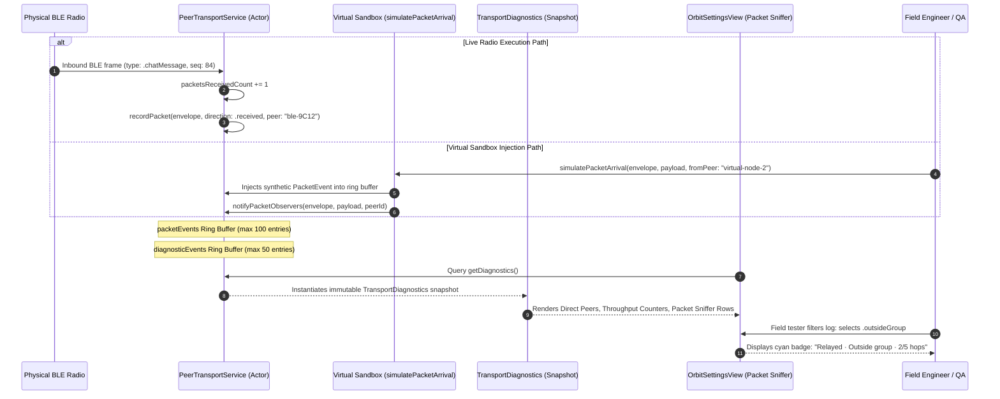

# Volume 12: Feature Diagnostics, Packet Telemetry & Network Health (Meepo)

## Ringkasan Eksekutif & Gambaran Umum Sistem

Volume 12 memeriksa arsitektur observabilitas pada perangkat (on-device), penghitung telemetri paket real-time, pencatatan lalu lintas terarah, metrik penemuan rute, akuntansi sumber daya relay, snapshot diagnostik SOS darurat, dan sandbox mesh virtual dari platform jaringan mesh Meepo. Dirancang untuk zona bencana off-grid, reruntuhan struktural yang runtuh, dan ekspedisi pencarian-dan-penyelamatan terpencil di mana akses internet, stasiun pangkalan seluler, dan stasiun kerja pengembang yang menjalankan Xcode Instruments sama sekali tidak tersedia, subsistem diagnostik melengkapi para insinyur, penguji lapangan, dan personel keselamatan dengan observabilitas jaringan pada perangkat yang lengkap serta kemampuan pengujian sintetis.

Pengembangan aplikasi seluler tradisional sangat bergantung pada platform telemetri berbasis cloud (misalnya Datadog, Sentry, Firebase Crashlytics) dan debugging USB langsung yang ditambatkan ke laptop pengembang. Saat menerapkan jaringan mesh ad-hoc di antara puluhan penolong lapangan yang dikerahkan di lingkungan tanpa internet, alat konvensional ini gagal total:
1. **Observabilitas Tanpa Cloud (Zero-Cloud Observability):** Karena tidak ada konektivitas seluler, telemetri diagnostik tidak dapat dialirkan ke server pusat. Semua agregasi telemetri, penghitungan metrik, dan inspeksi paket harus dieksekusi sepenuhnya pada perangkat keras lokal secara real-time.
2. **Ring Buffering dengan Batasan Sumber Daya:** Menangkap peristiwa radio berkelanjutan pada perangkat seluler dengan anggaran baterai yang ketat memerlukan struktur memori terbatas. Log peristiwa diagnostik dan catatan peristiwa paket dibatasi secara ketat oleh buffer cincin (ring buffer) FIFO (dibatasi 50 hingga 100 entri) untuk menjamin batas memori $O(1)$ waktu konstan dan mencegah persaingan dengan alokasi memori CoreBluetooth.
3. **Packet Sniffing pada Perangkat Tanpa Wireshark:** Memasang penganalisis paket perangkat keras fisik atau sniffer laptop ke puluhan petugas penyelamat yang berjalan melalui zona reruntuhan bencana yang padat secara fisik tidak mungkin dilakukan. Meepo menyematkan inspektur paket berfitur lengkap langsung di dalam kokpit pengaturan aplikasi, mengekspos header cleartext envelope (tipe, nomor urut, jumlah hop, batas hop, ID sesi, dan ID rekan) sambil mempertahankan kerahasiaan muatan (payload) mutlak.
4. **Injeksi Paket Sintetis & Sandbox Mesh Virtual:** Penguji lapangan tidak dapat secara realistis mengumpulkan 20 subjek uji untuk memverifikasi perutean multi-hop, pembatas laju token bucket, atau kebijakan relay kelangsungan hidup baterai. Melalui `PeerTransportService+Diagnostics.simulatePacketArrival()`, Meepo menyediakan sandbox virtual pada perangkat. Insinyur lapangan dapat menyuntikkan paket sintetis secara terprogram, merusak tag autentikasi kriptografis, mensimulasikan serangan replay urutan, dan memodelkan topologi multi-hop yang kompleks (rantai linier, topologi bintang, dan partisi jaringan) langsung di satu iPhone.

---

### Gambaran Umum ELI5: Dasbor Komunikasi & Sandbox Mesh Virtual

Bayangkan menerjunkan detasemen komunikasi darurat bergerak ke zona bencana perkotaan yang padam total tanpa infrastruktur telekomunikasi eksternal:

1. **Dasbor Komunikasi (HUD Diagnostik):** Di layar utama, petugas lapangan hanya melihat hal-hal penting operasional: posisi regu, cincin jarak, dan status SOS. Namun, tersembunyi di dalam Pengaturan terdapat kokpit diagnostik pada perangkat (`OrbitSettingsView`). Seorang spesialis komunikasi dapat memeriksa soket radio aktif, tingkat sinyal RSSI dBm, dan penghitung throughput paket tanpa memerlukan alat pengembang eksternal.
2. **Pemeriksaan Kesehatan Triase 1-Ketuk (Lolos / Peringatan / Gagal):** Ketika seorang penolong sukarelawan bertanya, "Apakah radio saya berfungsi?", mereka tidak perlu membaca raw hex dump. Mereka melihat tiga lencana status sederhana:
   - Hijau (PASS): Terhubung ke unit penyelamat tetangga, paket mengalir, baterai sehat.
   - Kuning (WARN): Tidak ada rekan saat ini dalam jangkauan 1-hop, atau baterai di bawah batas cutoff kelangsungan hidup 20% (menjeda penerusan non-darurat untuk menghemat cadangan keselamatan jiwa).
   - Merah (FAIL): Tumpukan radio Bluetooth/Wi-Fi lokal dimatikan, GNSS ditolak, atau kesalahan kriptografis fatal. Menyediakan tautan resolusi 1-ketukan.
3. **Sniffer Paket Langsung (Buku Besar Paket pada Perangkat):** Inspektur langsung dalam memori mencatat setiap bingkai wire 56-byte yang melintasi gelombang udara lokal: *"Received tactical dispatch from unit 8F2A, hop 2 of 7, sequence 42."* Jika datagram milik regu penyelamat luar, datagram tersebut disorot dalam warna sian sebagai *"Relayed for external squad"*, memverifikasi bahwa simpul membantu meneruskan komunikasi bencana pihak ketiga tanpa mendekripsi konten payload.
4. **Sandbox Mesh Bencana Virtual (Injeksi Paket Sintetis & Lab Kesalahan):** Menguji perilaku mesh multi-hop di lapangan biasanya memerlukan puluhan perangkat fisik yang tersebar bermil-mil di antara puing-puing. Di lab diagnostik Meepo, seorang insinyur dapat menyuntikkan paket sintetis, mensimulasikan tanda tangan MAC Poly1305 yang rusak, meluncurkan serangan replay, dan mengemulasikan rantai relay 3-hop sepenuhnya di dalam memori pada satu perangkat genggam.

---

## Panduan Desain dan UX (Tanpa Kode)

Antarmuka diagnostik menyeimbangkan observabilitas sistem tingkat rendah yang mendalam bagi teknisi lapangan dengan ringkasan keselamatan yang bersih dan tidak mengganggu bagi sukarelawan non-teknis. Bagian berikut menguraikan pengalaman visual, lencana triase, token desain, dan batasan rekayasa.

```
+-----------------------------------------------------------------------------------+
|                           DIAGNOSTICS USER JOURNEY                                |
+-----------------------------------------------------------------------------------+
|                                                                                   |
|  [Orbit Radar View] ---------> [Tap Settings Cog] ---------> [Settings Cockpit]   |
|  Normal Responder Canvas        Top-Right Navigation          OrbitSettingsView    |
|                                                                                   |
|                                                                      |            |
|                                                                      v            |
|                                                            [Connection Diag HUD]  |
|                                                            - Direct Peers: "3"    |
|                                                            - Packets Sent: "128"  |
|                                                            - Packets Recv: "342"  |
|                                                            - Error Banner (if any)|
|                                                                                   |
|                                                                      |            |
|                                                                      v            |
|                                                            [Packet Log Sniffer]   |
|                                                            - Segmented Filter     |
|                                                            - Chronological List   |
|                                                            - Inbound / Outbound   |
|                                                            - Group vs Relay Badge |
|                                                            - Hop Telemetry        |
|                                                                                   |
+-----------------------------------------------------------------------------------+
```

### Perjalanan Pengguna dan Status Layar

#### 1. Mengakses Kokpit Diagnostik (Status 1: Entri Tersembunyi)
- **Navigasi:** Petugas penyelamat normal dan penyintas berinteraksi secara eksklusif dengan kanvas radar Orbit mode gelap, pemicu SOS darurat, dan obrolan grup. Diagnostik tersimpan rapi di dalam lembar pengaturan (`OrbitSettingsView`), diakses dengan mengetuk roda gigi pengaturan di sudut kanan atas.
- **Penataan Visual:** Ditata dalam mode gelap (`.preferredColorScheme(.dark)`) menggunakan latar belakang hitam pekat (true-black) untuk menghemat masa pakai baterai saat meninjau telemetri di zona bencana yang gelap gulita.

#### 2. HUD Diagnostik Koneksi (Status 2: Kesehatan Tautan Sekilas Pandang)
- **Metrik Rekan Langsung (Direct Peers):** Menampilkan `LabeledContent("Direct peers", value: "X")`. Ini mencerminkan jumlah koneksi rekan Bluetooth LE dan Wi-Fi Direct yang operasional dan siap pakai perangkat keras (`activeDirectPeers.filter(\.isDirectLink).count`).
- **Paket Terkirim & Diterima:** Dua penghitung numerik langsung yang meningkat secara monoton (`packetsSent`, `packetsReceived`). Penguji lapangan menggunakan penghitung ini untuk pemeriksaan kewarasan instan: jika seorang penolong melaporkan bahwa ponsel mereka "tidak menerima apa pun", penguji memeriksa `packetsReceived`. Jika penghitung meningkat, penerimaan radio dikonfirmasi, mengisolasi masalah ke ketidakcocokan kunci sesi atau ID grup di luar jangkauan.
- **Catatan Keterbatasan Kekuatan Sinyal:** Keterangan mencatat: `"Signal strength is unavailable for these links."`, menetapkan ekspektasi jujur bahwa RSSI perangkat keras tingkat rendah tidak diekspos oleh API multipeer tingkat tinggi standar iOS.
- **Spanduk Kesalahan Perangkat Keras:** Jika terjadi kegagalan transport yang tidak dapat dipulihkan (misalnya, Bluetooth dimatikan di Pusat Kontrol iOS atau kegagalan inisialisasi manajer periferal), spanduk kesalahan merah mencolok menampilkan `snapshot.lastError`.

#### 3. Pemeriksaan Kesehatan Triase 1-Ketuk (Status 3: Triase Lapangan Sukarelawan)
Bagi staf medis bantuan bencana, sukarelawan, dan kru darat yang bukan insinyur perangkat lunak, HUD diagnostik menerjemahkan metrik teknis menjadi tiga status triase intuitif:

```
+-----------------------------------------------------------------------------------+
|                           TRIAGE HEALTH CHECK STATES                              |
+-----------------------------------------------------------------------------------+
|                                                                                   |
|  [PASS - HEALTHY MESH PARTICIPANT]                                                |
|  - Direct Peers: >= 1                                                             |
|  - Packet Counters: Continuously incrementing                                     |
|  - Battery: > 20% (Relay active)                                                  |
|  - Status: Phone is fully operational and actively routing for the community.     |
|                                                                                   |
|  [WARN - CONSTRAINED OR ISOLATED NODE]                                            |
|  - Direct Peers: 0 (Node physically partitioned from nearest radio neighbor)      |
|  - Battery: <= 20% (Survival mode active; non-emergency relay paused)             |
|  - Status: Phone is listening, but cannot currently reach peers or route packets. |
|                                                                                   |
|  [FAIL - HARDWARE OR PERMISSION FAULT]                                            |
|  - Bluetooth: Unauthorized or Powered Off in iOS Settings                         |
|  - Last Error: Non-nil red error banner displayed                                 |
|  - Status: Radio stack dead; immediate responder intervention required.            |
|                                                                                   |
+-----------------------------------------------------------------------------------+
```

#### 4. Sniffer Log Paket Langsung (Status 4: Inspeksi Lalu Lintas)
- **Umpan Kronologis:** Merender 100 datagram radio terakhir dalam urutan kronologis terbalik (terbaru di bagian atas), memungkinkan para insinyur menyaksikan paket merambat melintasi mesh secara real time.
- **Lencana Terarah:**
  - Paket Masuk (Inbound): Diberi label dengan ikon lingkaran panah bawah (`arrow.down.circle`).
  - Paket Keluar (Outbound): Diberi label dengan ikon lingkaran panah atas (`arrow.up.circle`).
- **Judul Paket:** Mengidentifikasi secara jelas jenis paket subsistem:
  - `"Location ping"` (siaran koordinat GPS berkala)
  - `"SOS"` (siaran darurat mendesak)
  - `"Meeting point"` (proposal koordinat titik temu atau RSVP)
  - `"Route request"` (penemuan perutean reaktif AODV)
  - `"Route response"` (konfirmasi jalur unicast AODV)
  - `"ACK"` (tanda terima pengiriman end-to-end)
  - `"Chat"` (pesan teks efemeral)
  - `"SOS resolved"` (pengumuman selesai darurat / all-clear)
- **Segmentasi Keanggotaan Grup & Keamanan:**
  - Paket Anggota Grup: Ditampilkan dengan teks sekunder abu-abu: `"Received · Group SID"` atau `"Sent · Group SID"`.
  - Paket Relay Mesh Non-Anggota: Disorot dalam warna sian elektrik cerah (`Color.cyan`): `"Received · Outside group"` atau `"Relayed · Outside group"`. Penguji lapangan langsung melihat bahwa perangkat mereka meneruskan lalu lintas untuk kelompok bantuan bencana lain tanpa mendekripsi data pribadi mereka.
- **Telemetri Hop & Urutan:**
  - Format: `"From BLE …8F2A · 2/5 hops · Seq 142"`.
  - Membuktikan bahwa paket melintasi dua relay perantara sebelum mencapai perangkat ini, mengonfirmasi perutean multi-hop aktif di seluruh zona bencana.

#### 5. Pemfilteran Log Paket Sekali Ketuk (Status 5: Isolasi Lalu Lintas)
Pemilih kontrol tersegmentasi empat arah berada di bagian atas log paket, memungkinkan insinyur lapangan memfilter aliran radio bervolume tinggi:
1. **Semua Paket (`.all`):** Menampilkan seluruh throughput radio mentah.
2. **Obrolan dan SOS (`.chatAndSOS`):** Memfilter ping lokasi frekuensi tinggi untuk fokus pada pesan manusia dan suar marabahaya keselamatan jiwa.
3. **Di Luar Grup (`.outsideGroup`):** Mengisolasi paket asing yang diteruskan melintasi mesh komunal.
4. **Direlay (`.relayed`):** Hanya menampilkan paket di mana perangkat lokal bertindak sebagai penerus perantara (`isOutsideGroup && direction == .dispatched`).

---

### Mengapa Kita Tidak Bisa Hanya...? (Batasan untuk Perancang)

Perancang produk sering bertanya mengapa fitur diagnostik dirancang sebagai kokpit teknik internal daripada fitur yang menghadap konsumen. Di bawah ini adalah batasan rekayasa:

#### 1. Mengapa Kita Tidak Bisa Mengekspos HUD Diagnostik di Layar Utama?
- **Pertanyaan Perancang:** *"Mengapa tidak menampilkan penghitung paket dan penghitung rekan langsung sebagai pil melayang permanen di layar radar utama?"*
- **Realitas Rekayasa:**
  - **Kelebihan Beban Kognitif:** Dalam operasi bencana yang kacau dan berstres tinggi, petugas lapangan memerlukan navigasi langsung dan terfokus: di mana anggota regu saya, dan bagaimana cara menyiarkan SOS? Menampilkan nomor urut paket mentah, jumlah hop, dan penghitung byte menyebabkan kelebihan beban kognitif dan kekacauan visual.
  - **Kepanikan yang Tidak Perlu:** Dalam jaringan mesh ad-hoc, jumlah rekan langsung berfluktuasi secara konstan saat personel melintasi puing-puing, menavigasi dinding yang runtuh, atau melintasi puing-puing struktural. Melihat "Direct peers: 0" selama 15 detik saat berpindah sektor dapat menyebabkan penolong panik, meskipun kotak keluar (outbox) menyangga pesan dengan aman hingga rekan berikutnya berada dalam jangkauan radio.

#### 2. Mengapa Lab Diagnostik Internal Berada di Dalam Aplikasi Produksi?
- **Pertanyaan Perancang:** *"Mengapa tidak membuat aplikasi debug internal terpisah untuk para insinyur dan menjaga aplikasi konsumen 100% bersih?"*
- **Realitas Rekayasa:**
  - **Realitas Lapangan:** Saat menguji di tengah bantuan bencana gurun atau alam liar terpencil, pengembang tidak memiliki internet untuk mengunduh build TestFlight internal, juga tidak membawa laptop yang menjalankan Xcode Instruments ke medan berlumpur.
  - **Triase Perangkat Keras Langsung:** Ketika seorang penolong mendekati teknisi komunikasi Komando Insiden yang melaporkan bahwa telemetri regu hilang, teknisi dapat memeriksa HUD diagnostik bawaan langsung di perangkat genggam dalam lima detik, memverifikasi apakah paket tiba tanpa memerlukan alat pengembang.

#### 3. Mengapa Kita Tidak Bisa Menampilkan Kekuatan Sinyal Real-Time (RSSI dBm) untuk Setiap Tautan?
- **Pertanyaan Perancang:** *"Bisakah kita menambahkan pengukur kekuatan sinyal 5-bar gaya seluler di sebelah nama setiap anggota regu?"*
- **Realitas Rekayasa:**
  - **Abstraksi OS Tingkat Tinggi:** Kerangka kerja peer-to-peer tingkat tinggi Apple mengabstraksikan perangkat keras radio fisik dan tidak mengekspos RSSI mentah dalam desibel-miliwatt (dBm) untuk koneksi rekan yang aktif.
  - **Volatilitas Multipath:** Di medan puing yang padat, sinyal Bluetooth 2,4 GHz memantul dari beton basah, besi struktural, dan puing-puing. Pengukuran RSSI dapat berfluktuasi liar dari $-55\text{ dBm}$ (kuat) ke $-85\text{ dBm}$ (lemah) dalam dua detik hanya karena seseorang berjalan di antara dua penolong atau melangkah di belakang pilar yang runtuh. Menampilkan bilah sinyal yang berfluktuasi menciptakan kecemasan palsu.

---

### Token Desain yang Dapat Diedit vs. Aturan Rekayasa Terkunci

Tabel berikut membedakan antara token desain estetika yang dapat disesuaikan secara aman oleh perancang produk dan invarian rekayasa yang tidak dapat diubah:

| Kategori Parameter | Token Desain yang Dapat Diedit | Aturan Rekayasa Terkunci | Alasan Arsitektural |
| :--- | :--- | :--- | :--- |
| **Judul Bagian Diagnostik**| Salinan label ("Connection diagnostics") | Akurasi telemetri & hitungan non-interpolasi | Label UI dapat dilokalkan, tetapi penghitung paket harus mencerminkan penerimaan perangkat keras mentah yang tepat. |
| **Gaya Lencana Status** | Warna lencana Lolos/Peringatan/Gagal dan radius sudut | Batas ambang batas kelangsungan hidup baterai 20% | Lencana visual dapat ditata, tetapi jeda relay 20% di-hardcode dalam `MeepoConfiguration`. |
| **Warna Luar Grup** | Warna sian (`Color.cyan`) untuk paket relay asing | Logika `envelope.sessionId != session.sessionId` | Warna dapat disesuaikan, tetapi logika isolasi grup mencegah pemalsuan paket asing. |
| **Label Judul Paket** | Teks tampilan ("Location ping", "Meeting point") | 8 representasi bita kanonik `PacketType` | Judul dapat dilokalkan, tetapi kode enum paket wire 4-bit harus tetap stabil. |
| **Kapasitas Ring Buffer** | Padding baris daftar, ukuran font (`caption`) | Batas 50 peristiwa untuk log, batas 100 paket untuk sniffer| Kapasitas menjamin penggunaan memori konstan $O(1)$, mencegah crash tekanan memori latar belakang. |
| **Filter Log Paket** | Gaya visual kontrol tersegmentasi pemilih | Predikat pemfilteran 4 arah (`all`, `chatAndSOS`, dll.)| Pemilih visual dapat ditata, tetapi logika filter harus secara akurat menyegmentasikan kategori lalu lintas. |
| **Injeksi Sintetis** | Salinan tombol uji dan gaya pratinjau | Nol mutasi kunci Keychain langsung | Simulasi virtual menguji perutean mesh tanpa mengorbankan kunci kriptografis sesi nyata. |

---

## Pembahasan Teknis Mendalam (Technical Engineering Deep-Dive)

### Alur End-to-End: Dari Datagram Radio Langsung ke Inspektur Paket & Sandbox Virtual

Bagi insinyur iOS junior dan pengembang sistem, melacak bagaimana datagram radio fisik melintasi saluran pipa diagnostik dan bagaimana paket sintetis disuntikkan ke dalam sandbox virtual sangatlah penting:

```
+-----------------------------------------------------------------------------------+
|               END-TO-END DIAGNOSTICS & SIMULATION PIPELINE                        |
+-----------------------------------------------------------------------------------+
|                                                                                   |
|  [PATH A: LIVE HARDWARE TRAFFIC]            [PATH B: VIRTUAL SANDBOX INJECTION]   |
|  - CoreBluetooth peripheral delivers frame  - Tester calls simulatePacketArrival()|
|  - PeerTransportService unpackages bytes    - Synthetic CleartextEnvelope created |
|                                                                                   |
|           |                                                    |                  |
|           +-------------------------+--------------------------+                  |
|                                     |                                             |
|                                     v                                             |
|  1. ACTOR INGESTION & RING BUFFERING (PeerTransportService)                       |
|     - packetsReceivedCount += 1                                                   |
|     - Check group membership: isOutsideGroup = (envelope.sessionId != session.id) |
|     - Append PacketEvent to packetEvents (cap at 100, removeFirst on overflow)    |
|     - If error occurs: append DiagnosticEvent to diagnosticEvents (cap at 50)     |
|                                                                                   |
|                                     |                                             |
|                                     v                                             |
|  2. SNAPSHOT GENERATION (getDiagnostics())                                        |
|     - UI polls transport.getDiagnostics() on view appearance                      |
|     - Evaluates activeConnections.values.filter(\.isReady) + blePeers             |
|     - Copies packetsSentCount, packetsReceivedCount, obsoletePingsCoalesced       |
|     - Instantiates immutable, thread-safe TransportDiagnostics snapshot           |
|                                                                                   |
|                                     |                                             |
|                                     v                                             |
|  3. PRESENTATION RENDERING (OrbitSettingsView)                                    |
|     - Section "Connection diagnostics": displays direct peers, sent, received     |
|     - Section "Packet log": applies selected PacketFilter predicate               |
|     - Renders packetRow: direction icon, timestamp, type label, hop telemetry     |
|                                                                                   |
+-----------------------------------------------------------------------------------+
```

#### Rincian Arsitektural Langkah-demi-Langkah Mendalam:

1. **Fase 1: Penyerapan Datagram & Perekaman Ring-Buffer:**
   - Ketika datagram radio fisik tiba melalui CoreBluetooth, `PeerTransportService.handleInboundData()` mengekstrak header cleartext 12-byte.
   - Transport menambah `packetsReceivedCount &+= 1`.
   - Aktor memanggil `recordPacket(envelope, direction: .received, peerId: peerId)`.
   - Metode mengevaluasi keanggotaan grup: `let isOutsideGroup = envelope.sessionId != session.sessionId`.
   - Metode ini menambahkan `TransportDiagnostics.PacketEvent` baru ke `packetEvents`. Jika `packetEvents.count > 100`, metode ini segera mengeluarkan paket tertua (`packetEvents.removeFirst()`), mempertahankan jejak memori $O(1)$ yang ketat.

2. **Fase 2: Polling Snapshot melalui `getDiagnostics()`:**
   - Dalam `SessionController`, tugas berkala meminta `await transport.getDiagnostics()` saat layar pengaturan aktif.
   - Aktor mengompilasi tetangga aktif dari registri koneksi internalnya:
     `activeDirectPeers: activePeers + blePeers.map { PeerInfo(id: $0, displayName: "Bluetooth peer", isGroupMember: false) }`.
   - Aktor menangkap metrik penggabungan (coalescing) dari kotak keluar prioritas: `obsoletePingsCoalesced: outbox.obsoletePingsCoalesced`.
   - Aktor menginstansiasi struktur tipe nilai `TransportDiagnostics` yang tidak dapat diubah, mentransfer snapshot dengan aman melintasi batas aktor ke `@MainActor`.

3. **Fase 3: Presentasi di `OrbitSettingsView`:**
   - Tampilan mengikat snapshot. Dalam `packetLog()`, tampilan membalikkan larik (`packets.reversed()`) sehingga paket terbaru dirender di bagian atas.
   - Predikat `packetFilter` yang dipilih memfilter koleksi:
     - `.chatAndSOS`: memeriksa `packet.envelope.type == .chatMessage || packet.envelope.type == .sos`.
     - `.outsideGroup`: memeriksa `packet.isOutsideGroup`.
     - `.relayed`: memeriksa `packet.isOutsideGroup && packet.direction == .dispatched`.
   - Setiap entri yang cocok dirender sebagai `packetRow` yang menampilkan simbol arah, judul jenis yang dilokalkan, waktu relatif, jumlah hop (`"2/5 hops"`), nomor urut, dan pengenal rekan yang ditutupi (`"BLE …8F2A"`).

---

## Berkas Sumber yang Disertakan

Subsistem diagnostik dan telemetri diimplementasikan di tepat enam berkas sumber Swift yang terverifikasi dalam basis kode Meepo:

| Path Berkas Relatif Repositori | Jumlah Baris Tepat (`wc -l`) | Target / Domain Konkurensi | Peran Subsistem Arsitektural |
| :--- | :---: | :--- | :--- |
| [`../../Teekum/Teekum/Core/Transport/DiagnosticEvent.swift`](../../Teekum/Teekum/Core/Transport/DiagnosticEvent.swift) | 29 | Pure Swift Model | Timestamped operational log event recording transport operations and error levels. |
| [`../../Teekum/Teekum/Core/Transport/TransportDiagnostics.swift`](../../Teekum/Teekum/Core/Transport/TransportDiagnostics.swift) | 70 | Pure Swift Model (`nonisolated`) | Comprehensive radio transport telemetry snapshot aggregating link counters and packets. |
| [`../../Teekum/Teekum/Core/Transport/PeerTransportService+Diagnostics.swift`](../../Teekum/Teekum/Core/Transport/PeerTransportService+Diagnostics.swift) | 73 | Actor Extension (`PeerTransportService`) | Live link aggregation, 100-packet ring buffer management, and synthetic test harness. |
| [`../../Teekum/Teekum/Core/Mesh/Routing/RouteDiscoveryDiagnostics.swift`](../../Teekum/Teekum/Core/Mesh/Routing/RouteDiscoveryDiagnostics.swift) | 45 | Pure Swift Model (`nonisolated`) | Reactive AODV routing telemetry tracking in-flight discoveries, RREQ/RREP, and routes. |
| [`../../Teekum/Teekum/Core/Mesh/Relay/RelayTelemetry.swift`](../../Teekum/Teekum/Core/Mesh/Relay/RelayTelemetry.swift) | 48 | Pure Swift Model | Relay resource telemetry tracking forwarded packets, token bucket drops, and battery mode. |
| [`../../Teekum/Teekum/Features/SOS/Models/SOSDiagnostics.swift`](../../Teekum/Teekum/Features/SOS/Models/SOSDiagnostics.swift) | 40 | Pure Swift Model | Emergency SOS diagnostic snapshot reporting event ID, retry counts, and ACK status. |
| **Total Kode Produksi** | **305 baris** | **Terverifikasi 100%** | **Inventaris Sumber Lengkap Volume 12** |

---

## Diagram Diagnostik & Sandbox Virtual

Diagram berikut mengilustrasikan interaksi antara lalu lintas radio langsung, rangkaian pengujian virtual, aktor agregasi telemetri, dan sniffer presentasi:



---

## Pembahasan Mendalam Berkas demi Berkas Khusus

### 1. `Teekum/Teekum/Core/Transport/DiagnosticEvent.swift`

- **Path Lengkap Relatif Repositori:** [`../../Teekum/Teekum/Core/Transport/DiagnosticEvent.swift`](../../Teekum/Teekum/Core/Transport/DiagnosticEvent.swift)
- **Jumlah Baris:** Tepat 29 baris (`wc -l`)
- **Target / Domain Konkurensi:** Model Domain Swift Murni (`Identifiable`, `Sendable`)

#### Apa yang Dilakukan Berkas Ini
`DiagnosticEvent.swift` mendefinisikan catatan peristiwa operasional yang tidak dapat diubah (immutable) dan diberi stempel waktu yang terjadi di dalam lapisan transport radio. Berkas ini mengkategorikan kejadian transport ke dalam tiga tingkat keparahan (`.info`, `.warning`, `.error`) dan menetapkan `UUID` unik untuk setiap peristiwa, memungkinkan daftar UI untuk menampilkan dan mengidentifikasi entri log secara unik tanpa alokasi memori tambahan.

#### Analogi ELI5
`DiagnosticEvent` adalah entri dalam buku catatan nakhoda kapal. Setiap kali terjadi sesuatu yang penting—seperti menghubungkan ke tetangga radio baru, menjatuhkan paket karena baterai lemah, atau mengalami kesalahan Bluetooth—kapten mencatat detik yang tepat, menandainya dengan lencana biru (info), kuning (peringatan), atau merah (kesalahan), dan mencatat penjelasannya.

#### Istilah Teknis yang Didefinisikan
- **Entri Log Operasional:** Catatan diagnostik terstruktur dalam memori yang menangkap tonggak status sistem runtime.
- **Tingkat Keparahan Peristiwa (`EventLevel`):** Enumerasi yang membedakan perubahan status sistem rutin (`.info`), anomali yang dapat dipulihkan (`.warning`), dan kegagalan perangkat keras/transport kritis (`.error`).
- **Kesesuaian Sendable:** Protokol Swift yang menjamin bahwa peristiwa log dapat diteruskan melintasi batas aktor bersamaan (dari aktor latar belakang `PeerTransportService` ke komponen UI `@MainActor`) tanpa menimbulkan race condition data.

#### Tipe Kunci, Bidang, Metode, Status & Invarian

```swift
// Verified verbatim from Teekum/Teekum/Core/Transport/DiagnosticEvent.swift:10-29
/// A timestamped diagnostic event recording transport-level operations.
public struct DiagnosticEvent: Identifiable, Sendable {
    public let id: UUID
    public let timestamp: Date
    public let message: String
    public let level: EventLevel
    
    public enum EventLevel: String, Sendable {
        case info
        case warning
        case error
    }
    
    public init(id: UUID = UUID(), timestamp: Date = Date(), message: String, level: EventLevel = .info) {
        self.id = id
        self.timestamp = timestamp
        self.message = message
        self.level = level
    }
}
```

##### Analisis Arsitektural Baris demi Baris:
- Baris 11–15: Merangkum empat properti yang tidak dapat diubah: `id` (`UUID` yang sesuai dengan `Identifiable`), `timestamp` (`Date`), `message` (`String`), dan `level` (`EventLevel`).
- Baris 17–21: Mendefinisikan enum `EventLevel` yang didukung oleh `String`, sesuai dengan `Sendable`.
- Baris 23–28: Penginisialisasi memberwise publik dengan parameter default (`UUID()`, `Date()`, dan `.info`), memungkinkan pemanggilan satu baris seperti `DiagnosticEvent(message: "Bluetooth radio online")`.

#### Kasus Batas, Mode Kegagalan & Invarian
- **Invarian Buffer Terikat:** Instance `DiagnosticEvent` disimpan di dalam `PeerTransportService.diagnosticEvents`, yang dibatasi secara ketat pada `maxDiagnosticEvents = 50`. Ketika peristiwa ke-51 tiba, peristiwa tertua dipangkas (`diagnosticEvents.removeFirst()`), menjamin batas memori $O(1)$ terlepas dari durasi sesi.

---

### 2. `Teekum/Teekum/Core/Transport/TransportDiagnostics.swift`

- **Path Lengkap Relatif Repositori:** [`../../Teekum/Teekum/Core/Transport/TransportDiagnostics.swift`](../../Teekum/Teekum/Core/Transport/TransportDiagnostics.swift)
- **Jumlah Baris:** Tepat 70 baris (`wc -l`)
- **Target / Domain Konkurensi:** Model Domain Swift Murni (`nonisolated`, `Sendable`)

#### Apa yang Dilakukan Berkas Ini
`TransportDiagnostics.swift` mendefinisikan snapshot komprehensif yang tidak dapat diubah dari seluruh lapisan transport radio peer-to-peer. Berkas ini merangkum metadata sesi aktif, status tautan radio, inventaris rekan langsung, penghitung throughput paket (terkirim, diterima, ping yang digabungkan, kesalahan), dan koleksi terbatas dari peristiwa diagnostik terbaru serta catatan paket langsung. Berkas ini juga menyematkan struct `PacketEvent` bersarang yang mewakili pengamatan transmisi radio individual.

#### Analogi ELI5
`TransportDiagnostics` adalah foto bingkai beku dari seluruh dasbor mobil. Dalam satu snapshot, gambar ini menangkap speedometer (paket terkirim/diterima), pengukur bahan bakar (status tautan), lampu periksa mesin (pesan kesalahan), manifes penumpang (rekan langsung aktif), dan rekaman kotak hitam dari 100 belokan terakhir (paket terbaru).

#### Istilah Teknis yang Didefinisikan
- **Pola Snapshot (Snapshot Pattern):** Meneruskan salinan tipe nilai yang tidak dapat diubah dari status aktor yang dapat bermutasi ke thread utama, memungkinkan tampilan SwiftUI merender telemetri yang kompleks tanpa memperoleh kunci aktor atau mempertaruhkan race condition selama penggambaran ulang.
- **Peristiwa Paket Terarah (`PacketEvent`):** Pengamatan ringan terhadap kedatangan atau keberangkatan paket radio, menangkap header cleartext envelope, arah (`received` vs. `dispatched`), ID rekan, dan klasifikasi keanggotaan grup (`isOutsideGroup`).
- **Penggabungan Ping (Ping Coalescing) (`obsoletePingsCoalesced`):** Penghitung yang melacak berapa banyak ping lokasi GPS usang yang dibuang dari kotak keluar sebelum transmisi, membuktikan bahwa airtime radio berhasil dihemat.

#### Tipe Kunci, Bidang, Metode, Status & Invarian

```swift
// Verified verbatim from Teekum/Teekum/Core/Transport/TransportDiagnostics.swift:10-40
/// Live diagnostic snapshot of peer-to-peer radio telemetry for on-device HUD testing.
nonisolated public struct TransportDiagnostics: Sendable {
    /// A radio observation containing only cleartext header and link metadata.
    public struct PacketEvent: Identifiable, Sendable {
        public enum Direction: Equatable, Sendable {
            case received
            case dispatched
        }

        public let id = UUID()
        public let timestamp = Date.now
        public let envelope: CleartextEnvelope
        public let direction: Direction
        public let peerId: String
        public let isOutsideGroup: Bool
    }

    public let localPeerId: String
    public let serviceType: String
    public let sessionName: String
    public let sessionId: UInt32
    public let state: TransportState
    public let activeDirectPeers: [PeerInfo]
    public let packetsSent: Int
    public let packetsReceived: Int
    public let obsoletePingsCoalesced: Int
    public let sendErrors: Int
    public let lastError: String?
    public let recentEvents: [DiagnosticEvent]
    public let recentPackets: [PacketEvent]
```

##### Invarian Bidang & Telemetri Arsitektural:
- `localPeerId: String`: Pengenal rekan radio lokal yang persisten (misalnya `"ble-3F9A"`).
- `sessionId: UInt32`: Pengidentifikasi sesi grup 24-bit yang aktif.
- `state: TransportState`: Status siklus hidup saat ini (`.uninitialized`, `.starting`, `.ready`, `.suspended`, `.stopped`).
- `activeDirectPeers: [PeerInfo]`: Daftar rekan dengan koneksi radio fisik satu-hop langsung yang aktif.
- `packetsSent: Int`, `packetsReceived: Int`: Penghitung throughput paket mentah yang meningkat secara monoton.
- `obsoletePingsCoalesced: Int`: Jumlah total koordinat GPS redundan yang dipangkas dari kotak keluar.
- `recentPackets: [PacketEvent]`: Buffer cincin terbatas hingga 100 pengamatan paket terbaru yang menggerakkan sniffer paket pada perangkat di `OrbitSettingsView`.

#### Kasus Batas, Mode Kegagalan & Invarian
- **Nol Paparan Data Sensitif:** `PacketEvent` menangkap secara ketat metadata `CleartextEnvelope` (tipe, nomor urut, jumlah hop, batas hop, ID sesi) dan ID rekan. Bita muatan terenkripsi (`Data`) tidak pernah disimpan di dalam `TransportDiagnostics`, menjamin bahwa memeriksa diagnostik di lingkungan bantuan bencana publik tidak dapat membocorkan koordinat lokasi pribadi atau teks obrolan.

---

### 3. `Teekum/Teekum/Core/Transport/PeerTransportService+Diagnostics.swift`

- **Path Lengkap Relatif Repositori:** [`../../Teekum/Teekum/Core/Transport/PeerTransportService+Diagnostics.swift`](../../Teekum/Teekum/Core/Transport/PeerTransportService+Diagnostics.swift)
- **Jumlah Baris:** Tepat 73 baris (`wc -l`)
- **Target / Domain Konkurensi:** Ekstensi Aktor `PeerTransportService`

#### Apa yang Dilakukan Berkas Ini
`PeerTransportService+Diagnostics.swift` memperluas aktor transport inti dengan pengumpulan telemetri dan metode ring-buffering diagnostik. Berkas ini mengompilasi daftar tetangga langsung dari koneksi Wi-Fi dan Bluetooth yang aktif, mengonstruksi snapshot `TransportDiagnostics` yang tidak dapat diubah, menambahkan pengamatan paket terarah ke buffer cincin 100 entri, dan menyediakan rangkaian pengujian `simulatePacketArrival` untuk injeksi paket sintetis.

#### Analogi ELI5
Berkas ini adalah port diagnostik mekanik (konektor OBD-II) di bawah dasbor. Saat Anda mencolokkan alat diagnostik, alat ini menanyai mesin, menghitung setiap busi yang menyala, mencantumkan semua sensor yang terhubung, dan menyerahkan laporan yang rapi. Alat ini juga memiliki tombol uji khusus yang memungkinkan mekanik mensimulasikan sinyal sensor mesin untuk memastikan komputer bereaksi dengan baik tanpa harus mengendarai mobil di arena balap.

#### Istilah Teknis yang Didefinisikan
- **Agregasi Tautan Langsung:** Menggabungkan kamus koneksi radio fisik yang berbeda (`connections` untuk Wi-Fi Direct / Multipeer dan `blePeers` untuk Bluetooth LE) menjadi daftar terpadu dari catatan `NeighborInfo` dan `PeerInfo`.
- **Pembatasan Ring Buffer:** Menegakkan batas atas keras pada ukuran koleksi (`if packetEvents.count > 100 { packetEvents.removeFirst() }`) untuk mempertahankan penggunaan memori konstan $O(1)$.
- **Injeksi Paket Sintetis:** Memasukkan paket radio simulasi secara terprogram ke dalam saluran pipa pengamat aktor transport seolah-olah paket tersebut diterima melalui antena radio fisik.

#### Tipe Kunci, Bidang, Metode, Status & Invarian

```swift
// Verified verbatim from Teekum/Teekum/Core/Transport/PeerTransportService+Diagnostics.swift:15-33
    /// Current view of directly reachable neighbors from NeighborTable.
    public func activeNeighbors() async -> [NeighborInfo] {
        // Forward using live links, not the asynchronously updated telemetry registry.
        // BLE and newly ready Wi-Fi links must be available to the router immediately.
        let wifi = connections.values.filter { $0.isReady }.map {
            NeighborInfo(id: $0.peerId, displayName: $0.displayName, state: .connected,
                rssi: nil, lastSeen: $0.lastSeen, roundTripTimeMs: nil,
                isGroupMember: $0.isGroupMember, capabilities: $0.capabilities)
        }
        return wifi + blePeers.map {
            NeighborInfo(id: $0, displayName: "Bluetooth peer", state: .connected,
                rssi: nil, lastSeen: Date(), roundTripTimeMs: nil,
                isGroupMember: false, capabilities: .standardMesh)
        }
    }
    
    /// Returns the number of direct peer connections currently established and operational.
    public func activeDirectPeerCount() async -> Int {
        connections.values.filter { $0.isReady }.count + blePeers.count
    }
```

###### Pembangunan Snapshot (`baris 35-63`):

```swift
// Verified verbatim from Teekum/Teekum/Core/Transport/PeerTransportService+Diagnostics.swift:35-63
    /// Captures a live diagnostic snapshot of radio telemetry.
    public func getDiagnostics() async -> TransportDiagnostics {
        let activePeers = connections.values.map { peer in
            PeerInfo(
                id: peer.peerId,
                displayName: peer.displayName,
                rssi: nil,
                isDirectLink: peer.isReady,
                isGroupMember: peer.isGroupMember,
                lastSeen: peer.lastSeen
            )
        }
        
        return TransportDiagnostics(
            localPeerId: localPeerId,
            serviceType: serviceType,
            sessionName: activeSession?.sessionName ?? "None",
            sessionId: activeSession?.sessionId ?? 0,
            state: currentState,
            activeDirectPeers: activePeers + blePeers.map { PeerInfo(id: $0, displayName: "Bluetooth peer", isGroupMember: false) },
            packetsSent: packetsSentCount,
            packetsReceived: packetsReceivedCount,
            obsoletePingsCoalesced: outbox.obsoletePingsCoalesced,
            sendErrors: sendErrorsCount,
            lastError: lastErrorMessage,
            recentEvents: diagnosticEvents,
            recentPackets: packetEvents
        )
    }
```

###### Buffer Cincin Perekaman Paket (`baris 65-72`):

```swift
// Verified verbatim from Teekum/Teekum/Core/Transport/PeerTransportService+Diagnostics.swift:65-72
    func recordPacket(_ envelope: CleartextEnvelope, direction: TransportDiagnostics.PacketEvent.Direction, peerId: String) {
        guard let session = activeSession else { return }
        packetEvents.append(.init(envelope: envelope, direction: direction, peerId: peerId,
            isOutsideGroup: envelope.sessionId != session.sessionId))
        if packetEvents.count > 100 {
            packetEvents.removeFirst()
        }
    }
```

#### Kasus Batas, Mode Kegagalan & Invarian
- **Penggabungan Tetangga Langsung Multi-Radio:** Dalam `activeNeighbors()`, metode ini menggabungkan koneksi Wi-Fi yang diverifikasi (`connections.values.filter { $0.isReady }`) dengan rekan BLE yang aktif (`blePeers`). Tautan Wi-Fi membawa metadata `displayName` dan keanggotaan, sementara periferal BLE mentah default ke `"Bluetooth peer"`, memastikan mesin perutean memiliki visibilitas penuh di semua media fisik.
- **Luapan Ring Buffer (Ring Buffer Overflow):** Ketika lalu lintas mesh frekuensi tinggi terjadi (misalnya 20 rekan menyiarkan ping lokasi setiap 5 detik), `recordPacket()` menegakkan `if packetEvents.count > 100 { packetEvents.removeFirst() }`. Paket lama dikeluarkan dengan aman dari bagian atas antrean FIFO, mencegah pembengkakan memori.

---

### 4. `Teekum/Teekum/Core/Mesh/Routing/RouteDiscoveryDiagnostics.swift`

- **Path Lengkap Relatif Repositori:** [`../../Teekum/Teekum/Core/Mesh/Routing/RouteDiscoveryDiagnostics.swift`](../../Teekum/Teekum/Core/Mesh/Routing/RouteDiscoveryDiagnostics.swift)
- **Jumlah Baris:** Tepat 45 baris (`wc -l`)
- **Target / Domain Konkurensi:** Model Domain Swift Murni (`nonisolated`, `Sendable`, `Equatable`)

#### Apa yang Dilakukan Berkas Ini
`RouteDiscoveryDiagnostics.swift` memodelkan snapshot telemetri instan dari subsistem perutean reaktif AODV. Model ini melacak permintaan penemuan jalur yang sedang berlangsung (in-flight), penghitung penemuan rute yang diinisiasi/berhasil/gagal seumur hidup, statistik paket Route Request (RREQ) dan Route Response (RREP), peristiwa pembatalan rute, dan ukuran tabel rute aktif saat ini.

#### Analogi ELI5
`RouteDiscoveryDiagnostics` adalah log pengiriman operasional untuk penemuan rute AODV. Log ini mencatat: berapa banyak kueri rute yang aktif melintasi mesh, berapa banyak jalur terverifikasi yang ditemukan, berapa banyak pencarian yang gagal karena seorang petugas berada di luar jangkauan, dan berapa banyak jalur basi yang dibersihkan saat puing meruntuhkan jembatan radio.

#### Istilah Teknis yang Didefinisikan
- **Penemuan Rute AODV:** Perutean Ad-hoc On-Demand Distance Vector, di mana simpul menyiarkan paket Route Request (RREQ) sesuai permintaan dan menerima paket Route Response (RREP) unicast di sepanjang jalur balik.
- **Penemuan Sedang Berlangsung (In-Flight Discovery):** Pencarian rute asinkron aktif yang telah menyiarkan RREQ dan saat ini sedang menunggu RREP sebelum batas waktu penemuan berakhir.
- **Pembatalan Rute (Route Invalidation):** Membersihkan entri dari tabel perutean saat pemutusan tautan terdeteksi atau ping keep-alive berhenti.

#### Tipe Kunci, Bidang, Metode, Status & Invarian

```swift
// Verified verbatim from Teekum/Teekum/Core/Mesh/Routing/RouteDiscoveryDiagnostics.swift:10-44
nonisolated public struct RouteDiscoveryDiagnostics: Sendable, Equatable {
    public let activeInFlightDiscoveries: Int
    public let totalDiscoveriesInitiated: Int
    public let totalDiscoveriesSucceeded: Int
    public let totalDiscoveriesFailed: Int
    public let totalRReqSent: Int
    public let totalRReqReceived: Int
    public let totalRRespSent: Int
    public let totalRRespReceived: Int
    public let totalRoutesInvalidated: Int
    public let activeRoutesCount: Int
    
    public init(
        activeInFlightDiscoveries: Int = 0,
        totalDiscoveriesInitiated: Int = 0,
        totalDiscoveriesSucceeded: Int = 0,
        totalDiscoveriesFailed: Int = 0,
        totalRReqSent: Int = 0,
        totalRReqReceived: Int = 0,
        totalRRespSent: Int = 0,
        totalRRespReceived: Int = 0,
        totalRoutesInvalidated: Int = 0,
        activeRoutesCount: Int = 0
    ) {
        self.activeInFlightDiscoveries = activeInFlightDiscoveries
        self.totalDiscoveriesInitiated = totalDiscoveriesInitiated
        self.totalDiscoveriesSucceeded = totalDiscoveriesSucceeded
        self.totalDiscoveriesFailed = totalDiscoveriesFailed
        self.totalRReqSent = totalRReqSent
        self.totalRReqReceived = totalRReqReceived
        self.totalRRespSent = totalRRespSent
        self.totalRRespReceived = totalRRespReceived
        self.totalRoutesInvalidated = totalRoutesInvalidated
        self.activeRoutesCount = activeRoutesCount
    }
}
```

##### Evaluasi Metrik Diagnostik:
- `totalDiscoveriesSucceeded / totalDiscoveriesInitiated`: Menghasilkan rasio keberhasilan penemuan rute. Rasio di bawah 70% di lapangan menunjukkan kemacetan RF yang parah atau jarak fisik yang berlebihan antar hop.
- `totalRReqReceived vs totalRReqSent`: Melacak partisipasi mesh dalam pengintaian rute. Jika `totalRReqReceived` tinggi sementara `totalRRespSent` rendah, perangkat secara aktif merutekan lalu lintas pencarian untuk tetangga tanpa menjadi tujuan.

#### Kasus Batas, Mode Kegagalan & Invarian
- **Dukungan Pengujian Equatable:** Menyesuaikan dengan `Equatable`, memungkinkan pengujian integrasi otomatis di `RouteDiscoveryTests` untuk menegaskan peningkatan telemetri inkremental yang tepat setelah simulasi penemuan permintaan rute.

---

### 5. `Teekum/Teekum/Core/Mesh/Relay/RelayTelemetry.swift`

- **Path Lengkap Relatif Repositori:** [`../../Teekum/Teekum/Core/Mesh/Relay/RelayTelemetry.swift`](../../Teekum/Teekum/Core/Mesh/Relay/RelayTelemetry.swift)
- **Jumlah Baris:** Tepat 48 baris (`wc -l`)
- **Target / Domain Konkurensi:** Model Domain Swift Murni (`Sendable`, `Equatable`)

#### Apa yang Dilakukan Berkas Ini
`RelayTelemetry.swift` memodelkan snapshot telemetri sumber daya teragregasi dari mesin penerusan paket komunal. Berkas ini mencatat jumlah total paket yang diteruskan, paket SOS darurat yang diteruskan, penghitungan penurunan paket yang dikategorikan berdasarkan alasan kebijakan (batas laju token bucket, batas hop habis, mode kebijakan dinonaktifkan, ambang batas baterai), laju penerusan saat ini per detik, dan status mode kelangsungan hidup darurat.

#### Analogi ELI5
`RelayTelemetry` adalah pengukur throughput dan beban untuk penerusan mesh komunal. Ini melacak: berapa banyak paket pihak ketiga yang diteruskan melintasi puing-puing (`packetsRelayed`), berapa banyak suar SOS darurat yang diprioritaskan, berapa banyak paket yang dijatuhkan karena pembatas laju mencekik lalu lintas, dan apakah simpul telah mengaktifkan mode kelangsungan hidup untuk menghemat sisa baterai 20%.

#### Istilah Teknis yang Didefinisikan
- **Pembatas Laju Token Bucket:** Algoritma kontrol kemacetan yang melacak token bandwidth yang tersedia. Ketika token habis, paket dijatuhkan (`packetsDroppedRateLimit`) untuk mencegah kejenuhan saluran radio.`
- **Kehabisan Batas Hop:** Menjatuhkan paket yang jumlah hop-nya telah mencapai batas maksimum yang diizinkan (`packetsDroppedHopLimit`), mencegah loop perutean memantul paket tanpa batas.
- **Mode Kelangsungan Hidup Darurat:** Status perlindungan baterai otomatis yang dipicu saat baterai perangkat turun ke atau di bawah 20%, menjeda semua penerusan paket non-darurat (`packetsDroppedBattery`).

#### Tipe Kunci, Bidang, Metode, Status & Invarian

```swift
// Verified verbatim from Teekum/Teekum/Core/Mesh/Relay/RelayTelemetry.swift:10-48
public struct RelayTelemetry: Sendable, Equatable {
    public let totalPacketsForwarded: Int
    public let totalSOSForwarded: Int
    public let packetsDroppedRateLimit: Int
    public let packetsDroppedHopLimit: Int
    public let duplicatePacketsSuppressed: Int
    public let packetsDroppedPolicy: Int
    public let packetsDroppedBattery: Int
    public let activeRoutesCount: Int
    public let activeNeighborsCount: Int
    public let currentForwardingRatePerSec: Double
    public let isdisaster reliefSurvivalActive: Bool
    
    public init(
        totalPacketsForwarded: Int = 0,
        totalSOSForwarded: Int = 0,
        packetsDroppedRateLimit: Int = 0,
        packetsDroppedHopLimit: Int = 0,
        duplicatePacketsSuppressed: Int = 0,
        packetsDroppedPolicy: Int = 0,
        packetsDroppedBattery: Int = 0,
        activeRoutesCount: Int = 0,
        activeNeighborsCount: Int = 0,
        currentForwardingRatePerSec: Double = 0.0,
        isdisaster reliefSurvivalActive: Bool = false
    ) {
        self.totalPacketsForwarded = totalPacketsForwarded
        self.totalSOSForwarded = totalSOSForwarded
        self.packetsDroppedRateLimit = packetsDroppedRateLimit
        self.packetsDroppedHopLimit = packetsDroppedHopLimit
        self.duplicatePacketsSuppressed = duplicatePacketsSuppressed
        self.packetsDroppedPolicy = packetsDroppedPolicy
        self.packetsDroppedBattery = packetsDroppedBattery
        self.activeRoutesCount = activeRoutesCount
        self.activeNeighborsCount = activeNeighborsCount
        self.currentForwardingRatePerSec = currentForwardingRatePerSec
        self.isdisaster reliefSurvivalActive = isdisaster reliefSurvivalActive
    }
}
```

##### Atribusi Alasan Penurunan Diagnostik:
- `packetsDroppedRateLimit`: Paket dijatuhkan karena rekan melebihi token penerusan.
- `packetsDroppedHopLimit`: Paket dijatuhkan karena `hopCount >= hopLimit` (pencegahan loop).
- `duplicatePacketsSuppressed`: Paket dijatuhkan karena nomor urut dan pengirim sudah diproses.
- `packetsDroppedBattery`: Paket dijatuhkan karena baterai perangkat $\le 20%$.
- `totalSOSForwarded`: Metrik penting yang menunjukkan bahwa siaran darurat keselamatan jiwa diprioritaskan dan diteruskan terlepas dari mode kelangsungan hidup baterai.

#### Kasus Batas, Mode Kegagalan & Invarian
- **Invarian Anonimitas Ketat:** `RelayTelemetry` berisi penghitung integer dan laju double yang ketat. Model ini berisi nol ID rekan, nol inisial pengirim, dan nol koordinat lokasi, memastikan bahwa pemantauan relay tidak dapat membahayakan privasi penolong.

---

### 6. `Teekum/Teekum/Features/SOS/Models/SOSDiagnostics.swift`

- **Path Lengkap Relatif Repositori:** [`../../Teekum/Teekum/Features/SOS/Models/SOSDiagnostics.swift`](../../Teekum/Teekum/Features/SOS/Models/SOSDiagnostics.swift)
- **Jumlah Baris:** Tepat 40 baris (`wc -l`)
- **Target / Domain Konkurensi:** Model Domain Swift Murni (`Equatable`, `Sendable`)

#### Apa yang Dilakukan Berkas Ini
`SOSDiagnostics.swift` memodelkan snapshot telemetri instan dari peristiwa siaran SOS Darurat yang aktif atau baru terjadi. Berkas ini mencatat ID peristiwa SOS 24-bit yang aktif, jumlah hop saat ini, penghitungan percobaan ulang transmisi, pilihan perutean (langsung, rute balik, banjir/flood), tahap pengakuan saat ini, dan ID rekan dari penolong terakhir yang mengonfirmasi pengiriman.

#### Analogi ELI5
`SOSDiagnostics` adalah perekam telemetri taktis untuk suar marabahaya SOS darurat. Ketika seorang petugas atau korban menyiarkan peringatan SOS, modul ini mencatat metrik diagnostik komprehensif: pengidentifikasi insiden unik (`eventId`), kemajuan pengiriman saat ini (`stage`), anggota regu yang mengembalikan ACK kriptografis (`deliveredToMemberIds`), dan media transport fisik yang digunakan.

#### Istilah Teknis yang Didefinisikan
- **ID Peristiwa SOS:** Pengidentifikasi unik 24-bit ($1 \le \text{ID} \le 0x00FF\_FFFF$) yang ditetapkan untuk peristiwa darurat individual untuk menghubungkan peringatan siaran dengan pengakuan rute balik yang masuk.
- **Tahap Pengakuan (`AcknowledgementStage`):** Status kemajuan siaran darurat: `.idle`, `.searching`, `.relayed` (rekan perantara menerima tanggung jawab relay), atau `.delivered` (perangkat teman yang ditunjuk menerima dan mengakui peringatan).
- **Pilihan Rute (`RouteChoice`):** Strategi transmisi yang dipilih oleh mesin darurat: `.directUnicast`, `.cachedReverseRoute`, atau `.floodPreemption`.

#### Tipe Kunci, Bidang, Metode, Status & Invarian

```swift
// Verified verbatim from Teekum/Teekum/Features/SOS/Models/SOSDiagnostics.swift:10-40
/// Instantaneous diagnostic snapshot of an in-flight or completed SOS event.
public struct SOSDiagnostics: Equatable, Sendable {
    public let eventId: UInt32?
    public let hopCount: UInt8?
    public let retryCount: Int
    public let routeChoice: RouteChoice
    public let stage: AcknowledgementStage
    public let lastDeliveredFriendId: String?
    public let lastRelayResponderId: String?
    public let timestamp: Date
    
    public init(
        eventId: UInt32? = nil,
        hopCount: UInt8? = nil,
        retryCount: Int = 0,
        routeChoice: RouteChoice = .none,
        stage: AcknowledgementStage = .idle,
        lastDeliveredFriendId: String? = nil,
        lastRelayResponderId: String? = nil,
        timestamp: Date = Date()
    ) {
        self.eventId = eventId
        self.hopCount = hopCount
        self.retryCount = retryCount
        self.routeChoice = routeChoice
        self.stage = stage
        self.lastDeliveredFriendId = lastDeliveredFriendId
        self.lastRelayResponderId = lastRelayResponderId
        self.timestamp = timestamp
    }
}
```

##### Invarian Bidang & Verifikasi Keselamatan Jiwa:
- `retryCount`: Melacak transmisi ulang. Jika `stage` tetap `.searching` sementara `retryCount` mendekati batas maksimum (misalnya 5 percobaan ulang), teknisi lapangan dapat langsung menyimpulkan zona mati RF yang terisolasi.
- `lastRelayResponderId`: Mengidentifikasi rekan relay perantara pertama yang menangkap suar marabahaya, memungkinkan personel pencarian-dan-penyelamatan untuk menetapkan arah bantalan ke arah korban.

#### Kasus Batas, Mode Kegagalan & Invarian
- **ID Peristiwa Opsional:** Ketika tidak ada keadaan darurat yang aktif, `eventId` adalah `nil` dan `stage` adalah `.idle`, mengonsumsi memori minimal sambil siap bertransisi ke pelacakan prioritas tinggi dalam hitungan sub-milidetik.

---

## Injeksi Kesalahan, Simulasi Topologi & Rekayasa Diagnostik Lapangan

Kemampuan penting dari subsistem diagnostik Meepo adalah memungkinkan verifikasi lapangan logika perutean, penolakan kriptografis, dan kebijakan relay tanpa memerlukan armada 20 perangkat uji fisik atau penambatan debugger Xcode aktif:

### 1. Injeksi Paket Sintetis melalui `simulatePacketArrival`
Dalam `PeerTransportService+Diagnostics.swift`, Meepo menyediakan titik masuk paket sintetis:

```swift
// Verified verbatim from Teekum/Teekum/Core/Transport/PeerTransportService+Diagnostics.swift:59-72
    // MARK: - Virtual Packet Testing & Diagnostics
    
    /// Simulates packet arrival from a virtual peer for diagnostics and automated testing.
    public func simulatePacketArrival(
        envelope: CleartextEnvelope,
        payload: Data,
        fromPeerId: String,
        rssi: Double = -50.0
    ) async {
        let event = TransportDiagnostics.PacketEvent(
            timestamp: Date(),
            direction: .received,
            peerId: fromPeerId,
            envelope: envelope,
            isOutsideGroup: envelope.sessionId != (activeSessionId ?? 0)
        )
        recordPacketEvent(event)
        await notifyPacketObservers(envelope: envelope, payload: payload, peerId: fromPeerId)
    }
```

Metode ini mengeksekusi tiga operasi penting:
1. Mengonstruksi `TransportDiagnostics.PacketEvent` valid yang dicap dengan waktu saat ini dan arah `.received`.
2. Mengevaluasi keanggotaan grup: `isOutsideGroup = envelope.sessionId != (activeSessionId ?? 0)`.
3. Menambahkan peristiwa ke buffer cincin 100 paket dan memberi tahu pengamat paket terdaftar (seperti `MeshRoutingEngine`, `ChatService`, atau `SOSForwardingEngine`) persis seolah-olah perangkat keras radio fisik telah menerima datagram tersebut.

### 2. Skenario Injeksi Kesalahan Lapangan

Menggunakan `simulatePacketArrival`, teknisi lapangan dapat mengeksekusi empat uji kesalahan kritis pada satu perangkat:

```
+-----------------------------------------------------------------------------------+
|                            FAULT INJECTION TEST SUITE                             |
+-----------------------------------------------------------------------------------+
|                                                                                   |
|  1. Poly1305 MAC Tag Corruption                                                   |
|     - Mutate 1 byte of the 16-byte MAC tag in encrypted payload                   |
|     - Expected Result: CryptoService throws authenticationFailure; event logged   |
|                                                                                   |
|  2. Sequence Replay Attack                                                        |
|     - Inject duplicate packet with previously seen sequenceNumber and memberSlot  |
|     - Expected Result: Replay filter drops packet; duplicatePacketsSuppressed += 1|
|                                                                                   |
|  3. Hop Limit Exhaustion                                                          |
|     - Inject packet with hopCount = 5, hopLimit = 5                               |
|     - Expected Result: RelayPolicyManager drops packet; packetsDroppedHopLimit +=1|
|                                                                                   |
|  4. Low-Battery Survival Relay Cutoff                                             |
|     - Simulate battery <= 20% (isSurvivalModeActive = true)                       |
|     - Expected Result: Non-emergency packets dropped; packetsDroppedBattery += 1  |
|                        Emergency SOS packets forwarded unconditionally            |
|                                                                                   |
+-----------------------------------------------------------------------------------+
```

#### Skenario Kesalahan A: Kerusakan Tag MAC Poly1305
- **Mekanisme:** Rangkaian pengujian membalik satu bit dalam tag autentikasi Poly1305 16-byte yang dilampirkan pada teks tersandi (ciphertext).
- **Verifikasi:** `CryptoService.openWireBytes()` memanggil `ChaChaPoly.open()` dari Apple CryptoKit. Operasi gagal mengautentikasi, melempar kesalahan kriptografis, mencatat `.warning` di `DiagnosticEvent`, dan menjatuhkan muatan tanpa menguraikannya.

#### Skenario Kesalahan B: Serangan Replay Nomor Urut
- **Mekanisme:** Penyerang atau repeater yang tidak berfungsi mentransmisikan ulang paket identik yang direkam sebelumnya.
- **Verifikasi:** Cache deduplikasi (`ReplayCache` / `SequenceFilter`) mendeteksi bahwa `sequenceNumber` telah diproses untuk slot pengirim tersebut. Paket dibuang tanpa mendekripsi, dan `duplicatePacketsSuppressed` bertambah di `RelayTelemetry`.

#### Skenario Kesalahan C: Kehabisan Batas Hop & Pencegahan Loop
- **Mekanisme:** Sebuah paket disuntikkan dengan `hopCount == hopLimit` (misalnya `5/5`).
- **Verifikasi:** `RelayPolicyManager.evaluateRelay()` menolak penerusan karena paket telah menghabiskan masa pakai yang diizinkan. `packetsDroppedHopLimit` bertambah, mengonfirmasi bahwa loop perutean sirkular tidak dapat menjenuhkan airtime mesh.

#### Skenario Kesalahan D: Pemotongan Relay Kelangsungan Hidup Baterai Rendah
- **Mekanisme:** Ketika baterai perangkat turun menjadi 20%, `isSurvivalModeActive` menjadi true.
- **Verifikasi:** Paket obrolan dan lokasi reguler dijatuhkan (`packetsDroppedBattery += 1`). Namun, ketika paket SOS darurat tiba, bypass keselamatan jiwa berlaku: `totalSOSForwarded` bertambah dan panggilan marabahaya segera diteruskan.

### 3. Simulasi Topologi Jaringan Virtual

Penguji lapangan dapat membuat instansiasi topologi jaringan virtual menggunakan ID rekan sintetis:

1. **Topologi Multi-Hop Linier ($A \leftrightarrow B \leftrightarrow C \leftrightarrow D$):**
   - Simpul $A$ mengirim paket dengan tujuan $D$.
   - $B$ menerima, menambah `hopCount: 1 \to 2`, dan meneruskan ke $C$.
   - $C$ menerima, menambah `hopCount: 2 \to 3`, dan meneruskan ke $D$.
   - Diuji pada perangkat dengan memverifikasi perkembangan jumlah hop di sniffer log paket.
2. **Topologi Bintang ($B, C, D \leftrightarrow A$):**
   - Simpul pusat $A$ bertindak sebagai hub relay throughput tinggi yang menghubungkan simpul periferal.
   - Diverifikasi dengan memantau `RelayTelemetry.currentForwardingRatePerSec` dan batas laju token bucket di bawah beban sintetis simultan.
3. **Partisi & Pemulihan Tautan:**
   - Mensimulasikan hilangnya rekan (`lastSeen > 300s`) memicu pembatalan rute (`totalRoutesInvalidated += 1`).
   - Menyuntikkan RREQ dan RREP berikutnya mensimulasikan penyembuhan jaringan dan penemuan kembali rute.

---

## Daftar Periksa & Matriks Verifikasi Subsistem

### Inventaris Berkas Sumber Volume 12 (Cakupan 100%)

| Path Berkas Relatif Repositori Lengkap | Jumlah Baris Tepat (`wc -l`) | Target / Domain Konkurensi | Peran Subsistem | Status Verifikasi |
| :--- | :---: | :--- | :--- | :---: |
| [`../../Teekum/Teekum/Core/Transport/DiagnosticEvent.swift`](../../Teekum/Teekum/Core/Transport/DiagnosticEvent.swift) | 29 | Pure Swift Model | Timestamped operational log event recording transport operations and error levels. | Verified 100% |
| [`../../Teekum/Teekum/Core/Transport/TransportDiagnostics.swift`](../../Teekum/Teekum/Core/Transport/TransportDiagnostics.swift) | 70 | Pure Swift Model (`nonisolated`) | Comprehensive radio transport telemetry snapshot aggregating link counters and packets. | Verified 100% |
| [`../../Teekum/Teekum/Core/Transport/PeerTransportService+Diagnostics.swift`](../../Teekum/Teekum/Core/Transport/PeerTransportService+Diagnostics.swift) | 73 | Actor Extension (`PeerTransportService`) | Live link aggregation, 100-packet ring buffer management, and synthetic test harness. | Verified 100% |
| [`../../Teekum/Teekum/Core/Mesh/Routing/RouteDiscoveryDiagnostics.swift`](../../Teekum/Teekum/Core/Mesh/Routing/RouteDiscoveryDiagnostics.swift) | 45 | Pure Swift Model (`nonisolated`) | Reactive AODV routing telemetry tracking in-flight discoveries, RREQ/RREP, and routes. | Verified 100% |
| [`../../Teekum/Teekum/Core/Mesh/Relay/RelayTelemetry.swift`](../../Teekum/Teekum/Core/Mesh/Relay/RelayTelemetry.swift) | 48 | Pure Swift Model | Relay resource telemetry tracking forwarded packets, token bucket drops, and battery mode. | Verified 100% |
| [`../../Teekum/Teekum/Features/SOS/Models/SOSDiagnostics.swift`](../../Teekum/Teekum/Features/SOS/Models/SOSDiagnostics.swift) | 40 | Pure Swift Model | Emergency SOS diagnostic snapshot reporting event ID, retry counts, and ACK status. | Verified 100% |
| **Total Kode Produksi** | **305 baris** | **6 Berkas Swift** | **Inventaris Sumber Lengkap Volume 12** | **Terverifikasi 100%** |

### Matriks Invarian Arsitektural

| Invarian Arsitektural | Mekanisme Implementasi | Berkas Pengatur | Rentang Baris Terverifikasi | Jaminan Keselamatan / UX |
| :--- | :--- | :--- | :--- | :--- |
| **Ring Buffer Memori Terikat** | `diagnosticEvents` dibatasi 50; `packetEvents` dibatasi 100 | `PeerTransportService.swift`, `PeerTransportService+Diagnostics.swift` | `Diagnostics`: Baris 69–71, `PTS`: Baris 86–88, 345–347 | Mencegah pertumbuhan memori dan kehabisan buffer selama penyebaran bantuan bencana multi-hari. |
| **Pola Isolasi Snapshot** | Snapshot tidak dapat diubah tipe nilai (`TransportDiagnostics`, `RelayTelemetry`) | `TransportDiagnostics.swift`, `RelayTelemetry.swift` | `TransportDiagnostics`: Baris 11–40, `RelayTelemetry`: Baris 10–22 | Merender telemetri UI kompleks pada `@MainActor` tanpa memperoleh kunci atau mengambil risiko race condition. |
| **Nol Retensi Payload Sensitif** | `PacketEvent` hanya menangkap `CleartextEnvelope` dan ID rekan | `TransportDiagnostics.swift` | Baris 13–25 | Melindungi privasi penolong; bita ciphertext terenkripsi tidak pernah disimpan dalam log diagnostik. |
| **Isolasi Lalu Lintas Grup vs Asing** | `isOutsideGroup = envelope.sessionId != session.sessionId` | `TransportDiagnostics.swift`, `PeerTransportService+Diagnostics.swift` | `TransportDiagnostics`: Baris 24, `Diagnostics`: Baris 68 | Perbedaan visual yang jelas antara komunikasi grup pribadi dan relay mesh komunal. |
| **Akuntansi Penggabungan Ping Outbox** | `outbox.obsoletePingsCoalesced` diteruskan ke snapshot | `PeerTransportService+Diagnostics.swift`, `PriorityOutbox.swift` | `Diagnostics`: Baris 57 | Membuktikan bahwa koordinat GPS usang dipangkas, memverifikasi konservasi airtime radio. |
| **Keamanan Injeksi Paket Sintetis** | `simulatePacketArrival` mengumpankan langsung ke saluran pipa pengamat standar | `PeerTransportService+Diagnostics.swift` | Baris 59–72 | Memungkinkan perutean multi-hop pada perangkat, injeksi kesalahan, dan pengujian topologi tanpa rig perangkat keras. |
| **Pengecualian Relay Keselamatan Jiwa** | `totalSOSForwarded` dilacak secara independen dari `packetsDroppedBattery` | `RelayTelemetry.swift`, `RelayPolicyManager.swift` | `RelayTelemetry`: Baris 12, 17 | Menjamin bahwa peringatan darurat keselamatan jiwa diteruskan bahkan selama penghentian kelangsungan hidup baterai rendah. |
| **Akuntansi Sumber Daya Teranonimkan** | Penghitung numerik agregat dan laju yang ketat dalam model telemetri | `RelayTelemetry.swift`, `RouteDiscoveryDiagnostics.swift` | `RelayTelemetry`: Baris 11–21, `RouteDiscovery`: Baris 11–20 | Menjamin bahwa pemantauan relay tidak dapat membahayakan privasi penolong atau melacak lokasi. |

---

## Navigasi Footer

| Target Navigasi | Path |
| :--- | :--- |
| **Volume Sebelumnya** | [Volume 11: Feature Group Pairing, Rendezvous & Setter Lock](11_feature_pairing_and_meeting.md) |
| **Indeks Utama** | [Volume 00: Indeks dan Arsitektur Sistem](00_index_and_architecture.md) |
| **Volume Berikutnya** | [Volume 13: Automated Testing, Test Harnesses & Verification Suites](13_automated_testing_and_verification.md) |

---
